# AmirhosseinKazemnejad【中英⚡强化学习与LLM｜nanoAhaMoment： RL for LLM from Scratch】 p01 P1 [BV13W1EBUEph_p1]

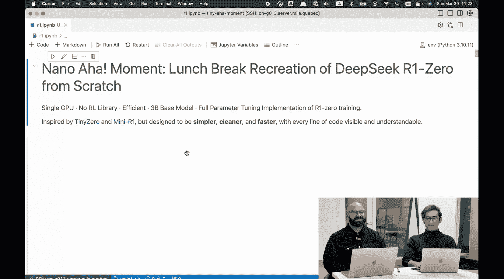

This is Ami Rosain and this is Mil。 We are researchers at Milla。

 and this video is going to be about no no moment， which is a single file， single GPU。

 very efficient recreation of R 10 like training from a scratch So we are not going to use any library。

 any other library and we are going to show you how to implement this inter side in a very efficient manner。

 we are going to use a 3 billion base mode in full parameter tu in a bit single GPU and this entire thing is's going to only take less than 10 hour to finish。

 Why do we need another script for recreating R one。😊，There are already some scripts out there。

 but the problem with most of them is either they are importing their trainer from Tra library。

 for example， so their code is not a single file， they are importing it from other places so the code is not hackable and sometimes even not efficient。

But also the efficient code bases are mostly based on ray， for example， the ver code base。

We think it's more useful maybe for industrial applications。

 but not that useful for academic purposes because it is unnecessarily complicated because the array system handles multiple nodes failure of jobs but when you just have a single GPU none of those problems are going to accurate here。

 but you're going to deal with the complexity of the framework Yes and honestly those libraries they exist for a good reason because as you're going to see the efficient adult training。

 efficient adult experiment is is going to depend on two main efficient training and really fast inference and having this together work seamlessly in their maximum potential it's going to be quite challenging to implement and it's going to require some it's going to require few optimization tricks to create these libraries unfortunately have to be this complex to handle all of these cases。

 however， in this video and in this codebase you are going to show most。

Most of these like most impactful tricks and most of these optimization and the coding ass for adult training in this video。

 you are gonna also learn these different ways。 People try to integrate these two main components of adult training。

 I think this video is going to also be a very good training resource for people who are interested in adult training of Ls。

 So what you're going to do is we take the Q 2。5。 the tri will base model， to pretrain model。

And we train it on the countdown task。Which is， I think， popularized by the time zero code base。

The task is you're given four numbers and you need to perform to provide a mathematical equation that results in a target number and the model needs to try different approaches to solve this problem。

 That's why reasoning suits this problem and you're going to train it with GRPO。

And let's see what we will have and achieve at the end of this video。So as you can see。

 we are going to train the model that at the end of the day its reproduce theha moment or these kind of interesting patterns that kind of emerges during pure auto training on a pretrain based model basically the set reflection set verification backtracking and so on as you can see here but the what let me try something different and it says weight I think I'm getting there So as you can see all of these patterns that you have probably seen in actual album models or any of these resenting models you are going to actually recreate these in kind of a single file not from scratch and on the left we have kind of the average response length which is at this point a famous response length plot that we have seen for this kind of training style and during the first few iterations the model is going to find units generations to follow the format and just get the handle the task and after。

While it's going to use its in thinking budgets or thinking tokens to actually improve its model question solving ability or its reasoning ability。

 And that's why probably we see this this pattern。 and we are going to see what would really happen at the end of the training where we have a very long responses at the end of this video The goal of this video is to go over this code we are going to start with this clean slate it's very clean file and we are going to implement all of this from scratch together and we try really to make sure we include every little detail that we know and that are actually useful for for this video It's gonna be one of those few hours tutorial caracia style and I hope you guys learn something and enjoy this video。

 it's going to be quite long。

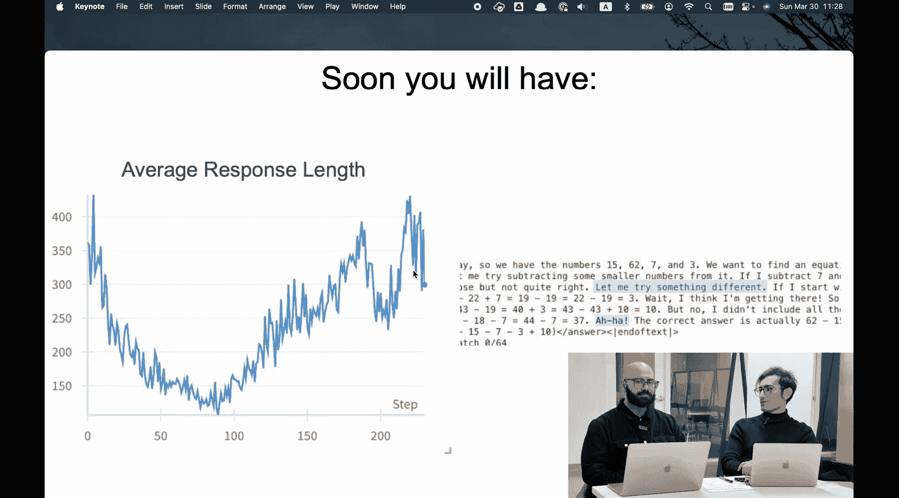

Actually， we are recording this。After recording the whole stuff and we know it's going to be long。

 so we hope it's useful for you， we think it is。Let's start。 Okay。

 so before going into before diving into the implementation details and all of the code for our10 input training。

 I would like to first cover the actual the training recipe just to make sure that everybody watching the video is on the same page。

 okay。

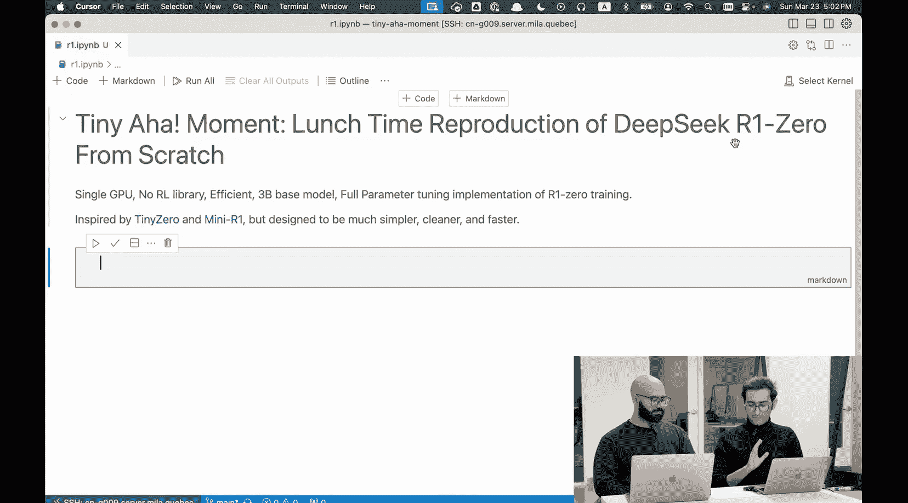

R10 recipe is actually quite simple。 And I think that's what makes it quite scalable and powerful。

 And the zero variant of R1。 Basically it startss from the pretrain model。

 It is right out of the pretraining stage of LMs and you do not apply any instruction and tu no supervised point on this LLM and just use it as is So once you have that。

 you use a thinking prompt and you basically append your problem definition to that think prompt and just fit it to the LLM and you let the LLM generate your reasoning。

 generate this response and as you are going to see you're going to force sale them to first think and then produce the final answer。

Once you have this response and once you extract the final answer。

 you are going to use the verifiable reward to compare or check the correctness of the model' output。

 So what is the correct what is verifi reward， Basically， it checks the output of the model。

 the answer provided by the model towards against some ground truth that you know that is the answer of this question。

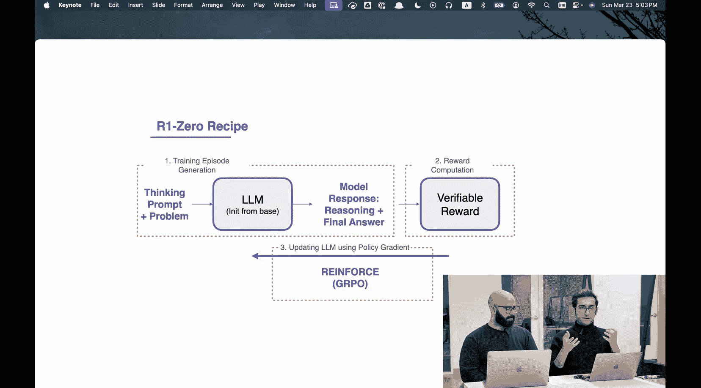

So basically it can create for you a binary bar such as zero1。

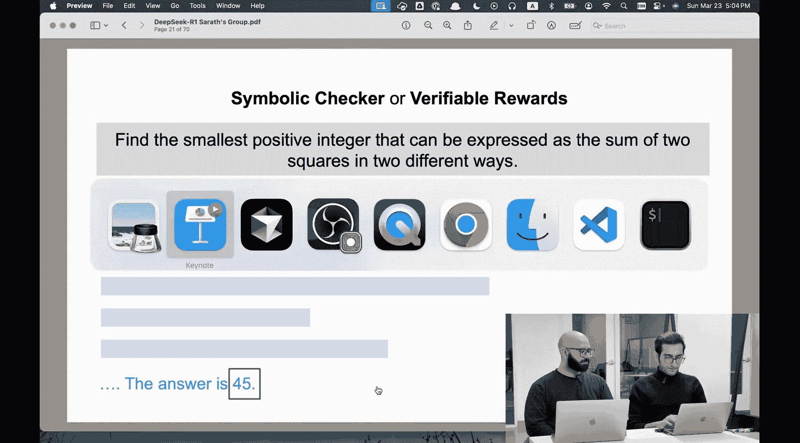

And once you have that， you can use GRPO or in general。

 it is very simple modification on top of reinforce and use that to update your policy and these three that you can see here are three different components of the notebook or the implementation that you're going to see today and these three components once coupled together they're going to constitute or training loop for R10 training and if you want to learn more about what is R1 what is R10 if you want to learn more information about this there is a great video by such a rush and he talks about all the details。

 all the package story， how R10 created， the base model。

 and how of the innovation that is involved in it。

But can I ask， what is the significance of R1， What part of this point flying was unknown before you have the deep6 R 1。

0 paper。 this is youre starting from a base pretrain model and there is no human supervision here。

 And your preing stage is on totally un superupervised and your oral stages also almost unsupervised。

 You're gonna need to know the ground ruless for all of these there' any problems is mathematical problems。

 But in general， you're not going to force any thinking patterns inside the model in the in the model。

 And I think。Letting the model to discover what is the best way to solve these things。

 this type of question by itself is quite exciting。So I guess like previously。

 they needed to induce this human thought process by。Instruction tuning。

 but currently RL picks up the signal from the pre training model。 So yes， after open A01。

 there were many efforts by folks in the research community to reproduce R1。 sorry， O1。

 and many of them involve these kind of inductive biases that were force to the model。 but R 1，0。

 It doesn't require any inductive bias and the training is not get out any human supervision。 I see。

 So the simplest approach actually worked。Yes。

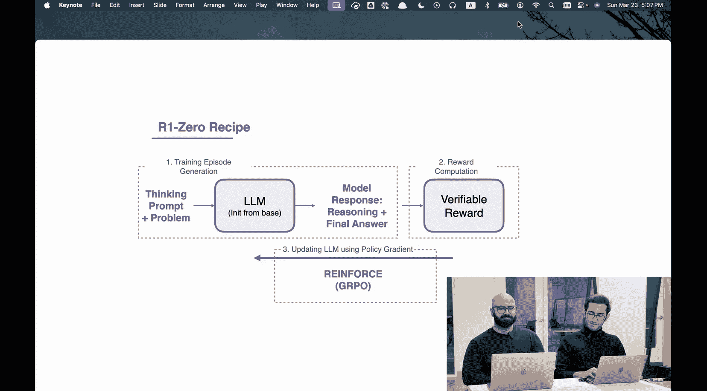

We actually thought before going into the coding implementation。

 it would be better to just show you the final result of this entire video and this entire training and just let us play with it a bit and see how it performs and how it looks like。

Okay， so we have uploaded them while in hugging phase into this depositository。 No moment 3 billion。

 which is based on the  Q 3 billion base。 And we just exactly train it with the same task for the same part。

 And it's checkpoint， right， It is the final checkpoint of one of these this run。

The one that you are going to see。 Okay， let's run this and we hear that can play with demo wall。

 just load the the lamb with the， with this。Let's just play with the model so we have right now an X an easy an example here。

 so we have  one，234 and the target is and to create 10。So the model just has to sum this up。

 So as we can see， the model is just thinking as smoothly and sorry the largest number as all of these together。

 And it is10。 This I mean， it was too easy for too easy for the model。 Okay， heres another example。

 Let's see how the model work。And it says starting with the largest number again。

 I also try another order here。And it seems that it has found。 But the answer， let's just check this。

64 Oh interesting。 Yeah， Oh，' very beautiful。Here's another one。

 and this should be slightly harder thats see how does the model perform， so this is the output。Oh。

 the model just gave up。 Yeah， and that's all。我知。66。 No。

 and this is that this is the model that youre going to create at the end of this tutorial。 But like。

 I want to close this off。 It's pretty interesting example Here。

 we just pass the inputs like the problem formats that the model just saw during training。

 exactly the I AD。But now the question is that what would the model do if you pass a non countdown example to the model like general general question point that is trained Yeah are trained on like content content tests。

Right， because this， as I said， this entire checkpoint that you are seeing right now。

 it was only trained ited from pre train model and was only trained on countant task with the verfi error bar that's just checking the final answer and also the format now the question is how does it perform do you expect actually if you pass a generic prompt？

Honestly， I think like my， my prediction is that it is going to try to mix in the answer to this question with the with the format or the thinking of content task。

 maybe this has seen， right， Yeah， that's my machine learning common sense。 Yes。

 So let's see how it works。😊，So we you you just pass the prompt and say how you show your work inside this tag。

 Yeah， and with the， with this answer tag。And honestly。The answer is interesting。

 Before showing you this， we actually around this example。

 Anna we were surprised to see this that the model kind of says start with initial greeting。

 hellello， how are you， This is a common way to begin a conversation。

 The person is The person asking the question is likely looking for a response or to initiate a conversation。

 The question， How are you is a polite way to inquire about someone's bag being is friendly and casual way to start a conversation。

 So it says， how are you as's a final answer。 And let's try to see。😊。

This is present the greeting into its components。 It's a common way to start the conversation。

 The greeting is a formal way of saying how you already oh。It's beautiful。 It's beautiful that。

The model， I know， its a pretrain model。 and then you train it with R on a completely like an countdown task。

 and it's same how to greet you。I， and okay， I generated it again。 And。

 and this is an interesting response。 We never said that。This is an AI model。 but what having。

Did be upset that you're hopeless so。 but I don't know。 I have function shedding。

 I don't have feelings。 and I I'm functioning normally， interesting functioning normally。

 The answer to hello， how are you。 It's quite as strange that the checkpoint is able to speak。 Yeah。

 in any case， I think this is quite interesting。 And hope you can also recreate this experiment yourself。

😊，Few in the next spot。

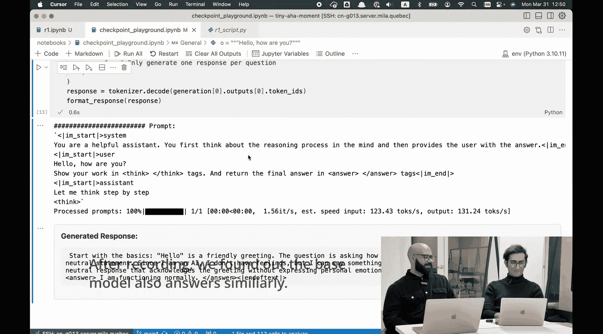

Okay， now let's load this dataset from Huging phase， the dataset for Candown task， and see。

 let's see inspect a couple of examples together。Before doing that I would like to set my hugging face home environment variable just to make sure that all of the downloads and all of the caches from Huging face is not going to blow up my home storage or whatever storage that you're going to use for this implementation。

 let's get it started in PortOS just to set the environment variable and that's an important path。

So now I'm going to define a applicableable variable called the scratch。

 this is going to be my home directory， I have this scratch folder their inside home that is linked to my shared network if anything that is saved here it's not going to make any problem and now let's define this environment variable。

To be something like this。Okay。And now that we have everything set up， let's load the data set。

Doess import the I basis It first data set is equal to a data set from this repository。

This repository is actually created by the author of the tiny zero repository right now you're going to use the train as split of this。

So， yeah， let's look at this。Perfect， we have this right now。And let's inspect one of these examples。

 I think。Al look at the last one，500000。 almost Yes， we have 500000 example questions like this。

 It is really easy to generate。 Yeah， yes。Okay， now we have the we have this， as you can see。

 you have set of input numbers or four numbers here。

 and you have to arrange this using the multiplication。

 addition abstracttraction and division to create this target number and for this case I encourage the viewers to pause the video and try to do this themselves。

But here we don't we are not going to do this manually， and we are going to use diptick。

And let's see if the model can solve this。 I already have this in my clipboard。

 Let's pass this a lipstick。 Why have you not paused Christine。Pos it。Okay。

 I'm not sure how long this is going to take。 if it's going to take more than a couple of seconds。

 we're going to cut the video。 But for now， let's see， I think it solved it。 Yeah。

 as you can see reason increased。 I think it already solved it in this case。

 but as with ourgon models， they're going to verify this verify their answers a lot。

 maybe sometimes too much。 And as you can see， it is running still running。 So。Probably。

 I think it's。I is finding a couple of different answers for this equation for this numbers。

 But I don't know。 Maybe it is searching for the simplest looking one。 maybe。

 but we didn't really specify this anymore problem。 It has found a solution。This is a great solution。

 right？That's verifyで。Yeah， it correct。 It's correct。 is it。Can you read。Yeah， it is correct。

Okay now I want to go back to the R one recipe okay as we can see here。

 we are in the very first part of the implementation and I want to implement and create the training prompt for for adultal training so let's start with this part okay so first of all I want to I'm going to define the prompts the thinking prompt that were going to use so were going to have a system message and a prompt template which I copied before and I'm going to briefly explain this to you。

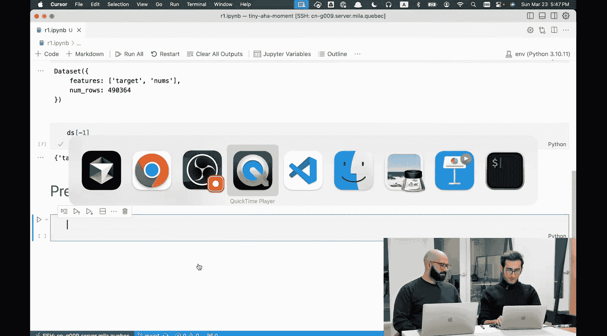

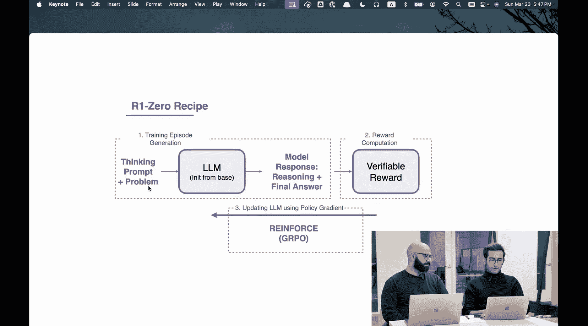

And。This is similar to， I think we we found these problems from mini R10 codebase。

 these are not really particularly special pro， just so it says that you're helpful assistant。

 you first think about the reasoning process in the mind and then provide the user with the answer。

And you also have the template that you're going to use so basically it is the problem definition that I showed you in the previous slide。

 so using the numbers you're going to place the numbers here。

 create an equation that equals the target number you can use basic arithmetic operations and each number can only be used once show your work inside the think tags and return the final equation and answer the answer tags for example here is one example that the model can use and yes。

 so this is the kind of the system the thinking prompt part of the code。

But the model is not trained to follow any instruction。 Yes， exactly。

 the model is not trained to follow any instruction。

 It is a base between model and the notion of system message it doesn't mean anything for it。

 So we are going to use the system message anyway to just make sure our entire pipeline and the final output of our training is compatible of with the other tools and chat template of yes。

 thats require or expect chat template or chat models。 But anyway。

 this is not part of R10 discipline anyway Okay， so we have this。promptmp message from template here。

 And now I want to implement the prepro of the data set。

 I want to create a proper prompt and fitting for feedinging them all of this。 By the way。

 we realized that in the previous thing that we copy pasted here。 there was。

 They told us if you put a mistake in the video， the viewers are going to。

Attend to it like it increases attention。Yes， so we fix this mistake here。 Okay。

 let's get it started。 So first I want to load the tokenizer。😊，Just before。

 let me define the model name。I think this is going to be one。2。53 billion。Yes。

 I think we need to also pass the repository， right， and the chat name of this。It's going to be。

Mo name plus instruct。And also， let's not forget the dash。 Okay， now lets me load the tokenizer。

I this from hugging face。Okay， perfect， yes。

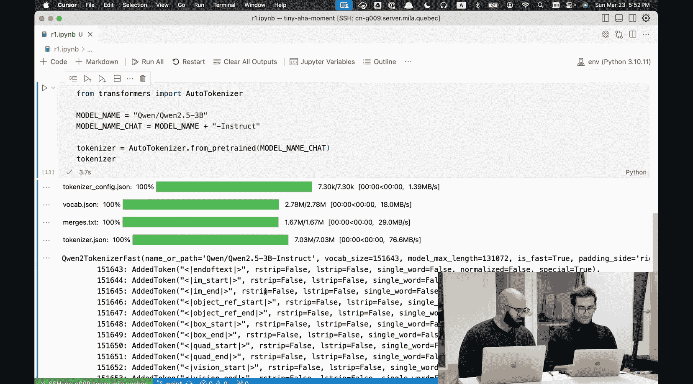

And just I want to mention here， we are loading the chat version of this organizer。

 there is almost no difference between the chat tokenr and the base model organizer， However。

 there is a small difference in the end of sentence token that we are going to fix that problem later。

 but for now because we are going to use this system product and system message and these kind of chat templates。

 we are going to use the。

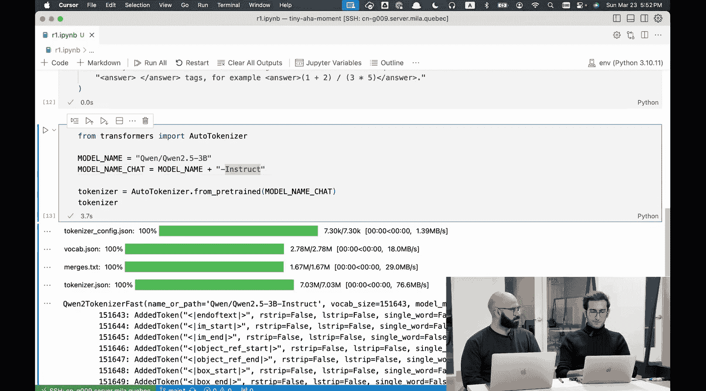

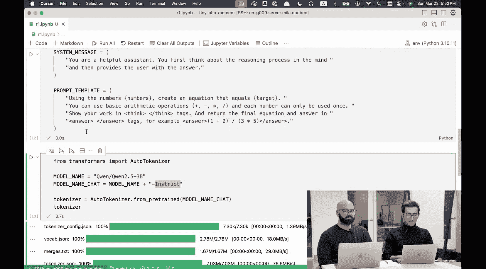

Chat organize of quote。Okay。Now we have this。 Let me rewrite。

 I'm going to use Hoging phase dataset set map to preprocess this dataset set and convert it to the chat format of the map。

 okay。So。This is the function that is going to perform the。Foratting for us。

 So the example is going to be a dictionary from string to any。 let's see if。Yes。

 from typing import import。Nice， okay。 And the output is also the same dictionary。Okay。

And let me extract these fields from the input example。 I think this was Nos。 and target was also。

And target。 Okay， so these are the inputs。 and let me create the chat and the chat message。

And messages。This is going to be a list。 So the first item is going to be the chat。

 the system message。 So we set the role to be system， I think， and the content is going to be。

Equal to system message。 And the next one is going to be the actual prompt for this。

 for the question。So the role is going to be user。And the content， on the other hand。

It's going to be called prompt template that we defined the few cells above。

 We are going to format them and say， I think numbers very equal to norms。Right。And the targets。

The call to what's equal to target。 So just to make sure that we have everything under track and with me check。

Numbers and targets。 So I think you're good。 Just to make sure you're consistent。

 Let's consistent let the。Let me red find this variable。Okay， for some reason。

 this for using parenthesesis， Let me。to packets。 Okay， so this is generally the chat message。

 That is the prompt that you are going to create for normal models。 However。

 since we are starting from a base between model， the model by default does not may not follow these instructions。

 So it might as well continue the question， generate the rest of the question to the question。

 and in order to prevent this or actually maybe help the model to force it or make sure that it start generating an answer or response to a question。

 we are going to purfil the model context with the assistant and let me think it step by step。

 just to make sure the model is going to respond to the prompt， not continue the prompt。 Okay。

 so the role is going to be。I never actually tested whether it's necessary， right。

 we never never tested， so maybe it also works。You know one of the things， but it doesn't hurt。

It doesn't hurt， yeah。One of the many things that one could check。 Yeah。

 you can check it with playing with the code ways。 Okay。

 so the content that I'm going to use is basically let me think step by step。

 I don't think this has really any effect。 But this is going。 this is nice to have this prompt。

 And let's say like back a slash and and start the think tag。 So this is actually what。😊，Aban paper。

Does as well even right now， if you look at the hugging phase implementation。Of R1。

 these think tokens are preed to appended to the kind of pre field to the prompt Do they have R1 implementation。

 they don't have R implementation， they have R1 implementation of their token obviously if you load the tokenizer they realize things at this。

Okay， can I actually show this to you Tony the zero version。

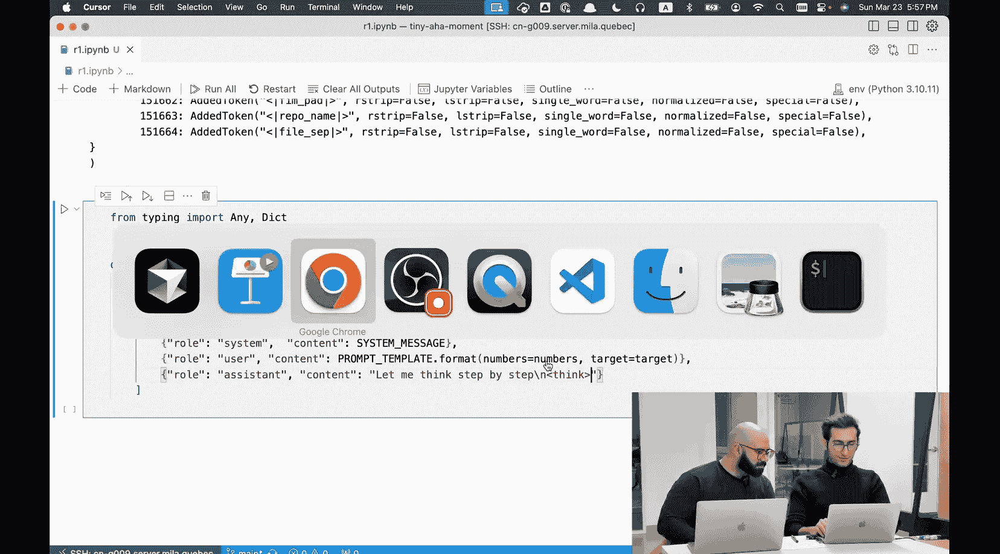

But I think even R1 itself， which is itself of instruct all。 I think they have this， these things。

 So if we go here。A lot more files， See a little more files。So it can either configurefig。

 they can load it here。 and yes， so this is a chat template。 It's not really readable at this point。

 but what I'm going to show you is here。So。Yeah other components， but I think。Yes， as we can see。

 when it wants to just finish the finish the vector prompt， it happens these two things。

 This is something that has been done by the original R1。 And were going to follow that as well。Okay。

 now let's continue。 theres something implementation。

 So next I'm going to to analyze this and also also create the textual prompt so for logging purposes。

And yes， so I'm going to use the tokenizer， by the way。

 if you feel these parts are easy and they don't have anything adjusting for you。

 feel free to skip apart。So we're going to use the tokenrar， apply chat template。

 Were going to pass the chat messages。And also， we need to make sure it is going to recognize it for us。

By the way， it's recognized that it is a global variable since we are notebook is fine and this is educational content。

 use don't follow this pattern。In your actual code basis。 And I think， yes， and since we are。

P you feeling the assistant part of this， we have to enable this flag so that phase is not so that Hu phase does not complain。

 Okay， now we have the input I is the prompt just organize and let me have the textual version of this as well just to make just assert it。

 Maybe we need it sometime in the when want to log the like the examples let's decode this。

Add a special tokens skip ski。Special tokens， I don't want to skip this because I want to see them actually。

And there is also a flag cleanup documentation and spaces well。Oh yes， sorry。

clelean up tokenization space at this flag。 I'm not sure at this point， whether it does something。

 but sometimes the token either change the if we move or add some spaces or a new line。

 So I'm just fine to make sure that I disable that。Yes， so now that we have these things。

 I think you're good be the processor example， you just return them。Input I。A ideas， and。

Prot is also equal as prompt。 Okay， and this is additive process。 that is。

 it's not going to modify the example in place。 This is going to return this and this kind of dictionary。

 new dictionary is going to be used to update the original dictionary。

 So we don't have to pass the target or numbers。 Okay。

 and so now that's we have or function that's used phase map pre processces。An example。

 this is our function。Number of pro number of processes that is's going to use， let's say。

For let's see what's how it's going to happen。 Yes， this is going to take a couple of minutes。

 We're going to cut that for you。 Okay， so now the pro pre processing is done。

 Let's check if the mapping is done correctly。 So this is the first example。 Let's。

Triint out the numbers and the target。Okay。So， let's see if。The。Spont。From here。Okay， perfect。

Everything seems fine， and you have the system message。Without the。

And we also have the numbers here and the actual target， and we have the examples also here， okay。

 perfect。And as you can see， the prompt that kind of force the model to with start generating a response is creep field the input okay。

 we can also for a second check the input I just to I think it's also fun to look at them as well convert I to tokens Okay。

 yes， and these are actually by themselves token everything as fine。

Now I want to start implementing the reward functions or the symbolic C here or the verifiable reward。

 which is the other term that people use in the literature。So for R10。

 we are going to use two reward， particularly to reward functions。

 which is suggested from the R10 paper dipy paper So here we are going to have particularly two reward so I'm showing you an example you have the prompt on the top and then you have the model entire model response on the bottom and so we are going to have two reward so basically the format reward and the math or equation reward and in the format reward the function basically checks whether the response of the model is inside this opening and closing team tag and also the answer comes right after closing of the thing and it is also inside this closing and of the opening and closing of the answer text okay so just basically a simple format that we are going to enforce the model to follow the reason that we need this format is doesn't have anything to do with the。

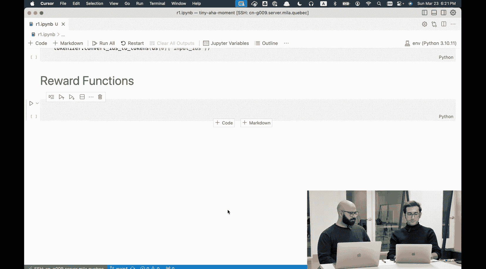

Particular reasoning behaviors， it's just to make our lives easy in a sense that we can easily extract the 45 number。

 the final answer from response and then check it against the you couldn't know where the answer is if the answer was not in the answer type exactly what to just find what part of it is exactly as you saw in the。

The example that I'll show you the。33 number that we use dipy R1 for many equations in there。

 There are many equations and many different approaches。 We need this to make our license。And。

Once you have this reward， we also have another reward here， the equational mass reward。

 which is the thing that I showed you in the beginning of the video。

 it basically checks the final answer which is extracted from these two tags and basically checks it that the grand truths answer。

 which we know for these particular plot， okay。Now let's start implementing the format function first。

 format keyboard function first， and then we go with the battery one。But in our setting。

 you don't have a grant truth， it's just that it should evaluate to the target。

 Like we don't know the actual equation because there are many ways also in this task。

 we don't have a grant rules。 So in a sense， or grant rules is the target number。

 we just checks we just check whether this whatever is inside this evaluate to the target number However。

In proper mathematical dataset sets， you always have a question and then you have the final grantbooks answer。

And that's where ocean comes from。Okay， let's get us started。

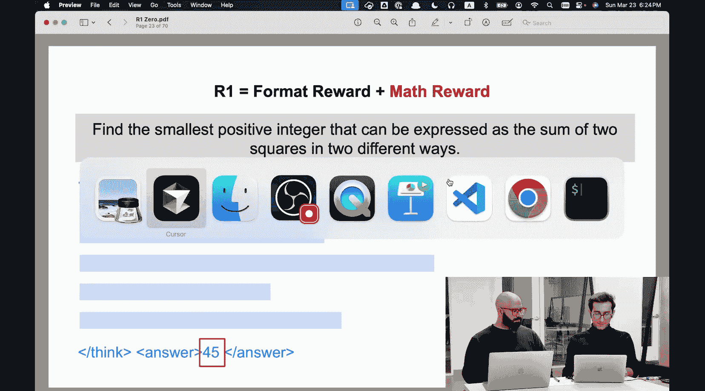

And we are now going to implement this before starting implementing the format world。

 let me define the US token variable here because our format is going to use that and as I said before the us token of the base model and the chat model of when they are different So because we are using the base version we have to make sure that we are reading the end of sentence token from the correct and token and so I'm going to load the。

Or not preterm model to here， youre not even going to make a reference for this and。Oh。

 let me just first extract the IED， and then。Just make sure it is working。Perfect， and。

He was talking itself。Is equal to。That we can either。Cont。I z tokens。K。Okay。

 and just to give you a sense， what is the。Originalizer， the Chaman opizer end of sentenceus to。Yes。

 so as you can see， these are different。 This is for the chat version of the clone。

 And this is for the base version of the coin。 If you're not going to use this。

 you just create a copy of this document here so that we can use it later in the Q piece， okay。

So basically me deal this。Okay， now let me， I want to define the format reward function。

 We are not going to see the entire implementation。

 the process to implement this function together because its it's boilerplate and it's not really interesting yes。

So now we have， I have completed this chunk of code here。 Let me import the。Rejects。And okay。

 first I want to， I will go over the this function I will explain different parts of this and then I think the best way to learn how this work is just go and play with it and just give it some example。

 some output and see where it works and where it doesn't。Okay。

 let's make sure that it doesn't complain perfect。okay， the format de function。

 it receives a completion， the model output just a string and it has to return a single number。

 The reason that we are not receiving the sample that was used to generate this completion that we don't really need this here because we are just checking the format but definitely we don't need to know the sample that was used to generate this。

Okay， we are going to start from here。 The reason that we add the thing to again to the completion is because we already added this to the prompt。

 pre field it。 We are just added here to just make origin X matching convenient。

 But we don't really have to do this and。😊，We make sure if the completion is ended with the end of sentence so we just remove it because as I said。

 the rejectx does not handle the end of sentence and so the reject I'm not going to explain this entire really big reject to you but generally you can think of this as a part that checks the thinkinging tags。

 the think process open with this and close with this there is no other additional think tags inside this and you will see that the model also generate a lot of things tags even inside like the output think tags then it has to be followed by backlash n and then the answer is going to be inside this tags so the rejectx is defined as this we can pass it to activity to see actually what are the exact part of this and how this works but we are not going to focus on this for now and we search for this reject here in the completion if there is a match if there is no match we know that the format is projects。

And just pretend0。 And if there is a match， we extract the content inside the answer。

 And here we just want to check whether the stuff inside the answer。

 it follows the format because sometimes the model actually puts the full equation numbers with the addition multiplication together。

 and it also says equal to the target。 So we don't want that inside the。Answer tax。 Yeah。

 or it might use like other operations other than addition subtraction。

 Maybe use factor wheels or something。 wantan to discourage that right。 Yes。

 that has that format is not allowed。Yes， so if it's using some other character inside the tag。

 it receives a reward of 0。5。 But if everything is correct， like is using。Only the allowed pattern。

 the allowed characters， we are good， it receives a zero re of1。

 and if any error happens during this entire process， it is going to receive a reward of0。

I think in the original one， the reward 0。5 was also 0， but we found if you add， it becomes smoother。

Yes。So you wanna give with something if it actually like is just， like。

 is is just conforming to the think and answer tag format。

 but also another reward for getting the format inside the answer tag correct to make it more a little bit more granular。

 Okay， and now we have to this。 Let's go and make a few exam。 Let's run this together。 So。

As you can see， it is returning 0。 Why is this the case， We are seeing a starting think tag。

 It should not be the case because the think tag， as we said， is already preing the prompt。

 So removing that fix issue and fix the problem is going。 Okay， and as you see here， the。

 the all of the。Operations and all of the like digits， they all follow the allow pattern。

 But let me check with some， like other。Characers here。 And as you can see。

 we have followed the opening and closing of these tags。

 But the stuff inside the answer is not correct。 It does not allow。

 It does not follow the allowed patterns。 So its going to receive of 0。5。

 But removing that obviously fixes。 Can you have the team tag in。Inside yes， so let's。

Have some tag here， and。Something here。So as you can see。

 the reject checks for kind of missed tags and it doesn't allow you but if you write something after the answer tag。

 that's me。Do you think。It is I think it is going to complain because the rex is going to force it to office its and the answer type。

 but we can just check it here。你自よ。Okay nice。All right。

 now we know how the format function works and let's go and implement the equation or matrix right now we want to check with the target。

Okay， now the timing is for the for the equation reward or the math reward again copy paste a chunk of code that implements this。

 So it is the equation reward function it receives the completion similar to format function and in addition to completion it also receives the numbers。

 list of numbers in the which is inside the sample that was used to generate this example and also the target number just allows us to check the mouse output the equation Okay now let's see how it works again。

 we are adding the think tag here and just the completion。

 although I think here is not that necessary to add this here because we don't check it right Yeah we don't check this So yeah in your version we can remove this。

Or maybe we can remove this in the yeah， maybe in the production version of the quote anyway。

 and since the reason that we don't check for the and the reject that we showed you before is that it is already checking the format entry board so。

😊，We just extract an answer part of this。 And obviously， there is no answer。

Partly inside the completion， the reward is0 and once it is extracted。

 we just extract all of the numbers inside this equation again with reject and the reason we do this we just check the only ones equation at the condition of the format it should add once and only once and only once right so。

Once we extracted use number inside the equation， we can just check whether by these own repeated bonds。

 and it is the same as the input numbers。Okay， and once we have this。

 we again here check for the allowed pattern inside this equation。

 I don't think it is still necessary because we have done this in the format you want right yeah。

 not actually the format you words will be zero if it's not respected or also the equation reward should be zero。

Take question about okay。So now we have that and we make sure we only have like abstracttraction。

 multiplication， everything we can just use Python eval function to come to just run this equation。

 which is dangerous which is dangerous probably you shouldn't be doing this but with all the redxes that we implemented and also passing this kind of builts functions as none。

 we should be safe enough for this unless as someone provides you with a malicious model or something yes and。

Yeah， so once we have the result of this equation， we just checks it that the。Targets。

 and if it is like the different days of difference between them， you just return one。

 otherwise you0。Da let's run this， no complaints， okay。Now。

 let us check how let us put some examples inside this function and see how it works。Okay。

 this is the example that I'm going to use， so。The inputs the input numbers are one and 2。

 In general， these cities comes with at least three numbers like explore numbers。

 But this is just for just showcasecaing this。 So we have one and 2 and the target is to produce 3。

 And so， yes， we have this thing here。 and the model is outputting5。

So the equation is obviously equal to a0。 If we remove this。

 it is going to be three and it doesn't matter whether it is two or not。

 it can be like three ones still0，0。诶有。And the reason for that is basically because of the only ones。

One onでます， right。Yeah， but else。 let us's also check these dangerous。 Yeah comments。 I， no。

 this comment is not going to work， obviously， because it does not follow the allowed pattern。

 And also， even if， for whatever reason that the pass， we have the builtium functions to be none。

 So these functions are not available。 mean， apparently。

 I read that you can access it in some two standard。 So it's not like it complete safe card。 but yes。

 it's not a sandbox it is not a sandbox execution for us， it's fine for this educational example。

 but obviously， this is not a safe things。Is there anything else that we want to showcase。

 I wondered what happens if you just provide two ones can like， yeah。

 two ones and also like the inputs to two ones。系。The provided numbers are one and one。

And you need to create three3， No2。 How can you create。Yeah， this is correct。

 repeated numbers If the input the inputs contain repeated numbers。

 but this is not going to be a case in the data set。 Okay。

 I don't think that we have repeated numbers inside the data。So just someone to。

Wever it back to the original line。Yes， to us it is the task and the reward。

 So we have these two functions， format reward and the equation reward。

 So we are going to implement a function that just basically uses to create one single floating point or scalar for every completion。

 So like you have a single reward， a single reward function。So， computer art。Completion。

 which is a string and also the sample。output output is floated。 Okay， so the norms， as always。

 is sample。Nooms and target is equal to sample。Target， okay， formats reward。

Is equal to format function， do you just need to pass the completion。And equation reward。

Is equal to equation word。Punction， we need to pass the completion。And you have to pass the norms。

And the target。Okay， so the output is going to be。Format。Pluss equation report。Okay。

So this is a nice handy functions that combines these two。

 we are just going to use this function from now on the computer report of and you test it on the。

Which is， yes。 So let's have this。And I'm going to use this one here。I just need to create the。

Sample for this。Roms equal to 1 and 2。Target。Equal to 3。Let's just run this。 So we to everybody too。

 because the equation match and also the。 So if I add think that here。

If what is going to be one because the equation matches what the format doesn't。 The format doesn't。

 What is inside dance or is actually correct， What the format is incorrect， yes。Okay。Hey。

 we are back。 You might realize that or set up an or close slide exchange。

 And the reason for that is basically we have lost of footage that we captured for the rest of this video。

 So we are already recording because we press the record button and everything。

 and the application was working。 but it just recorded the blank screen。 Yes。

 every time that's our fault。 we didn't write to own a screen recording application。😊。

And that's why we need to recruit it again。So we are starting from the episode generation part and in the beginning of this video I would like to give credit to the authors of these reward functions。

 we took these reward functions from the minir repository so make sure check them out this was really create a starting point for us so now that we are at the episode generation part let me go back to the keynote presentation and so previously we completed the reward computation and now we are going to go back to the episode generation previously we did the thinking pro and all pro formation and we discussed it in depth and now we are going to take samples from the LLM and basically try to compute the GRPO advantages use the reward functions that we implemented before and basically create we create the entire generation pipeline for the GRPO algorithm。

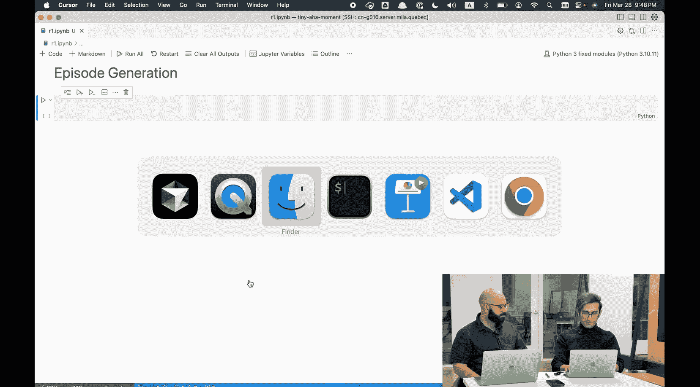

Okay。And let's get a started。

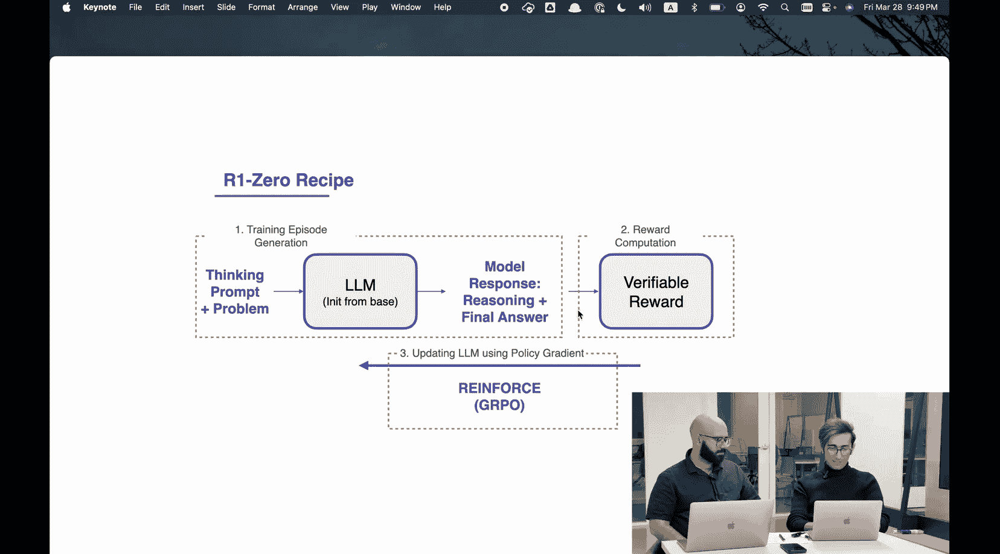

Going back to the notebook before starting let me， I want to discuss how in this code base we are going to take samples or generate far more error。

And generally， if you are familiar with hugging face， then you have a。

Casal model for causal and for language。 hugging face models for causal language regeneration。

 you basically have a dot generation method。 And it's basically you use this and you video prompted input ideas。

 and we generates the output for you。 However， this method is not particularly fast。

 And in order for us to， because we are generating lots of episodes and in the entire during duration of or training。

 we need something really fast。 And there are multiple alternatives in the。

Open source community And for this project， we are going to use BLL。

 BLLM is an inference engine and it takes your LLM， which is out of the show。

 and you you import this VLM into this inference engine and you just take the samples from the V And this is done very efficiently it manages the memory very well。

 has very high throughput and basically everything we need for this project Other than BLLM we have other projects such as Sang and Tgi and I think to this moment Sang。

 it has a bit higher throughput from the benchmark that I remember these frameworks they always changing at some point one of them is going to be better than the other at the right time that you wrote thisang gave us some stability So some coulda legal access error。

That's why， like in the middle of training after one hour。 So that's why we chose V。 Yes， and the。

 the API is it all is' almost the same。 so we can just。Exactly。

 as I'm gonna explain in the next part， and you're gonna see that working with this。

 even it is very similar to hugging past that generates all of these they are going to be very similar to each other and hopefully they should be really easy to swap but that's not what that's going to be the future versions of this code base if someone wants to do。

Yes， it's very good。Yeah， actually， me as said B started with S G9 and S G9 is， I think。

 about 30 to 50% faster than VLM at this indoor setup。 But as me said， it's VLM is much more stable。

 We didn't encounter any out of memory or kuda random kuda for the purpose of this talk。

 and the purpose of this project， were going to CB TL。 Okay， so。😊。

Let's just start importing it but the very first thing to do。

We have two primary classes that we are going to deal with the first one is LLM and this is the starting point if you are going to use BLM as a library。

 BLM also has a common line interface if you are going to use it in terminal that's someone you're going to use but right now since we are using in your Python code that's the class and also we have sampling parameters。

 I'm going to discuss this a bit later but basically this controls the common parameters for sampling like max tokens and like top P top K the temperature and so on okay so now that we have the LLM class imported from the BLM librarys I want to first initialize BLLM and just play with it a bit and see just explain the entire API and how it works but it is going to output in your response given your response given your prompt。

Okay， so let's get asserted。 So we are going to have the class。嗯。Okay。

 this because it's going to take a couple of parameters I'm going to explain the most common ones and so the first one that you are gonna to pass is basically the model name so here you can actually input the path to your hugging face model as well So by there you have it in your hugging face repository or you can actually have it in your local call file system So business string can be anything really。

And the rest would be the。GPU utilization memory， GPpU memory utilization， I think this is。

Before like this is one of the stuff that you're gonna control if you want to manage your memory。

 So for this project， since we are going to use single GPU and youre going to keep the model of the reference and the optimizers。

 everything in the in a single GPU， we are going to only use 0。2 for VLLM。

 And given that we have 1880 g GPU 100800 large， this is going to be about 16 gigytes I think。

But it is just for the KV cashio， or is it also for the model。That's a good question。 Yeah， I think。

Majority of the memory utilization for VLM is just for the KVc because our language model is a 3 billion mall and if you imagine we have the B flow version visual is the one that you're going to use right now。

 it's going to be about 6 gigytes。26 or 7 gigs， I guess， given that we have 16。

 the rest would be just hopefully the Ks。 After initialise。

 we check whether the consumption is 16 GBs or 22。That's renewal， let's see。Okay。

 so the next parameters is basically the data type， the mobile data type， generally， it's。

B follow 16 because we have 800 GPs and these LMs， they support S our these GPPUs support B follows 16。

 So better to use them。Okay， next one question I always have is the model is in before 16 itself。

 right， Yes， so if you indicate here， flow 30 to what happens， I think。

Maybe the LLM is being to broadcast。So the next parameters。

 you may recognize that I'm reading from notes I these are little width of parameters。

 so I cannot really remember all of this So the next one isva a space and you're going to use very small one。

 so it's just 2Gb。😊，And so what is the purpose of this cyber space。 So during their generation。One。

 one benefits of using this infr engine is that they use the memory really efficiently。

They are designed such that they are never going to be out of memory。

 They are never going to issue out of memory errors， almost even if。

There are no memory available in the， in the KB cache in the entire KB cache allocated for BLLM。

 It is going to evict some of the。Allly generated responses and either it just totally removed them and regenerate them again。

 or for this case， it's going to move them to CPU like all of the KB cache compute for the responses that we are not generating in right now。

 they are just inside the Kv cache if you are going to continue it。So basically。

 it is going to move the move those KV cache that are already compute to CPU。

 and it's going to hold it there。 Comp the， the generations for the current sequence that is running。

 And then once it's done。 And if we going to get the。

Get that already generated sequence scheduled again。

 This is going to take those from the CPU memory and put it on the GP again。 Okay， but for us。

 because we have brandy's code before， we know that all of the。

 even that we have a limited number of maximum number of sequence， maximum sequence length。

 we are not going to encounter any out of memory issue。 And so even if we assign small rapid space。

 we cannot I think。I'm not sure about the passing zero。Work。

 maybe it can complain because it needs at least something。So， yeah。

 we are going to use a very small amount of CPU memory because it's probably never going to happen that we are going to move us from GPU to CPU and then move it back again。

 So this is the swap space one。 And there is another parameter enable prefix caching and。😊。

And we are going to say it to true。 So what is prefix caching。 So as you see， then you， for instance。

 pass， let's say， imagine， let's imagine that you have a chat conversation with an LM。

 So the first1 is yours， obviously， the LLM answers and it is your turn and so on。

 right So during all of these generations that the Vietnam is performing。 the LM is performing。

 It is producing KV catch， obviously right， And。😊，After the first turn of the assistant。

 it is returned back to you as a user right， and now it is your turn to answer this ask the second question。

 I ask a follow up question， right？Then once you ask this。

 the is not going to recompute all of these history of your conversation again。

 So it is going to use it from the cache that it already holds for the entire conversation。

 and it's going to only continue generating from the new part of the data。 and since this。

 we are going to use， we are going to generate multiple responses per each question。

 It's going to it's going to be beneficial for us to keep these option true。

 And basically it enable us to save memory and also have higher performance because you are not going to recompute everything from scratch again for each new responses that they share the same prompt or same query。

 Okay， and the last part is max model length。 if I'm not mistaken。😊，So basically。

 it says the maximum context size that we is going to as you for this model since all of four generations is going to be below max the maximum number of tokens that you are going to generate for any prompts is going to be around 1024 tokens。

 We can just pass a simple number of 2048。 And this is going to be more than enough。

 considering that you are going to have some tokens for the prompt。 And yeah。

 you are going to be fine bit number。 Okay， so let's run this。 Oh， okay now。Maybe Max Lynn， yes。

 probably。Maxal lamb。Yep， okay。So now it's going to load this model inside from hugging phase。

 So this is the qui2 2。53 billion base you you're not going to see the base here。

 but since it's not an in version， it's a base version。

As we can see it is using the fresh attention backend because we have it already insult。

 it automatically switches to that backend， if you don't have it。

 I think it switches back to trione backend if I'm not mistaken。

It's going to take a few seconds to finish。 and now， yeah， we are done， okay。So。

The inference engine is now loaded and ready to be used inside the memory。 Okay， how do we use this。

 It's actually very similar to how you approach using hoging phase generate。

 So we have another similar generate method and。You can generally pass your prompt as the first input argument to this method。

 And then you can pass your sampling in prompts。 So for now。

 let's just pass very like simplistic prompts to this。 So just remember， this is a pretrain model。

 So it doesn't have any chat format。 It doesn't know how to follow instruction。

 and and it what is going to happen and just want to pass hell a word。

 And let's see what happens So of。Output inside this variable and see， okay。 So yeah， as you see。

 it's already generated。 Let's see what it returned to。

So we have the this is a list of re output objects so re output object this is kind of a class that we able to construct and it's wants to return the output to you since we have only the single prompt。

 the output is going to be the first item inside this list you have this class， as I said。

 so this class， if you want to use the if you want to see the output of this， the actual output。

 there is this field。Thirdt output， you're going to use that。Okay。

 and so we have also another list of completion outputs。

 The reason that it is a list here is because VM supports sampling multiple random responses from each prompt right now。

 since we have this didn't say you need to sample more than one。

 It is giving us a list that only has a single item。 Okay， so we're gonna。😊，Also， get the single。

 the first item and to get the actual textual content， this is the text。Okay。

 so this is the textbook， Okay， so it says it was the first post on this plug I made and I will use it。

As it's very small。 It's very small。 And the reason for that is because we did not。

Pass the max token Max token power。 Oh， the default is small。 So。

 and now I'm going to change this Max new tokens。 the amount of tokens that the V is going to generate for us。

 As I said， there is a sampling parameters。 and the way we are going to change this is by passinging an instance of sampling parameters class。

 okay。The parameters that controls the length of generation is Mike token。

 and for now let's generate 200 tokens。So as you see， oh， it is actually fast enough。Hello。

 So using Gi。 This is a hello across platform。Yeah hell。This is a local platform using gi。Okay。

 interesting， okay， yeah。Okay， so now that we have this， we know how it works。

 I'm going to pass an example for a more data set to see what it returns。

 and perhaps we can see what is inside the。😊，Initial distribution of this model at the future earn point。

ok。Can you also ask how the model feels。系 how are you。哦，OK。I don't understand this。Thank you。Anyway。

 okay， let's， I think we have defined the dataset variable。

 It is a hugging phase dataset and the above cells。 So as you can see， we have these fields。

 It is called inside this data set。 let's take the first example and I'm just gonna print the prompt here。

 just to see what example we are dealing with。 and yes， as we can see。

 we have these three numbers and we have to create an equation that equals 98。

 We have to use these kind of four operations。 and we have to follow the format and so on。

 so remember this from the part that we define the the class。 Okay， the data。 Okay。

 so now I'm going to use this again。 and。As you saw。

 here is the place that you pass your input through via。And。

As you can see here it supports textual content， but in this project we are going to pass the input ID directly and you can use both of these options honestly。

 there is not so much difference performance by the tokenizations for these really short number short instances is not going to take that long。

 however， I think passing the input I， the prompt token IDs directly。

 it' just really beneficial for us in a sense that we can be really sure that the tokenization inside yellowLM is not going to add or remove any special tokens or something unexpected that we have not predicted。

Because at this point when we are dealing with VLM。

 it's kind of a black black box engine and some of these behaviors。

 these edge cases might not be well documented。 so it's just， I don't think even we can pass。

 for example， turn off the a visual tools insight that well。Yes， I'm not sure how we should do this。

 Maybe there is an option。 It's just better to keep like passing good ideas， right。 Yeah。

 you're sure that。So there is this instead of just passing this as like a positional argument。

 there is this prompt token ID and it takes you a list of lists and each item of this list is going to be your token ID so we have the input I which is the token I of prompts for this example and they're going to use So you see here that there is this line through this generate method and the isn't that you are seeing here is that I think the latest version of theLM deprecated this prompt token ID parameter I think they change it to something else。

 I don't remember it right now for now we can use this but maybe in future when you are watching this is not going to be available but you can basically find the new input argument for this method and but anyway I don't think it's going to change they are not going to change the behavior for sure they support input I they are going。

InAt least from the in the library format， if it was me， I would。Stop the support for the exchange。

That's one option。Okay， and yeah， it's generating。 Let me increase this to 1024 tokens just to make sure that we have enough a space for the all to generate this。

 as you can see here， actually， this is not a bad outputs to be honest because it is totally related to actually the target of 98 using numbers。

 as you can see is， then what it is repeating the numbers perfectly。

 It is not a like it's totally random output it makes close to solving your problem。

 finally multiply the values。 Let's sample a couple more time。 Sometimes you see funny outputs。

 Let's see we have the like us。😊，Where do you think Okay， oh。

 you already have a think so can have any but it's not in the format that you want。 but yes。

 and as oh， you shouldn't let generate。 Yeah， as you can see。

 you all already seeing the language switching phenomena that deepse paper reported right now。

 it seems to be Chinese characters。 I'm not sure。 maybe and and it is not all Chinese。

 you we have encountered like Arabic Persian characters。

 Persian alphabet like really anything could happen。 I think even here。

 I'm not sure about language this is， but yeah， I don't know。Anyway。

 so you see how the VLm works and the second option。

 I want to just finish this section with going over all of the samples of all of the arguments in the sampling in prompts to see how we can control this I think the next parameter that we are going to definitely using this project is basically n so what is n it controls how many random independent generation Vm is going to create for each prompt that youre passing so if you set n equal to two you're going to receive two generations for this prompt and if you have another prompt basically you're going to see another two for them as well So output puts one right Yes yes exactly the first item that youre assigning here it is basically the list of the samples that theF but the second in the index that we are passing is basically。

We sorting through the generation， the generations we get from for that particular， exactly。So。

 let's see。We have this one and。This is the first。The second one should be this one。 Yes' that。 Its。

 oh， this answer is following our format， just the format。 The format almost because the brackets。

 I don't think we support。 Oh no， Yeah， that's true。 We don't support bracket。 But I mean。

 it follows the thing really good， actually， in that Oh， funny。 very。

 So having very good treatment base models really help。Yeah， exactly。 So you can't change it。

 I wonder what Lama would do here。 Lama 3， like Lama 2 even Lama 3， like 3。1。

 at least And those are interesting cases。 don't exploit it。 You cant try read this like。 Yeah。

 that's a very good This is starting point。 Yeah， in this like textbooks。

 There are like parts or questions Yeah that。 That's what is left to the reader。 Yeah。

 this one is left for you。😊，Let sample 10， just to。See a bunch more example。

 talking per second would be the throughput。 The throughput is about 500 talking per second。 However。

 remember that this is a small batch，10 samples that support much larger batch。 Yes。

 if you increase the batch size， effective batch size of VLLM。

 you're going to see much higher numbers。Second bond。 Third bond。That was。

 Let me think about the equation again。 Oh， already， you're seeing some。Interesting。

 you're already seeing some verification or。Yes， something。 So it。

 we see it in the samples of the printing mode。 Yeah， so any case， now we have。

 we know basically how the balloon works and we know how to control it。 And oh。

 before finishing this， let me just go and check over the like the last parameters。 So temperature。

 basically for us， I think it is11。1。0。 But you can obviously changes to anything you want。

 if you set it to 0。 It is going to be greed sampling。😊。

Does we let them have truequi sampling like sampling again is。 I think for this example。

 you're going to。Weund this。 And I think you're going to see exactly the same output， However。

 because VLM is doing dynamic and batching and there are examples coming from the scheduler to the inside of the GPO like the entire computation in the dynamic way。

 There is a possibility that for each of these dynamic by sizes。

 the underlying kuda or the underlying tor implementation。

 they're going to use different kernels Kuda kernels。 And these different kta kernels。

 they are not necessarily going to give you themin same answer。

 So you might see slight like body even sample with temperature 0。

 It all depends on your batch size or exactly like is going you can sample with 0。2。

 but probably is going to generate more garbage。 so as you can see。We have other parameters。

 top K and top P。 So I think the default value for top p is1 and default value for top K is -1。

 And for this project， these two are going to be disabled。

 We are not going to use top P or top K sample。In the next part we are going to implement the actual episode generation part。

 I would like to again go over the at this slide and just explain what does an episode really mean and so the policy gradientian algorithm work is through sampling generations from your model and using the reward to compute basically the words of every generation and using these entire episode to compute the gradient of gradient of policy with respect to gradient of the reward with respect to its parameters。

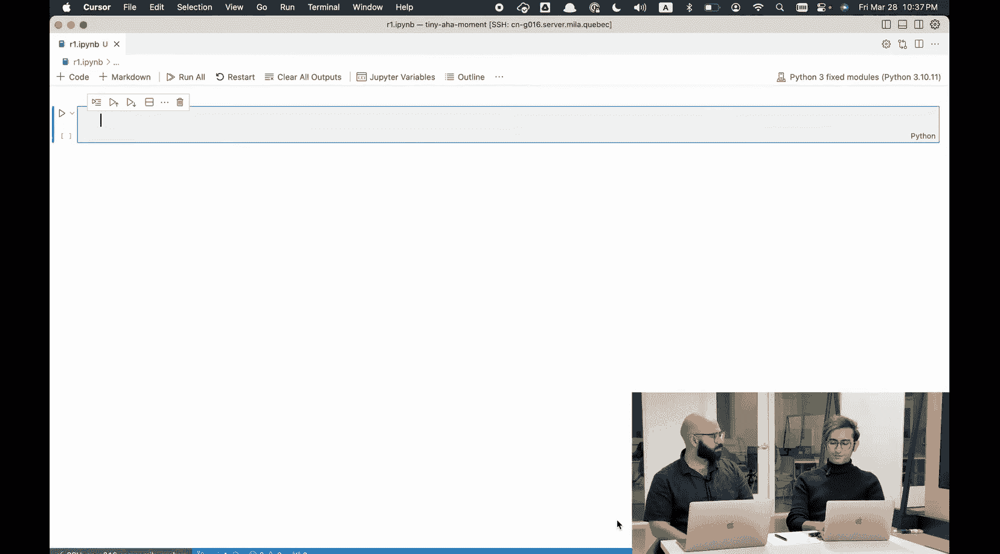

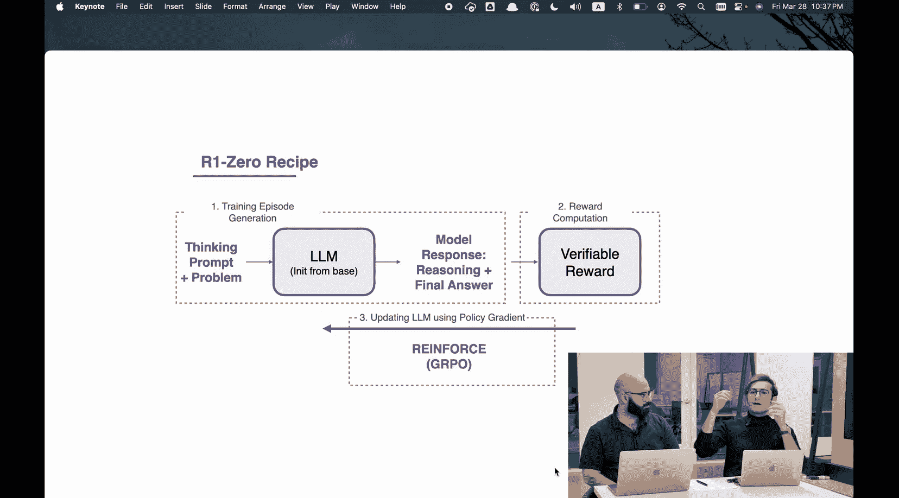

And this is happening inside the loop so you again you're going to sample again， compute the reward。

 use that to compute the gradient， estimate estimate of the gradient and again okay so an episode basically this is a set of query the responses from the model and the advantages okay intuitively a policy gradient algorithm it's going to increase the probability of high reward responses and it's going to decrease the probability of low reward responses right and this high or low reward they' are going to be controlled by a variable called advantage and a concept called advantage。

And GRPO is going to have its way of computing its advantage， but in general。

 this advantage controls how much a response is going to be preferred or disprefer under the model distribution。

And we are going to explain all of this in a more detail in the policy gradient section， but for now。

 just have this about what advantage really mean and what an episode is exactly I want to show you plots of this entire episode generation components。

 So as you can see here we have the prompts So we have two prompts here and for each prompt we are generating for completion。

 So at the end we are going to have eight episodes。And once each completion is computed。

 we use the rewards， reward function that we defined before。 we compute the reward as well。

 and with this reward， we compute their advantages。 Okay。

 so what is an advantage here in GRPO advantage you can think of this advantage as essentially normalized reward。

 and this normalization is happening among the responses to a single query。 Okay。

 so that's the reason that you're seeing R minus mean divided by the deviation。

 So it's renormalizing these rewards to compute the advantages。 However。

 you should remember that these advantages， they are computed for entire for each responses， right。

 they are not computed for each token。 This is computed only for each responses。

 GRPO in general doesn't have any fine character assignment and。

Once these per response advantages are compute， they are going to be repeated for every token Okay so all of the tokens inside this response are going to be treated equally if we happen to know that this response is a high advantage response you' are going to increase the like problem。

 all of its tokens at the same time Okay the output of the episode generation component in this code base is going to be the query token ids。

 the response token id for all of this and the advantages。

 So as you can see the length So these advantages they match the length of the generations。

 the length of the responses for each of these okay。

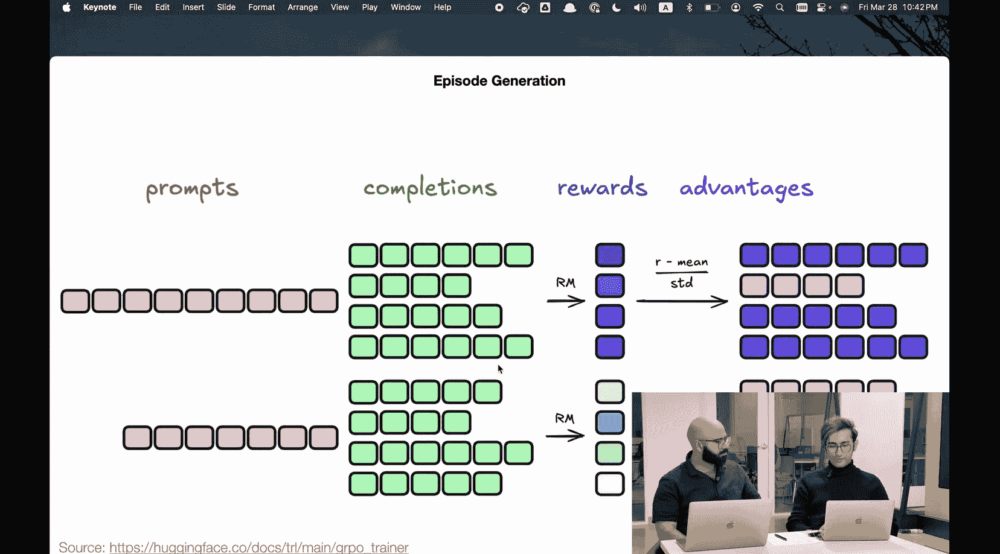

Now this back to get back to the code。 I want to first implement this all for a single example and just complete everything。

 And then we are going to introduce nicely implementeded function， Okay， so。

I'm going to define single sample here and I'm going to use a very basic example that we have in the cells above。

 if I remember correctly， it was one and two as the input numbers and we had the target of three。

And so this was sort the input of this example， Lets me。Just。To canize this。

 so we had this pre process。Yeah， function that we gave these as input。Let's see the output of this。

 Okay， perfect。 So we have the token ideass and the prompts and everything。 Okay。

 so just to show you what does this prompt look like。 I'm sure that you all notice。

 but this doesn't hurt。Okay， so this is the prompt。 This is the input。 and we have the target update。

Okay。Next I'm going to paste a couple of synthetic completions and we are going to instead of using V the N40s。

 I'm going to just use those completions because for now it is a simplistic example just to see how this entire episode generation these are the completions that I just paste so as you can see these completions are in tokenite they are not like in the string for。

And the reason for this is that the VLLM is going to return these token ID。

 not the entire like textual。 It's not going to dig tokenize this for us。 Okay。

 I have pasted four generations for these four synthetic generations。

 obviously for these sample data like data instance and these token ID they correspond to these generations okay。

And I would like to go over all of these completions just to see how do they look like and what are the reward。

 Okay， the first one， as you can see， it's。😊，Good looking instance， like completion。

 because we are closing the think tag and we have everything inside the answer tags as well。

 And also stuff inside the answer is correct。 Okay， and the second one。

 it does not get the format reward because there is an opening think tag inside the thinking part。

 So the reward the the reward for format is going to be0 for this。 However， as you can see。

 the answer part is correct。 So it is going to receive a reward for the equation。 and the second one。

 obviously， we can see that this is not correct。 So it's not going to receive a reward for this。

 but the format function seems good。😊，Yeah， can you write the reward that you expect？For this。 Yeah。

 So this is one plus one。 The first one is for the format。 The second is for the equation。

 The for the second one， we are going to receive the bought0，4 format。

 I bought up one for the equation。 This one， the format is fine。 However， the answer is incorrect。

 and for this one， it's。Both the format is incorrect because it does not close the thinking tag and also the answer is incorrect as well。

 So now that we know how this completion looks like and these are the corresponding to I。

And obviously once you have received this from VLM。

 we have to convert them to a textual format okay so I'm going to define a variable code responses and I'm going to use the tokenizer there is this batch decocoded function that receives the list of token ids for all of this and it's going to generate the outputlet for us However I want to specify some of the flags for decode。

 Basically I want to set this special tokens to false because sometimes it does have this option to remove the special tokens for you。

 I don't want to deal with that I don't want the tokenizer do any kind of processing for us besides converting token ids to the string form and also there is a cleanup tokenization spaces that I would like to set it to false as well sometimes there are some weird phenomena happening with this tokens that after tokenization detokenization is done if try to do。

Removal of some spaces。 However， I remember this was the case in the older limbs， like， for instance。

 in T5 and so on。 I'm not sure whether this is the case withquin models。

 but let's just keep it for now。 and okay， so let's look at the responses。 Yes， as we can see。

 they all match the ones that we have here。 one particular point is that we have not included end of tokens in this in this textual comment that I have written here。

 but in their actual completion2ken8s， you have seen you can see that there is a end of sentence2ken80 Okay and the reason that we have included here is that Vm is going to include this for you in the output Okay。

 since we have the textual form， we can easily go and compute the reward for all of these responses。

 So I'm going see they match for expectation， yes。And so we have the compute reward function。

 it receives the completion， let's define a response variable for this particular item。

 and it also received the sample， okay。Oh。So is the half then， Who is the half thats。Good question。

 Maybe it's checking。 Let me copy this。And。Move it here。 maybe just a compute format。 Yeah。

 let's see。 And so we have format function reward function。 And let's past this。Oops。

 can you remove the thing tag and see what happens， Is it going to jump to one or。Let's see。

I think if you， if this， if the reject is not going to be managed。Then it is always going to be zero。

 But I think if you remove that thing。Like this wonderful the first one， yes。

 the first one is going to be。No， interesting。Yeah， so we only give the half if the。

 if there is something inside this broken， maybe。Wait， can you get。What is it。Okay。

 in this condition， it becomes half what。If the airport is broken， it gives this as you。 Yeah。

 any case， you can fix it yourself。 It's not broken。 It's just， yeah。

 this is how it is defined for now， okay。Let's continue with episode generation。

 So imagine that these are reward functions that are defined。

 You can add yourself like another reward functions or anything。 So the episode generation part。

 it does not really assume anything about the reward。

 So it assumes that you just pass the completion。 It just receives a floating point a single scalealar number for each of these responses。

 Okay， so now that you have this， I'm gonna convert this to non point arrays。

 just it is much more easier to。For areas， in this case。Okay。

So now it's time to compute the advantages and let me go back to the slides that we had and see how these advantages are computed。

 So as I said， we are going to renormalize these your barss and these renormalization as I said。

 it's happening inside this group of responses for prompts and that's where the name actually come from GRPO。

 the group thing is from the group of responses with single  queryries。

Yeah， so in our example， it's just we have four completions per this single process exactly。

 So you have a group of four responses， but this is a group for the single response。

 the sample that we define here。

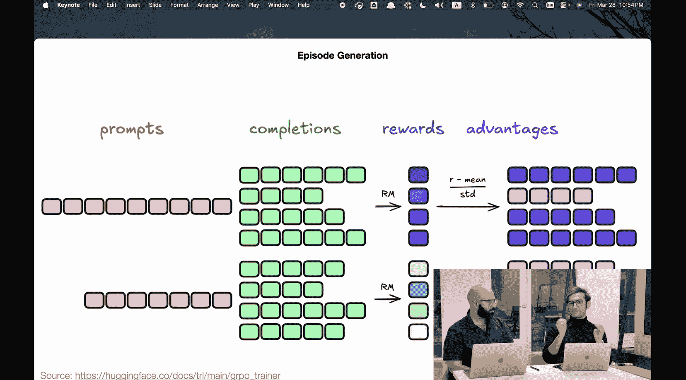

This one， so this basically constitute our group。Anyway。

 so let's now move on and compute these kind of renormalized reward and we call them response advantages。

I'm going to use the non pi functions so we can actually use nonpy mean。We have to pass the rewards。

 and that's divided by the。With this entire thing inside the parentheses。 And that's divided by the。

So deviation of these reports。Okay， you're almost done， However。

 it's good to add some basically epsilons to make sure that we are not overflowing。Y。

 and these basically constitute our advantages。 Yeah。

 The funny thing about you here is that by chance， even if your standard deviation is 0。It means。

Your all of your words are the same and the mean is also the same， So you have zero。

 So the denominator is also zero， so you won't have problems， but it's just by chance。

Stay safe and use absinence。Yeah， thenominator is going to be 0。 However。

 since Python is going to compute the denominator as well for you， you should have this。嗯。

Thisception， okay， so now let's look at these numbers， these advantage numbers。 I think be design。

 we just created these completions by chance。 But I think their advantage is actually in a nice format。

 a nice result。 Okay， and let's look at the reward that we have here。

 So this is the one for the full response。 Everything format and like equation。

 everything checks out。 The second to， the second and third one， they have one problem。 One of them。

 they have an issue with the format， The other has an issue with the equation， and the fourth one。

 it doesn't have anything correct。 Okay， so that's why we have it here。😊，But as you can see。

 when you renorize everything， the first one is going to have a positive be。

 positive advantage per se。 And the last one is going to have a negative one because it's really a bad response。

 So the first one is really good because everything checks out the last one。

 it's really bad because nothing really works。 However。

 the two that are in the between in the middle。 they receive a response of the receiver beta of 0。

 So but it means that these two， they are not going to contribute to your Gi end computation。

 And basically， this kind of represents the。😊，Average response of these two represent the average response of the model to this question。

 And you really want to reward the stuff that are above this average。

 and you want to penalize the stuff that are below this average。

 So this is burden normalization really comes from。 And okay。

 so now we have computed the responses for the advantages for the responses。 But as I said。

The policy or the implementation that we have here， it receives advantages per tokens。 Okay。

 and GRPO， it doesn't compute advantages per token， particularly。 However。

 it just copies the advantage for all of the tokens in responses。 Okay advantage to all tokens。

 Yes exactly。So let's the let's define the actual advantages and we can say pair to and advantages。

 but I think in the oral terminology， always advantages are defined for each individual action and actions here are addressed tokens。

 each individual tokens。Okay， so we are going to reiterate over the the responses and basically the response advantages。

 Okay， actually， I think it is the completions because the responses， they just takes form。

 We need to define these perkens。 Okay， so let's just complete changes to that。

 and response advantages。Okay， so this is going to be basically response advantage。Time am。

The main of completion。Okay。So just print this out。 And as we can see， we have a list of four item。

 and each item is a list of advantages for the for the each response。 And as you can see。

 all of the tokens inside the first advantage list is the same。 this is the same for all of the。

 Okay， so if you just want to。Test this。 You can see that the length of the completions。

That position 0 and the length of advantages at position 0， they all match， okay。

And now that we have completed this， we know how it is everything from the beginning from the prompts to completions and then to reward computation。

 reward normalization， response and advantages and third advantages is just completed。

 let me go over a couple of examples for renormalize advantage renormalize the board or response advantages。

 because I think。Intuitively， if you look at this example。

 it makes sense that what it is actually doing。So I'm going copy paste a few examples。

 and we're going to go over them。 Okay， we have the first example。 And as you can see， we have。

Five rewards， and it means we're a group of responses， we have five responses。And so we。

 this is our rewards。 And the first two are correct。 and the second ones。

 the the third fourth and and the fifth one， they are incorrect。

And just assuming that we have a binary reward function for these examples。

 and the one is equal to correct and the0 represents the incorrect okay。

 then with city advantages here as we can see after the normalmalizations， the only good stuff。

 they go only good responses， they were going to receive a reward of or bitit of positive bait or positive advantage and the risks that are incorrect。

 they are all going to be negatively discouraged。In this example we only have only single successful answer or response and there is sort of completely incorrect and we can imagine that this case represents like more difficult question for the model is at the current iteration of our algorithm that theol ones Yeah it barely solves this question and it happens to be that we have only a single response that is actually a successful and as you can see the weight that is assigned to a single successfuls example is it' actually a quite positive right it is much more positive that these inscessful one and even in this inscessful ones are negative right so the absolute value of this the value that is assigned to the successful one is much more than the negative ones。

😊，And even comparing this with the previous one， we can see that it is encouraged even more because it is a valuable example because it means that probably you found the solution。

 the model found the solution and you really want to take an advantage of the third example representedly hard question and all of the responses they are unsuccessful and computing this。

 it means that as you can see。The， the advantages is going to be also 0， so。

What it means is that these responses they are not going to really affect your policy securitycur because on average。

 this model is really bad on this question。 So there is really no advantage to any of the。

 There is no advantage or disadvantage to be honest。 one of these responses。 It is equally bad。

 They are equally bad， yeah。Nothing is encourage discaging。 Yeah。

 nothing is really above or beyond the average。 An next example is also similar between the opposite day。

 So here we have all of the responses for this particular problem。 Thats is all correct。

 And this kind of represent kind of an easy question for written the model at this situationeration and as Milda said。

 there is no advantage to any of these。 So all of these， they are going to be assigned a beta of 0。

 So none of these going to attribute anything to the final gradient for this iteration at least。

Let's look at the another one。 So in this example， we have almost everything is correct。

 but we have one that is incorrect。 This one is similar to the one that we saw here。

 But in the opposite So the correct funds， they're going to be encouraged。

 but the one that happen to be really bad。 It's going to be really punch。

 I hope you folks understand this concept of pretty normalized advantage。 Finally。

 I would like to just， I'm gonna copy paste the entire episode generation function from up to bottom。

 And this is a completely implemented function。 And I'm just going to explain it line by line。

 But the entire steps inside this function they are this stuff that we just we just did here。 Okay。

 so。😊，Yes， this is the episode generation function。 As you can see， create training episodes。

 So let's see first what it receives as input。 Okay， so it receives the。

Iput samples like the data sets or prompts that we actually use to generate generate these responses from V L。

 And we are going to receive all of the generations。 And also all finish reasons。

 I'm gonna talk about the finishes in a bit。 But I just want to explain， what these two list are。

 So the samples here。 Let's say we use four samples to generate。

There episodes for this and training for these auto iteration。 So the all generations list。

 it is going to be four times let's say we had five per each five responses generated per each prompt and is going to be a list of length to any okay。

 and so these responses are going to be listed from the order of their prompt。

 So the first five is are the generations corresponding to the first prompt， the second five。

 they are going to be theyre going to be the generations of the second prompt and so on。

And the other option was to make them a list of lists。

But I think H G line didn't return something like this。 Yes， we designed it。 Yeah。

 we designed it in this way， and。I think you can go in both phases。 However。

 you just want it to be compatible with it SJ bank。

 So if someone in the future wants to implement this change real them SG。

 they have they just don't have to change anything here。So what is the finished reasons。

 Vietnamm is going to stop generating of a response mainly in two different ways。

 So first it's going to stop generating if it sees end of sentence token or any stop sequence that you pass through Vietnam So if it sees that if it sees end of sentence or that particular list of tokens that we basically as stop Vietnamm is going to stop generating right。

 and the second way Vietnamm can of stop generating is if it hits the maximum length Can we see it in ones actually。

 I think have。Yes， I think this one， let's print this again。Yeah， maybe I change something or 0。

 Okay Yes， I think we this is the response that we generated the temperature。very high temperature。

 it's a very high temperature。 Most probably it doesn't have an of sentence And most likely。 So if。

 let's look at the。Output object for this one。 And I think there is a field here。

 if I'm not mistaken。Inter very long as yeah。TheS stop is exactly。

 I think the stop reason for this is。No， is it not？Okayか。YeahI the function。 no， it cannot be。Yeah。

 it's。A bit as strange， to be honest。Let's reduce this generation length。2， I don't know 10。

Okay I finishes answer reason is non interesting。 I think this is some sort of a like a bike for。

 Maybe it's a placeholderer for the actual keyword that has stopped the generation。

 maybe maybe So any。 So we have the finishes here。 And as you can see， it is length。

 if it happen to be that it's just a stop because of like hitting any end of sentence expression or sequence。

 it is going to return as a stop here。 So instead of length。

 it's going to be stop just gonna be a string that says a stop inside。 Okay， so yes。

 its all finished reasons， it is going to be a list of a strings for the stop reasons of all of these generation。

 It's either length or stop either length for real for now， it is。

I think there are some cases if we stop by some sequence other than the end of sentence。

 I think there's going to be some option inside V11 that it returns by8 to itself Okay。

 but we are not using any Yeah， so as I said， this all finished reasons It is going to be the same like as all generations So it's going to be4 by four times 5 It is going to be soft to any as well Okay。

 so as a input， it's going to receive these three variables。

 but can I ask a question like why do we even have this I think we are not using we are not using。

 but it can be used in the rewards for example。It can be used for the reward， and。One of the。

Like in this case， it's not going to be used， but in some cases， when you。

 you're not extracting the final answer from these answer tags， for example。

 if the model is generating the the final answer inside late boxed environment。

Work command in that case， if the model has generated that， but it has not stopped generating。

 maybe it has hit the maximum tokens， but it hasn't finished response。

 maybe it has it wanted to say a or want to explain its answer in that case it can decide whether you want to report that or not report that finishes based on the finished saying like if you have the answer but you did not finish going to give you a reward of one or when you decide that no you to finish you need to finish the most implementation that I see and the implementation that we had in basis before if you are not going to give it if it doesn't if it doesn't and in some inference engines。

 I'm not sure whether this is the case you blank if the model stop generating based on a end of sentence。

 there might be cases that it does not going to include that stop inside end of。

In spoken inside the generations。 I see concate。 So you。

 you have to decide based on Finn reason to whether you want to concatenate or not concatenate。

 because if it has not finished the risk and response。

 you should not really concatenate this by yourself。 Yeah， that makes sense。 Any case。

 not important for this。In all of the generations， VietnamM is going to put end of sentence so can if it reaches that inside there are all of these generations for us。

 so we don't have to worry about that okay。As you can see let me also define these variables variable here I think we use four here in any case and so there are some like kind of sanitity checks length of all generation it should be equal to length of all finished reasons and also it should be equal to length of samples times the length times the generations per sample okay so here we are going to just create indices for all of these groups of responses per each of these tokens This is not really special and we over go over these groups and we extract their token ids we convert them to their textual format responses and we use the compute reward function to compute reward for each of these individual responses and once we have them we compute the advantages from a GRP advantage formula and once you have them you just repeat them for every token and。

Basically， this constitute your advantages。And finally。

 and for the up to this point where it looks looks very close to what we are doing manually。

 So exactly just exactly the same。 I think it's just this point that is a little bit different exactlyact so here is going we are going to append the result of these things to three different variables。

 So heres where the output of create training output of these functions come into place Okay packaging exactly so the return of this is a dictionary and this dictionary has three key Okay。

 it's going to have the query token ideas which are the talkingken ideas of the prompts and the response token ideas。

 the talkingken ideas of the generations， the completions and the advantages for each of these individual responses and。

These the length of these advantages are going to match the length of their responses。 Okay。

 so just one thing I want to mention that here， because the stuff that is stuff that are outside of this function。

 they do not care about like individual or like different details in the episode generation。

 they only care about these particular episode。 And in those cases。

 we are going to repeat the prompts for each of these responses in each group。

 we know that for each of these responses， we use a single prompt。 But since the outside code。

 they do not care about the different details in here， they just take episodes as inputs。

 they have to repeat these queries for each of these responses each episodes a training episode。

 and maybe it's going to be chopped and sent to multiple notes， not in awkward ways， but yes， so。

Exactly， yeah， so nothing really special。 So as you can see here in the all query token I。

 we are just repeating the the token I of our prompt four times the number of the length of our group and for the token for the response token I we don't have to do this because already we have four of them or generations per sample number of them and the same goes for the advantages。

 Okay， so yeah should be able to run this on our own。Exactly， so what is our sample here。

 We have this。 we have this sample。Okay， and do you want to run the sale again， or are you sure？

It's seen them。For sure inside。 Okay， anyway， let's go and try to run this function。

 let's see what it returns。 So create training episodes as input， it receive samples。

 So we just pass a list of one， which is our simple sample。

 and it receives the list of all of these generations for us。 It was the completion variable。

 And we didn't have any finished reason list。 So if we're going to just create stop times times 4。

Or basically the length of generations。And this should。Do the job for us。 Let's see。Yes。

 as you can see， I mean， it's quite a long qua to ideas， but I think let's。

So this inside a variable so we can inspect it manually。 So we have all advantages。

 And so if you remember from previous parts， this was the advantage of all of the tokens in the first response and so on。

 And the last response was obviously the that one So it had the negative advantages。

 and So they are the same values They are the same values as we computed like。In the notes。Yeah。

 and so I want to。Also， look at this。 Lets me just print it。 I like 10 of them。 I guess。

 So I just want to show you that this is the same， same value same token ideas for all of these prompts。

 right， Second one， the same。For the third one， same for the fourth one， the same。 Oh， fourth one。

 the same as well。 Okay， so I guess now we have the。

Kind of the component inside or code base that generates the training episode for us。

 And the next part is going to be us using these episodes， these  query talkingken ideas。

 these response token ideas and their advantages to estimate the policy get。

Let's go and implement the buzz here。This part is going to be about poly and computation and before going to quite obviously。

 I would like to go over the slides that we have again and just through recap what we had before。

 we did the implementation for reward computation and we now have the entire pipeline for generating episodes。

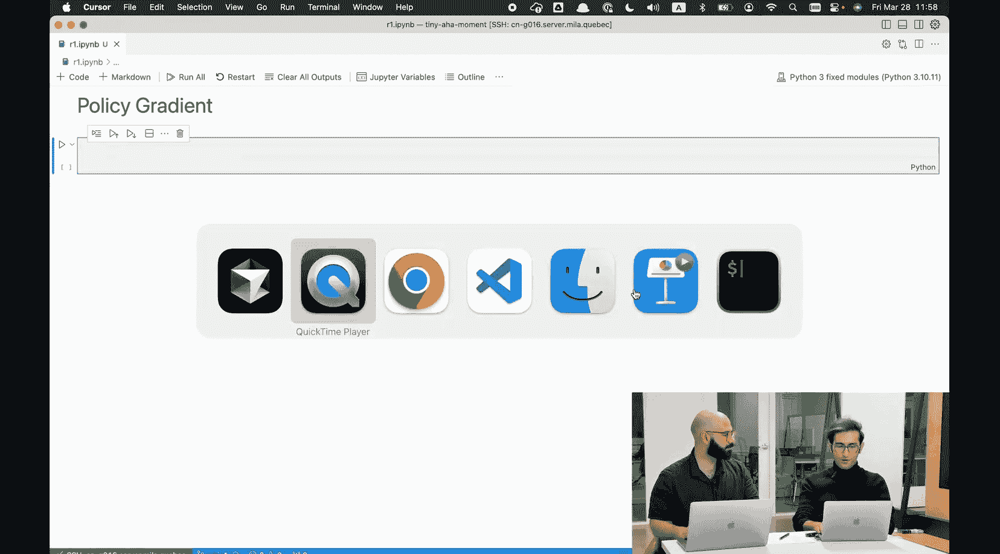

So once you have this episode。 and remember， this entire loop is going to be repeated。

 These entire three components are going to be repeated inside the loop。 So generate episode。

 compute the reward， update the policy again， generate the episode with the new policy and so on。

 So now we are at the part that we have generated all of our episodes。

 And we want to compute the policy ir。 So what is the policy ir。 It is you want to。

Compututer gradient of。The expected youve already did to expect to model parameters。

 or in simple term， we want to update our policy to be better at solving this and this task。

Once you have all of these episodes， you you are going to use a particular form of objective function to compute a loss and。

Compte the get the MT speak laws or bike proing through this to update the policy， okay， and。

As we are using GRPO for the implementation into this code base， and GRPO uses PPO objective。

 PPOC objective， similar to many other algorithms such as Min PPO and any PPO based algorithms basically。

In the next few slide I'm going to go over the PPO objectives but it look like。

 what does it really mean and see the actual forms that we are going to use so this the next few slides are not going to be particularly about GRPO they' are going to be about the PPO objective。

 but this is obviously the loss that GRPO uses。Okay， so this is the PPO clip objective。

 It looks scary in the first glance， but this is not doing really special。

 It is basically if M else implemented using mathematical operations。

 but let me go over it we have one of the prominent terms here or the like the probability of the policy or your model for generating what can by or generating action at time is6。

 given all of the context that it has the prompt and whatever where it has generated so far。 Okay。

 and if we need this kind of probability from the current model and the old policy。

 but is the old policy， it is a policy from the previous auto deterration。

 Okay So this ratio and this ratio is repeated here as well。

 and we have this 80 here and here what is this 80， this is the advantage of。😊。

Generating to again atity。 So we have talked about advantages in the previous sections。

 and this is exactly like that。 So if you remember， let me go back。

 these are the advantages that be computed before， right。 And as we know。

 this is at this is the same length at this as the completions。

 And now you can see the reason why because all of these ratios。

 all of these probabilities they arere going to multiply by their advantage。Okay。

 this is the advantage and we have the clip and the sigmoid and the mini。

 and I'm not going to explain all the details of this PPO objective。 if you want to know about this。

 please visit like there are so many courses on on RL Sergey living course。

 Open AI spinning golf course。 There are so many great resources。😊，And I think intuitively。

 if you want to think about PPO objective， it creates a trust region over the previous policy。

 And if we are inside inside this trust region， we are going to receive the gradient here is going to be activated if you are outside of this trust region。

 there is no gradient for us Okay so intuitively， we just want to update the policy then we are we know that we are in a kind of a safe region to do this。

 we don't want to deviate so much from the the kind of old policy and that's why we are doing this And remember。

 this PPO objective， it does not prevent you from going too far。

 but basically if you are too far reward Yeah it's exactly， but if you are too far。

 it is not going to be you giving you any gradient exactly so now that we know like a kind of a general view of PPO objective。

 I have a good news for you， we are not going to use this exactly as I said。We generate episodes。

 and we use this objective to compute a loss， and we use backro through this objective to compute the gradient。

 And generally， the way we do this is that we， for a set of episodes that we generate。

 we do a couple of a few gradient updates。Often more than one get updates using these objective on the same set of episodes okay and let's say you generate episodes and you apply four gradient updates。

 you compute this objective four times using four batches of random samples of your episodes and you compute the gradient on four times you update your point C four times as well okay this is how generally stuff are implemented If you go to different code bases。

 you probably going to see this。However， for this implementation， we are only going to。

Update or policy once per episodes generations。 Okay， so we generate， let's say 10 episodes。

 We compute the gradient。 We compute the laws on all of these hundred episodes and we compute the gradient only bonds and applied only bonds。

 Okay， once the gradient is applied， we update the policy。

 we go generate this episodes again and do all of this stuff again。

 other terms our data is always on policy now。 Yes。

 in terms of the grow of policies where you're training on data that is sampled from。

Not your current current policy。 So if you do multiple updates。

 as soon as you do a single gradient update， the policy the trajectories that you have are no longer sampled from the current policy。

 But in our case， it's just we sample once。 we take a single gradient step。 We sample again。

 we take a single gradient step。Yes， and one。Good result of this thing that you are doing is that many of this stuff that you're going to see here they simplify。

 Okay， so what do I mean by this。 as I said， the old policy here means the policy at the previous iteration。

 the policy that we use sample the episodes right and since we are doing a single update whenever we compute this objective。

 this pi of data， it has not updated yet right So it means that this entire ratio it is going to be equal to one right and so the good news here is that if you want to clip something that is already one with this epsilons So this clip function it is going to return this term but just a ratio theres there's not going to be any clipping right So this entire clip is going to be equal to this ratio is ratio times the advantage Okay and looking at。

😊，The other term here is the input of the minimum function。We see that again， ratio times this。 Okay。

 and so obviously， we have a minimum of exactly same terms and the minimum of exactly same terms we going to be that terms。

 those terms。 one of those terms， right， if we rer， if we simplifies all of these things as be said。

 we are going to have these object， okay。And。Its objective， and。

What would happen is basically if we take the gradient with respect to this particular objective to simplified form。

 we are going to reach reach this form and this form is basically one yellow policy gradient with advantage and it's just so obvious。

As it results in this， right， if you just eyeball it。

But if you are like me and it is not very obvious to you， so we are going to have a proof of this。

 how you get from here to here in the next section。

 so here is a simple proof on why the PPO objective actually boils onto vanilla policy gradient when the policy is not updated and the old policy is the same。

😊，So the objective is the Pteta。Over the the old。Multipular被了。

And we want to take the gradient of this expectation。 So what we do is we write it as an integration。

So it would be the expectation is over pitheta， so it would be pieta multiplied by pitheta divided by pitheta gold。

 multiplied by the a。So as you notice， it would be pi theta the power of two divided by pi theta old。

てらいぱであま。When。Graduator ands。The inside of the integral。

So it would be the graiteta of P thetadu multiplied by putata。😔，Topl my deadline。But， as you can see。

This term， this term， not differentialily with respect to data。So what happens is that we'll have。

Then just the gra of。By theta2 divided by5 theta。advantage。 so at the end。

It would be two times pi theta multiplied by the grateta of piteta。Dided by by that old。Multiply by1。

 So because theteta are old and theta are the same。 This is， this equals to one。

 So what happens So like one。 So what happens well have here two times the grateta of piteta。

Multiply the advantage。 And this is just。Here， we're going to use the electric trick。

So what we do is we multiply by theta and divide by by theta。So this thing actually just equal one。

 it's just to transform it an expectation。And， we know。

This thing actually just equals to gra of luck probably。 So it would be two。Integral of pi theta。

 gra theta of the like pi theta。Multiply by advantage and this is just the expectation。

 so it becomes two。Times the expectation over grad of log Poetto。Multipied by the advantages。

And this is just vanilla。好是。So as you can see， the gradient of this objective is just two times the one applies gradient objective。

And that is the。And， so we have this so the gradient of this PP objective。

 this simplified objective is going to be two times this expectation okay and these two we can safely ignore it because it doesn't it does not change the direction of gradient and it's always true in all of these things all of these gradient terms okay so just about to explain but does this really means it means that we are going to compute the like probe of every generated tos and we are going to multiply them by the advantage that we know for all of these responses and once we have this last term we just we can just simply back prop through them and the gradient is going to be computed。

And if you have a batch of this， obviously you're going to estimate this expectation with Monte Carlo samples basically。

 or the Monte Carlo estimation as expectation。And， so this is this part of this PP objective。

 but this is not the entire objective that we use in GRPO。And the second part is this K， L4。

So this kL， the job of this scaleL is to prevent us from moving too far from the reference policy and the reference policy here is the policy that we started or training in this case would be the pretrain model without any training just the base version right and so how do we compute this KL term in the recent versions of the auto code bases and in GRPO we have this term which computes these different ratios and used them to compute the KL and we backrup through this I'm not going through too much details of how this term how did we come up with this term because it's really not really the focus of this video but this expression it's an unbiased lowvariance estimation of KL which John Schhuumman he I think came up with this or introduces I think in 2020 so if you want to can go。

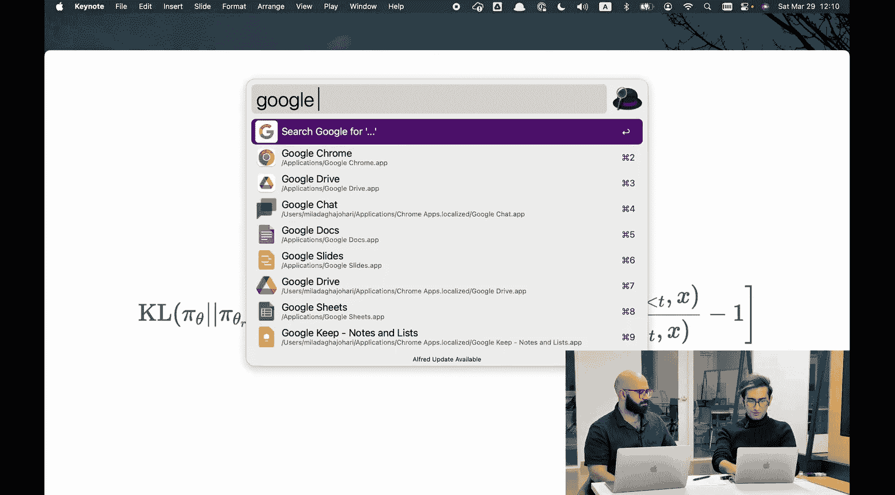

To blog posts， I guess。So aro kL divergence from Z Schumman。

 and we are using basically K K3 or this form of the KL estimator， in case as we can see。

 the bias is0 and it has lower variance than the first version。In any case， as I said。

 this is not the focus of this video， if you are interested and read this black post。

 it's quite interesting。

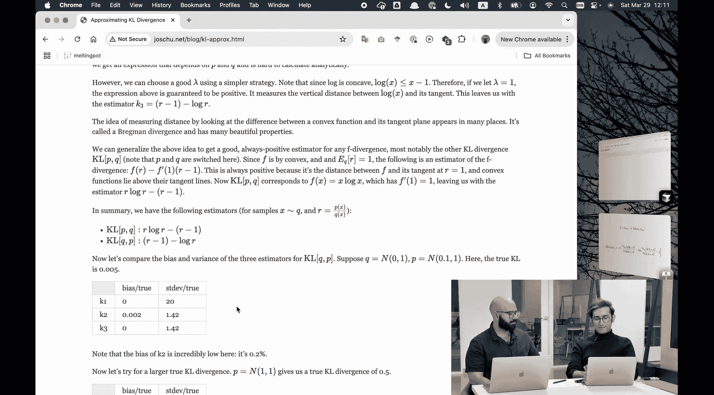

Let's continue。And before going through the actual implementation， I would like to。

Discuss one more time， what is the actual difference between GRPO and other algorithms such as PPO and B and PO？

As I said in the beginning of this section， the objective that we use to update the model to compute the gradient。

In all of these algorithms， they are all the same。However。

 the difference lies in how the advantages computed in all of these algorithms。

 GRPO by design assign the same advantage to use all the tokens equally。

 but algorithms such as PPO or one PO， they have fine great gradient assignments。

 they actually compute pair token advantages that can differ from different tokens in a single response。

 So however to visualize this。 So this could be the GRPO and these actions are different tokens generated for your response and these are basically the gradientians that you compute。

 let's say for all of these generations。 And if this is a positive or highbar or high advantage response。

 all of these tokens， they are going to be equally contributing to the gradients coming from this response。

 And if this is not a very good response。 All of these tokens again。

 they contribute to operatinging the one。 But you can start to see the potential。Problem here， right。

 for instance， if everything。Up to this point， every part of the generation to this point was correct。

 and only the model just stumble upon of a mathematical mistake or just miscompte something。

 and everything just goes off track after this point， all of these。

 even the first few parts that were objectively correct。

 they're going to be all discourage or they're going to the probability of those are going to be decrease all at the same time。

 As I said， these two the other variances of algorithms define gradient creative assignment。

 they compute press step advantages and step or per talking advantages。

 and they play different contribution into the final gradient。 So for instance， this a5。

 it does not really have any advantage。 So it term is not going to be involved in gradient computation and some we go in the direction of increasing them some of them be just going in the reverse direction。

We just go decrease their probability。 and generally， the。The， the the problem of credit assignment。

 knowing which of these tokens， which of them matter in the actual response。 That's by itself。

 is a kind of a very challenging And one of the core problems in even like classic R or entire RL。

 basically。 Yeah， this is the overview of these algorithms。 I think like the way I see it is。

Advantage as a technical term can mean as a definition， which is。

The expected return after you take an action and if you follow your policy。

Subtracted by the expected return if you don't。If you just sample from a policy like。

Not fixed state on that specific action。 And these algorithm try to estimate that advantage。

 And GRPO's estimation is just very biased。Because different tokens should have different actual advantages。

But they assign the same advantage every talking， but algorithms like P and wine PO。

 they try to estimate the actual advantage。So it becomes fine grained。

So the way I see it is like just the advantages that they estimate。Is incorrect。Is by。

But the bias is a term to just say it's incorrect， right， Def， Yeah。

 this is a estimate been that said these are technical or terms。

 and we are just going over them in a slightly handba form。 But if you' are interested。

 please go ahead and just learn about all of these things。

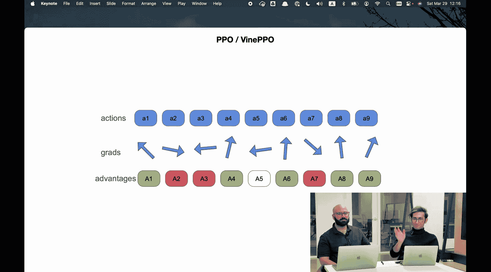