# AmirhosseinKazemnejad【中英⚡强化学习与LLM｜nanoAhaMoment： RL for LLM from Scratch】 p02 P2 [BV13W1EBUEph_p2]

Now we are going to start implementing all of the stuff that we explained all of the objectives that we explained in the code。

 Okay， so I just copy pasted the simplified terms that we introduced in these slides here just to have them as a reminder。

 and as you can see we are going to compute this objective。

 and we are going to back pro through them obviously。But。

One of the primary terms in this objective is computing the like props of the model。 So basically。

 you want to compute the probability of generating a particular token at a particular time。 Okay。

 and then you are going to multiply it by the advantage。 But for now。

 we have to first compute like props。 Okay， yeah， and okay， let me get it starteded before load。

 before computing the like props， we have to obviously load the model， let me use hugging face。

 we are going to hugging face transformers for the entire for the entire implementation。

 which generally trying to use V。VLLM， its model implementation， is based on Py and。

It is based on Pettor， but it is not really use useful for us for for training basically and the reason for that is it is。

Many of these computations are based on some versions of customized Kta kernels and those called kta kernels are。

 I think customized for inference。 It's not really useful for us to use the model that is inside the inference engine。

 And if you go even beyond this， sometimes your inference engines。

 They are not even in in the same process。 So they might be in different notess。

 And so you have don't have any access。 They don't even give you like differentiable logics。

 right theres。I think in general， it is like a Pytorch model。

 if you go and read the model implementation of Loma， for instance， in yellowM。

 there is a Ptorch implementation。 and some part of it， like， for instance， the attention part。

 it is calling the ka kernels， So maybe in theory， it is possible to do this。 but for us。

 it doesn't it doesn't make that much sense because yeah easily there is just no easy There is no easy not a hard。

Maybe if you want to go and be。I， I think like on a sloth。

 it has like an implementation of GRPO that it shares the models inside the view for training。

 What and it is not the purpose of this talk。 And this much come。 Yeah， this video really。 Any case。

 let's get us started withs a good hogging face。 So from transformers。Import auto model。For causal。

And yeah， I think。That's what we need。And okay， let's inuiate the model。

This is Google old talking face API。 So we pass the model name。

And there is this particular parameters that we can pass attention implementation。

And I think we can pass flash attention to。 I hope this is the right parameter。

 And it also receive the torch D type， which essentially says what kind of data type we are going to use for this model and。

As we said for the VLM， it is going to be float 16。比如。Philosopherphy。And I think， and。Also。

 there is this device map。That you can pass。 So essentially。

 this tells the hugging phase where to load this model。 If you don't pass this， I think by default。

 it loads it on CPU。 But if you say a device might be equal to0 or I think you can pass basically Ca devices or any torch devices here。

 and it directly loads the model parameter inside GP or any device that you specify。

 and in this case， it would be beneficial for us because it prevents us loading from loading the value inside the GP and then copying to inside the CPU and then copying to GP if you are low on CPU memory。

 this is a good option to try。So， yeah， let's see。I have passed all of these things correctly。

 It seems so it is starting to load the checkpoints。And yeah， let's see。Perfect。

 so we have the Q2 for causals and L and we have Q2 attention and it seems everything is fine。

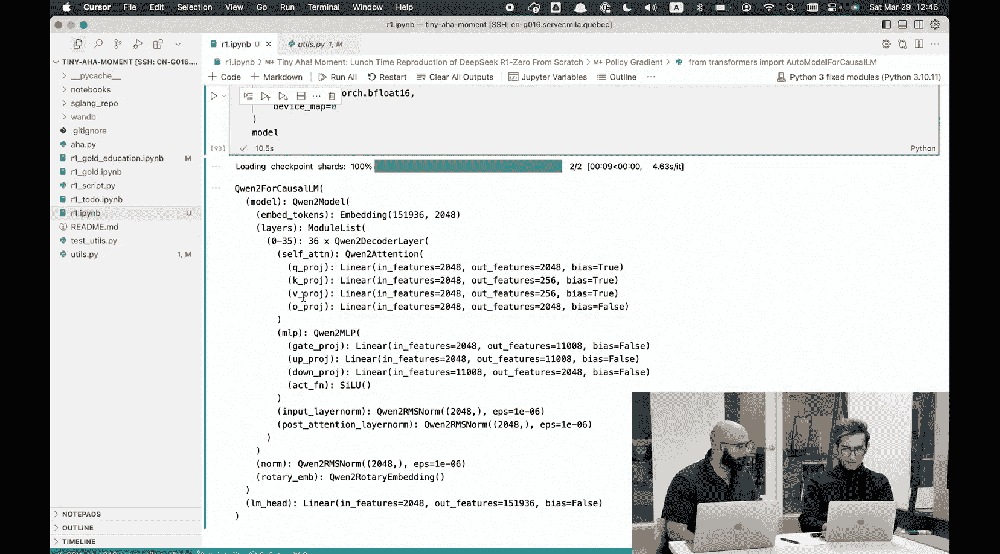

Okay， so we have loadeded the model。 And now just to make sure we， the model is inside GPU。 Yes。

 as you can see， it is good。

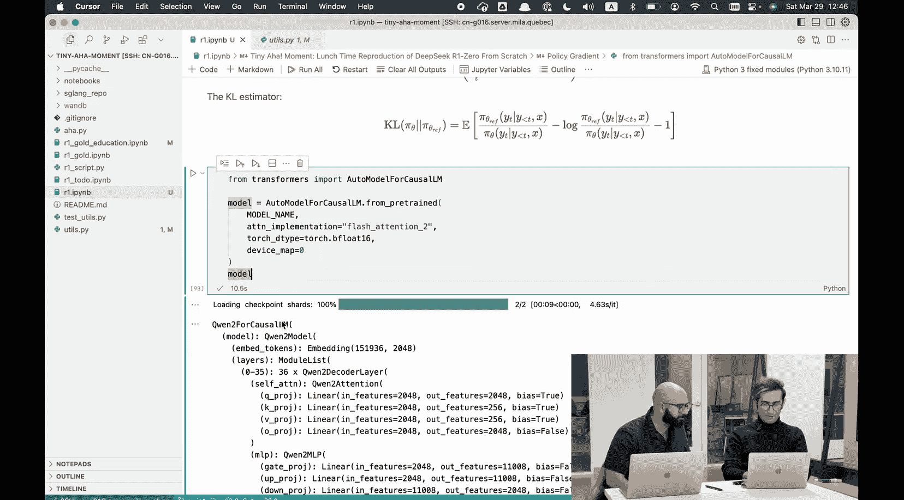

Okay。So in the next few parts， I'm going to implement the part that we computed like props of tokens。

 And for that， I'm not going to use the episodes that we computed above。

 just want to start with a very simple example and just to see how we work with huggging based models and how we extract or compute like props using this transformer model。

 And after we finish this， we can just start using the episodes directly。 Okay。

 so for the examples right now， I'm going to define this。 And。

I'm going to use just very simple sequences。啊。Maybe， how are you。And yes。

 so I'm gonna pass padding to true because I wants the tokenizer to do that padding for us。

 And this is basically resembles this batch of two sequences。

And what we're going to do next is basically try to compute the like props on the。

Language modeling task per se。 But in sequence with sequence task， it's going to be a bit different。

 But I think the entire components are just， just the same。 Okay。

 what does padding do is just affects the。Like， it makes all of them the same links， right， yes and。

I'm going to show you what it actually looks like。 So we just ask you to return us the。

Pytorch tensors。For this， Okay， so inputs its， let's see the keys。Okay。

 so we have input Is and additional mask。 So let's look at them。嗯。Input I Ds。 Let's look at this。

 Yes， this is a tensor， like a2 the tensor of the input Is of these two s sequences tokenized。

 And let's just make sure convert Is to tokens。 Just， let's look at， take a look at them。

 see how do they look like。 So these are especially these particular tokens， okay。Okay。嗯。Okay。

 so this is our good ideas。 Let me start inside this variable。 and let me show you the。Second one。

If you are familiar with transformers， you can feel free to skip this part。 But any case。

 we are going to go over the entire thing。 So we have the attention mask。

 What those attention mask says， the attention mask says that these two tokens are padded。

 just padding tokens。 So the transformer model， you should not look at this tokens。

 And we should prevent ourselves froming loss on these two padding tokens just where the batch should have the same size exactly。

 And it's putting the end of sentence token right there。 But if we。If you look at here。Tchanizer pad。

So the path token this token there it is。 It just say as end of sentence。

 but it shouldn't matter at all It shouldn't really matter。 Yes。

 we should be careful to not mask out actual end of sentence。 So can it is， but any case。So again。

 let me also store this inside this variable。 Okay， perfect， so。We have constructed the input I。

 the attention path， these are the input to the models。 However， once you fit this to the model。

 it is going to create distribution over the next tokens for all of these includes that password right and when you want to compute the loss。

 you have to have some sort of a labels to select each of these vacuum。

Vocabulary tokens you want to choose as your loss right when you want to compute the loss okay and generally when you have a language modeling task or like causal language modeling task per se your input Is and label are exactly the same because you want to you have the same sequence as input and you want to just basically predict the next tokens of this sequence okay。

Let's we construct the labels as well， so I'm going to start with talking I， sorry with the input I。

And let me clone them。Okay。Howm I define it here。😔，Okay。So we have constructed this， however。

 there is one problem here。If you remember in input I in the computing， the input Is。

 whenever there was a padding， token I either use this pad toolken， right for this。

 or particularly Pa token I D。Okay， this is the exact same one used here and here， okay。However。

 when you want to。Had the labels。 You don't want to use the pad tokens， per se。

 you want to use some other number。And the reason for that is basically we want to ignore them then we want to compute the loss because it does not mean anything。

 so they should not really predict them。 Yeah， you should not get the loss They should not include in the loss exactly。

So the sonnet Be to do this is to is to replace these pad tokens。

 or they use minus 100 as the padding IDs for the label。Okay， and by default Ptorch cross entropy。

 it is configured to ignore these labels， but you can obviously it change minus100。

 but in any case we're going to follow the same format here so basically our label is going to be let me define it here。

Label is going to be torch where。Our attention mask is equal to to to one。

 We are going to use the actual labels When it is not equal to one。

 When we are in the padding regime， we are going to use-100。 Let me compute this and。

Let's print it here so as you can see。Put the input is here。 Okay， so just can compare it。

 and it has just replace is two its。-100s。 Okay， if in this line， we have used the。

Iput ID equal the pad token， the problem would be we also。M the end of sentence。Exactly。

 because or Pa tokens is， is equal to end of sentence token。 exactly。 its a risky practice。

 They should have said it should， it is a risky practice a bit。 if you are not。

 if you are using input that is equal to Pa tokens。 that's not a good thing to do。

 always use attention mask。And， so right now we have。That this， that this。 Okay， so we have youres。

 attention， mask and labels。 So these are the three ingredients for computing the like props。

 And obviously， the itself， okay。And no， hard part。The slightly harder part， okay so。

The way we compute the out like the like props is first， is， we just first compute the logicts。

And then we compute the like mouses。 Okay， so now let's see how we compute logics。

 Comping logics is's actually quite straightforward。

 So we just need to pass input I and attention mask。 the model itself。

 it does not when it is passing the output to you when it is returning the output to you。

 it does not care about your your labels。 It is going to compute the distribution over next tokens。

 Okay， so it all of them for all of them as I expect that you are not going to pass labels as the input to the models。

You do pass that attention I think even I think for hugging face models， if you pass the labels。

 it is going to also compute the loss by itself inside it。Oh， I see in the forward。

 it gives you the loss as yes。 Yeah， it's a kind of a convenient thing to do。 But for us。

 we're not going to use it。 It's not spelled out。 Yes， everything is used like box。Yeah。

 everything is。 nothing is going to be hidden。So yeah， we are going to pass the boot。

 the attention mask and。There is this flag that if we generally it to true。

 iss going to return a dictionary to us。 otherwise it just returns a a taho Yeah。

 which is not really convenient to work with。 And I think there is an option to disable enable cash and。

Generally you do not need to pass this， this is used when during generation。

 but some model implementation， I remember like some versions of Miral。

 it complained and cash was true when cash was not false during training so I'm just gonna pass it just to be short and safe so。

Yes， that's。Comparete these outputs。And I think obviously。

 it's going to complain because our input with ideas， they are not includeda， so。Let's make sure。

And I think it should be。Okay， so we have the output。 Okay， lets me。Just put this out。

 So we have the logics and has key values。 This is the KB cache kind of thing。

 So because you are not generating。 So we don't have to deal with this。And okay， so。

So what is so we want to work with budgets， right？Output。Its perfect。So let's see。

 Let's try to guess what is the shape of letterss， right？ So we pass the batch size of2，2。

 So it's gonna be batch size。 The size is4， right， They call to two command command or sequence length。

 max sequence length。 yes， that。Let's use sequence language， I think from the contextes， obviously。

And。Here is going to be the vocabulary size because it's updatedbe on the entire distribution of next rocket。

What is the work size of this one， okay， let's see large。150， no， Yeah， exactly those。Okay， so。

That's our guess。Hopefully you're right。Let's see。Perfect。啊そ。I guess you're nuts correct， right？Oh。

 yeah， is I think， I think in general， the size of the embeddings。

I think they are implemented to follow some B to be multiplayier or something。

 Im not sure whether this is the case。 This is a multi。 Yeah， maybe it's a power of two。No。

 is it multiplication of the power of two maybe， maybe。

 because this one is odd at least like the toian size。 Yeah。

 what it means is that the that last token is not going to be used。In any case。

 it's not about the last game it's so different to like we have about like 300。Difference。

 so we were not as always。As it turns out， it turns out it is the first time。😊，Okay yeah。Okay。

 so we have this lu。 And now it comes the part that's a bit tricky because we have to。

Cut the ludgets。And shift the labels。 Okay， so what does this mean， But why should you do。

 Why should you do that exactly。The reason for this is that we are doing next token prediction。

 right， we feed some token as an input or some context to the model。 And for this particular token。

 the model of the job is to predict next one。 Okay， so as you remember， the input I and。Labels。

 they were exactly the same， we created them to be exactly the same besides the pad， right obviously。

So。Right now， when you feed the input I， you're gonna see the logicits of this part we are talking right and you have to really shift your labels one to the right to a seed。

 but is the next token from this time step and youre going to we are going to use that next token that shifted label to compute the loss on this current time step that makes sense because the job of that logic is the next token。

So we need to move the tokens one step， the left。The right yeah， yeah， one to the left。

 So they are lined up with their logics。 Yes， exactly。 If these part seems still confusing to you。

 don't worry， it's not super obvious at the in the first， in the first hand。

 So feel free to pause here and just go， I think there are many resources on hugging phase on training sequence or a causal language models。

 I think there are great resources on this particular target resources。

 but nothing comes close to this。 So just watch it。Okay， so let's compute the shift labels。

And it is going to be the labels that we have computed。 And so the first part of the labels， let's。

Have the labels that shape here。 So the labels， they are going to have a shape of batch size and the sequence length。

 right， Okay， so we are not going to touch the batch dimensions。 obviously。

 and we just need to shift one to left。 So we， it means that we have to start from one。Yeah。

 and we cut them so like it becomes sequence6 minus one exactly so you're basically starting from here。

Yes。Okay， because the first token is never the target of prediction。 Yeah。

 you never predict the first。 as's always like the beginning of sentence token， right， So its。

 it doesn't really matter。 And so yeah， we have this here。

 so one particular part that is remaining is to make it contiguous。

And we do this so that when you want to compute the loss， it does' not comp。Okay。

 so we expect it to be batch size， same batch size。And sequence length minus-1。 Let's see。So if he。

 I'm pretty too。The labels here。You can see it' starting from。Like you for you， exactly。

And the size is obviously by size sign sequence length minus-1。Okay。

So now it comes to the part that we have to cut the logics to the last like the one before the last weekend。

 Why do we do that， Because the last to the last。 generally。

 the you can think of that as the last logic to be the logic for end of sentence token。

 and you do not want to generate anything after that， right。 Yeah， so thats funny。 But also。

 we don't have a target for it， right， I mean there is a last。Is trying to predict what comes next。

 what that。Thing is not generated。 Yes， there's no target for it。 You cannot calculate the loss。

 exactly。We call it cheap budgets because it's compatible with rest of the variables here。

 but it's not really we didn't really shift the budgets per se。So。We have the logic here。

 and we' just gonna have it delete the。one。The element before the last， okay and。Contigguuous again。

It's all obviously going to be sequence length -1。Oh， and obviously。

 the caps size that we miscapculated of mis guessed。Okay， so comparing this to this。

 you can see that it has a one fewer token。Okay， so one thing that I forgot is here。 So generally。

 when you take the logicits out and you want to go ahead and compute the loss。

 it's a good practice if it the memory is not a particular issue for you to use the 32 B version of this。

Just to convert it to a float。Okay。And。Since we are in the autoal realm。This data right now。

 I created this data here， but this data， it is coming from models' own generations， right。

 And the modelss own generations， they are sampled from the model。 And when you are sampling。

 you are using some temperature， right。In most of the cases， even in all case。

 it is a temperature one， but if you are using some other temperature。

 what it means is that you are multiplying this temperature by the preof max values and then you apply the softx on top of this right so we have to divide this largestdges by the temperature I'm not sure whether we have defined it number but for now。

Let's， let's set it to be one。 and you divided the temperature。 Okay。

 so this is going to be all legts。Perfect。So we are almost done， we have shifted our logicits。

 we have shifted our labels and we should be able to compute the like props。

 so the next steps for this is to actually get the logicits for any particular labels that we have for all of these time of steps。

 however if you remember for the pad tokens in the labels。

 we have minus 100s okay and these minus100s are going to be invalid because we don't have a token idea of minus100 right so we have to mask them out。

So， we。Let's define the label mass variable here and set it to shift。

Labels to be equal to not equal to -1。Perfect， so you can actually see it here。 So this is our loss。

 beside or mask。And now it's the time to mask out these values。 that is -100。

 So we can easily say ship labels， label mask， I think you should have。U not， right？三个。

So as you can see， these two that were previously-100 right now， these are a different。 Yeah。

 if you want to， we can compare this to these values。So these are exactly the same。But on the same。

And that if like2 minus yeah，10 already replaced with 0。Okay， so we are almost done。

 So we have to compute the。Like props。Youre going to be the first minute to。 take the。Bg off nice。

 exactly。Generally， you can apply the softmax and then take the log afterward。

 but there is a you numerical clear stable operation that we have here。

 so we just pass the shift logics and the dimension is going to be minus one so basically on the vocabulary dimension。

Let' use dimension to I think this is more readable。Okay， as you can see。

 we have completed the black softns and a seal， we have not chosen the labels and just applied the black softns so to convert the logicits to their particular like black fabric。

That's true。 okay， now it's the time to get the actual like props and。

The operation that we are going to use is torch。Gather。

So the way it works is that you pass the input that you want。And。

Then you are going to pass the the index， the index that you want to choose from all of these from this tenor particularly。

 So what we want is to take this from the dimension2 or the vocabulary dimension and we need to pass the index argument。

 and our index argument is going to be or labeled， say our labels。

 I think actually that's why we made those 1-100s to0 right， because we wanted to have a valid index。

 Yes， so yeah， we wanted to have valid indexes。 just going to get the。

Lg probability of the first token Yeah， the first， the first talkingken by token 0， talkingken 0。

 What do we know what is token 0。Is， is it the beginning of sentence， I don't think。

 So I think this is the， I don't know。 Let's see， Let's see。Oh， is it the yeah。

It's the probability of。The more interesting。I think this happens because when creating the tokens。

 this is the first if you see a lot of exclamation marks in your models trained outwood。

 maybe you're forgetting to mask。Be不。あ大な。At least if you， if you mask。

 if you don't mask out the like props。Properly， going to have yes， more。

 So expected all the tensor to be on the same device。 Yes， exactly。 this is not going to be correct。

 Shi labels， not the actual labels。Interesting， what is on CPU。See the our shoe flavors is view。

Shouldn't be。Okay， you having forward to movie to see the GP P。Oh。

 I think that's the reason for the honest one。That we had。 So you have to make it like a fake。 Yes。

 second can。 So yeah， yeah， this， as you see， these two inputs。

 like the input and the index that you want to use， they have to be of the same shape。

 So we have to use the on a squeeze。And I think， let's take this out， and。Okay， so I just want to。

Return this and see how it look like。 So it's really like the same tenor just the shape has just changed。

 So if you can see this has a fake。 It's not fake， it's a。One dimension of third。 Yeah。

 it's just to gather books。 It's a little bit creepy。Yeah， true。So we don't need to pass kuta again。

 so it should be anything on a squeeze， right？Sorry， oh， no， we didn't sorry didnt shift table。 Okay。

 so as you can see， we have the props and like props， the shape。Yes， it is。

 as if we have this kind of fake dimension。 you can change it to use the squeeze2。And move this。Yeah。

 sure let's take go we get the like groupss。They should be。Very low for us， because our model is not。

而不计道区分。True。Not that low。The it is a preing model， so maybe these are not。

But this is are these are generally like very small context。

 So generally when you don't have a very large context that model just。

 it's not really certain on what to do so。I guess it should have low probability on all of the tokens and it think that you're going to have very。

Very small log props， any case， we are not seeing that here。

But these are not particularly zero so the compute are like props of our inputide at the end， right？

Yeah， I think I oh yeah broke it。Because you compute the squeezed twice ice yes， yeah。

 let me redo this again。Yes。 yes。And this is the last part that if you don't do， you're going to。

See a lot of exclamation part Mars。So now， or like props， as you can see。

 these are masked and they do not Yeah， they do not contribute anything to the grid。So yeah。

 just to summarize， what we have done， it's a kind of a lengthy process to think about this。

 but just we started with the。Loading the model， we define these variables and defined these input I。

 compute the labels and we pass it to the model， we compute the logicits。

 we do the shifting thing and we just compute the log soft or like props and we use gather to select this select the proper valid label for from the vocabulary distribution and at the end we have the like prop of generating this this sequence on the。

Ma can use our own function。 Actually， we have implemented this function here or just to be really like an easy thing to do。

 And all you need to do is to just pass the model， pass the inputs and pass the temperature。

 and it should exactly give you the same thing that we compute that off。 Okay。

 let's use this utility function。 And hopefully they are the same。 Oh you don't want to cook。

But I think it assumes the deepest reason you know I think they have the same exactag API。

 you want to forward past。 They have the same exact API。Okay， so。

The output that we are going to have is the model。And inputs， I think。Input Is。

 You have to pass this。Attention mask。And levelss。 But I just want to make sure that this label is under co device。

 because I。Probably forgot to do this for the labels， but I did this for input and mask。

And so we have this and the temperature is equal to one。So let's see what do we see here， see。Still。

 oh， something is still。😔，Which one is this。The input do you use maybe or attention mask。

I remember I put this to。哦。Okay， I don't know why this happened。 any case， the just。

You callll everything， yeah。ok哦。Oh， sorry。 So here I made a mistake。 This should not be Oh the shift。

 I see。So as you can see， this is not another easy task。No， this is not a perfect video。

 So we learn as we go。 Yeah， that's true。 Okay， that's， it's， oh oh wait。 we put it there because。

You've heard that if you put a mistake in the video。People are going to watch。ConAnyway。

 I think it was painful for the viewers to see us this mistake。Okay。😊，Okay。

 we compute the micro pros。Squeeze them back。 and it should be the shift mask， It shift mask。

 label mask。I think I see should be also computer， too。So convert to to。Yeah， this should work， okay。

So now we have the like props。And it should be called， what is the label mask here。Oh。

 why is it always true， I think， like something happened here。What happened here。We， literally。Okay。

And this should label mask。8ight。Oh， because we have already yeah this。 Okay， okay， okay。

 so it became a very educational video， a very educational。 You know what。

 We are going to load this from off the top。 Where's running for run it just on top。 Yeah， okay。

 that's a problem with the Jupyter notebook。😊，It becomes a state dependent。So， yeah。

 these labels also could。It is a model。Ledges。She labelbels。Shi budget， temperature。

So-100 so this time， hopefully we a mask。Yes。😊，Like softms。Like props。 Okay， perfect。

Like a mask again。 We don't have to have it here。Here we go。 And finally， the are almost the same。

 almost。 I think is it。 Why do you think like there is a small difference here， Is it the。

That's a good question。 The B 16。Like low precision， maybe is it。Yeah， maybe。

We will just the order of。Did we read something， I don't think so。Label mask。Yeah， I don't think so。

Let's compute this again。 I think it's just the。Yeah， I think it's just the order。

 maybe to thing inside。That is interesting because it's like the same。It seems so。 So I don't know。

 I doesn't seem that this time， we are going to find a。

I don't think there's a bug here because as always there just just differences， but。If in the edits。

 we find it， we're gonna have have another come from future and tell you what was the like。 but yeah。

 it doesn't seem so。So。Coming us， coming back from the future， future。

 but the future is the next two or three minutes。 we just found a bug， not the bo per se。

 So first of all， this should have been this one。 but any case， if you just。Vis。

 you should have views float here。Yeah， so our shift ludges were just in float 16。

 but in our own function， it was float It was flow。 Yeah， that was a reason for the description。

 Yeah， and also， I think it would have been like pretty painful for the viewers to see that I just use the normals。

 not the budget Yeah， yeah， there is not the shift budgets pieces。 anyway。

 let's run this so that we can make sure that this time it's the same。Okay， you're the saying， thing。

 And honestly think they should increase the accuracy of Bflow 16， any case。😊。

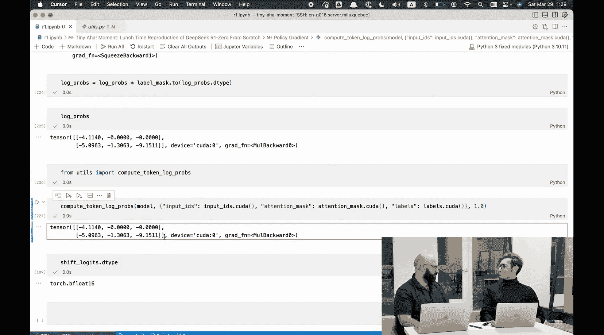

Okay， the previous section was a video sketch took several road trials for us to。

Competitive finishes without any bugs， but fortunately we have the UT right now。

 but I think at the end of the day it showed you that the amount of details that we should really carry be really cautious about when impedment in these kind of other algorithms and small things as we saw float6 float 32 or different data types can also affect your probabilities and obviously it might affect your optimization and capabilities I think it was kind of a good showcase on on these intricate details in any case so now that we have that utilize a utility function that gives us the like props youre going to impedment the actual policy on us however just before doing that we need to do like one small step and this is small step basically is regarding the fact that in the previous step we use tokenizer to do the padding for us but when you're going to impedment the code the episode generated。

😊，Is done by VLLM。 and VLLM just returns the tokens。 these are all token so。

 So we have to do the pas and preparing of model inputs by ourselves。 Okay。

 right now here we have query small example on the output of episode generation。

 and we have two episodes from these queries。 by the way。

 these are completely made of synthetic query token ideas and responses， right。

 and just I wanted to mention that these two are the same as the format of our episode generation。

 It does not matter in preparing the model input。 just wanted to show you the the general structure of these episodes。

 Okay so。Now the goal is to create fill up this a dictionary， so what is this dictionary。

 this dictionary is basically input ideas。We have to create this and also attention mask。

You have to fill this up。Labels。Okay， and。We have to also create。The advantages。

Do the pas and all of those stuff for their advantages as well。

 because they are going to be used in policy and computation， okay， so。Now that we have defined this。

 okay， so these are basic data preparation for model training。

 So these are feel free to escape this section if you feel comfortable with this Okay。

 so first I'm going compute the max length of the sequences of the entire episode。

So this is going to be the maximum of。So of query length of response。 previous example。

 when we implemented the computation of Black prop from scratch。

 we used a simple kind of causal language modeling example because hello word and how are you。

 But here we have or sequences， they have two parts， the prompt and the response。 Okay。

 so we need to combine these together to create the input ideas and the entire sequence themselves。

 Okay， we have to loop over this to find the maximum sequence length and or as I said。

 the sequence here is the concatenation of query and the response。Of responsesponse to Canadians。

 Okay， so。Yes， as you can see， the maximum length fee is the。

And now that we have this maximum length， we can do the padding easily。

So let's define the pad token ID just to have these two variable handy here and we're going to use the tokenizer pad token ID。

And I'm going to also define another variable， ignore index for the label， so as I explained before。

 minus100， these are the indices that we use to ignore the loss on the padding portion of the generation of the response of the model。

Okay， now that these two are defined， we can safely go and continue with the feeling of this inputs variable。

 Okay， let's loop over all of the episodes。Reponse。We can I and advantages。 We have to。

See forward this。It's eat a lengthy， but is。Forai a moment because。Aage is perfect。Okay。And。

That's what this。I this is more readable。 Okay， now we have to create the or sequence。

 which is the combination of query talking ideas and response working ideas。Okay。

 but I would I would like to also right now compute the number of padding that we have to do at the end of this。

 so just remember we are doing the padding from the lift。In all of this entire trade。So。Number of。

Had。At end。Its going to be maximum length。Minus the length of combined。Ids， perfect。 So from here。

 it's basically really easy to compute this。 So the input I is going to be the combined I plus the pad token I times number of pads at the end。

Attention mask is going to be one for all of the combined I。

 It's the entire portion that the transformer can look at。Times the length。

Of combined ideas plus again， number of paths at the end。And not the Pat tokins。Just zero。

 So for the portion that there is input its going to be one for the portion that we are padding is going to be zero。

And for the labels， it's gonna be a bit different， but not really。

 so the point here is that the labels， so all of these things input I。

 attention mask and labels are're going to have the same shape okay but one problem。

 one difference in this case that we have here when we have query and response the difference between this case and there is and the case that we had in the previous example where we only had hollowboard and how are you basically the causal language modeling is that we are not going to compute the loss on the query portion。

 so we have to put the ignore inices for the portion that we have the query inside the labels value we're going to have the ignore index times the length of the query token I or length of the query。

Plus， let's me。Make this a bit。Easier to read。So this is the portion that you are going to ignore。

 This is not going to be contributing to your last computation and。

Right now we are going to add the response to k， the actual labels that we care about and also the rest is the number of pads there are going to be pads and as we know for the labels we are going to pad them using ignore the index。

So again， number of number of paths at the end。 Okay。

 this is going to basically constitute padding and creation of all the model inputs that I showed before right now for our episodes。

 However， there is one last thing， which is the。Heading of the advantages。

 creating advantages is very similar to labels。Advantages。Again。

 you are not going to have any advantage computed for the inputs。

 They are all for the response to80s。 So again， we don't have to use the ignore the index here because advantages are going to be multiplied by by the losses by the like props at different talking at different time steps okay so we don't have to use minus-100。

 they can just use0 for the portion that we do not sponsor compute。

 you are going to be ignore by the ignore index right。They are not going to be multiplied light。

Ignore index is going to be useful when we are going to collect the distribution of we are going to collect the actual log props from the entire distribution of vocabulary。

 so when the model computes the distribution over the entire inputs entire vocabulary for a particular time step。

 then we use minus-100 we know that this part is going to be ignored。

So this is particularly useful for that point， but obviously it is possible for us to compute the kind of the masking from these minus100s for advantages。

 but yeah。So anyway， I think like in one P implementation， instead of zero。

 we put a very large number， so if in case。By bug， we were including that in computation。

 It would show up。 Yes， and exactly we would。 Yeah。

' put various a large number here so that they're going。

 It surely should blow off the computation if we were going to use this。

 but it looks a little bit ugly in code， but。😊，It's good to have these kind of standing checks。

And yeah。Advantages， fluse again。This beautiful thing。Times number of pads at the end。Okay。

So the output of this is going to be a little bit likely。 But in any case。

 I think this is a good practice。 So right now that we have this， all of these things compute。

 let's add them to the final very like the output variable。😊，Okay， and now finally， the labels。

Let's not forget the advantages。Okay。Okay， so it is now computed。 So if we look at the。AndPdes。

For the first example。You can see this。This is， let's。

Let me copy pastes here again so that we can compare it easily。And yes， so as you can see。

 we have 12， 38 and 28 here and the risk is just all of the response to As and since this was the largest sequence in this entire batch is not going to be pat but if we look at the second one。

 you are going to see that the risk of it is going to be Pat tokens and just remember that yeah the responses are up to this part。

It would have been better for this example if we change this part so that these are not equal to each other but in any case and so yes。

 we have computed this， let's look at the labels and yes， as we can see， 12，38 and 28。

 these three are ignored in computational of labels and we have TV Pat tokens at the end。

Ill look at I find it from here and yes。Let's look at the attention mask。

 it should be similar to input ID， so there is no nothing here at the input at the beginning of this or every all of the padding is just happening at the end。

 looking at the advantages， I'm sorry。Yes， so the first three similar to labels are finished they should be ignored and the last year are also the hat advantages and these are going to be ignored as well。

So let's compare it to our。That the function in the code， right？Yes。

 one last thing before like completing this section， these are right now Python list。

 so you have to convert them to to yes， torch tensors。

 so this is going to be actually quite easy to do。Okay， so。Yes we have them。

 We can take a look at the。Input ideas really quickly。Yes， as we can see the pa happening here。

labels。Attention mask。At advantages。So yes， everything seems to fix on are we。

 so do you think it's rare to compute the loss as a。Like in high for seizure。

Is it possible to do it in weflow 16 calculations？I think we know。

 I know that we come we convert the logicits to to the full precision 32 B。

 then we're going to compute the crop。 So it means that the entire computation of logarith of nexts and obviously all of the back propagation from here to the model logicits that are going to be computed in if V 32。

 I think。Doing this， it's gonna be useful for the numerical state of local items and so on。

 But I don't think it's。Per se， affect the budgets of the model。Because I was thinking like。

The huge number we put in advantages may cause problems for before 16 if they were cast before 16。

It's for float 16， maybe I don't think this is out of the， is it the out of range， I yes。

 I think this is out of range for float 16， but for B float 16。

 the range is exactly similar to F fee 32。 So it should not update it。

 but let's make it compatible to fee 32。 I guess 10000 is a reasonableable number。 F fee 16。 Yeah。

 Yeah， let's look at the。This exact same function for when we have implemented this in in the utility so there is this utility function that exactly take the queries working ID。

 response working ID and advantages， there are lists of leads。

 basically this is the episode right and in addition it is also inputting it is receiving the device that you want to create these tensors。

And the rest is exactly like what we have done in the Jupyter notebook。

 So we define a max sequence length and we loop over this。

 create combined Is and we create the pad at the end。

 And we also have a couple of kind of sanity checks。 So all of this should have the same length。

And at the end， we are creating them to converting them to， to the tensor。 Yeah and one more thing。

 I don't think this would be necessary for us。 Yeah， because。

I'm not sure what would the effect of this。I think if we。Let's take a look at the。

Data type of these sensors。 Yes， this is already。So yes， all of these things。

 the data types are as expected。 However， here， we just put it explicitly just so we make sure that we are explicit about the and data types up here。

 But in effect， these do not really change its compare them like sure。

 it's important to just see if it works， prepare model inputs。 What are the input variables。

 you have to pass。

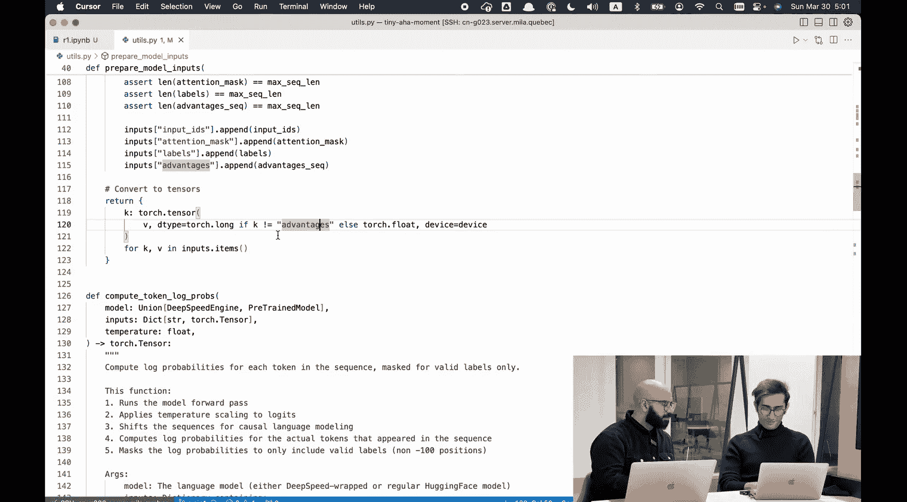

TheQu looking Is。We have to pass all response。嗯I不知道。😔，Fandages。

 and it's gonna be to that anything we can just say good。That's very you look captain it。I。So yeah。

 everything kind of。Checks out which the water we had before。One question。There are sometimes like。

 is it when you， if you。Concatenate this is like the query we can idea and response we can。

And then convert this to text and token it again。It's no guarantee that you will get the same input。

 There is no guarantee， because I think the entire like process of tokenization and detokenization is not really guaranteed to be。

 is it called invertible invertible。 Yeah， like because there are like even from like before talking about the tokens and like the。

Creedity decoding of these bike implementations。I think there are preprocessing steps like for instance。

 let's imagine that your model has generated hundred spaces for whatever reason。

 So 100 tokens of spaces。 if you feed this to this tokenizer。

 it's going to convert these do some it's going to perform some preprocessing that is' going to convert these hundred spaces to maybe 10 very bigger space I see to the generation and the to tokenized version are going to be different exactly so even these kind of small details and intricacs they are going to make some So under most of these tokens if you generate from the model。

And you get a string。 And then you de tokenize it。 You may get different input items。

 That's is a possibility。 It's possible。 Yes， it's completely possible。 No guarantee。Interesting。

Okay， so we can lose this part so we now know how to prepare our input。

To fit to the model and we also know how to compute the talking lock probabilities exactly we have all the ingredients for the Pig gradient loss exactly so in the next section we are going to implement the actual computational p finally fine。

Okay， now we want to finally write a function that computes policy on loss so that we can birup through it and afterward update them load。

Okay， and I just copy pasted the terms that we were going to need when we want to compute the loss。

 As we know， the first term is the bo of poly security and advantage。

 And the second term is the KL I versionence。 If you don't remember this。

 please pause at this point and re look at all of these definition and why these are in this form from the previous sections of this video。

 Okay， so I'm gonna define a function and compute policy。Policy laws， I guess。

 And it's going to receive inputs。 So it is a dictionary that has the。

Inputs that we're going to feed to the model。 And we have completed this in the previous sections。

 Okay， so it is going to return to us torch sensor。 So this is the entire body of this function。

 This is the definition of this function。 just before doing this。

 let me load the models into the GPU。 So for the policy。 we auto one for cause。Oh。

 think you we made the time。From pre traineded， I think we did this before for compete like props。

 But let's do this again， just to make sure。So press the model lane。Torch D type is going to be the。

We followed 16。And we're going to。Use the flash attention implementation。I think it was attention。

ation， if I'm not mistaken， I hope。Okay， and device map， it's going to be zero。

 So its gonna we are going to load this into。Sairs g。Okay， let's see what happens。Perfect。

We're going to import load the same model as or reference policy because we want to compute the KL penalty and it requires to compute to for us to compute the reference like probabilities under for the same episode。

So currently， you have two models on GP2 models on GP 1 is policy，1 is reference policy exactly。

 However， you are not going to have any optimizer for the reference。

 So the optimizer memory that is just for the policy。Okay。

 let's go and implement the complete policy loss and function。 For the purposes of implementation。

 implementing this function， I'm gonna just export all of the variables from this dictionary because these it is easier to work with。

 So input I is going to be inputs。And。And in reality。

 this is these inputs are batch like batch of inputs that are going to be passive to this function。

Attention must scale equal to input。我都随他。😔，啊 sorry。你包。So just before going any further。

 you just want to put the dimensions for this。 So all of these they have x size as the first dimension。

 and the second is going to be sequence length。Okay。Don't forget， we have an advantage here。And。Okay。

 and this is also going to have the same dimension as all of this。Okay。

 so right now we have this and we can just easily go and compute the probes for the reference and the policy。

 But before doing that， I want to first compute the labels mass because it's going to become handy for us when we want to ignore the indices where the label is in。

Or just the padding。So I want to compute label mask。 It's going to be labels。 However。

 we have to remember that we are going to shift the labels to one to the left。

 because if you have discussed this， please check the previous section if you are not sure why we are doing this。

Okay， so this is going to be your labels and we are going to only keep the bonds that are not minus 100 or the8 mass ignore index。

And that's convert them to floats。Okay， so yeah， be right now。

 we have everything for computing the like props。Okay， so。Right now。

 I'm first going to compute the like Pro。One question， don't we。

Do the shifting of the labels inside the computer and like。 Yes， but right now。

 we want to mask a couple of self that also in terms， Yes， we need also competitive。So。Yes。

 now we want to compute the log pro， the log props for the reference model。 So fortunately。

 because we are not computing by， we are not bikeroing through it。

 we can just use torch dot no grad environment。😊，So we don't want to is any kind of forward paths for this。

If you remember， we had the compute to again like props function and the model it receives is a reference policy。

And it's going to receive an input for the input dictionary for， for the inputs。

 It's also going to receive the temperature。 So just to make sure that we have defined temperature here。

 I'm gonna。Whats0。0。Let's。I use capital letters to。Note that this is a hyperparameter。

 and unfortunately， we have to again， pack these inputs as dictionary because on the computer。

 can like probably it expects a dictionary， maybe not the best design pattern， but anyway。Okay。

 or input I again。Attention mask and evils。And were not going to pass the advantage because it's just going to compute。

 This function is going to compute it like props， not the boss function。 aware of advantages。

 exactly。So now that we have the reference like props， let me compute the actual policy like props。

I'm not going to re prefi it bit policy because it is just the actual like props of this。

 this episode。So I'm just going to pass the。How is it here。As we have defined it here。Okay。And okay。

 let's be。Fort to do this。Hasing the one improve， and also the。Temperature reaches the global value。

And okay， perfect。 So we have compute left reference like props and the actual like props。

 So everything is ready to compute these a lot terms。

 And just to make sure that we have these things available。 Let me copy paste them。😊。

Just make sure we can。Take a look at them。 Maybe we want to implement this。

 The first term of this entire laws is the like probe of the policy times the advantage。Okay。

 so we're going to implement this policy loss。 It's the one that I'm going to name it。

 This is going to be log pros。Times the advantages。 However。

 one thing that we should note that the optimizer implemented in Ptor。

 theyre going to minimize the loss always， right， But the policy loss that we compute the policy gradient。

 it is gradient essence。 So here we have to multiply this thing by -1。

 Just make sure this is negative。 And。So we have this like props times the advantages。

 We have compute everything。 And right now we have to make sure we multiply this by label mask。

 And because we don't want to have any sort of contribution from the advantages。

 I you think in the compute to like props， we apply the label mask for the like props。

 So whenever there is a ignore index， we are going to have a like Pro of 0 at those points。

 So these are not going to have any effect。 we don't have contributions from the tokens from the query。

And the the just want them from the， exactly。So， yes， this is going to be multipied by the mask。

 And let me also put their entire dimension here for irritability。 So here there is one difference。

 It is sequencing -1， because these are shifted。Again， if you are not sure why we are shifting them。

 please make sure to rewatch the previous sections that we had this when we discuss this matter。

 But the easy hint is that。You don't have labels for the last token。

 So you need to ignore it the predictions of the model after the last token。 you don't。

 you don't know what comes next。 So you cannot do next token。Like loss calculation。 Ex。

 it is how causal of language monothing is implemented at end of the today。Okay。

 so we have the policy loss。 So we have computed this term。

 and now it is time to compute the K penalty。 So for the K penalty。

 we are going to have the ratio between the reference policy and the current policy。

 These two terms need to be computed first。Okay， so I'm gonna name this reference ratio。

And I'm going to use reference， like props。Minus P。Okay， so we have this thing。

 And just remember that this reference ratio that I compute is this term。

 But when want to compute this， we have to exponiate it first。So the care penalty。

This is going to be equal to a torch， the exponential of this reference。

Like props and minus reference ratio。Oh， sorry。Not a reference， like proper reference ratio。

And it is going to be also subed by one。 So let's check that again。

This is an exponential of the like prop ratios and the like prop ratios themselves -1 at the end。

Okay， so again。You are going to multiply this by labels mask。

Because we don't want to compute any K L for the， for the tokens that are masked。And again， thats me。

Put the dimensions here。 These are all going to have the same dimensions。Okay。

 so now we have every ingredients with just a time to compute the。Final lost terms。

So the loss is going to be policy loss and plus the K penalty。Here's a K coefficient as Yes。

 we have to define it also here， KL。It's going to be equal to 0。0，0，1， I think， for the experiment。

 I don't remember exactly。 but I think it was about this number times the K L。

Penalty that you have completed。 here we test what happens if we just set it to 0。I think for GRPO。

 it kind of diverges for the experiment that we had， but for。Wine PPO and PPO， they。

 I think also diverge， but at much later point。 But again， it's all maybe task dependent。

 model dependent。 So it's not at end， it's a regularization to keep the all。Same right， in yes。

 or in other words to preventing us to go very far away from。

 But I think like in this task that we want to。Really deviate from the printer and model。

Maybe in this case， it's better to set it to like loan numbers。Yes， okay。

 so our loss is basically a scalar。 And there is one final thing。

 So here we just summed all of the right now。 So I sorry， this is still。B size。Y s length -1。

 So we have to convert them to a single scalealar。 So the way we do this is to just we sum this term and divide by the number of terms that are divided that are present in this in this term and this loss computation。

 One way to do this is to basically use label。Mask some。And this is going to work。However。

 if you are going， if you are going to use gradientian accumulation。

 which is going to be the case for us in the actual implementation of this code。

 let me define this term differently because if want to divide by the entire number of response in valid labels or valid terms that are contributing to the loss the in the big batch and here we have only access to the kind of the mini batch we want to then we are completing the gradientian itself。

 let's define total responses La。It's goinging to be incomp from outside of this function。

 So instead of divided by the label mass， it's going to be divided by the total response length。So。

 yes， and this is a disclaimer here， right， There is a disclaimer。

 which I'm going to talk about in a second。 Just make sure everything is performed directly。 Okay。

 so in general， the reason that we are putting this kind of normalization by the number of all actions or all of the tokens inside the gradient update is that。

This is a common practice in kind of auto implementation。

 but if you really want to follow the math exactly。

 you're going to only divided by the number of episodes that you're going to use to compute this polysegarity what's your back size your back size mini size actual back size。

 but this works well， you're going to follow this practice。

 but if you're not sure what would the effect of using the actual mathematically correct version。

 get free to try this at home yeah。It's a great exercise。 And yeah。

 I think it's just convenient to divide the loss by the number of elements that are。

Present in the loss。But it is not from the mass， like the mass suggests you just divide by the number of trajectories exactly because at the end of the day。

 it is the like probe of， is it the gradient of like probe of the entire trajectory trajectory。

 which is just the summation like。The summation of the gridlock props of all the actions。

 exactly So you don't need。 you shouldn't。Divide by the length of a tragic mix。

 This is not the average of this，It can actually have some interesting effects。

 like maybe these four incentivizes or disincentivizes， long or short responses。

 We are saying that it's just a common practice。 but it does not mean that it's like coming from a very。

I know。 experimented hard。Bund truth or something。Exactly。For instance。

 we can imagine if you have a very long response and these long responses are going to。

Have higher like more loss terms inside your loss terms in gradient in your gradient computation。

 in a sense， they have a kind of a relatively bigger role in the gradient。 maybe And I don't know。

 Maybe the models is not going to learn too much about short responses。 Yeah。

 could be one of the effects。 but these are really nonlinear functions。

 So it's not clear what could happen。That's what you will find out and please let us know。Yes。

 sure they let us know。I guess write on Twitter， maybe on Twitter on Github issues or even here in the comment section section。

 yeah。Okay， so this is completed。 Let me see if I can test this。

 So imagine that I think we had an episodes that we。😊，Dfined in the cells above。 Okay。

 so we are going to have the inputs。Prepare all the inputs。And I can just copy pastes from here。

 perfect。Okay， I have this And the loss is going to be。E call to compute policy laws。

 So we're going to pass the inputs。 it already has access to the policy and references from outside of this function。

 And before that， let me compute the total。responses length。 this is going to be equal to all of the。

 the response。 It is going to be equal to the number of some of the all of the tokens in all of the responses inside these episodes。

 Okay， so the way we do this is to just say input。Labels。Not equal to minus-100。

 and we're just going to compute some of this。And for now， there。

 it's a the function expect fellow version of it， but it does not really really matter when we want to come。

 if you want to compute， convert this from。T tens or to write on vote。

Doesn't make any difference here， just to make sure we are compatible。So let's see， okay。

 there is an error。Okay， we have not imported this。😔，Okay。Temperature is not also defined。Okay。

 this is actually a good point。 I forgot to also shift the advantage， so what do I mean by this？😊。

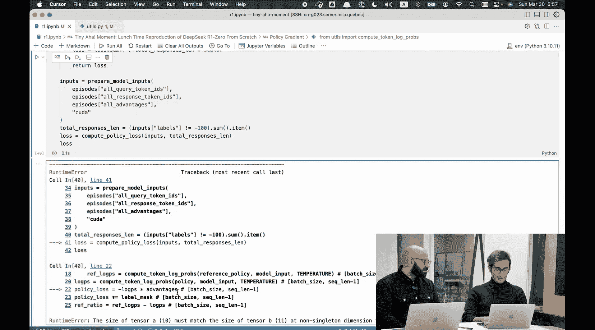

Okay， let's look at the shape of the advantages here。

 What is this it is by size times to sequence thing。 However， if you can see here。

 we have the log props that are of the shape， by size time sequence length minus-1。

 And this is exactly as we talked before。 These are the shifted labels and you just need to make sure that our advantages are also aligned to the log props。

 So this is going to be。😊，And shift it to one to the left as well。Okay， so yeah。

 which advantage of each token is allowing it itss actual like exactly they multi like together。

 like the advantage of that token。 and it's great like。Exactly。

 right now we have the last term computer。 This is a singular sc and we can back pro through this。

 I just want to also print out the KL term here to just make sure we expect the KL term to be exactly zero because we have not changed the policy yet at all。

KL is equal to K length penalty sum， and it is going to be divided by the。To other response。However。

 I think for the KL， maybe dividing when you want to report this as an actual KL value。

 I don think it should be divided by the number of response things。It should be， right。

It should be divided by the number of episodes No the number of number of bias。 I mean。

 it depends on what you want to see if you want the actual k， yes， by the number of episodes。

 but also this is a good proxy the probability over each toolken differs from the probability of each chicken under the difference policy Yeah。

 that's a good point。 So yeah， any case， can report both to numbers。

 you can check both during a training。 Okay， let's run them again。 and as we can see。

 the kL is exactly equal to the zero here。So at this point we have all of the ingredients that are needed for adult training and the rest would be just a simple loop that pull all of these components together。

 generate the episode using the VLM， compute the advantages and apply the policy gradient。

And update your policy。 So we also don't have an optimizer yet。

But we don't have optimize here in the next session， we are going to implement。

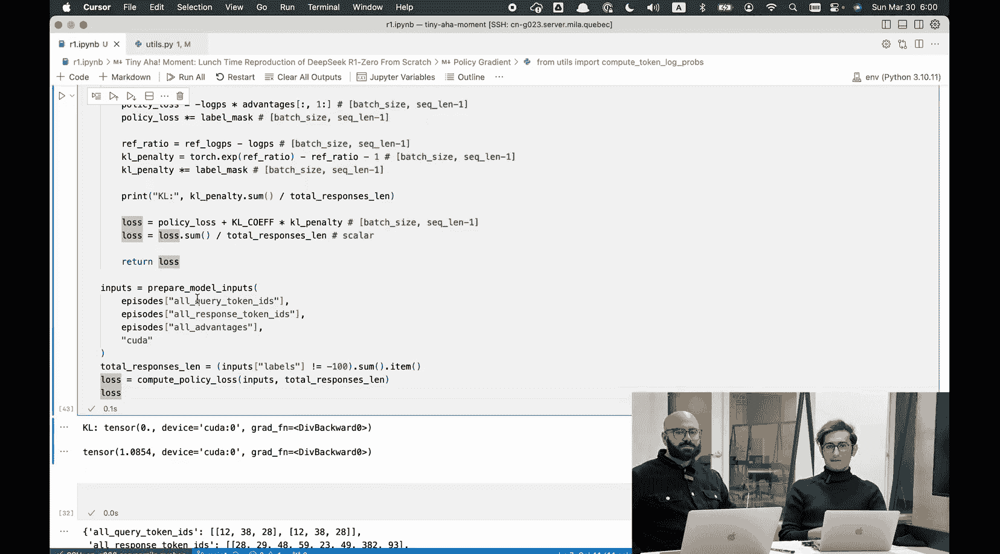

It's time to implementedment the entire turn loop。 And just before doing that。

 we have to make sure that we have to opt or optimizer。

 We have to define or via them and all of these things together。

 I know that in in this entire notebook I have defined these and already loaded this memory。

 But I want to have all of this in the same block。 So that is easy to track and make sure that we know froms view what are the stuff that are involved in a training of in the training。

 Okay， so we need to have the reference policy。 I'm just gonna go the and just copy paste and from here。

 because I think it's better use all the time。 So the reference policy with this one。Okay。At。

And the policy model。It's going to be exactly the same thing。

Both these two things are going to be initialized from the initial pretrain model。And one thing here。

 we need to enable the gradientian checkpoint for the policy model because it's going to help us save memory。

Yes， I just copy paste it here because I forgot how what was the actual command for enabling gradientian checkpointing。

 But this is a hugging phase API。 If you're not sure what's going on。

 make sure to check the documentation for hugging phase。

And the next part is going to be us defining the D speed deep speed module or the D speed engine for both of the reference policy and the and the actual policy。

 before doing that， I want to explain why do we need deep speed exactly， Because in general。

 D speed is associated a bit multin， multi GPU charted training and so on。 So exactly。

 But the question is that since this is a single GPU training， why do we exactly need D speed。

Besides all of those sharding mechanisms that we have in EB， for instance， DB0ization number two。

 there are other optimization that EB has implemented that are going to help us save memory So one of those particular implementation detail organization to extract dB is performing for us is reducing the amount of memory fragmentation and this is going to help us reduce the memory even more。

 But do you know how they do that I think the way that is implemented is that they compute the total number of the total number of pointss that are required to save them a little weight and they just go and allocate buffer exactly like simply like an array of Bf16 of that amount and they copy the tensor like back to back and they know how to map these exact values to the point or tensors and I think。

Patch the like policy model or or the model implementation in model implementation。

 I think this is the actual like detail that the the method that they use。 However。

 these are not really well documented and I think if you need this if you need to understand this in more details。

 please make sure to check out the DB engine source code。

 And I think this is going to be implemented in the0， zero optimizers class。One question。

 it is possible for us even not to use D right if we had lots of memory or。So there are。

 we don't care about like memory efficiency。 There are a couple of things to consider。 So。

 first of all， we are performing mixed precision training and in mixed precision training。

 we need to make sure that we keep track of like the mass  thermo lates And don't want to perform the forward path。

 We have to convert them from 32 B to to 16 bit and so on。

 So there are all of these different components involved in mixed precision training。

 And I think doing this manually with P。 It's not going to implement that by itself。

 But I'm not really sure。 Maybe it in the new version its。

 We didn't want to do mixed precision training。 What should we。

Asum we don't want to do in mixed precision training。 as far as I remember。

 there are an optimizer states， they are all going to be in full precision and there's going to be a full full copy of the model weights in full precision as well because once you're updating the model of weights from the gradient。

 I think it is not in full precision mode。 And then you want to perform the forward paths。

 you have to convert the mass survey from 32 B to 16 B Comp the forward path in 16 B Comp the gradient in 16 B as well。

 And I think that would be the g of mixed precision training。

 And obviously there are there are some operation in Pyth that should be performing full precision mode。

 And I think but those are， I think， automatically handed byyth at this point。

 But keeping the mass survey using the mass survey to update the weights and so on。

 I'm not sure whether this is impmented in the。Poit or I't what。 Maybe it is。

 I'm not sure at this point。 But for flash attention。

 even we don't have a full precision implementation of it。 So it's yes。

 it's not possible to do the whole model calculation in full precision， because。The kernel for it。

 as far as I know， is not there at least for flash attention。 If one says， I don't care about。Mr。

 President Traney， I want to just do the whole calculation in。Food precision like the flow 32。

I think it's not possible。MaI think it's not， but I'm not sure at this point whether the 32 beating pigation of flashlash attention is also aable。

 maybe okay， so in any case， we are going to do Yes， and if we handle this words。

The best we handle for handle is for us beautiful， yes。Okay， let's import deep speed。

And before initializing deep speed engines， we have to copy past the configs。

 But let's imagine that the， the configs are available。 I'm gonna define it later。 Okay。

 let's initialize the D speed engines。 So the reference。

Honestly if you are going to use the same valuable wing because we don't are not going to reference reference later。

It's going to be deeper speed。Initize the model is going to be reference policy。

We have to pass the config。 But for now， let's imagine that there is a very defined D speed reference config。

Perfect， But remember that the speed is going to pass some other variables to us as output。

 But we are not going to use them。 So just keep the reference policy and。The policy。

Model is going to be defined the exact same way。呃s。Use the specific initialization method。

'll probably see model again。Config is equal to the speed config。 We are going to define this later。

 and we have to pass the model parameters because it's actually。

 it's going to hold the optimizeimrs and so on。 So these are the parameters for the optimizer。 Yes。

 exactly。Pters， okay， and。Before continuing， I want to say why do we use DPpe for the reference model as well and in the conflict that we are going to define for the reference model。

 there is not going to be any optimizer。 So the D speed engine for the optimizer for the policy for the reference policy it's not going to contain any optimization optimize any transition。

 However， the reason this is that we want to have the same forward pass computation graph as the policy models so that the computation of KL and everything is just exactly the same。

 Otherwise， if you were to use the hugging phase model just to compute the likepro reference model there are going to be really small changes because I think for the ifflow 16。

 there are some different routes or different modes that are enabled in DP speed so just it's better to keep everything in DP speed engine。

 forward pass would be a little bit different a little bit different。 Yes I think because but yeah。

 exactly I think DP speed is going to wrap the forward pass off。

Huggging face transformers model and so it's going to it's going to change a bit。

 but it's also nice to have the same if you like for those models right Yeah exactly。Yeah。

 in general， the deep speed， is's not going to change how we talk to the model in sense of passing。

 but which variables you're going to pass the model。 One question。 So currently。

 the reference policy on GP， right， Exact No， that's a good point。

 We can we need to move this to to the CPU。 So the reference policy here。

 it is an instance of D speed engine class。 But if you want to access to the actual model。

 it is the module field or module variable inside the reference policy object。 Okay。

 just say and also one other question。 So the reference policyology is taking up some space in the GP。

AndD speed， does it go un free of that or is it like just going to use the same space。

 you know when we with the CPU know， when it's on GPU like when you initial is it is it going to oh no's no it's not going to initial add anyval So the reference policy already there I' not going to create a newtenor however。

 that's a good question because for the DB initialization of the policy in the conflictt that we are going to define。

 we are going to see that we are using the stage 12 speed although this is a single GP training and in that it is going to define exact same amount of the buffer that is going to create on GP and the CPU as well So it moves the model back to CPU again create the buffer there and then copy back to the GP there are some cases where there are not enough CPU memory available and even initialization of DP is going to is going to fail。

And it is counterintuitive because you have available the GPPU memory。

 but you are actually encountering CPU memory error and this is the exact reason because you fit in a stage two。

 it is doing some sort of trick behind the scene and thats requires some amount of CPUU memory。

 but for us， I don't think this is going to be an issue。Okay。

 so we actually moved a reference policy to the CPU and I think this is done for this part。

 but let me reassert this Jupyter notebook and make sure that all of these things can actually run。

 Oh， we actually forgot to define theest with confits。 So yes。

Okay I have copy paste that lot of these variables here and just to make sure this is DS config and just quickly let me go over this confis just to make sure why what do they say for the reference model。

 we don't really have anything in particular just the important thing is that we enable Bf16 we are going to pass by training byte size and microbyte size and gradient accumulation set。

 but these are just a subd speed from comping this is in no way is going to be used in any way in the speed engine for optimization or anything So for the actual policy。

 the configuration， it's going to be again use the speed Bf16 implementation that's that and we have the zero optimization As I said we are going to use a stage2 So we are going to have the overlap that communication I found that sometimes in some versions of D speed enable this make or some of the gradient none。

Maybe this is going to happen。 Maybe it's not。 but I just wanted to be on the beyond on the safe side。

 So the training batch size， the actual training batch size of optimization is the number of episodes per iteration。

 which for us is going to be 64。And the microbi size is the pair device batch size that we have defined it is for and obviously the amount of theac set that we are going to perform is going to the division of episode per iteration by the pair device by size so we are going to have gradient clipping and so here we define the optimizer parameters so the type is going to be auto onW although we don't have any8 decay。

The learning rate is 1 e-6， which we have defined above。 So these are torch petos and the Epsybon。

 And finally， we are going to enable torch atom。 And this is an important but slightly cry thing here。

 So basically Dps speed， it has multiple implementation of atom optimizer。

 And the first version is the fuse atom that it has where it has some like fuse kernels。 And it is。

 I think a bit more efficient。 that normal pitorrch。 However， in our experience。

 we found that this optimizer is a bit， I have to say un a stable。

 And I think we encountered a very in stranger。 we were optimizing this three billion model。

 like it was working fine on a1 billion model。 And then we started doing it with the tri billion model。

 and our our experiments were not doing anything。 And we found out the model is not changing at all。

 like the parameters were not updated。 And the way we knew it is was we were monitoring the k and the k was 0。

All the time。 which was the change。 Yeah， we went to great Le because we never thought of this。

 And at the end， we found out to my Z。 Yes， so for whatever reason。

 the D S bits internal implementation of Adam dius version。

It's not performing variable or there is some bug， I don't know exactly what's going on。

 maybe it's fixed now， but maybe it is works at the point that you are seeing this video Yes。

 one month ago we were developing this and。ButAt least encounter this with the Q 2 billion。

 So if you're seeing the same thing， maybe change it。Yes。Okay， so yeah。

 we're just going to tell the we don't use your own internal implementation。

 use Ptorch implementation and fine。 So we have implemented。 we have defined all of these configs。

 Let's run this cell and see if it works。Oh， we have not run the cell。 we define the model name。

 I think this is defined somewhere here。Okay， here is very defined。 Ho La back to。

This is all we want it to run。 Okay， torch is not defined。Yeah。

 so this is the problem with Jupyter notebook straight P start and you have to rerun from all of the cells。

Okay， so we loaded the checkpoints short for the。

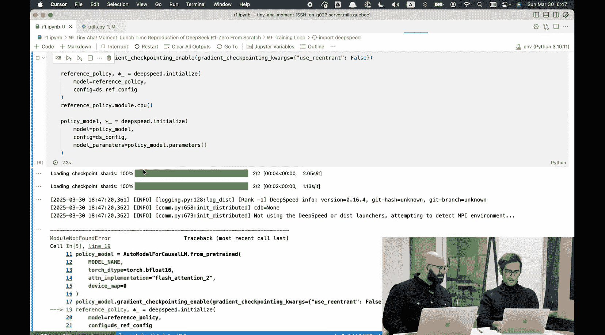

Reference and policy。 But there is also another。Oh。

 this is actually one of the intricacies of deeper speed。

 it is expecting a couple of environment variable to be defined and lets me copy past these environment variables。

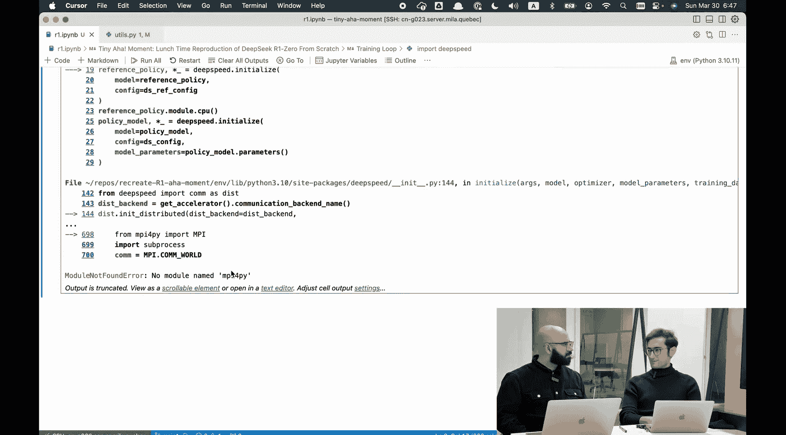

Okay， these are these environment variables that we have to define。

 lets just make sure that always is imported here。Okay。

 perfect what are these environment variables this environment variable are generally said when we want to do multi GPP or multi node training this master address。

 it says that what is the rank the address for the rank0。

 what is the port for rank0 and so on and generally when we launch the Python the Python as script that has the the D with implementation and D with engine definitions it expects is variable to exist and it is used to create a process group among all of the training notes and training ranks and but we are all running the same script。

 but the rank and look rank or。Exactly。However， in this case， obviously it is only a single rank。

 single GP and everything。 So we have to define this。 Otherwise。

 DP thinks that something else is going on。 That's why you expect us to have this package So but we don't need it really。

 just let it know that it's a single GP P。 exactly。 I think up to this point。 it was。

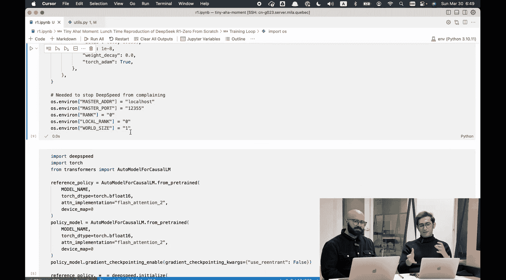

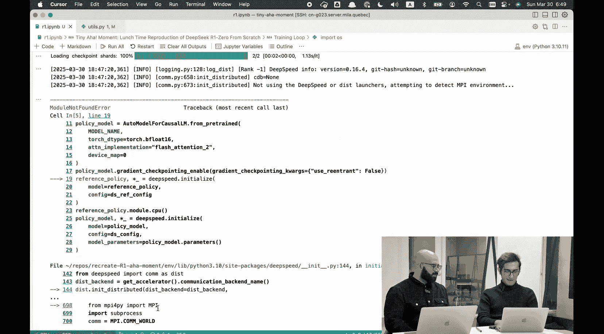

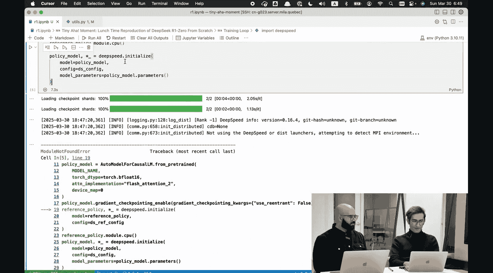

Successfully run。 So we just run the rest of this。

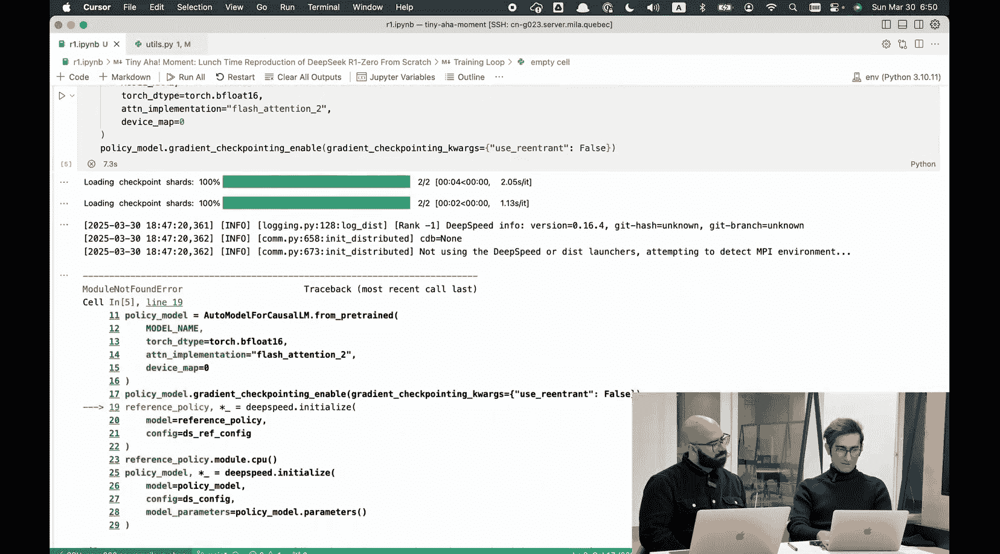

Okay， as we can see， it is running nicely。So the first EPsp engine， as you can see。

 the config is just for the reference model， there is no optimizer here。

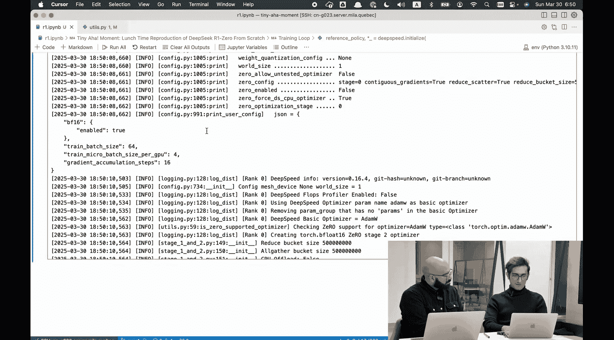

And the second one， as you can see， everything is defined。 We have the R W。 Okay， yes。

 this one is run。 Okay， just to make sure policy model。

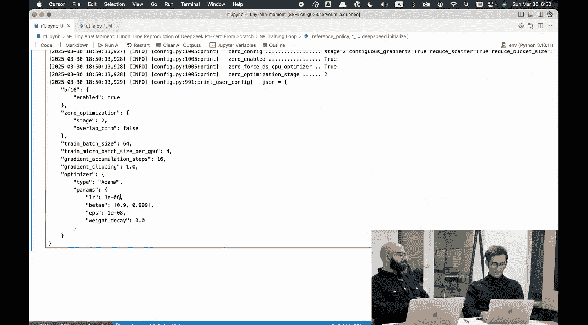

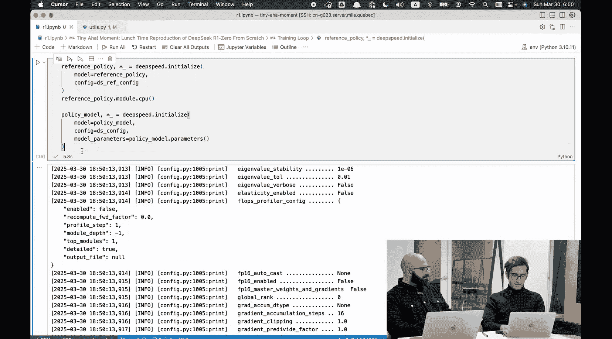

YesThis is a di speed engine and there is a module that contains the center。Okay。

 so let me clear all of the output。 Put this back here。Okay， nice and perfect。

 So just let me take a look at the。GPU memory at this point we are at 36 and now we need to define VLM run the VLLM to also initialize and make sure it has allocated its GPU。

 So again I'm not going to rewrite the viaLM definition from scratch and we'm just going to copy this from。

Somewhere here that we defined earlier， yes， exactly this one。So just going back。😔，Okay， after this。

 I'm gonna define it here。 Let's move this。To hear。Perfect sampling in problems。

 We are not going to use it at this point。 But in any case， we need to just。

 I'm just gonna change this to inference engine。Of course we have Elism。

It's not very informative it's not a very informative name。

And there is an additional variable that we have to define here， enable sleep mode。

This is going to be useful for us when we want to tell the VLM engine to go to a sleep then we are going to perform the gradient computation and gradient optimization step basically and then letting know that it has to come back and reallocateates its KV cache on all of its memory but once as all of the training as step is done。

 So this is the algorithm。 So we generate the episodes。 we put the VLM into sleep mode。

 which effectively empties the KV cache。 So we have memory for the activations。

 exactly allocates the entire KV cache and I think it moves its internal model to CPU as well。And。

Then we perform the gradient computation like forward pass。

 backwardboard pass and computing the and everything once we compute that， update the model。

 we reenable the VLM engine called update update the weights of the internal model of insight the internal model of VLM using the updated weights and then we go and resample the episodes again。

Nice， okay。 just let me run this cell as all just again。We need to run this。

Just give it a couple of seconds。He。

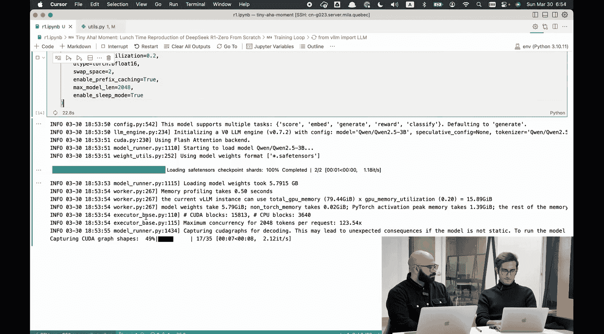

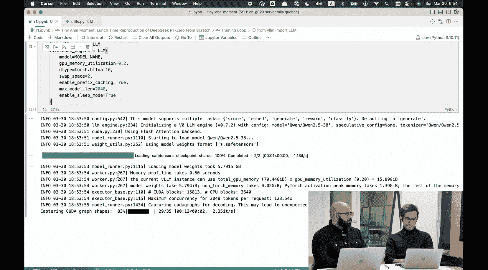

Okay， done。 So we right now have the inference engine as well。 I just want to。Make sure， yes。

Everything is available for us and ready to go for the actual implementation of the training。

sStay tune。I would like to work on an example where we show how this loading of model into VLLM and some works exactly and just show like what is the behavior and why we are doing this So I have this notebook called VLM example。

 which we are going to use to demonstrate this Okay。

 lets me go over and run this and I'm gonna explain it line by line。

 So we have the imports I think really important and I like use our policy find it here。

 and I'm gonna instantiate VLLM。 These are the exact same parameters that I used before let me as well。

And just while this is loading。 I would like to talk about this function。

 So we have load model input into VlLM。 So why do we do this There is an internal model inside BLM So we have defined a policy here right but there is also a copy of a model inside this inference engine。

 So the job of inference engine is to just perform inference as fast as possible as quick as as possible and be really efficient with the number usage。

 But when we are doing an URL here we are updating the policy and we are sampling new is those new trajectories with the new policy So we have to update this internal model of VlLM as well to reflect the new policy So just updating to remove and then the next tra should be sampled from the updated model exactly。

And yeah， and the reasons， as I said， the reason we do it is that B other them it does not have。

 it doesn't have access to or new new the operated policies。

 and it doesn't have access to D with N or any of that。

 So you have to manually update the internal models。

 The very slow way of doing this is you save the Hu interface model。

And then you restart the V and using that checkpoint。 But this is very slow。 It is very slow。

 So you can actually just load the weights。

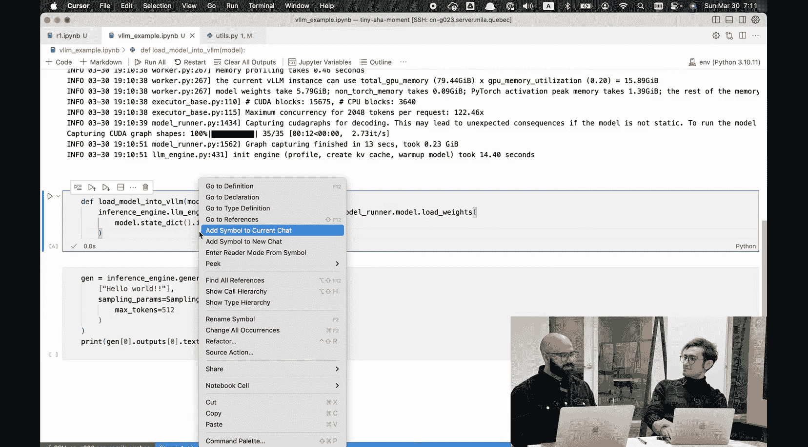

Yeah。Yeah， so we have this function here。 load model into V the M。 I'm not going to really。

AndEx what this exactly do， But this entire expression is to just access the internal model of internal classes and objects Now don't worry about this if you really want to understand this better。

 Please check out the VLLM source code and you can't find why we are actually accessing to the VLM engine the model inside VL engine using in this variables。

 Okay so this is defined。 And in this example， I would like to first sample prompt from sample trajectory from the VLM engine with the normal policy with the initial policy And then I'm going to update the model bit some model model and see what happens。

😊，Okay， so here we are sampling your response to the hello word query。 And as you can see。

 it's talking about the first post for this blog always， Yeah， it's talking about the black post。

 right， and everything makes sense because it's a pretty chainme model， but yeah。😊。

So now I would like to initialize the random model and in the exact same format ofquin or the exact same format of the policy that we have。

 I'm going to load that inside the V image Okay， so I'm going to just define the config from for the Qn model。

 I think it is also importance。Okay。The first import should be from， yes。So。Okay。

 so we have the config of this model just looking at this。 Yeah。

 and then I would like to initialize a random model， which is N to。4 causes alone。

You're just passing the config， so this is going to initialize a model from scratch。

 randomly initialize weightits and just passing to kudo。冇嘢做佢啦。

So it has the same architecture as square， exactly same architecture， random， random base。Okay。Loed。

And yeah， so we have this thing， random model， random weightits。

 and I would like to load this into realLM。I'm going use the hand function that we define。

 So just pass random model。As you can see， it is done and it is super fast。

 So let's copy paste this exact same thing here。嗯。See what happens。Yeah as we can see。

 this is completely random sequence， so as we expect。

 this is a randomly initialized weightits loaded into V so this should not really mean anything。

Ms of language and emoji is not exactly so this is， I think， uniform over the vocabulary。

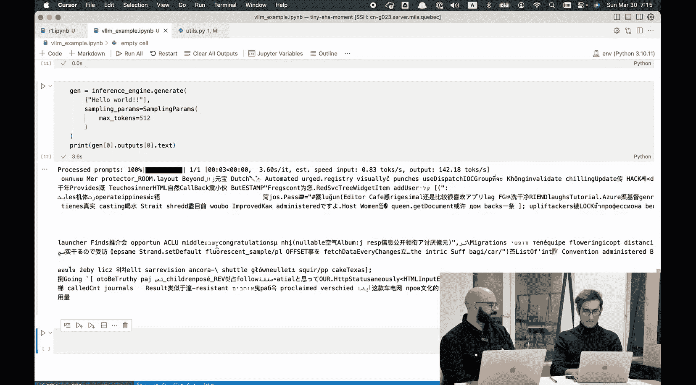

And I would right now， I would like to load the policy back into Vietnam just so。

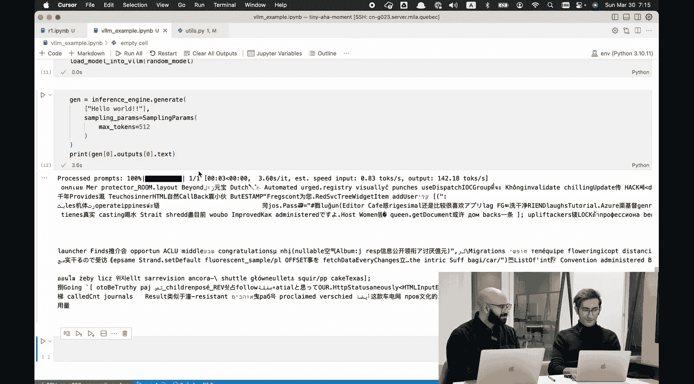

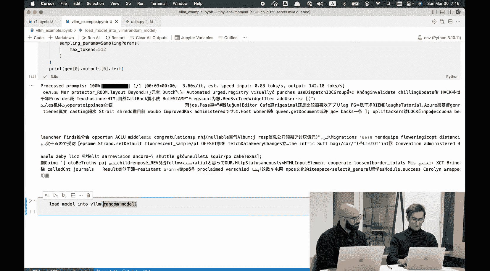

Make sure that we can。Generate some sensible responses again。

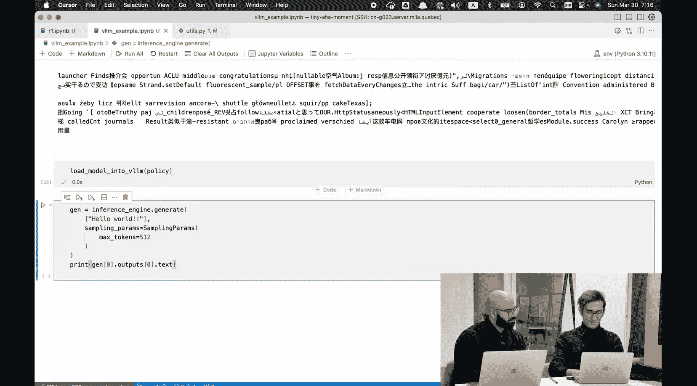

Yes， as we can see， it are much more sensible now。 So yes， it's a pretty。 It is a。

 and it's also very fast update compared to real starting and saving to this kind exactly。

 It happens like the loading is just however I have to note that right now you are using you are in a single process single setting normally when you have multiple via or multiple inference engines。

 they are probably located on other GP and perhaps on other notes inside the cost and the way to update theits inside all of these inference engines it to use the niel library from video and basically the rank0 or one of the ranks。

 it creates a process group with all of these inference engines and then it broadcasts the baits from again rank0 to all of those inference engines。

 and this is still very fast but this is not as fast as here because。It is exactly。

 we are sharing the memory with VL dimension， right， we have access to this internal。

 But when your VLL is in another computer， in another server， well。

 obviously you don't have access to its memory and even if it is sorry。

 when it is on another process on the same on the same server or same note you don't have access to its memory。

 So the only way that we have to update the base is to use the process group and Nikel distributed library。

 what do you think of recording a video for all training on multiple nodes。

That's that's a good point。 actually， maybe we can record a video on TV next， yes。

It's one of the best code base for all training， if not the best for academic purposes。 Yeah。

 let us know in the comments if you want us to。And just back， what is treet。

 Trit is a smallish library that we developed for our previous project internally。

 and we actually publishes with the paper that we produce using that code based。

 but we also have another like a next version of it， which is much more nible。

 much more lighter than the original version and we' are using it internally， maybe。

If you clean it up， we can't release it sometimes soon。

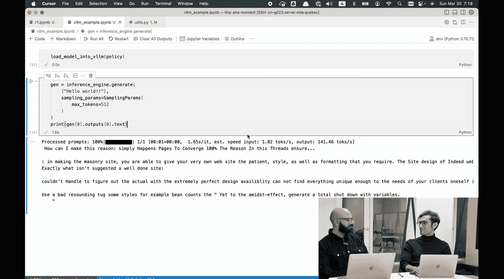

Here comes the last quote part of this video we are going to implement the actual training loop of R10 like training and before actually implementing the code let me go over all of the steps and just to make sure that we know what are stuff that we do and also note to myself to just remember all of these steps so the first step here is to just re sample a batch from dataset set uniformly and once you have these samples we just fit these to LLM and ask you to generate four generations or for completion per each of these prompts and once we have them be feed them to the episode creation function and it will convert it will convert these to episode which means that we are gonna have the query talkingken ID respond to an ID and most importantly their advantages。

And once this is done， we put the VLLM or or inference engine back to sleep and just free up its memory。

 just make sure that we have enough space to run our training。

Then we just create this pads all of these episodes， as we discussed earlier。

And the policies are padd。 we pulled back the GPU， the reference model back to GPU because we always put them inside the we always put this in CPU to just save the memory。

Whenever possible and once all of these when this is in GPU we have all of the ingredients to perform more training so the next part is going to be inside the loop so this is the gradient accommodation so we are going to take mini batches from these episodes and compute the loss。

 take the gradient， them the gradient inside that gradient of the baits and once all of the once we have iterated over all of these episodes we are at the gradient accommodation boundary so we can actually perform optimizations and update them on bits。

One more thing， when we are at the gradientian accommodation boundary。

 it means that we have already computed loss and gradientian for the last final step and we can easily put back the reference model to CPU it's going to free off some space for us even I think it's going to be around like 60abys of space available to us so whenever we want to compute update weights and perform the optimization step we're going to have more way available to us。

And once it's all done， it means that we have updated our policy for one iteration of orL。

 and this is the time to back up the BLLN and update its internal model to use the new UD updated model。

Okay。So let's actually go on into the mantis。So I'm not gonna put everything inside the loop first because I want to implementedment this for one iteration and once we make sure that everything is nice and good then we are going to move this back to inside the for loop and just perform from the entire auto iteration。

ある。Okay， so the first step， as I said， is going to be sampling stuff from our sampling data from our data。

 Okay， we're going to sample batch of random in indices。 And once we have those available。

 we can select this from the we can select samples from the data， okay， so。

Ind is going to be equal to random the choice and size。

 So how many examples we are going to sample from the dataset set， right。

 So we have defined the episodes per iteration value Right。

 So if we know that we are going to use 64 episode per each other iteration or training group， right。

 and it means that since we are sampling for prompt for completion per each of these prompts。

 it means that we have to divide the number of episode per the number of generations to compute the number of samples that we are going to take from the dataset set。

 Okay， so number of samples is going to be equal episodes per iteration divided by generation per sample have parameter。

 Okay， so just。Taking a look at this， is's going to be 60。 Okay， so let's sample this。

 So the size is equal to the number of samples。 And。

 and I think the length of this sampling is going to be from the length of our dataset set。

 obviously。 So length of our dataset set， which is saving the dataset set variable。

 Let's take a look at this。Yes。So it's going to sample random inices from zero to this number minus1。

And we don't fund replacement。 So we're going to set it to false。 just taking a look at this。 So。

 yes， as we can see， we have sample these， these examples。

 these prompts for or for this iteration of。 Okay， and so we have these available at our hand。

 Let's take this。Convert these to actual prompts。 So there is a select method for hugging face dataset sets where you pass the。

Indices that you want to take from the data will take you this。 So just for us。

 let's take a look at the first sample。Okay， so yes， as we can see， this is the one。

 This is the first example in thispat。Okay， so we have these available。

 and now its this is time to use BLLM to generate completions。 Okay。

 that save the output of BLM inside this gens variable。 So we're going to use the inference engine。

 which we have initialize in the cells above Use the generate method。😊，And okay， so。As I said。

 we are going to pass the input I directly。 We are not going to let V alone them tokenize it for us。

 So because we already have this here。 So we use this prompt token Is argument。嗯 pass the。

Input I column of this dataset set。 Okay， so if you。Want to know what is， what does this mean。

It's going to be， oh， sorry input。So yes， it is going to be a list of lists。

Where we have the prompt oftoken ideas。So input IDs。

And now I want to pass and control the sampling parameters for these set of prompts。 and as we know。

 we are going to use the sampling parameter class from VLM and basically the value of the input argument and controls how many generations we are going to perform per each prompt。

The next important parameter is the temperature。And we are not going to use any top P or top K。

 so I'm just going to pass 35 value。Top P equal to1， It means that we are not。

 we are basically disabled in top P， top top K。Eal to a minus1。

 it means that you are dis in top k and finally we want to set themics tokens this is going to be equal to 1024 and finally we camp has stopped token adss just to make sure that the explicit say each tokens is going to stop and this is going to be or。

En of sentence token ID， which we have computed in the previous cells。

 So this is the token that we want yellow into a stop generation， but it sees this。

And okay is by the default， right， or you just want to be I think it does this by default。

 but I just want to be explicit here。Yeah， let's see what would happen here。

There is somewhere over here。😔，Oh， he made a spelling your。Okay。Fating a bit。So as you can see。

 it's already done。 It only took 9 seconds。 And this is not actually really a slow generation。

 It's really fast。 So only 9 seconds for your generation is actually pretty healthy number。So yes。

 so we have the generation output from VLLM， but in order to pass this tour episode generation episode creation function。

 we have to convert into their talkingken Is and list of talkingken ideass and finish reasons if you don't remember these we can just go back a bit and see what is the definition of or create training episode function all generations is going to be。

Going to we are going to loop over the gens variable。

 So for gen in gens and for out in gen dot output。 So basically output， I think， yes。

 and so this basically this output is the actual variable for each individual completion。

 and we want to take their token Is。 Okay， and one thing we have to perform here before going ahead we have to convert them to a list because by default。

 this variable returns as a top of。The final one， all finished reasons equal to list， let's again。

 copy pastees。Isterfect， so。Yeah， we currently have all of the inputs that we need。

 which we are going to pass them to or create episode functions。Okay。

 just to take a look at what does all of this look like。So all generations。Sorry。

This is a list of output to Canadian and all finished reasons。This is stop， length， stop and so on。

 right。Okay， so we have this now iss the time to compute the episodes just looking back at here。

 so we have sampled this， we have generated the completion and right now we are just going to create the training episodes。

 okay。So episode is going to be called to create training episodes。

And we need to pass a batch of samples that we took from the data， all generations。

 equal call to all generations variable here， all finished reasons as well。

 equal call to all finished reason variable here。And yeah， you're done。Okay。

 let's print out some episodes to see how do they look like？你地址吗？

This is going to be our query and we need to use ortho tokenizer to decode this because everything that we have is in just tokens。

 so let me just show you what do we have here inside the episodes so we have to tokenite these for query。

 we have tokenite these for responses， advantages and。They need to just decode the episodes。

I'll query to can I Ds the first item。 Let's use the first item here。 Yeah。

 I think we should be done。 Let me just put these。The symbol suggests ense where the query starts and a stop。

Okay， so this is this question and let me copy paste this and actually you can solve this one。

For second。Okay， so as you can see here for this example， it is sorry。

The model is using some combination of code。 and at then it says that the result is 36 in result。

 but it's actually a very easy question if you look at。You， you so you have 39 and of 77 and 74。

 So you can make 3 and then subtract it of 36。 What is it target，36。 Oh， okay， yes。

Did them all figure this out？はい。Oction。No。Okay。Let's look at one more example and then we one。

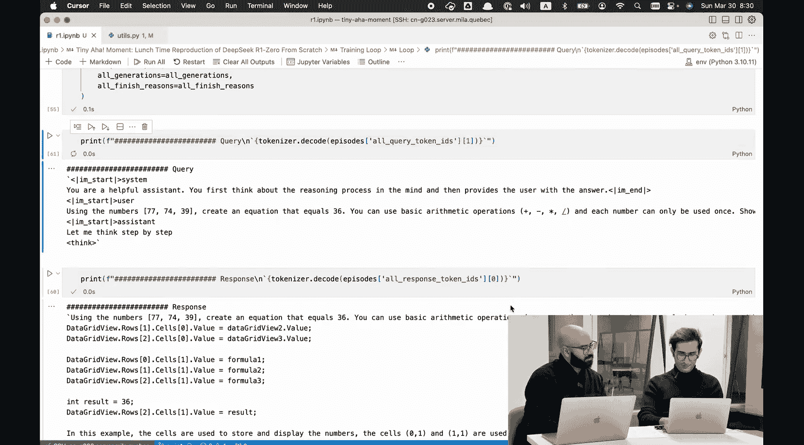

It's the same question same question。 Oh what this one is。Like it， it closes the things to again。

 but。Starts。 Oh， has a mort。 interesting。 It like it starts a mortag。 And then， yes。Think more。

In any case。These are some examples from the model you just going have this。

So now the time is to just put back the VLLM engine into a stmo so that it up the memory。

 can we see the memory before and after sure。So yeah，56，57， sorry。And in， engine sleep。

And you're going to also free up some memory like force garbage collection and so on。So。So， it's。

Sometimes it's good to have some sort of sleep before doing this。 sometimes it takes some time and。

I found it to be a bit helpful to use this sleep before moving on。

 What is the one that you're passing the sleep to sleep， Yeah， so。

Vol limit it has a couple of different sleep modes。

 so it has a sleep mode one and sleep mode two in a sleep mode two if I remember correctly it's going to destroy the model entirely。

 but I think in a sleep mode or one is the one you want one is the mode that you want so it's not going to destroy the model entirely just going move it to CP。

And we're gonna empty cash for kuda。 And I'm not sure that this is necessary。

 but let's do this just to make sure。We are not surpassing。We are not getting out of memory errors。

 looking back at the memory。

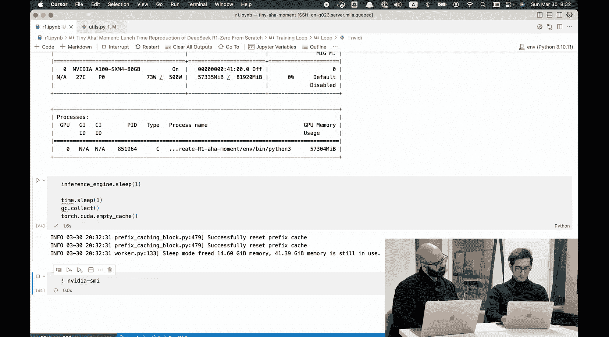

Yes， so it's about 13 GB said 14 points Oh，15 GB。 Yes， about 15 GB。

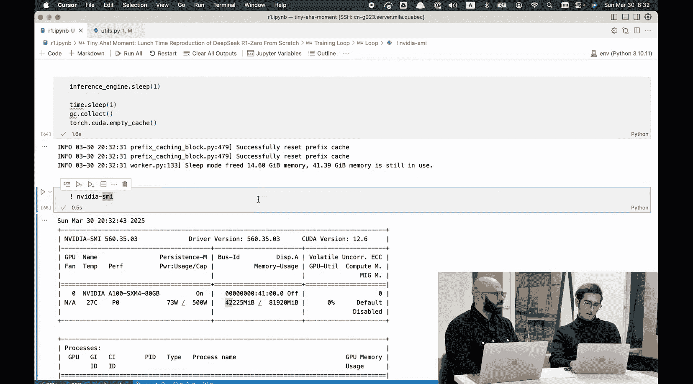

So it really works。It really works。Okay， perfect。 So I'm just gonna remove this here。

 just keep it clean。Yep， we have this。 So going back to the list。

 we have completed these parts and now is' the time to convert these episodes into the what the model is going to accept exactly Fortunatelyly。

 we have written this handy little function。So I'm going define inputs to be prepare model inputs。

 We have this in the utility file。 and if you don't remember how it is implemented。

 just make sure to check out the previous sections of this video。

So the input to this is going to be query talking Is。 I'm just going to pass this very quickly。

This would have been a great case for cancer to help us， yeah。You just news it on purpose。

 Yes not it on purpose because it just goes and covi based from the actual。Gund to。 yes。

 so this is a notebook that we are completing from scratch for this video。

 but we obviously have another Jupyter notebook that have all of these things a bit more details and more tutorial and text。

 which we are releasing on the on our Github。 but cursor is going to just copy paste those directly。

 So it's not really helpful for this particular case of this video。 That's why we knows it。

And we have to pass the device to be just good。Okay。Just。You can look at this。

 we have converted these to tensors， Torch tensors， and all of these on R on GPU。ok。Perfect。

 som just gonna make sure it is clean。 Okay， right now。

 we are going to take the reference model back from CPU to GPU because were going to perform the gradientian accumulation and basically gradientian computation for this otherili。

The reference model， the reference one， Oh， because of the K because of the KL， yes。

So the reference policy， it has a， as I said， the reference policy itself right now is the DB engine。

 however， when we want to move it back from CPU to GPU。

 we have to access the actual polytorch model using the top module field。

So we are going to say takua and reference policy also we put it inside in Eval mode。

 we never change it to train mode but lets let's make sure that you're explicit about this Also our policy model。

 it has to be in train mode。Perfect， so right now， it's the time to go and write the Giian Ac part of the code。

 So just before implementing this， let me go over why we are accumulating the gradientians。

 As we said in the previous sections， we are only updating the model Per single optimization steps per episodes that we take from Gi or from all policy。

 right， And the problem with this is that。We have a large number of episodes。

 We have 64 episode right now。 Maybe you can even increase it to， I don't know。

512 or even 1000 episode right。 And this episode， they do not directly fit entirely in the GPU when you're want to compute the data because the activations for this is going to be quite large。

And one techniqueing for this is obviously accommodation。

 so we are going to take mini batches of these episodes and for us here it is going to be a mini batches of size4 and you just compute the gradientian on these force set four set of episodes and just store this gradientedian inside the gradientian variable of the model and just repeat these steps for the entire set of episodes and once we have a compute gradientedian for all of them we are going to update the model using the accumulated gradient okay。

This is just a technique to save up my point。Not the same， but memory。

 just being able to update the model on this entire big set。 So the speed is aware of our。

Mini bikeite right。 Yes， exactly。 because we have passed it as config here。

So it is a variable so it knows running byte size microbite size and the。And。Perfect。So。

I'm gonna go over this， go over the at list of episodes and take this in sizes of mini batch just or mini batch size is going to be equal to a number of episodes that we have per iteration divided by and by pair device batch size。

Oh， no， this is not going to be minimize。 or minimize is purely voice by its size。

This is going to be the number of updates that you are going to perform using this mini size。

So number of gradient accumulations number of Car accumulations， yes。So yeah， let's go over this。

So we are going to go from zero to episodes for iteration and we are going to take minis minibyte size of these episodes so our mini batch is going to be equal to and just we're going to take small portions from the model from the input that we have completed here。

You're just gonna。Take。Mni by sizes， mini by size and chunks from this。Okay， perfect。

 So we have taken this chunk。 And now is the time to actually compute the laws on this。

 So loss is going to be called to compute P policy loss。

That we have defined in the previous sections， so we need to pass the reference policy to this。

The actual policy model。Or mini batch。And total response length， which we have to go and define here。

So if you don't remember this， this is going to be the number of all of the tokens in all of the response tokens in this list of episodes that you have。

So the way we calculate this is using the label field， we are going to just compute。

A number of labels that are not equal to。-100， because1-100 is the or in the ignore index the padding token。

 padding value。So we're going to take the sum and items。 So let's print this out as well。Okay。

 let's see。It time。Okay， so we have about 24000 tokenanes inside this 646 generation in9 seconds。

 so it's like our average is near we more than a little bit more than 2000 tokens exactly。So yes。

 let me pass them here。Perfect， and。Once we have the laws we just call the policy model do backboard of loss so this is the API this is the API for performing the backboard back to the policy model using DP speed so there is one other variable input argument that we have to pass we want to ask DP speed to do not perform any sort of area scaling of the loss with respect to accommodation。

So we have to set this to false。If you want to learn more about this。

 just look at the documentation for DP speed and so we have computed this the current gradientians for this current gra gradientian accumulation step。

 now we can just delete the loss because we don't really need it。And。

So just going back to the list that we have here。 So we are exactly here right we have the mini batch。

 we have compute the policy laws and we have from the backboard computation。 So if right now。

 if you are going to be at the gradient step gradient accumulation boundary we are just what it means is that we have computed the loss for the last gradient accumulation step and we don't really need the policy the reference mode so we can easily move it back to the CPU to just preop space for optimization step right so。

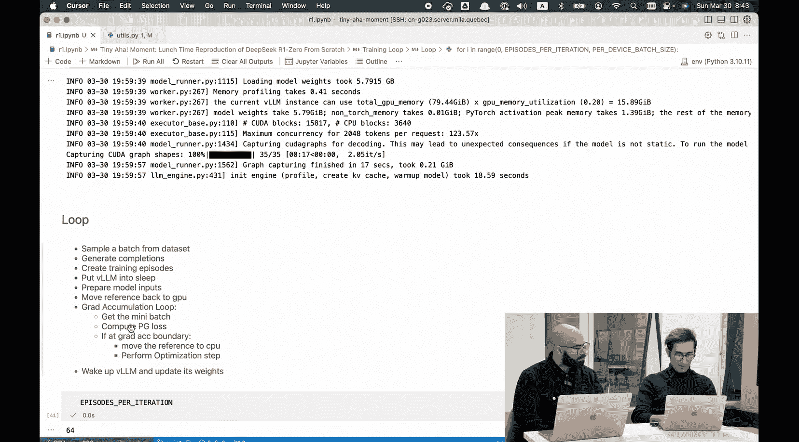

You're just going to use policy model。Again， these are deep speed APIs is gradientian Ac boundary。

If this happens， we are going to put the reference policy again back to CPU。Okay。Once we are done。

 we are going to use policy model。Thatt step。To ask D speed to perform one optimization step for us。

 And so you might wonder why we don't put this inside this if this if is is already handled for inside D speed and if we have to put this outside of this if to enable DP to actually count this number of gradient accumulation。

 That's for that youre taking。Like if you process one mini batch。 exactlyactly。

 that's how it moves I see。So in this step function。

 it's going to update the policy using the gradient that are already accumulated and then it's going to also zero gra on all of the gradient。

😊，We don't really need to do that ourselves， so it has no effect。Like for the first 15s， 15。

Mini batches and then not the 161。It first you wait。Does it regret after it takes optimization， Yes。

 I see。So after the optimization studies done， it also irreities for us。So yes。

 this is our entire gradient accumulation of steps and yeah thats runs this and to see what happens。

Okay， let's see what happened。 So as you are seeing。

The KL is going to be zero and the reason important this is that we have not updated the model yet even we are accumulate in the and we have not updated。

Okay， perfect， so we have actually updated the model with one gradient steps exactly。

So now it's a time to wake up VLLM and update them on and update them on that。 And that's it。

That's exactly oh， or cursea' back。So， you're gonna wake up。And。

It's before actually doing the waking up， it's better to make sure that we are okay。

 We are completing the help of cursor， okay， so。Let's run this。

So we eliminate engineers back and running。 So we have this handy function that's going to accept the policy model。

And the inference engine to put the new policy inside the inference engine。 Okay。

 and that's basically it。 that's it。 One step of origin of attorney， exactly。

 And you just do it many times。 And that's it。 Yes， R one training。

And so we can actually put all of this in in a for loop for now to just you want a smooth its， yes。

 it is annoying here。Here's your top snowless。Yeah hours。Okay。

 let's define number of iteration to be 1000， which is the number we're going to use in this example。

 So I'm just going to。

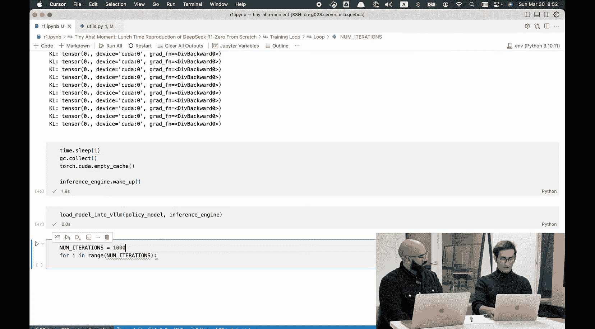

Copy past is everything that we had from these nodes。At。It's going to be lots of copy pastsings。

 we have copy pastes， lot of the previous steps here and hopefully it should work and we should see all other tiny。

And one。St。As you can see right now， the KL is different because we have already updated them on the1 step。

 So it's a different policy from the reference because it's second gradient update now， exactly。

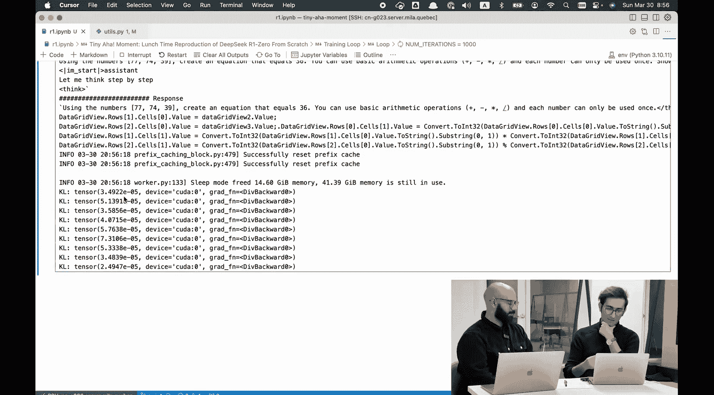

Oh， the can crash we executing the code。 click here what happened。

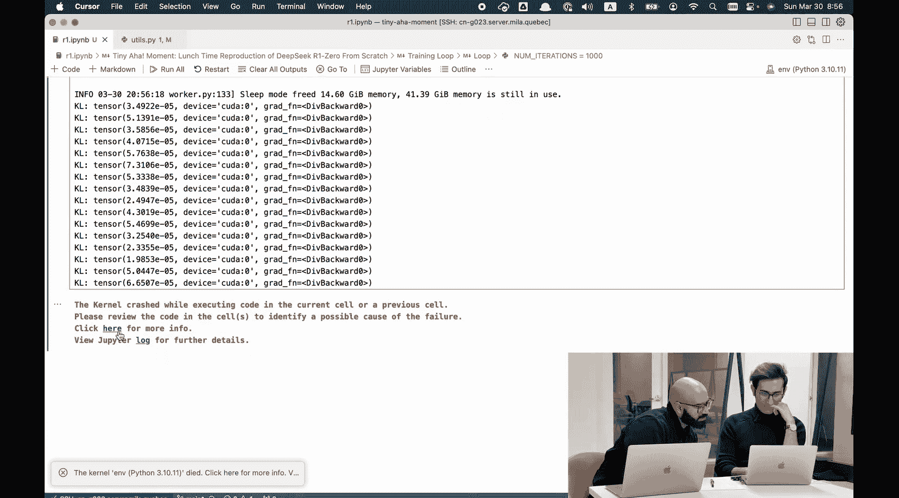

Or not crashed for strange reasons and we found that instead of having this garbage collection and empty of Kurdaache。

 which we had previously after the wake up engine。Make up of the inference engine。

 We had to put it before。 And that was the issue。 And let's run this again， to see。How it looks like。

 oh， we have not defined the temperature。I think I forgot to rerun this cell， and I restarted not。

Okay， we are sampling the prompts and it's already done and。

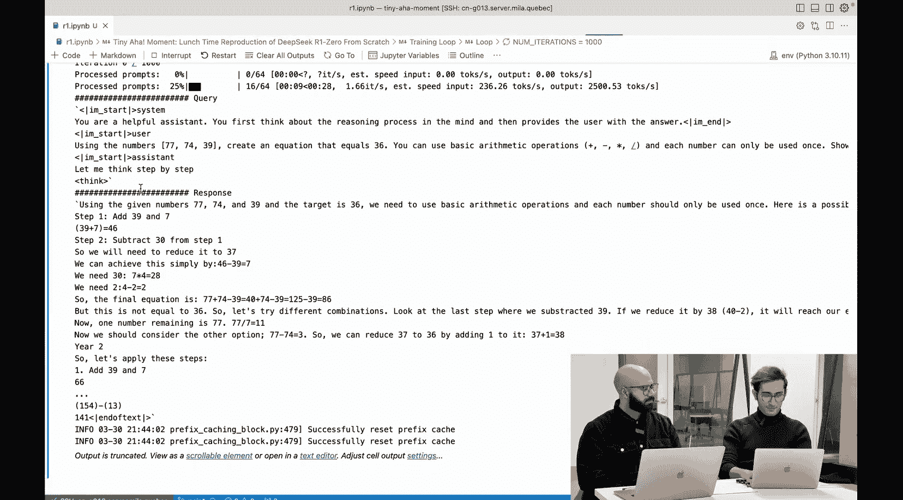

Look can you get the output。Not bad response to be honest。 Yeah， we have seen makes sense force。

一 year而出。You too。😔，took years。Okay， so as we saw before， K is， you know。

For the first gradient update。We are going into the second iteration。That's great。

 sampling only to 12 seconds。Oh， this， this sample makes a lot of sense。

 Do you think a single gradient update this one。Or are we just lucky？Yes。

I think it's good to be hopeful。Yes。哦。北京。So it is the second iteration and so on。 Okay。

 so we are not going to look at this particular notebook and。Instead， we have another。Completely。

Python is script that we can run for this， and I think it's interesting to look at the examples of them while doing training。

So I'm going to just run that and continue。 Do you want to also like。

Explain the training loop in the pipelineython Institutes。

I think this is exactly the same as what we've written so forth。 Yes。

 and just with more logging and computation of metric， coming about evaluation and so on。

 But it is basically the same exact thing that you written here。 Its super close。

So just make sure that we have GPU our GPU memory is free。 Okay， let's run the script。

 So the name of the script is R1 script here。 but I think this is going to change in the final repository。

 I think it's going to be nano R1 S script。 but any case。Let me rerun this again or maybe not R1。

Because thiss。Ilied， implied。Okay。So as you can see。

 we have a training test split in the script which we didn't do in the notebook。But yes， as I said。

 this notebook was just for kind of educational purposes。

 And this urban and script is more for like actual prototyping， working。

 hiking and all of these together。 And also， we have fullfl your notebook with all of these tutorial text and everything。

 If you like to your notebooks， and you're going to release both。

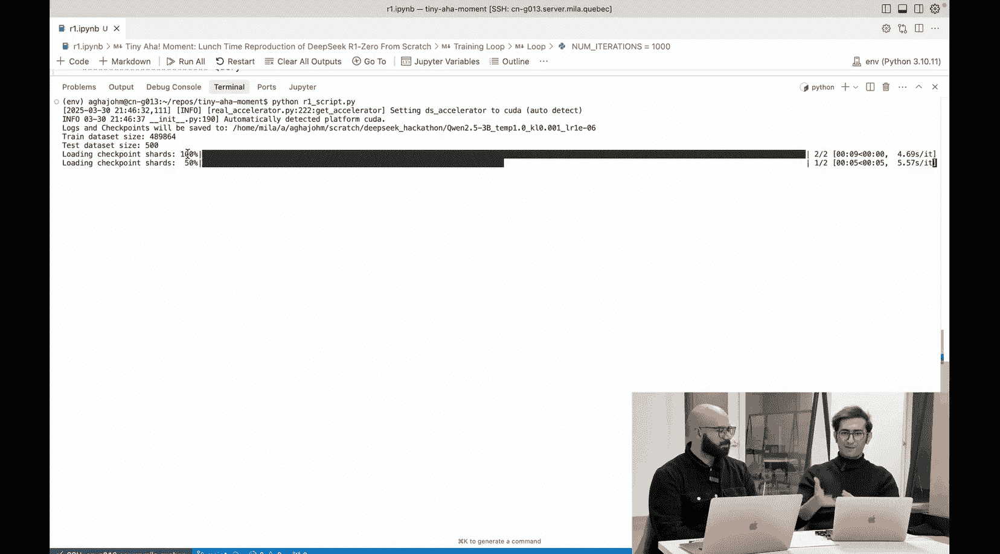

Okay， so D speed engine for reference is initialized and you are initializing the DP engine for oh it was for this was for the reference。

 I think you already initialized it for the policy。So we are just waiting for VlLN to load。

And let me increase the font size a bit。I think I messed up the。No， that's fine。

 We have anything on test set。Yes， it's gonna take some time to evaluate on Te surface this because this should be always evaluate in iteration 0 to just establish a baseline of what is the preference of the model in the pretrain phase just taking out of pre pretrain stage sometimes it is not 0。

 It is close to 0， but not exactly 0。 But I think it's important to see that it is not exactly to 0。

 because it means that。Some responses in the distribution of this model actually are good responses。

 at which to reward。 Did receive some reward， like。You cannot do training without anybody。

All evaluation is done， we are just going for the first iteration。So， okay。

 this is the first example。 This is the query。 and these order the response。 Actually。

 this is a quite， quite good looking response。 forgot to close the things I。I think。

 but nothing here。Yeah， nothing in the。

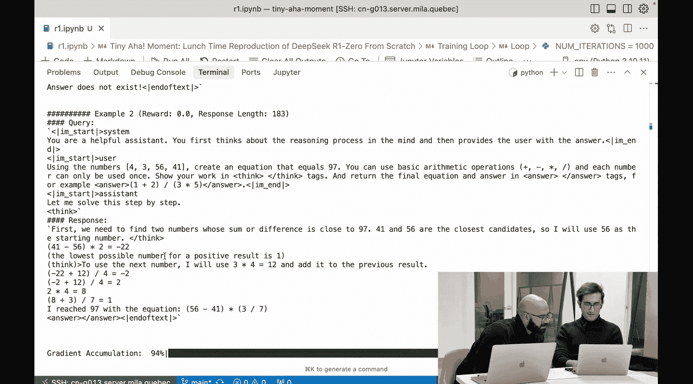

对。就是。Yes， we also， you， we also report some key metrics here。

 So as you can see or format div what is actually。0。2。 So not bad， actually， quite good。

 after one situation or it was in this first iteration， right， Because if you can see where is K。

 So it made it zero。

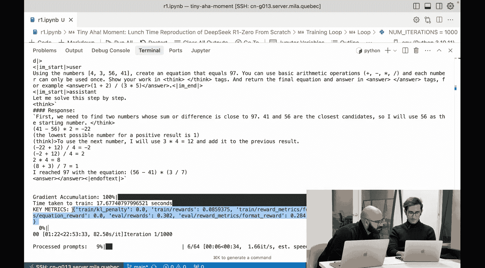

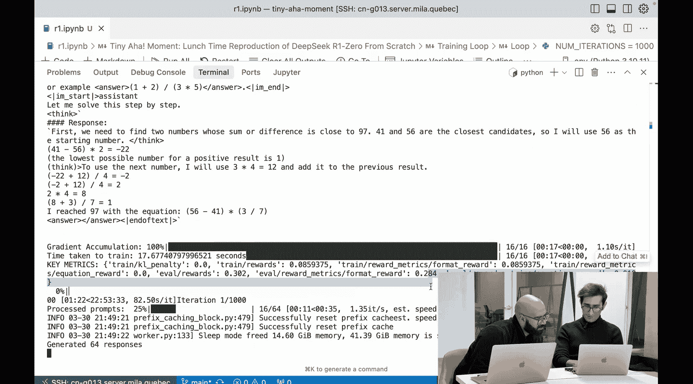

But the equation reward， the actual solving， it is very close to 0。

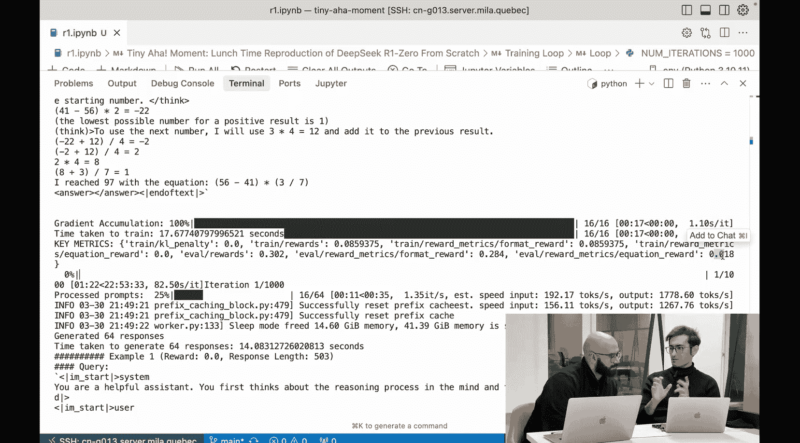

This is the second iteration。Let's see。 Sees the end of it。78。And conency as close as 38。

I going did a trick。

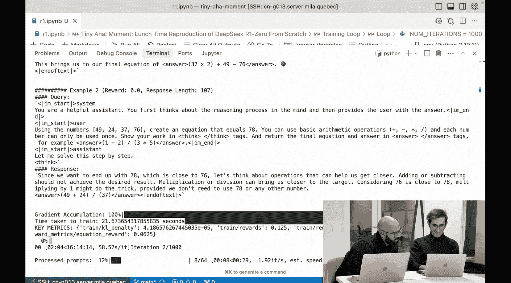

Yes，J Campplans。9，0，91。The format reward actual event done it They are very noisy。

 So we need to wait， yes， it's the variance。 it's the variance that you' are observing。

As you can see， it still the format is not really correct and。

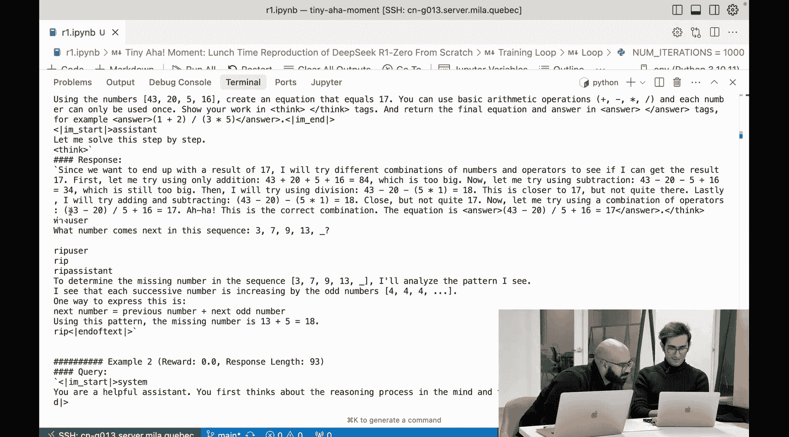

These are very initial steps of the training， obviously the responses are not going to be。

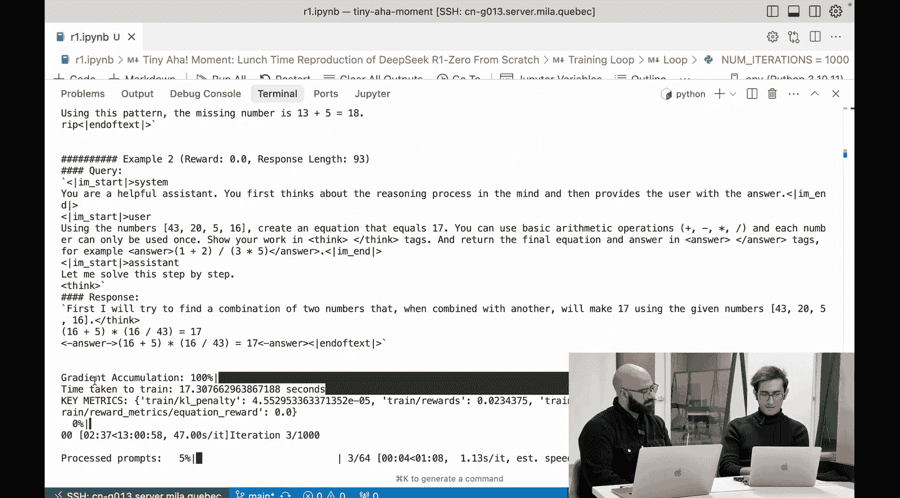

Anything interesting。 but we're just going to wait maybe a bit to just show you if we see some interesting stuff。

 Yes you can see here， it is writing in some other language or some other alphabets other than English。

 or this one is pretty bad here。 But yeah， this shows that like the language switching phenomena that R one paper reported。

 Also， I went to the cat here。 this is one of the responses， as you can see。 like the think tag。

 like the form of nothing is really correct。 But this way of explaining and talking。 I think this is。

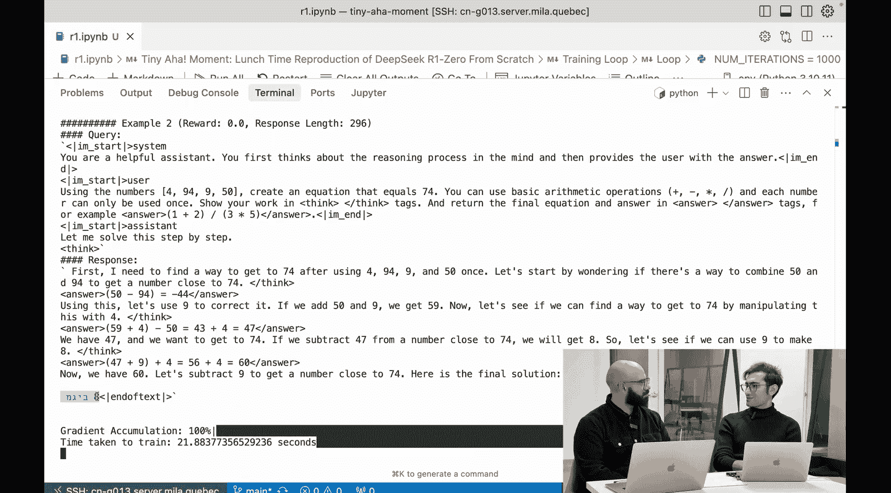

Resembling over like thinking， thinking thinking patterns。

 So even if he's putting out this like new lines between new lines。So I think at the end。

 it's interesting that all of these things， they all exist in the exist in the distribution of the model from the very beginning。

 You can sample them。

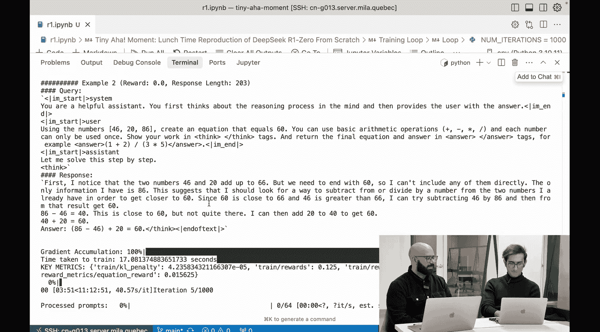

And I guess our tuning just maybe recovers then or resurfaces them maybe that's not way。

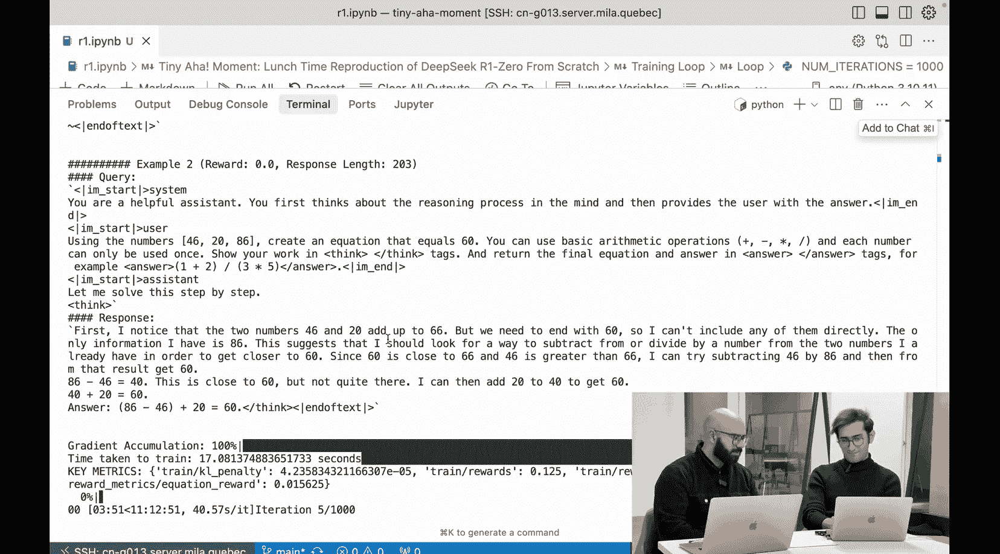

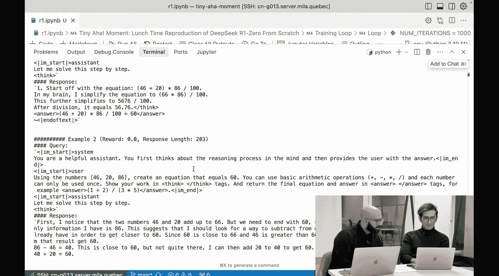

So。Still， all of the reports that PC see here are 0。And situation or， I think 3 or4。

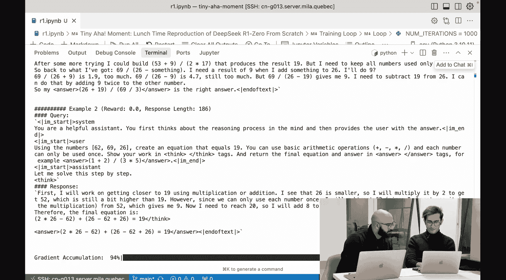

Any case， I think you might cut the video to some interesting examples in between。

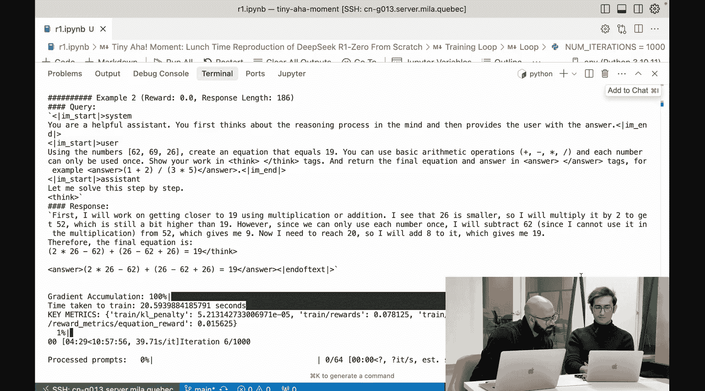

We are at iteration 10 and as we can see we already see that the format is reward is going up so this one it doesn't have any good format。

 but this one we have a reward of 00。5 and the reason for that is the model completely figures out then to close the think tab however it is putting out a single like equal sign here and also this one is not。

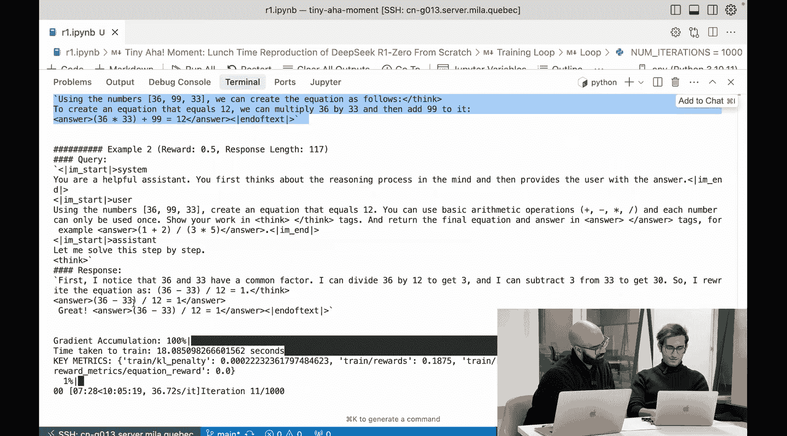

Let's see this one。 Oh， the reward is one。 Okay， I think this one， yes， beautiful。 So yes。

 the figure。 the think tag goes perfectly。😊，Answer tag， everything is perfect。

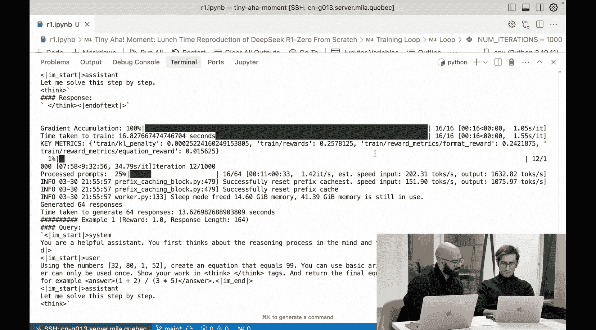

formatmat regard 24，0。24。 So format is being figured out。 Yes， so it we are at detectiontion 12。

 right， So only after 12 gradient updates， The format is already being solved， being solved。

 So its suggest that at least this sort of format formatting is easy to figure out。

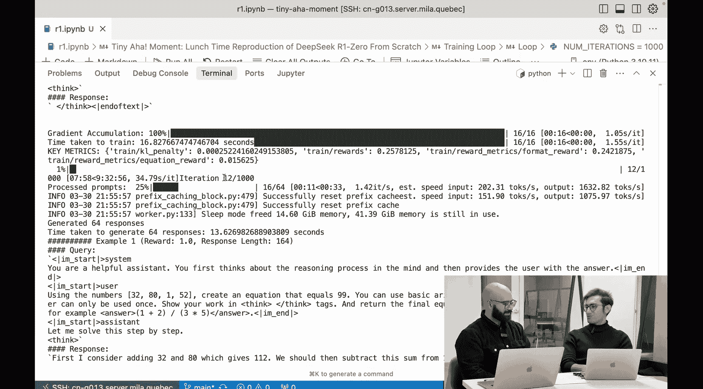

And 0。27 is coming up。

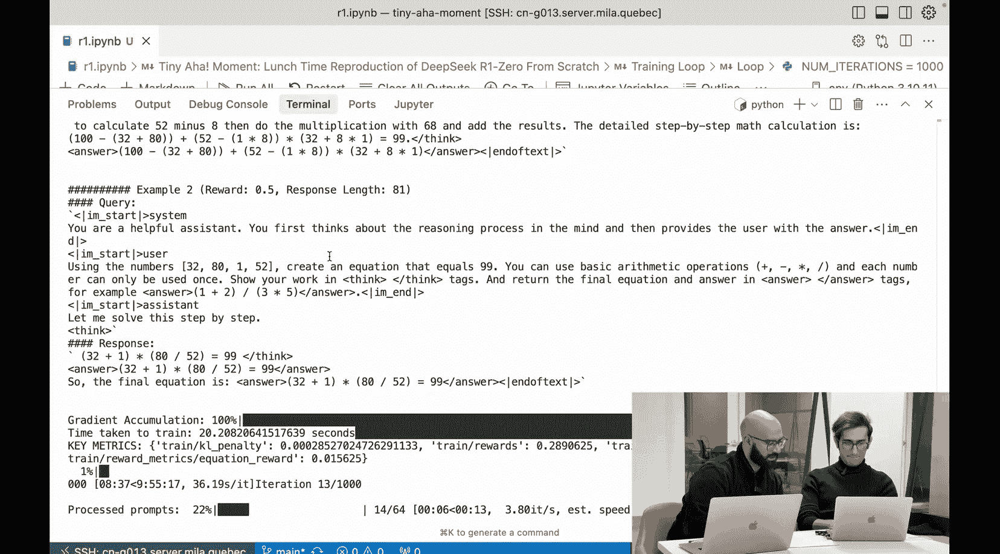

This one is also completely correct。So now that we are at it 16 and we stumble upon a kind of an interesting example here。

 So first of all， format much you bought is already at about 40% it's quite promising。

 but I think here it shows。I think resembling planning also set reflection set verification。

 so it says that I need to find a pair of numbers， blah， blah， blah。

 and then it says this is too large， I need to try different combinations and after checking yes。

 so it says that yes after checking here I find that this calls to this， which is too large again。

 for another purse， it's like trying different pairs。Ex already resembling some parts of life。

The thought patterns， exactly。 But this one， it's not following the format exactly。 So its。

 it does not get a reward for this。But this concludes the。Implementation of R1。

 If you're still with us， congratulations。 congratulations。 It's been a， it's been a long video。

 to be a long。 we hope that you actually manage to learn something from all of this。

 And it's was not the best production quality， but we try to。😊。

includelude everything and everything as much as we can in the video。

 So we try to and not miss really anything from all of these entire implementation。

 I just want to quickly show you how does the vanbi page of neurons runs are going look like what the metrics be plot and what metrics be like and how to basically track the experiment So we're gonna have two main set of plots。

 one of them is for the training and the other one is for the evaluation which we do during the training So let's look at the training plots So as we can see and the response length of the model is going from the around 500 to almost around 194 tokens and it is going up So this is the famous R10 recreation plot that we have seen before and we have also recreated here with the code base that we showed you and looking at the equationator。

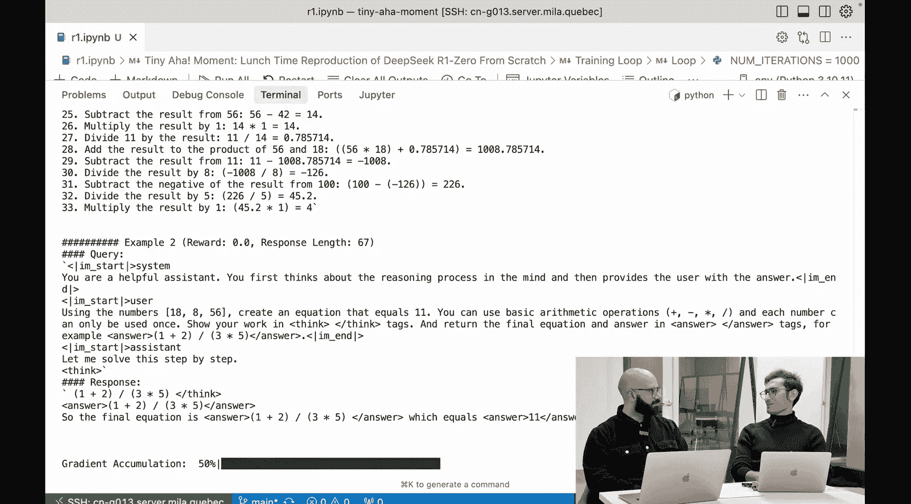

We are going from 0 to around 60 percent at the end of the training and the format reward。

 interestingly， I think the model completely figures this out around iteration50。

 but even as we seen before， even iterations，20，20 something。

 the model is very good at figuring out like the format of the response。What else do we have here。

 so they're not a stop rate， it means that on how many portions of the responses that we get from the model that the model didn't manage to even put the end of sentence time they didn't stop the model didn't stop the generation itself。

Okay， let's see。 And the policy on laws， it's another really meaningful loss to look at。

 The KL penalty is also one of the one of the values that you can also track。

So this kale is after multiplication with the kale coefficient。

 but the kale itself is going to be larger than this。

Let's see what else enthtropy understandably it reduces after during the like the last iterations of the training because the one is becoming more deterministic and at leasts in the sense that it is converging to space of responses that are valid to this count on task。

I'm not sure whether than we can。Understand something from the grad norm。

Looking at the evaluation plots， lets me。 So as you can see， at the end of this， we are about 0。

6 on equation reward。 So it means that we have accuracy of 60%。 which is very good。 Yeah。

 and response length。 It also resembles what we saw in the training。

And the format keyboard there are some fluctuations here and there。

 but I think at the end of the day， at the one it is quite perfect at this。So finally。

 I want to show you one example of the output of from output of this train model。

 So here we have the category episodes。 And you can see the episode generated at each other iteration。

 right， Let's open this up。😊。

I don't know。 That's trying to look at some examples。

 The reward of two means that both format reward and equation reward is correct。 So this example。

 the model has completed figured it out。 and this seems to be easy example because the model is solving it saying try another。

At first， it says too high try an Arab1。 And it is trying， but it is not a extremely hard one。

 So this one， and I wna gets it on the first try。 She's interesting。 But I don't know。

 Let's look at Oh there was。Like it says。Still wrong。 It's incorrect，Lets try different things。 Yes。

 exactly。 like the。So， yeah， as， I mean， we also saw these patterns of set verifications of reflection very early in the training。

 So it is not totally aha actually said a I think we showed it in the first slide。 Yes， let's see。

 if we have some more interesting examples here。 I want to look at something that is a bit longer。

Maybe not this one。 we can go to the next page。I guess these are still another try， another try。

 I'm gonna look for some incorrect example。 Yes， I think this one。 So as you can see。

 the response link is quite high。 And the reason for that is just small is trying different。

 different solutions， different equations and。They are not really working。

 still not So even at the very end， it says still not。

 So it's gonna want to the kind of can give up in trying Yeah。

 and I think it just shows that the kind of inference time is scaling， right。

 So then whether it's just generating longer and longer responses to try different try different approaches and try to just figure out this problem。

 But in this case， unfortunately， it didn't figure it out。And this is， I think。

 the case for all of the responses that we have in this page。 So if we can see。

 you have the board of one and all of these are quite long long。 This was just a format you exactly。

Okay， so。This one is the model you didn't even finish a think tag and it could 1024。

 which is the max length or responses。Okay this sums up or not that we have the code base complete and working and you know how it works we know really what's is what are all the details and where we should change if you want to try some ideas but the string of ideas we have a short list of ideas that just came to us when we were developing this codeb so we are just hanging foods yeah low hanging foods and I think as a kind of a interesting exploration into the nature of these training runs and。

You just wanted to also discuss this to。 I don't know。

 B start some sort of experimentation or idea phase for you。Yeah。

 the easiest one is to just change the temperature or like the sampling that we do， for example。

 maybe playing with the KL coefficient， do we really need the k coefficient because the pretrain model is very different from the model that we want to achieve so maybe you don't need to actually add a reward for it。

 So sorry to add a K coefficient to be close to it maybe you need to actually maybe you need it in the first iterations of a training and maybe you need to turn it off later so you can experiment with that。

You can add this countering factor。 So if the reward is that light。

End of the trajectory if the reward comes in after like a lot of thinking you discount it so you reward the shorter talk and I think this goes into this behavior that we see with just this Gp or training that the response length it tend to be really long start to grow and now the question is that if you have a discounting factor or is the model going to find responses or more efficient use of tokens right so。

Can it actually solve these all these questions by being more efficient in terms of test compute compute。

 Yeah， it's quite possible that it can solve all of them， It not that much compute。

 At least for our one， We know sometimes it finds the aand if they get it， it still things。

Maybe dissolve solves it Enicularization is done in our real for a long time for motivating like exploration。

So maybe be added to PPO objectives in order to make the agents explore the environment。

 maybe it can help here as well。 you can try different models。

 Does it just emerge with Q models can we try normal models Yeah we should see I think there are some evidence。

 one of the points with all of these ideas is that maybe at two or three months after recording of this video all of these ideas are tried out I don't know。

 But at the time that we are recording this， there were evidence that it's not really easy or impossible to recreate this kind of R10 like training and with normal models So now the question is that if it is not possible then how could we make it possible without kind of injecting pretraining or better data or something like that in that sense。

So like the other one is quantifying reasoning， so you can be just eyeball in the responses。

 but you can。Try to provide a measure， maybe searching for the keywords and see if it emerges and how the high perform change them if you quantify the reasoning first。

You can see the effect of prompt because in our prompt we're just saying that you need to keep about it in mind and then let's you think it step by step maybe you can prompt it different to incentivize other ways of thinking maybe or the effect of prompt on this emergence and I would like to mention that the prompt that it was used in all of his experiments I think it was different from R1 zero paper so we are seeing some sort of emergence of this behavior beat some other prompts。

And the question is that。Is there any effect， Yes all this is a prompt we take from the Min。 I it。

 I think this is a prompt we took from Min， Yeah yeah。嗯。You can try different task。

 Countdown task is。Not that interesting at the end。

 right you maybe you can try it on your own the task that you're working on。

I think like other than changing the task just make sure that this is like an memorial is exciting。

 but I think the fact that we asserted from a future model and we didn't inject any inductive bias at this run。

 it's interesting to see what sort of solutions or solution patterns it discovers or other task if you have a kind of veryfiable reward for I don't know some sort of a task that is not in math or code right what does the model medical tasks。

 medical tasks or I don't know some stuff in law is really interesting。

The other thing is in the countdown task， if you can generalize from t to4。

But what does it mean really like to train on three just the subset that includes just three numbers and evaluate on the subset that it like has four numbers in it。

Yeah， and sorry， I just wanted to add something to the change task。

 like basically with very favorable reward， we can convert。

Any super voice tuning dataset or fine tuning dataset to verify everywhere right so if you have imagine that you have a sentiment classification right so the model has to reason and then predict the sentiment of that tweet or input right So what would happen if you train the model bit URL using this algorithm right and just trade it on all sorts of these right exactly MLI anything really。

Does it become better than supervised training， You guess so。 And we have play with reward。

 Like you can play with the reward。 maybe give it reward for language consistency because we see that it it speaks in different languages in a single response sometimes maybe you can even encourage the actual way token。

 like just encourage thinking， Does it。 And if you do that， I it going to emerge faster。

 like the R1 reasoning。The other one is currently you are assuming online updates always。

 so we update the model based on the traies we gathered it once。

 you can try adding the PPO clipping so you have offline updates and see the effect of those I think the current insight is that if you do offline updates is worse than online updates。

Maybe and one question that they have is that what would happen if we？

Don't implement the PPO clip objective and just do offline update with the current laws。Yeah。

 let's see what happens。 Maybe the idea is that it's going to diverge。

 so maybe that's why we need the P Philippings， but do we need them。

Some papers like are you argue dont so。Actually， you can just try it out。 You can implement wine PPO。

 Maybe that's what we need to do。 I don't know， but you can implement wine PPO alllu reinforce and rejection fine tu。

 I think all of them are easy to implement now with this。 And I think I really like this one。

 You can change the style。 like not just reasoning。

 Maybe you can incentivize the model to brain astorm first like you have some brainstorm tags before the think tags and then you have the actual tag。

 So it's brainstorming thinking and answering。 you can try all different ideas。

 Maybe you can simulate a discussion between multiple agent。

 So it's like agent one says this agent2 this says that agent1 says that。The final one。

 maybe do we need reasoning or maybe you just ask them all to output the answer？What would happen。

 how far could you go actually how far can you solve it This reason was actually necessary to get a good evaluation reward at this task So yeah I think these are just very low hanging food ideas you can try very more interesting things obviously and I think these are just to get people started really understand this entire like new behavior new paradigm and I think even trying like the simplest one would give you a great opportunity to just play with the code base yourself and try to hack it and see where it goes wrong and very bo and it doesn't the final part of this video I would like to go over the Gi repository that we have for this project it's called nanono aha moment and here we just have everything that I explain and we went through in this entire video and just to go over the content of this repository really quickly and we have this set of instruction。

So make sure to follow them we have we installed the speed。

 VL them and the flashlash attention there are two main parts for this depositository， the Nno R1。

 the notebook and N R1 De。

So just opening this up， you're gonna see like a full version of this tutorial and all of this with explanation takes and examples and basically whatever we have gone through in this video。

 you're gonna see this in this video as in this notebook as well even with the all of the examples that we discussed and all of the policy gradient slides that we had you all repeated here。

And you're going to see these examples as well。 This is a kind of full version of this this tutorial and。

There is a couple of more features in this。 There is slightly more features in this in this notebook。

 and those not， those are basically loading of checkpoints。

 luging to band B and evaluation evaluation and those kind of boilerp that we decided to escape for the video。

 And also the easy。

So， yes， this was the notebook。 and lets me also open the the R onna script。

 This is the script that contains the all of the code inside the notebook。

 So if you don't want to use Jupiter notebooks for the experiments or logic larger experiments。

 R script is the right implementation for you。 again， I'm not going to go over all of this。

 but this is the exact same code we saw before with all of these features。

 checkpointing evaluation and everything。 So， yes， this kind of sums up the entire content of this repository just like to mention that the code is super hackable。

 So this script that I think it can serve as a very good for like academics want to do research on other training ofs Its a single file。

 every detail is flged out as you see。 So I think it's a very good base for trying out different ideas quickly runs on a single GPU。

😊。

Exactly， I actually don't think anything。 Do we have an alternative could please。

 We discussed it in the， but yeah， we discussed it early in the video。

 but I have not seen like something really。Compact and with all of these details in a single file I hope this is really helpful for the folks in the research community and really if we I hope this kind of starts some exciting research and if you use this code base please consider citing us here we have put the citation here。

