# Andrej Karpathy Keynote & Winner Pitches at UCB AI Hackathon 24 Awards Ceremony - P1 - GPT中英字幕课程资源 - BV1hb421n7vt

Welcome to the closing ceremony of UC Berkeley's AI hackathon。 I want to call on stage the awesome。

 incredible executive director of SkyDck， Caroline Wint。😊。

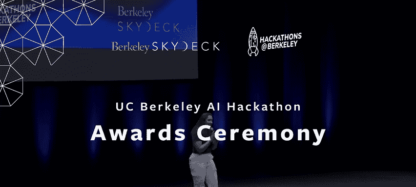

Thank you ready。 you keep hi everybody， how you doing？You're ready to hear who won the hackathon。

 Yes， you are。 how many hackers here， how many in the audience？Oh nice， very good All right。

 we're gonna to get started because I think you want to hear Andre Yes， you want to hear Andre， yes。

 you want to hear Andre all right， let's quick run through。

 you want to hear some cool facts about what has been happening。

 This is what we're going to do today We're gonna get to our pitches soon。This is some pictures。

 All you hackers。 did we have fun。 Did we have a good time。 I had an absolute blast。 And yes。

 there were llamas for sure。 I was there most of the time I was not there at 3 AM。

 but I was so impressed with all of you。 You hacked your hearts out and I'm so proud of all of you。

 whether on stage you're an audience you're all completely awesome。 All right。

 how many people it took to make this happen。 this giant number，371 UC Berkeley Skydck。

 which I represent and Cal hacks educational program and student organization。

 So I think we did a pretty decent job of getting this all together。 This is how it breaks down。

 hackathon at Berkeley directors， Skydck staff， sponsors， we're gonna give some love to sponsors。

 As I mentioned we're an educational program。 Cal hacks is a student organization。

 This is all because of the sponsors。 So we're gonna give them a ton。😊，When they come up on stage。

 you're with me？Awesome， okay， 140 judges，100 plus volunteers and 80 mentors hanging out。

 helping everybody。

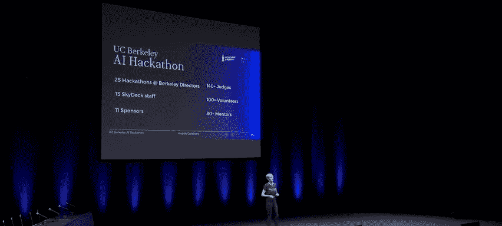

Let me tell you a bit about Sky deckck， who hasn't heard of Skydeck。Anybody， a couple of you。

 Skydeck， UC。 C。 Berkeley's flagship Acelerator。 We host 250 startups a year。

Our accelerator track gets $200000 in investment from our dedicated Adv fund， prettyty cool。

 Let me tell you about Berkeley Skydck Fund， our dedicated Adv venture fund。

 investing about 40 startups a year。 That's a lot of startups for adventure fund， by the way。

 the 200 K investment。😊，And who wants to play to Skydek？July 16。

 I want to see all of your startup applications coming in。 That's in a month。

And hackathons at Berkeley are amazing student organization。

 truly extraordinary people who helped put us this on this event。 This is， of course， what they do。

 They do hackathons。 They've been doing it for 10 years。 They do about 2500 students a year。😊。

And of course， they reach a ton of universities。 How many people here， not from Cal。

 hacking not from Cal。 fantasticastic， welcomee， Berkeley is a place where we bring great talent in。

 y'all are great talent。 We brought you here。 That's what we do。

 That's what Berkeley Hackathons does。😊。

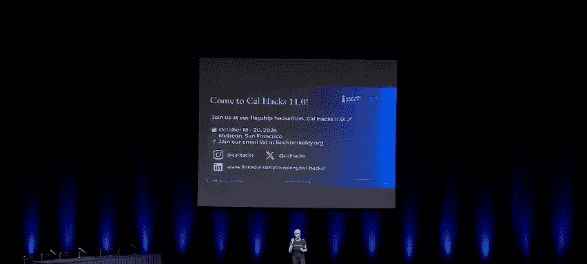

Come to their 11th big hackathon in San Francisco in October。Check out on social media。

 Get on that LinkedIn。 All of that。 Okay， who's coming to San Francisco。 y'all coming。 Yes， O。

 fantastic。😊。

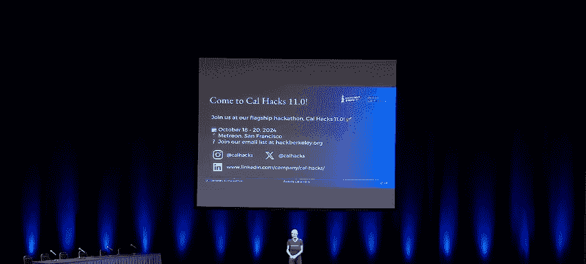

All right， thank you to our partners， all of you who brought your hackers here。

 including our friends down to the South Bay。 Thank you for joining us and all the other great universities。

 Fastic。 Really happy to have you。😊。

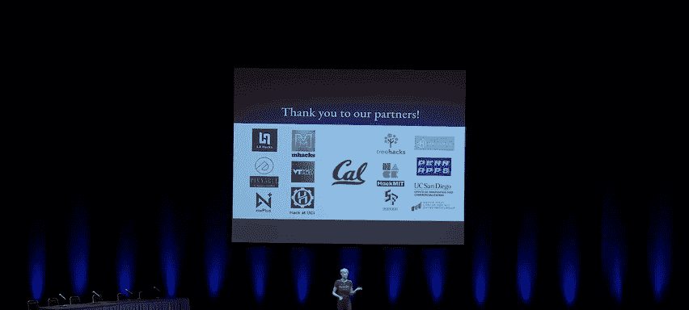

You want to hear Andre？Do you want to hear on？Yes， please give a huge round of applause for our keynote speaker。

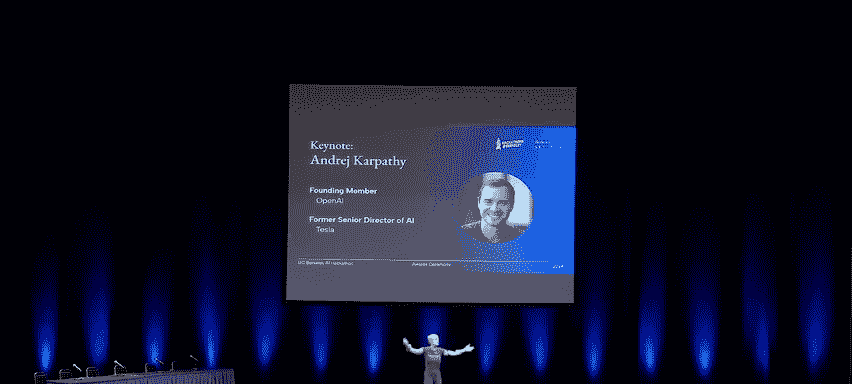

member of open AI。 I need the app。 Come I keep going。 Andre， Come on out。Carpathy。Yes。

 there applause。Okay。

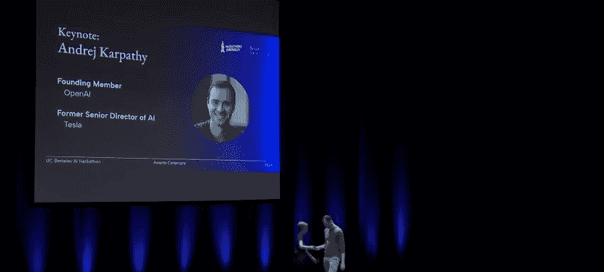

Hi， everyone。Yeah， so thank you for inviting me。 It's a really a great pleasure to be here。 I love。

 love， love hackathons。 I think there's you know， a huge amount of energy， huge amount of creativity。

 young people trying to do cool things， learning together， creating。

 It's just like my favorite place to be。 And I've had my fair share of hackathons。

 So really great pleasure to be here and talk to you today。😊。

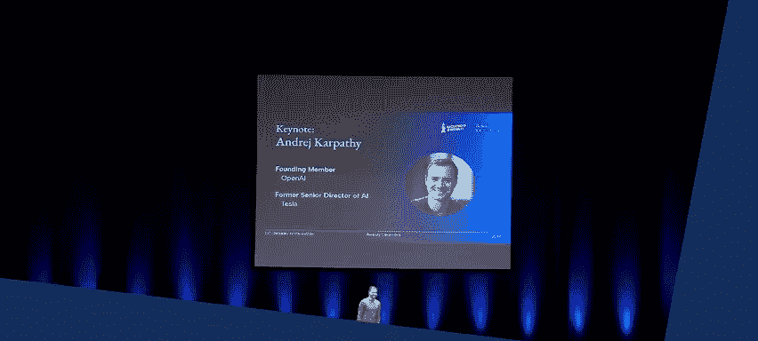

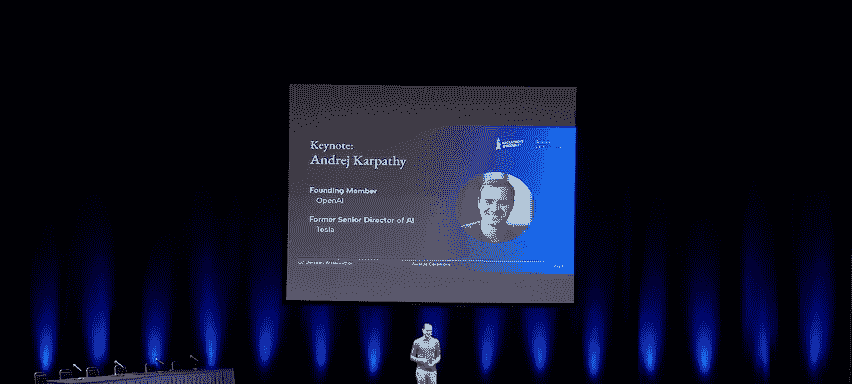

So one thing is this is bigger than I expected when they invited me。 So this is really large here。

 I kind of feel like actually the scale of the hackathon is quite large。

 And I guess like one thing I wanted to start with is that just in case you're wondering this is not normal for AI。

 I've been in AI for about 15 years so I can say that with confidence。

 And you know it's kind of just like grown a lot。 So for me。

 AI is you know a couple hundred academics getting together in like a workshop of a conference and you know talking together about some esoteric details of some math。

 And so this is what I'm used to。 this is when I entered AI about 15 years ago。

 you're working with say when you're training neural networks。

 you're working with these tiny digits from Mnesist， you're training a restricted boltman machine。

 you're using contrastive divergence to train your network。 And then you're scrutinizing these。😊。

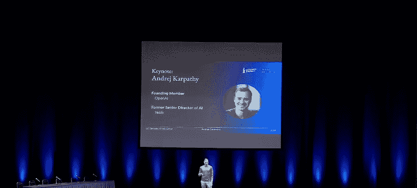

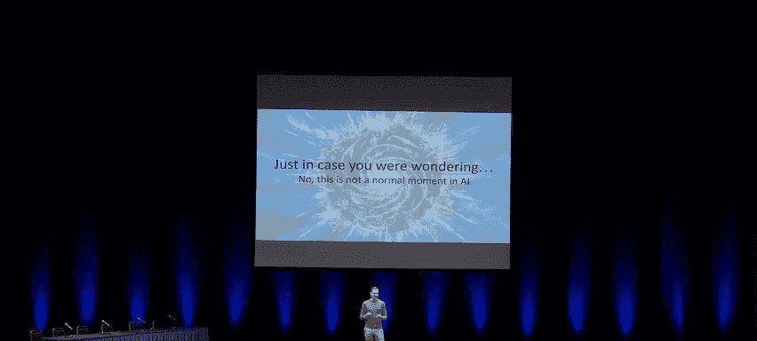

On your first light to make sure that the network trained correctly。

 And I know none of that makes any sense because it's been so long ago。

 but it was a different vibe back then。 and it was not as crazy。

 I think things have really gotten out of proportion to some extent。

 but it is really beautiful to see the energy。 And today，15 years later。

 it looks a lot more like this。😊，So this is I guess where AI is today。

 and that's also why this event is large I expect。 So yeah N video， the manufacturer of GPUs。

 which is used for all the heavy lifting for our neural networks。

 is now the most valuable company in the United States and has taken over and this is the day that we live in today and why we have so many hackathons like this and so on。

 which I think is quite amazing but definitely unprecedented。

 and this is a very unique point in time。 that many of you maybe are entering the AI field right now。

 and this is not normal。 It's super interesting， super unique ton happening。

Now I think fundamentally， the reason behind that is that I think the nature of computation basically is changing and we kind of have like a new computing paradigm that we're entering into。

 and this is very rare。 I kind of almost feel like as the 1980s of computing all over again and instead of having a central processing unit that works on instructions over bytes we have these large language models which are kind of like the central processing unit working on tokens。

 which are a little string pieces instead and then in addition to that we have a context window of tokens instead of a RA of bytes and we have a coence of disk and everything else。

 So it's a bit like a computer and this is the orchestrator and that's why I call this like the large language model L MOS and I sort of like tweeted about this in some more detail before。

 And so I see this as a new computer that we're all learning how to program and what it's good at what it's not as good at how to incorporate it into product and really hard to squeeze the most out of it。

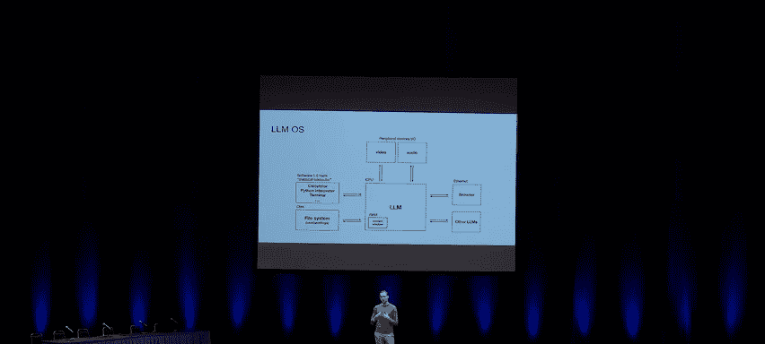

So that I think is quite exciting。 And I think maybe many of you have seen the G 40 demo that came out from open AI to three weeks ago or something like that。

 And you really start to get a sense that this is this is a thing that you can actually talk to。

 And it responds back in your nature natural interface of like audio and it sees and hears and can paint and can do all these things。

 I think potentially many of you have seen this movie if you't， I would definitely watch it。

 it's extremely inspirational for us today movie her and actually kind of presently in this movie when this main character here talks to the AI。

 that AI is called an Os an op system。 So I think that's very present from that movie。

 and it's a beautiful movie。 and I encourage you to watch it。 Now， the thing is that in this movie。

 I think the focus is very much like the emotional intelligence kind of aspects of these models。

 But these models in practice in our society will probably be doing a ton of problem solving in the digital space。

 And so it's not just going be a single digital entity that kind of。😊。

Weird way resembles a human almost in that you can talk to it， but it's not quite a human of course。

 but it's not just a single digital entity。 Maybe there's many of these digital entities。

 and maybe we can give them tasks and they can talk to each other and collaborate and they have fake slack threads。

 And they're just doing a ton of work in the digital space。

 and they're automating a ton of digital infrastructure。

 not just a digital infrastructure but maybe physical infrastructure as well。

 And this is kind of in earlier stages， I would say and will probably happen slightly lagging behind a lot of digital innovations because it's so much easier to work with bits than atoms。

 but this is another movie that I would definitely point you to as one of my favorites。

 It is not very well known at all。 It's called I robot and it's from 2004。 Will Smith， amazing movie。

 and it kind of explores this future with like human robots doing a lot of tasks in society。

 and kind of spoiler alert。 It doesn't go so well for these people in this movie and the robots like take over a little bit。

 but I think it's kind of interesting to think through and definitely would encourage you to also watch this movie。

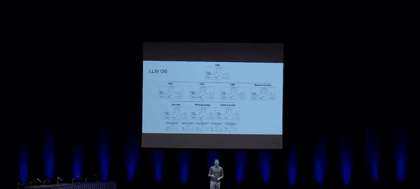

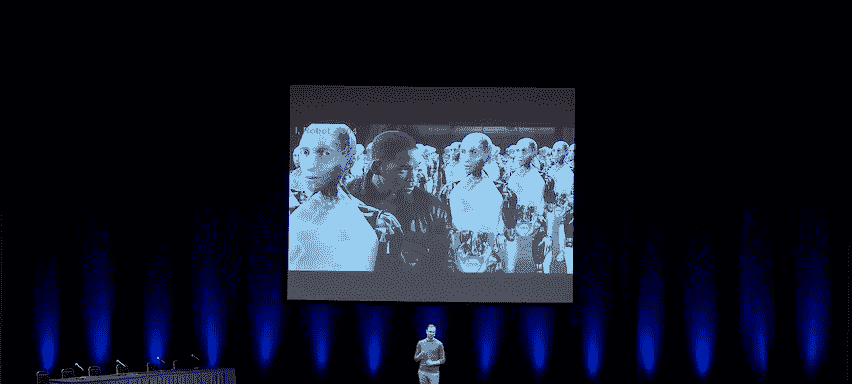

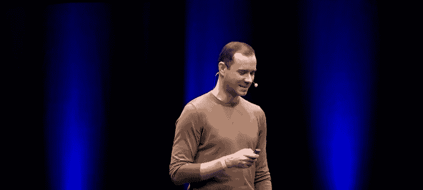

And this movie takes place in 2035， allegedly， which is 10 years away。 And so maybe in 10 years。

 you can definitely squint and think about that maybe we are gonna be in a place where these things are walking around and talking to us and performing tasks in physical world and digital world。

 And what does that look like， What does that mean and how do we program them。

 How do we make sure that they sort of do what we want them to， etc。

So when you put all this together， I think。The feeling that people talk about often is this feeling of AG。

 like do feel the AG quote unquote。 And what this means is that you really intuitively understand the magnitude of what could be coming around the corner if this stuff actually continues to work。

 The amount of automation that we can potentially have in both the digital space and the physical space。

 Now， I don't know about you。 but I actually find this picture kind of bleak。

 This is what came out when I put a bunch of the last few minutes of talk into an image generator。

 And I don't actually like this picture。 I think we can do better。

 And you know you we have a few thousand people here， you're about to enter the industry。

 and you're gonna be working in a lot of this technology， and you're gonna be shaping it。

 and you have some active sort of power over it。 So I don't know maybe we want this to look something like this。

 This is what I would like。 So this is humans， animals and nature coexisting in harmony。

 But secretly， this is actually a high techch society。 And there are robots and quadcopts。

 and there's a ton of automation。 but it's hidden way。

 And it's it's not sort of like in your face and。😊，So maybe this is something that we want instead。

 And you should feel a lot of agency over what you want the future to be like。

 because you're gonna build it。 So maybe we can agree right now that this is better than the previous picture。

 But I don't know about you。 but I would hope so， because I'm gonna be living in that future。

 I think。So the question for this hackathton， I mean。

 a lot of you have worked on a a bunch of really cool projects over the last day or two。

 And the question is， how do we go from hacking to actually changing the world and building this future。

 whatever that may be for you。 And so what I thought I would do in this talk is go over maybe like my last 15 years or so in the industry？

 And I think I had a bit of a window into how projects become real world change。

 And I have some takeaways and things like that And that I maybe wanted to talk about。

So the first thing that I find really incredible is how projects that are sometimes very small projects like little snowballs can actually like snowball into really big projects and just how incredible that is to watch。

 So as an example， I have my fair share of hackathons。 like I mentioned。

 These are some projects from a long time ago that I worked on over the last 15 years or so。

 So I had a little ruby cube color extractor。 I put up some game programming tutorials on YouTube like 13 years ago and tried to teach people programming for games。

 I had a video games and a lot of them， I had this like kind of janky neuroevolution simulator。

 which was kind of interesting。 And unsurprisingly。

 not all of these projects actually go on to snowball。 A lot of this is just exploration。

 You're tinkering。 And so actually， these three projects didn't really go anywhere for me。

 I wouldn't say that it was really wasted work。 It was just like it didn't add up to and didn't snowball。

 but it was still like helping me along the way。 I'll come back to that later。😊。

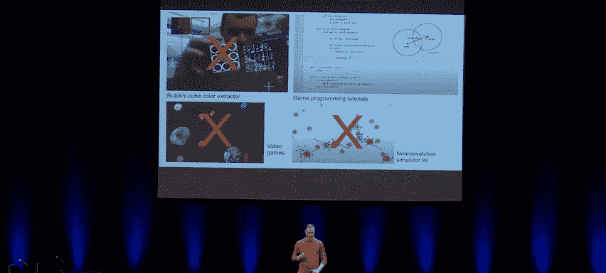

But the game programming tutorials actually ended up snowballing for me in a certain way because that led me from game programming tutorials to a bunch of ruby cube videos actually。

 that became kind of popular at the time。 And this kind of sparked an interest in teaching for me And then when I was a PhD student at Stanford I got to teach this class CS231N and got to develop it and teach it。

 And this was the first big deep learning class at Stanford。

 and a lot of people have gone onto like this。 And then after that。

 I ended up making another YouTube channel， which is my zero to hero series for deep learning and LMs。

 So a lot of people like that as well。 And then on top of that continuing the snowball。

 the project that I'm currently very interested in is this next class and what it could look like and how I can make it better。

 and I'm calling that L M11 n。 and it's about building a storyteller something like a chat E that you can work with to generate stories。

 And the idea is you build everything from scratch from basic prerequisites all the way to like kind of a chat E clone in the domain of storytelling and building that from scratch。

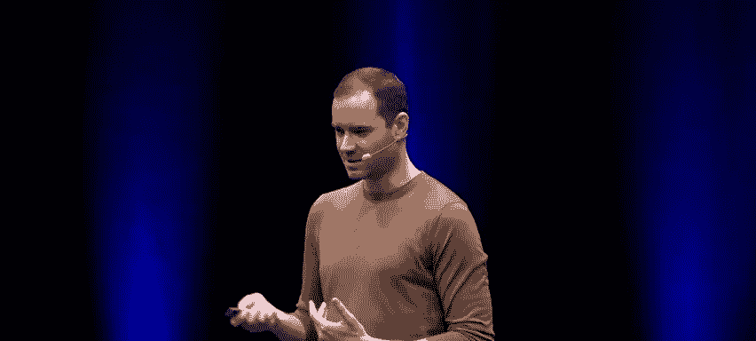

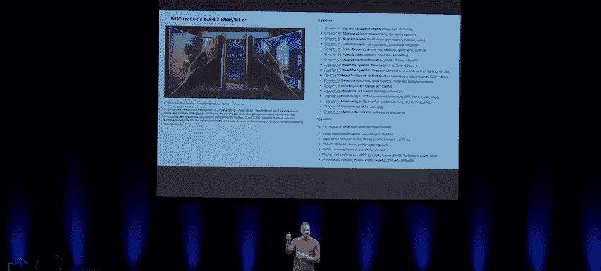

I think will be really instructive， could be really fun。

 I only published this on GitthHub like two or three days ago。

 So it's pretty raw and still very much in the early stages。 But I'm really excited for it。

 And this for me， is an example of a snowball。 It started with like 13 years ago。

 little game programming。 And I'm working on a course that I think will be really interesting。😊。

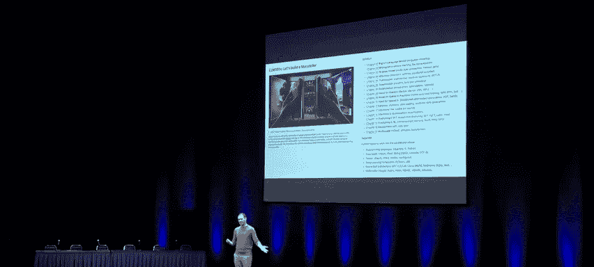

Thank you。Another example for my life， I think， is the snowball that I've witnessed with Open AI。

 So as was briefly mentioned， I was a founding member， researcher of Open AI。

 And so I was there seven years ago。 These are some images that are public of what it was like working out of Greg's apartment。

 like eight of us。 And Open AI was found it to be kind of like a counterbalance to Google and Google was like this gorilla was 70 billion free cash flow。

 And back then Google employed like half of the AI research industry almost so it was kind of like you know an interesting setup。

 I would say， and we were just like 8 people with a laptop。 So that was really interesting。

 and very similar to my background。 Open AI ended up exploring a large number of projects internally。

 we hired some really good people。 and many of them didn't go too far。

 but some of them really did work。 And so as an example， here's a project that was in an early stage。

 a very small snowball in the early history of open AI。 Someone worked on a Reddit chatbot。

And if you come by their desk and you're like， what does this look like when someone's working on a Reddit chatbot。

 We're trying to compete with Google and you're working on a Reddit chatbot like we should be doing something bigger。

 And so it's very easy to dismiss these small snowballs because they're so fragile。

 these projects are so fragile in the beginning。 But actually， this Reddit chatbot。 And by the way。

 don't read too much into the specific details。 These are kind of like random screenshots just for illustration。

 But this was a Reddit chatbo and looked naive。 But actually Reddit chatbot。 what is that。

 It's a language model。 And it happens to be trained on Reddit。

 But actually you could train a language model on any arbitrary data， not just Reddit。

 And when the transformer came out。 This was spun into something that worked much better。

 And then the domain was expanded from just Reddit to many other web pages and selling you get G1 G23。

4 and then you get G 4。 So actually this Reddit chatbot that was so easy to dismiss。

 actually ended up leading and snowballing into G 4。

 which we currently think of as this like change in the computing paradigm。 you can talk to it。

 It's amazing。😊。

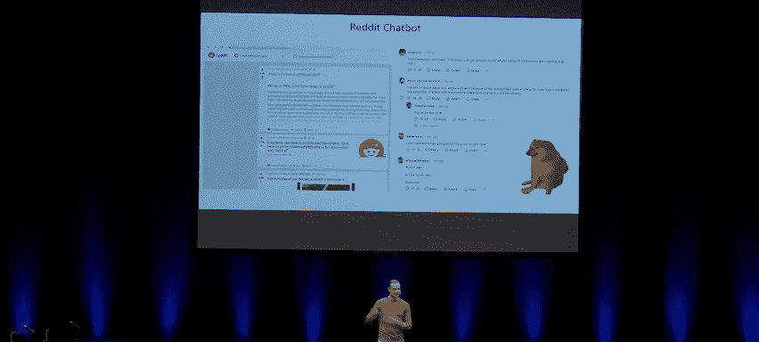

So it's really incredible for me to have witnessed some of those， I guess snowballs。

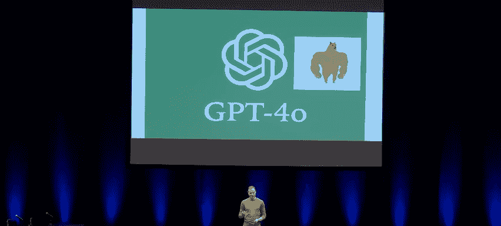

And today， opening out， of course， is worth maybe somewhere just below $100 billion or something like that。

 So really incredible， incredible to see some of these snowballs in practice。😊。

So I would say a lot of you over the last two days have also worked on small projects。

 small snowballs， maybe， and it's really incredible to me that some some of them probably won't go anywhere。

 but probably some of them actually will。 and you should continue the momentum of your projects。

 and maybe they can add up to a really big snowball， and that's really incredible to watch。

The next thing I wanted to briefly talk about is this concept of 10000 hours that was popularized by Malcolm Gladwell。

 I think I actually am quite a big believer in it， and I think that to a very large extent。

 success comes from just repeated practice and just a huge amount of it and you should be very willing to put in those 10000 hours and just literally just count。

 Don't be too nervous about what am I working about am I succeeding or failure etc just do simple being counting of how many hours you're doing and everything adds up even the projects that I fail that and didn't snowball into anything。

 those add to my counter of the number of hours I've spent developing my expertise and getting into an empowered state of being able to take on these projects with confidence and getting them to work。

So a few examples of that， I made this like really junky website a few weeks ago。

 This was a weekend project， and it's called A moviesvies do life。😊，And you can visit it。

 I think it still works。 I'm not 10% sure。 I wouldn't recommend you go there。

 It's trying to be a movie recommendation engine because I was trying to figure out what to watch on that Saturday。

 and then I was like， okay I need to build myself a movie recommendation engine So I put this up and one of the tweets that was reply to mine was wow that's so cool that you got this to work in the weekend。

 I was kind reflecting on that at the time。 because it wasn't as amazing to me And the reason for that was that this person is not seeing is that this is my 20th time like making a website like this。

 so I see all the steps I was gonna follow I needode， I need a flask server。

 I'm gonna write some of this javascript style sheets Hml I'm gonna spin this together。

 I I need to scrape all these web pages I need to I vectors I need to train SVM and all these I've already done before 20 times。

 I already have code snippets lying around from previous project。 And I'm just remixing what I have。

 I've already done all of this。 And so remixing everything。😊。

Into a new form isn't actually that much work and allowed me to put this up over the weekend。

 And it's not that crazy。 And this only comes from expertise。

 This only comes from having done it 20 times that you can do this so confidently。

The next example I would say in my life was a Tesla Autopilot。

 So I was hired to lead the computer visionion team at Tesla Autopilot about seven or eight years ago。

 And one of the first things I did actually when I joined the team was I basically ended up rewriting the computer vision deep learning network training codebase from scratch in Pytorrch in some of the first few months that I entered the team and I sort of rerote the whole thing from scratch and that ended up being a kernel of what it is now。

 and I think to some extent to some people that looked impressive at the time。

 But for me it wasn't because I was coming from my PhD。 and I spent five years doing stuff like that。

 And I knew exactly what needs to go into there。 I need my training set， my evaluation sets。

 I need my training loop in Pytorrch I need my sort of configs。 I need my log directories。

 I need to bring in a resnet， I need to put in detection doing regression classification And so the whole thing like I'm anticipating all the steps and that only comes from experience that only comes from having done。

20 times before。 And so I think this makes a huge difference and things that look impressive are maybe much less impressive to you if you've done it 20 times before。

 So really try to get to this point where you have your 10000 hours。 It makes a huge difference。

 And just， yeah， that's it。By the way，1000 hours， if you're doing 6 hours per day。

 I think this works out to about five years。 So it's about a length of a PhD that you need to develop expertise in an area。

 So I think it's roughly correct。 that that works out to about a PhD length。

The other thing that I found is actually quite useful is to keep the dopamine flowing。

 be aware of your psychology， your brain， how it works and what it needs to keep going and how to keep inspired。

 And so in particular， your brain is a reward machine and it wants rewards and you need to give it rewards。

 So what is a good way to give it rewards in my practice it is by doing projects and work on projects and continue publishing them。

 And so here I have a web page snippet of some of the projects I have worked on in the past。

 And these are hackathon projects and random projects and not all of them are good。

 of them not quite good。 But what I love about projects is a number of things。 number one。

 I love that projects get you to work on something and to end and depthwise。

 Like normally when you go to classes， you're learning in a breathwise fashion。

 you're learning a lot of stuff just in case you might need it in the future。

 when you're working on a project， you know what you need and you're learning it on demand and you're just trying to get it to work。

 So I think is a very different mode of learning that really complements the breathwise learning is very important。

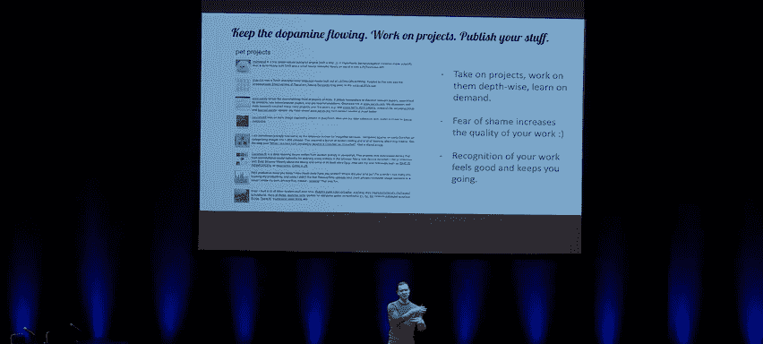

10% encourage people to work on projects。The other thing is putting them up is actually also like a really good Jedi mind trick in my experience。

 The reason for that is that if you're gonna put something up。

 you're thinking about all the people who are gonna be looking at it。

 your friends and teammates and family and future employers， etc。

 And so that really increases the bar for your own work。

 And it it makes you work harder because they're gonna be looking at it and you feel shame if it was crappy。

 And so you work much harder。 and you're gonna go that extra mile to make it really good。

 And that really really helps。

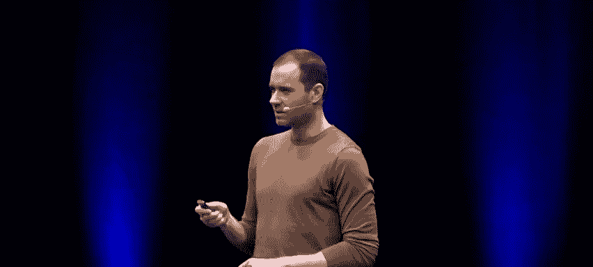

And lastly， when other people are looking at your projects。

 you're gonna get that reward because they like it。 they appreciate it。 They fork it。

 They work on top of it。 And so that feels good to your brain。

 And so the way that this comes together is you are getting your dopamine。 you feel good。

 That way you can build up to 10000 hours of experience。 And that's what helps you a lot。 Snowball。

 your projects from a small snowball all the way to a really big one and actually make change in the world。

😊。

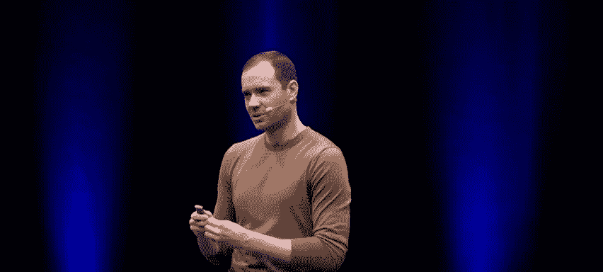

So， in summary。That's， I think， how it works like on the high level。 And the message is。

 just keep hacking。That's it。Oh。And then hopefully。

 this is the feature that we're going to build together when we snoobball all of our stuff or something like that。

 but not not the first picture I showed。 hopefully。 And that's it。 Thank you。😊。

Andre Capary， everybody。 Thank you， Andre。 That was awesome。 Thank you。 Thank you。😊。

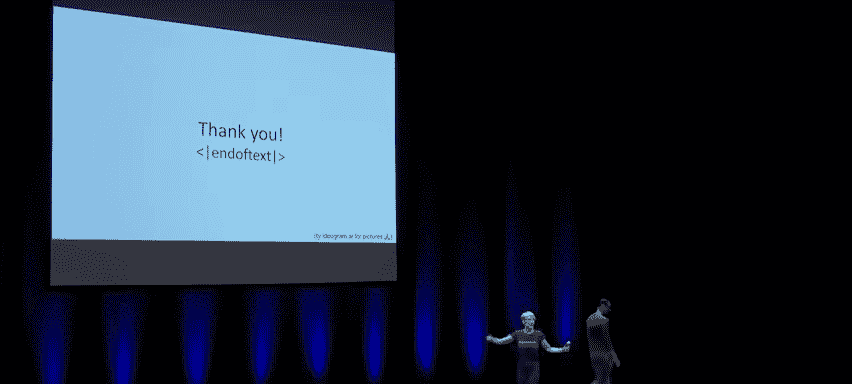

All right。Let's get to those pitches。

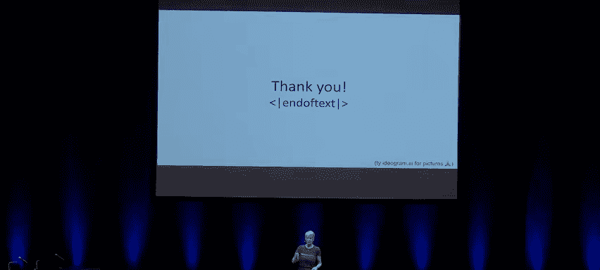

The grand prize coming up， you're gonna to hear  eight pitches by eight projects filtered through 290 submissions narrowed down to8。

 so you'all gonna to see some cool stuff。 The grand prize is $25000 investment and actual term sheet from the Berkeley Skyec fund。

 They must commit to hacking all summer on their project。 and they must appropriately form。

 of course， a legal entity。 How do you get money otherwise。 All right。

 I would like to now tell you briefly about how this is gonna go。8 projects， as I said。

 three minute pitch。 you guys are ready， three minutes。 Yes， they're ready。

 The judges will then provide three minutes of feedback。😊，And then after all the pictures。

 the grand judges will go and deliberate。And pick a winner。 while， we show you some other cool stuff。

 All right， I would like to introduce now to great applause， everybody， please。

 because we have an incredible panel of judges。 We are so pleased to have them。

 Please welcome our first judge Brian Bley with the Berkeley Sdck Fund。😊，Welcome， Brian。

Marcy Vu with Grraycroft。 welcomecome Marcy。Namdi Irebuem。With light speed， welcome， Nabi。

Irving Sux with Mayfield Fund。 welcomele Irving。Kurt Kitzer。

 UC Berkeley faculty and serial entrepreneur。 Welcome Kurt。👏And Mark Niitzburg。

 Berkeley faculty and director of the UC Berkeley Center for Human Compatible AI。 Thank you， judges。

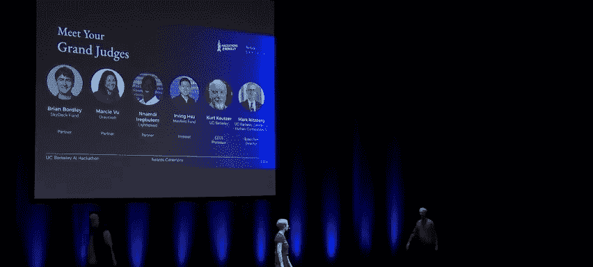

All right， we got eight startups warming up backstage。Let's give them a little drum roll。

's give him a little drum roll。We can get them going。 I first have to hear if the slides up。

 the slide is up first。 Are you ready， Are ready。😊。

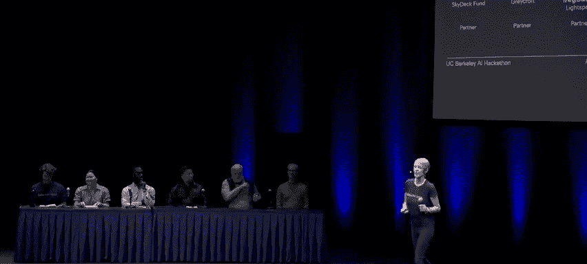

Are you ready？Yes， please give everybody a warm round of applause。 They've been up all night hacking。

 and they're ready to share with you。 Please welcome the first project， revisionvis， Come on out。

 Come out out， revision。😊。

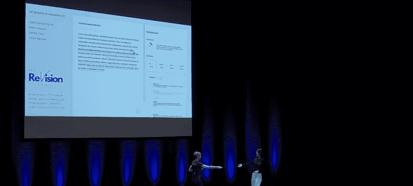

yes， the make。That would be helpful。Yeah， thank you， so good evening everyone。

 it's my pleasure here on behalf of my team also for the Reion project and my name is Danica I'm a rising senior studying computer science at UC Berkeley。

 we have Masters of design students as well as data science students on our team and we're really excited to tell you about our project。

😊，So our project we're focusing on building an AI copilot tool for STEM textbook authors。

 capable of detecting and mitigating bias in textbooks to create inclusive education content。

 and there is a reason why we're doing this when considering overall representation scientists across textbooks。

 only 13。1% where women compared to 86。9% men in a 2020 study that featured seven of the most frequently used biology textbooks within the US。

😊，And on average， people of color only appear every 320 pages of text。

 While white figures observed every 24 pages across 10 college ST textbooks published between 2016 and 2020。

So we thought about this problem deep and hard and it has been something that I've seen from my personal studies and starting from elementary school to middle school we constantly see different examples of word problems in other situations where Texas always there and it's not always reflective of the actual true history and this research has been done by numerous scientists who have gone through this process of identifying people creating databaseses but there is just no current fix and no one is really hoping to create this problem but there is no current fix that helps address this problem so the textbook companies actually is who our team identified as their buying customer。

 the current revision process actually takes six to 12 months of a committee of five or more full-time employees working on bias checks and the issue here is that employees are actually not experts on their topic。

 they also bring in their personal biases as well so our tool would come in right in between the writing and revising part of this this entire cycle that developers go through on writing textbooks。

😊，So again here as our competitor analysis， I'm sure many of you have used turn it in or grammarly when you're submitting even essays。

 and we really think that there needs to be an additional check here for bias and checking gender。

 racial， political and other biases and making this process affordable and automatic。

 so so it's not a cost leave process for anyone。And throughout this process we're addressing supply chain diversity。

 so starting from a younger age， the elementary school students could be able to use textbooks that truly reflect the true history as well as themselves and here is our prototype so we have our textbook here on the left side of the screen where you get to show in real time the examples of like some sort of text that a writer is creating at the moment and on the right we have an overall score and the bias checks for different categories and we're using machine learning models on the back end to actually identify as well as LLMs。

😊，And I'm not sure if I can play the prototype， but。哦。

Okay yeah it does play so essentially can click through the different links to see the breakdown and once you actually highlight one of these we are also adding in an API through Hu through a couple of the sponsors here like such as Hu API and more to actually identify emotional analysis as well in the textbook writing and in addition to this we're hoping to build a chatbot that can actually help you also bringing in databases from the unrecognized scientists and being able to sort of represent it because bias actually exist in three different ways one of them is through actual like text such as representing firefighters would be nicer than saying fireman and the other way is that the entire tone and emotional analysis which is why our team used Hu API to actually detect that emotional component and the third one is mitigating bias so we also considered adding in the chatbot so say for example。

 if you want to highlight。😊，Scientists that are like， for example， contributing to physics。

 you wouldn't just say， list a few male scientists and call it a day。

 We would also suggest equivalent contributions of female scientists as well。

So please join me and our team in revisioning our future of education and work。 Thank you。😊。

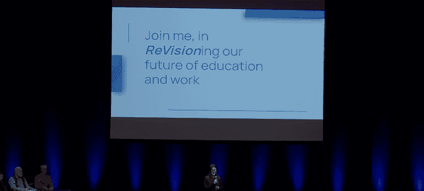

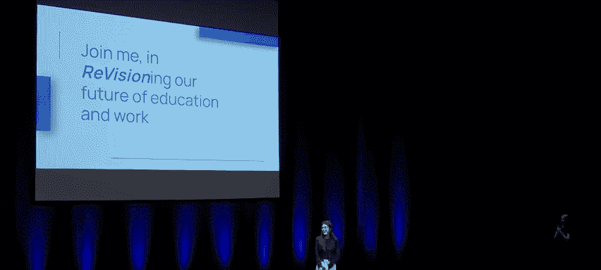

So I think everybody in communication today， nonprofit or profit is concerned about diversity。

 so it seems like you have a much larger market than just textbook educators。Also。

 to comment on kind of like market sizing and whatnot。 I would think about you know。

 potential ways you could expand the market here because the number。

People who are involved in writing textbooks is a relatively small group。

 but one way to think about it is like maybe in this new era of AI generatedrated content a much wider array of people can be part of this textbook generation process so that's one thing and then I would also maybe consider selling directly to the consumers of textbooks because in some sense the buy we're talking about is internalized on that side of the equation not on the manufacturer side and so it could be an incentive there for want to pay for something like this Yeah definitely that's something we're considering so like the textbook would be our official buyers that we're marketing to but eventually it would be more of like a grammarly checkered type of tool that anyone can use。

Yeah， I had a similar comment on tam and market opportunity and as you think about just。

How a textbook gets put into production， that if you actually have it as a tool for whether it's news or other areas。

 you'd have more velocity， both in terms of getting the data to improve your models。

 but also greater impact。Yeah I'll just， I'll just like as well。 I mean similar。

 I think everyone here is kind of hitting the theme of how do we think bigger， So even enterprises。

 right， like companies sending out communications internally or externally。

 I know this this problem exists everywhere。 So that's kind of where my brain would go to。

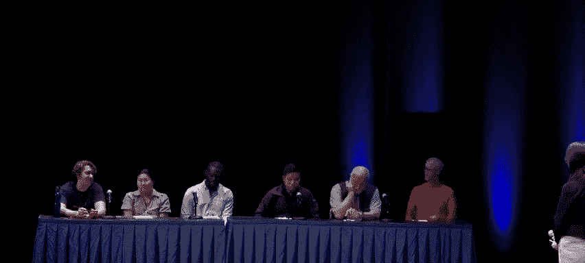

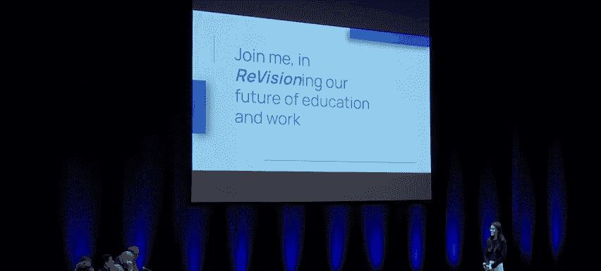

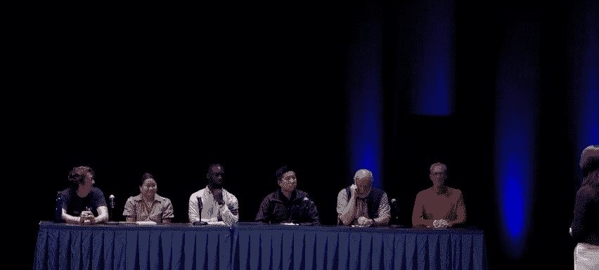

Okay， thank you。 Yeah， thank you。

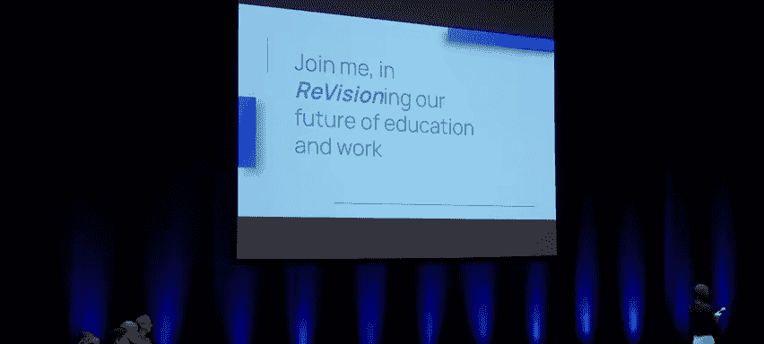

Ohoops。AN O， please welcome AgeN O。Hey there everyone， my name is Shashank。

 I'm here today with my friends Agam and Drvahuja somewhere in the crowd over here。

 we built today Agent OS。

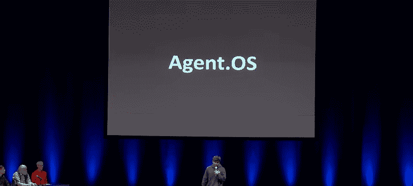

Picture this， you work at a hair salon and you guys are bombarded every single day and every single year by your accounting and tax preparation quams These are things that are very hard to deal with and you've heard of tools like open AI。

 chat GT， LLM this。Chat GT that everything but you have no clue where to start using these technologies and that's no fault of your own The current state of the technology right now is very bad at multifunctionary tasks more so it's very hard as an individual developer sometimes even non-technical to even get started with even the simplest automations or workflows or tools with such LLMs even engineers with years on years of experience in this space to take tens of hundreds of hours and even thousands and thousands of dollars to even get started to build something This is where agentnt OS completely transforms the landscape。

With agent O you're able to create multi-agent workflows in a matter of seconds from natural language what does that even mean Take your average corporate org structure you have your managers。

 you have your workers and sometimes you even have your interns everyone is really good at what they do they have their tools。

 their skills let's say John is really good at charting and making PowerPoins let's say Steve is really good at Python coding everyone's really good at what they do in this you have a very collaborative working together to create this common solution for someone coming from higher up that's how agent O was designed Our engineers drew and Uum we're able to replicate this human collaborative process to programmatically using LLMs What does this do this allows everyone from the common Joe all the way up to enterprise clients to be able to interact and use these multiagent agentic workflows in their day today life to improve their quality of life or productivity in all in a matter of seconds and a few sentences。

Let's go back to the study of the hair salon in the process of doing your taxes and accounting you have multiple steps。

 you have your collection from your receipts and your invoices。

 you have calculating your cash flow all the calculations you have to do you have to manage your workers and then you also have to do your general summary what about your insights for the year how you were spending what you were spending on and you have to also do a lot of clustering and analytics on this this is a very complex workflow that's nearly impossible for modern day LLMs at the current state to do right now you can take chat GT you ask it a question for even more than three things it'll forget what the first thing was by the time you're at the second it doesn't work that way with agentnt O this completely changes where you're able to have these complex workflows let's dive into another demo So let's say I'm an analyst at JP Morgan and my boss tells me every morning I want to report of XYz stock in the morning a detailed report on paper how do I do that I use agent O and you can see a bunch of other complex use cases of multiple agents working together collllabo。

But in the toolbox or in the searchbar， you can see the use case of the analyst here I to do market research and livestock data。

 I have to search the internet， go on Yahoo finance， then I have to create my analysis。

 technical analysis， qualitative analysis， then I have to do what my boss is telling me to do and after all of that I have to create charts。

 graphs and visualizations。

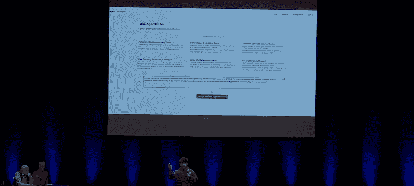

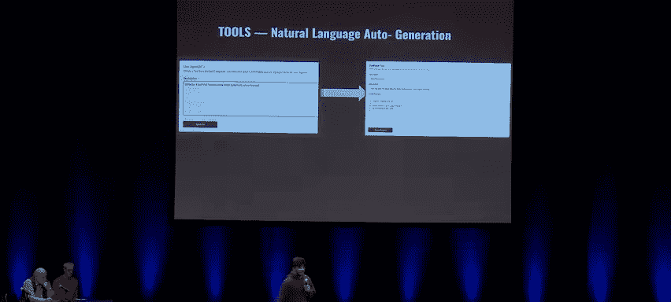

Here you can build tools using natural language like the one right there that says write me a tool that fetches the metastock price from Yahoo finance and in a matter of seconds the common Joe or anyone is able to create that tool。

 connect them to workers you can think of workers as your everyday employees， agents。

 people that perform these actions using the tools and connect them to super teamss and these teams are able to on the screen you see four but you can scale this up to 4400 basically complex vertical and horizontal organizations that are able to perform complex decision making and complex analyses for anyone from enterprise to consumer。

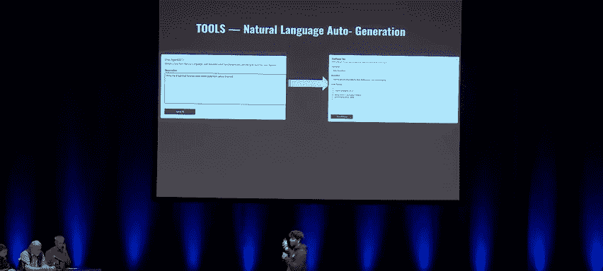

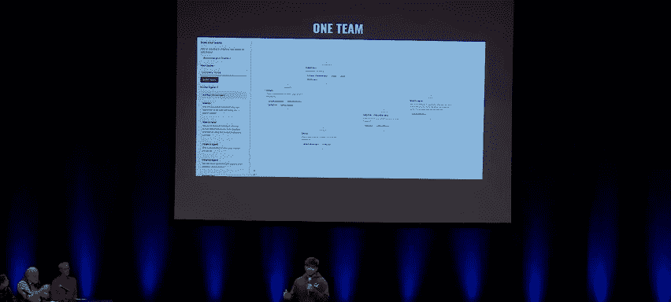

What does this do with the multi-agent multite framework this completely opens the landscape up for anyone and everyone to take on the power of LLMs into their own hands from natural language take your average farmer at a farmers's market he's trying to create his marketing campaign for the upcoming farmers's market this Sunday he has no clue where to start looking at his metrics looking at the customers looking at the weather and creating these brochures。

 papers， pamphlets and whatnot with one line and one minute using agentnt O he can create all the documentation he needs in order to enact this stuff and be able to perform successfully and continually grow his business at his farmers's market things like this are completely opened up with agent O and we hope to completely democratize the process of using LLMs at all scales at all geographies and all use cases within sentences and seconds Thank you。

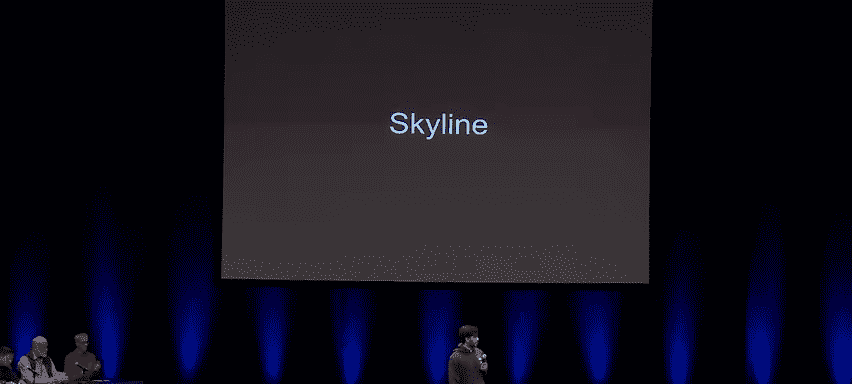

That's a。A compelling proposition。The one thing that I worry about is right now the agents。

Are the LLMs you know？performing these tasks and there's a certain question about the veracity and reliability of what they're doing。

 and so I think that in a future where we have that reliability this would make perfect sense。

 but I would want to add a kind of tandem subject matter expert。

 maybe looking over the shoulder of each of the agents。

I think next time I hear this pitch I'd love to hear about the one market you're going to crush。

 it's hard for me to imagine serving a hairris stylist one day and Morgan Stanley analyst the next。

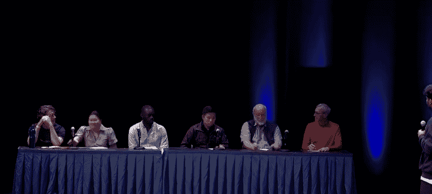

This is a huge opportunity and a big bold mission that you have。

 I would want to dig a bit deeper into your tech stack and the people you have on your team because these are really complex problems and issues and also agree that what would be your first area of focus because it's pretty broad and wide。

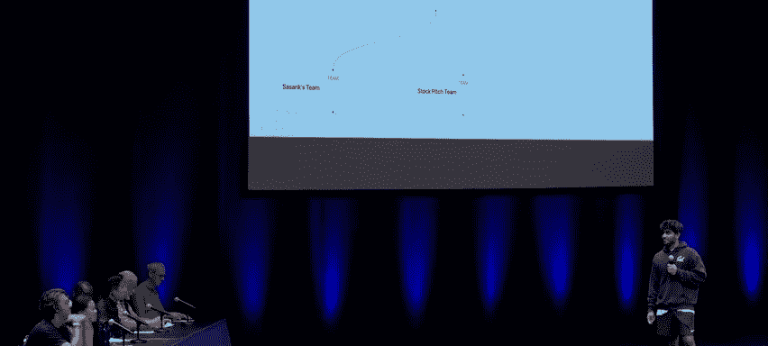

I'll say I kind of like the broad focus and there's a lot of individual startups tackling each of these individual problems if it's invoicing or research。

 so might be interesting to figure out how to like loop in all these other tools that are out there and really kind of just be like an interface layer and let these other companies solve the technical challenges。

I think the value proposition of creating multi-agent workflows in a matter of seconds is really compelling。

 I think the next step would be trying to figure out how can you go from simply performing these tasks to becoming the best at these tasks so for example。

 going after the outliers， sort of the thesis around coaching networks。

 some startups do this and they do it better for like certain verticals than others so I think doing more research around that could be really compelling。

only thing I would add is just think about enterprise security and how you solve for that' a lot of authenticity and authorization you're going to have to do for all these agents。

 so just have an answer for that。

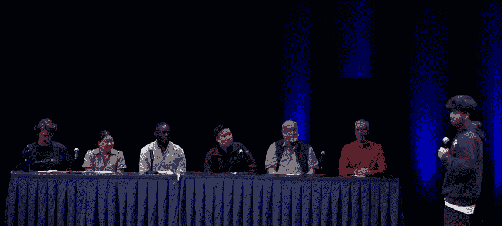

Well yeah， thank you so much， thank you everyone。Thank you， Age O。

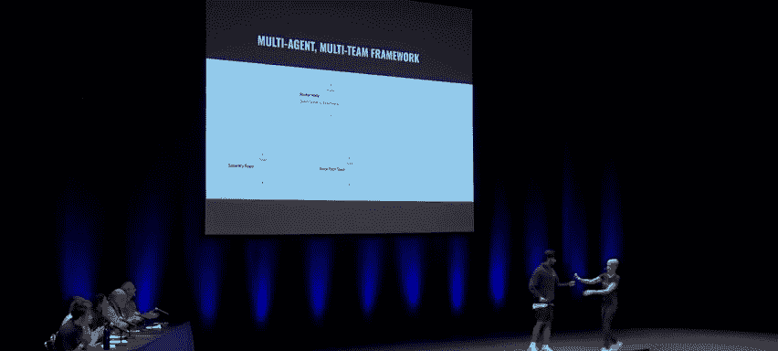

All right， next up， skyline， Come on out， skyline。Hey， everyone。

Hey so my name is Rajan and Im a firsty student at the University of Waterloo and I study software engineering and I fundamentally believe that cities shouldn't be static。

 they should optimize and scale for the people who inhabit them and so we build Skyline Skyline is an an optimizeimr and it allows you to better understand how to model cities using agents and optimize things like traffic and transit to inherently increase mobility and reduce things like carbon emissions So this is a very weird problem that we solved but I want to walk through the case study of Los Angeles So Los Angeles is one of the largest carbon emitters in North America。

 this is most because of their transit because of the amount of cars and so what are ways in which we can optimize this Well let's look directly at the people who inhabit Los Angeles。

 We can extract census data things like age。 we can look at things like gender。

 we can look at things like income。We can find population density graphs and using this information we can start to find patterns。

 specifically what we did is we created 500 distinct agents。

 Each agent is a different citizen with different with different interests and what we can do is we can give them each their own chain of thought Each person here has their own day in their life for example this person is a very young I believe this was a 22 year old with a very large income he's a long day at work and after work he goes to the gym we can now reason about what this person may do and now model this on a map。

Now once we have how these different agents are moving around what we can do is we can try and optimize things like transit so what we do here is we have our own proximal policy analyzer and this allows us to create simulations and what we believe to be the best way to understand how we can move around from any point A and B in the fastest way at the lowest carbon cost。

 these our own carbon cost analysis mechanisms our own machine learning models to better understand how we may be emitting carbon and how to reduce this through our transit So this is a lot that it is through you and I think the best way for me to represent this to you is through video I hope this video loads。

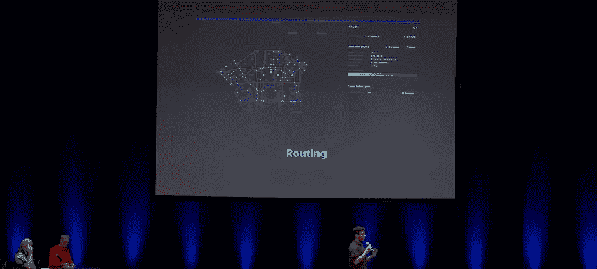

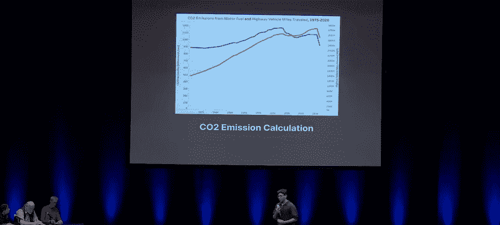

ok。It's possible to play the video。So what we first do is we have an agent based relation。

 These are 500 distinct things in parallel that are running now they each go around throughout their day and what we can do is we can find patterns in how they move around now the best part is what we can do is now they're all back in their original position we can start a generation of transit and we're using these patterns to now generate live different transit systems that we believe to be the most optimal So what Skyline isre not we're not a company that does an analysis of transit we are a human modeling company and that allows us to better understand and better predict how things around us will change and how we can optimize them using these patterns Yeah so that skyline。

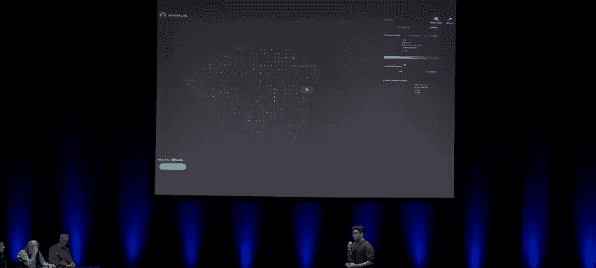

Happ you taking easy back。

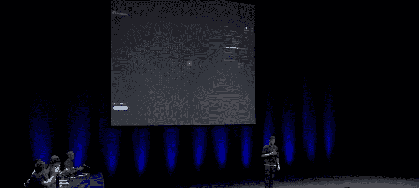

Wow。I just want to observe that what you're doing in creating a sort of digital twin of a city is for essentially each citizen is being simulated using one of these really powerful expensive things。

 a language model。

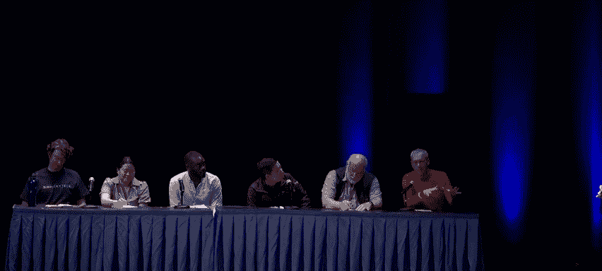

It will be probably an important step to draw from the language model。

 some of the statistics that are actually fed in in the first place and make sure you're getting out something representative。

 but that's very impressive。

Yeah similar comment， I think you there's all sorts of like economic theory about you know agents and modeling their behavior and their values and whatnot and the thing that usually gets to you as sort of heterogeneity across the population so making sure that that actually represents the populations being modeled is important and then the other thing also related to value I would think about is just value capture for your own sake because I feel like this is like a category of software where like yeah the economic impact of this could be massive but how much of that do you get to capture as a software vendor is like less clear to me but it's very interesting。

I guess I would be curious about maybe some more like nuanced enterprise use cases as well。

 if it's concerts or security or stadiums， so kind of just thinking about like are there more micro use cases that there's a more direct RI with？

For the sort of modeling。Yeah we tried to consider ourselves to be a human modeling software。

 and this is just one of the most visual applications， which is transitent。Okay。Awesome。

 thanks so much。 Thank you。

Thank you， skyline。All right， next up， we have。

We have Spark， please welcome Spark。Hi， hows everyone， how is Call。

 we are Spark and we're giving a voice to new entrepreneurs， young entrepreneurs。😊。

So let's admit it cold calling is really hard I mean resources are hard to get。

 it's a steep learning curve and getting attention is hard if you've cold called someone you know。

 they don't have time， they'll say oh sorry call me back later I mean they're busy everyone's busy we have things to do so we have to figure out how can we earn the time of working people。

There's existing solutions， it's long and arduous for trial and error。

 it's expensive for a sales coach。 and finally it if you have a sales partner。

 chemistry isn't easy if you're just meeting them， right？Well we have a process。

 you upload a transcript to our software。We go through and analyze the emotion。

 we aggregate this data， and we give you productive feedback。

Who's our target market well look around you guys are our target market， people who are engineers。

 people who love to build and say this weekend you made some sort of product you want to sell。

 you don't have much experience with sales or outreach with our software you can record your cold outreach and we can tell you what you've done right and how you can improve to hopefully land your product where it needs to be。

And later on， we want to expand to call centers and sales staffs because we think we can spread this across an organization and it can be highly profitable。

We have usage based tiing， so 75 cents a minute for 100 hours， going up to 40 cents for 10，000。

So this is our software。And I want to tell you guys a story。

I started being an entrepreneur around six months ago， and we made an AI bodycam analysis startup。

 So I did 100 phone calls，100 cold calls。 I got no clients，200，300，500 and700。

 no one whos responding to me。 So by 800， I got actually three。 and I realized something。

 the human brain is pretty amazing。 We're able to pick up on patterns。 but at the same time。

 it's kind of inefficient because it took 800。😊，Here we look at the emotion between every single sentence。

 and we figure out spikes of emotion and decreasing emotions。

We see that when we talk about security and data privacy with police officers。

 it shows an increase in their interest。 and this was a trend among many conversations we had。

 So in our analysis page。We see in the top left that mentioning AI accuracy and efficiency。

 increased officer safety and discussing cost savings really helped us when we were talking to officers because we're some college students right we're dealing with some pretty confidential data bringing this up early really helped improve our rates and the four things you see here and the corners are the different triggers we generated automatically based on the cold calls we had so one is positive reactions。

 negative reactions。Escalate or deescalating tense situations and normalizing exciting situations。

We also generate insights， too， based on whatever cold calling trends you make。

We also have a rag so you can upload your company knowledge。

 your target audience and your pricing information。 So if you make a mistake， don't worry。

 we got your back。 We'll tell you， hey， maybe instead of saying this。

 you could have said this because might have helped you out a little bit。Sorry。

 my team picture isn't not here， but thank you to Tsha and Nick and Krishna。

 you guys were a great team。 I'm honored to be here representing you guys today。

 I'm open to feedback。

I guess I need to be the first person to say that you're entering a pretty competitive market with other offerings here。

No， yeah。I'll say something that stuck out to me was this idea of insights。

 but I think there's at an organization there's going to be a sales team and a marketing team and an online web team。

And those teams that't really talk to each other。 So maybe it's interesting to think about how do you pull insights from like one channel of sales or marketing and actually bring that into like another channel。

 So maybe the insights from cold calling are actually influencing what's going on the website。

 Maybe there's some interesting。Spots of opportunity there。 Yeah。

 I can actually talk about one facet of this。 We want to explore deeply。

 I want to give you an example， say we have three founders in the company， right。

 I have a first cold call with one person and later on。

 my second cofounder wants to set up a warmer call right in the future。

 And then my third founder wants to set up a third call。

 We want to build a profile for this client as they go along so we can truly understand them And also we want to develop a profile on ourselves too。

 so we can learn more about ourselves as we go and how we're behaving make sure that we're learning as we go。

 So we're thinking if we develop a CRM on top of this data that we leverage and we can connect multiple teams and enable crossfunction benefit。

😊，Yeah I had a similar comment I think it would be really game changing if in addition to some of the real-time analyses you guys are doing around sentiment where you can see a system with information on prior calls or this person's particular strengths and weaknesses and how they complement those of the other people on the team and to really build the CRM this knowledge graph around each person's strengths and weaknesses on the team to be able to better fine tune the system Yeah thank you you guys saw the analysis but also there's a long list of past conversations you can actually go into every single conversation you've ever had and look at it deeply the same way you did in the like latest conversation。

I would think about the full sales funnel This is pretty deep down in it and as you think about where are you really going to be able to convert or wheres where is the wedge that really matters because there's a lot that goes into converting a sale and it's not just the cold call So is the issue or you actually calling the right people or is the issue like are you actually speaking to the right decision makers So just thinking more broadly about that funnel and where you might actually be able to have the most impact and have the right wedge into。

The broader products we。Thank you。 thank you。All right， thank you S， We appreciate it， bye。

 enjoy your question。

Clicker。Clicker， thank you。Next up， we have， hear me out， please welcome， hear me out。The big one。

Hi guys。 Hey， Hi， my name is Marcus。 Im from hearing me out。

 and what we've built is an AI driven customer service pipeline。

 optimizing call matching and visibility。 So that might leave you scratching ahead。

 So let's just talk about the problem。😊，So let me give you a bit of context。

 I'm an exchange student and when I first came here I had to deal with so many things。

 I had to deal with banking， I had to deal with insurance， I had to deal with deliveries。

 and I even had my car breakdown down on me and that was a real pain。In short。

 I was overwhelmed by the sheer number of customer service calls because for each of these things。

 I had to make so many calls just to get things done。

And I think a lot of you guys can relate to that。 We've all had our fair share of bad call experiences where we're upset。

 The customer service representative is also upset。 nothing is done。

 We've also had good experiences as well。 And I think that's the core of what we're trying to tackle here。

We want to create a pipeline that tries to provide optimal matching and provide visibility on emotional data to businesses。

So we also did the research， and I think the numbers speak for itself。

This is a key problem with a sizable market， and a sheer number of people are affected by this as well。

And this is our problem statement， which is， how might businesses which offer customer service calls。

 provide a better experience for their customers。So we think we can tackle this in four key components。

 First of all， an improved Colbo。 We all are common with that initial roboca that we have to deal with。

 And sometimes it's really， really frustrating。 How many times we had the callbo talk to you。

 and it just doesn't direct you to the right person。 I think we've all experienced that before。

Second and third， and I think this comes hand in hand is just business visibility。

 We want to provide businesses with better visibility of both call both call experiences， data。

 as well as customer representatives bandwidths over the day as they continue to take calls。

And finally， this is where we put those two together。

 We want to take that data and optimize a customer's journey through a best through a better customer to service representative matching。

😊，So I won't bore you with this data but with that in mind。

 we developed a set of decoupled microservices， and I just want to point three key parts out to you。

 So first of all， we want to assess customer agreeability with an initial roboco。

 but this won't just be your normal roicol。 We want to use Hume's EVI to manage the roicol in an empathetic manner such that it measures the customer' emotions as they go through the call and eventually outputs an agreeability score for the customer。

Second of all， we have a call analysis feedback loop。

 and that's that whole thing on the right and it goes down below。

 and what this does is once you have a call connected between a customer and a representative。

 it takes in multiple factors of data such as the call duration。

 the emotional change over the call and the overall call outcome。

Using Hume's emotional measurement API， we can then also generate a cold score。Finally。

 and this is the third and key part to this。 It's the matching API。

 usings the two things that I just mentioned。 we can best match a customer to a customer service representative。

 which matches their vibe， their energy and their emotions based on how our customer models built。😊。

So what's the outcome of all this， as a representative goes through their day。

 their state changes depending on how their calls go and their bandwidth adjust accordingly。

 This affects the subsequent customers， which they are matched to in a positive manner and creates a better experience for both parties。

So there's a lot more which we can build with what we have。 But with this foundational pipeline。

 we believe we effectively tackle the problem that needs to be solved。 That's all I have for today。

 Thank you。

Nice， thank you。Yeah I mean， a little bit of feedback similar to the last company as well。

 just there's a lot of companies working in this space too。

 So I would just continue to think through know how to find that core differentiation。

 you know if you continue to work on us after the hackathon。 Yeah I completely agree。

 I think a key part that we thought was really exciting was just what you can achieve with custom models what we're doing by developing a feedback loop is we're creating something where we can create in a sense a model which trains itself。

 we can assess how calls might improve or get worse after the matching and that feedback gets fed straight to the matching API so that it knows whether or not it's done a good job or not and we find that really interesting and we think that that's a key differentiating factor which we can achieve。

There might be some opportunities for building some sort of like synthetic data pipeline here where you could just sort of simulate calls with like an AI bot of some sort and use that as feedback I don't know how good that data will be or not but could be interesting Yeah no that's a really interesting thought thank you yeah。

I know right now you guys are targeting customer service agents as well as call centers。

 something that could be interesting to think about is as you think about the different stages of the software adoption lifecycl as you go from your early adopters to your early majority and then your late majority who is eventually going to justify your evaluation in terms of what those ideal customer profiles are going to look like down the line。

Yeah， thank you for that。 I think one key thing was like we actually had a judge come to us and talk to us about how they were doing something similar for sales representative as well。

 and we found that really interesting so happy to figure out how we can pivot if that need arises。😊。

Thank you so much thank you。

Thank you， hear me out。All right， next up we have dispatch AI， please welcome Dispatch。Hi everyone。

 my name is Spike and I'm with Dispatch AI。In the United States。

 over 80% of 911 call centers are critically understaffed。

 this means that in a crisis people with real emergencies aren't able to get the support they need because all the human agents are busy。

And they're often put on a hold。This is particularly an issue in our neighboring city of Oakland。

 where last year， the average wait time was over 60 seconds to pick up a 911 call。 Now。

 in an emergency， every second count， and this could be literally the difference between life and death。

This is unacceptable， and that's why we built dispatch AI。

 the world's first AI 911 call operator designed to eliminate these wait times。

Our system is powered by two key components， first is the voice AI。

 the voice AI will step into calls when all human agents are busy and it will work with the caller to evaluate their situation。

 extract the location， and optionally dispatch first responders directly to the scene。

And the second part is our powerful dashboard for the operator themselves。

 so the operator will have access to a bird's eye view of all of the ongoing calls。

 which will be automatically triaged by the AI into different forms of severity or priority further they'll see that the AI will automatically extract the location and will provide a live transcript of the call so that they can quickly see what's going on and even step into the call once they're available。

Further， they have buttons that allow them to directly with just one click because the locations already fetched。

 dispatch police， firefighters or paramedics。All of this is done from a human centric angle and the way how we achieve this is by taking into account the callers's emotions。

 so for instance， when a caller shows signs of anxiety or fear。

 the system could work more to calm them down and make them feel at ease before taking the next safe step。

This system is fully designed with ethical safeguards in mind。

 and part of that was fine tuning a model on over 50911 calls so that it could understand the proper protocols and have a wide or haves or be knowledgeable on a wide variety of possible scenarios in which a 911 operator could assist in。

 including fake calls or instances where it may not need assistance。

This is all powered by our innovative tech stack that utilizes a variety of AI components。

 including the voice AI， the emotional analysis and of course a key component of this。

 the fine tuning itself。 Our mission is to make requesting emergency services more effective and efficient。

 Thank you。

I'll go first。I thought you did a great job I thought you presented the problem set the opportunity and the product very clearly and you only had three minutes but you hit all the relevant points Thank you。

The one thing I would encourage you to think about a little bit is。

Sort of like the optimization function for these municipalities right because if people in Oakland are waiting 60 seconds to get their 911 call answered like there's a reason for that I don't know what that is but somehow these municipalities have decided that that's how they want it to be and so I would just think about like。

You know， as you bring in AI to this problem， doing the like potentially difficult AB test of making sure that whatever it is that these municipalities are actually optimizing for is actually improved by this because it seems like a no brainer when you first say it。

 but like。Clearly， it's this way for some reason that is probably nuanced and tricky。

 so just something to think about。Any other feedback。

I don' just just following up on that I think the key is eases of adoption。

 I mean I think it's easy going to be easy to make a productivity argument to the city of Oakland。

 but then you've got to think about who's actually installing who's paying for this and who's installing it。

Okay， think that's good， thank you so much。Thank you。We dispatch。All right。And。

Next up we have ASL Bridgeify， please welcome ASL Bridgeja。Hello， my name is Ia。

 and today I'll be presenting ASL Bridgeify， the next generation of sign language in interactive learning。

Oh。呃。Oh， this。Okay。Sorry， so what was the inspiration behind this Well。

 ASL is the third most studied language after Spanish and English and over a billion people are projected to have some sort of hearing loss deficiency。

 which is why it's even more important to have a seamless way for people with hearing loss deficiencies to communicate with people without them and vice versa and next there's over 15000% return on investment over a 10 year period demonstrating the value proposition and existing platforms like Duolingo surprisingly do not take into account ASL learning。

 which is why it's important to build an interactive platform where individuals can retrieve the accuracy of their signed text as well as characters。

Now our solution includes three proprietary AI models first we use the random forest algorithm in order in order to map input post estimation frames of frame length of 200 to the predicted to the predicted alphabet from A to Z。

 Next， we also use an LSTM model which capture sequential dependencies to map to map from hand post coordinates to the to the actual word。

 and then we also have our individualized RAG calling in Lin as well as as well as PDFs that are specific to ASL learning that get chunked and transformed in a vector dimension space。

Now， as you can see here， this is a hand pose estimation extraction using the media Pi library so you can see A。

 B， and C。And here's our platform where you can there are different modules to learn alphabet signs as well as sentences and we even have a real time ASL practice。

 so in real time to capture the sign that you are actually the letter that you're actually signing and give you the accuracy for that so here's an example of us using the media Pi library to actually extract all of the hand key points。

And here are some videos where there are over hundreds of words that you can actually view to learn each of the hand signing frames。

Now this is our proprietary REG and the way we've trained this is we've collected a variety of PDFs that are essentially manuals for ASL learning and potentially in the future we would want to incorporate things like YouTube transcriptions that can actually be that can actually be transformed and embedded within our vector dimension model。

Now in now， in the future， this doesn't AL doesn't just hand hand pose estimationation doesn't just have to be。

ha to be localized to ASL there are plenty of other opportunities for human pose estimation including fields like dance。

 martial arts where you can not only identify certain techniques。

 but you can also get feedback generations from certain input frames and in the future this could also be integrated into existing solutions such as zoom。

 loom and Facetime video， so if so given the signing of a certain sentence transcript you can get in real time the actual predicted sentences and words。

Okay。That's nice work for 36 hours。

I would be。I spent some time。Creating assistive technologies for the blind。

 and I would be just very aware of the market and how you'll approach it and who will' be paying。

 I think that will be a good thing to pay attention to。

Thank you。Yeah， as you think about the market。You know， I feel like these language learning apps are。

Tricky to。Kind of scale to meaningful businesses。 You know。

 there's sort of like Rosetta Stone over 20 years ago。

 And then there's been like dualol ingo on this most recent gen。

 but there aren't like that many that get to meaningful scale， so。

Might be worth just thinking about that market。What are the kind of success drivers。

 I think even as I mentioned previously apart from just hand pose estimation。

 I think that there's a big market for body post estimation。

 I think especially in things like combat training， especially like if you look at the military。

 even dance dance performance companies where they have to train dancers and they're actually specific techniques in which they want in which they want ground truth feedbacks for。

 I think those are also potential markets that could be ready to penetrate into。

You chose more traditional machine learning algorithms in early neural nets like LTM。

 and that may be the right answer， that's not obvious to me。

 but I think you would for today's audience who need to explain why you're not using more contemporaryI。

Algorims。Yeah， so initially we were actually thinking about using more encoder encoder based transformer models。

 but we ran into some struggles so we just ended up we ended up settling on the LSTMs。

 but in the future， we would obviously we would obviously adopt more of the state of the art transformers and even in the case for feedback generation for given hand poses that could be an easy encoder to decor multi like self-attention model that you could train。

Okay， thank you so much。 Thank you。Thank you。All right。

 our last contestant for the grand fries is greenwiseise。 Please welcome Greenwise。😊，When I was 14。

I stopped eating all meat。I lasted about two months。Now， even though I still eat meat。

 there are a lot of small changes you can make that have a huge impact on your carbon footprint。

For example， by switching from beef to chicken。You cut the carbon footprint of your meals by six times。

What we do is we help you make that switch from beef to chicken， for everything。 for your shoes。

 your shirt， household supplies， food， everything has a carbon cost and a carbon footprint that we can mitigate。

😊，So how does a consumer analyze all their purchases and the carbon footprint of anything and try to make all these very difficult decisions and research about how they should change their actions。

 Well， thats where greenwise comes in we seamlessly integrate with existing customer purchase models to basically。

인포。What the consumer is already doing， for example， through receipts or through emails。

 and we integrate with Apple Pay with Amazon and with Square to automatically get their purchases into our system。

 From there， we compare that we vectorize their purchase and compare it to our vector database。

 This database has all the carbon footprints of over 10000 products that we've。

Alyze and make sure that these are accurate carbon estimates。 Additionally。

 by using the vector embedding， we make sure that these similarity scores are very accurate。

 It's not an LM that can hallucinate。 These are real accuracy scores and real carbon predictions。

From there， it directly can tell them an alternative product that is very similar。

 but has a less carbon footprint。Additionally， this programs a lot of room for scaling when other businesses want to analyze their carbon footprint for their products。

Or for events and other bigger venues。So from good intentions to reality， let's make it happen。

It's a very innovative ragG use case I would' have never thought of the it's pretty not using Oh it's not It's similar in that it uses a vector embedding for finding similarity。

 but the similarity is directly the output Yes， that's right yeahologies。

Is this a subscription product？So I would imagine it being a description product。

We would have here to but probably not we ideally we'd integrate with existing businesses like Instacart or Safeway so that。

They can show our results on how green or how the carbon footprint of certain products is on their app。

But it also works for consumers to use on their own as demonstrated here。

People wouldn't pay for a subscription， though。Okay， I think that's all we comments。

 Thank you so much。

Green wise， thank you。All right I would now like to invite our esteemed judges to convene in this secret room where judges make their decisions and we are gonna to have the special prizes so as I mentioned a bunch of sponsors came to make this all happen we an educational program and it is entirely the sport of these sponsors and they're not just providing support they got cool prizes so let's bring them on in just a minute you're going to hear from each one。

 these are the sponsors for today and I also want to thank our community sponsors。

 these are startups， very cool startups who hung out and helped our young hackers with their needs and theirre cool tools All right so our very first special prize is going to be announced。

By a very special campus partner。I'd like to welcome。The academic innovation Catat。

 I'd like to welcome out here， Matt Cininni and Paul Work to tell you about AIC。

 one of our newest campus partners doing very cool stuff， please give them a welcome， thank you。

Thank you so much Caroline it's just a thrill to be here so my partner and I Paul and I created academic innovation catalyst or AIC to release more innovation from academic research for positive social impact and we're focused initially on the areas of climate tech in AI for good which is why we're here today how do we do this well we make proof of concept grants so no strings attached non-dilutive grants to academics with an idea and then we help them take that idea carry it through commercialization to scale and sustainability and so that's what we do we're thrilled to be here today and we'll be making two awards to the most compelling business plans or innovations involving the use of AI to make the world a better place and we couldn't be more excited to announce them in five seconds here I'll just say that we met with。

Many amazing teams it's been an extraordinary weekend thank you so much for including us we had to narrow it down to two it was tough but I think you'll see that they're well deserving so with that let me hand it to my partner Paul Wek to announce the winners of the AIC AI for Good awards in 19 I'm sorry 2024。

Whats。This is what happens when you get old people up here on stage。So any rate。

 we are really thrilled to be here， as Matt said， and we're especially thrilled with the fact that so many of you are putting your talents to work for such great causes and for the betterment of humanity and AI has so much potential in so many realms but among the most important is to make the world a better place and to make a social impact and so with that we're thrilled to announce the first two winners。

Dispatch AI and ASL bridge ofified。So these are tremendous companies， we again。

 the competition was so strong， may I ask actually both sets of winners to stand in the audience here？

And thank you again so much for the terrific work， I think as you heard。

 ASL Bridgeify is doing for sign language， what Duolingo has done for learning other languages and it is so important and it's incredible and shocking that it's an underserved and currently notserv market and their technologies are going to change that and dispatch AI。

 what can you say， I mean it's such an important issue to be able to get emergency response to be able to get a response when you need it and of course the reality is when we have unfortunately too many mass catastrophes。

 the time when you need the response。

Strapid is that and you're often most shortstaffed and so dispatch AI is using artificial intelligence and a variety of technologies to speed that process up and to help both the dispatchers and the people that the dispatchers are helping and so can I ask the dispatch AI team to stand up as well and be recognized。

It's a great job。 congratulations to all of you and to everyone who is here today。 Thank you so much。

Thank you Madam and Paul， thank you academic innovationno Catalyst。

 our next special prize is going to be introduced by our very own general manager at SkyDck， S Cha。

 give her a welcome。Hello everyone， hope everyone has had a great weekend。At SkyDEC。

 we have about a year and a half ago， we launched the SkyDk Climate Tech track。

 in part thanks to a nice grant from the university with $150，000 to build out the track。

And right away we started putting that to work， we grew our advisor network from you know maybe like five advisors in climate tech to now over 30 advisors that are in the climate tech space and beyond that prior to the grant we had maybe three year to five startups every batch that we're in climate tech and now we average 15 startups per batch in the climate tech space and we really hope to see that grow so I'm very pleased to announce that the winner of the S climate tech track is team greenwise。

 I think they're still in the green room because they just pitch they were the last ones to go on stage。

But they really kind of represent the type of start the you team members that we like to see at early stage startups。

 it's three team members that are best friends from middle school Oh they're all here on stage come on out I wasn't expecting that but Anthony Ben and Ethan three best friends from middle school representing UC Davis。

 UC Santa Cruz and UC Barbara UC Santa Barbara and they've built a platform for carbon footprint footprint tracking with actionable recommended recommendations for vendors so that people and companies can reduce their overall carbon footprint so please help me in congratulating this team winners of $25000。

All right， thank you， S， thank you， Green clicker， clicker， thank you。

All right， next up， special prizes from Intel， Intel， come on out， Intel was here。

 their table was swamped， I'd like to introduce Gabrielle Aoranto。Hi everyone。

 thank you all so much and thank you to the organizers for having us we've had such a great weekend and your projects are so amazing so thank you to everyone who joined our track as you can see the winners behind me。

 congrats to all the winners we have our raffle winner Ila Rs， third place is Asel。

 second place is batteries by LLM and first place is dispatch AI so let's give them a hand of a grand round of applause。

😊。

嗯。Yes， great job， amazing projects if you won， please meet us outside I want to hand you your prizes we have them with us so please meet us outside so we can take pictures and give you your prizes。

 thank you。😊。

Thank you， Intel。All right， next up， AWS。 Come on， stage AWS。 We've got Rohit Tuluri。

 Kevin Lu and Brandon Middleton。And that's what they're going to tell you， go ahead repeatheat。

Howdy there， can you all hear me Yes awesome Well hey thank you so much Skyde team for having us and Cal Has。

 this has been an extremely impressively run operation and we're really excited to be partners and sponsors of this hackathon today we have three different prizes actually let me introduce myself first we have Brandon Kevin and Roe Rohi we are members of the generative AI organization at AWS we work with top generative AI startups like anthropic stability perplexity and others in the development of their large language models as well as our overall kind of inorganic and organic growth strategy including investments as well today we have three different prizes we have four of the teams that we have chosen to give the prizes out to our first place prize is for $10000 in AWS credits and we have two other prizes。

 one for climate tech and then one for responsible AI which are5000 I did want to say that。

We talked to so many impressive startups and founding teams today and hackathon teams today。

 I wish we could give prizes to all of them， we did want to recommend that those who we spoke with and I think we have these conversations with you already to go ahead and apply for the AWS generative AI Acccelerator as well as our AWS Actate program to receive additional credits I'll go first I'm going to be announcing the Cl tech we're going to give the prize out to disaster aid is disaster aid in the room today。

Yes， good job， yes。And then for responsible AI， we have a two way high。

 so we're splitting that pride into 2。5K for each team in credits。

 and that's GPT ethics and D ancestry there in the hall。

All right and I'll round us out our grand prize kind of the most impressive thing that we heard and saw today is going to go to safefeguards。

 so safeguard team， if you're in the building or stand up real fast。

 let's give you a round of applause。I don't see them。

But God bless you and keep doing what you're doing， thanks so much guys。Thank you， Intel。

 our next amazing partner， Reach Capital。 Please come out， Tony Wan。😊，Ohpe， out of order。

Let me see if I can find you， there you are。Okay Mike awesome thank you so much thank you to Cal Has。

 thank you to SkyDck， it is such a delight and pleasure to be with all of you today and thank you to everyone for being here from across the country from across the world my name is Tony and I'm from reach capital and let's just cut to the chase because there's those around my here we want to congratulate Frodo for winning our AI and education prize Frodo Amman and a team if you are here please stand up please stand up all right you are right upfront you are in the right place Thank you so much。

😊。

you've won the one ring as they say or at least our $1000 cash prize。

 so please let's meet up afterwards reach capital we're an early early stageed techch BC firm investing in E techch。

 we invest in education across K12 higher ed in workforce in tools that expand access to education and economic ability and many of the companies in a portfolio we're founded by students themselves you know like what better place to find a great ideas and great talent and to go to places like this where students are living that experience so if you're building venture ined tech please reach out Thank you so much。

Thank you， Tony。Next up we have you。com， we have Rex， come on out， Rex and tell us about the prize。

Applause， please for our thank you so much。Yeah， so we wanted to announce I'm Rex， we're from U。com。

 this is Oliver， as you know U。com brings transparency and web access to our LLMs to make sure that they're as accurate as possible。

 so we wanted to give an award for the best use of U。

com's APIs to transify so congratulations if you guys want to stand up。

👏If you're here there you guys are yeah， thank you so much。

 Transparified did an incredible job by they were live streaming videos。

 fact checking them as they went， using sources from the web and you do com search APIs。

 It was really incredible and powerful。 and Oliver will talk about our custom system。😊，Yeah。

 so for our best customer assistant， we'd like to give that to events。aiI with Oliver Dvesh。

 so Oliver and Devve， can you please stand up if you're in the room？Congrat there。Yeah。

 so we were particularly impressed by what they've built， essentially they handle booking， searching。

 and even talking with customer agents on the phone and they used you。

com in a way to actually find these events， so we were incredibly impressed by them and can't wait to see what they do in the future。

Yep， come find us after and we will give you your awards。 Thank you， Hume， are you， thank you。

 All right， I think we're going back to Hume now with Zach Greathouse。 welcomecome Hume。

 nice round of applause， please。😊，Hi， so first just a huge thanks to SkyDEC and CalHs for organizing this event and inviting us back and to all the staff for running such a memorable event。

 so I'm going to be announcing our three categories for our track。😊。

We have our bestI， our best empathic AI for social good。

 best empathic AI for just most innovative empathic AI， and then just the best overall。

 as you can see the teams here， we've chosen scam scanner， can scam scanners are you're here。

 can you stand up， all right， big ob applause？For most innovative， we have Blo Budy。

Where's Blue Budy， he said up， yeah， okay， great job， you guys。

Talking to plans and then best use of empathic AI overall we chose lock in。

 It's a personalized learning assistant are you in the room where you yeah there we are okay congratulations you guys come meet us after outside we'd love to chat。

 take pictures and thank you so much thank you to all the participants Yeah maybe see you next year So take care All right thanks you All right and our last special prize is Gck there they are please welcome Jose Menendez。

Hey， everyone。Very nice to be here for those of you who haven't heard about rock，ock。

com experienced the fastest influence on Earth period， all I have to say about rock right now。

 but our special rock Star Award today goes to scam Scner， where are you guys？

So。These guys。Have a product that I want my mom to use today， right。

 monitor your call for potential scams。Who doesn't want that for your mom， your uncles？

And the whole thing now。They get 1000 credits on Grolock cloud， which is。Many。

 many millions of tokins。嗯。There's two special missions。I have to read so items screw up。

Three brown1 blue， where are you guys？Another awesome solution。 These guys are。😊。

Generating on the fly， incredible videos for math。

Something that I would use right now as well and trans verifyify， are you guys around here？

You you've been mentioned as well。 Trans very very cool。

 Who doesn't want to hear a podcast with instant fact checking， right， right。

Now， my special surprise for the day， I want to make a very special mention of Nathan Bogg。

 are you around？

Nathan， all right， Nathan didn't use rock， so I'm going to give a special technical excellenceence award to Nathan。

😊。

For a model he trained and ran on his CPU。

For doing very interesting dumb operations corrections on the fly for F end， not only that。

 Nathan is invited officially to present his work in the G HQ as soon as he can。

That's it guys， I'm very impressed with all the work we saw。

 thank you very much congratulations thank you Bro， all right。

Our esteemed judges are back with their determination， please come back， judges。

Come back so we can all enjoy the grand prizeze。 Are you guys ready？

Do you have a guess？Is there a voting， do we a voting tally taking bets？Everybody。

 I want you to guess。Your top two choices for grand prize。And then， I'm going to ask。

Who got it right， Okay， So as our wonderful judges take their seat。All right。

 we got some shout outs going here。Any other shout outs？Okay。All right， this audience is into it。

 So as a reminder， the Grand Prize is a $25000 investment from the Berkeley Skydeck Fund。

Also a golden ticket to our Pa 13 program at SkyDck and a special prize we are happy to announce that Open AI is providing $2500 in credits for this winter so I think we're ready for the drum roll。

 take your guesses only the judges know I don't know we're all about to find out it just that AI just that where are you come on come on up。

There's stairs right there。 Come on。 Come to the front stage。There you go， thank you judges。

 I want to invite while we invite dispatch up， I want to thank all of you for coming。

 I want to invite。sごい。Spike。From dispatch， here's the team。😡，There we go。

 dispatch AI grand prizeze winners。Well done。Well done。

I'd like to invite the Skydck staff to come out and the Berkeley Hackathon staff to come out。

 come on out。They've been working all weekend。 I think some of them did not sleep at all。

 Please give everyone who joined to make this a huge round of applause。Thank you， everybody。

Thanks for joining us。We will see you next year。

