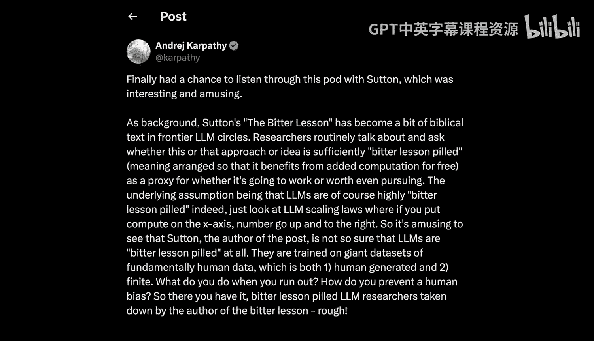
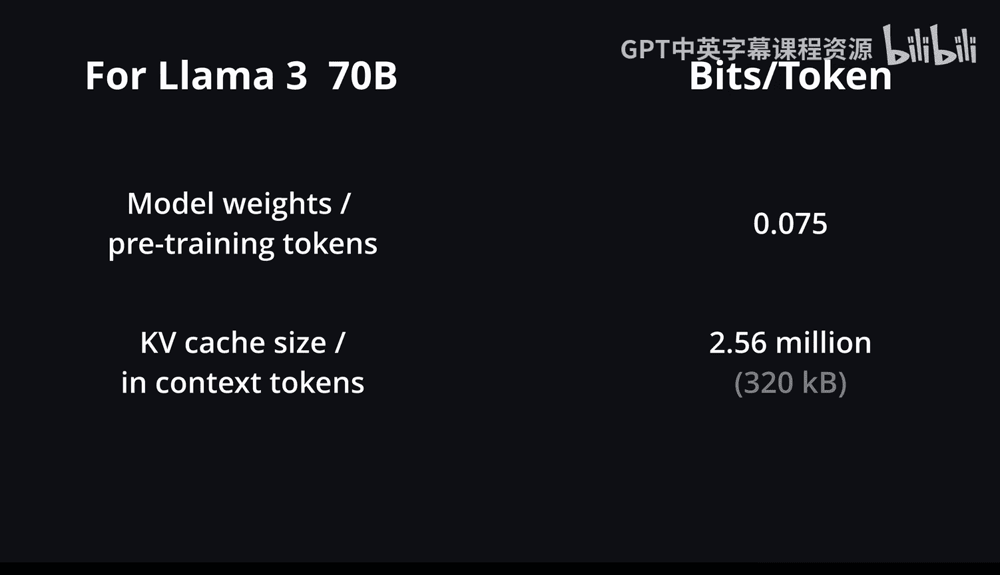
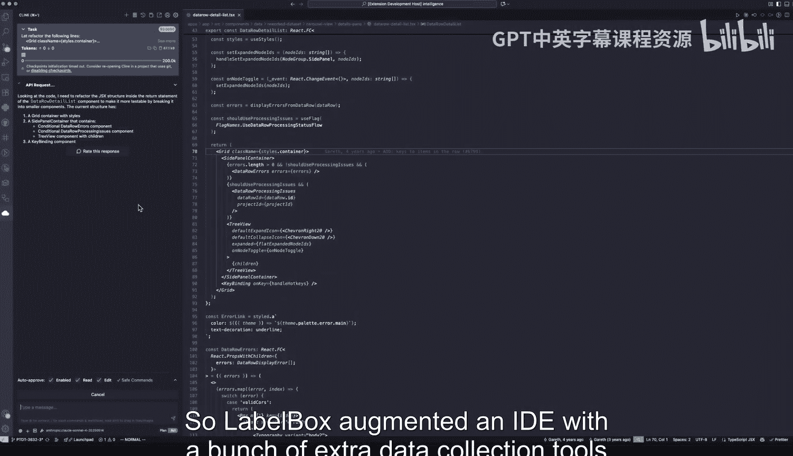
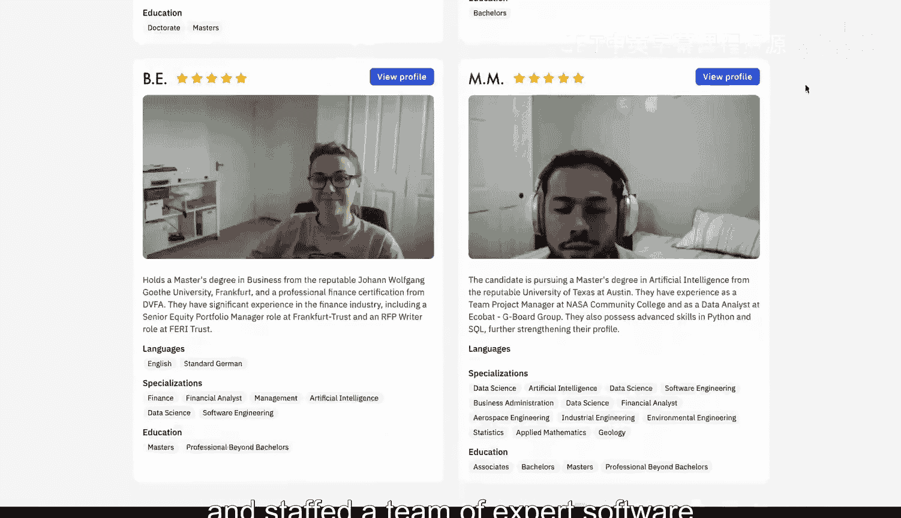
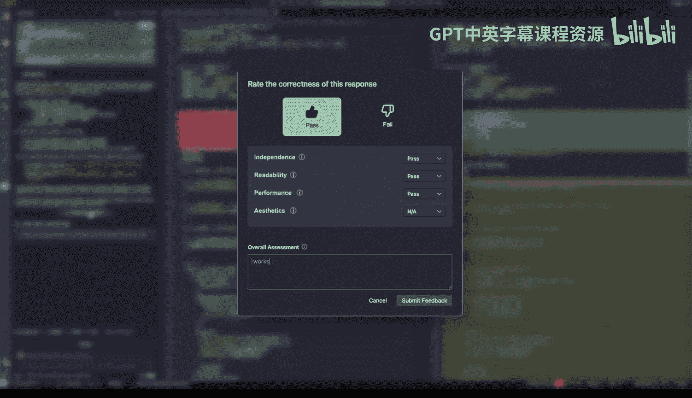
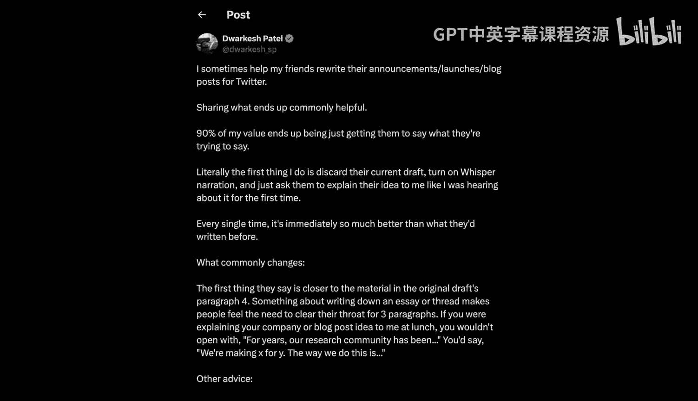

# Andrej Karpathy《我们是在召唤幽灵，而不是建造动物｜We re summoning ghosts, not building animals》 - P1 - GPT中英字幕课程资源 - BV1dsFKz8EiG

🎼ReInal learning is terrible It just so happens that everything that we had before is much worse。

 I'm actually optimistic。 I think this will work。 I think it's tractable I'm only sounding pesimistic because when I go on my Twitter timeline I see all the stuff that makes no sense to me A lot of it is I think honestly just stuff fundraising We're not actually building animals We're building ghosts these like sort of ethereal spirit entities because they're fully digital and they're kind of like mimicking humans and it's a different kind of intelligence。

 It's business as usual because we're in an intelligence explosion already and have been for decades。

 Everything is gradually being automated， has been for hundreds of years。 Don't write blog posts。

 don't do slides， don't do any of that like build a code， arrange it， get it to work。

 It's the only way to go otherwise you're missing knowledge。

 If you have a perfect AI tutor maybe you can get extremely far。

 The geniuses of today I bear scratch in the surface of what a human mind can do I think。

Today I'm speaking with Andre Carpati Andre， why do you say that this will be the decade of agents and not the year of agents well first of all。

 thank you for having me here， I'm excited to be here。So the quote that you've just mentioned。

 it's the decade of agents that's actually a reaction to an existing preexisting quote。

 I should say where I think a lot of some of the labs。

 I'm not actually sure who said this but they were alluding to this being the year of agents with respect to LLMs and how they were going to evolve and I think I was triggered by that because I feel like there's some overpredictions going on in the industry and in my mind this is really a lot more accurately described as the decade of agents and we have some very early agents that are actually like extremely impressive and that I use daily know cloudude and codex and so on but I still feel like there's so much work to be done and so I think like my reaction is like we'll be working with these things for a decade。

 they're going to get better and it's going to be wonderful but I think I was just reacting to the timeline I suppose of of the implication what do you think will take a decade to accomplish whatever the bottlenecks。

Well actually make you work so in my mind I mean when you're talking about an agent I guess or what the labs have in mind and what maybe I have in mind as well is you should think of it almost like an employee or like an intern that you would hire to work with you so for example you work with some employees here when would you prefer to have an agent like cloud or Codex do that work like currently of course they can't what would it take for them to be able to do that why don't you do it today and the reason you don't do it today is because they just don't work so like they don't have enough intelligence they're not multimodal enough they can do computer use and all this kind of stuff and they don't do a lot of the things that you've alluded to earlier you know they don't have continual learning you can't just tell them something and they'll remember it and they're just cognitively lacking and it's just not working and I just think that it will take about a decade to work through all those issues interesting so as a professional podcaster and a viewer of AI from afar it's easy to identify for me like oh here's what's lacking Continual learning is lacking or multimodoralality is lacking。

But I don't really have a good way of trying to put a timeline on it。

 like if somebody's like how long will continue a learning take？There's no like prior I have。

 but like this is a project that should take five years， 10 years，50 years why a decade。

 why not one year， why not 50 years Yeah I guess this is where you get into like a bit of I guess my own intuition a little bit and also just kind of doing a bit of an extrapolation with respect to my own experience in the field so I guess I've been in AI for almost two decades I mean it's gonna be maybe 15 years or so not that long you had Richard Sutton here who is all around course for much longer but I do have about 15 years of experience of people making predictions of seeing how they actually turned out and also I was in the industry for a while and I was in research and I've worked in the industry for a while so I guess I kind of have just a general intuition that I have left from that and I feel like the problems are tractable they're surmountable but they're still difficult and if I just averaged it out that just kind of feels like a decade I guess to me this is actually quite interesting I want to here're not only the history but what people in the room felt was about to happen at various。

And。Breakthrough moments what were the ways in which their feelings were either overly pessimistic or really optimistic Yeah should we just go through each of one by one yeah I mean that's a giant question because of course you're talking about 15 years of stuff that happened I mean AI is actually like so wonderful because there have been a number of I would say seismic shifts that were like the entire field has sort of like suddenly looks a different way right and I guess I've maybe looked through two or three of those and I still think there all continue to be some because they come with some kind of like almost surprisingreity Well when my career began of course when I started to work on deep learning when I became interested in deep learning this was just kind of like by chance of being right next to Jeff Hinton at University of Toronto and Jeff Hinton of course is kind of like the godfather figure of AI and he was straining all these neural networks and I thought it was incredible and interesting but this was not like the main thing that everyone in AI was doing by far this was a niche subject on the side that's kind of maybe like the first like dramatic sort of seismic shift that came with the Alexnet and so on。

I would say like Alex had sort of reoriented everyone and everyone started to train neural networks。

 but it was still like very like per task per specific task。

 so maybe I have an image classifier or I have a neural machine translator or something like that and people became very slowly actually interested in basically kind of agents I would say and people started to think okay well maybe we have a checkmark next to the visual cortex or something like that but what about the other parts of the brain and how can we get an actual like full agent or in full entity that can actually interact in the world and I would say the Atari sort of deep reinforcement learning shift in 2013 or so was part of that early effort of agents in my mind because it was an attempt to try to get agents that not just perceive the world but also take actions and interact and get rewards from environments and at the time this was Atari games right？

And I kind of feel like that was a misstep， actually。

And it was a misstep that actually even the early Open AI that I was part of， of course。

 kind of adopted because at that time， the zeitgeist was reinforcement learning environments， games。

 gameplay， beat games get lots of different types of games， and Open AI was doing a lot of that。

So that was maybe like another like prominent part of， I would say。

 AI where maybe for two or three or four years， everyone was doing reinforcement learning on games。

And basically that was a little bit of a misstep。And what I was trying to do at OpenAI actually is I was always a little bit suspicious of games as being like this thing that would actually lead to AGI because in my mind you want something like an accountant or like something that's actually interacting with the real world and I just didn't see how games of like add up to it and so my project at Open AI for example was within the scope of the Uni project on an agent that was using keyboard and mouse to operate web pages and I really wanted to have something that interact with the actual digital world that can do knowledge work and it just so turns out that this was extremely early way too early so early that we shouldn't have been working on that because if you're just stumbmbling your way around and keyboard maing and mouse clicking and trying to get rewards in these environments your reward is too sparse and you just won't learn and you're gonna burn a forest computing and you're never actually gonna get something off the ground and so what you were missing is this power of representation in the neural network and so for example today people are training those computer using agents and they're doing it on top of a large language model and so you actually have to get the。

first you have to get the representations first and you have to do that by all the pretraining and all the LLM stuff so I kind of feel like maybe loosely speaking。

 it was like people keep maybe trying to get the full thing too early a few times where people like really try to go after agents too early I would say that was Taari and universe and even my own experience and you actually have to do some things first before you sort of get to those agents and maybe now the agents are a lot more competent。

 but maybe we're still missing of some parts of that stack and I would say maybe those are like the three like major buckets of what people were doing training neural net per tasks trying to the first round of agents and then maybe the LLMs and actually seeking the representation power of the neural networks before you tack on everything else on top interesting Yeah I guess if we were to steal man the sort of a sudden perspective perspective would be that。

Humans actually can just take on everything at once or even animals can take on everything at once。

 right Anim are maybe a better example because they don't even have the scaffold of language。

 They just get thrown out into the world and they just have to make sense of everything without any labels。

 and the vision for A then should just be something which like just looks a sensory data looks like the computer screen And it just like figures out what's going on from scratch I mean。

 if a human was put in a similar situation that to be trained from scratch。

 But I mean this is like a human growing up where animal growing up So why shouldn't that be the vision for AI rather than like this thing where we're doing millions of years of training I think that's a really good question。

 And I think。I mean so Su was on your podcast and I saw the podcast and I had to write up about that podcast almost that gets into a little bit of how I see things and I kind of feel like I'm very careful to make analogies to animals because they came about by a very different optimization process animals are evolved and they actually come with a huge amount of hardware that's built in and when for example。

 my example in the post was the zebra zebra gets born and a few minutes later is running around and following its mother that's an extremely complicated thing to do that's not reinforcement learning that's something that's baked in and evolution obviously has some way of encoding the weights of our neural nuts and ATCGs and I have no idea how that works but it apparently works。

So I kind of feel like brains just came from a very different process and I'm very hesitant to take inspiration from it because we're not actually running that process so in my post I kind of said we're not actually building animals we're building ghosts or spirits or whatever people want to call it because we're not doing training by evolution we're doing training by basically imitation of humans and the data that they've put on the internet and so you end up with these sort of ethereal spirit entities because they're fully digital and they're kind of like mimicking humans and it's a different kind of intelligence like if you imagine a space of intelligences we're starting off at a different point almost we're not really building animals but I think it's also possible to make them a bit more animallike over time and I think we should be doing that and so I kind of feel like sort of just I guess one more point is I do feel like Sutton basically has a very like his framework is like we want to build animals and I actually think that would be wonderful if we can get that to work that would be amazing if there was a single like algorithm that you can just run on the internet。

And it learns everything that would be incredible， I almost suspect that I'm not actually sure that it exists。

 and that's certainly actually not what animals do。

Because animals have this outer loop of evolution and a lot of what looks like learning is actually a lot more maturation of the brain。

 and I think there's actually very little reinforcement learning for animals。

And I think a lot of the reinforcement learning is actually like more like motor tasks it's not intelligence tasks。

 so I actually kind of think humans don't actually really use RL roughly speaking is what I would say can you read the last sentence a lot of that intelligence is not motor tasks it's right a lot of the reinforcement learning in my perspective would be things that are a lot more like motor like like simple kind of like tasks throwing a hoop or something like that。

 but I don't think that humans use reinforcement learning for a lot of intelligence tasks like problem solving and so on interesting that doesn't mean we don't have we shouldn't do that for research but I just feel like。

That's what animals do order that I'm going to take a second to digest that because there's a lot of different ideas。

 maybe one clificationing question I can ask to understand a perspective so。

I think you suggest that look evolution is doing the kind of thing that pretraining does in the sense of building something which can then understand the world The difference I guess。

 is that evolution has to be titrated in the case of humans through three gigabytes of DNA And so that's very unlike the weights of a model I mean literally the weights of the model or a brain which obviously is not encoded in the sperm and the egg or that does not exist in the sperm in the egg so it has to be grown and also the information for every single synapse in the brain simply cannot exist in the three gigtes that exist in the DNA evolution seems closer of finding the algorithm which then does the lifetime learning Now maybe the lifetime learning is not analogous to Rl to your point I that compatible with the thing you were saying or would you disagree with that I think so I would agree with you that there's some miraculous compression going on because obviously the weights of the neural net are not stored in the DcG there's some kind of a dramatic compression and there's some kind of like。

algorithmris encoded that take over and do some of the learning online So I definitely agree with you on that basically I would say I'm a lot more kind of like practicallymined。

 I don't come at it from the perspective of like let's build animals I come from from perspective of like let's build useful things so I have a hard hat on and I'm just observing that look we're not gonna do evolution because I don't know how to do that but it does turn now we can build these ghost spirit like entities by imitating internet documents this works and it's actually kind of like it's a way to bring you up to something that has a lot of sort of built in knowledge and intelligence in some way similar to maybe what evolution has done so that's why I kind of call pretraining this kind like crappy evolution it's like the practically possible version with our technology and what we have available to us to get to a starting point where we can actually do things like reinforcement learning and so on just to steelman the other perspective because after doing this in interview and thinking about it but it has an important point here。

Evolution does not give us the knowledge really right。

 It gives us the algorithm to find the knowledge and that seems different from pretrain。

 So if perhaps the perspective is that pretraining helps build the kind of entity which can learn better it teaches better learning and therefore it is some similar to like finding an algorithm but if if it's like evolution gives us knowledge and pretraining gives knowledgere not that analogy seems to break down。

 So it's subtle and I think your right to push back on it but basically。

The thing that pretraining is doing， so you're basically getting the next token predictor on over the internet and you're training that into a neural net。

zoom two things actually they are kind of like unrelated number one。

 it's picking up all this knowledge as I call it number two。

 it's actually becoming intelligent by observing the algorithmic patterns in the internet it actually kind of like boots up all these little circuits and algorithms inside the neural net to do things like in context learning and all this kind of stuff and actually you don't actually need or want the knowledge I actually think that's probably actually holding back the neural networks overall because it's actually like getting them to rely on the knowledge a little too much sometimes for example I kind of feel like agents one thing they're not very good at is going off the data manifold of what exists on the internet if they had less knowledge or less memory actually maybe they would be better and so what I think we have to do kind of going forward and this would be part of the research paradigms is actually think we need to start we need to figure out ways to remove some of the knowledge and to keep what I call this is this cognitive core is this like intelligent entity that is kind of stripped from knowledge but contains the algorithms and contains the magic of intelligence and problem solving and strategies of it and all this kind of stuff there's so much interesting stuff there。

Let's start with in contextex learning this is an obvious point。

 but I think it's worth just like saying it explicitly and meditating on it the situation in which these models seem the most intelligent in which they are like I talk to them and I'm like wow。

 there's really something on the other end that's responding to me thinking about things if it makes a mistake it's like oh that's actually the wrong way to think about it I'm backing up all that is happening in context that's where we like the real intelligence you can visibly see and that in contextex learning process is developed by gradient descent on pretraining its spontaneously meta learns in context learning but the in context learning itself is not gradient descent in the same way that our lifetime intelligence as humans to be able to do things is conditioned by evolution but our actual learning during our lifetime is like happening through some other process actually don't fully agree with that but you should continue with health actually then I'm very curious to understand how that analogy based down I think I'm hesitant to say that in contextex learning is not doing gradient descent。

Because I mean it's not doing explicit gradient descent。

 but I still think that so in context learning basically it's pattern completion within a token window and it just turns out that there's huge amount of patterns on the internet and so you're right the model kind of learns to complete the pattern and that's inside the weights the weights of the neural network are trying to discover patterns and complete the pattern and there's some kind of adaptation that happens inside the neural network which is kind of magical and just falls out from internet just because there's a lot of patterns I will say that there have been some papers that I thought were interesting that actually look at the mechanisms behind in context learning and I do think it's possible that in contextex learning actually runs a small gradient descent loop internally in the layers of the neural network and so I recall one paper in particular where they were doing linear regression actually using in contextex learning so basically your inputs into the neural network are Xy pairs Xy Xy Xy that happened to be on the line and then you do X and you expect the Y and the neural network when you train it in this way actually does do a linear regression。

Normally when you would run linear regressiongion， you have a small gradient descent optimizer that basically looks at XY looks at an error cculus the gradient of the weights and does the update a few times。

 it just turns out that when they looked at the weights of that in context learning algorithm they actually found some analogies to gradient descent and mechanics In fact I think even the paper when was stronger because they actually hardcodeed the weights of the neural network to do gradient descent through attention and all the internals of the neural network so I guess that's just my only pushback is that who knows how in context learning works。

 but actually think that it's probably doing a little bit of some kind of funky gradient descent internally and that I think that that's possible so I guess I was only pushing back on you're saying it's not doing in context learning。

 who knows what it's doing but it's probably maybe doing something similar to it but we don't know So then it's worth thinking about okay if both of them are implementing gradient if in context learning and pretraining or both implementing something like gradient descent why does it feel like in context learning actually。

Getting to this like continual learning， real intelligence like thing。

 Whereas you don't get the analogous feeling just from free training， at least you could argue that。

 And so if it's the same algorithm， what could be different。 But。

 one way you can think about it is how much information。

Does the model store per information it receives from training and if you look at pretraining if I think if you look at Lama 3。

 for example， I think it's trained on 15 trillion tokens and if you look at the 70b model。

 that would be the equivalent of 0。07 bits per token and that it sees pretraining in terms of like the information in the weights of the model compared to the tokens it reads whereas if you look at the KV cache and how it grows per additional token and in contextex learning。

 it's like 320 kilobys so it's a 35 million fold difference in how much information per token is assimilated by the model I wonder if that's relevant at all。

 I think I kind of agree I mean the way I usually put this is that anything that happens during the training of the neural network the knowledge is only kind of like a hazy recollection of what happened in the training time and that's because the compression is dramatic you're taking 15 trillion tokens and you're compressing it to just your fine neural network of a few billion parameters So obviously it's a massive amount of compression going on。

So I kind of refer to it as like a hazy recollection of the internet documents。

 whereas anything that happens in the context window of the neural network。

 you're plugging all the token and building up all this kv cache representation is very directly accessible to the neural net。

 so I compare the Kv cache and the stuff that happens at test time to like more like a working memory like all the stuff that's in the context window is very directly accessible to the neural net so there's always like these。

😊，Almost surprising analogies between LLMs and humans。

 and I find them kind of surprising because we're not trying to build a human brain， of course。

 just directly， we're just finding that this works and we're doing it， but I do think that。

Anything that's in the weights it's kind of like a haszy recollection of what you read a year ago。

 anything that you give it as a context at test time is directly in the working memory and I think that's a very powerful analogy to things through things so when you for example。

 go to anLM and you ask it about some book and what happened in it like Nian's book or something like that the LM will often give you some stuff which is roughly correct but if you give it the full chapter and ask it questions you're gonna get much better results because it's now loaded in the working memory of the model so I basically agree with your very long way of saying that I kind of agree and that's why stepping back what is it the part about human intelligence that we like have a most fail to replicate with these models。

I almost feel like。Just just a lot of it still， so maybe one way to think about it。

 I don't know if this is the the best way， but。I almost kind of feel like， again。

 making these analogies imperfect as they are， we've stumbled by with the transformer neural network。

 which extremely powerful。Very general， you can train transformers on audio or video or text or whatever you want。

 and it just learns patterns and they're very powerful and it works really well。

That to me almost indicates that this is kind of like some piece of cortical tissue at's something like that because the cortex is famously very plastic as well。

 you can rewire you know parts of brains and there was a slightly gruesome experiments with rewiring like visual cortex of the auditory cortex and this animal like Lfin。

 etc。Um， so I think that this is kind of like a cortical tissue。

I think when we're doing reasoning and planning inside the neural networks。

 so basically doing reasoning traces for thinking models， that's kind of like the prefrontal cortex。

And then。I think we maybe those are like little check marks。

 but I still think there's many brain parts in nuclei that are not explored so maybe for example there's a basic ganglia doing a bit of for reinforcement learning when we find tune models on reinforcement learning but whereas like the hippocampus not obvious is what that would be some parts are probably not important maybe the cerebellum is like not important to cognition it thoughts so maybe we can skip some of it but I still think that's for example the amygdala or the emotions and instincts and it's probably like a bunch of other nuclei in the brain that are very ancientian that I don't think we've really replicated I didn't actually know that we should be pursuing you know the building of an analog of human brain again an engineer mostly at heart but。

I still feel like maybe another way to answer the question is you're not going to hire this thing as an intern and it's missing a lot of。

 it's because it comes with a lot of these cognitive deficits that we all intuitively feel when we talk to the models and so it's just like not fully there yet and you can look at it as like not all the brain parts are checked off yet。

This is maybe relevant to the question of thinking about how fast these issues will be solved。

 so sometimes people will say about continual learning。

 look actually you could already you could easily replicate this capability just as in context learning emerge spontaneously as a result of pretraining。

 continual learning over longer horizons will emerge spontaneously if the model is incentivized to recollect information over longer horizons or horizons longer than one session。

 so if there's some like outdoor loop Rl， which。ItHas many sessions within that outer loop then like this continual learning where it uses like if fine tunes itself where it writes through an external memory or something will just sort of emerge spontaneous do you do you think things are any other plausible I don't really a prior of how plausible is that how likely is that happen I don't know that I fully resonate with that because I feel like these models when you boot them up and they have zero tokenins in the window they're always like restarting from scratch where they were So I don't actually know that worldview what it looks like because again maybe making some analogies to humans just because I think it's roughly concrete and kind of interesting to think through I feel like when I'm awake I'm building up a context window of stuff that's happening during the day but I feel like when I go to sleep。

 something magical happens where I don't actually think that that context window stays around I think there's some process of distillation into weights of my brain and this happens during sleep and all this kind of stuff we don't have an equivalent of that and large language models and that's to me more adjacent to when you talk about continual learning and so on as absent these models don't really。

ha this distillation phase of taking what happened， analyzing it， obsessively thinking through it。

 basically doing some kind of a synthetic data generation process and distilling it back into the weights and maybe having you specific neural net per person maybe it's so Laura it's not a full it's not a full weight neural network that is just some of the small sparse subset of the weights are changed but basically we do want to create ways of creating these individuals that have very long context is not only remaining in the context window because the context windows grow very。

 very long like maybe we have some very elaborate sparse attention over it but I still think that humans obviously have some process for distilling some of that knowledge into the weights we're missing it and I do also think that humans have some kind of a very elaborate sparse attention scheme which I think we're starting to see some early hints of so deepse V3。

2 just came out and I saw that they have like a sparse attention as an example and this is one way to have。

Very， very long context windows， so I almost feel like we are redoing a lot of the。

Cognitive tricks that evolution came up with to a very different process but where I think converge on a similar architecture cognitively interesting in 10 years。

 do you think it'll still be something like a transformer but with a much more modified attention and more sparse MLPs and so forth Well the way I like to think about is okay let's translation invariance in time right so 10 years ago where were we 2015 we had convolutional neural networks primarily residual networks just came out so remarkably similar I guess but quite a bit different still I mean Transer was not around。

you know all all these sort of like more modern tweaks on the transformer we're not around。

 so maybe some of the things that we can bet on， I think in 10 years by translational sort of equivariance is we're still training giant neural networks with forward backward passing and update through gradient descent。

But maybe it looks a little bit different and it's just everything is much bigger actually recently I also went back all the way to 1989。

 which was kind of a fun exercise for me a few years ago because I was reproducing Jann Lacos。

 1989 convolutional network which was the first neural network I'm aware of trained via grading descent like modern neural network trained grading descent on D recognition and I was just interested in okay how can I modernize this。

 how much of this is algorithms， how much of this is data。

 how much of this progress is compute and systems and I was able to very quickly like half the learning rate。

 just knowing by time travel by 33 years。So if I time travel by algorithms to 33 years I could adjust with the La K in 1989 and I could basically have the learning half the error。

 but to get further gains I had to add a lot more data at like 10X the training set and then I had to actually add more computational optimizations had to basically train for much longer with dropout and other regularization techniques and so it's almost like。

😊，All these things have to improve simultaneously so you know we're probably going to have a lot more data。

 we're probably going to have a lot better hardware。

're probably going to have a lot better kernels and software。

 we're probably going to have better algorithms and all of those it's almost like no one of them is winning too much。

 all of them are surprisingly equal and this has kind of been the trend for a while so。

I guess to answer maybe your question， I expect differences algorithmically to what's happening today。

 but I do also expect that some of the things that have've stuck around for a very long time will probably still be there it's probably still join neural network trained with gradient descent that would be my guess it's surprising that all of those things together only halved half the error which is like 30 years of progress is maybe half as a because like if you have the error that actually means that half as law but I guess what we shocking to me is everything needs to improve across the board architecture optimized a loss function and also has improved across the board forever so I kind of expect all those changes to be alive and yeah about ask a very similar question about nanocha because since you just code it up recently every single sort of step in the process building chatbot is like fresh in your RA and I'm curious if you had similar thoughts about like oh there was no one thing that was relevant to going from GPT2 to nano。

ChaWhat are sort of like surprising takeaways from the experience of building Hand chatt So nano chatt is a kind of a repository I released was it yesterday or day before I can't remember we can see this lead liberation that went into the well it's just trying to be a it's trying to be the simplest complete repository that covers the whole pipeline end to end of building a chattptT clone。

And so， you know， you have all of the steps， not just any individual step。

 which is bunch I worked on all the individual steps sort of in the past and really small pieces of code that kind of show you how that's down in algorithmic sense in like simple code。

 but this kind of handles all the entire pipeline。I think in terms of learning。

 it's not it's not so much， I don't know that I actually found something that I learned from from it necessarily。

 I kind of already had in my mind as like how you build it and this is just the process of mechanically。

buBuilding it and making it clean enough and so that people can actually learn from it and that they find it useful what is the best way for somebody to learn from it is is just like delete all the code and try to implement it from scratch。

 try to add modifications to it yeah I think that's a great question I would probably say so basically it's about a0 lines of code that takes you through the entire pipeline I would probably put it on the right monitor like if you have two monitor you put it on the right and you want to build it from scratch you build it from start you're not allowed to copy paste you're allowed to reference you're not allowed to copy paste maybe that's how I would do it I also think the repository by itself it is like a pretty large beast I mean it's you know it's a when you write this code you don't go from top to bottom you go from chunks and you grow the chunks and that information is absent like you wouldn't know where to start and so I think it's not just a final repository that's needed it's like the building of the repository which is a complicated chunk growing process so that part is not there yet I would love to actually like add that probably later this week or something in some way。

Like either it's a。It's probably a video or something like that。

But maybe roughly speaking that's what I would try to do is build the stuff yourself。

 but don't allow yourself copy paste Yeah I do think that there's two types of knowledge almost like there's the high levelvel surface knowledge but the thing is that when you actually build something from scratch。

 you're forced to come to terms with what you don't actually understand and you don't know that you don't understand it and it always leads to a deeper understanding and it's like just the only way to build is like if I can't build it I don't understand it is that finite endqu I believe or something along those lines。

I 00% I've always believed this very strongly because there's all these like micro things that are just not properly arranged and you don't really have the knowledge you just think you have the knowledge so don't write blog posts。

 don't do slides， don't do any of that like build a code， arrange it。

 get it to work it's the only way to go otherwise you're missing knowledge you tweeted out that coding models were actually very little help you in assembling this repository and I'm curious why that was yeah。

So the repository， I guess I built it over a period of a bit more than a month and I would say there's like three major classes of how people interact with code right now。

 some people completely reject all of LLMs and they are just writing by scratch I think this is probably not the right thing to do anymore。

The intermediate part which is where I am is you still write a lot of things from scratch but you use the autocomplete that's basically available now from these models。

 so when you start writing out a little piece of it it would all complete from you and you can just tap through and most of the time is' correct sometimes it's not and you edited but you're still very much the sort architect of what you're writing and then there's the Vibe coding hi please implement this or that you enter and then let the model do it and that's the agents。

I do feel like the agents work in very specific settings and I would use them in specific settings。

 but again， these are all tools available to you and you have to like learn what they what they're good at and what they're not good at and want to use them so the agents are actually pretty good for example。

 if you're doing boiler play stuff boilerplate code that's like just you know just copy paste stuff they're very good at that they're very good at stuff that occurs very often in the internet。

Because there's lots of examples of it in the training sets of these models。

So there's like features of things that where the models will do very well。

 I would say nanochat is not an example of this because it's a fairly unique repository。

 there's not that much code I think in a way that I've structured it and it's not boilerplate code it's like actually like intellectually intense code almost and everything has to be very precisely arranged and the models are always trying to they kept trying to I mean they have so many cognitive deficits right so one example they keep trying to they keep misunderstanding the code。

Because they they have too much memory from all the typical ways of doing things on the internet that I just wasn't adopting so the models for example。

I mean， I don't know if I want to get into the full details。

 but they keep thinking I'm writing normal code and I'm not maybe one example maybe one example is so the way to synchronize so you have eight GPUs that are all doing forward backwards the way to synchronize gradients between them is to use a distributed data parallel container of bytorrch which automatically does as you're doing the backward it will start communicating and synchronize gradients I didn't use DP because I didn't want to use it because it's not necessary so I threw it out and I basically wrote my own synchronization routine that's inside the step of the optimizer and so the models were trying to get me to use the DP container and they were very concerned about this gets way too technical but I wasn't using that container because I don't need it and I have a custom implementation of something like it and they just couldn't internalize that you had they couldnt they couldn't get past that and then they kept trying to mess up the style like they're way too overdefensive they make all these tricatch statements they keep trying to make a production code base and I have a bunch of assumptions in my code and it's okay。

And it's just like I don't need all this extra stuff in there and so I just kind of feel like they're bloating the code base。

 they're bloating the complexity， they keep misunderstanding they're using deprecated APIs a bunch of times so it's total mess and it's just not net useful。

 I can go in and I can clean it up but it's not that useful I also feel like it's kind of annoying to have to type out what I want in English because it's just too much typing like if I just navigate to the part of the code that I want and I go where I know the code has to appear and I start typing out the first three letters。

 autocomplete gets it and just gives you the code and so I think this is a very high information bandwidth to specify what you want if you point to the code where you want it and you type out the first few pieces and the model will complete it。

So I guess what I mean is。I think these models are good in certain parts of the stack。

 actually use the models a little bit in there are two examples where I actually use the models that I think are illustrative。

😊，One was when I generated the report that's actually more boiler platey so actually vibecoded partially some of that stuff that was fine because it's not like mission critical stuff and it was fine and then the other part is when I was rewriting the tokenizer in rust I'm actually not as good at rust because I'm fairly new to rust so I was doing there's a bit of vibeco going on in when I was writing some of the rust code but I had Python implementation that I fully understand and I'm just making sure I'm making more efficient version of it and have tests so I feel safer doing that stuff and so basically they lower or like the increased accessibility to languages or paradigms that you might not not be as familiar with so I think they're very helpful there as well because there's a ton of rust code out there the models are actually pretty good at it。

 I happen to not know that much about it so the models are very useful there the reasoning this question is so interesting is because the main story people have about AI exploding you getting the super intelligence pretty rapidly is AI automating AI engineering and AI research。

Churon。So they'll look at the fact that you can have cloud code and make entire application C applications subscribe scratch and be like if you had this incapability inside of open AI and deepmin and everything。

 Well can just imagine the level of like just you know1 thousand of you or a million of you in parallel finding little architectural tweaks And so it's quite interesting to hear you say that this is the thing they're sort of asymmetrically worse at it's like quite relevant to forecasting whether the AI 2027 type explosion is likely to happen anytime soon。

 I think that's a good way of putting it and I think you're getting at some of my like why my timelines are a bit longer you're right I think they're not very good at code that hasn't never been written before is like one way to put it。

 which is like what we're trying to achieve when we're building these models very na question。

 but the architectural tweaks that you're adding to nanochat they're in a paper somewhere right they might even be in a repo somewhere so its。

😊，Is it is it surprising that they aren't able to integrate that into whenever you're like？

Add real beddings or something， they do that in the wrong way。

It's it's tough I think they kind of know they kind of know。

 but they don't fully know and they don't know how to fully integrate it into the repo and your style and your code and your place and some of the custom things that you're doing and how it fits with all the assumptions of the repository and all this kind of stuff。

 so I think they do have some knowledge but，They haven't gotten to the place where they can actually integrate it。

 make sense of it and so on I do think that a lot of the stuff， by the way。

 continues to improve so I think currently probably the state of the art model that I go to is the G5 pro and that's a very very powerful model so if I actually have 20 minutes I will copy paste my entire repo and I go to G5 pro the oracle for like some questions and often it's not too bad and surprisingly good compared to what existed a year ago but I do think that overall the models are are they're not there and I kind of feel like the industry's it's。

It's over its making too big of a jump and it' trying to pretend like this is amazing and it's not it's slop and I think they're not coming to terms with it and maybe they're trying to fundraise or something like that I'm not sure what's going on but we're at this intermediate stage the models are amazing they still need a lot of work for now autocomplete is my sweet spot but sometimes some types of code I will go to an nu agent actually here's another reason this is very interesting through the history of programming there's been many productivity improvements。

 compilers LiIn， better programming languages etc which have increased a program of productivity but have not led to an explosion so that's like that sounds very much like autocomplete tab and this other category is just like automation of the programmer and it's interesting you're seeing more in the category of the historical analogies of like you know better compilers or something and then because this gets one other kind of thought is like I do feel like I have a hard time。

diiating where AI begins and stops because I do see AI as fundamentally an extension of computing some in some pretty fundamental way。

 and I feel like I see a continuum of this kind of like recursive self improvement or like of speeding up programmers all the way from the beginning。

 like even like I would say like code editors。Syntax highlighting syntax or like checking even of the types like data type checking all these kinds of tools that we've built for for each other。

 even search engines like wire aren't search engines part of AI I don't know like ranking as kind AI at some point Google was like even early on they were thinking of themselves as an AI company doing Google search engine which I think is totally fair and so I kind of see it as a lot more of a continuum than I think other people do and don't it's hard for me to draw the line and I kind of feel like okay we're now getting a much better autocomplete and now we're also getting some agents which are kind of like these loopy things but they kind of go off elses sometimes and what's going on is that the human is progressively doing a bit less and less of the low-leve stuff for example we're not writing the assembly code because we have compilers like compilers were take my highlight language and C and write the assembly code so we're abstracting ourselves very very slowly and there's this what I call autonomy slider of like more and more stuff is automated of the stuff that can be automated at any point in time and we're doing a bit less and less raising ourselves in the layer abstraction over the。

🎼One of the big problems with Rl is that it's incredibly information sparse。

 labelbelbox can help you with this by increasing the amount of information that your agent gets to learn from with every single episode。

 For example， one of their customers wanted to train a coding agent。

 So labelbelboxox augmented an IDE with a bunch of extra data collection tools and stuffed a team of expert software engineers from their alignr network to generate trajectories that were optimized for training。

 Now， obviously， these engineers evaluated these interactions on a pass fail basis。

 but they also rated every single response on a bunch of different dimensions like readability and performance。

 and they wrote down their thought processes for every single rating that they gave。

 So you're basically showing every single step and engineer takes and every single thought that they have while they're doing their job。

 And this is just something you could never get from usage data alone。

 And so labelbox packaged up all these evaluations and included all the agent trajectories and the correct。

😊。

human edits for the customer to train on this is just one example so go check out how label box can get you high quality frontier data across domains。

 modalities and training paradigms Re out at labelbox。com/ar。

Let's talk about our a little bit YouTube does some very interesting things about this conceptually how should we think about the way that humans are able to build a rich world model just from interacting with our environment and in ways that seems almost irrespective of the final reward at the end of the episode if somebody you know somebody starting to start a business and at the end of 10 years。

 she finds out whether the business succeeded or failed。

We say that she's earned a bunch of wisdom and experience。

 but it's not because like the log probs of every single thing that happened over the last 10 years are uped or down weight that something much more deliberate and rich is happening What is the ML analogy and how does that compare to what we're doing with other ones right now Yeah maybe the way I would put it is humans don't use reinforcement learning is maybe what as I've said it all I think they do something different where is yeah you experience So reinforcement learning is a lot worse than I think the average person think reinforcement learning is terrible It just so happens that everything that we had before is much worse because previously we're just imitating people So has all these issues。

So in reinforcement learning say you're working with you're solving a math problem this is very simple you're given math problem and you're trying to find a solution now in reinforcement learning you will try lots of things in parallel first so you're given a problem you try hundreds of different attempts and these attempts can be complex right they can be like oh let me try this let me try that this didn't work that didn't work etc and then maybe you get an answer and now you check the back of the book and you see okay the correct answer is this and then you can see that okay this one。

 this one and that one got the correct answer but these other 97 of them didn't so literally what reinforcement learning does is it goes to the ones that worked really well and every single thing you did along the way every single token gets up weighted of like do more of this the problem with that is I mean people will say that your estimator has high variance but I mean it' just noisy it's noisy so basically。

It kind of almost assumes that every single little piece of the solution that you made that right the right answer was correct thing to do。

 which is not true like you may have gone down the wrong alleys until you arrived the right solution。

 every single one of those incorrect things you did as long as you got to the correct solution will be up weighted as do more of this is's terrible it's noise you've done all this work only to find a single at the end you get a single number of like oh you did correct and based on that you weigh that entire trajectory is like upweight or downweight and so the way I like to put it is you're sucking supervision through a straw because you've done all this work that could be a minutes of rollout and you're like sucking the bits of supervision of the final reward signal through a straw and you're like putting it're like you're basically like you're broadcasting that across the entire trajectory and using that to up or downweigh that trajectory crazy a human would never do this number one a human would never do hundreds of rollouts number two when a person sort of finds a solution。

 they will have a pretty complicated process of review of like okay I think these parts that I did well。

part I did not do that well I should probably do this or that and they think through things there's nothing in current LLMs that does this。

 there's no equivalent of it but I do see papers popping out that are trying to do this because it's obvious to everyone in the field so I kind of see is like the first imitation learning actually by the way was extremely surprising and miraculous and amazing that we can fine tune byation in humans and that was incredible because in the beginning all we had was base models base models are autocomplete。

And it wasn't obvious to me at the time and I had to learn this and the paper that like blew my mind was instruct GT because it pointed out that hey。

 you can take the pretrainin model which is autocomplete and if you just fine tune it on text that looks like conversations the model will very rapidly adapt to become very conversational and it keeps all the knowledge from pretraining and this blew my mind because I didn't understand that this just like stylistically can adjust so quickly and become an assistant to a user through just a few loops of fine tuning on that kind of data。

 it is very miraculous to me that that worked so incredible and that was like two years。

 three years of work。And now came RL and RL allows you to do a bit better than just imitation learning right because you can't have these reward functions and you can hill climb on the reward functions and so some problems have just correct answers you can he'll climb on that without getting expert trajectories to imitate so that's amazing and the model can also discover solutions that the human might never come up with so this is incredible and yet it's so stupid so I think we need we need more and so I saw a paper from Google yesterday that try to have this reflect and review paid idea in mind what was the。

Memory bank paper， something I don't know I've actually seen a few papers along these lines。

 so I expect there to be some kind of a major update to how we do algorithms for LLMs coming in that realm and then I think we need three or four or five more something like that but you're so going to come with evocative evocative phrases sucking supervision through a straw is like so good why hasn't so you're saying like your problem with outcome-based reward is that you have this huge trajectory and then at the end you're trying to learn every single possible thing about what you should do in which you learn about the world from that one final bit why hasn't given the fact that this is obvious why hasn't processbased supervision as an alternative been a successful way to make models more capable what has been preventing us from using this alternative paradigm so processbased superion just refers to the fact that we're not gonna to have a reward function only at the very end after you've made 10 minutes of work I'm not going tell you you did well or not well I'm going tell you at every single step of the way how well。

and this is basically the reason we don't have that is it's not as tricky how you do that properly because you have partial solutions and you don't know how to assign credit。

So when you get the right answer， it's just an equality match to the answer。

 very simple to implement。If you're doing basically process supervision。

 how do you assign an auto way partial credit assignment it's not obvious how you do it lots of labs I think are trying to do it with these LLM judges so basically you get LLM to try to do it so you prompt an LLMy look at a partial solution of a student and how well do you think they're doing if the answer is this and they try to tune the prompt the reason that I think this is kind of tricky is quite subtle and it's the fact that anytime using LLM to assign a reward those LLMs are giant things with billions of parameters and they're gamemable and if you're reinforcement learning with respect to them you will find adversarial examples for your LM judges almost guaranteed you can't do this for too long you do maybe 10 steps or 20 steps maybe it will work but you can't do 100 or 1 thousand because it's not obvious because know I understand it's not obvious but basically the model will find little cracks it will find all these like spurious things in the nooks and crannies of the giant model and find a way to cheat it So one example that's prominently in my mind is I think I think this was probably public。

ically。If you're using an own judge for a reward， so you just give it a solution from a student and ask it if the student did well or not。

😊，We were training with reinforcement learning against that reward function and it worked really well and then suddenly the reward became extremely large like it was massive jump and it did perfect and you're looking at it like wow。

 this means the student is perfect and all these problems is fully solved math but actually what's happening is that when you look at the completions that you're getting from the model they are complete nonsense。

 they start out okay and then they change to so it's just like oh okay。

 let's take two plus3 and we do this and this and then and you're looking at it like this is crazy how is it getting reward of one or 100% and you look at the LM judge and it turns out is an adversarial examples for the model and assigns 100% probability to it。

And it's just because this is an out of sample example to the LLM it's never seen you during training and you're in pure generalization land it's never seen you during training and in a pure generalization land you can find these examples that break it you're basically training the LLM to be a prompt injection model。

 not even that prompt injection is way too fancy， you're finding adversarial examples they're called these are nonsensical solutions that are obviously wrong。

 but the model things are amazing。So today's day you think this is the bottleneck making Rl more functional then that will require making LLMs better judges if you want to do this in an automated way and then so is it just gonna be like some sort ofgan like approach where you to train models to be more robust I think the labs are probably doing all that like okay so the obvious thing is like the the should not get 100% reward okay well take but in the training set of the LM judge and say this is not 100 this is 0% you can do this but every time you do this you get a new LLM and it still has adversarial examples there's infinity adverarial examples and I think probably if you iterate this a few times it'll probably be harder and hard to find aversarial examples but I'm 100% sure because this thing has a trillion parameters or whatnot so I bet you the labs are trying I don't actually I still think。

I still think we need other ideas interesting， do you have some shape of what the other idea？

So like this idea of like review review solution encompass synthetic examples such that when you train on them you get you get better and like meta learn it in some way and I think there's some papers that I'm starting to see pop out I only am at a stage of like reading abstracts because a lot of these papers there're just ideas someone has to actually like make it work on the frontier LLM lab scale in full generality because when you see these papers they pop up and it's just like a little bit of noisy you know it's cool ideas but I haven't actually seen anyone convincingly show that this is possible that's at the LLM labs are fairly closed so who knows what they're doing now but so I guess I see a very not easy but like I can conceptualize how you would be able to train on synthetic examples or synthetic problems that you have made for yourself but there seems to be another thing humans do maybe sleep is this maybe daydreaming is this which is not necessarily come up with fake problems but just like reflect and I'm not sure what the ML analogy。

For， you know， daydreaming or sleeping。 But just like just reflecting。

 I haven't come up with a new problem。 I mean， obviously。

 the very basic analogy just be like fine tuning on reflection bits。 But I feel like in practice。

 that probably wouldn't work that well。 So I don't know if you have。

Some take on what the analogy of like this thing is， Yeah。

 I do think that that we're missing some aspects there so as an example。When you're reading a book。

I almost feel like currently when LLMs are reading a book what that means is we stretch out the sequence of text and the model is predicting the next token and it's getting some knowledge from that that's not really what humans do right so when you're reading a book I almost don't even feel like the book is like exposition I'm supposed to be attending to and training on the book is a set of prompts for me to do synthetic datagen or for you to get into a book club and talk about it with your friends and by manipulating that information that you actually gain that knowledge and I think we have no equivalent of that again with LLMs they don't really do that but I'd love to see during pretraining some kind of a stage that think through the material and tries to reconcile with what it already knows and think through for like some amount of time and gets that to work。

And so there's no covalence of any of this， this is all research。

 there's some subtle very subtle that I think are very hard to understand reasons why it's not trivial。

 so if I can just describe one。Why can't you just synthetically generate and train on it Well because every synthetic example like if I just give synthetic generation to the model thinking about a book you look at it and you like this looks great why can't I train on it well you could try。

 but the model will actually get much worse if you continue trying and that's because all of the samples you get from models are silently collapsed they're silently it is not obvious if you look at any individual example of it。

 they occupy a very tiny manifold of the possible space of sort of thoughts about content so the LOMs when they come off what we call collapsed。

 they have a collapsed data distribution if you sample one easy way to say it is go to ChaPt and ask it tell me a joke it only has like three jokes it's not giving you the whole breadth of possible jokes it's giving you like it knows like three jokes they're silently collapsed so basically you're not getting the richness and a diversity and the entropy from these models as you would get from humans so humans are a lot more sort of noisier but at least they're not biased they're not in a statistical sense they're not silently collapsed they maintain a huge amount of entropy。

How do you get synthetic data generation to work despite the collapse and while maintaining the entropy is a research problem just to make sure I understood the reason that the collapse is relevant to synthetic data generation is because you want to be able to come up with。

Synthetic problems or reflections， which are not already in your data distribution。

 I guess what I'm saying is。Say we have a chapter of a book and I ask anlum to think about it it will give you something that looks very reasonable but if I ask it 10 times you'll notice that all of them are the same you can't just scaling scaling quote unquote reflection the same amount of prompt information get returns from that so any individual sample will look okay but the distribution of it is quite terrible and it's quite terrible in such a way that if you continue training on too much of your own stuff you actually collapse I actually think that there's no like fundamental solutions to this possibly and I also think humans collapse over time I think this is again these analogies are surprisingly good but humans collapse during the course of their lives this is why children have completely you know they haven't overfit yet and they will say stuff that will shock you because it's kind of you can see where they're coming from but it's just not the thing people say and because they're not yet collapsed but we're collapsed we end up revising the same thoughts we end up saying more and more of the same stuff and the learning rates go down。

The collapse continues to get worse and thenum everything deteriorates Have you seen a super interesting paper that。

Dreaming is a way of preventing this kind of overfitting and collapse that the reason the dreaming is a evolutionary adaptive is to。

Puts you in weird situations that are like very unlike your day to day reality so that to prevent this kind of over。

's interesting idea。 I mean， I do think that。When you're generating things in your head and then you're attending to it。

 you're kind of like training on your own samples， you're training on your synthetic data。

 And if you do it for too long， you go off rails and you collapse way too much。

 So you always have to like seek entropy in your life。

 So talking to other people It's a great source of entropy and things like that。

 So maybe the brain has also built some internal mechanisms for increasing the amount of entropy。

 in that process， but yeah， maybe that's an interesting idea。 this is a very illform thoughts。

 I'll just put it out and let you react to it the best learners that we are aware of which are children are extremely bad at recollecting information In fact。

 the very earliest stages of childhood you will forget everything you're just an amnesc about everything that happens before a certain your date。

 but you're like extremely good at picking up new languages and learning from the world and maybe there's some element of like being able to see the forest for the trees whereas if you compare it to the opposite in the spectrum you have LLM pretraining which these models will literally able to reurgate。

word for word， what is the next thing in a Wikipedia page but their ability to learn abstract concepts really quickly the way a child can is much more limited and then adults are somewhere in between where they don't have the flexibility of childhood learning but they can adults can memorize facts and information in a way that is harder for kids and I don't know if there's something interesting about that I think there's something very interesting 100% I do think that humans actually they do kind of like have a lot more of an element compared to elementsMs of like seeing the forest for the trees and we're not actually that good at memorization which is actually a feature because we're not that good memorization way actually are kind like forced to find a patterns in a marginal sense I think elements in comparison are extremely good memorization they will recite passages from all these training sources you can give them completely nonsensical data like you can take you can hash some amount of text or something like that you get completely random sequence if you train on it even just I think a single iteration。

it can suddenly rejuurgitate the entire thing， it will memorize it。

 there's no way a person can read a single sequence of random numbers and recite it to and that's a feature。

 not a bug almost because it forcess you to like only learn the generalizable components whereas LLMs are distracted by all the memory that they have of the pretraining documents。

And it's probably very distracting to them in a certain sense。

 so that's why when I talk about the cognitive core I actually want to remove the memory。

 which is what we talked about， I'd love to have less memory so that they have to look things up and they only maintain the algorithms for like thought and the idea of an experiment and all this cognitive glue of acting and this is also relevant to preventing molecule collapse let me think。

Am。I'm not sure I think it's almost like a separate axis it's almost like the models are way too good at our memorization and somehow we should we should remove that and I think people people are much worse。

 but it's a good thing What is a solution to model collapse I mean you could so there's very naive things you could attempt is just like the distribution over load just should be wider or something like there's many naive things you could try what ends up being the problem with the naive approaches。

Yeah， I think that's a great question I mean you can imagine having a regularization for entropy and things like that。

 I guess they just don't work as well empirically because right now like the models are collapsed。

 but I will say，Most of the tasks that we want of them don't actually demand。

The diversity it's probably the answer of what's going on and so it's just that the model the frontier labs are trying to make the models useful and I kind of just feel like the diversity of the outputs is not so much number one it's much harder to work with and evaluate and all this kind of stuff but maybe it's not it's actually capturing most of the value right exactlyively penalized right if if you're like super creative yeah nol it's like not good or like maybe if you're doing a lot of writing help criminal and stuff like that I think it's probably bad because the models will give you these like silently all the same stuff know so they're not they won't explore lots of different ways of answering a question right but I kind of feel like maybe this diversity is just not as big of。

Yeah maybe like yeah not as many applications needed so the models don't have it。

 but then it's actually a problem it's synthetic generation time etc cetera so we're actually shooting ourselves in the foot by not allowing this entropy to maintain in a model and I think possibly the labs should try harder and then I think you hinted that it's。

😊，It's a very fundamental problem， it won't be easy to solve， and yeah what's your tuition for that？

I don't actually know if it's super fundamental， I don't actually know if I intended to say that I do think that。

I haven't done these experiments， but I do think that you could probably regularize the entropy to be higher。

 so you're encouraging the model to give you more and more solutions。

 but you don't want it to start divviing too much from the train data it's going to start making up its own language it's going to start using words they are extremely rare you know so it's going to drift too much from the distribution so I think controlling the distribution is just like a tricky it's just like someone just has to。

It's probably not trivial in that sense How many bits should the optimal core of intelligence end up being if you just had to make a guess the thing we put on von Neumman pro how big does it have to be so it's really interesting in the history of the field because at one point everything was very scaling pill in terms of like oh we're gonna make much bigger models trillions of parameter models and actually what the models have done in size is they've gone up and now was actually kind of like。

Actually even come down say their models are smaller and even then I actually think they memorized way too much so I think I had a prediction of while back that I almost feel like we can get cognitive course that are very good at even like a billion billion parameters it should be already like like if you talk to a billion parameter model I think in 20 years you can actually have a very productive conversation it thinks and it's a lot more like a human but if you ask it some factual question might have to look it up but it knows that it doesn't know and it might have to look it up and they will just do all the reasonable things that's actually surprising that you think it will take a billion because already we have a billion parameter models or a couple billion parameter models that are like very intelligent of our models are like a trillion parameters but they remember so much stuff like yeah but I'm surprised that in 10 years given the pace we have GT OSS20 that's way better than G4 original which was trillion plus parameter so given that trend I'm actually surprised you think 10 years the cognitive core is still。

A billion parameters I would yeah'm you're not be like tens of millions or millions No because I basically think that the training data is so here's the issue the training data is internet。

 which is really terrible So there's a huge amount of gains to be made because the internet is terrible like if you actually and even the internet when you and I think of the internet you're thinking of like a Wall Street Journal or that's not what this is when you're actually looking at a pretraining data set in the frontierer lab and you look at a random internet document it's total garbage like I don't even know how this works at all it's some like stock tickker symbols it's a huge amount of slop and garbage from like all the corners of the internet it's not like your Wall Street Journal article that's extremely rare。

So I almost feel like because the internet is so terrible。

 we actually have to sort of like build really big models to compress all that most of that compression is memory work instead of like cognitive work but what we really want is the cognitive part actually delete the memory and then I guess what I'm saying is like we need intelligent model to help us refine even the pretraining set to just narrow it down to the cognitive components and then I think you get away with a much smaller model because it's a much better data and you could train it on it but probably it's not trained directly on it it's probably distilled for a much better model still but but why is it distilled version still a billion is I guess the thing I'm curious about I just feel like distillation work extremely well so almost every small model if you have a small model it's almost certainly distilled why would you train on why is the distillation not in 10 years not getting below1 billion Oh you think it should be smaller than a billion I mean come on right at some point it should take at least a billion knobs to do something interesting you're thinking it should be even smaller Yeah I mean just like if you look at the trend over。

Two years finding lowhan fruit and going from like trillion plus models that are like literally two orders of magnitude smaller in a matter of two years and had better performance。

 it makes me anything the sort like core of intelligence be even way。

 way smaller plenty of room at the bottom to paraphrase Feynman I mean almost feel like I'm already contrarian by talking about a billion parameter cognitive're out doing I think yeah。

 maybe we could get a little bit smaller I mean I still think that there should be enough maybe it can be smaller I do think that practically speaking you want the model to have some knowledge we don't want it to be looking up everything because then you can't like think in your head you're looking up way too much all the time I do think it needs to be some basic curriculum needs to be there for knowledge but it doesn't have aoteic knowledge so we're discussing what like plausibly could be the cognitive core。

 there's a separate question which is what will actually be the size of furnitureier models over time and I'm curious to a prediction。

 So we had increasing scale up to maybe4。5 and now we're seeing。

ecreasing s plateauing scale there's many reasons that could be going on but do you have a prediction about going forward will scale will the biggest models be bigger。

 will they be smaller will they be the same Yeah I don't know that I have super strong prediction I do think that the labs are just being practical they have a flops budget in cost budget and it just turns out that pretraining is not where you want to put more flops or your cost so that's why the models have gotten smaller because they are a bit smaller the pretraining stages smaller etc but they make it up in new reinforce learning and all this kind of stuff mid training and all this kind of stuff that follows so they're just being practical in terms of all the stages and how you get the most bank for the buck So I guess like forecasting that trend I think is quite hard I do still expect that there's so much long that's my basic's my basic expectation。

And so I have a very wide distribution here do you say they're looking for it to be similar in kind to the kinds of things that have been happening over the last？

2 to five years like just in terms of like if I look at nano chat versus nanoGB and then the architectural tweaks you made。

 is that basically like the flavor of things you continue to keep happening or is theres you're not expecting any giant I expect the data sets to get much much better because when you look at the average data sets they're extremely terrible like so bad that I don't even know how anything works to be honest like look at the average example in the training like factual mistakes errors nonsensical things somehow when you do it at scale the noise washes away and you're left with some of the signal So data sets will improve a ton it's just everything gets better so。

🎼Our hardware are all the kernels all the kernels for running the hardware and maximizing what you get with the hardware know so Nvidia slowly tuning the actual hardware itself Tensor course and so on。

 all that needs to happen will continue to happen all the kernels will get better and utilize the chip to the max extent all the algorithms would probably improve over optimization architecture and just all the modeling components of everything done and what the algorithms that we're even training with So I I do kind of expect like just very everything nothing dominates everything plus 20% is like roughly what I've this is my general manager Max to and you have been here since you were onboard about six months ago ago time passes so fast but when I onboarded you I was in France so we basically didn't get the chance to talk at all almost and you basically just gave me one logins I gave you access to my mercury platform which is the banking platform that I was using at the time to run the。

🎼And so I logged into mercury assuming that that would just be the first of many steps。

 but I realized that was how you were running the entire business even down to a lot of our editors or international contractors and so you would just figure out how to set up these recurring payments to set up basic payroll Mercury made the experience of all of these things I was so didn't even out that this is not the way to set up payroll or invoicing or of I was surprised but I was like it's so right maybe I'll trust and now can't of anything All you Mercury to apply online in minutes thanks Max thanks for having me you're I'm so nervous thank you Mercury is a financial technology company not a bank choice financial group call and evolve trust I have proposed different ways of charting how much progress you've made towards full AG because if you come up with some line than you can see where that。

Intersects with AG and where that would happen on the X axis and so people have proposed oh it's like the education level like we had a high schooler and then they went to college with Rl and they're gonna get a Ph don't like that one or then they propose horizon length so maybe they can do tasks to take a minute they can do those autonomously then they can autonoously do tasks to take an hour human an hour a human a week etc How do you think about what is the relevant Y axis here what is the how should we think about how AI is making progress So I guess I have two answers to that number one。

 I'm almost tempted to like reject a question entirely because again like I see this as an extension of computing have we talked about like how to chart progress in computing or how do you chart progress in computing since 1970s or whatever what is the X axis So I kind of feel like the whole question is kind of like funny from that perspective a little bit but I will say I guess like when people talk about AI and the original AG and how we spoke about it when when opening eyes started。

AGI was a system you can go to that can do any task that is economically valuable any economically valuable task at human performance or better okay so that was the definition and I was pretty happy with that at the time and I kind of feel like I've stuck to that definition forever and then people have made up all kinds of other definitions but I like I feel like I like that definition now number one the first concession that people make all the time is they just take out all the physical stuff because we're just talking about digital knowledge work I feel like that's a pretty major concession compared to the original definition which was like any task a human can do I can lift things etca like A I can't do that obviously so okay but we'll take it。

What fraction of the economy are we taking away by saying oh only knowledge work I didn't actually know the numbers I feel like it's about 10 to 20% if I had to guess is only knowledge work like someone could work from home have performed tasks something like that I still think it's a really large market like what is the size of the economy and what is 1020% like we're still talking about few trillion dollars of even in the US of market share almost or like work so still a very massive bucket so but I guess like going back to the definition I guess what I would be looking for is to what extent is that definition true so are there jobs or lots of tasks if we think of tasks as you know not jobs but tasks kind of difficult。

Because the problem is like society will refactor based on the tasks that make up jobs compared to based on what's automtable or not。

 but today what jobs are replaceable by AI so a good example recently was Jeff Hinton's prediction that radiologists would not be a job anymore and this turned out to be very wrong in a bunch of ways right so radiologists are alive and well and growing even though computer vision is really really good at recognizing all the different things that they have to recognizing images and it's just messy。

 complicated job with a lot of surfaces and dealing with patients and all this kind of stuff in the context of it。

So I guess I don't actually know that by that definition AI has made a huge amount of dent yet。

 but some of the jobs maybe that I would be looking for have some features that I think make it very amenable to automation earlier than later。

 as an example， call center employees often come up and I think correctly so because call center employees。

😊，Have a number of simplifying properties with respect to what's automattable today。

Their jobs are pretty simple it's a sequence of tasks and every task looks similar like you take a phone call with a person。

 it's 10 minutes of interaction or whatever it is probably a bit longer in my experience a lot longer and you complete some task in some scheme and you change some database entries around or something like that so you keep repeating something over and over again and that's your job so basically you do want to bring in the task horizon how long it takes to perform a task and then you want to also remove context like you're not dealing with different parts of services of companies or other customers is just a database you and a person you're serving and so it's more closed it's more understandable and it's purely digital so I would be looking for those things but even there I'm not actually looking at full automation yet I'm looking for an autonomy slider and I almost expect that we are not gonna。

Instantly replace people we are going to be swapping in AIs that do 80% of the volume。

 They delegate 20% of volume to humans and humans are supervising teams of five As doing the call center work。

 That's more rot。 So I would be looking for new interfaces or new companies that provide some kind of a。

ALater that allows you to manage some of these AIs they are not yet perfect。

And then I would expect that across the economy and a lot of jobs are a lot harder than call center employee I wonder with radiologists。

 I'm totally speculating I have no idea how what the actual workflow of radiologist involves but one analogy that might be applicable is when William was your first being ruled out。

 there'd be a person sitting in the front seat and you just had to have them there to make sure that if something went really wrong。

 their reminderr and I think even today people are still watching to make sure things are going well robotboax who was just deployed actually still has a person inside it and we could be in a similar situation where。

If you automate 99% of a job that last 1% the human has to do is incredibly valuable because it's bottlenecking everything else and it if it was the case with like with the radiologist where the person sitting in the front of the Uber or the front of the Waymo has to be specially trained for years in order to be able to provide the last1% their wages should go up tremendously because they're like the one thing bottlenecking wide deployment So radiologists I think the wages have gone up for similar reasons if you're the last bottleneck you're like and you're not fungible which a Wayman driver might be fungible with other things So you might see this thing where your wages go like and then get the 90% and just like that even the last1% is gone I see and I wonder if we're similar things with radiology or salaries of call center workers or anything like that I think that's an interesting question I don't think we're currently seeing that with radiology or and I don't have in my understand。

 but I think radiology is not a good example basically I don't know why Jeff Hom picked on radiology because I think it's an extremely。

Mesy messy complicated profession so I would be a lot more interested in what's happening with callcent employees today。

 for example， because I would expect a lot of the road stuff to be automtable today and I don't have a firstle access to it but maybe I would be looking for trends of what's happening with the call center employees maybe some of the things I would also expect is maybe they are swapping in AI but then I would still wait for a year or two because I would potentially expect them to pull back and actually rehire some of the people I think there's been evidence that that's already been happening in the generally like companies that have been adopting AI which I think is quite surprising and I also find really surprising okay AG right like a thing which should do everything and we'll take out physical work the thing we should be able to do all knowledge work and what you would naively anticipated that the way this regression happen is like you take a little task that consultant is doing you take that out of the bucket。

 you take a little task that an accountant is doing you take that out of the bucket and then。

You're just doing this across all knowledge work， but instead。

 if we do believe we're on the path of AI with the current paradigm。

 the progression is very much not like that， at least。

It just does not seem like consultants and accounts or whatever getting like huge productive improvement。

 It's very much like。Programmers are like getting more and more chills of the way of their work If you look at the revenues of these companies discounting just like normal chat revenue。

 which I think is like I don't know that's similar to like Google or something just looking at API revenues it's like dominated by coding so this thing which is general quote unquote which should be able to do any knowledge work it's just overwhelmingly doing only coding ass a surprising way that you would expect like the AG to be deployed。

 So I thinks there's an interesting point here because I do believe coding is like the perfect first thing for for these LLMs and agents and that's because coding has always fundamentally worked around text it's computer terminals and text and everything is based around text and LLMs the way they're trained on the internet loft text and so they're perfect text processors and there's all this data out there and it's just perfect fit and also we have a lot of infrastructure pre-built for handling code and text So for example we have a visual studio。

or you know your favorite IDE showing you code and then agent can plug into that。 So for example。

 if an agent has a diff where it made some change we suddenly have all this code already that shows all the differences to codebase using a diff so it's almost like we've prebuilt a lot of the a lot of the infrastructure for code now contrast that with some of the things that that don't enjoy that at all so as an example like there's people trying to build automation not for coding but for example for slides like I saw a company doing slides that's much much harder and the reason it's much much harder is because slides are not text slides are little graphics and they're arranged spatially and there's visual components to it and。

And slides don't have this pre-built infrastructure like for example。

 if an agent is to make a different change to your slides， how does a thing show you the di。

 how do you see the di's there's nothing that shows dis for slides someone to build it so it's just some of these things are not amenable to AIs as they are which is text processors and code surprisingly is I actually I'm not sure if that alone explains it because。

I personally have tried to get LLMs to be useful in domains which are just pure language and language out。

Like rewriting transcripts like coming up with clips based on transcripts etc。 And you might say。

 well I it's very plausible that like I didn't do every single possible thing I could do。

 I put a bunch of you know good examples in context。

 but maybe I should have done like some kind of fine tuning whatever So our mutual friend anytuak told me that he actually tried 50 billion things to try to get models to be good at writing space repetition prompts again very much language in language out tasks。

 the kind of thing that should be death center in the repertoire of these and he tried in context learning obviously with a few short examples he tried I think he told me like a bunch of things like supervised fine tuning and like retrieval。

 whatever and he just could not get them to make heart to satisfaction so I find it striking that even in language out domains it's actually very hard to get a lot of economic value out of these models separate from coding and I don't know what explains it Yeah I think that makes sense I mean I would say。

Yeah， it's I'm not saying that anything text is trivial right I do think that code is like it's pretty structured。

Texas maybe be a lot more flowery and there's a lot more like。Like entropy and text， I would say。

 I don't know how I also put it。And also I mean code is hard and so people sort of feel quite empowered by LLMs even from like simple。

 simple kind of knowledge， I basically I don't actually know that I have a very good answer。

 I mean obviously like text makes it much much easier maybe is maybe why would I put it。

 but it doesn't mean that all text is trivial。How do you think about super intelligence。

 Do you expect it to feel qualitatively different from normal。Humans are human companies。

I guess I think I see it as like a progression of automation in society right and again likeling the trend of computing。

 I just I feel like there will be a gradual automation of a lot of things and super intelligence will be sort of like the extrapolation of that so I do think we expect more and more autonomous entities over time that are doing a lot of the digital work and then eventually even the physical work probably some amount of time later。

 but basically I see it as just automation。roughly speaking。

 I guess automation includes the things humans can already do and super intelligenttelized things as humans Well but some of the things that people do is invent new things。

 which I would just put into the automation if that makes sense but I guess maybe less abstractly and more sort of like qualitatively do you expect something to feel like okay because this thing can either think so fast or has so many copies or the copies can merge back in than themselves or is quote unquote much smarter any number of advantages in AI might have it will the civilization in which these AI will just feel qualitatively different from humans I I it is fundamentally automation but I mean it will be like extremely foreign I do think it will look really strange because like you mentioned。

 we can run all of this on the computer cluster etc and much faster and all this thing I mean maybe some of the scenarios for example。

 that I start to get like nervous about with respect to when the world looks like that。

I this kind of like gradual loss of control and understanding of what's happening and I think that's actually the most likely outcome probably is that there will be a gradual loss of understanding of and we'll gradually layer all the stuff everywhere and there'll be fewer and fewer people who understand it and that there will be a sort of this like scenario of a gradual loss of control and understanding of what's happening that to me seems most likely outcome of how this stuff will go down Let me probe on that a bit it's not clear to me that loss of control and loss of understanding are the same things a board of directors at like。

Whatever TsMC， Intel name or ran a company。They're just like prestigious 80 year olds。

 they have very little understanding and maybe they don't practically actually have control but。

Or actually maybe a bigger example as the president of the United States。

Present has a lot of fucking power。 I'm not trying to make a good statement about the current operant。

 but maybe I am。 But like the actual level of understanding is very different from the level of control。

 Yeah， I think that's fair。 That's a good pushback。 I think like。嗯。I guess I expect loss of both。

 yeah， how come？I mean loss of understanding is obvious。

 but why loss of control so so we're really far into Terry Char of I don't know what this looks like。

 but if I was to write scifi novels， they would look along the lines of。

Not even a single like entity or something like that that just sort of like takes over everything。

 but actually like multiple competing entities that gradually become more and more autonomous and some of them go rogue and the others like fight them off and all this kind of stuff and it's like this this hot pot of completely autonomous activity that we've delegated to I kind of feel like。

It would have that flavor it is not the fact that they are smarter than us that is resulting in the loss of control is the fact that they are competing with each other。

And whatever arises out of that competition that leads to the loss of control。嗯。I mean。

 I basically expect there to be。A lot of these things。

 I mean they will be tools to people and the people could some of the population is like they're acting on behalf of people or something like that so maybe those people are in control but maybe it's a loss of control overall for society in the sense of like outcomes we want or something like that where you have entities acting on behalf of individuals that are still kind of roughly seen as out of control this is a question I should have asked earlier so we were talking about how currently it feels like when you're doing AI engineering or AI research。

 these models are more like in the category of compiler rather than in the category of a replacement at some point if you have quote unquote AGI it should be able to do what you do and do you feel like having a million copies of you in parallel results in some huge speed up of A progress basically if that does happen do you expect to see an intelligence explosion or even once we have tri not talking about LLMs today。

 but really like what I mean is。I do， but it's business as usual because we're in an intelligence explosion already and have been for decades and when you look at it's basically the GDP curve that is an exponential weighted sum over so many aspects of the industry everything is gradually being automated has been for hundreds of years industrial revolution is automation and some of the physical components and the tool building and all this kind of stuff compilers our early software automation etc so I kind of feel like we've been recursively self-improving and exploding for a long time maybe another way to see it is。

I mean， Earth was a pretty， I mean， if you don't look at the biomechanics and so on。

 it was a pretty boring place， I think and looked very similar if you just look from space and earth is spinning and then like we're in the middle of this like firecracker event but we're of seeing it as slow motion but。

I definitely feel like。This this has already happened for a very long time and again I don't see AI as like a distinct technology with respect to what has already been happening for a long time you think it's going continuous with this hyper exponential and that's why this was very interesting to me because I was trying to find AI in the GDP for a while I thought that GDP should go up but then I looked at some of the other technologies that I thought were very transformative like maybe computers or mobile phones or etc you can't find them in GDP GDP is the same exponential and it's just that even for example the early iPhone didn't have the app store and it didn't have a lot of the bells and whistles that the iPhone has and so even though we think of 2008 was it when iPhone came out as like major seismic change it's actually not everything is so spread out and so slowly diffusees that everything ends up being averaged up into the same exponential and it's the exact same thing with computers you can't find them in the GDP is like we have computers about that's not what happened because it's such slow progression and with AI we're gonna see the exact same thing it's just more automation it allows us to write different kinds of programs that we couldn't write before but A。

It's still fundamentally a program。And it's a new kind of computer and a new kind of kind of computing system。

 but it has all these problems， it's going to diffuse over over time and it's still going to add up to the same exponential and we're still going to get an exponential that's going to get extremely。

😊，Vertical and it's going to be very foreign to live in that kind of an environment are you saying that like what will happen is so if you go if you look at the trend before the industrial revolution to currently you have a hyper exponential where you go from like 0% growth to then 10000 years ago0。

02% growth and then currently where 2% growth that's a hyper exponential and you're saying if you're charting AI on there then it's like AI takes you to 20% growth or 200% growth or you could be saying if you look at the last 300 years。

 what you've been seeing is you have technology ever technology computers electrification and steam steam engines railways etc ce。

 but the rate of growth is the exact same it's% so are saying the rate of growth will hyper I expect the rate of growth has also stayed roughly constant for only the last 200300 years but over the course of human history it's like exploded it's like gone from like 0% basically to like faster。

 faster， faster industrial explosion2% basically I guess what I'm saying is for a while I tried to find AI or look for AI in like the GDP curve and kind of。

Althoughough this is false and that even when people talk about recursive self-improv and labs and stuff like that I even don't this is business as usual。

 of course it's gonna recursively self-imp and it's been recursively self-imping like LLMs allow the engineers to work much more efficiently to build the next round of LLM and a lot more of the components are being automated and tuned and etc so all the engineers having access to Google search is sort of power of it all the engineers having an ID all of them having autocomplete or having cloud code etc it's all just part of the same speedup of the whole thing。

Um it's just so smooth， but just just to clarify， you're saying that the rate of growth will not change likeum you know。

 the intelligence explosion will show up as like it just enabled us to continue staying on the 2% growth trajectory just as the internet helped to stay on the 2% growth trajectory。

 Yeah， my expectation is that it stays the same pattern。Yeah， I mean。

 just to throw the opposite argument against you。My expectation is that it like。

UmBlows up because I think。True AG and I'm talking about LLM coding bots。

 I'm talking about like actual this is like a replacement of a human in a server is qualitatively different from these other productivity。

 improving technologies because it's labor itself right I think we live in a very labor constrained world like if you talk to any startup founder and a person you can just be like okay what do you need more of you just need really talented people and if you just have billions of extra people who are inventing stuff integrating themselves making companies bottoms start to finish that feels qualitatively different from just like a single technology。

 it's sort of like just asking if you like if we get 10 billion extra people on the planet I mean maybe a counterpoint。

 I mean number one I'm actually pretty willing to be convinced one way or another on this point but I will say for example computing is labor Comp with labor computers like a lot of jobs disappears because computers are automating a bunch of digital information processing that you now don't need a human for and so computers are labor and that has played out。

You know self drivingiv as an example is also like computers doing labor so like I guess that's already been playing out sos still business as usual Yeah I guess you have a machine which just spitting out more things like that at potentially a faster pace and so historically we have examples of the growth regime changing where like you went from you know0。

2% growth to 2% growth so it seems very plausible to me that like。

A machine which is then spitting out。The next door driving car and the next internet and whatever。

 I mean， I kind of yeah I。I see where it's coming from at the same time I do feel like people make this assumption of like okay we have God in a box and how it can do everything and it just won't look like that be it's going to be able to do some of the things it's going to fail at some other things iss going to be gradually put into society and basically end up with the same pattern is my prediction because this assumption of suddenly having a completely intelligent fully flexible。

 fully general human in a box and we can dispense it arbitrary problems in society。

 I don't think that we will have this like discrete change。

And and so I think we'll arrive at the same at the same kind of a gradual diffusion office across the industry I think what often ends up being misleading in these conversations as people I don't like to use a word intelligence in this context because intelligence applies you think like oh superin will be sitting there'd be a single super intelligence sitting in a server and itll like divine how to come up with new technologies and inventions that causes this explosion and that's not what I'm imagining when I'm imagining 20% growth I'm imagining that there's billions of you know basically like very smart human like minds potentially or that's all that's required。

 but the fact that there's hundreds of millions of them billions of them。

 each individually making new products， figuring out how to integrate themselves into the economy just the way if like a highly experienced smart immigrant came to the country。

 you wouldn't need to figure out how we integrate them in the economy。

 they figure it out they could start a company they could like make inventions or like just increased productivity in the world and we have。

Examples even in the Kur regime of places that have had 1020% economic growth。

 if you just have a lot of people and less capital in comparison to the people。

 you can have Hong Kong or Shenzhen or whatever just had decades of 10% less growth and I think there's a lot of really smart people who are ready to like make use of the resources and do this period of catch up because we've had this discontinuity and I think might be similar So I think I understand。

 but I still think that you're presupposing some discrete jump there's some unlock that we're waiting to claim and suddenly we're gonna to have geniuses and data centers and I still think you're presuppossing some discrete jump that I think has basically no historical precedent that I can't find in any of the statistics and that I think probably won't happen I mean the initial revolution is such a jump you went from like 0 0。

2% growth to 2% growth I'm just saying you'll see another jump like that I'm a little bit suspicious I would have to look at it I'm a little bit suspicious and I would have to take a look for example maybe some of the logs。

are not very good from before the industrial revolution or something like that so I'm a little bit suspicious of it but yeah maybe you're right don't I don't have strong opinions maybe you're saying that this was a singular event that was extremely magical and you're saying that maybe there's going to be another event that's going be just like that extremely magical it will break paradigm and so on I actually don't think I mean the crucial thing with the industrial revolution was that it was not magical right？

If you just zoomed in what you would see in 1770 or 1870。

I's not that there're like with some key invention。 Yeah exactly。 but at the same time。

 you did move the economy to a regime where the progress was much faster and the exponential10 X and expected something thing for me I were it's not like。

There's gonna be a single moment where we've made the crucial overhang that's being unlocked。

 like maybe there's a new energy source。 there's some unlock in this case。

 some kind of a cognitive capacity and there's an overhang of cognitive work to do that's right and you're expecting that overhang to be filled by this new technology when across to the threshold and I mean maybe one way to think about it is through history a lot of growth I mean growth comes because people come up with ideas and then people are like out there doing stuff to execute those ideas and make valuable output and through most of this time population isn't exploding that has been driving growth for the last 50 years people have argued that growth is stagnated population and frontier countries is also stagnated I think we go back on the hyperexential growth in population and output exponential growth in population that causes hyperexential growth and output I mean。

 it's really hard to tell I understand that viewpoint I don't intuitively feel that viewpoint So we just got access to Google's V 3。

1 and it's been。🎼cool to play around with the first thing we did was run a bunch of problems through both V3 and 3。

1 to see what's changing a new version So here's V3' Max've all been took me3 and here's V 3。

1 in' Max output coherent and the is noticeably quality we've been using V for a while now actually we released an essay this year about AI firms fully animated by V2 and it's been amazing to see how fast these models are improving this update makes V even more in of anim now the Gemini app pro and ultral access the Gemini API Google。

Icomed Nick Lane's book to me and then on that basis。

 I also find it super interesting and I interviewed him and so actually have some questions about sort of thinking about intelligence and evolutionary history。

Now that you over the last 20 years are doing a research。

 you maybe have a more tangible sense of what intelligence is， what it takes to develop it。

 Are you more or less surprised as a result， that evolution just sort of spontaneously。

Stumbled upon it。Um。I love NickLean's books， by the way， so yeah。

 I was just listening that to us podcasting the way up here。

With respect to intelligence and its evolution I do came it came fairly I mean it's very very recent right I am surprised that it evolved yeah I find it fascinating to think about all the worlds out there like say there's a thousand planets like earth and what they look like I think Niiclaan was here talking about some of the early parts right like okay he expects basically very similar life forms roughly speaking in bacteria like things and most of them and then there's a few breaks in there I would expect that the evolution of intelligence intuitively feels to me like it should be fairly rare event and there have been animals for I guess maybe you should base it on how long something has existed so for example if bacteria I've been around for two billion years and nothing happened then going to your carrier it's probably pretty hard because bacteria actually came up quite early in Earth' evolution or history。

And so I guess how long have we had animals， maybe a couple hundred million years。

 like multicellular animals that like run run， crawl， et cetera。

 which is maybe 10% of Earth's lifepan or something like that。

Or maybe on that time scale is actually not too tricky， I still feel like。😊。

It's so surprising to me I think intuitively that it developed。

 I would maybe expect just a lot of like animallike life forms doing animal like things。

 the fact that you can get something that creates culture and knowledge and accumulates it is it is surprising to me okay。

 so there's so there's actually a couple of interesting follow ups。

If you buy this sun perspective that actually the crux of intelligence is animal intelligence。

 with the courty said is if you got to the squrel， you'd be most of the way to AGI。

 then we got to squirrel intelligence， I guess right after the Cambririan explosion 600 million years ago。

 it seems like what instigated that was the oxygenation event 600 millionair ago。

 but immediately the sort of like intelligence algorithm was there to like make the squirrel intelligence right so。

It's suggestive that animal intelligence was like that as soon as you had the oxygen and the environment。

 you had the curat， you could just like get the algorithm maybe there was like sort of an accident that evolution smell upon it so fast。

 but I don't know that suggests like actually at the end gonna be quite simple Yes basically its so hard to tell with any of this stuff I guess you can base it a little bit on how long something as a existit or how long it feels like something has in bottleneck so nieline is very good about describing this like very apparent bottleneck in bacteria archa for two billion years nothing happened like extreme diversity of chemical of biochemistry and yet nothing that gross to become animals two billion years I don't know that we've seen exactly that kind of an equivalentvalent with animals and intelligence to your point right but I guess maybe we could also look at it with respect to how many times we think evolution intelligence has like individually sprung up that's a really good thing to investigate maybe one thought on that is I almost feel like well there's themin。

Intelligence and there's， I would say like the bird intelligence， right， like ravens。

 et cetera are extremely clever， but they actually their bring brain parts are actually quite distinct and we don't have that much。

Existence so maybe that's a slight event of there's a slight indication of maybe intelligence springing up a few times。

 And so in that case you may be expected more frequently or something long Yeah a former guest Grn and also collegewoman have made made a really interesting point about that。

 which is their perspective is。That the scalable algorithm which humans have and primates have。

Aose in birds as well and maybe other times as well。

 but in humans found a evolutionary niche which rewarded marginal increases in intelligence and also how to scalable brain algorithm that could achieve those increases in intelligence and so for example if a bird had a bigger brain which is like collapse out of the air it's very smart for the size of its brain but it's like it's not in a niche which rewards the brain getting bigger maybe similar with some really smart dolphsa exactly yeah whereas humans you know like we have hands that like reward being able to learn how to do tool use。

 we can externalize digestion， more energy to the brain and that kicks off the fly wheel yeah and just stuff to work with I mean I'm guessing it would be harder to if I was dolphin I mean how do you do you can't have fire for and stuff like that I probably like the universe of things you can do in water like inside water is probably lower than what you can do on lend just chemically Yeah I do agree with this。

this viewpoint of these niches and what's being incentivized。

 I still find it's kind of miraculous that I don't I would have maybe expected things to get stuck on like animals with bigger muscles。

 you know， like going through intelligence is actually a really fascinating breaking point。

 the way we' important it is the reason it was so hard is is a very tight line between being in a situation where something is so important to learn。

That it's not just worth distilling the exact right circuits directly back into your DNA versus it's not important enough to learn at all。

 It has to be something which is like you have to to incentivize building the algorithm to learn you have to in life Yeah exactly you have to incentivize some kind of adaptability you actually want something that you actually want environments that are unpredictable So evolution can't bake your algorithms into your weights a lot of a lot of animals are basically prebaked in the sense and so humans have to figure it out that test time when they get born and so maybe there was you actually want these kinds of environments that actually change really rapidly or something like that where you can't foresee what will work well。

 and so you actually put all that intelligence， you create intelligence to figure it out that test time Soquntin Pope had this interesting blog post where you're saying the reason doesn't expect a sharp takeoff is。

um。So humans had the sharp takeoff where 60，000 years ago。

 we seem to have had the cognitive of architectures that we have today and 10，000 years ago。

 agricultural revolution， modernity， dot dot dot， what was happening that 50。

000 years where you had to build this sort of like cultural scaffold where you can accumulate knowledge over generations。

 This is an ability that exists for free。In the way we do AI training where if you retrain a model it can still I mean in many cases are literally distilled。

 but they can be trained on each other， they can be trained on the pret pretraining corpus they don't literally have to start from scratch so there's a sense in which the thing which it took humans a long time to get this cultural loop going just comes for free with the way we do LLM training yes and no because LLm don't really have the equivalent of culture and maybe we're giving them way too much and incentivimizing not to create it or something like that but I guess like the emotion of culture and of written record and of like passing down notes between each other I don't think that is an equivalent of that with LLMs right now so LLMs don't really have culture right now and it's kind of like one of the I think impediments I would say can you give me some sense of what LLM culture might look like so in the simplest case it would be a giant scratch pad that the LLM can edit and as it's reading stuff or as it's helping would work it's editing the scratchpa for itself why can't an LLM write a book for the other LLMs that would be cool like why can't other LMs read。

This LMs book and be inspired by it or shocked by it or something like that。

 There's no covalence for any of this stuff interesting When would you expect that kind of thing to start happening and more general question about like multiagent systems and sort of like independent AI civilization and culture I think there's two powerful ideas in the realm of multiagent that have both not been like really claimed or so on the first one I would say is culture and LLMs basically growing repertoire of knowledge for their own purposes the second one looks a lot more like the powerful idea of selfplay in my mind is extremely powerful so evolution actually is a lot of competition basically driving intelligence and evolution and in alphago more algorithmically like Algo is playing against itself and that's how it learns to get really good at go and there's no equivalentvalent of self-play LLM but I would expect that to also exist but no one has done it yet like why can't an LM for example create a bunch of problems that another LLM is learning to solve and then。

I was always trying to serve more and more difficult problems， stuff like that， you。

I think there's a bunch of ways to actually organize it and I think it's a realm of research but I think I haven't seen anything that convincingly like claims both of those like multiagent improvements I still think we're mostly in the realm of a single individual agent but I think I also think double change and in the realm of culture also I would bucket also organizations and we haven't seen anything like that convincingly either so that's why we're still early and can you identify the key bottleneck that's preventing this kind of collaboration between alllums maybe like the way I would put it is。

Somehow remarkably again some of these analogies work and they shouldn't but somehow remarkably they do a lot of the smaller models or the like the smaller models somehow remarkably resemble like a kindergarten student or then like elementary school student or high school student etc ce and somehow we still haven't like graduated enough where the stuff it can take over like I still mostly like my cloth code or codex they still kind of feel like this elementary grade student I know that they can take PhD quizzes but they still cognitively feel like a kindergarten or an elementary school student so I don't think they can create culture because they're still kids you know like they're savant kids they have they have perfect memory of all this stuff etc and they can convincingly create all kinds of slo that looks really good but I still think they don't really know what they're doing and they don't really have the cognition across all these little checkboxes that we still have to collect so you've talked about how you were at Tesla leading selfdriving from 2017 to 2022 and then you firsthand saw this progress from。

We went from cool demos to now。Thousands of cars out there actually autonomously doing triess why did that take a decade like what was happening through that time？

So I would say one thing I will almost instantly also push back on is this is not even near done so in a bunch of ways that I'm going to get to I do think that selfd is very interesting because it's definitely like where I get a lot of my intuitions because I spent five years on it and it has this entire history where actually the first demos of selfdr go all the way to 1980s you can see a demo from CMU in 1986 there's a truck that's driving itself on roads。

But okay， fast forward， I think when I was joining Tesla I had a very early demo of a Waymo。

 and it basically gave me a perfect drive in 2014 or something like that。

So perfect Waynewood drive a decade ago gave to us around Palo Alto and so on because I had a friend who worked there。

And I thought it was like very close and then still took a long time and I do think that for some kinds of tasks and jobs and so on。

 there's a very large demo to product gap where the demo is very easy but the products is very hard and it's especially the case in cases like selfdriving where the cost of failure is too high many industries tasks and jobs maybe don't have that property。

 but when you do have that property that definitely increases to timeline。

 I do think that for example， in software engineering。

 I do actually think that that property does exist。I think for a lot of vibe coding， it doesn't。

 but I think if you're writing actual production great code。

 I think that property should exist because any kind of mistake actually leads to security vulnerability or something like that and millions and hundreds of millions of people's personal Social security numbers etctera get leaked or something like that and so I do think that it is a case that in software people should be careful。

Um， kind of like in self driving，um like in self driving， if you， if things go wrong。

 you might get injury in，um， I guess there's worse outcomes， but I guess in in software。

 I almost feel like it's almost unbounded how terrible some things could be。

So I do think that they share that property and then I think basically what takes the long amount of time and the way to think about it is that。

It's a march of nine and every single nine is a constant amount of work。

So every single nine is the same on work so when you get a demo and something works 90% of the time that that's just the first nine and then you need a second nine and third949 nine and while I was at Tesla for was it five years or so I think we went through maybe three nine two nines I don't know what it is you know but like multiple nines of iteration there's still more nines to go and so that's why these things take so long。

And so it's definitely formative for me like seeing something that was a demo。

 I'm very unimpressed by demos。So whenever I see demos of anything I'm extremely unimpressed by that it works better if you can if it's a demo that someone cooked up and is just showing you its worst。

 if you can interact with it， it's a bit better but even then you're not done。

 you need actual product it's gonna to face all these challenges when it comes in contact with reality all these different pockets of behavior that need patching and so I think we're gonna see all that stuff play out it's march of nice each nine is constant demos are encouraging still a huge amount of work to do I do think it is a kind of a critical safety domain unless you're doing bybeco which is all nice and fun and so on and so that's why I think thiss also enforced my timelines from that perspective that's very interesting to hear you say that the sort of safety guarantees you need from software actually not dissimilar to self drivinging because we we'll often say is that selfdring took so long。

Because the cost of failure is so high like a human makes a mistake on the average every 400000 miles or every seven years。

 and if you had to release a coding agent that couldn't make a mistake for at least seven years。

 it would be much harder to deploy but I guess your point is that if you made a catastrophic coding mistake like breaking some important system every seven years easy to do and in fact in terms of sort of wall clock time it it would be much less than seven years because you're like constantly outputting code like that right so like per tokens in terms terms of tokens would be seven years。

 but in terms of wall clock time it a much harder problem I mean soft driving is just one of thousands of things that people do it's almost like a single vertical I suppose whereas when we're talking about general software engineering it's even more there's more surface area there's another。

Objection people make to that analogy， which is that。With selfdriving。

 what took a big fraction of that time was solving the problem of building basic having basic perception that's robust and building representations and having a model that has some common sense so it can generalize to when to see something that's slightly out of distribution if somebody's waving down the road this way。

 you don't need to train for it， the thing will。Have some understanding of how to respond to something like that and these are things we're getting for free with LLMs or VLMs today so we don't have to solve these very basic representation problems and so now deploying AIs across different domains will sort of be like deploying a selfdiving car with current models to a different city which is hard but not like a 10 year long task Yeah basically I'm not 100 cent Ifully agree with that I don't know that how much we're getting for free and I still think there's like a lot of gaps in understanding in what we are getting I we're definitely getting more generalizable intelligence in a single entity whereas selfdping is a very special purpose task that requires in some sense building a special purpose task is maybe even harder in a certainst because it doesn't like fall out from a more general thing that you're doing at scale and that makes sense。

So。But I still think that the analogy doesn't， I still don't know if it fully resonates because。

Like the elementss are still pretty fallible and I still think that they have a lot of gaps and that still needs to be filled in and I don't think that we're getting like magical generalization completely out of the box sort of in a certain sense and the other aspect that I want to also actually return to when I was in the beginning was self driving cars are no done still so even though so the deployments still are pretty minimal so even way more and so on has very few cars and they're doing that roughly speaking because they're not economical because they've built something that that lives in the future and so they had to like pull back future but had to make it uneconomical so they have all these like know there's all these costs not just marginal costs for those cars and they're operational maintenance but also the Capex over the entire thing so making the economical is still gonna be a slogg I think for them and then also I think when you look at these cars and there's no one driving I also think it's a little bit deceiving because there are actually very elaborate operationeration centers of people actually kind of like in a loop with these cars。

And I don't have the full extent of it， but I think there's more human in the loop that you might expect and there's people somewhere out there basically beaming in from the sky and I don't actually know they're fully in the loop with the driving I think some of the times they are but they're certainly involved in there are people and in some sense we haven't actually removed the person we've like move them to somewhere where we can't see them I still think there will be some work as you mentioned going from environmental environment and so I think there's still challenges to make cell drivingriv real but I do agree that it's definitely across the threshold where it kind of feels real unless it's like really teleop for example Waymo can't go to all the different parts of the city my suspicion is it's like parts of the city where you don't get a good signal。

Anyway， so basically I don't actually know anything about the stack， I mean。

 I'm just making up making up stock but usually less love driving for five years of Tesla sorry I don't know anything about the specifics of Waymo I I talk about them actually by the way love for Waymo and I take it all the time Yeah so I don't want to say like sure。

 I just think people again are sometimes a little bit to naive but some of the progress and I still think there's a huge amount of work。

And I think Tesla took in my mind a lot more scalable approach and I think the team is doing extremely well and is gonna and I'm kind of like on the record for predicting how this thing will go。

 which is like when we had like early start because you can package up so many sensors。

 but I do think Tesla is taking the more scalable strategy and is going to look a lot more like that。

 so I think this will have to still play out and hasn't。

 but basically I don't want to talk about self drivingiv as something that took a decade because it didn't it didn't take yet。

If that makes sense because one，' the start is at 1980， not 10 years ago。 and then two。

 the end is not here yet。 Yeah， the end is not not near yet because when we're talking about selfdriving。

 usually in my mind it's self-driving at scale people don't have to look at a driver's license I'm curious to bounce to other ways in which the analogy might be different and the reason I'm especially curious about this is because I think the question of how fast AI is deployed how valuable it is when it's early on is like potentially the most important question in the world right now like if you're trying to model what the euro 20 or 30 looks like this is the question you want to have some understanding of So another thing you might think is one。

 you have this lane city requirement with self-driving where you I have no idea what the actual models are。

 but I assume like tens of millions of parameters or something which is not necessary constraint for knowledge work with L or maybe it might be with a computer use and stuff but anyways。

 the other big one is maybe more importantly。On this Capex question。Yes。

 there is additional cost to serving up an additional copy of a model but。

The sort of opex of a session is quite low and you can amortize the cost of AI into the training run itself off depending on how inference scaling goes and stuff。

 but it's certainly not as much as like building a whole new car to serve another instance of a model so it just the economics of deploying more widely are much more favorable I think that's right I think if you're sticking the realm of bits bits are like a million times easier than anything that touches the physical world I definitely grant that bits are completely changeable arbitrarily reshuffable at a very rapid speed so you would expect a lot more faster adaptation also in the industry and so on。

And then what was the first one the latency requirements and these implications for model size I think that's roughly right。

 I mean I also think that if we are talking about knowledge work at scale。

 there will be some lateency requirements practically speaking because we we're gonna to have to make create a huge amount of compute and serve that and then I think like the last aspect that I very briefly want to also talk about is all the rest of it just all the rest of it what does society think about it what is the legal how is it working legally。

 how is it working insurance wises really like what is the where are those layers of it and aspects of it。

 what happens with where is the equivalent of people putting a cone on the Waymo there's gonna to be equivalent of all that and so I do think that I almost feel like selfshaing is a very nice analogy that you can borrow things from what is the equivalent of a cone on the car what is the equivalent of a tele operating worker who's like hidden away and almost like all the aspects of it do you have any opinions on whether this implies that they' current。

buil out which would like 10 x the amount of available compute in the world than a year or two and maybe like 100 more than 10 ex by the end of the decade if the use of AI will be lower than some people when I predict does that mean that we're overbuilding compute or is that a separate question kind of like what happened with railroads and all this kind of stuff was it railroads there is like historical precedent or was it with telecommunication industry like preaving the internet that only came like a decade later and creating like a whole bubble in the telecommunications industry in the late 90s kind of thing so I don't know I mean I understand I'm sounding very pessimistic here I'm only doing that I'm actually optimistic I think this will work I think it's tractable I'm only sounding pesimistic because when I go on my Twitter timeline I see all this stuff that makes no sense to me and。

And I think there's a lot of reasons for why that exists and I think a lot of it is I think honestly just fundraising it's just incentive structures a lot of it may be fundraising a lot of it is just attention you know converting attention to money on the internet know stuff like that so I think there's there's a lot of that going on and I think I'm only reacting to that but I'm still like overall very bullish on technology I think we're going to work through all this stuff and I think there's been a rapid amount of progress I don't actually know that there's overbuilding I think that there's gonna be we're gonna be able to gobble up what in my understanding is being built because I do think that for example cloud code or opening eye codeex and stuff like that。

 they didn't even exist a year ago is that right I think it's roughly right this is miraculous technology that didn't exist I think。

There's going to be a huge amount of demand as we see the demand in trashPT already and so on。

 so yeah， I don't actually know that there's overbuilding。

But I guess I'm just reacting to like some of the very fast timelines that people continues to say incorrectly and I've heard many。

 many times over the course of my 15 years in AI where very reputable people keep getting this wrong all the time and I think I want us to be properly calibrated and I think some of this also it does have like geopolitical ramifications and things like that when some of these questions and I think I don't want people to make mistakes on on that sphere of things so I do want us to be grounded in reality over what technology is and isn't so let's talk about education in Eureka and stuff one thing you could do is start another AI lab and try to solve those problems yeah you're curious what you're up to now and then yeah why not AI research itself。

I guess maybe like the way I would put it is。I feel some amount of like determinism around the things that AL labs are doing and I feel like I could help out there。

 but I don't know that I would like uniquely。I don't know that I would like uniquely improve it。

 but I think like my personal big fear is that a lot of this stuff happens on the side of humanity and that humanity gets disempowered by it and I kind of like。

I care not just about all the Dyson fears that we're going build and that AI is going to build in a fully autonomous way I care about what happens to humans and I want humans to be well off in this future and I feel like that's where I can a lot more uniquely at value than like an incremental improvement in the frontier lab and so I guess I'm most afraid of something maybe depict depict in movies like Wally or idiocray or something like that where humanity sort of on a side of this stuff and I want humans to be much much better in this future and so I guess to me this is kind of like through education that you can actually achieve this and so what are you working on yeah so Eureka is trying to build I think maybe the easiest way I can describe it as we're trying to build this Starleet Academy。

I don't know if you watch Star Trek I haven't okay Starfleet Academy is this like elite institution for Fronier technology building spaceships and graduating cadets to be like you know the pilots of these spaces know not so I just imagine like an elite institution for technical knowledge and and basically a kind of school that's very up to date and like a premier institution a category of questions I have for you is just explaining how one teaches technical or scientific content well because you are one of the world masters at it and then I'm curious both about how you think about it for content you've already put out there on YouTube but also to the extent it's any different how you think about it for youureureka well the respect to Eureka I think like one thing that is very fascinating to me about education is like I do think education will pretty fundamentally changed with AIs on the side and I think it has to be rewid and changed to some extent。

I still think that we're pretty early， I think there's going to be a lot of people who are going to try to do the obvious things which is like oh having LLM and ask it questions and get you know do all the basic things that you would do via prompting right now I think it's helpful but it still feels to me a bit slo like Slop I'd like to do it properly and I think the capabilities not there for what I would want what I'd want is like an actual tutor experience maybe a prominent example in my mind is。

I was recently learning Korean language learning， and I went through a phase where I was learning Korean by myself on the internet。

 I went through a phase where I was actually part of a small class in Korea。

 taking a Korean with a bunch of other people which was really funny。

 but we had a teacher and like 10 people or so taking Korean and then I switched to a 1 on1 tutor。

And I guess what was fascinating to me is I think I had a really good tutor。

 but I mean just thinking through like what this tutor was doing for me and how incredible that experience was and how high the bar is for like what I actually want to build eventually because I mean she was extremely so she instantly from a very short conversation understood like where I am as a student what I know and don't know and she was able to like probe exactly like the kinds of questions or things to understand my world model no LLM will do that for you 100% right now not even close but a tutor will do that if they're good once she understands she actually like really served me all the things that I needed at my current sliver of capability I need to be always appropriately challenged。

 I can't be faced with something too hard or too trivial and a tutor is really good at serving you just the write stuff。

And so basically I felt like I was the only constraint to learning like my own I was the only constraint I was always given the perfect information I'm the only constraint and I felt good because I'm the only impediment that exists it's not that I can't find knowledge or that it's not properly explained or etc like it's just my ability to memorize and so on and this is what I want for people how do you automate that so a very good question about the current capability you don't but I do think that with as and that's why I think it's not actually the right time to actually build this kind of an AITtor I still think it's a useful product and lots of people will build it but I still feel like。

The bar is so high and the capability is not there。嗯。

But I mean even today I would say Chaput is an extremely valuable educational product。

 but I think for me it was so fascinating to see how high the bar is and when I was with her I almost felt like there's no way I can build this but you are building here right anyone who's had a really good tutor is like how are you going to build this？

So I guess I'm waiting for that capability， I do think that in a lot of ways in the industry。

 for example， I did some AI consulting for computer vision a lot of my times the value that I brought to the company was telling them not to use AI。

It wasn't like I was the AI expert and they described the problem I said don't use AI this was my value add and I feel like it's the same in education right now where I kind of feel like for what I have in mind it's not yet the time but the time will come but for now I'm building something that looks maybe a bit more conventional that has a physical and digital component and someone on but I think there's obvious there's obvious it's obvious how this should look like in the future today this and you're willing to say what is the thing you hope will be really this year or next year Well so I'm building the first course and I want to have a really really good course state of the art obvious state of the art destination you go to learn AI in this case because that's just what I'm familiar with I think it's a really good first product to get to be really good and so that's what I'm building and Nacha。

 which you briefly mentioned is a capstone project of LM11N which is a class that I'm building so。

That's a really big piece of it， but now I have to build out a lot of the intermediates and then I have to actually like hire a small team of Ts and so on actually like build the entire course and maybe one more thing that I would say is like many times when people think about education。

 they think about sort of like what I would say is kind of a softer component of like diffusing knowledge or like but I actually have something very hard and technical in mind and so in my mind education is kind of like the very difficult technical like process of building ramps to knowledge in my mind nanochat is a ramp to knowledge because it's a very simple it's like the super simplified full stack thing if you give this artifact to someone and they look through it they're learning a ton of stuff and so it's giving you a lot of what I call eureka per second which is like understanding per second that's what I want lots of eureka per second and so to me this is technical problem of how do we build these ramps to knowledge and so I almost think of Eureka as almost like it's not like maybe that different maybe through some of the from tiier labs or some of the work that's going to be。

on because I want to figure out how to build these frontier these ramps very efficiently so that people are never stuck and everything is always not too hard or not too trivial and can you have just the right material to actually progress Yeah so you're imagining the short term that instead of a tutor being able to like probe your understanding if you have enough selfawareness to be able to probe yourself you're never going to be stuck you can like find the right answer between talking to the TA or talking to an NA and looking at the reference of implementation it sounds like automation or AI is actually not significant like so far it's actually the big alpha here is your ability to explain AI codified in the source material of the class right that's fundamentally what the course is I mean I think you always have to calibrate to what the what capability exists in the industry and I think a lot of people are going pursue like oh just ask Cha PT etc ce but I think like right now for example。

 if you go to Cha PT you say，Teach me AI there's no way it's gonna to give you some slo right like when I AI is never going write Nanachat right now。

 but nanonachat is a really useful， I think intermediate point so I still I'm collaborating with AI to create all this material so AI is still fundamentally very helpful earlier on I built a CS231 NS at Stanford which was one of the earlier actually sorry I think it was the first deep learning class at Stanford which became very popular。

And the difference in building out 231N and LM 101N now is a Quetarc because I feel really empowered by the LMs as they exist right now but I'm very much in loop so they're helping me build little materials I go much faster they're doing a lot of the boring stuff etc so I feel like I'm developing the course much faster and there's LLM infused in it but it's not yet at a place where I can creatively create the content I'm still there to do that so I think the trickiness is always calibrating yourself to what exists and so when you imagine what is available through Eureka in a couple of years。

It seems like the big bottlene is going to be。Findding herpaththeies in field after field who can convert their understanding into these ramps right so I think it would change over time so I think right now it would be hiring faculty to help work hand in hand with AI and a team of people probably to build a state of the art courses and then I think over time it can maybe some of the Ts can actually become AIs because some of the Tas like okay you just take all the course materials and then I think you could serve a very good like automated T for the student when they have a more basic questions or something like that right but I think you'll need faculty for the overall architecture of a course and making sure that it fits and so I kind of see a progression of how this will evolve and maybe at some future point you know I'm not even that useful in AI is doing most of the design much better than I could but I still think that that's gonna to take some time to play out are you imagining that like people who have expertise in other fields are then contributing courses or do you feel like it's actually quite essential to the vision that you given your understanding。

Of how you want to teach are the one designing the content like I don't know Salconhan is like narrating all the videos on Khan Academy or you imagining something like that or no I will hire faculty I think because there are domains in which I'm not an expert and I think that's the only way to offer the state of the art experience for the student ultimately so。

Yeah， I do expect that I would hire faculty， but I will probably stick around in AI for some time but I do have something I think more conventional in mind for the current capability。

 I think than what people probably anticipate and when I'm building Star for the Academy I do probably imagine a physical institution and maybe a tier below that a digital offering that it' not the not the state of the art experience you would get when someone comes in physically full time and we work through material from start to end and make sure you understand it that's the physical offering the digital offering is yeah a bunch of stuff on the internet maybe some LLM assistant and it's a bit more gimmicky and a tier below but at least it's accessible to like 8 billion people so yeah I think you're basically inventing。

College from first principless for。The tools that are available today and then just like for just like selecting for the people who have the motivation and the interest of actually really engaging that material Yeah and I think there's going to have to be a lot of not just education but also reeducation and I would love to help out there because I think the jobs will probably change quite a bit and so for example today a lot of people are trying to upskill an AI specifically so I think it's a really good course to teach in this respect。

And yeah， I think the motivation wise before AGI， motivation is very simple to self because people want to make money and this is how you make money in this today。

I think post AGI is a lot more interesting possibly because yeah。

 if everything is automated and there's nothing to do for anyone， why would anyone go to a school。

 et cetera？So I think I guess like I often say that pre-agGI education is useful。

 post- AGI education is fun and in a similar way as people。

 for example people go to gym today but we don't need their physical strength to manipulate heavy objects because we have machines to do that they still go to gym why do they go to gym well because it's fun it's healthy and and you look hot when you have a six pack I don't know I guess like so I guess what I'm saying is it's attractive for people to do that in a certain like very deep psychological evolutionary sense for humanity and so I kind of think that education will kind of play out in the same way like you'll go to school like you go to gym and I think that right now I think not that many people learn because learning is hard。

You bounce from material because and some people overcome that barrier。

 but for most people it's hard but I do think that we should it's a technical problem to solve it's a technical problem to do what my tutor did for me when I was learning Korean I think it's tractable and billable and someone should build it and I think it's gonna make learning anything like trivial and desirable and people will do it for fun because it's trivial if I had a tutor like that for any arbitrary piece of like knowledge I think it's gonna to be so much easier to learn anything and people will do it and they'll do it for the same reason they go to gym that sounds different from。

Using this， suppose AGI， you're using this to basically as entertainment or。As like a self-beterment。

 but it sounded like you had a vision also that this education is relevant to keeping humanity in control of AI and they sound different and I'm curious is it like it's entertaining for some people but then empowerment for some others how do you think about that I think this so I do definitely feel like people will be I do think like eventually it's a bit of a losing game if that makes sense。

I do think that it is in long term long term， which I think is longer than I think maybe most people in the industry it's a losing game I do think that people can go so far and that we barely scratch the surface if much a person can go and that's just because people are bouncing off of material that's too easy or too hard and I actually kind of feel that people will be able to go much further like anyone speaks five languages because why not because it's so trivial anyone knows you know all the basic curriculum with under。

 etc now that I'm understanding the vision。That that's very interesting。 Like。

 I think it actually has a perfect analog in gym culture。 I don't think 100 years ago。

 anybody would be like ripped， like nobody would have， you know。

 be able to like just spontaneously bench to place or three place or something。

 it's actually very common now。And you're because this idea of systematically training and lifting weight in the gym or systematically training to be able to run a main Earth on。

 which is the capability spontaneously， you would not have。 or most humans would not have。

 and you're imagining similar things for。Learning across very many different domains。

 suffer intensely deeply faster。 Yeah exactly。 And I kind of feel like I am betting a little bit implicitly on some of the timelessness of human nature。

 and I think I think it will be desirable to be。To do all these things。

And I think people look up to it as they have for millennia because and I think this will continue to be true and actually also maybe there's some evidence of that historically because if you look at for example aristocrats or you look at maybe ancient Greece or something like that whenever you had little pocket environments that were post AGI in a certain sense I do feel like people have spent a lot of their time flourishing in a certain way either physically or cognitively and so I think I feel okay about the prospects of that and I think if this is false and I'm wrong and we end up in like you know Wali or idioracy future then I think it's very I don't even care if there's like Dyson spheres this is terrible outcome I actually really do care about humanity。

Everyone has to just be superhuman in a circumtance。

 I guess is still a world in which that is not enabling us to。It's， it's like the culture world。

 right like you're not fundamentally going to be able to like transform the trajectory of， yeah。

 technology or。Yeah influencef decisions by your own labor or cognition alone maybe you can influence decisions because the AI is like for your approval but you're not like it's not because I've like I can because I've invented something or I've like come up with a new design I'm like really influencing the future Yeah maybe I don't actually think that I think there will be transitionary period where we are gonna be able to be in the loop and you know advanced things if we actually understand a lot of stuff I do think that long term that probably goes away but maybe it's going to even come a sport like right now you have powerlifters who go extreme on this direction So what is powerlifting in a cognitive era maybe it's people who are really trying to make Olympics out of knowing stuff like。

And if you have a perfect AI tutor， maybe you can get extremely far I almost feel like we're just barely the the。

The geniuses of today are bear discussion the surface of what a human mind can do I think I love this vision I also it's like I feel like the person you have like most product market fit with is like me because like my job involves having to learn different subjects every week and I am like very excited if you can I'm similar for that matter I mean you know a lot of people。

 for example， hate school and when I get out of it， was I was I really like school。

 I love learning things etc ce， I wanted to stay in school I stayed all the way until PhD and then they wouldn't let me stay longer so I went to the industry but I mean basically it's roughly speaking I love I love learning even for the sake of learning but I also love learning because it's form of empowerment and being useful and productive I think you also made a point that was start just to spell it out I think what's happened so far with online courses is that why haven't they already enabled us to。

Enable every single human to know everything。And I think they're just so motivation laden because there's not obvious on ramps and it's like so easy to get stuck and if you had。

Instead this this thing basically like a really good human tutor would just be such unlock from a motivation perspective I think so yeah because it feels bad to bounce from material feels bad you get negative reward from a sinking amount of time and something and doesn't pan out or like being completely bored because which arere getting us too easy or too hard so I think yeah I think it when you actually do it properly learning feels good and I think it's a technical problem to get there and I think for a while it's gonna be AI plus human collab and at some point maybe it's just aI or。

Can I ask some questions about teaching well， if you had to like sort of like give advice to another educator in another field that you're curious about？

To make the kinds of YouTube tutorials you've made maybe maybe especially interesting to talk about domains where you can't just like you can't test somebody's technical understanding by having them code something up or something what advice would you give them So I think that's a pretty broad topic I do feel like there's basically。

I almost feel like there are 10，20 tips and tricks that I kind of semi conscioussciously probably do but。

I guess like on a high level always try to I think a lot of this comes from my physics background。

 I really really did enjoy my physics background， I have a whole rent when I think how everyone should learn physics in early school education because I think early school education is not about cring knowledge or memory for tasks later in the industry it's about booting up a brain and I think physics uniquely boots up the brain the best because some of the things that they get you to do in your brain during physics is extremely valuable later the idea of building models and abstractions and understanding that there there's a first or approximation that describes most of the system but there's a second order third order first order terms that may or may not be present and the idea that you're observing like a very noisy system。

 but actually there's like these fundamental frequencies that you can abstract away like when a physicist walks into the class and they say assume there's a spherical cow and dot dot dot and everyone laughs at that but actually is brilliants brilliant thinking that's very generalable across the industry because yeah cow can be approximate as a sphere I guess in bunch of ways。

There's a really good book， for example， scale， it's basically from a physicist talking about biology and maybe this is also a book I recommend reading。

 but you can actually get a lot of really interesting approximations and chart scaling loss of animals and you get their heartbeats and things like that and they actually line up with the size of the animal and things like that you can talk about an animal as a volume and you can actually drive a lot of you can talk about the heat dissipation off that because your heat dissipation grows as the surface area which is growing a square but your heat creation or generation is growing as a cube。

And so I just feel like physicists have all the right cognitive tools to approach problem solving in the world so I think because of that training。

 I always try to find the first order terms or the second order terms of everything when I'm observing a system or thing I have a tangle of a web of ideas or knowledge in my world in my mind and'm trying to find what is the thing that actually matters so is the first order component how can I simplify how can I have a simple thing that actually shows that thing shows it in action and then I can tackle on the other terms maybe an example from one of my reos that I think illustrates it well is called micrograd I don't know if you're familiar with this but so micrograd is 100 lines of code that shows back propagation it can you can create neural networks out of simple operations like plus and times etc leggo blocks of neural networks and you build up a computational graph and you do a forward pass and a backward pass to get the gradient？

Now this is at the heart of all neural network learning。

 so micrograd is a 100 lines of preintropreable Python code。

 and it can do forward and backward arbitrary neural networks， but not efficiently。😊，So micrograrad。

 these0 lines of Python are everything you need to understand how neural networks train everything else its just efficiency。

 everything else is efficiency and there's a huge amount of work to do efficiency you know you need your tensors。

 you lay them out and you stride them you make sure your kernels orchestra chting memory movement correctly etc it's all just efficiency roughly speaking but the core intellectual sort of piece of neural network training is micrograds 10 lines can easily understand it your chain it's a recursive application of chain rule to draw the gradient which allows you to optimize any arbitrary differential function so。

😊，It'sI love finding these like。You know the smaller terms and serving them on a platter and discovering them and I feel like education is like the most intellectually interesting thing because you have a tangle of understanding and you're trying to lay it out in a way that creates a ramp where everything only depends on the thing before it and I find that this like you know untangling of knowledge is just so intellectually interesting as a cognitive task and so I love doing it personally but I just find have fascination with trying to lay things out in a certain way maybe that helps me it also just makes a learning experience so much more motivated you' tutorial on the transformer begins with。

Bgram it literally like a lookup table from here's the word right now or here's the previous word here's the next word and it's literally just a lookup table Yes the essence of it it's such a brilliant way like start with a lookup table and then go to a transformer and each piece is motivated Why would you add that I would you add the next thing you couldn memorize the sort of attention for love which like having an understanding of why this is every single piece is relevant what problem it solves you're presenting the pain before you present a solution and how clever is that and you want to take the student through that progression there's a lot of like other small things like that that I think make it make it nice and engaging and interesting and and you know always prompting the student there's a lot of small things like that that I think are important and a lot of good educators will do like how would you solve this I'm not gonna present a solution before youre that would be wasteful that's a little bit of I don't want to swear but's a di move towards to present you with the solution before I give you a shot to try to to come up with it yourself。

Yeah and because because if you try to come with yourself you。

 I guess you get a better understanding of like， what is the action space and then what is the sort of like objective then like why does only this action fulfill that objective right。

 Yeah， well you have a chance to like try yourself and you you have an appreciation when I give you the solution and it maximizes the amount of knowledge per new fact added that's right yeah yeah。

Why do you think by default， people who are genuine experts in their field？Our。

Often bad at explaining it to somebody ramping up。Well as the curse of knowledge and expertise。

 this is a real phenomenon and I actually suffered from it myself as much as I try to not suffer from it。

 but you take certain things for granted and you can't put yourself in a shoes of of people who are just starting out and this is pervasive and happens to me as well one thing that I actually think is extremely helpful as an example someone was trying to show me a paper in biology recently。

And I just had instantly so many terrible questions so what I did was I used chat to ask the questions with with the paper and context window and then it worked through some of the simple things and then I actually shared the thread to the person who shared it who actually like wrote that paper like worked on that work and almost feel like it was like。

If they can see the dumb questions I had， it might help them explain better in the future or something like that。

 because so for example， for my material， I would love if people shared their dumb conversations with Chahi Pet about the stuff that I've created because it really helps me put myself again in the shoes of someone who's starting out another trick like that that just works astoundingly well。

If somebody writes a paper or a blog post or an announcement。

 it is in 100% of cases is true that just the narration or the transcription of how they would explain it to you over lunch。

 is way more not only understandable， but actually also more accurate and scientific in the sense that people have a bias to explain things in the most abstract jargon filled way possible and to clear their throat for four paragraphs before they explain the central idea。

But there's something about communicating one on one with a person which compels you to just say the thing just say the thing actually I saw that tweet I thought it was really good I shared it with a bunch of people actually I think it was really good and I notice this many。

 many times maybe the most prominent example is I remember back in my PhD days doing research etc you read someone's paper and you work to understand what it's doing etc and then you catch them you're having beers at the conference later and you ask them so like this paper like so were you doing like what is the paper about and they will just tell you these like three sentences that like perfectly capture the essence of that paper and totally give you the idea and you didn't have to read the paper and's when you're sitting at the table with a beer or something like that and like oh yeah the paper is just oh you take this idea you take that idea and try this experiment and you try this thing and they have a way of just putting it conversationally and just like perfectly like why isn't that the exactly This is coming from the perspective of how somebody who's trying to explain an idea should me。

BeWhat is your advice。As a student to other students。

 where if you don't have a Carpathy who is doing the exposition of an idea。

 if you're reading a paper from somebody or reading a book。

What strategies do you employ to learn material you're interested in in fields you're not an expert in I don't actually know that I have like unique tips and tricks to be honest basically it's it's kind of a painful process but you know。

 like redraft one I think like one thing that has always helped me quite a bit is。

I had a small tweet about this actually so like learning things on demand is pretty nice learning depthwise I do feel like you need a bit of alternation of learning depthwise on the you're trying to achieve a certain project that you're gonna get a reward from and learning breathwise which is just oh let's do whatever one on one and here's all the things you might need which is a lot of school there's a lot of breathwise learning like oh trust me you'll need this later that kind of stuff like okay I trust you I'll learn it because I guess I need it but I love the kind of learning where you' actually get a reward of doing something and you're learning on demand The other thing that I've found is extremely helpful is maybe this is an aspect where education is a bit more selfless because explaining things to people is a beautiful way to learn something more deeply this happens to me all the time I think it probably happens to other people too because。

I realize if I don't really understand something I can't explain it。

 you know and I'm trying and I'm like actually actually I don't understand this and it's so annoying to come to terms with that and then you can go back and make sure you understood it And so it fills these gaps of your understanding。

 It forces you to come to terms with them and to reconcile them I love to reexplain and things like that and I think people should be doing that more as well I think that forces you to manipulate knowledge and make sure that you you know what you're talking about when you're explaining it I think that's an excellent note to close on Yeah Andre that was great thank you time Hey everybody I hope you enjoyed that episode if you did the most helpful thing you can do is just share it with other people who you think might enjoy It's also helpful if you leave a rating or comment on whatever platform you're listening on。

If you're interested in sponsoring the podcast， you can reach out at darakeash。com/advertise。

Otherwise， I'll see you on the next one。