# Andrej Karpathy《软件正在改变｜Software Is Changing (Again)》中英字幕 - P1 - GPT中英字幕课程资源 - BV19fgrzJEGh

Please welcome former Director of AI Tesla Andre Carpathy。🎼好い好い。😊，Wow， a lot of people here， hello。

Okay， yeah， so I'm excited to be here today to talk to you about software in the era of AI。😊。

And I'm told that many of you are students， like bachelors， masters， PhD and so on。

 And you're about to enter the industry。 And I think it's actually like an extremely unique and very interesting time to enter the industry right now。

😊，And I think fundamentally， the reason for that is that software is changing。

Again。And I say again because I actually gave this talk already。

 but the problem is that software keeps changing， so I actually have a lot of material to create new talks and I think it's changing quite fundamentally。

 I think roughly speaking， software has not changed much on such a fundamental level for 70 years。

 and then it's changed I think， about twice quite rapidly in the last few years。

 and so there's just a huge amount of work to do a huge amount of software to write and rewrite。

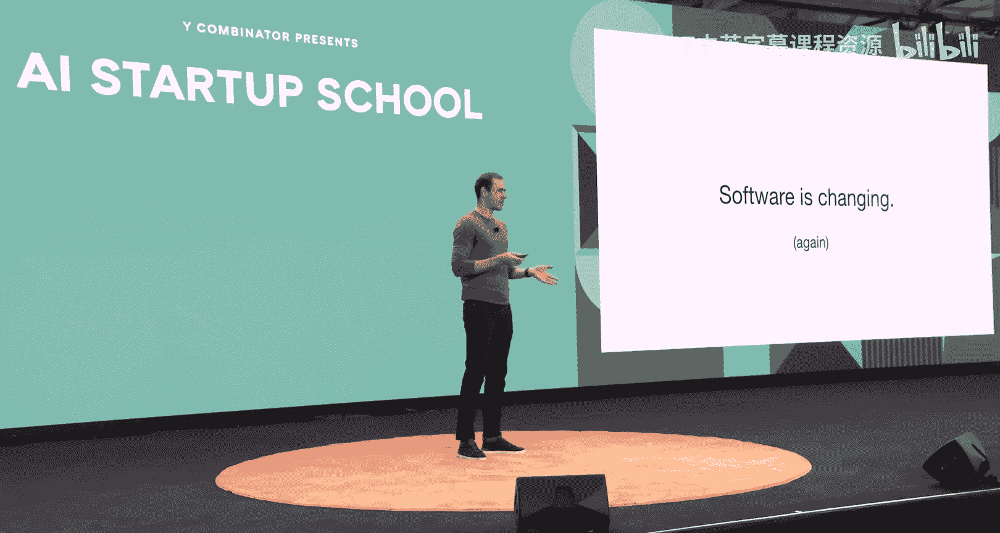

So let's take a look at maybe the realm of software。

 So if we kind of think of this as like the map of software。

 this is a really cool tool called map of Gitthub。 This is kind of like all the software that's written。

 these are instructions to the computer for carrying out tasks in the digital space。

 So if you zoom in here， these are all different kinds of repositories and this is all the code that has been written and a few years ago I kind of observed that software was kind of changing and there was kind of like a new type of software around and I called this software 2。

0 at the time and the idea here was that software 1。

0 is the code you write for the computer software 2。

0 are basically neural networks and in particular the weights of a neural network。

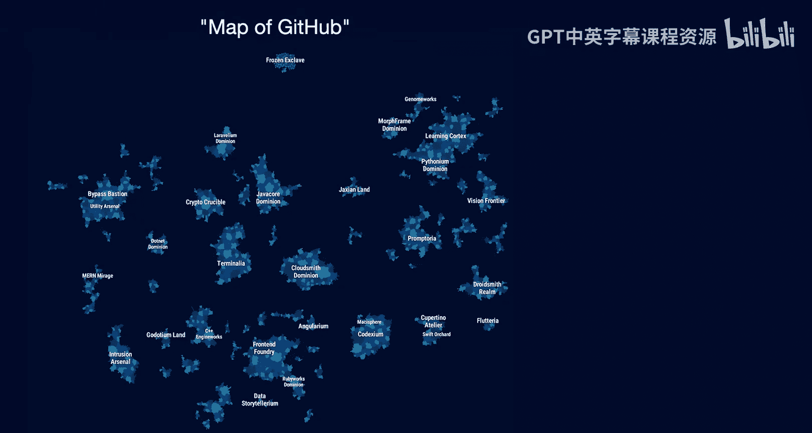

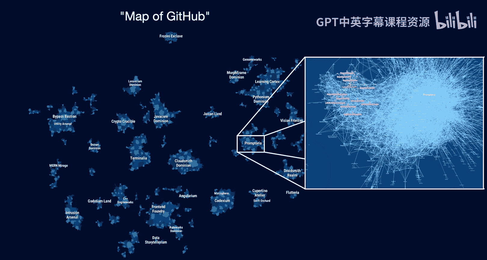

And you're not writing this code directly。 You are most。

 you are more kind of like tuning the data sets。 and then you're running an optimizer to create the parameters of this neural lot。

And I think like at the time neural networks were kind of seen as like just a different kind of classifier。

 like a decision tree or something like that。 And so I it was kind of like I think this framing was a lot more appropriate。

 and now actually what we have is kind of like an equivalent of Github in the realm of software 2。

0 and I think the hugging face is basically equivalent of Gitthub in software 2。

0 and there's also a model Atlas and you can visualize all the code written there in case you're curious by the way。

 the giant circle， the point in the middle， these are the parameters of flux the image generator and so anytime someone tunes aura on top of a flux model。

 you basically create a Gith commit in the space and you create a different kind of image generator。

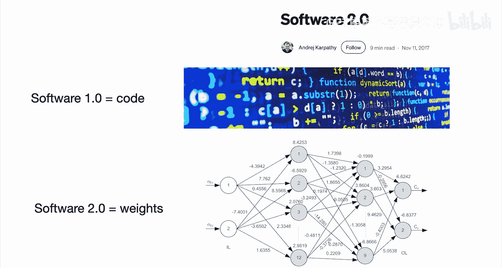

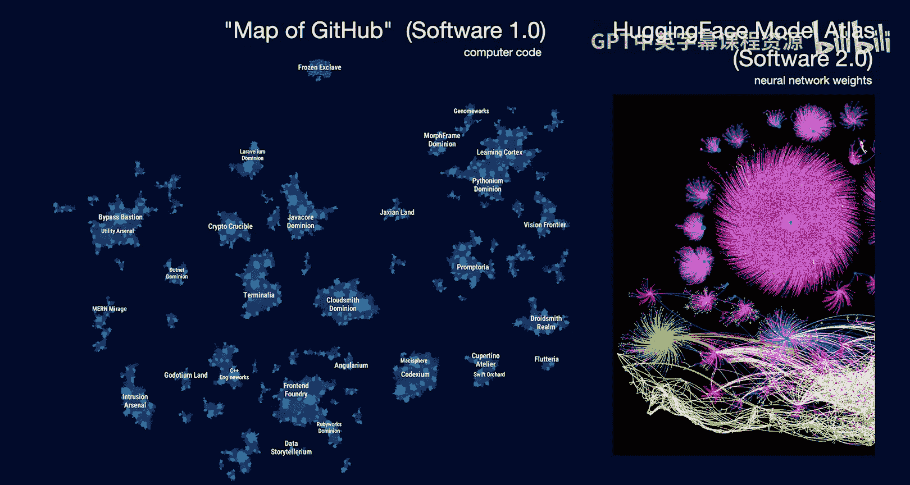

So basically， what we have is software 1。0 is the computer code that programs a computer。 Software 2。

0 are the weights which program neural networks。 And here's an example of Alexne imagemage recognizer neural network。

 Now， so far， all of the neural networks that we've been familiar with until recently were kind of like fixed function computers。

Image two categories or something like that。 And I think what's changed。

 and I think as a quite fundamental change， is that neural networks became programmable with large language models。

And so I see this as quite new， unique， it's a new kind of a computer。 and so in my mind。

 it's worth giving it a new designation of software 3。0 and basically your prompts are now programs。

That program， the L LM。 And remarkably， these prompts are written in English。

 So it's kind of a very interesting programming language。So maybe to summarize the difference。

 if you're doing sentiment classification， for example。

 you can imagine writing some amount of Python to basically do sentiment classification or you can train in neural net or you can prompt a large language model So here this is a few shot prompt and you can imagine changing it and programming the computer in a slightly different way。

 So basically we have software 1。0 software 2。0 and I think we're seeing maybe you've seen a lot of GiHub code is not just like code anymore。

 there's a bunch of like English interspersed with code and so I think there's a growing category of new kind of code So not only is it a new programming paradigm it's also remarkable to me that it's in our native language of English And so when this blue on mind a few I guess years ago now I tweeted this and I think it captured the attention of a lot of people and this is my currently pinned tweet is that remarkably we're now programming computers in English。

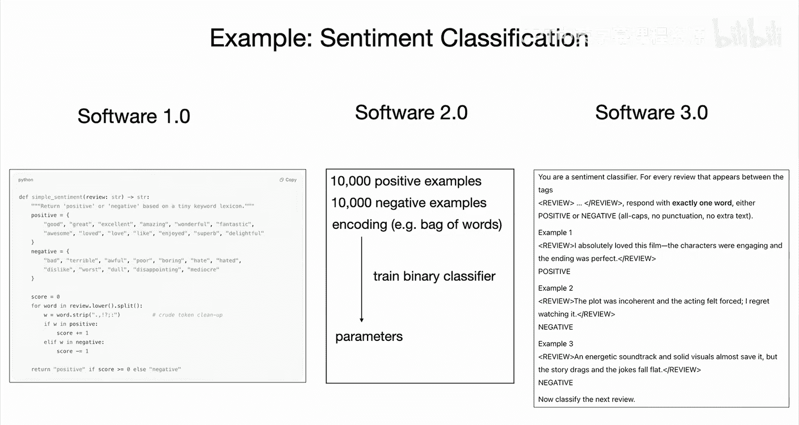

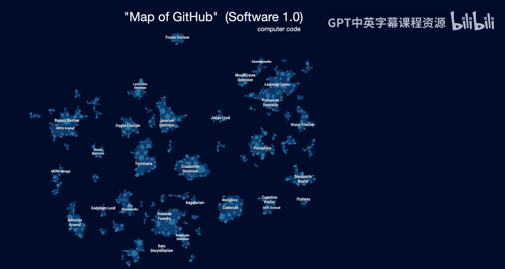

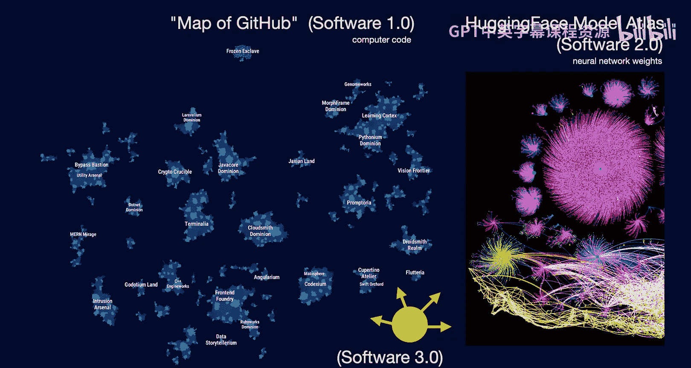

Now， when I was at Tesla， we were working on the autopilot and we were trying to get the car to drive。

And I sort of showed this slide at the time where you can imagine that the inputs to the car are on the bottom and they're going through a software stack to produce the steering and acceleration。

And I made the observation at the time that there was a ton of C plus plus code around in the autopilot。

 which was the software 1。0 code。 And then there was some neural net in there doing image recognition。

And I kind of observed that over time as we made the autopilot better。

 basically the neural network grew in capability and size。

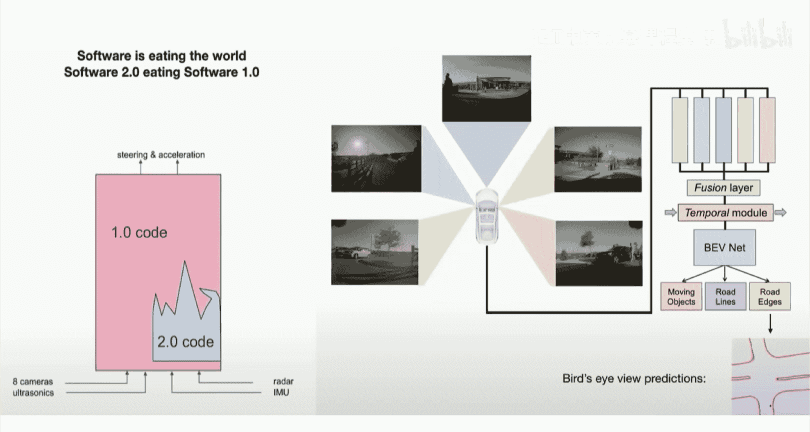

In addition to that， all the C plus plus code was being deleted and kind of like was。

And a lot of the kind of capabilities and functionality that was originally written 1。

0 was migrated to 2。0。 So as an example， a lot of the stitching up of information across images from the different cameras and across time was done by neural network。

 and we were able to delete a lot of code and so。

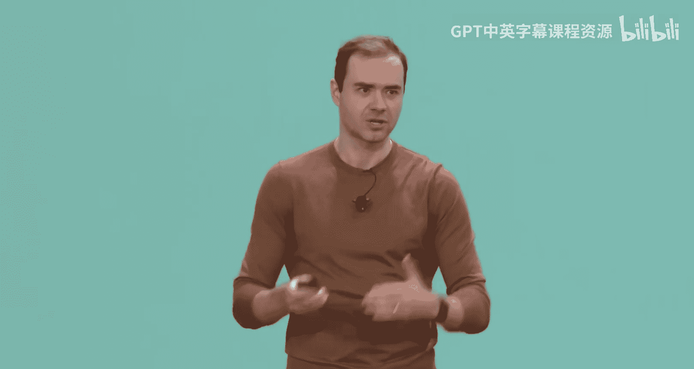

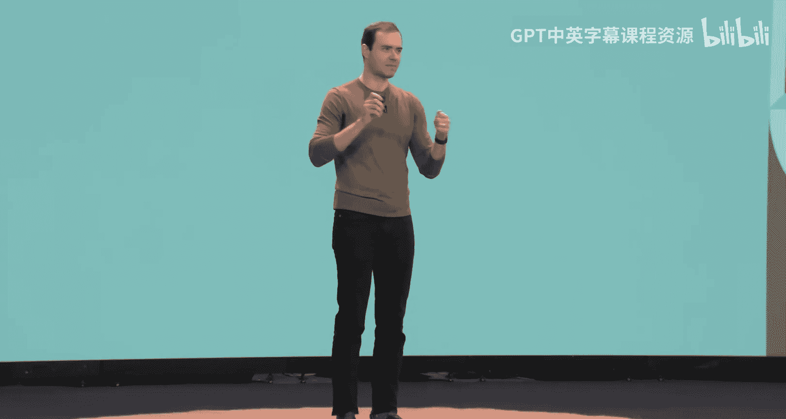

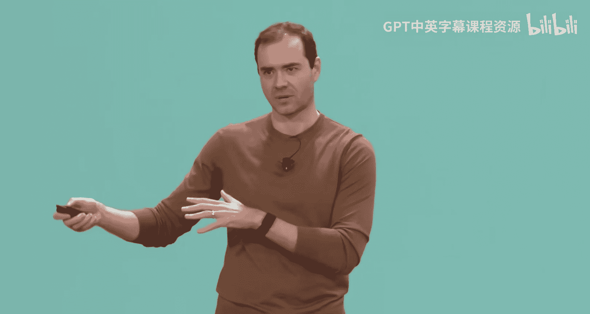

Software 2。0 stack is quite literally ate through the software stack of the autopilot。

 So I thought this was really remarkable at the time。

 And I think we're seeing the same thing again where basically we have a new kind of software and it's eating through the stack。

 We have three completely different programming paradigms。

 And I think if you're entering the industry。 It's a very good idea to be fluent in all of them because they all have slight pros and cons。

 And you may want to program some functionality in 1。0 or 2。0 or 3。0。 Are you gonna train neural。

 Are you gonna just prompt an LM。 should this be a piece of code that's explicit， etc。

 So we all have to make these decisions and actually potentially fluidly transition between these paradigms。

😊。

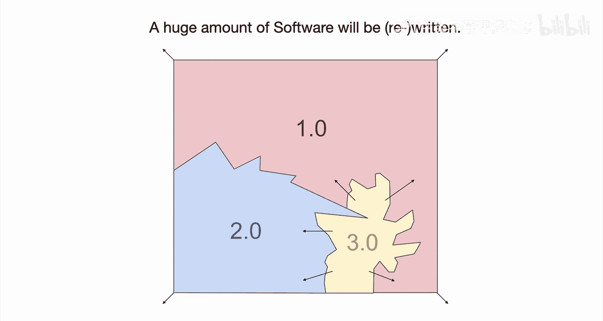

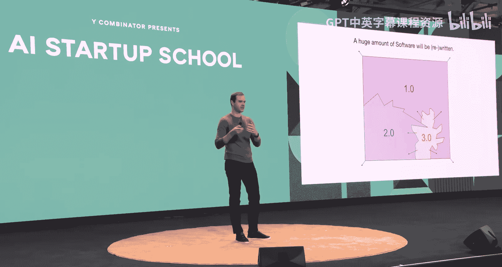

So。What I wanted to get into now is。First， I want to， in the first part。

 talk about LOMs and how to kind of think of this new paradigm and the ecosystem and what that looks like。

Like what is this new computer， what does it look like， and what does the ecosystem look like？

I was struck by this quote from And actually many years ago now I think and I think Andrew is going to be speaking right after me。

 but he said at the time， AI is the new electricity。

 And I do think that it kind of captures something very interesting in that LOMs certainly feel like the properties of utilities right now so。

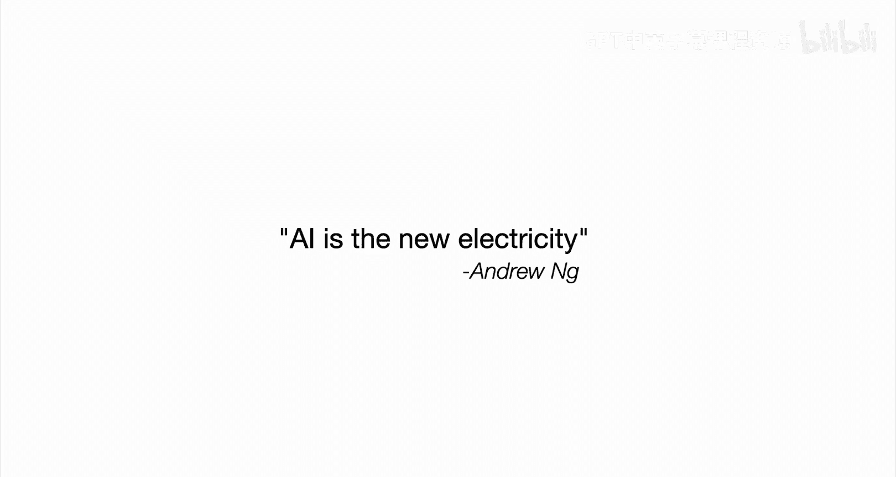

LLM labs like Open AI， Gemini， Anthroppy， et cea， they spend Capex to train the LLMs。

 and this is kind of equivalent to building A grid。

 and then there's Opex to serve that intelligence over APIs to all of us。

And this is done through metered access where we pay per million tokens or something like that。

 and we have a lot of demands that are very utilitylike demands out of this API。

 we demand low latency， high uptime， consistent quality， etc ce。In electricity。

 you would have a transfer switch so you can transfer your electricity source from like grid and solar or battery or generator in LLMs we have maybe open router and easily switch between the different types of LLMs that exist。

Because the LLMs are software， they don't compete for physical space。

 so it's okay to have basically like six electricity providers and you can switch between them because they don't compete in such a direct way。

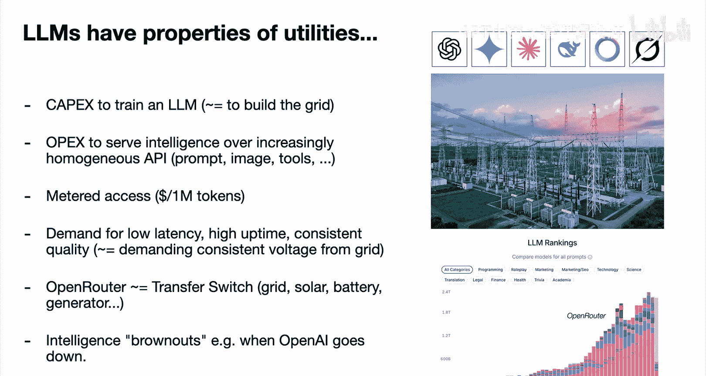

And I think what's also a little fascinating and we saw this in the last few days actually。

 a lot of the LLMs went down and people were kind of like stuck and unable to work。

 and I think it's kind of fascinating to me that when the state of the art LLMs go down。

 it's actually kind of like an intelligence brown out in the world。

 it's kind of like when the voltage is unreliable in the grid， and the planet just gets dumber。

 the more reliance we have on these models which already is like really dramatic and I think will continue to grow。

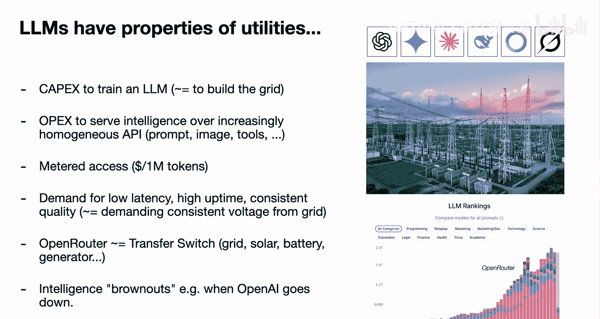

But Els don't only have properties of utilities。 I think it's also fair to say that they have some properties of fabs。

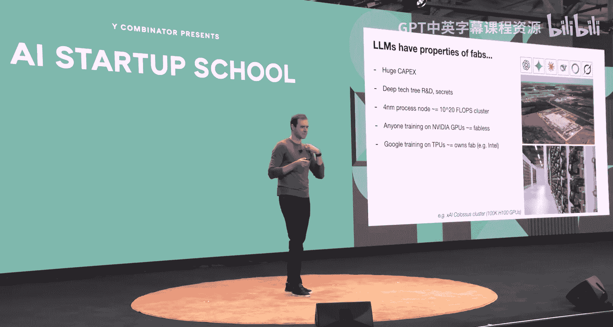

And the reason for this is that the Capex required for building LLM is actually quite large。

 it's not just like building some power station or something like that right you're investing in a huge amount of money。

 and I think the tech tree for the technology is growing quite rapidly。

 so we're in a world where we have sort of deep tech trees。

 research and development secrets that are centralizing inside the LLM labs。

And but I think the analogy muddies a little bit also because as I mentioned。

 this is software and software is a bit less defensible because it is so malleable。

 And so I think it's just an interesting kind of thing to think about potentially。

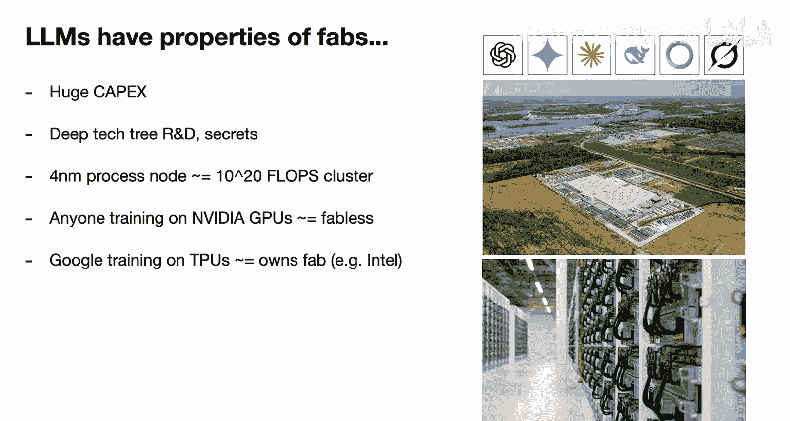

There's many analogy analogies you can make like a 4 nanometer process node maybe is something like a cluster with certain Mac spots。

 you can think about when you're using NviDR GPUs and you're only doing the software and you're not doing the hardware。

 that's kind of like the FabS model but if you're actually also building your own hardware and you're training on TPUs if you're Google that's kind of like the Intel model where you own your Fab so I think there's some analogies here that makes sense。

 but actually I think the analogy that makes the most sense perhaps is that in my mind LLMs have very strong kind of analogies to operating systems。

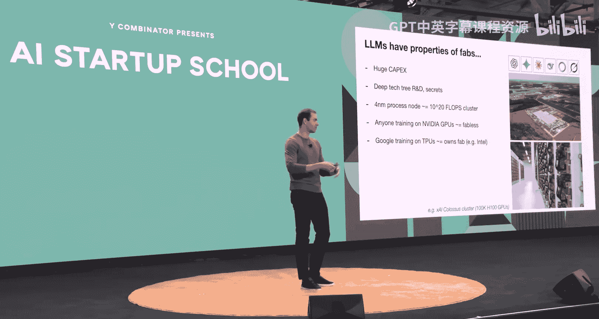

In that this is not just electricity or water。 It's not something that comes out of the tap as a commodity。

 these are now increasingly complex software ecosystems right So they're not just like simple commodities like electricity。

 And it's kind of interesting to me that the ecosystem is shaping in a very similar kind of way where you have a few close source providers like Windows or Macs And then you have an open source alternative like Linux。

 And I think neural for LLms as well。 we have a kind of a few competing close source providers and then maybe the Lama ecosystem is currently like maybe a close approximation to something that may grow into something like Linux。

 Again， I think it's still very early because these are just simple Lms。

 but we're starting to see that these are going to get a lot more complicated。

 It's not just about the LLM itself。 It's about all the tool use and the multimodalities and how all of that works。

 And so when I sort of had this realization of while back I tried to sketch it out。

 and it kind of seems to me like Lms are kind of like a new operating system right So the LLM is a new kind。

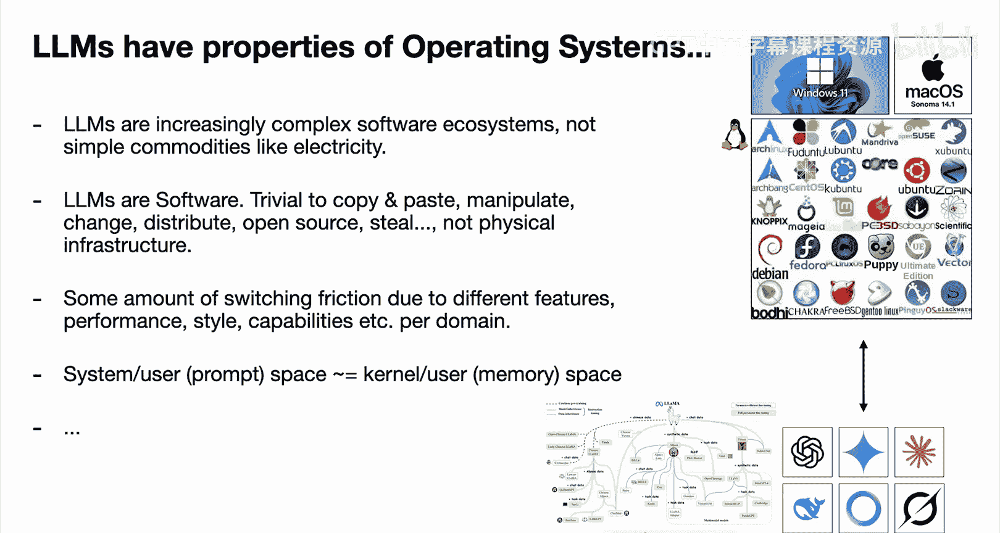

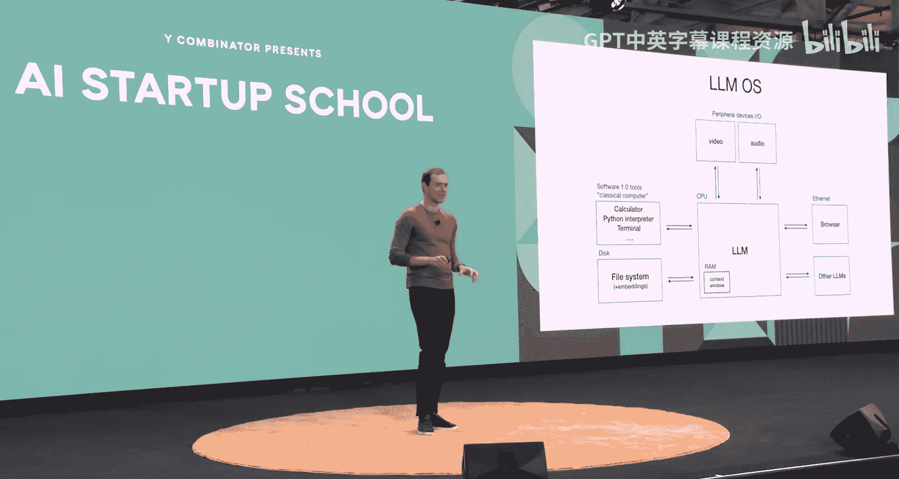

Computer， it setting。 it's kind of like the CPU equivalent。

 The context windows are kind of like the memory。And then the LLM is orchestrating memory and compute for problem solving。

 using all of these capabilities here。And so definitely， if you look at it。

 it looks very much like operating system from that perspective。 A few more analogies， for example。

 if you want to download an app， say I go to VS code and I go to download。

 you can download VS code and you can run it on Windows。

 Linux or Mac in the same way as you can take an LLM app like cursor。

And you can run it on GT or cloud or Gemini series， right， It's just a dropdown。

 So it's kind of like similar in that way as well。

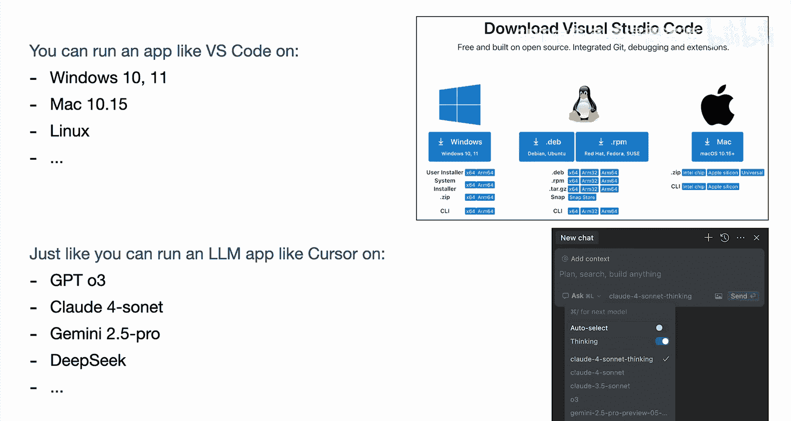

More analogies that I think strike me is that we're kind of like in this 1960s ish era where LLM compute is still very expensive for this new kind of a computer and that forces the LLMs to be centralized in the cloud and we're all just sort of thin clients that interact with it over the network and none of us have fully utilization of these computers and therefore it makes sense to use time sharingharing where we're all just a dimension of the batch when they're running the computer in the cloud。

 and this is very much what computers used to look like during this time。

 the operating systems were in the cloud， everything was streamed around and that was batching。

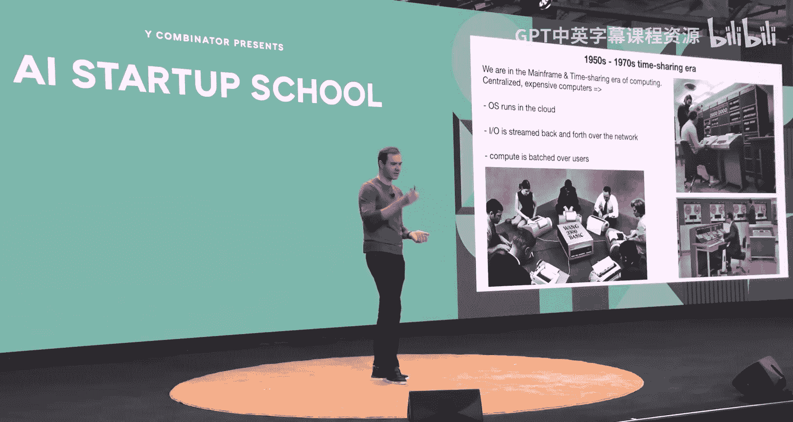

And so the personal computing revolution hasn't happened yet because it's just not economical。

 it doesn't make sense， but I think some people are trying， and it turns out that Mac minis。

 for example， are a very good fit for some of the LLMs because it all if you're doing batch on inference。

 this is all supermem bounds and this actually works。

And I think these are some early indications， maybe of personal computing。

 but this hasn't really happened yet， it's not clear what this looks like。

 maybe some of you get to invent what this is or how it works or what this should be。

Maybe one more analogy that I'll mention is whenever I talk to ChayP or some LLM directly in text。

 I feel like I'm talking to an operating system through the terminal， like it just it's text。

 it's direct access to the operating system， and I think a GuUI hasn't yet really been invented in like a general way like should ChayPT have a GuI like different than just the tech bubbles certainly some of the apps that we're going go into in a bit。

 have GuI， but there's no like。

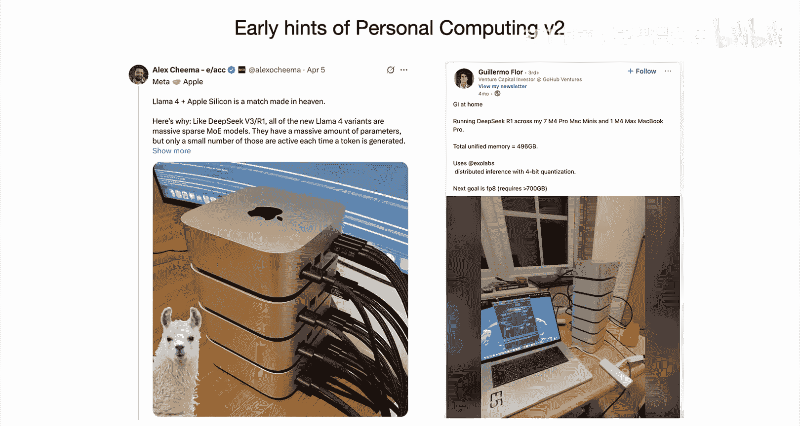

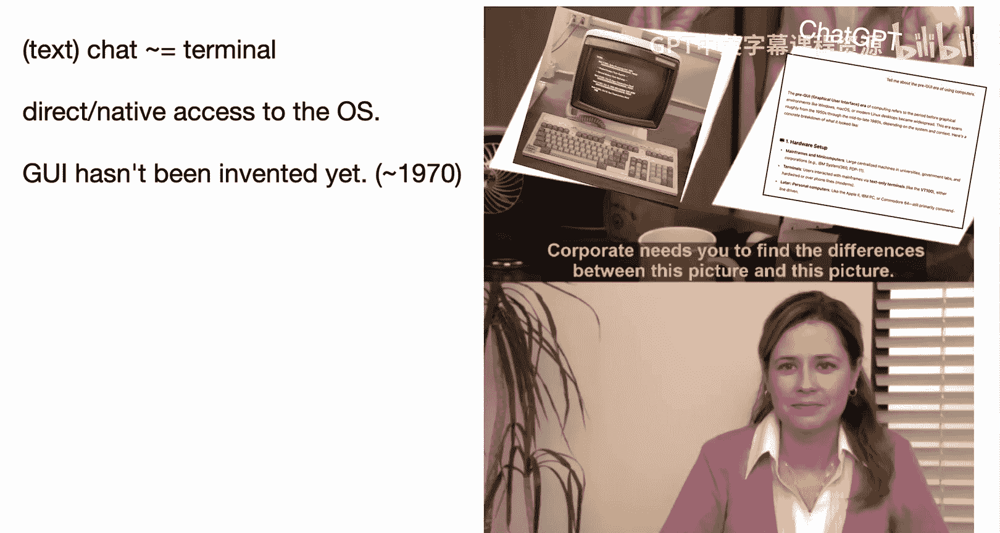

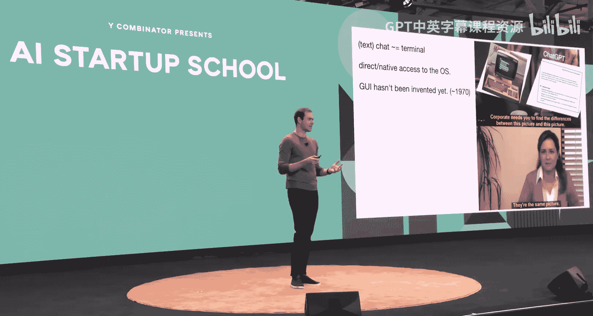

Gy across all the tasks， if that makes sense。There are some ways in which LLNs are different from kind of operating systems in some fairly unique way and from early computing。

And I wrote about this one particular property that strikes me as very different this time around。

 It's that LLMs like flip， they flip the direction of technology diffusion that is usually present in technology。

 So for example， with electricity， cryptography， computing flight Internet GPS。

 lots of new transformative technologies that have not been around typically it is the government and corporations that are the first users because it's new and expensive。

 etc。 and it only later diffuses to consumer but I feel like LM are kind of like flipped around。

 So maybe with early computers， it was all about ballistics and military use but with LLMs。

 it's all about how do you boil an egg or something like that。

 This is certainly like a lot of myus And so it's really fascinating to me that we have a new magical computer and it's like helping me boil an egg。

 It's not helping the government do something really crazy like some military ballistics or some special technology。

 Indeed corporations are governments are lagging behind the adoption of all of us of all of these technologies。

 So it's just backwards。

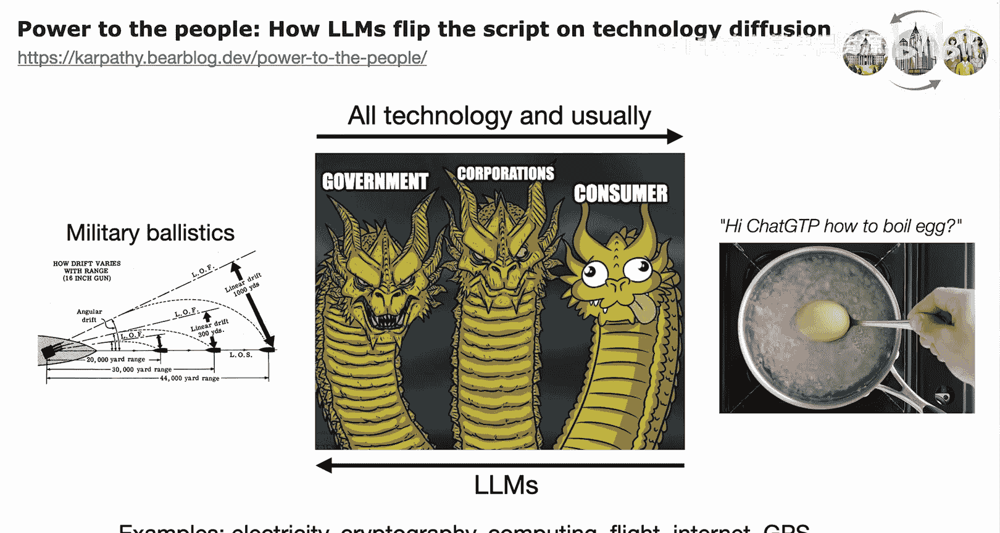

I think it informs maybe some of the uses of how we want to use this technology or like what are some of the first apps and so on？

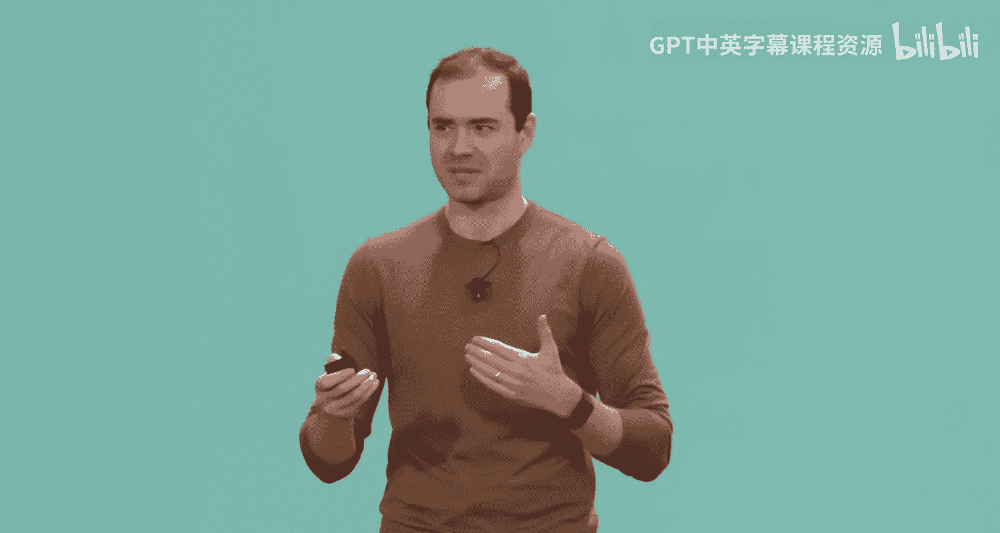

So in summary so far。LLM labs， BB， LLMs， I think it's accurate language to use。

 but LLMs are complicated operating systems。There are Cca 1960s in computing and we're redoing computing all over again and they're currently available via time sharing and distributed like a utility。

 What is new and unprecedented is that they're not in the hands of a few governments and corporations。

 They're in the hands of all of us because we all have a computer and it's all just software and ChaPT was beamed down to our computers like billions of people like instantly and overnight and this is insane and it's kind of insane to me that this is the case and now it is our time to enter the industry and program these computers。

 This is crazy So I think this is quite remarkable。

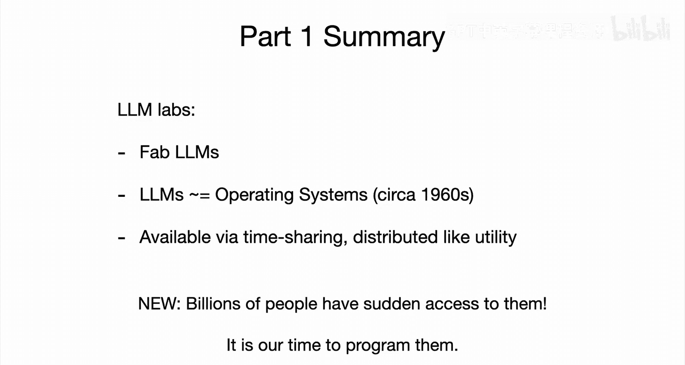

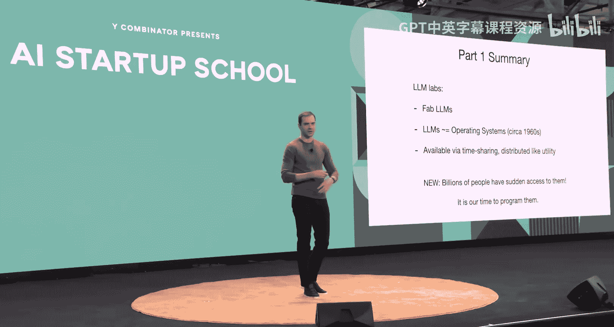

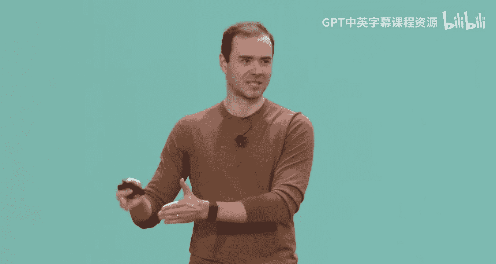

Before we program LLMs， we have to kind of spend some time to think about what these things are。

 and I especially like to kind of talk about their psychology。

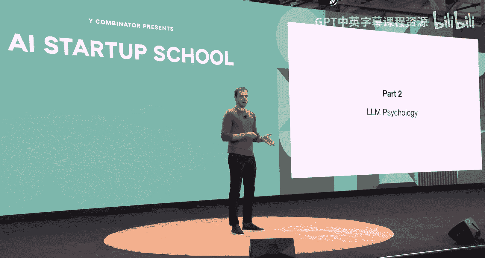

So the way I like to think about LLNs is that they're kind of like people's spirits。

 They are stochastic simulations of people， and the simulator in this case happens to be an utter aggressiveive transformer。

 So transformer is a neural net。It's， and it just kind of like goes on the level of tokens。

 It goes chunk， chunk， chunk， chunk chunk。 And there's an almost equal amount of compute for every single chunk and。

This simulator， of course， is just is basically there's some weights involved and we fit it to all of text that we have on the internet and so on and you end up with this kind of a simulator and because it is trained on humans it's got this emergent psychology that is humanlike so the first thing you'll notice is of course。

LMs have encyclopedic knowledge and memory and they can remember lots of things a lot more than any single individual human can because they read so many things。

 it actually kind of reminds me of this movie Rainman。

 which I actually really recommend people watch it an amazing movie I love this movie and Dusin Hoffman here is an autistic savan who has almost perfect memory so he can read he can read like a phone book and remember all of the names and phone numbers and I kind of feel like ElNs are kind of like very similar they can remember Shah hass and lots of different kinds of things very very easily。

So they certainly have superpowers in some respects， but they also have a bunch of I would say。

 cognitive deficits， so they hallucinate quite a bit and they kind of make up stuff and don't have a very good sort of internal model of selfknowledge。

 not sufficient at least， and this has gotten better but not perfect。

They display jagged intelligence， so they're going be superhuman in some problem solving domains。

 and then they're going to make mistakes that basically no human will make like you know they will insist that 9。

11 is greater than 9。9 or there are two Rs in strawberry。 These are some famous examples。

 but basically there are rough edges that you can trip on。 So that's kind of I think。

 also kind of unique。They also kind of suffer from angrade amnesia so and I think I'm alluding to the fact that if you have a coworker who join in your organization。

 this coworker will over time learn your organization and they will understand and gain like a huge amount of context on the organization and they go home and they sleep and they consolidate knowledge and they develop expertise over time。

 LLMs don't natively do this and this is not something that has really been solved in the R&D of LLMs I think。

 and so context windows are really kind of like working memory and you have to sort of program the working memory quite directly because they don't just kind of like gets smarted by default and I think a lot of people get tripped up by the analogies in this way。

In popular culture， I recommend people watch these two movies， memento and 51st states。

 in both of these movies， the protagonists， their weights are fixed and their context windows gets wiped every single morning and it's really problematic to go to work or have relationships when this happens and this happens to all all the time。

I guess one more thing I would point to is security kind of related limitations of the use of LLNs。

 so for example LLNs are quite gullible， they are susceptible to prompt injection risks。

 they might leak your data， etc ceter， and there's many other considerations security related。

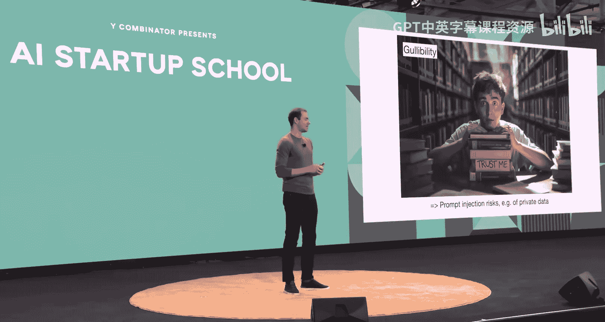

So basically， long story short， load you have to load you have to simultaneously think through this superhuman thing that has a bunch of cognitive deficits and issues。

 How do we and yet they are extremely like useful And so how do we program them and how do we work around their deficits and enjoy their superhuman powers。

So what I want to switch to now is talk about the opportunities of how do we use these models and where are some of the biggest opportunities。

 this is not a comprehensive list， just some of the things that I thought were interesting for this talk。

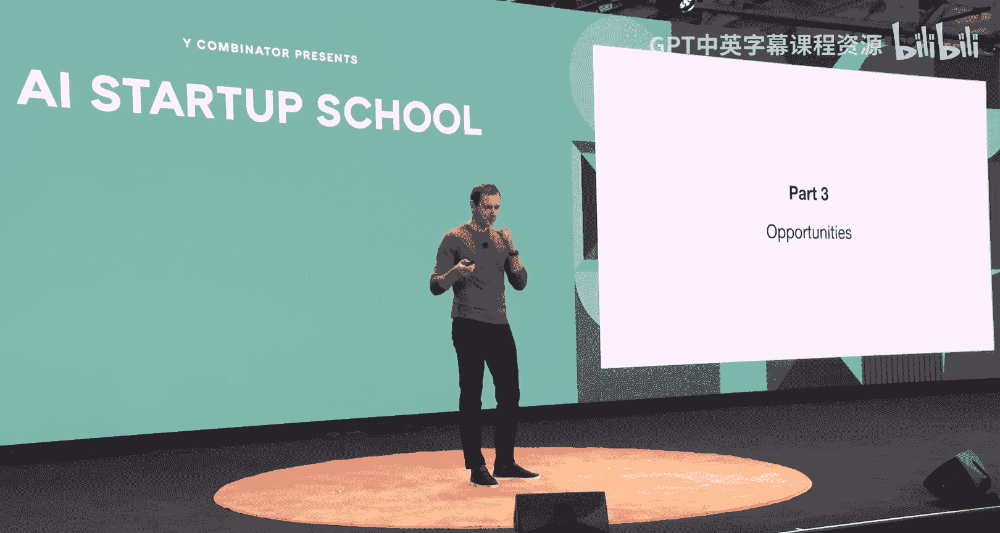

The first thing I'm kind of excited about is what I would call partial autonomy apps。

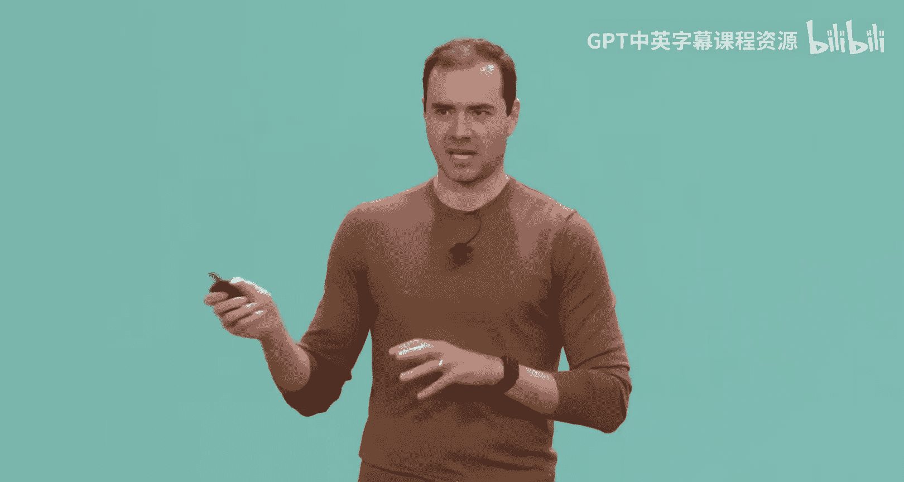

So for example， let's work with the example of coding。

You can certainly go to chatCT directly and you can start copy pastsing code around and copy pasting bug reports and stuff around and getting code and copy pastsing everything around。

 why would you do that， Why would you go directly to the operating system It makes a lot more sense to have an app dedicated for this。

 And so I think many of you use cursor I do as well and cursor is kind of like the thing you want instead you don't want to just directly go to the chattT And I think cursor is a very good example of an early LLM app that has a bunch of properties that I think are useful across all the LLM apps So in particular you will notice that we have a traditional interface that allows a human to go in and do all the work manually just as before。

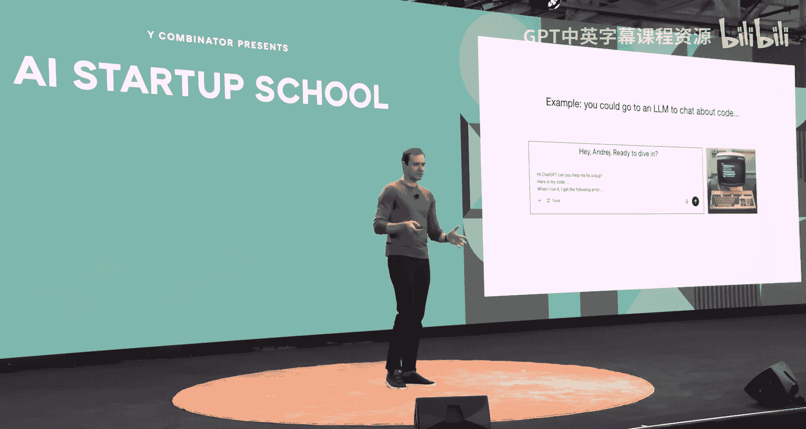

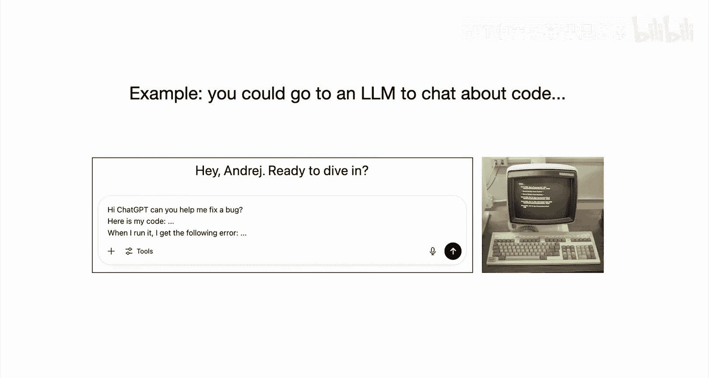

But in addition to that， we now have this LLM integration that allows us to go in bigger chunks。

And so some of the properties of LLM apps that I think are shared and useful to point out。

 Number one， the LLMs basically do a ton of the context management。 Number two。

 they orchestrate multiple calls to LLMs， right so in the case of cursor。

 there's under the hood embedding models for all your files， the actual chat models。

 models that apply diffs to the code， and this is all orchestrated for you。

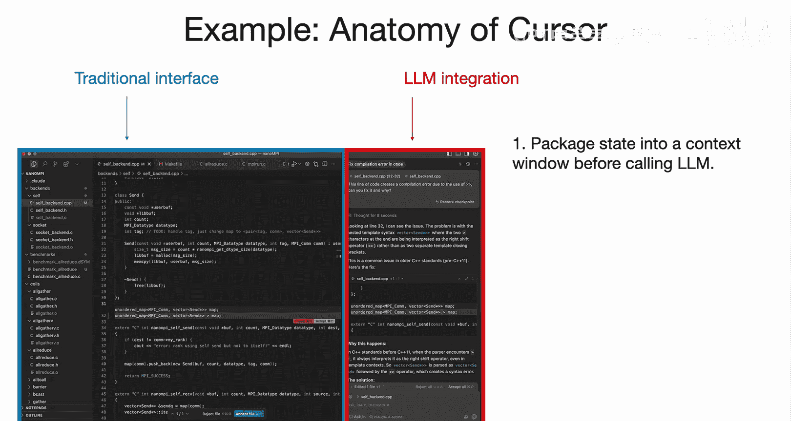

A really big one that I think also maybe not fully appreciated always is application specific Gui and the importance of it because you don't just want to talk to the operating system directly in text。

 Text is very hard to read， interpret， understand。 and also like you don't want to take some of these actions natively in text So it's much better to just see a di as like red and green change。

 and you can see what's being added as intracted。 It's much easier to just do command why to accept or command and to reject。

 I shouldn't have to type it in text right So Gui allows a human to audit to work of these fallible systems and to go faster。

 I'm going to come back to this point a little bit layer as well。

 And the last kind of feature I want to point out is that there's what I call the autonomy slider。

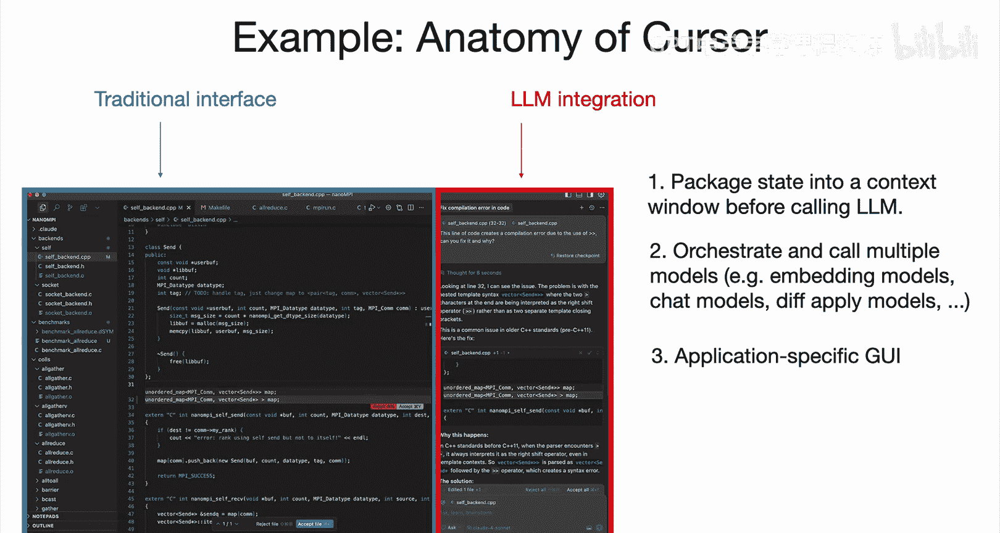

So for example， in cursor you can just do tap completion， you're mostly in charge。

 you can select a chunk of code and command K to change just that chunk of code。

 you can do command L to change this entire file， or you can do command I which just let a red do whatever you want in the entire repo and that's the sort of full autonomy agent gen version and so you are in charge of the autonomy slider and depending on the complexity of the task at hand。

 you can tune the amount of autonomy that you're willing to give up for that task。

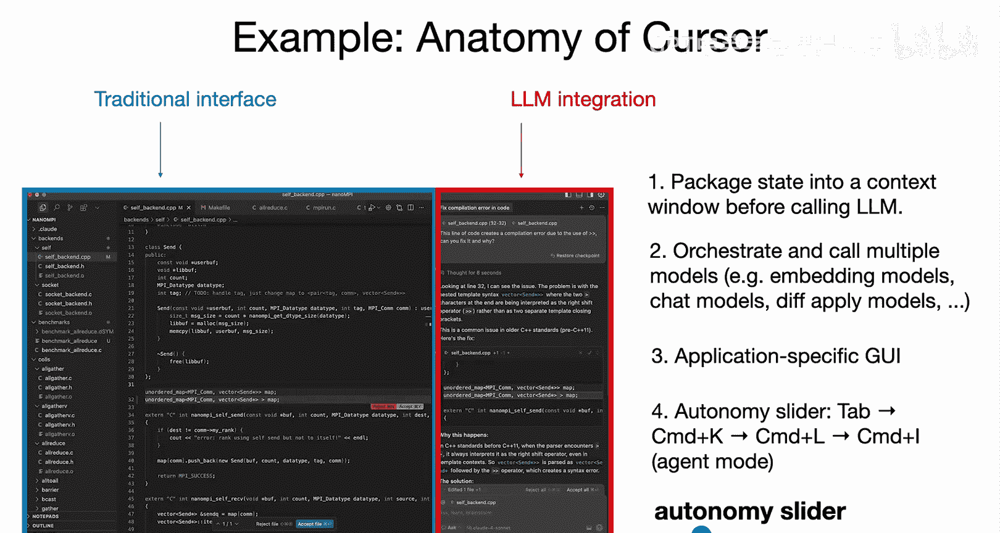

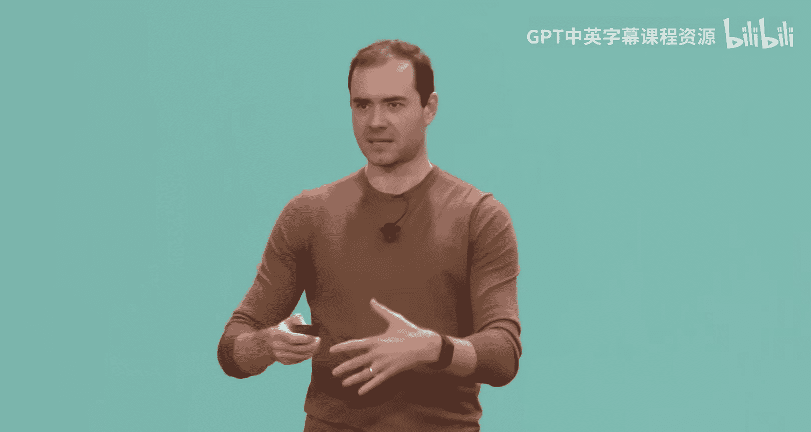

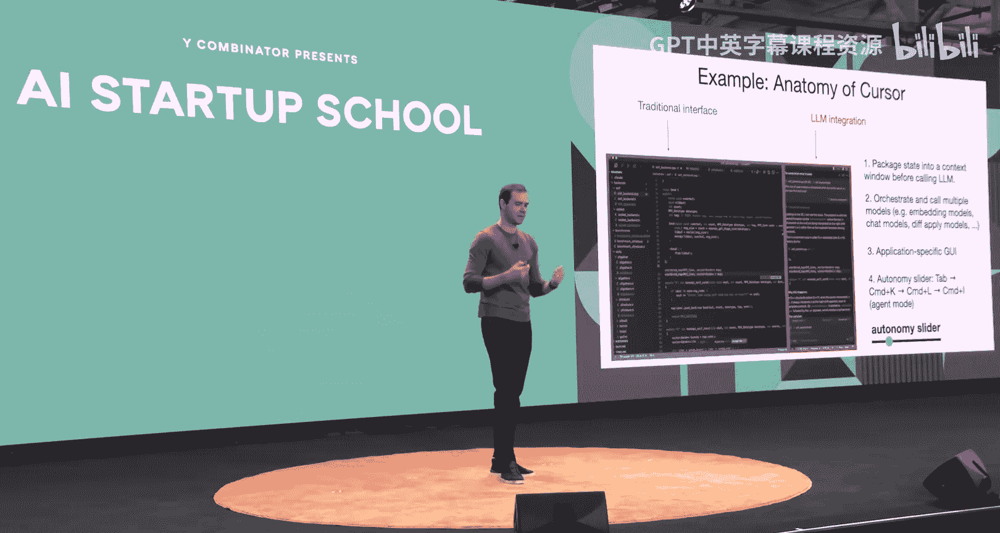

Maybe to show one more example of a fairly successful LLla map perplexity。

 it also has very similar features to what I just pointed out in cursor。

 it packages up a lot of the information。 it orchestrates multiple Llums It's got a gui that allows you to audit some of its work so for example。

 it will cite sources and you can imagine inspecting them and it's got an autonomy slider。

 you can either just do a quick search or you can do research or you can do deep research and come back 10 minutes later So this is all just varying levels of autonomy that you give up to the tool So I guess my question is。

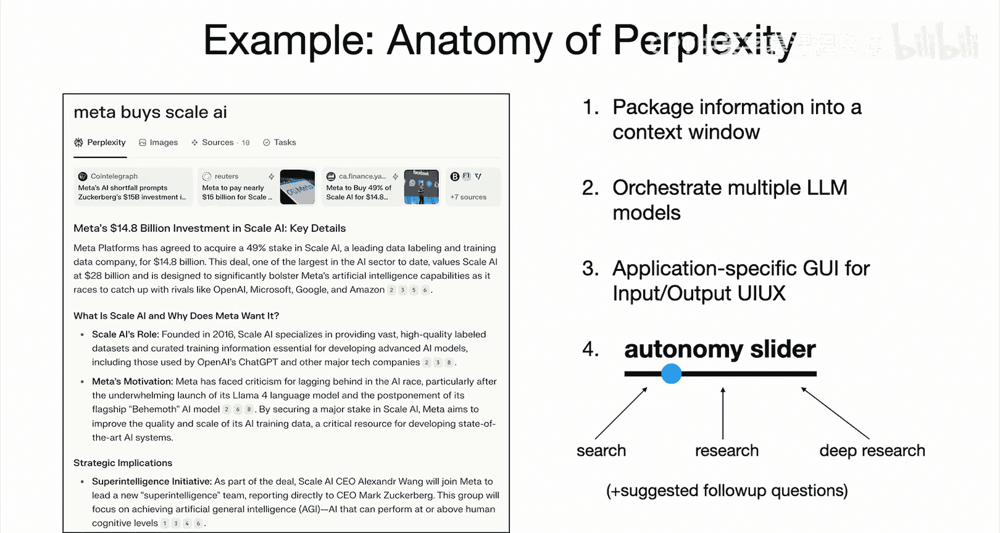

I feel like a lot of software will become partially autonomous and I'm trying to think through like what does that look like and for many of you who maintain products and services。

 how are you going to make your products and services partially autonomous。

 can an LLM see everything that a human can see Can an LLM act in all the ways that a human could act and can humans supervise and stay in the loop of this activity because again these are fallible systems that aren't yet perfect。

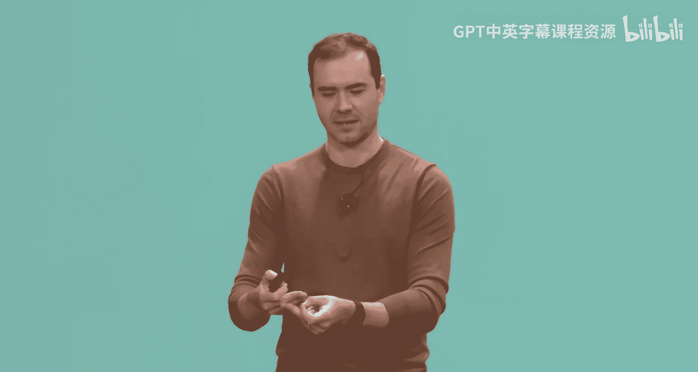

And what does a diff look like in Photoshop or something like that， you know。

 And also a lot of the traditional software right now。

 it has all these switches and all this kind of stuff that's all designed for human。

 All of this has to change and become accessible to L LNs。

So one thing I want to stress with a lot of these LLM apps that I'm not sure gets as much attention as you should is。

We were're now kind of like cooperating with AIs and usually they are doing the generation。

 and we as humans are doing the verification。 It is in our interest to make this loop go as fast as possible。

 So we're getting a lot of work done。 There are two major ways that I think this can be done。

 Numb one， you can speed up verification a lot。 And I think guis， for example。

 are extremely important to this。 because GuI utilizes your computer vision GPU in all of our head。

 reading text is effortful and it's not fun， but looking at stuff is fun。

 and it it's just kind of like a highway to your brain。

 So I think guis are very useful for auditing systems and visual representations in general。

 And number two， I would say is。

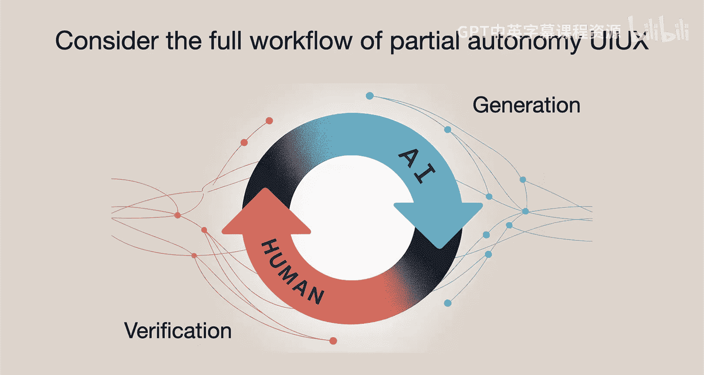

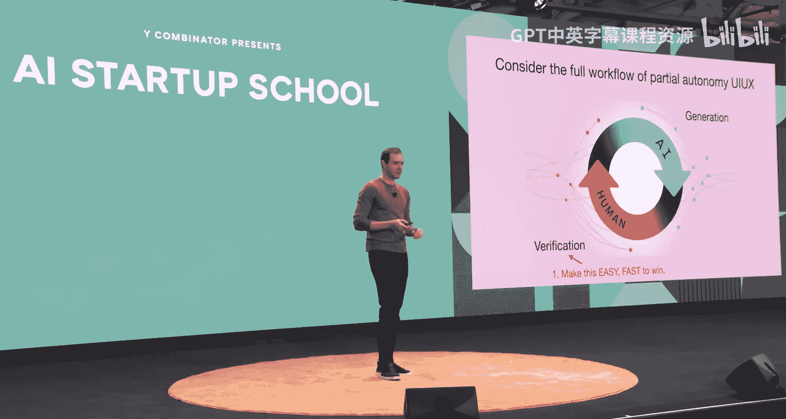

We have to keep the AI on the leash。We I think a lot of people are getting way over excitedted with AI agents。

 and it's not useful to me to get a diff of 1000 lines of code to my repo。 Like I have to。

 I'm still the bottleneck， right， even though that 1000 lines come out instantly。

 I have to make sure that this thing is not introducing bugs is just like。

And that is doing the correct thing， right， And that there's no security issues and so on。 So I。

 I think that。Yeah， basically， we have to sort of like。

It's in our interest to make the flow of these two go very， very fast。

 and we have to somehow keep the AI on the leash because it gets way too overreactive。

 it's kind of like this。 This is how I feel when I do AI assisted coding。 If I'm just bybe coding。

 everything is nice and great， but if I'm actually trying to get work done。

 it's not so great to have an overreactive agent doing all this kind of stuff。

 So this slide is not very good。 I'm sorry， but。I guess I'm trying to develop， like many of you。

 some ways of utilizing these agents in my coding workflow and to do AI assisted coding。

 and in my own work， I'm always scared to get way too big dis。

 I always go in small incremental chunks。 I want to make sure that everything is good。

 I want to spin this loop very， very fast。 and I sort of work on small chunks of single concrete thing。

 And so I think many of you probably are developing similar ways of working with with LMs。

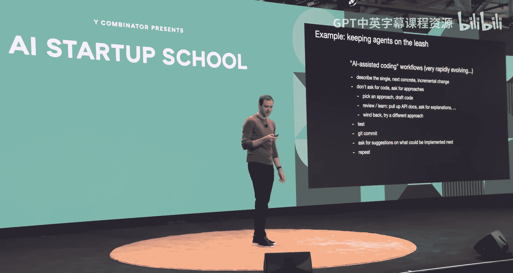

I also saw a number of blog posts that try to develop these best practices for working with LLMs。

 and here's one that I read recently and I thought was quite good and it kind of discussed some techniques and some of them have to do with how you keep the AI on the leash And so as an example。

 if you are prompting if your prompt is big then the AI might not do exactly what you wanted and in that case。

 verification will fail you're going to ask for something else if a verification fails。

 then you're going to start spinning so it makes a lot more sense to spend a bit more time to be more concrete in your prompts which increases the probability of successful verification and you can move forward。

 And so I think a lot of us are going to end up finding kind of techniques like this。

I think in my own work as well， I'm currently interested in what education looks like in together with kind of like now that we have AI and all。

 what does education look like。 And I think a large amount of。

Thought for me goes into how we keep AI on leash。 I don't think it just works to go to ChaPT and be like。

 hey， teach me physics。 I don't think this works because the AI is like gets lost in the woods。

 And so for me， this is actually two separate apps， for example。

 there's an app for a teacher that creates courses。

 And then there's an app that takes courses and serves them to students。 And in both cases。

 we now have this intermediate artifact of a course that is auditable。

 and we can make sure it's good。 we can make sure it's consistent。

 And the AI is kept on the leash with respect to a certain syllabus。

 a certain like progression of projects and so on。 And so this is one way of keeping the AI on leash and I think has a much higher likelihood of working。

 And the AI is not getting lost in the woods。One more kind of analogy I wanted to sort of allude to is I'm no stranger to partial autonomy and I've kind of worked on this。

 I think， for five years at Tesla， and this is also a partial autonomy product and shares a lot of the features like for example。

 right there in the instrument panel is the Gui of the autopilot。

 so it's showing me what the neural network sees and so on and we have the autonomy slider where over the course of my tenure there we did more and more autonomous tasks for the user。

And maybe the story that I wanted to tell very briefly is。Actually。

 the first time I drove a self-driving vehicle was in 2013。

 and I had a friend who worked at Waymo and he offered to give me a drive around Palo Alto。

 I took this picture using Google Glass at the time。

 and many of you are so young that you might not even know what that is。

 but yeah this was like old the rage at the time。And we got into this car。

 and we went for about a 30 minute drive around Palo Alto， Highways， streets and so on。

 And this drive was perfect。 There was zero interventions。 And this was 2013。

 which is now 12 years ago。😊，And it's kind of struck me because at the time when I had this perfect drive。

 this perfect demo， I felt like。😊，Wow， selfd is imminent because this just work。 This is incredible。

 but here we are 12 years later， and we are still working on autonomy。

 We are still working on driving agents。 And even now。

 we haven't actually like fully solved the problem。

 like you may see Waymos going around and they look driverless， but you know。

 there's still a lot of teleop and a lot of human in the loop of a lot of this driving。😊。

So we still haven't even like declared success， but I think it's definitely like going to succeed at this point。

 But it just took a long time。 And so I think like， like this software is really tricky。

 I think in the same way that driving is tricky。 And so when I see things like， oh。

2025 is the year of agents， I get very concerned。 and I kind of feel like。

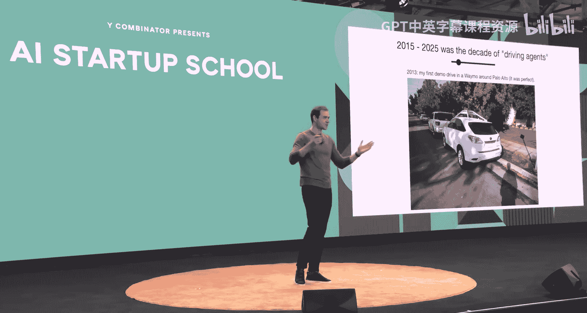

You know， this is the decade of agents， and this is going to be quite some time。

 We need humans in the loop。 We need to do this carefully。 This is software。 Let's be serious here。

One more kind of analogy that I always think through is。The Iron Man suit， I think this is。

 I always love Iron Man。 I think it's like so correct in a bunch of ways with respect to technology and how it will play out。

 And what I love about the Iron Man suit is that it's both an augmentation。

 and Tony Stark can drive it。😊。

And it's also an agent。 and in some of the movies， the Iron Man suit is quite autonomous and can fly around and find Tonyny and all this kind of stuff。

 And so this is the autonomy slider is we can be we can build augmentations or we can build agents and we kind of want to do a bit of both。

 but at this stage， I would say working with fallible LLMs and so on。

 I would say you know it's less Ironman robots and more Iron Man suits that you want to build。

 it's less like building flashy demos of autonomous agents and more building partial autonomy products。

 and these products have custom goese and Uiux and we're trying to and this is done so that the generation verification loop of the human is very。

 very fast。 But we are not losing the sight of the fact that it is in principle possible to automate this work。

 And there should be an autonomy slider in your product。

 and you should be thinking about how you can slide that autonomy slider and make your product sort of more autonomous over time。

 But this is kind of how I think there's lots of opportunities in these kinds of products。

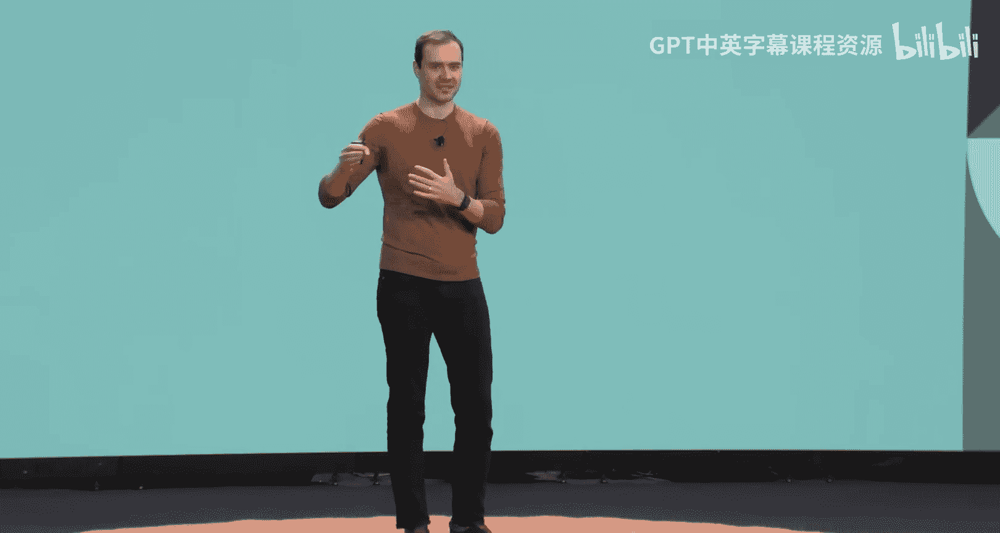

I want to now switchges a little bit and talk about one other dimension that I think is very unique。

 Not only is there a new type of programming language that allows for autonomy in software， but also。

 as I mentioned， it's programmed in English， which is this natural interface and suddenly everyone is a programmer because everyone speaks natural language like English。

 So this is extremely bullish and very interesting to me and also completely unprecedented。

 I would say it used to be the case that you need to spend five to 10 years studying something to be able to do something in software。

 this is not the case anymore。 So I don't know if by H， anyone has heard of vi coding。

This， this is the tweet that kind of like introduced this。

 But I'm told that this is now like a major meme。 One story about this is that。

I've been on Twitter for like 15 years or something like that at this point。

 And I still have no clue which tweet will become viral and which tweet like fizzles and no one cares。

 And I thought that this tweet was gonna be the latter。 I don't know。

 It was just like a shower of thoughts， but this became like a total meme。

 And I really just can't tell。 But I guess like it struck a chord and gave a name to something that everyone was feeling。

 but couldn't quite say in words。So now there's a Wikipedia page and everything。It is like。

Yeah， this is like a major contribution now or something like that， so。

So Tom Wolf from Hugggging Face shared this beautiful video that I really love。😊。

These are kids vibe coding。And I find that this is such a wholesome video。 Like， I love this video。😊。

Like， how can you look at this video and feel bad about the future， The future is great。

I think this will end up being like a gateway drug to software development。

I'm not a doer about the future of the generation。 And I think， yeah， I love this video。

So I tried byco a little bit as well because it's so fun So bycoing is so great when you want to build something super duper custom that doesn't appear to exist。

 And you just want to wing it because it's a Saturday or something like that。

 So I built this ios app。 And I don't I can't actually program in Swift。

 But I was really shocked that I was able to build like a super basic app。

 And I'm not gonna explain it。 It's really dumb。 But I kind of like。

 this was just like a day of work。 And this was running on my phone like later that day。

 And I was like， wow， this is amazing。 I didn't have to like read through Swift for like five days or something like that to like get started。

😊。

I also vcoded this app called menuugen。 And this is a lot。 You can try it in menugen do app。

 And I basically have this problem where I show up at a restaurant。 I read through the menu。

 and I have no idea what any of the things are。 and I need pictures。 So this doesn't exist。

 So I was like， hey， I'm gonna buycode it。 So this is what it looks like。 You go to menugen that app。

😊，And you take a picture of， of a menu and then menu and generate the images。

 And everyone gets $5 in credits for free when you sign up。 and therefore。

This is a major cost center in my life，This is a negative revenue app for me right now。

I've lost a huge amount of money on menugen。

Okay。But the fascinating thing about menuugen， for me。Is that。The code of the vibe coding part。

 the code was actually the easy part of of vibe coding menuugen。

 and most of it actually was when I tried to make it real so that you can actually have authentication and payments in the domain name and a deployment this was really hard and all of this was not code。

 All of this Devops stuff was in me in the browser clicking stuff。

 And this was extreme slog and took another week。 So it was really fascinating that I had the menugen basically demo working on my laptop in a few hours。

 And then it took me a week because I was trying to make it real。

 And the reason for this is this was just really annoying。 So for example。

 if you tried to add Google log into your web page I know this is very small。

 but just a huge amount of instructions of this clerk library telling me how to integrate this and this is crazy like it's telling me go to this URL。

 click on this dropdown chooseose this。 go to this and click on that。

 and it's like telling me what to do like a computer is telling me the actions I should be taken。

 like you do it。 What am I doing。

ます。The hell。Yeah。

I had to follow all these instructions。 This was crazy。

 So I think the last part of my talk therefore focuses on， can we just build for agents。

 I don't want to do this work。😊，Can agents do， Thank you。No。Okay。So roughly speaking。

 I think there's a new category of consumer and manipulator of digital information。

It used to be just humans through guis or computers through APIs。

 And now we have a completely new thing。 and agents are their computers。

 but they are humanlike kind of right， they're people spirits。

 There's people spirits on the Internet。 and they need to interact with their software infrastructure。

 Like， can we build for them。 It's a new thing。 So as an example。

 you can have robust TXC on your domain and you can instruct or like advise， I suppose。

 web crawlers on how to behave on your website in the same way you can have maybe L TXT file。

 which is just a simple markdown that's telling LLms what this domain is about。

 And this is very readable to an LLM。 if it had to instead get the Hml of your web page and try to parse it。

 This is very error prone and difficult and will screw it up and it's not gonna work。

 So we can just directly speak to the LM。 It's worth it。

A huge amount of documentation is currently written for people。

 so you will see things like lists and bold and pictures。

 and this is not directly accessible by an LLM。 So I see some of the services now are transitioning a lot of their docs to be specifically for LLMs。

 So verll and Stripe as an example are early movers here。

 but there are a few more that I've seen already。 and they offer their documentation in Markdown。

 Markdown is super easy for LMs to understand。

This is great。 Maybe one simple example from， from my experience as well。 Maybe some of you know。

3 blue1 brown， He makes beautiful animation videos on YouTube。😊，Yeah。

 I love this library so that he wrote Manin， and I wanted to make my own。

 and there's extensive documentation on how to use Manin。

 And so I didn't want to actually read through it。 So I copy pasted the whole thing to an LLM。

 And I described what I wanted。 and it just worked out of the box。

 like LM just boycoded me an animation exactly what I wanted。 And I was like wow， this is amazing。

 So if we can make docs legible to LLMs。 it's going to unlock a huge amount of kind of use And I think this is wonderful and should happen more。

😊。

The other thing I wanted to point out is that you do， unfortunately have to。

 It's not just about taking your dogs and making them appear and markdown。 That's the easy part。

 We actually have to change the do。 because any time your dogs say click， this is bad。

 An L L M will not be able to natively take this action right now。 So verll， for example。

 is replacing every occurrence of click where the equivalent curl command that your L M agent could take on your behalf。

And so I think this is very interesting。 And then， of course。

 there's a model context protocol from Anthropic。 And this is also another way。

 It's a protocol of speaking directly to agents as this new consumer and manipulator of digital information。

 So I'm very bullish on these ideas。 The other thing I really like is a number of little tools here and there that are helping ingest data in like very LM friendly formats。

 So， for example， when I go to a Github repo like my nanoGB repo。

 I can't feed this to an LLM and ask questions about it。 because it， you know。

 this is a human interface on Github。 So when you just change the URL from Github to get ingest。

 Then this will actually concatenate all the files into a single giant text and it will create a directory structure。

 etc。 And this is ready to be copy pasted into your favorite LM and you can do stuff。😊。

Maybe even more a dramatic example of this is Deep wki。

 where it's not just the raw content of these files。This is from Devon。

 but also like they have Devin basically do analysis of the Github repo。

 and Devin basically builds up a whole docs pages just for your repo。

 And you can imagine that this is even more helpful to copy paste into your LLM。

 So I love all the little tools that basically where you just change the URL and it makes something accessible to an LLM。

 So this is all well and great and I think there should be a lot more of it。

 One more note I wanted to make is that。😊。

It is absolutely possible that in the future， L L Ms will be able to， this is not even future。

 This is today。 They'll be able to go around and they'll be able to click stuff and so on。

 But I still think it's very worth basically meeting LL M halfway L M halfway and making it easier for them to access all this information。

 because this is still fairly expensive， I would say to use and a lot more difficult。

 And so I do think that lots of software， there will be a long tail where it won't like adapt because these are not like live player sort of repositories or digital infrastructure。

 And we will need these tools。 But I think for everyone else。

 I think it's very worth kind of like meeting in some middle point。 So I'm bullish on both。

 if that makes sense。

So， in summary。

What an amazing time to get into the industry。 We need to rewrite a ton of code。

 A ton of code will be written by professionals and vibe coders。😊。

These LLMs are kind of like utilities， kind of like fabs。

 but they're kind of especially like operating systems， but it's so early。

 it's like 1960s of operating systems。 And and I think a lot of the analogies crossover。

 and these LMs are kind of like these fallible you know people spirits that we have to learn to work with And in order to do that properly。

 we need to adjust our infrastructure towards it。 So when you're building these LLM apps。

 I describe some of the ways of working effectively with these LLNs and some of the tools that make that kind of possible and how you can spin this loop very。

 very quickly and basically create partial telling products。 And then yeah。

 a lot of code has to also be written for the agents more directly。 But in any case。

 going back to the Iron Man suit analogy。 I think what we'll see over the next decade roughly is we're going to take the slider from left to right。

And I'm very interesting。 It's gonna be very interesting to see what that looks like。

 And I can't wait to build it with all of you。😊，Thank you。

