# Andrej《复现GPT-2(124M版本)｜Let's reproduce GPT-2 (124M)》中英字幕 - P1 - GPT中英字幕课程资源 - BV1cR54zaE6p

Hi， everyone。So today we are going to be continuing our zero to Hero series， and in particular。

 today we are going to reproduce the GBT2 model， the 124 million version of。

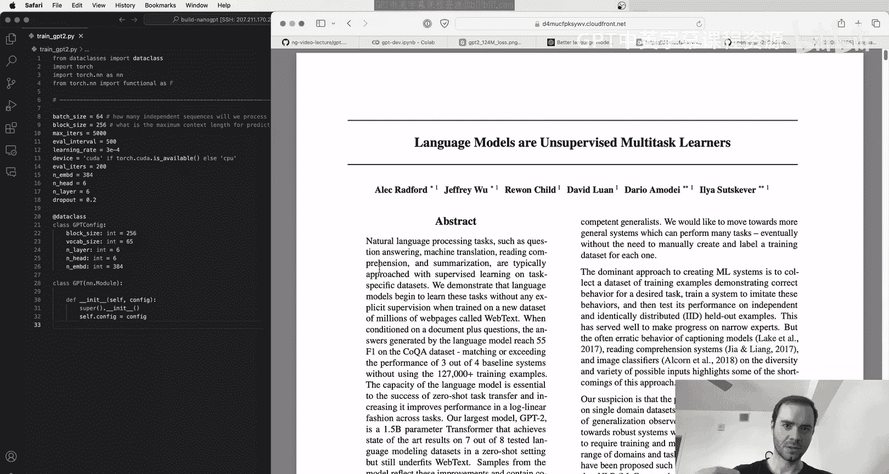

So when Open AI released GPD2， this was 2019 and they released it with this blog post。

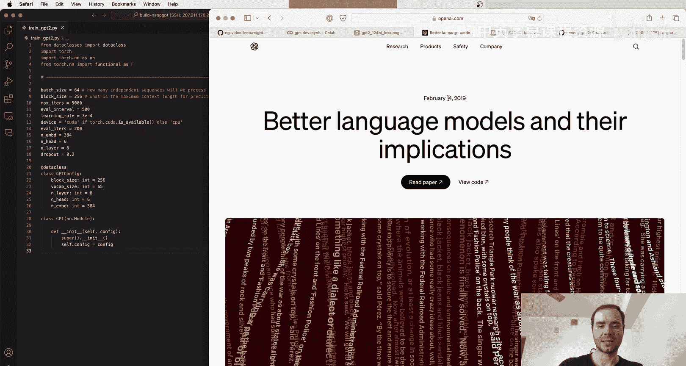

On top of that， they released this paper and on top of that they released this code on GitHub。

 so opening as/lash GT2。Now， when we talk about reproducing GPT2。

 we have to be careful because in particular in this video。

 we're going to be reproducing the 124 million parameter model。

So the thing to realize is that there's always a minise when these are releases are made。

 so there are the GPT2 miniseries made up of models at different sizes and usually the biggest model is called the GPT2。

But basically the reason we do that is because you can put the model sizes on the X axis of plots like this and on the Y axis you put a lot of downstream metrics that you're interested in like translation summarization。

 question answering and so on， and you can chart out these scaling loss so basically as the model size increases you're getting better and better at downstream metrics。

And so in particular， for GBT2。If we scroll down in the paper。

 there are four models in the GT2 minise starting at 124 million all the way up to 1558 million。 Now。

 the reason my numbers， the way I say them disagree with the table is that this table is wrong。

 if you actually go to the GP2 Gitthub repo， they sort of say that。

There was an error in how they added up the parameters。

 but basically this is the 124 million parameter model， etc。

 So the 124 million parameter had 12 layers in the transformer and it had 768 channels in the transformer 768 dimensions and I'm going to be assuming some familiarity with what these terms mean because I covered all of this in my previous video let's build GT2 let's build GT from scratch So I covered that in the previous video in this playlist。

Now， if we do everything correctly and everything works out well， by the end of this video。

 we're going to see something like this where we're looking at the validation loss， which basically。

Measures how good we are at predicting the next token in a sequence on some validation data that the model has not seen during training。

 And we see that we go from doing that task not very well because were initializing from scratch。

 all the way to doing that task quite well。 by the end of the training。 And hopefully。

 we're going to beat the G to 124 m model。 Now， previously， when they were working on this。

 this is already 5 years ago。 So this was probably a fairly complicated optimization at the time。

 And the GPus and the compute was a lot smaller today。

 you can reproduce this model in roughly an hour or probably less even。

 and it will cost you about 10 bucks。 if you want to do this on the cloud cloud compute。

 a sort of computer that you can all rent。 And if you paid $10 for that computer。

 you wait about an hour or less。 you can actually achieve a model that is as good as this model that opening I released。

And one more thing to mention is， unlike many other models。

 opening I did release the weights for GPT2， so those weights are all available in this repository。

But the G2 paper is not always as good with all of the details of the training。

 So in addition to the G2 paper， we're going to be referencing the GT3 paper。

 which is a lot more concrete in a lot of the height parameters and optimization settings and so on。

And it's not a huge departure in the architecture from the G2 version of the model。

 So we're going to be referencing both G2 and G3 as we try to reproduce G2 124M。 So let's go。

So the first thing I would like to do is actually start at the end or at the target so in other words。

 let's load the GP to 1204M model as it was released by OpenI and maybe take it for a spin。

 let's sample some tokens from it。Now， the issue with that is when you go to the codebase of GepT2 and you go into the source and you click in on the model that Pi。

 you'll realize that actually this is using Tensorflow。

So the original GPT2 code here was written in Tensorflowlow， which is。You know， not。

 let's just say not used as much anymore。 So we'd like to use Pytorch because it's a lot friendlier。

 easier。 And I just personally like it a lot more。 The problem with that is the initial code is intensorflow。

 We'd like to use Pytorch。 So instead to get the target。

 we're going to use the hugging face transformers。Code， which I like a lot more。

 So when you go into the transformers source transformers models， G2 modeling G2。 Pi。

You will see that they have the GT2 implementation of that transformer here in this file。嗯。And。

It's like medium readable but not fully readable， but what it does is it did all the work of converting all those weights from Tensorflow to Pytorrch friendly。

 and so it's much easier to load and work with。So in particular。

 we can look at the GPT2 model here and we can load it using hoging phase transformers。

 So swinging over， this is what the tile looks like。

From transformformers import the AGP2 LM head model。And then。From pre train G2。Now。

 one awkward thing about this is that when you do GT2 as the model that we're loading。

 this actually is the 124 million parameter model。If you want the actual the GT2， the 1。5 billion。

 then you actually want to do dash Excel。So this is the 124M， our target。

Now what we're doing is when we actually get this， we're initializing the Pytorch and N module as defined here in this class。

From it， I want to get just the state dit， which is just the raw tensors。

 so we just have the tensors of that file。And by the way here this is a Jupyter notebook。

 but this is Jupyter notebook running inside VS code。

 so I like to work with it all in a single sort of interface， so I like to use VS code。

 so this is the Jupyter notebook extension inside VS code。So when we get the state di。

 this is just a diict so we can print the key and the value。

 which is the tensor and let's just look at the shapes。So， these are sort of the。

Different parameters inside the GT2 model and their shape。 So the W weight for token embedding。嗯。

Is of size 50257 by 768， where this is coming from is that we have 50257 tokens in the GP2 vocabulary and the tokens。

 by the way， these are exactly the tokens that we've spoken about in the previous video on my tokenization series。

 So the previous videos just before this I go into a ton of detailed tokenization。

 GT2 tokenazizer happens to have this many tokens。For each token。

We have a 768 dimensional embedding that is the distributed representation that stands in for that token。

 So each token is a little string piece， and then the 768 numbers are the vector that represents that token。

And so this is just our lookup table for tokens。And then here we have the lookup table for the positions。

 So because GPT2 has a maximum sequence length of 1024。

 we have up to 1024 positions that each token can be attending to in the past。

And every one of those positions in GPT2 has a fixed vector of 768 that is learned by optimization。

And so this is the position embedding and the token embedding。

And then everything here is just the other weights and biases and everything else of this transformer。

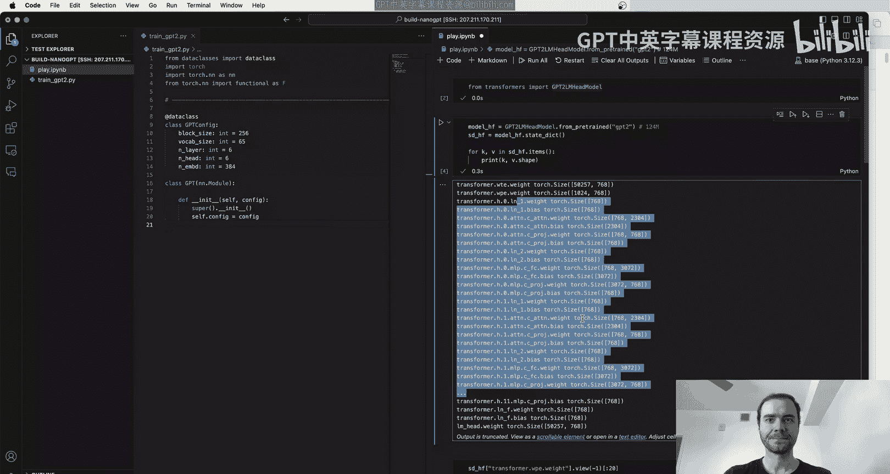

So when you just take， for example， the positional embeddings and flatten it out and take just to 20 elements。

 you can see that these are just the parameters。 these are weights， floats。Just。

We can take and we can plot them， so these are deposit position embeddings。

And we get something like this， and you can see that this has structure。And it has structure。

 because。What we have here really is every row in this visualization is a different position。

A fixed absolute position in the range from zero to 1024。

And each row here is the representation of that position。

And so it has structure because these positional embeddings end up learning these sinusoids and cosines that sort of like represent each of these positions。

 and each row here stands in for that position and is processed by the transformer to recover all the relative positions and sort of realize which token is where and attend to them depending on their position。

 not just their content。

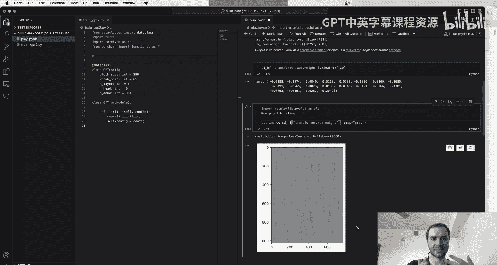

So when we actually just look into an individual column inside these。

 and I just grabbed three random columns。You'll see that， for example， here we are focusing on。

Every single channel。 And we're looking at。What that channel is doing as a function of position from one from 0 to 1023。

 really。And we can see that some of these channels basically like respond more or less to different parts of the position spectrum。

 so this green channel really likes to fire for everything after 200。Up to 800， but not less。

 but a lot less。 and has a sharp drop of here near 0。

 So who knows what these embeddings are doing and why they are the way they are。 You can tell。

 for example， that because they're a bit more jagged and theyre kind of noisy。

 you can tell that this model was not fully trained。

 And the more trained this model was the more you would expect to smooth this out。

 And so this is telling me that this is a little bit of an undertrained model。 But in principle。

 actually， these curves don't even have to be smooth。 This should just be totally random noise。

 And in fact， in the beginning of the optimization。

 it is complete random noise because this position embedding table is initialized completely at random。

 So in the beginning you of jaggedness。 And the fact that you end up with something smooth is already kind of impressive that that just falls out of the optimization because in principle。

 you shouldn't even be able to get any single graph out of this that makes sense。

 But we actually get something that looks a little bit noisy。 But for the most part。

 looks sinusoidal like。In the the original transformer paper， the attention is all you need paper。

 the positional embeddings are actually initialized and fixed Farmable correctly to sinusoids and cosines of different frequencies and that's the position encoding and it's fixed but in GPT2 these are just parameters and they're trained from scratch just like any other parameter and that seems to work about as well and so what they do is they kind of like recover these sinusoidal like features during the optimization。

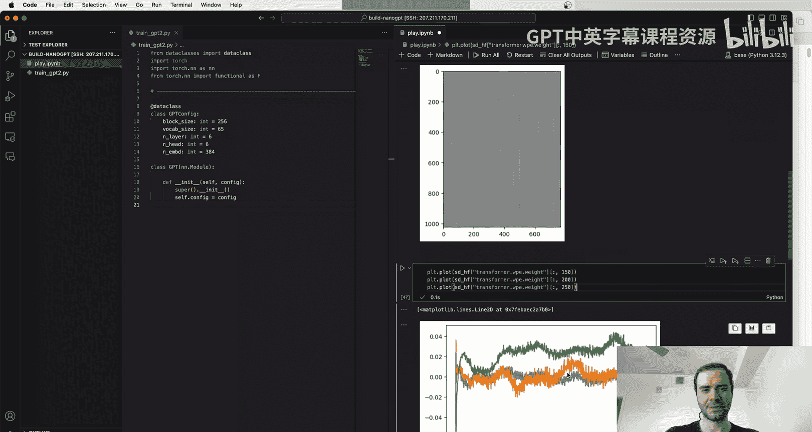

We can also look at any of the other matrices here。Here I took the first layer of the transformer。

And looking at like one of its weights and just the first block of 300 by 300。

 And you see some structure。 But like， again， like， who knows what any of this is。

 If you're into mechanistic interpreterability， you might get a real kick out of trying to figure out like。

 what is going on。 What is this structure。 And what does this all mean。

 But we're not going to be doing that in this video。

 But we definitely see that there's some interesting structure。 And that's kind of cool。

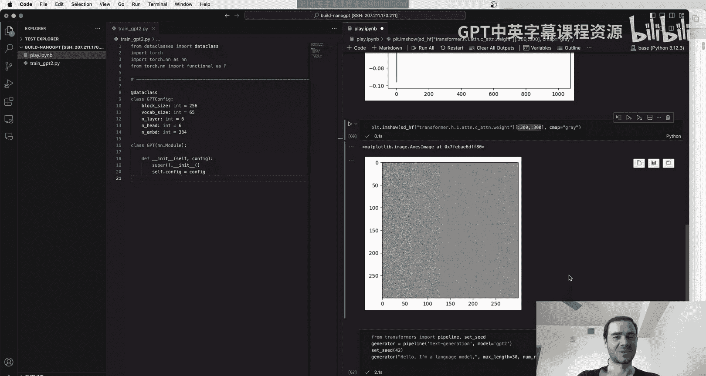

What were mostly interested in is we've loaded the weights of this model that was released by open AI。

 and now using the hugging face transformers， we cannot just get all the raw weights。

 but we can also get the what they call pipeline and sample from it。 So this is the prefix。

 Hello I'm a language model comma。 And then we're sampling 30 tokens。

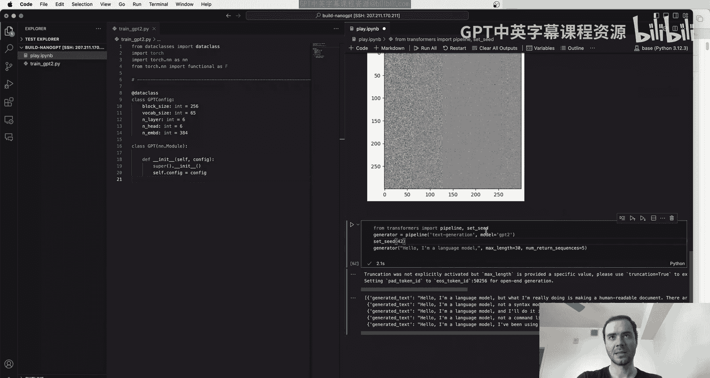

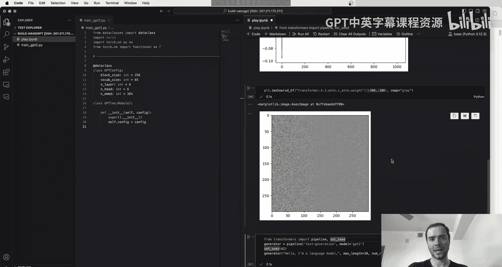

And we're getting five sequences。 and I ran this， and this is what it produced Hill on language model。

But what I'm really doing is making a human readable document。 There are other languages。

 but those are ta ta tat， so you can read through these if you like。

 but basically these are five different completions of the same prefix from this G2124M。

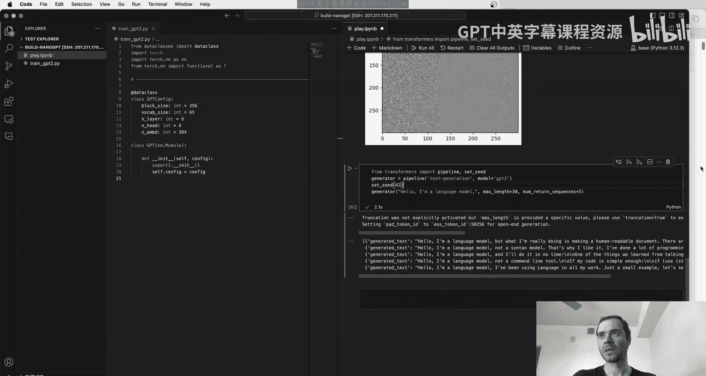

Now， if I go here， I took this example from here。And sadly， even though we are fixing the seed。

 we are getting different generations from the snippet than what they got。

 So presumably the code changed。

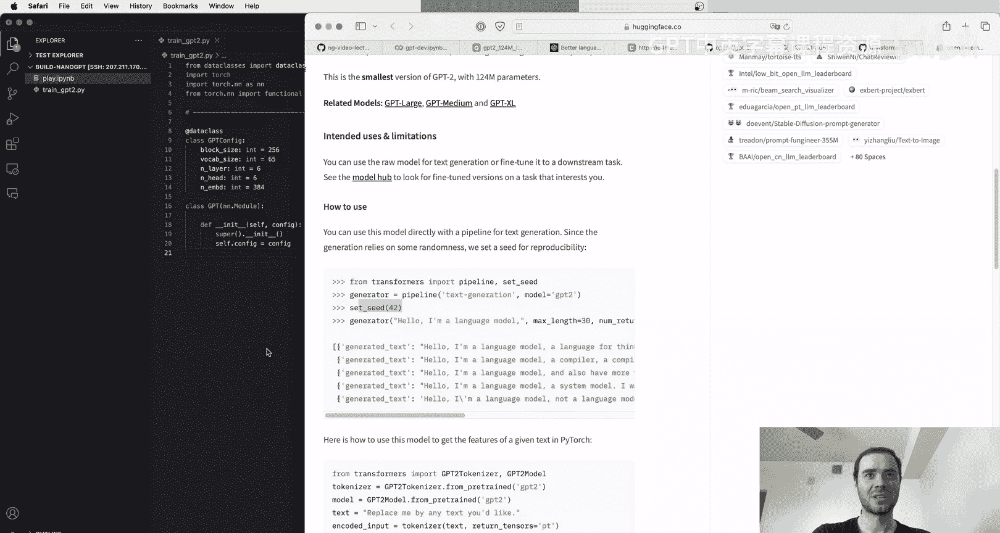

But。What we see， though， at this stage that's important is that we are getting coherent text。

 So we've loaded the model successfully。 We can look at all its parameters and the keys tell us where in the model these come from。

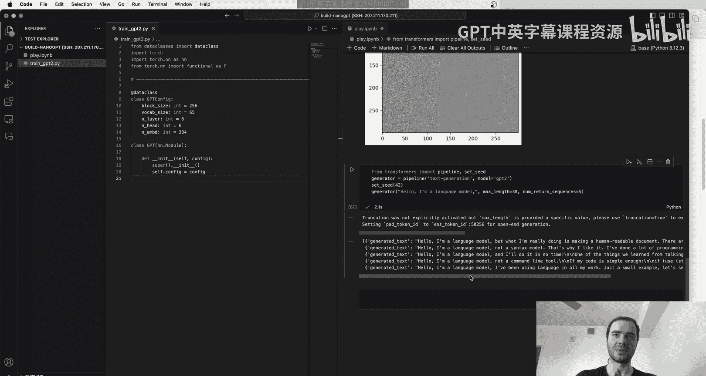

And we want to actually write our own GP2 class so that we have full understanding of what's happening there。

 We don't want to be working with something like the modeling G2 Pi because it's just too complicated。

 we want to write this from scratch ourselves。 So we're going to be implementing the GP model here in parallel and as our first task let's load the GP2 on 24M into the class that we are going to develop here from scratch。

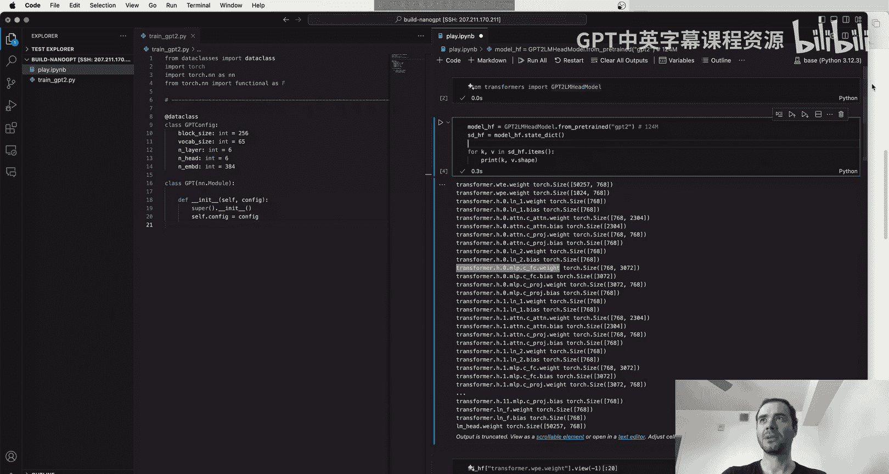

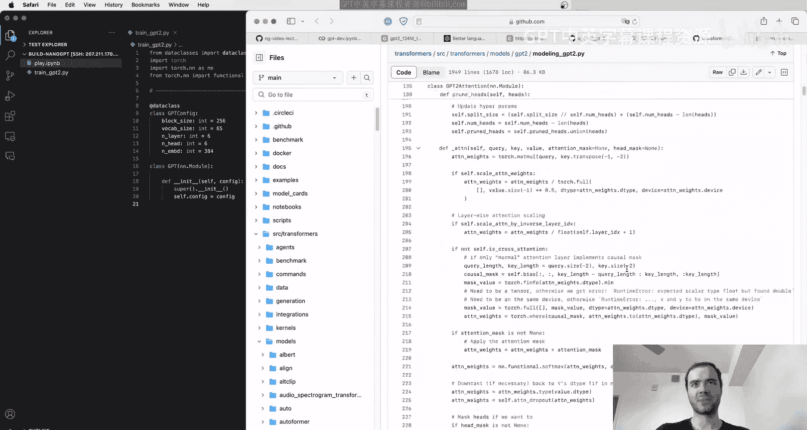

That's going to give us confidence that we can load the open eye model。 And therefore。

 there's a setting of weights that exactly is the 124 model。 But then， of course。

 what we're going to do is we're going to initialize the model from scratch instead and to try to train it ourselves on a bunch of documents that we're going to get。

And we're going to try to surpass that model。 So we're going to get different weights and everything's going to look different。

 hopefully better even， but we're going to have a lot of confidence that because we can load the open eye model。

 we are in the same model family and model class and we just have to rediscover a good setting of the weights。

 but from scratch。

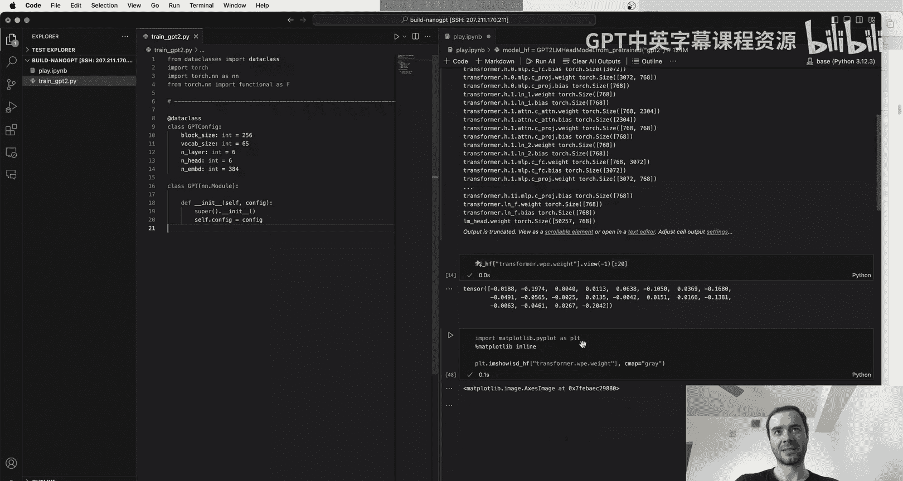

So let's now write the GT2 model and let's look the weights and make sure that we can also generate text that looks coherent。

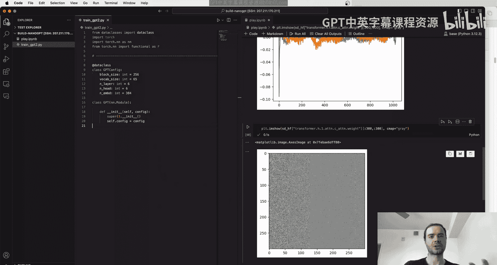

Okay， so let's now swing over to the attention is all you need paper that started everything。

 and let's scroll over to the model architecture， the original transformer。Now。

 remember that G2 is slightly modified from the original transformer。 in particular。

 we do not have the encoder。 GT2 is a decoder only transformer， as we call it。

 So this entire encoder here is missing。 in addition to that。

 this cross attention here that was using that encoder is also missing。

 So we delete this entire part。Everything else stays almost the same。

 but there are some differences that we're going to sort of look at here。

So there are two main differences。When we go to the G2 paper under 2。3 model。We notice that first。

 theres a reshuffling of the layer norms。 So they change place。 And second。

 an additional layer normalization was added here to the。Final self attention block。

 So basically hold the layer norms here， instead of being after the MLP or after the attention。

 they swing before it， and an additional layer norm gets added here right before the final classifier。

So now let's implement some of the first sort of skeleton and N modules。

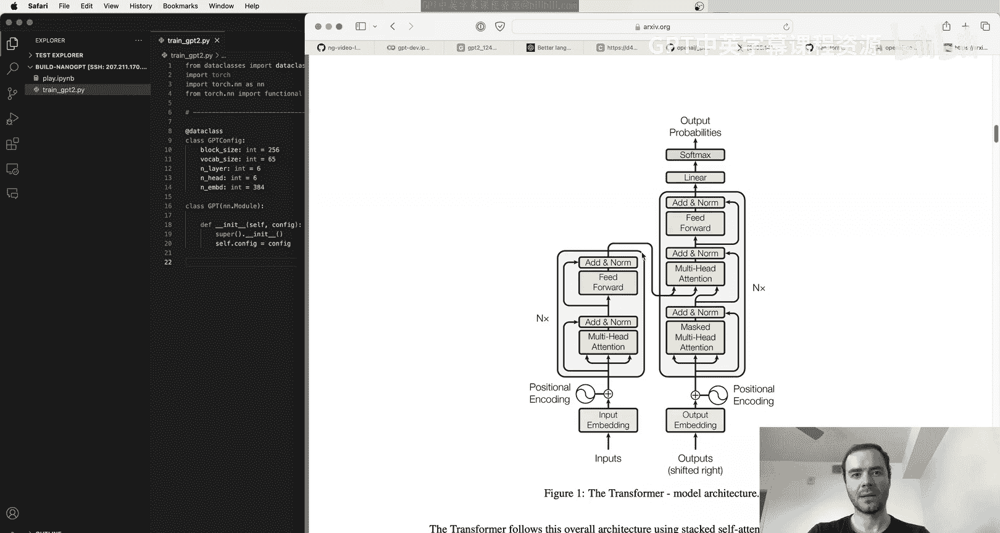

Here in our GPT and N module， and in particular we're going to try to match up this schema here that is used by hugging face transformers because that will make it much easier to load these weights from this state d。

So we want something that reflects this schema here。So here's where I came up with。Basically。

 we see that the main container here that has all the modules is called transformformer。

 So I'm reflecting that with an NN module diict。 and this is basically a module that allows you to index into the sub modules using keys just like a dictionary strings。

Within it， we have the weights of the token embeddings， WTE， and that's an an embedding。

And the weights of the position embedding， which is also just an N embedding。 And if you remember。

 N then embedding is really just a fancy little wrappper module around just a single。

Single array of numbers， a single block of numbers just like this， it's a single tensor。

And an embedding is a glorified wrapper around a tensor that allows you to access its elements by indexing into the rows。

Now， in addition to that， we see here that we have a dot H and then theres a this is indexed using numbers instead of indexed using strings。

 so there's a dot H dot0，12， etc cetera， all the way up till dot H dot 11。

 And that's because there are 12 layers here in this transformer。

 So to reflect that I'm creating also an H I think that probably stands hidden。

And instead of a module diict， this is a model list so we can index it using integers exactly as we see here。

 do0， do12， etc。And the module list has n layer blocks。

 and the blocks are yet to be defined in a module in a bit。In addition to that。

 following the G2 paper， we， we need an additional final layer norm that we're going to put in there。

 and then we have the final classifier， the language model head， which。Project from 768。

 the number of embedding dimensions in this GT， all the way to the vCab size， which is50，257。

 and GT2 uses no bias for this final sort of projection。

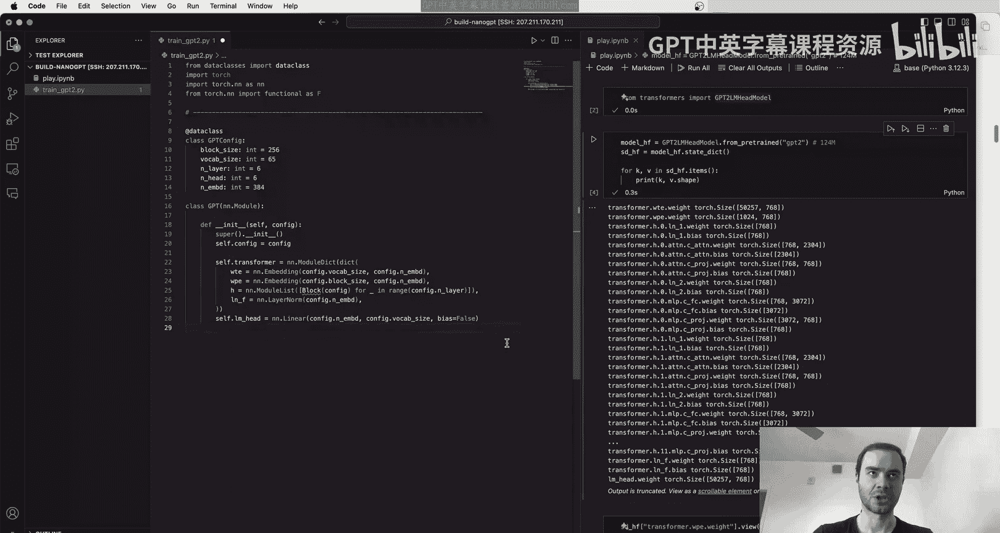

So this is the skeleton and you can see that it reflects this。

 so the WTE is the token embeddings here it's called output embedding。

 but it's really the token embeddings。The PE is the positionalcoings。Those two pieces of information。

 as we saw previously are going to add and then go into the transformer。

The dot H is the older blocks in gray， and the L And F is this new layer that gets added here by the G2 model。

And Elm Head is this linear part here。

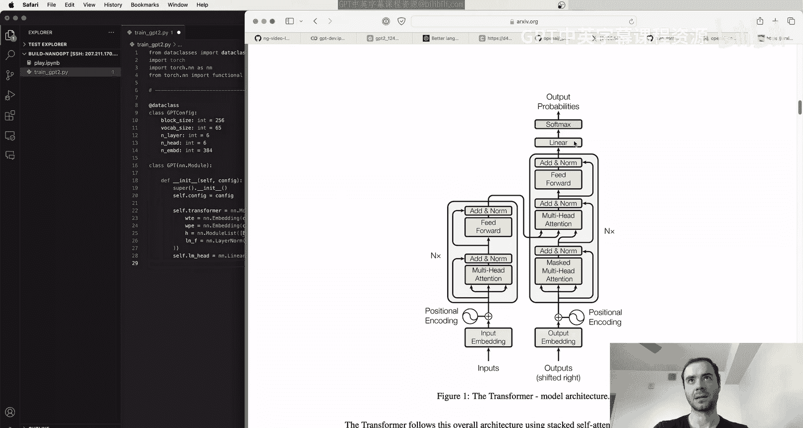

So that's the skeleton of the GPT2。 We now have to implement the block。

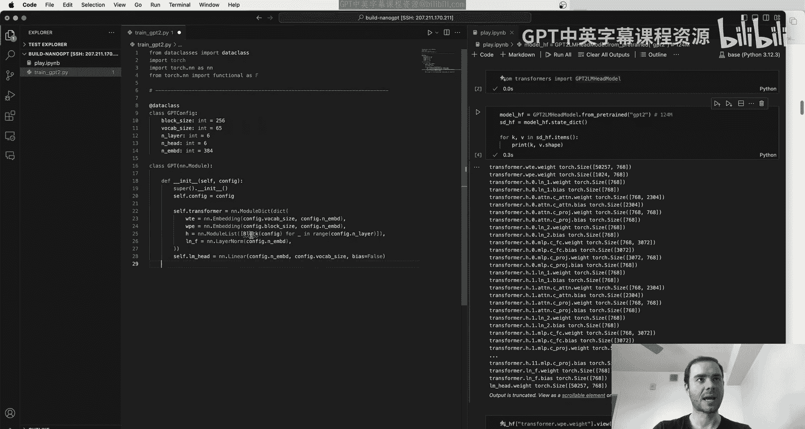

Okay， so let's now recurse to the block itself， so we want to define the block。

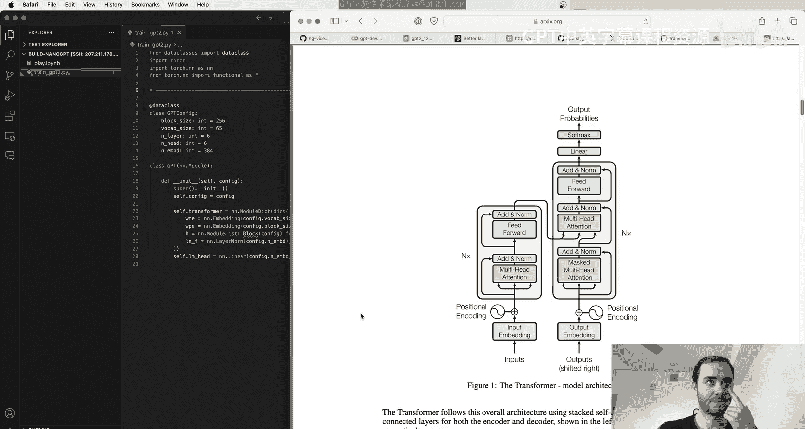

So I'll start putting them here， so the block。I like to write it out like this。

These are some of the initializations and then this is the actual forward path of what this block computes。

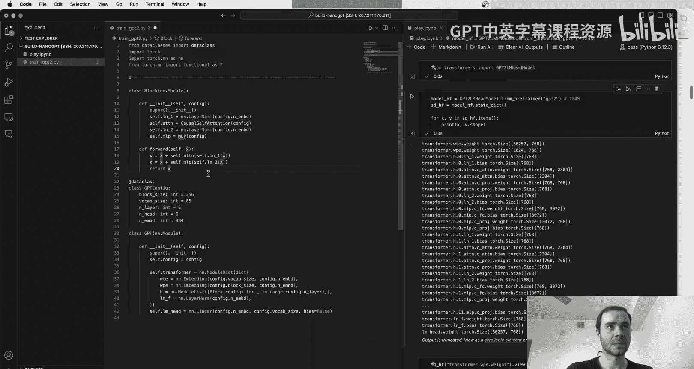

And notice here that there's a change from the transformer again that is mentioned in the GPT2 paper。

So here the layer normalizations are after the application of attention or feet forward。

 in addition to that note that the normalizations are inside the residual stream。

 you see how feet forward is applied and this arrow goes through and through the normalization。

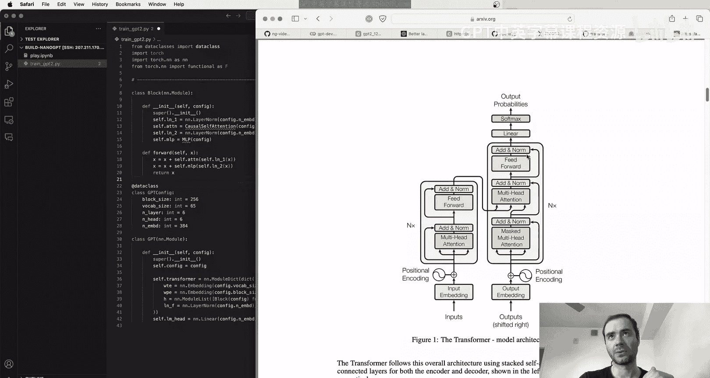

So that means that your residual pathway has normalizations inside them。

 and this is not very good or desirable， you actually prefer to have a single clean residual stream all the way from supervision。

 all the way down to the inputs， the tokens。And this is very desirable and nice。

 because the gradients that flow from the top。 If you remember， from your micrograd。

 addition just distributes gradients youre in the backward stage to both of its branches equally。

 So addition is a branch in the gradients。 And so that means that the gradients from the top flows straight to the inputs。

 The tokens。Through the residual pathways unchanged， but then in addition to that。

 the gradient also floats through the blocks and the blocks contribute their own contribution over time and kick in and change the optimization over time。

But basically， clean residual pathway is desirable from an optimization perspective。And then。

This is a pre normalormalization version where you see that R X first goes through the layer normalization and then the attention and then goes back out to go to the layer normalization number two and the multilia perceptron sometimes also referred to as a feed forward network or an FFN。

And then that goes into the residual stream again。And the one more thing that is kind of interesting to note is that recall that attention is a communication operation。

 It is where all the tokens and there's 1024 tokens lined up in a sequence。

 And this is where the tokens communicate。 This is where they exchange information。

 So attention is a aggregation function。 It's a pooling function。 It's a weighted sum function。

 It is a reduce operation。 whereas MLP， this MLP here happens at every single token individually。

 There's no information being collected or exchanged between the tokens。

So the attention is the reduce and the MLP is the map。

 and what you end up with is that the transformance just ends up just being a repeated application of map produce。

 if you want to think about it that way。 So this is where they communicate and this is where they think individually about the information that they gathered。

 and every one of these blocks， it refines the representation is set to a usual stream。

So this is our block， slightly modified from this picture。Okay， so let's not move on to the M LP。

So the MLP block I implemented as follows， it is relatively straightforward。

 we basically have two linear projections here that are sandwiched in between the Galu No nonlinearity。

So N and dot galu approximate is 108。

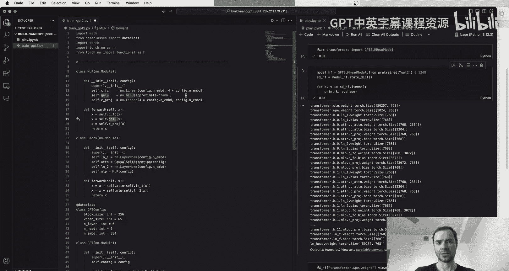

Now when we swing over to the Py documentation， this is in that Galu and it has this format。

 and it has two versions， the original version of Galu， which we'll step into in a bit。

 and the approximate version of Galu， which we can request using10H。

So as you can see just as a preview here， Geu is a basically like a reello， except there's no flat。

 exactly flat tail here at exactly zero。But otherwise it looked very much like a slightly smoother re。

It comes from this paper here， Gasian or linear units。

 and you can step through this paper and there's some mathematical canalic reasoning that leads to an interpretation that leads to the specific formulation it has to do with stochastic regularializers and the expectation of a modification to adapt to drop out so you can read through all of that if you'd like here。

And there's a little bit of the history as to why there is an approximate version of Galu and that comes from this issue here。

 as far as I can tell。And in this issue， Daniel Hendrix mentions that at the time when they developed this nonlinear nonlinearity。

 the Earth function， which you need to evaluate the exact Galu was very slow in tensor flows so they ended up basically developing this approximation and this approximation that then ended up being picked up by Bt and by GPT2 etc。

 but today there's no real good reason to use the approximation version you'd prefer to just use the exact version because my expectation is that there's no big difference anymore and this is kind of like a historical kind of quirk but we are trying to reproduce GPT2 exactly and GPT2 used the 10h approximate version so we prefer to stick with that。

Now， one other reason to actually just intuitively use Gelu instead of Verlu is previously in in videos in the past。

 we've spoken about the dead Relu neuron problem， where in this tale of a relu。

 if it's exactly flat at 0， Any activations that fall there will get exactly zero gradient。

 There's no change， there's no adaptation， there's no development of the network。

 If any of these activations and in this flat region。

But the gallo always contributes a local gradient。 And so there's always going to be a change。

 always going to be an adaptation and sort of smoothing it out。

 ends up empirically working better in practice， as demonstrated in this paper。

 and also as demonstrated by it being picked up by the B paper GP2 paper and so on。

 So for that reason， we adopt this non nonlinearity here in in the GPT2 reproduction。

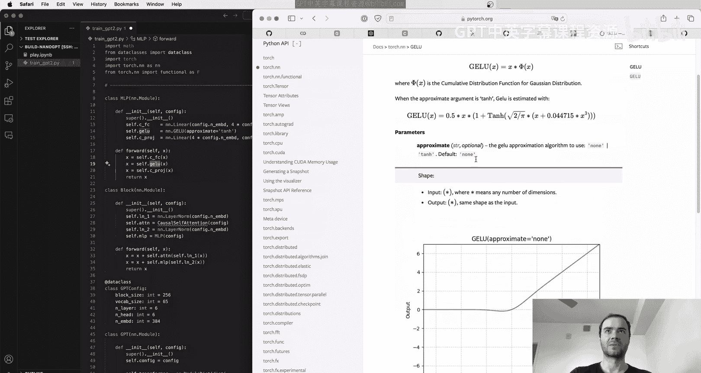

Now in more modern networks， also like Lama 3 and so on。

 this nonlineararity also further changes to sig glue and other variants like that。

 but for GT2 they used this approximate Gaup。Okay， and finally， we have the attention operation。

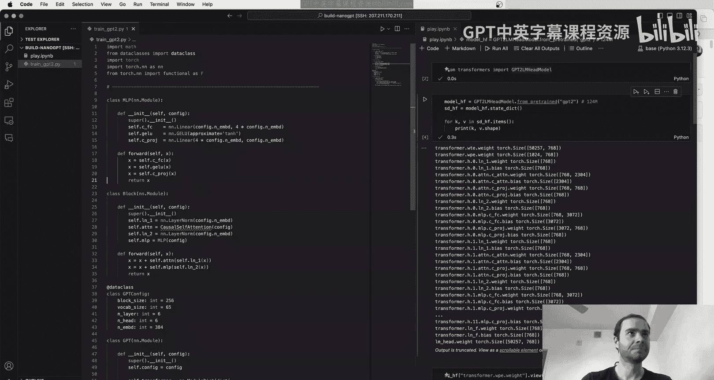

So let me paste in my attention。So I know this is a lot。

 so I'm going to go through this a bit quickly， a bit slowly。

 but not too slowly because we have covered this in the previous video and I would just point you there。

So this is the attention operation Now in the previous video you will remember this is not just attention。

 this is multi headed attention， right？And so in the previous video。

 we had this multi headeded attention module， and this implementation made it obvious that these heads are not actually that complicated。

 There's basically in parallel inside every attention block。 There's multiple heads。

 and they're all functioning in parallel。And their outputs are just being concatenated。

 and that becomes the output of the multiheaded attention。

So the heads are just kind of like parallel streams， and their outputs get concateated。

And so it was very simple and made the head be kind of like fairly straightforward in terms of its implementation。

What happens here is that instead of having two separate modules and indeed many more modules that get concatenated。

 all of that is just put into a single self-attention module。

 and instead I'm being very careful in doing a bunch of transpose split tensor gymnastics to make this very efficient in ptorch。

 but fundamentally in algorithmically nothing is different from the implementation we saw before。

In this Gi repository。So。To remind you very briefly。

 and I don't want to go into this into this in too many in too much time。

 but we have these tokens lined up in a sequence and there's 1020 of them。

And then each token at this stage of the attention emits three vectors， the query， key and the value。

And first what happens here is that the queries and the keys have to multiply each other to get sort of the attention amount。

 like how interesting they find each other， so they have to interact multiplicatively。

So we're doing here as we're calculating the Q KV， we'll splitting it。

 and then there's a bunch of gymnastics， as I mentioned here。

 and the way this works is that we're basically making the number of heads and H into a batch dimension。

And so it's a batch dimension just like B。 so that in these operations that follow。

 Pytorch treats B and N H as batches， and it applies all the operations on all them in parallel in both the batch and the heads。

And the operations that can applied are number one。

 the queries and the keys interact to give us her attention。

This is the utter aggressive mask that makes sure that the tokens only attend to tokens before them and never to tokens in the future。

The softmax here normalizes the attention， so it sums to one always。

And then recall from the previous video that doing the attention matrix multiplied with the values is basically a way to do a weighted sum of the values of the tokens that we found interesting at every single token。

And then the final transpose contiguous and view is just reassembling all of that again。

 and this actually performs a concatenation operation。

So you can step through this slowly if you'd like， but it is equivalent mathematically to our previous implementation it's just more efficient in Pytorrch。

 so that's why I chose this implementation instead。Now， in addition to that。

 I'm being careful with how I name my variables。 So， for example， Catin is the same as Catin。

 and so actually our keys should basically exactly follow the schema of the hug face transformers code and that will make it very easy for us to now port over all the weights from exactly this as sort of naming conventions。

 because all our variables are named the same thing。But at this point。

 we have finished the DGPT2 implementation。And what that allows us to do is we don't have to basically use this file from Agingface。

 which is fairly long。

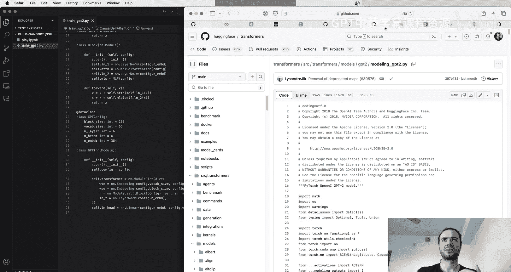

This is。2000 lines of code。 Instead we just have less than 100 lines of code and this is the complete GP to implementationation。

 So at this stage we should just be able to take over all the weights。

 set them and then do generation so let's see what that looks like Okay so here I've also changed the G config so that the numbers here the parameters agree with the G 2124 m model。

 So the maximum sequence length， which I call block size here is 124。

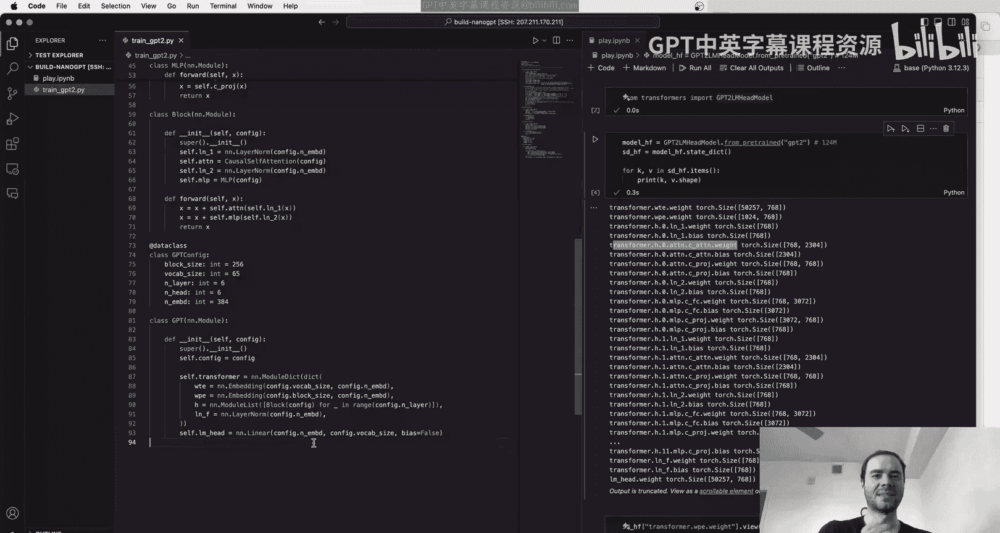

The number of tokens is 5250257， which if you watch my tokenizer video， know that this is 50。

000 merges， BPp merges。256 byte tokens， the leaves of the BE tree。

 and one special end of text token that delimits different documents and can start generation as well。

And there are 12 layers， there are 12 hits in the attention。

 and the dimension of the transformers was 768。So here's how we can now load the parameters from Huging face to our code here and initialize the GP class with those parameters。

 so let me just copy paste a bunch of code here。

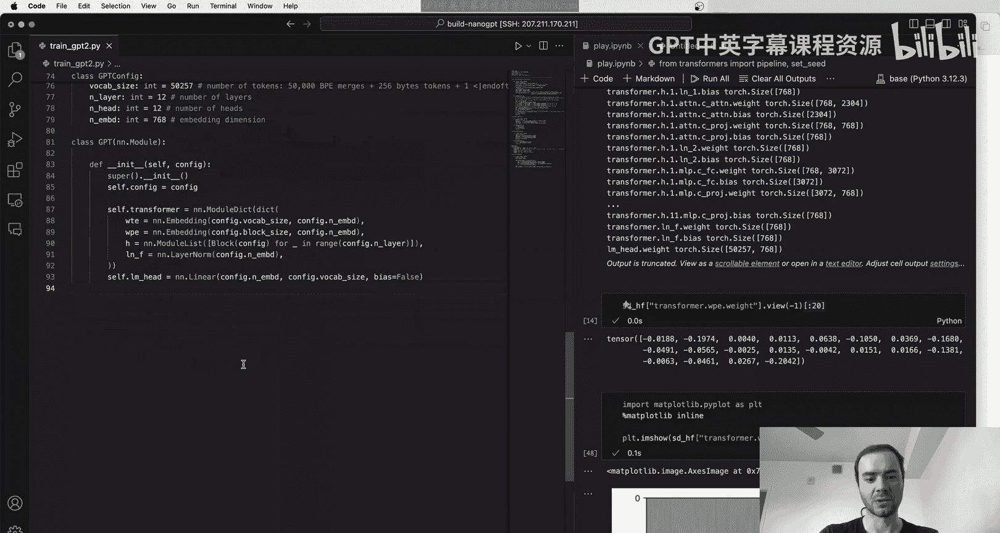

And I'm not going to go through this code too， too quickly， too slowly。Because。Honestly。

 it's not that interesting。 It's not that exciting。 We're just loading the weights。

 So it's kind of dry。 But as I mentioned， there are four models in this miniseries of G2。

 This is some of the Jupyter code code that we had here on the right。 I'm just porting it over。

 These are the hyper parameters of the G2 models。We're creating the config object and creating our own model。

 and then what's happening here is we're creating the state diict。

 both for our model and for the Huging F model。And then what we're doing here is we're going over to hugging face model keys。

 and we're copying over those tensors。And in the process。

 we are kind of ignoring a few of the buffers， they're not parameters， they're buffers。

 so for example， attention to bias， that's just used for the auto aggressive mask。

And so we are ignoring some of those masks and that's it。

 And then one additional kind of annoyance is that this comes from the Tensorflow repo and I'm not sure how this is a little bit annoying but some of the weights are transposed from what Pytorch would want。

 and so manually I hard coded the weights that should be transposed and then we transpose them if that is so。

And then we return this model。So the firm pretrained is a constructor。

Or a class method in Python that returns the G object。 If we just give it the model type。

 which in our case is G2， the smallest model that we're interested in。

So this is the code and this is how you would use it， and we can pop open the terminal here。

In V code， and we can Python train G2 that pi。And。Tingers crossed。

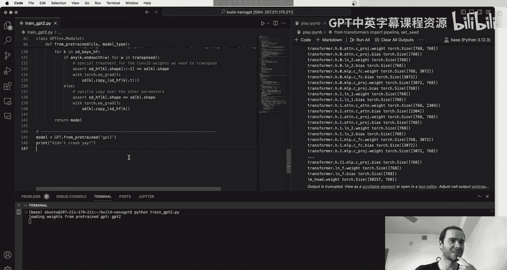

Okay， so we didn't crash。 And so we can load the weights and the biases and everything else into our N N module。

 But now let's also get additional confidence that this is working。

 And let's try to actually generate from this model。 Okay。

 now before we can actually generate from this model， we have to be able to forward it。

 we didn't actually write that code yet。 So here's the forward function。

So the input to the forward is going to be our indices， our tokens token indices。

 and they are always of shape B by T and so we have batch dimension of B。

 and then we have the time dimension of up to t。And the T can't be more than the block size。

 The block size is a maximum sequence length。So B by T in theice arranged as sort of like a two dimensional layout and remember that basically every single row of this is of size up to block size。

 and this is T tokens that are in a sequence， and then we have B independent sequences stacked up in a batch so that this is efficient。

Now here we are forwarding the position embeddings and the token embeddings and this code should be very recognizable from the previous lecture。

 so we basically use a range which is kind of like a version of range。

 but for pytorrch and we're iterating from0 to t and creating this positions sort of indices。

And then we are making sure that they're on the same device as IDX because we're not going to be training on only CPU that's going to be too inefficient。

 We want to be training on GPU and that's going to come in a bit。

Then we have the position embeddings and token embeddings and the addition operation of those two。

 Now， notice that the position embeddings are going to be identical for every single row of input。

 And so there's broadcasting hidden inside this plus where we have to create an additional dimension here。

 and then these two add up because the same position embeddings apply at every single row of our example stacked up in a batch。

Then we forward the transformer blocks and finally their last layer norm and the LMad。

So what comes out after forward is thelogs。And if the input was B by T indices。

 then at every single B by T， we will calculate the logits for what token comes next in the sequence。

 So what is the token B T plus1， the one on the right of this token and vab size here is the number of possible tokens。

 And so therefore， this is the tensor that we're going to obtain。

 And these logits are just a softm away from becoming probabilities。

So this is the forward pass of the network and now we can get logits and so we're going to be able to generate from the model imminently。

Okay， so now we're going to try to set up the identical thing on the left here that matches Huging face on the right。

 so here we've sampled from the pipeline and we sampled five times up to 30 tokens with a prefix of Ho Emma language model and these are the completions that we achieved。

So we're going to try to replicate that on the left here。

So number term sequence is 5 max length is 30。 So the first thing we do， of course。

 is we initialize our model。Then we put it into evaluation mode。 Now。

 this is a good practice to put the model into Eval when you're not going to be training it you're just going to be using it。

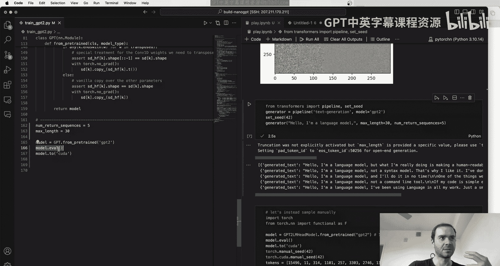

And。I don't actually know if this is doing anything right now for the following reason。

 our model up above here contains no modules all layers that actually have a different behavior at training or evaluation time。

 So for example， dropout， batchche norm and much of other layers have this kind of behavior。

 but all of these layers that we've used here should be identical in both training and evaluation time。

嗯。So potentially model that Eval does nothing， but then I'm not actually sure if this is the case and maybe Pytorch internals do some clever things depending on the evaluation mode inside here。

The next thing we're doing here is we are moving the entire model to KUa。

 so we're moving this all of the tensors to GPU， so I'm SSd here to a cloud box and I have a bunch of GPUs on this box and here I'm moving the entire model and all of its members and all of its tensors and everything like that。

Everything gets shipped off to basically a whole separate computer that is sitting on the GPU。

 and the GPU is connected to the CPU and they can communicate。

 but it's basically a whole separate computer with its own computer architecture。

 and it's really well catered to parallel processing tasks like those of running neural networks。

So I'm doing this so that the model lift on the GPU， a whole separate computer。

 and it's just going to make our code a lot more efficient because all of this stuff runs a lot more efficiently on the GPUs。

So。That's the model itself。Now， the next thing we want to do is we want to start with this as the prefix when we do the generation。

So let's actually create those prefixed tokens。So here's the code that I've written。

 We're going to import T token library from Open AI， and we're going to get the GPT2 encoding。

 so that's the tokenizer for GPT2。And then we're going to encode this string and get a list of integers。

 which are the tokens。Now these integers here should actually be fairly straightforward because we can just copy paste this string and we can sort of inspect what it is in Tiktokenizer。

 so just pastcing that in， these are the tokens that are going to come out。

So this list of integers is what we expect tokens to become。 And as you recall， if you saw my video。

 of course， all the tokens， they're just little string chunks right。

 so these are this is the chunkncation of this string into GP2 tokens。

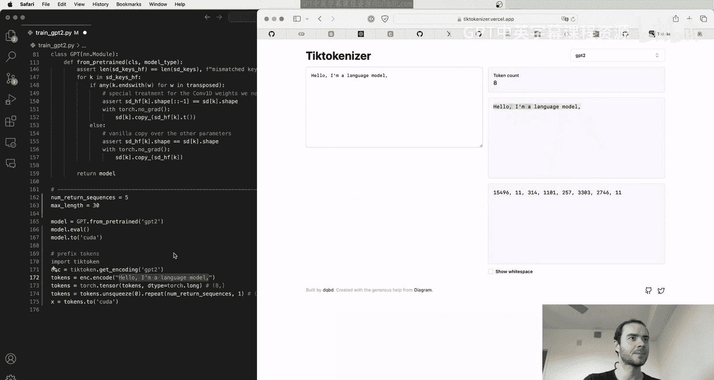

So once we have those tokens， it's a list of integers， we can create a torch tensor out of it。

 in this case it's eight tokens， and then we're going to replicate these eight tokens for five times to get five rows of eight tokens。

And that is our initial input X， as I call it here， and it lives on the GPU as well。

 So X now is this I X that we can penitive forward to get our logits so that we know what comes as the sixth token。

Sorry， as the ninth token。In every one of these five rows。Okay， and we are not ready to generate。

 so let me paste in one more code block here。

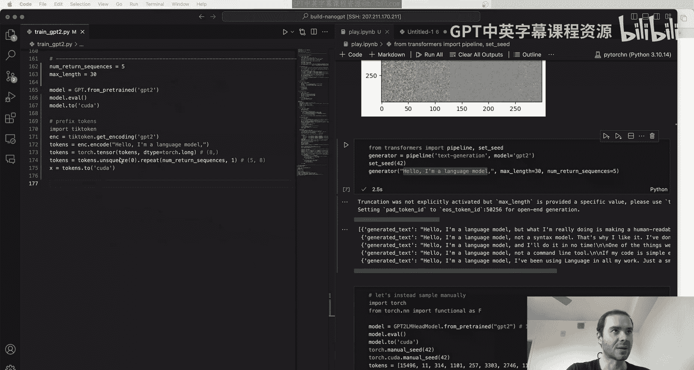

So what's happening here in this called block is we have this x。

 which is of size b by t right so batch by time and we're going to be in every iteration of this loop。

 we're going to be adding a column of new indices into each one of these rows right and so these are the new indices and we're appending them to the sequence as we're sampling So with each loop iteration we get one more column into x。

And all of the operations happening in the context manager of Torrst Nograd。

 this is just telling PyTtorch that we're not going to be calling that backward on any of this。

 so it doesn't have to cache all the intermediate tensors。

 it's not going to have to prepare in any way for a potential backward later and this saves a lot of space and also possibly sometime。

So we get our logits， we get the logits at only the last location。

 we throw away all the other logits， we don't need them， we only care about the last columnslogits。

So this is being wasteful， but this is just kind of like an inefficient implementation of sampling。

So it's correct， but it inefficient。So we get the last column of logitts pass it through soft mass together probabilities。

 Then here I'm doing top K sampling of 50， and I'm doing that because this is the hugging face default。

 So just looking at the hugging faced dogs here of a pipeline。 there's a bunch of。

Quirrks that go into hugging face and。I mean， it's kind of a lot， honestly， but。

I guess the important one that I notice is that they're using top K by default。

 which is 50 and what that does is that。So that's being used here as well。

 and what that does is basically we want to take our probabilities and we only want to keep the top 50 probabilities and anything that is lower than the 50th probability。

 we just clamp to zero and renormalize。And so that way， we are never sampling very rare tokens。

 The tokens we're going to be sampling are always in the top 50 of most likely tokens。

 And this helps keep the model kind of on track and it doesn't blabber on and it doesn't get lost and doesn't go off the rails as easily。

 and kind of like sticks in the vicinity of likely tokens a lot better。

 So this is the way to do it in Pytorch。 and you can step through it if you like。

 I don't think it's super insightful。 So I'll speed through it。 But roughly speaking。

 we get this new column of tokens。 We append them on X。

 And basically the columns of x grow until this Y loop gets tricked up。And then finally。

 we have an entire x of size。5 by 30 in this case， in this example。

 and we can just basically print all those individual rows。 So I'm getting all the rows。

 I'm getting all the tokens that were sampled， and I'm using the decode function from T tokenizer to get back the string。

 which we can print。And so terminal near terminal。And let me Python train G 2。Okay。

So these are the generations that we're getting， hello， I'm a language model， not a program。New line。

 your line。Hello， I'm a language model and one of the main things that bothers me when they create languages is how easy it becomes to create something that。

I mean so this will just like bla around right in all these cases now one thing you will notice is that these generations are not the generations of hugging face here。

And I can't find the discrepancy to be honest and I didn't fully go through all these options。

 but probably there's something else hiding on addition to the top B， so I'm not able to match it up。

 but just for correctness down here below in the Jupyter notebook and using the hugging face model。

So this is the hugging face model here。I I replicated the code， and if I do this and I run that。

Then I am getting the same results。So basically the model internals are not wrong。

 it's just I'm not 100% sure what the pipeline does in Hugingface。

 and that's why we're not able to mesh them up， but otherwise the code is correct and we've loaded all the tensors correctly。

 so we're neutralizing the model correctly and everything here works。So long story short。

 we've ported all the weights。 We initialize the GPT2。 This is the exact opening of GPT2。

 and it can generate sequences and they look sensible。And now here， of course。

 we are initializing with GPT2 model weights， but now we want to initialize from scratch from random numbers。

 and we want to actually train a model that will give us sequences as good as or better than these ones。

In quality。 And so that's what we turn to next。 So it turns out that using the random model is actually fairly straightforward because Pytorch already initializes our model randomly and by default。

 So when we create。The GP model in the constructor this is all all of these layers and modules have random initializers that are there by default。

 so when these linear layers get created and so on there's default constructors。

 for example using the Ja initialization that we saw in the past to construct the weights of these layers and so creating a random model instead of a GPT2 model is actually fairly straightforward and we would just come here。

And instead， we would create model equals G， and then we want to use the default config， G config。

And the default config uses the 124 m parameters。 So this is the random model initialization。

 and we can run it。And we should be able to get。Results now the results here， of course。

 are total garbage car and that's because it's random model and so we're just getting all these random token string pieces chunked up totally at random。

 so that's what we have right now。Now one more thing I wanted to point out by the way is in case you do not have Kuda available because you don't have a GPU。

 you can still follow along with with what we're doing here to some extent and probably not to the very end because by the end we're gonna to be using multiple GPUs and actually doing a serious training run。

 but for now you can actually follow along decently So one thing that I like to do in Pytorch is I like to auto detect the device that is available to you So in particular you could do that like this。

So here we are trying to detect the device to run on that has the highest compute capability。

 You can think about it that way。 So by default， we start with CPU。

 which of course is available everywhere because every single computer will have a CPU but then we can try to detect do you have a GPU if so use a kuda and then if you don't have a kuda do you at least have MP MP is the backend for Apple Sil so if you have a MacBook that is fairly new。

 you probably have Apple silicon on the inside and then that has a GP that is actually fairly capable depending on which MacBook you have and so you can use MP which will be potentially faster than CPU。

And so we can print the device here。 Now， once we have the device。

 we can actually use it in place of Puda。So we just swap it in。And notice that here。

 when we call model on X， if this x here is on CPU instead of GPU。

 then it will work fine because here in the forward， which is where Pytroch will come。

When we created PWS， we are careful to use the device of IDX to create this tensor as well。

 and so there won't be any mismatch where one tensor is on CPU is on GPU and that you can't combine those。

 but here we are carefully initializing on the correct device as indicated by the input to this model。

So this will auto detect device for me。 this will be， of course， GPU。So using device Kuda。

But you can also run with， as I mentioned， another device， and it's not going to be too much slower。

 so if I override device here oops。If I override device equals CPU。Then。

We'll solve print kuda of course， but now we're actually using CPU，1，2，3。four。5。Six， okay。

 about six seconds。And actually we're not using torch compile and stuff like that。

 which will speed up everything a lot faster as well， but you can follow along even on a CPU。

 I think to a decent extent。So that's note on that Okay so I do want to loop around eventually into what it means to have different devices in Pytorrch and what it is exactly that Pytorch does in the background for you when you do something like module dot2 device or where you take a torch tensor and do a dot2 device and what exactly happens and how that works but for now I'd like to get to training and I'd like to start training the model and for now let's just say the device makes code go fast and let's go into how we can actually train the model。

So to train the model we're going to need some data and for me。

 the best debugging simplest data set that I like to use is the tiny Shakespeare dataset and it's available at this URL so you can w get it or you can just search tiny Shakespeare dataset。

And so I have in my file system as just Ls input dot TxD， so I already downloaded it。

And here I'm reading the data set， getting the first 1000 characters， and printinging the first 100。

Now remember that GPT2 has roughly a compression ratio。

 the tokenizer has a compression ratio of block 3 to1。

 so 1000 characters is roughly 300 tokens here that will come out of this in the slice that we're currently getting。

So this is the first few characters。And if you want to get a few more statistics on this。

 we can do work count on input。txc。So we can see that this is 40，000 lines， about 200。

000 words in this data， and about 1 million bytes in this file。

 and knowing that this file is only ASI characters， there's no crazy uncode here as far as I know。

 and so every ASI characters is encoded with one byte and so this is the same number roughly a million characters inside this dataset。

So that's the data size by default， very small and minimal data set for debugging。

To get us off the ground， in order to token as this data。

 we're going to get Tk token encoding for GBT2， encode the data， the first 1000 characters。

 and then I'm only going to print the first 24 tokens。So these are the tokens as a list of integers。

And if you can read GT2 tokens， you will see that 198 here。

 you'll recognize that as the slashing character， so that is a new line。

 and then here for example we have two new lines so that's 198 twice here。

So this is just a tokenization of the first 24 tokens。

So what we want to do now is we want to actually process these token sequences and feed them into a transformer。

And in particular， we want them， we want to rearrange these tokens into this IDx variable that we're going to be feeding into the transformer。

 so we don't want a single very long one dimensional sequence。

 We want an entire batch where each sequence is up to is basically t tokens and t cannot be larger than the maximum sequence length。

And then we have these t long sequences of tokens， and we have B independent examples of sequences。

So how can we create a B by T tensor that we can feed into the forward out of these one dimensional sequences？

So here's my favorite way to achieve this。So if we take torch and then we create a tensor object out of this list of integers in just the first 24 tokens。

My favorite way to do this is basically you do a dot view of。For example， 4 by6， which multiply 224。

 and so it's just a two dimensional rearrangement of these tokens and you'll notice that when you view this one dimensional sequence as two dimensional four by6 here。

 the first six tokens。Up to here end up being the first row。

 the next six tokens here end up being the second row and so on。

 And so basically it's just going to stack up this the。

Every six tokens in this case has independent rows， and it creates a batch of tokens in this case。

 And so， for example， if we are token 25 in the transformer。

 when we feed this in and this becomes the I D X， this token is going to see these three tokens and is going to try to predict that 1。

98 comes next。So in this way， we are able to create this two dimensional batch that's quite nice。

 Now， in terms of the label that we're going to need for the target to calculate the loss function。

 how do we get that？ Well， we could write some code inside the forward pass because we know that the next token in a sequence。

 which is the label is just to the right of us， but you'll notice that actually we for this token at the very 13。

 we don't actually have the next correct token because we didn't load it。

So we actually didn't get enough information here。So I'll show you my favorite way of basically getting these batches and I like to personally have not just the input to the transformer。

 which I like to call X， but I also like to create the labelbels tensor。

 which is of the exact same size as x， but contains the targets at every single position。

And so here's the way that I like to do that。 I like to make sure that I fetch plus one token because we need the ground truth for the very last token。

For 13。And then when we're creating the input， we take everything up to the last token。

 not including and view it as for V6， and when we're creating targets。We do the buffer。

 but starting at index 1， not index 0。 So we're skipping the first element and we view it in the exact same size。

 And then when I print this。Here's what happens。Where we see that basically。

 as an example for this token 25， its target was 198。

 and that's now just stored at the exact same position in the target tensor， which is 198。

 And also this last token 13 now has its label， which is 1，98。

 And that's just because we loaded this plus 1 here。So basically this is the way I like to do it。

 you take long sequences， you view them in two dimensional terms so that you get batches of time。

And then we make sure to load one additional token。

 so we basically load a buffer of tokens of B times t plus1。

 and then we sort of offset things and view them， and then we have two tensors。

 one of them is the input to the transformer and the other exactly is the labels。

And so let's now reorganize this code and。Create a very simple data loader object that tries to basically load these tokens and feed them to the transformer and calculate the loss。

 Okay， so I've reshuffled the code here accordingly。 So as you can see here。

 I'm temporarily overriding to Rons CPU。And importing TikTookken。

 and all of this should look familiar。 We're loading 10 characters。

 I'm setting Bt to just before 4 and 32 right now just because we're debugging。

 We just want to have a single batch that's very small。

And all of this should now look familiar and follows what we did on the right。

And then here we get the we create the model。And get the logits。And so here， as you see。

 I already ran this， only runs in a few seconds， but because we have a batch of 4 by 32。

 our logits are now of size 4 by 32 by 50，057。So those are thelogs for what comes next at every position。

And now we have the labels which are stored in Y。 so now is the time to calculate the loss and then do the backward pass and then the optimization。

 so let's first calculate loss。Okay， so to calculate the loss。

 we're going to adjust a forward function of this and in module in the model， and in particular。

 we're not just going to be returning logits， but also we're going to return the loss。

And we're going to not just pass in the input in the Cs， but also the targets in y。And now we will。

Print not Lodgees that shape anymore。 We actually gonna to print a loss function。

 and then just out exit of 0 so that we skip some of the sampling logic。

So now let's swing up to the forward function， which gets called there because now we also have these optional targets。

And when we get the targets， we can also calculate the loss and remember that we want to basically return。

Lous loss and loss by default is none。But。嗯。Let's put this here。If targets is not none。

Then we want to calculate the loss and Copit is already getting excited here and calculating the what looks to be correct loss。

 it is using the cross entropy loss。As is documented here。

So this is a functioning pytorrch under the functional。

Now what is actually happening here because it looks a little bit scary。

 basically the FA across entropy does not like multidimensional inputs。

 it can't take a B by t by vocab size， so what's happening here is that we are flattening out this three dimensional tensor into just two dimensions the first dimension is going to be calculated automatically and it's going to be B times t。

And then the last dimension is vocab size， so basically this is flattening out this three dimensional tensor of logits to just be two dimensional B times t。

 all individual examples and vocab size on in terms of the length of each tro。

And then it's also flattening out the targets， which are also two dimensional at this stage。

 but we're going to just flatten them out， so they're just a single tensor of B times T。

And this can then pass into cross entropy to calculate a loss which we return。

So this should basically， at this point run because it is not too complicated， so。Let's run it。

And let's see if we should be printing the loss。And here we see that we printed 11 roughly and。

And notice that this is the tensor of a single element， which is this number 11。 Now。

 we also want to be able to calculate a reasonable kind of starting point for a random nationized network。

 So we covered this in previous videos， but our vocabulary sizes 50257。

At initialization of the network， you would hope that every vocab element is getting roughly a uniform probability so that we're not favoring at initialization any token way too much。

 We're not confidently wrong at initialization。 So we're hoping is that the probability of any arbitrary token is roughly one over 5002 57。

And now we can sanitity check the loss because remember that the cross entropy loss is just basically the negative log likelihood。

 so if we now take this probability and we take it through the natural logarithm。

And then we do the negative。That is the loss we expect at initialization。

 And we covered this in previous videos。 So I would expect something around 10。82。

 And we're seeing something around 11。 So it's not way off。

 This is roughly the probability I expect at initialization。

 So that tells me that at the initialization or probability distribution is roughly diffuse。

 It's a good starting point。 and we can now perform the optimization and tell the network which elements you know should follow correctly in what order。

So at this point， we can do a lost step backward， calculate the gradients and do an optimization。

 So let's get to that。 Okay， so let's do the optimization now。So here we have。The loss is。

 this is how we get the loss。But now， basically， we want a load for loopier。 So 4 I in range。

 Let's do 50 steps or something like that。 Let's create an optimizer object in Pytorrch。嗯。

And so here we are using the atom。Optimizer， which is an alternative to the stochastic gradient descent optimizer SGT that we were using。

 So ST is a lot simpler。 Adam is a bit more involved and I actually specifically like the at W variation。

 because in my opinion， it kind of just like fixes a bug。

So Adam W is a butt fix of Adamom is what I would say。When we go to the documentation for item W。

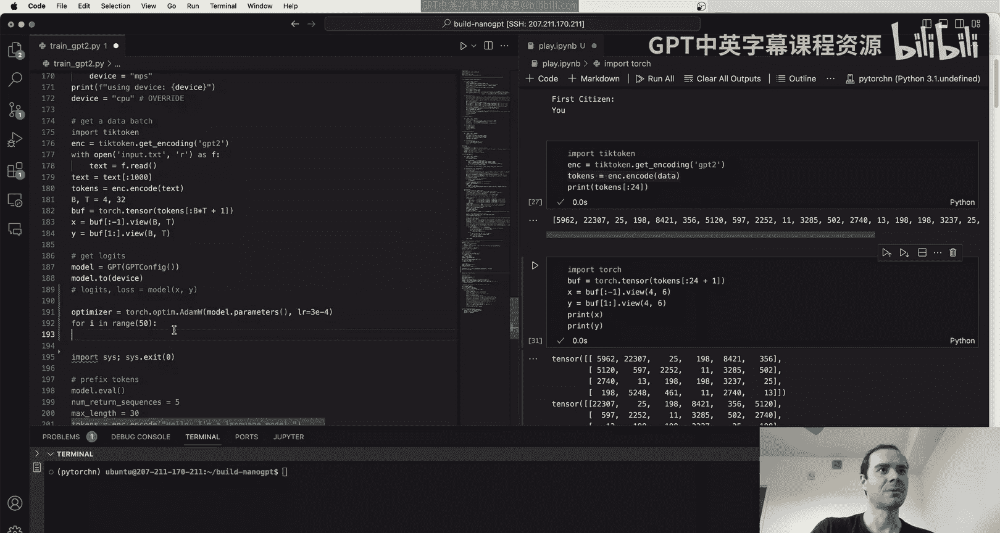

Oh， my gosh。We see that it takes a bunch of five parameters and it's a little bit more complicated than the SGD we' were looking at before。

 because in addition to basically updating the parameters with the gradient scale by the learning rate。

 it keeps these buffers around and it keeps two buffers the M and the V which it calls the first and the second moment So something that looks a bit like momentum something that looks a bit like RMS Pro if you're familiar with it。

 but you don't have to be it's just kind of like a normalization that happens on each gradient element individually and speeds up the optimization。

 especially for language models， but I'm not going to go into the detail right here。

 we're going to treat it as a bit of a black box and it just optimizes the objective faster than SGd。

 which is what we've seen in the previous lectures。So let's use it as a black box in our case。

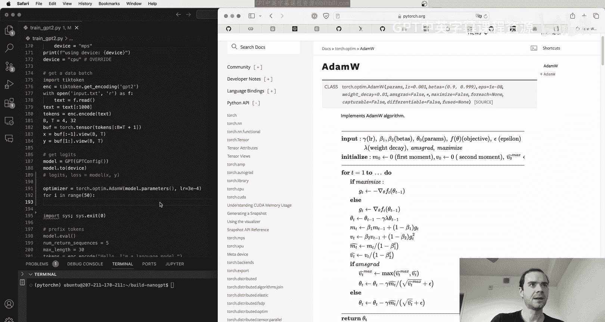

Create the optimizer object， and then。Go through the optimization。

The first thing to always make sure the compilepi did not forget to0 the gradients。

 so always remember that you have to start with a zero gradient。

 then when you get your loss and you do a dot backward， dot backward adds to gradients。

 so it deposits gradients， it always does a plus equals on whatever the gradients are。

 which is why you must set them to 0。So this as gradient from this loss。

 and then we call the step function on the optimizer to update the parameters。

And to decrease the loss。And then we print the step and the loss dot item is used here because loss is a tensor with a single element。

 dot item will actually convert that to a single float， and this float will not will live on a CPU。

So this gets to some of the internals again of the devices。

 but loss is a tensor with a single element and it lifts on GPU for me because I'm using GPUs when you call dot item。

Pytorrque behind the scenes will take that one dimensional tensor。

 ship it back to the CPU memory and convert it into a float that we can just print。

So this is the optimization， and this should probably just work。Let's see what happens。Actually。

 sorry。 Let me， instead of using CPU override， let me delete that。 So this is a bit faster for me。

 And it runs on Kuta。啊。Expected alltensors to be on the same device， but found at least two devices。

 Kuda 0 and CPU。So Kuda0 is the zeroth GPU because I actually have8 GPUs on this box so the zeroth GPU in my box and CPU。

And a model we have moved to device， but when I was writing this code。

 I actually introduced a bug because Buff， we never moved to device。

 and you have to be careful because you can't just do Buff dot to of device。It's not stateful。

 It doesn't convert it to be a device。 It instead returns pointer to a new memory。

 which is on the device。 So you see how we can just do model that to a device that does not apply to tensors。

 You have to do both equals。嗯。Bop that two device and then this should work okay。

So what we expect to see， we expect to see a reasonable loss in the beginning。

 and then we continue to optimize just a single batch。

 and so we want to see that we can overfit this single batch。

 we can crush this little batch and we can perfectly predict the indices on just this little batch。

And in these， that is roughly what we're seeing here， so。We started off at roughly 10。

8211 in this case。 And then as we continue optimizing on this single batch without loading new examples。

 we are making sure that we can overfit a single batch， and we are getting to very， very low loss。

 So the transformer is memorizing this single individual batch。

And one more thing I didn't mention is the learning rate here is 3 in negative 4。

 which is a pretty good default for most optimizations that you want to run at a very early debugging stage。

So this is our simple inner loop， and we are overfitting a single batch and this looks good。

 So now what what comes next is we don't just want to overfit a single batch。

 We actually want to do an optimization so we actually need to iterate these Xy batches and create a little data loader that make sure that we're always getting a fresh batch and that we're actually optimizing reasonable objective。

 So let's do that next。Okay， so this is where I came up with。 And I wrote a little data loader light。

So what this data loader does is we're importing T token up here。

 reading the entire text file from this single input TxD。Tokenizing it。

 and then we're just printing the number of tokens in total。

And the number of batches and a single epoch of iterating over this dataset set。

 So how many unique batches do we output before we loop back around at the beginning of the document and start reading it again。

So we start off at position zero， and then we simply walk the document in batches of B times t。

 so we take chunks of b times t and then always advance by B times t。And。

It's important to note that we're always advancing our position by exactly B times t。

 but when we're fetching the tokens， we're actually fetching from current position to B times t plus1。

 and we need that plus one because remember we need the target token for the last token in the current patch。

And so that way we can do。The XY， exactly as we did it before。And。If we are to run out of data。

 we'll just loop back around to zero。So this is one way to write a very。

 very simple data letter that simply just goes through the file in chunks and its good enough for us for current purposes and we're going to complexify it later。

And now we'd like to come back around here and we'd like to actually use our data loader。

 so the import Tktoken has moved up。 and actually， all of this is now useless。

 So instead we just want a train loader。For the training data。

And we want to use the same hypopar for four， so batch size was 4 and time was 32。

And then here we need to get the Xy for the current batch。

So let's see if copal gets it because this is simple enough。

 so we call the next batch and then we make sure that we have to move。

Are tensors from CPU to the device。So here， when I converted the tokens。

 notice that I didn't actually move these tokens to the GPU， I left them on CPU， which is default。

And that's just because I'm trying not to waste too much memory on the GPU in this case this is a tiny data set that it would fit。

 but it's fine to just ship it to GPU right now for our purposes right now。So we get the next batch。

 we keep the data loader simple， CPU class， and then here we actually ship it to the GPU and do all the computation。

And。Let's see if this runs。 So Python trigibutity2 duck pi。

 And what do we expect to see before this actually happens。

 What we expect to see is now we're actually getting the next batch。

 So we expect to not overfit a single batch。 And so I expect our loss to come down。But not too much。

 And that's because I still expect it to come down because in the 50257 tokens。

 many of those tokens never occur in our data set。 So there are some very easy gains to be made here in the optimization by。

 for example， taking the biases of all elogits that never occur and driving them to negative infinity。

And that would basically just， is's just that all these crazy unicodes or different languages。

 those tokens never occur。 So their probability should be very low。

 And so the gains that we should be seeing are along the lines of basically deleting the usage of tokens that never occur。

 That's probably most of the loss gain that we're going to see at this scale right now。

But we shouldn't come to a zero because。We are only doing 50 iterations。

 and I don't think that's not to do in epoch right now。 So let's see what weve got。

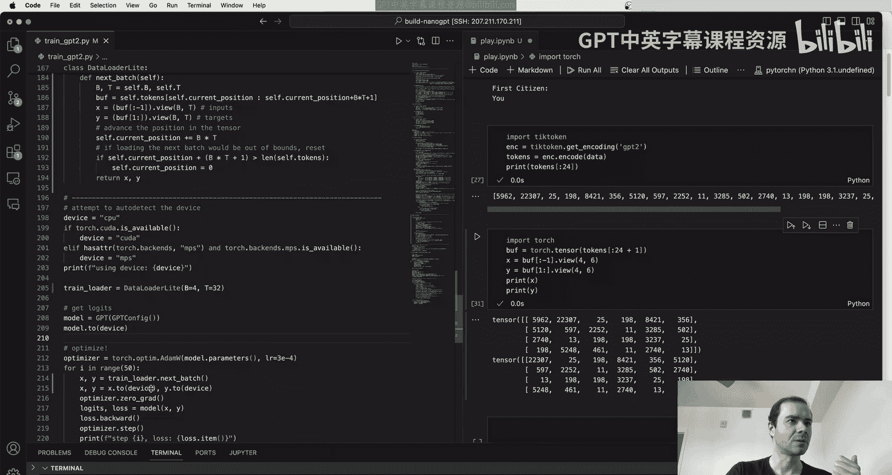

We have 338，000 tokens， which makes sense with our 3 to1 compression ratio because there are1 million characters。

So one epoch with the current setting of B and T will take 2600 batches。

 and we're only doing 50 batches optimization in here。

So we start off in a familiar territory as expected， and then we seem to come down to about 6。

6 so basically things seem to be working okay right now with respect to our expectations so that's good Okay next I want to actually fix a bug that we have in our code It's not a major bug but it is a bug with respect to how GPT2 training should happen。

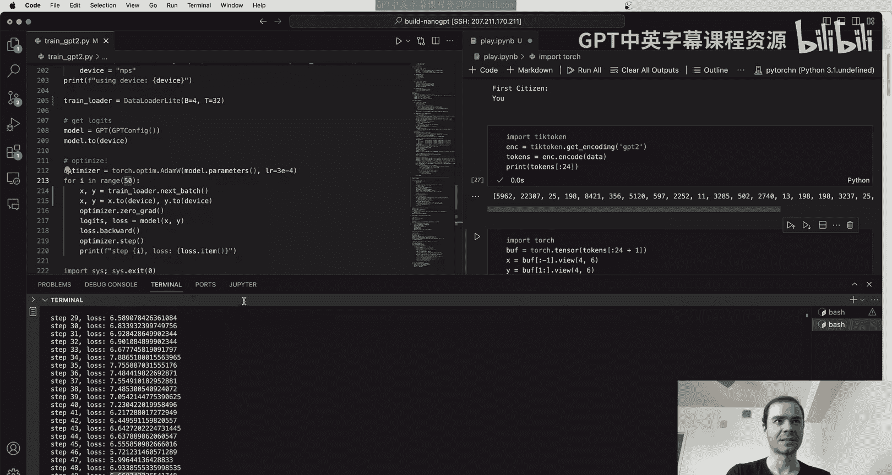

嗯。So， the buck is the following。We were not being careful enough when we were loading the weights from hugging face。

 and we actually missed a little detail。 So if we come here。

Notice that the shape of these two tensors is the same。

 So this one here is the token embedding at the bottom of the transformer。

Right so and this one here is the language modeling head at the top of the transformer。

And both of these are basically two dimensional tensors， and their shape is identical。 So here。

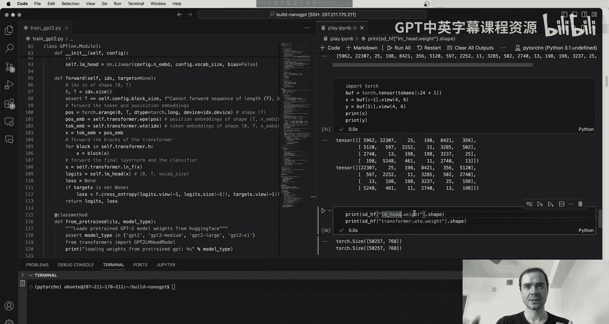

The first one is the output embedding， the token embedding。

 and the second one is this linear layer at the very top， the classifier layer。

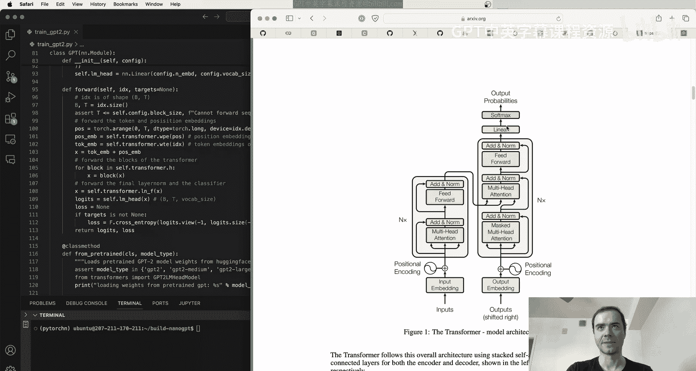

Both of them are of shape， 50，057 by768。嗯。This one here is giving us our token embeddings at the bottom。

 And this one here is taking the 7，68 channels of the transformer and trying to upscale that to 5000 57 to get the lous for the next token。

So they're both the same shape。 but more than that， actually。

 if you look at comparing their elements in Pytorch， this is an element wise equality。

 So then we use that all。 and we see that every single element is identical and more than that。

We see that if we actually look at the data pointer。

 what this is a way in Pytorarch to get the actual pointer to the data and the storage。

 we see that actually the pointer is identical。 So not only are these two separate tensors that happen to have the same shape and elements。

 they're actually pointing to the identical tensor。So。

What's happening here is that this is a common wait time scheme。

That actually comes from the original。From the original attention is all you need paper and actually even reference before it。

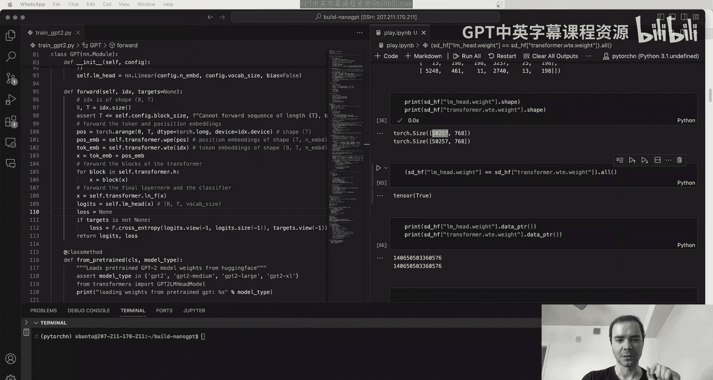

So if we come here。嗯。Embedding and softms and the attention is all you need paper。

They mentioned that in our model， we shared the same weight matrix between the two embedding layers and the preofmax linear transformation similar to 30。

So this is an awkward way to phrase that these two are shared and they're tied in their the same matrix。

 and the 30 reference is this paper。So this came out in 2017 and you can read the full paper。

 but basically it argues for this weighttying scheme。

 and I think intuitively the idea for why you might want to do this comes from this paragraph here。

And basically， you can observe that。嗯。You actually want these two matrices to behave similar in the following sense。

If two tokens are very similar semantically， like maybe one of them is all lowercase and the other one is all uppercase。

 or it's the same token in the different language or something like that。

 if you have similarity between two tokens， presumably you would expect that they are nearby in the token embedding space。

But in the exact same way， you'd expect that if you have two tokens that are similar semantically。

 you'd expect them to get the same probabilities at the output of a transformer because they are semantically similar。

And so。Both positions in the transformer at the very bottom and at the top have this property that similar tokens should have similar embeddings or similar weights。

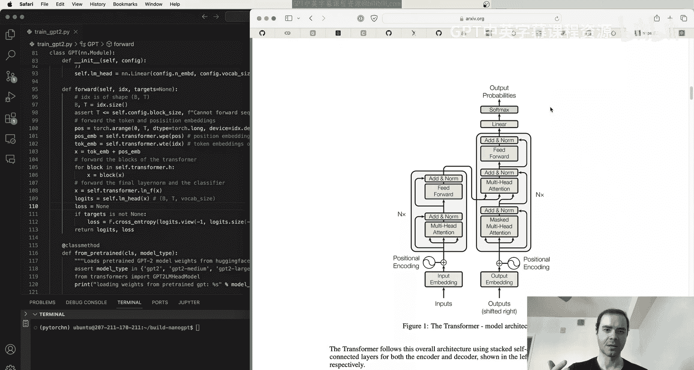

And so this is what motivates their exploration here， and they kind of， you know。

 I don't want to go through the entire paper。And you can go through it。

 but this is what they observe。They also observed that if you look at the output embeddings。

 they also behave like word embeddings， if you just kind of try to use those weights as word embeddings。

So they kind of observe this similarity， they try to tie them and they observe that they can get much better performance in that way。

And so this was adopted and the attachment is only need paper。

 and then it was used again in G2 as well so。I couldn't find it in transformers implementation。

 I'm not sure where they tie those embeddings， but I can find it in the original GPT2 code introduced by Open AI。

 so this is OpenI GPT2 source model。And here where they are forwarding this model。

 and this is intensorflow， but that's okay。 we see that they get the WTE token embeddings。

 and then here is the encoder of the token embedding in the position。And then here at the bottom。

 they use the WT E again to do the logits。 So when they get the logits， it's a mael off。

This output from the transformer and the WTE Tensor is reused。

UAnd so the WTE tensor basically is used twice on the bottom of the transformer and on the top of the transformer。

And in the backward pass， we'll get gradients contributions from both branches。

 and these gradients will add up on the WTE tensor。

So we'll get a contribution from the classifier layer， and then at the very end of the transformer。

 we'll get a contribution at the bottom of it flow again into the WTE tensor。So we want to。

 we are currently not sharing WTE in our code， but we want to do that。So。Way sharing scheme。

And one way to do this， let's see if Qal gets it。Oh， it does， okay， so this is one way to do it。

Basically。Relatively straightforward， what we're doing here is we're taking the WTE dot weight。

And we're simply redirecting。It to point to the Elad。So this basically copies the data pointer right。

 it copies the reference， and now the WTE dot weight becomes orphaned， the old value of it。

 and Pythtorch will clean it up， Python will clean it up and so we are only left with a single tensor and it's going to be used twice in the forward pass。

And this is， to my knowledge， all that's required， so we should be able to。

Use this and this should probably train。We're just going to basically be using this exact same sensor twice。

We weren't being careful with tracking the likelihoods。

 but according to the paper and according to the results。

 you'd actually expect slightly better results doing this。And in addition to that。

 one other reason that this is very， very nice for us is that this is a ton of parameters。 right。

 What is the size of here， It's 768 times 500257。 So this is 40 million parameters。 And this is a 1。

24 million parameters model。 So 40 divide 124。 So this is like 30% of the parameters are being saved using this weight time scheme。

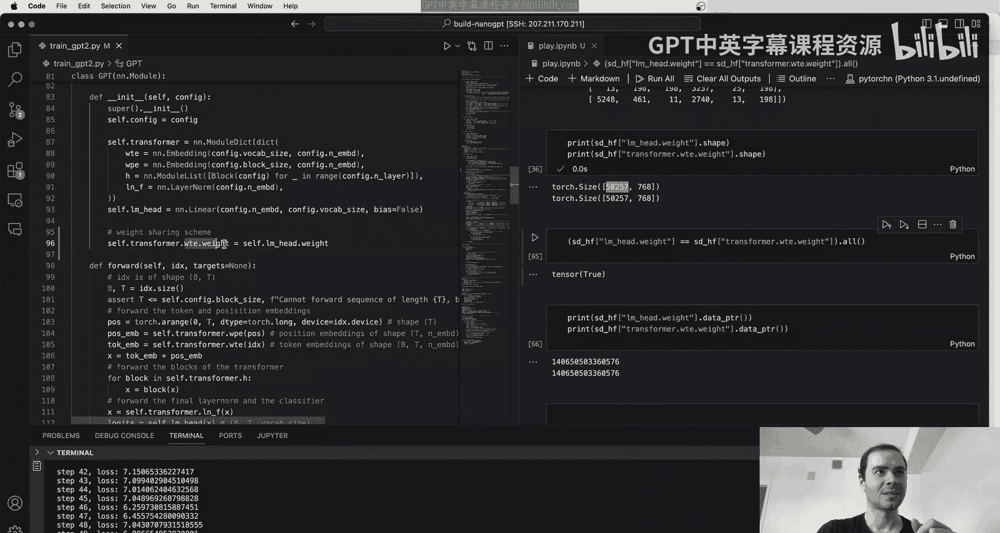

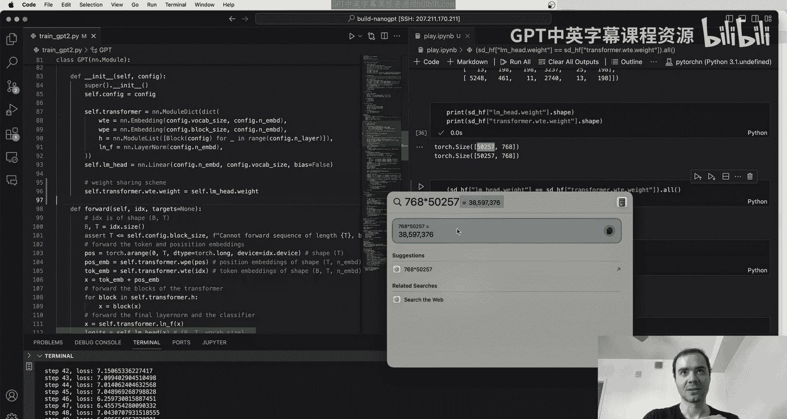

And so this might be one of the reasons that this is working slightly better if you're not training the model long enough。

Because of the weighttying， you don't have to train as many parameters。

 and so you become more efficient in terms of the training process。

 because you have fewer parameters and you're putting in this inductive bias that these two embeddings should share similarities between tokens。

So this is the Wa time scheme and we've saved a ton of parameters。

 and we expect our model to work slightly better because of the scheme。Okay。

 next I would like us to be a bit more careful with the initialization and to try to follow the way GPT2 initialized their model。

Now， unfortunately， the GPT2 paper and the GT3 paper are not very explicit about initialization。

 so we kind of have to read between the lines。And instead of going to the paper。

 which is quite vague， there's a bit of information in the code that Open I have released。

 so when we go to the model thatt Pi， we see that when they initialize their weights。

They are using the standard deviation of 0。02。 and that's how they they So this is a normal distribution for the weights and the standard deviation is 0。

02。For the bias， they initialize that with0。And then when we scroll down here。

Why is this not scrolled？嗯。The token embeddings are initialized at 0。02 and position embeddings at 0。

01 for some reason。So those are the initializations and we'd like to mirror that in GP2 in our module here。

 So here's a snippet of code that I sort of came up with very quickly。

So what's happening here is at the end of our initializer for the GT module。

 we're calling the apply function of anN module and that iterates all the sub modules of this module。

And applies in it weights function on them。And so what's happening here is that we're iterating the modules here。

 and if they are an nN linear module， then we're going to make sure to initialize the weight using a normal with a standard deviation of 0。

02。If there's a bias in this layer， we will make sure to initialize that to zero。

 note that zero initialization for the bias is not actually the Pyro default。By default。

 the bias here is initialized with a uniform。 So that's interesting。 So we make sure to use 0。

 And for the embedding， we're just going to use 0。02 and keep it the same。

 So we're not going to change it to 0。01 for positional because it's about the same。

And then if you look through our model， the only other layer that requires initialization and that has parameters is the layer norm。

 and the Pyth's default initialization sets the scale in the layer norm to be 1 and the offset in the layer norm to be0。

 so that's exactly what we want and so we're just going to keep it that way。

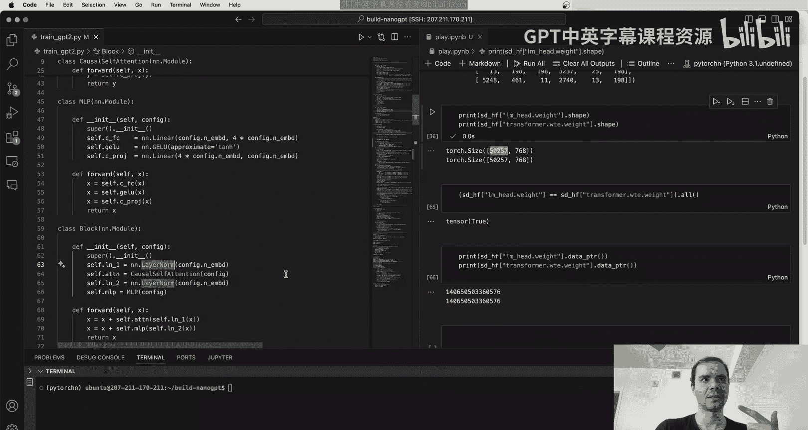

And so this is the default initialization if we are following the。

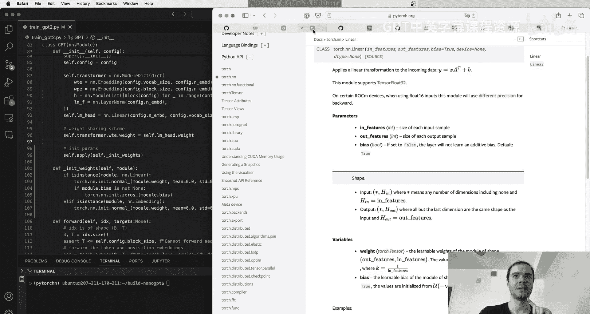

Where is it the GPT2 source code that they've released？I would like to point out， by the way。

 that typically the standard deviation here on this initialization。

 if you follow the heavier initialization， would be one over the square root of the number of features that are incoming into this layer。

 But if you'll notice actually 0。02 is basically consistent with that because the d model sizes inside these transformers for G2 are roughly 768。

1600， etc ceter。 So one over the square root of， for example，768 gives us 0。03。If we plug in 600。

1600， we get 0。02。If we plug in three times that 0。014， et cetera。 So basically 0。

02 is roughly in the vicinity of reasonable values for the for。For these initializations anyway。 So。

 so it's not completely crazy to be hard coding 0。02 here， but you'd like typically some。

Something that grows with the model size instead， but we will keep this because that is the GPT2 initialization per their source good。

But we are not fully done yet on initialization， because there's one more caveat here。 So here。

A modified initialization which accounts for the accumulation on the residual path with model depth is used。

 We scale the weight of residual layers initialization by factor of  one over squared n。

 where n is the number of residual layers。So this is what GPT2 paper says。

So we have not implemented that yet， and we can do so now Now I'd like to actually kind of like motivate a little bit what they mean here。

 I think， so here's roughly what they mean。If you start out with zeros in your residual stream。

Remember that each residual stream is a is of this form where we continue adding to it x is x plus something。

 some kind of contribution。 So every single block of the residual network contributes some amount and that gets added。

And so what ends up happening is that the variance of the activations in residual stream grows。

So here's a small example if we start at zero， and then we for 100 times。

 we have sort of this residual stream of 768 zeros。And then 100 times we add random。

 which is a normal distribution， zero mean one standard deviation。If we add to it， then by the end。

 the residual stream has grown to a half standard deviation of 10。

And that's just because we're always adding。嗯。These numbers。 and so。

This scaling factor that they use here exactly compensates for that growth。

So if we take n and we basically scale down every one of these contributions into the residual stream by one over the squared root of n。

So one over the squared event is n to the negative 0。5， right？Because n to the 0。

5 is the square root， and then one over the square root is a negative 0。5。

 if we scale it in this way。Then we see that we actually get。one。So。

This is a way to control the growth of activations inside the residual stream in the forward pass。

And so we'd like to initialize in the same way where these weights that are at the end of each block。

 so this Cpro layer， the GBT paper proposes to scale down those weights by one over the square root of the number of residual layers。

So one crude way to implement this is the following， I don't know if this is Pyr sanctioned。

 but it works for me is we all do this in the initialization。

See that that that special nanoGPT scale in it。Is one。

So we're setting kind of like a flag for this module。There must be a better way in pie torch ride。

 but。I don't know。Okay， so we're basically attaching this flag。

And trying to make sure that it doesn't conflict with anything previously。

And then when we come down here。This S D， D should be 0。02 by default。But then， if has at her。

Module of this thing。Then。S T D times equals。嗯。Coopile does not guess incorrect。

 So we want one over the square root of the number of layers， so。

The number of residual layers here is twice times。Sve that config layers。 And then this。

Times negative 。5。So we're going to scale down that standard deviation。

 and this should be correct and implement that。I should clarify， by the way。

 that the two times number of layers comes from the fact that every single one of our layers in the transformer actually has two blocks that add to the visual pathway right。

 we have the attention and then the MLP， so that's where the two times comes from。

And the other thing to mention is that what's slightly awkward。

 but we're not going to fix it is that because we are weight sharing the WTE and the Lmed。

In this iteration over all submodules， we're going to actually come around to that tensor twice。

 So we're going to first initialize it as an embedding with 0。02。

 and then we're going to come back around it again in a linear and initialize it again using 0。02。

 and it's going to be 0。02 because the alarm head is， of course， not not scaled。

 So it's not going to come here。It's just it's going to be basically initialized twice using the identical same initialization。

 but that's okay。And then scrolling over here。I added some code here so that we have reproducibility。

To set the seeds。 And now we should be able to Python train G2 not pi and let this running。

 And as far as I know， this is the G2 initialization in the way we've implemented right now。

 So this looks。

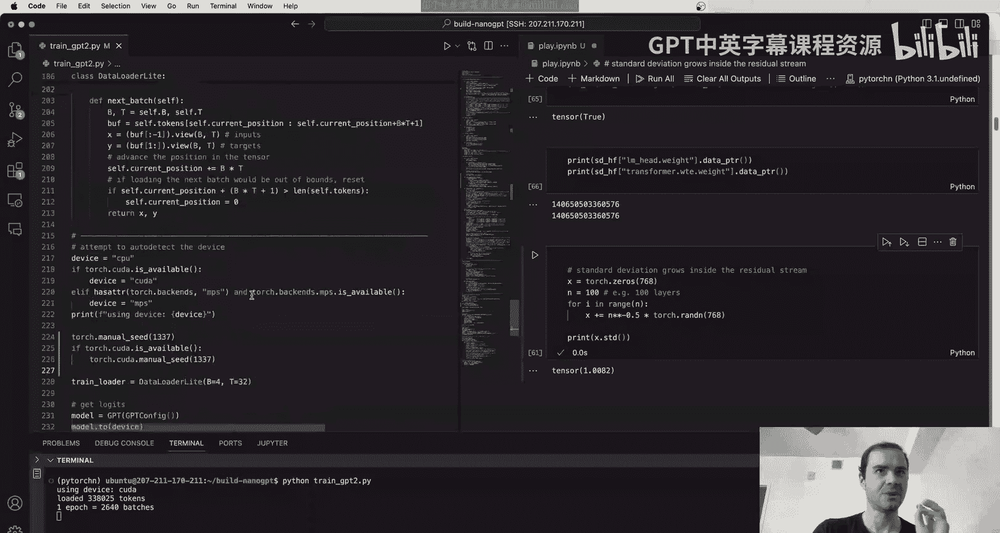

Reasonable to me。Okay so at this point we have the G2 model。

 we have some confidence that it's correctly implemented。

 we've initialized it properly and we have a data loader that's iterating through data batches and we can train。

 So now comes to the fun part。 I'd like us to speed up the training by a lot。

 so we're getting our money's worth with respect to the hardware that we are using here。

And we're going to speed up the training by quite a bit。Now。

 you always want to start with what hardware you have。

 What does it offer and are you fully utilizing it， So in my case， if we go to Nvi SMMI。

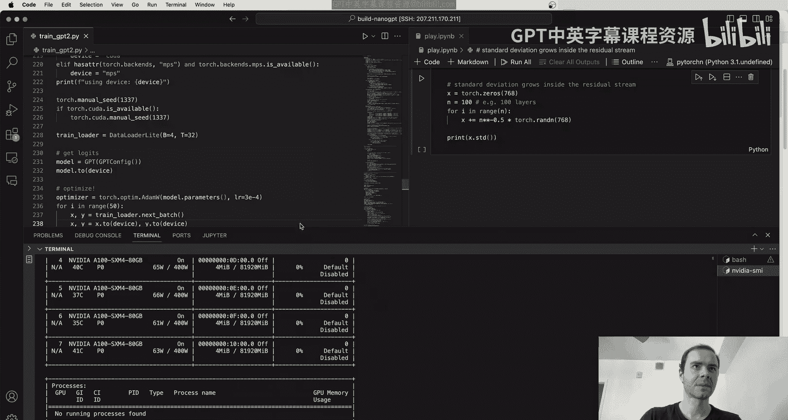

We can see that。I have 8 g。And each one of those GPUus is an A100 SXM， 80 gigabytes。

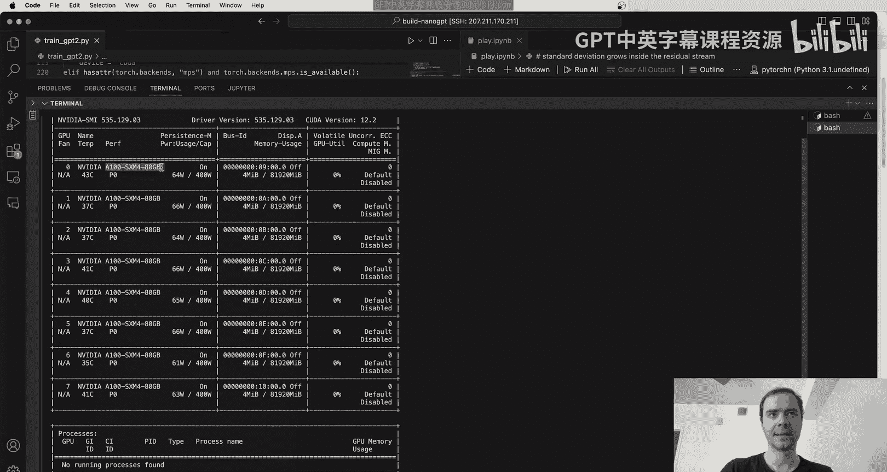

So this is the GPU that I have available to me in this box。

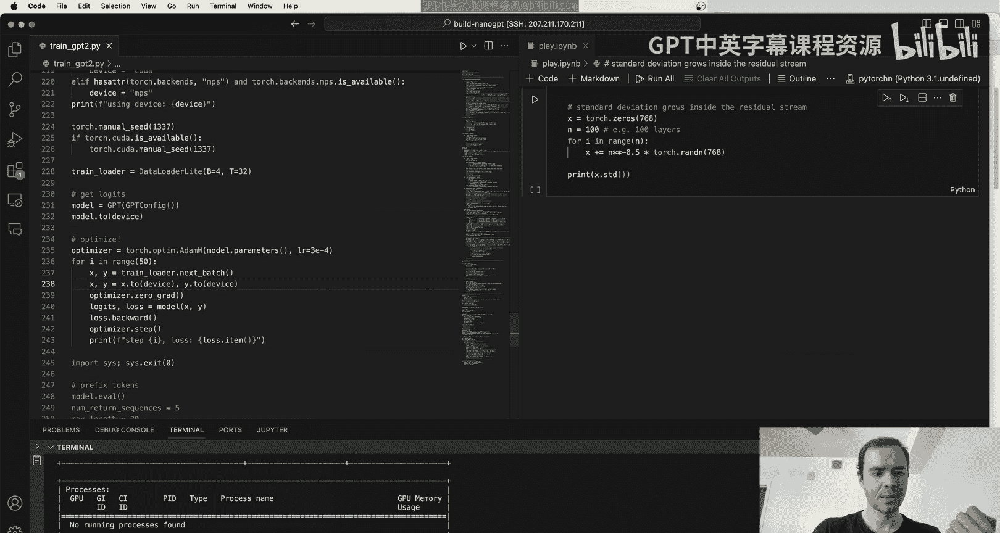

Now when I use to spin up these kinds of boxes， by the way。

 my favorite place to go to is Lambda Labs， they do sponsor my development and that of my projects。

But this is my favorite place to go and this is where you can spin up one of these machines and you pay per hour and it's very。

 very simple。So I like to spin them up and then connect V Eco to it， and that's how I develop。Now。

 when we look at the8100s that are available here。

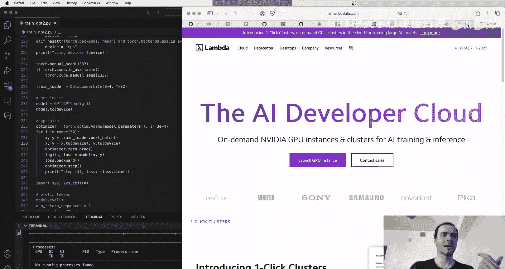

8ight，180 GB S XM is the。GPU that I have here。 And we have a bunch of numbers here for how many calculations you can expect out of this GPU。

So when I come over here and。Iyes break in right after here。 So Python traity。

So I'm breaking in right after we calculate the logics and the loss。

And the interesting thing I'd like you to note is when I do Los。 d type， this prints a torch。

 float 32， so by default imptorrch， when you create tensors。

 and this is the case for all the activations and for the parameters of the network and so on。

 by default， everything is in float 32。That means that every single number。

 activation or weight and so on is using a float representation that has 32 Bs。

And that's actually quite a bit of memory， and it turns out empirically that for deep learning as a computational workload。

 this is way too much and deep learning and the training of these networks can tolerate significantly lower precisions。

Not all computational workloads can tolerate small precision， so for example。

If we go back to the data sheet， you'll see that actually these GPUus support up to FP 64。

 and this is quite useful。 I understand for a lot of scientific computing applications。

 and there they really need this， but we don't need that much precision for deep learning training。

 So currently we are here FP 32。

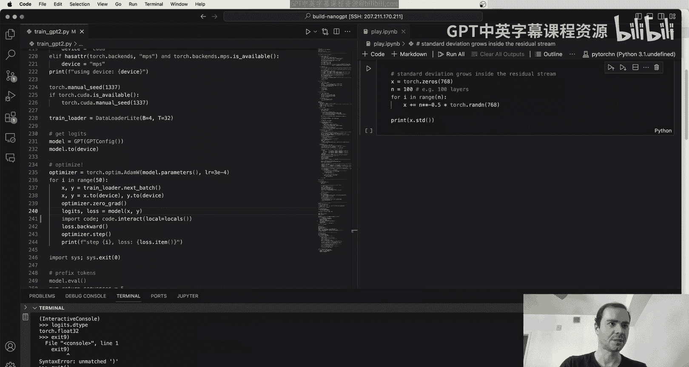

And with this code， as it is right now， we expect to get at at most 19。5terra flobs of performance。

 That means we're doing 19。5 trillion operations， floating point operations。

 So this is floating point multiply at most。Most likely。

And so these are the floating point operations。Now notice that if we are willing to go down in precision。

 so T of 32 is a lower precision format we're going to see in a second。

 you can actually get an 8x improvement here， and if you're willing to go down to F 16 or B float 16。

 you can actually get times 16 x performance all the way to 312teroflobs。

You see here that Nvidia likes to cite numbers that have an asterisk here。

 this asterisk says with sparsity， but we are not going to be using sparsity in our code and I don't know that this is very widely used in the industry right now。

 so most people look at this number here without sparsity。

And you'll notice that we could have got even more here。 but this is int8。

 and int 8 is used for inference， not for training， because int 8 has a。嗯。

It basically has uniform spacing。And we actually require a float so that we get a better match to the normal distributions that occur during training of neural networkss。

 where both activations and weights are distributed as a normal distribution。

 and so floating points are really important to match that representation。

So we're not typically using int8 for training， but we are using it for inference。

And if we bring down to precision， we can get a lot more teraflops out of the tensor course available in the GPus。

 We'll talk about that in a second。 But in addition to that。

 if all these numbers have fewer bits of representation。

 it's going to be much easier to move them around。And that's where we start to get into the memory bandwidth and the memory of the model。

So not only do we have a finite capacity of the number of bits that our GPU can store。

But in addition to that， there's a speed with which you can access this memory and you have a certain memory bandwidth。

 It's a very precious resource。 And in fact， many of the deep learning workloads for training are memory bound And what that means is actually that the tensor course that do all these extremely fast multiplications。

 most of the time they're waiting around， they're idle because we can't feed them with data fast enough。

 We can't load the data fast enough for memory。 So typical utilizations of your hardware。

 if you're getting 60% utilization。 you're actually doing extremely well。

So half of the time in a well tuned application， your tensor course are not doing multiplies because the data is not available。

So the memory bandwidth here is extremely important as well。

 And if we come down in the precision for all the floats， all the numbers。

 weights and activations suddenly require less memory。

 so we can store more and we can access it faster。 So everything speeds up， and it's amazing。

 And now let's reap benefits of it。 And let's first look at the tensor float 32 format。😊，Okay。

 so first of all， what are Tensor core Well Tensor course。

 Tensor course is just an instruction in the a100 architecture， right？

So what it does is it does basically a little 4 by 4 matrix multiply。

 So this is just matrix multiplication here of4 by 4 matrices。

 and there are multiple configurations as to what precision any of these matrices are in what precision the internal accumulate happens。

And then what is the output precision， input precisions etc， so there's a few switches。

 but it's basically a 4 x4 multiply， and then anytime we have any operations that require matrix multiplication。

 they get broken up into into this instruction of little 4x4 multiply and so everything gets broken up into this instruction because it's the fastest way to multiply matrices。

And it turns out that most of the computational work that we're doing up above。

 all of it really is matrix multiplication。 Most of the work computationally happens in the linear layers。

嗯。Linear， linearar， et cetera。 There's a few things sandwiched in between。

 So there's some additions in residuals。 there's some Gaut non nonlineararities。

 There's some layer norms， et cetera。 But if you just time them， you'll see that these are nothing。

 like basically， the entire transformer is just a bunch of major multiplications， really。

And especially at this small scale， 124 million parameter model。

 actually the biggest matrix multiplication by far is the classifier layer at the top。

 that is a massive matrix multiply of going from 768 to 50，257。

 and that matrix multiply dominates anything else that happens in that network roughly speaking。

So its matrix multiplies that become a lot faster， which are hidden inside our linear layers。

And they're accelerated through Tensor Cose。Now， the best reference。

 I would say for tester course is basically just go to the。Hey 100 architecture white paperper。

 and then it's pretty detailed。 but I think people。

 it's like relatively really readable mostly if you half understand what's happening。嗯。So figure 9。

 tensor float 32。So this is the explanation basically for T F 32 and what happens here。

And you see that there's many configuration options here available。

 So the input opera and what precisions are they in， the accumulator and what basically the。

The internal representation within the instruction。

 when you do the accumulate of this matrix multiplication。

So the intermediate plus equals of the intermediate little vector multiplies here。

 that all happens in FP32。And then this is an aex improvement， as I mentioned。

 to the ops that we get。 So T f to 32 specifically， we're looking at this row here。

 And the way this works is。嗯。Normallyorm F p thirty2 is thirty2 bits，T of 32 is the exact same bits。

 We have one sign bit。 We 8 exponent bits， except the menisa bits get cropped in the float。

 And so basically， we end up with just 19 Bs instead of 32 B because the last 13 Bs get truncated。

 They get dropped and all this is internal to the instruction。

 So none of it is visible to anything in our Pytorch。 none of our Pytorch code will change。

 all of the numbers will look identical。 Its just that when you call the tensor core instruction。

 internally in the hardware。 It will crop out these 13 bits。

 And that allows it to calculate this little matrix multiply significantly faster，8 x faster。

Now， of course， this speed up comes at a cost， and the cost is that we are reducing the precision。

 Our accumulate is still FP32。 Our output is FP 32。 Our inputs are FP 32。 but internally。

 things get truncated in the opera to perform the operation faster。

 And so our results are starting to be a bit more approximate。 but empirically。

 when you actually train with this， you basically can tell the difference。

So the reason I like TF 32 is because if you can tolerate a little bit of a precision fudge。

 then this is free。 Like none of your codes sees this。

 It's fully internal to the operation and the operation to you just go ax faster。

 and it's a bit more approximate。 And so it's a pretty sweet spot。 I would say in optimization。

 And let's see what that looks like first。 So I've set up our codes to just time the iterations。

 So it'll import time。😊，I changed the hypoparmeter so that we have something a bit more that reflects kind of workload that we want to run because we want to do a fairly large run at the end of this。

 so let's use batch size 16 and let's now use the actual GPT2 maximum sequence length of 1024 tokens。

So this is the configuration。And then。For fifth iterations， I'm just doing something very lazy here。

 I'm doing tender time to get the current time， and then this is the optimization loop。

And now I want to time how long this takes。 Now， one issue with working with GPus is that as your CPU。

 when your CPU runs， it's just scheduling work on GPU。

 it's ordering some work right And so it sends a request and then it continues running。

 And so we can actually it can happen sometimes that we sort of。Speed through this。

And we queue up a lot of kernels to run on the GP。 And then the CPU sort of like gets here and takes time to time。

 But actually， the GP is still running because it takes it time to actually work through the work that was scheduled to run。

And so you're just building up a queue for the GPU。And so actually， if you need to。

 you want to wait tokudata synchronize， and this will wait for the GPU to finish all the work that was scheduled to run up above here。

 and then we can actually take the time。So basically。

 we're waiting for the GPU to stop this iteration， take the time。

 and then we're going to just print it。Here I'm going to run the training loop。

 and here on the right， I'm watching andV SMM。So we start off at zero， we're not using the GPU。

 and then by default Py， we'll use GPU0， so we see that it gets filled up and we're using 35 gigabytes out of 80 gigabytes available。

And then here on the left， we see that because we've cranked up the batch size。

Now it's only 20 batches to do a single epoch on our tiny Shakespeare。

And we see that we're seeing roughly 1000 milliseconds per iteration here， right？So。

The first iteration sometimes is slower and that's because Pytorch might be doing a lot of initializations here in the very first iteration and so it's probably initializing all these tensors and buffers to hold all the gradients and I'm not sure all the work that happens here。

 but this could be a slower iteration when you're timing your logic you always want to be careful with that。

 but basically we're seeing1 thousand milliseconds per iteration。

And so this will run for roughly 50 seconds as we have it right now。So that's our baseline inflow 32。

One more thing I wanted to mention is that。If this doesn't fit into your GPU and you're getting out of memory errors。

 then start decreasing your batch size until things fit。 So instead of 16。

 try 8 or 4 or whatever you need to fit the batch into your GPU。 and if you have a bigger GPU。

 you can actually potentially get away with 32 and so on。By default。

 you want to basically max out the batch size that fits on your GPU。

And you want to keep it nice numbers， so use numbers that have lots of powers of two in them。

 so 16 is a good number， 8， 24， 32， 48， these are nice numbers。

 but don't use something like 17 because that will run very ineffiently on the GPU and we're going to see that a bit later as well。

So for now， let's just stick with 16， 1024。And the one thing that I added also here。

 and I ran it again is I'm calculating a tokens per second throughput during training because。

We might end up changing the batch size around over time。

 but tokens per second is the objective measure that we actually really care about how many tokens of data are we training on and what is the throughput of tokens that we're getting in our optimization so right now we're processing and training on 163000 tokens per second roughly and that's a bit more objective metric。

Okay， so let's now enable TF32。 Now luckily， Pytorch makes this fairly easy for us and to enable TF 32。

 you just need to do a single line。

And is this。And when we go to the patch documentation here for this function。Basically。

 this tells Pytort what kind of kernels to run。 And by default， I believe it is highest。

Highest precision for matmo。And that means that everything happens in F 32， just like it did before。

 but if we set it too high as we do right now。Major multiplications will now use Tensor F 32 when it's available。

My GPU is the A100， so it's an Are series， and therefore Tf32 is available If you have an older GPU。

 this might not be available for you。But for my GPPU it's available。

 and so what I expect my church to do is that every single place where we see an NN dot linear。

Inside there， there's a matrix multiplication， and I expect that matrix multiplication now to be running on Tensor course。

 utilizing the TF32 precision。So。This is the single line of change that is， I believe necessary。

 And let's re run this。 Now， we saw that in terms of the throughput that is promised to us。

 we're supposed to be getting 8 x roughly。 So let's see what happens。And that 8 x came from here。

 right。8 x。 And it also came from。Looking at it here， 15060 flops instead of 19。5。Okay。

 so what actually happened？So we're seeing that our throughput roughly 3 x， not8ex。 So we are going。

 we're from 1000 milliseconds。 we're going down to 300 milliseconds。

 and our throughput is now about 50000 tokens per second。 So we have a roughly 3 x instead of8x。

 So what happened。And basically what's happening here is， again。

 a lot of these workloads are memory bound， and so even though the TF32 offers in principle。

A lot faster throughput。All of these numbers everywhere are still float 32s。

 and it's float 32 numbers that are being shipped all over the place through the memory system and is just costing us way too much time to shuttle around all this data。

 And so even though we've made the multiply itself much faster。

 we are memory bound and we're not actually seeing the full benefit that would come from the Nakin math here。

That said， we are getting3 x faster throughput， and this is free。Single line of code and pytorch。

 All your variables are still float 32 everywhere。 It just runs faster。

 and it's slightly more approximate， but we're not going to notice it basically。 So that's TF 32。

Okay， so let's now continue。So we've exercised this row and we saw that we can crop out some of the precision inside the operation itself。

But we saw that we're still memory bound。 We're still moving around all these floats， right。

 otherwise， and we're paying that cost because of this。

So let's not decrease the amount of stuff that we're going to be moving around。

And we're going to do that by dropping down to B flow 16。

So we're only going to be maintaining 16 bits per float。And we're going to use the B flow 16。

 and I'll explain in a bit FP16 difference， and we're going to be in this room。

So let me go back to the documentation here for the A 100。嗯。

We see here the precisions that are available， and this is the original FP32。

 the TF32 crops out the precision。 and then here in BF16， you see that it is very similar to TF32。

 but it's even more aggressive in cropping off of the precision than menissa of this float。

So the important thing with B flow 16 is that the exponent bits and the sign bit， of course。

 remain unchanged。 So if you're familiar with your float numbers。

 and I think this should probably be an entire video by itself。

 The exponent sets the range that you can represent of your numbers and the precision is how much precision you have for your numbers。

And so the range of numbers is identical， but we have fewer possibilities within that range because we are truncating them in Tisa so we have less precision in that range。

what that means is that things are actually fairly nice because we have the original range of numbers that are representable in float。

 but we just have less precision for it。And the difference with FP16 is that they actually touch and change the range。

 so FP16 cannot represent the full range of FP32。 It has a reduced range。

 and that's where you start to actually run into issues because now you need these gradients。

 Cals and things like that。 And I'm not going go into the detail of that in this video。

Because that's a whole video by itself。But FP16 actually historically came first。

 that was available in the Volta series before Ampire。 And so FP 16 came first。

 and everyone started to train FP 16。 but everyone had to use all these gradient scaling operations。

 which are kind of annoying。 And it's an additional source of state and complexity。

 And the reason for that was because the exponent range was reduced in F P 16。

So that's the IE FP16 spec， and then they came out with Pf16 and the Ampire。

 and they made it much simpler because we're just truncating Monteessa。

 we have the exact same range and we do not need gradient scrs， so everything is much much simpler。

Now， when we do use BS16， though， we are impacting the numbers that we might be seeing in our Pytorch code。

This change is not just local to the operation itself。 so let's see how that works。嗯。

There's some documentation here that， so I think this is probably the best best page to explain how to use mixed precision in Pytorrch。

Because there are many other tutorials and so on， even within Pytor documentation。

 that are a lot more confusing， and so I recommend specifically this one because there's five other copies that I would not recommend。

And then when we come here。Ignore everything about everything。

 Ire everything about the gradient scalers。And only look at to shot auto cost。And basically， also。

 this comes to a single line of code at the end。 So this is the context manager that we want。

And we want to use that in our network when you click into the Torst Autocast。Auttocasting。

 it has a few more a bit more guideline for you， so it's telling you do not call Bflow 16 on any of your tensors。

 just use autocast and only surround the forward pass of the model and the loss calculation and that's the only two things that you should be surrounding leave the backward and the optimizer step alone。

So that's the guidance that comes from the Pro scheme。 So we're going to follow that guidance。

 and for us， because the lost calculation is inside of the model forward pass for us。

 We are going to be doing this。And then we don't want to be using torch float 16。

 because if we do that， we need to start using gradient scalealrs as well。

 So we are going to be using B float 16。This is only possible to do an ampere。

But this means that the changes are extremely minimal， like basically just this one line of code。嗯。

Let me first break in。To here before we actually run this。So right after Los。

 I'd like to show you that。Different from the T of 32 that we saw。

 this is actually going to impact our tensors。So。This Lo tensor。

If we now look at this and we look at the D type， we suddenly see that this is now B flow 16。

Is not flow 32 anymore。 So our activations have been changed。 The activations tensor is now B 16。

 but not everything has changed。 So model dot transformer。Dot WT。

This is the weight token embedding table， it has a dot weight inside it。

 and the D type of this weight， this parameter is still torch flow 32。

So our parameters seem to still be in flow 32， but our activations， the logits are now in B4 16。

So clearly， this is why we get the mixed precision， some things Pytorch is keeping inflow 32。

 some think Pytorch is converting to lower precision。嗯。

And what gets converted at what point is not super clear。I remember scrolling down。Is it here。来。Okay。

 I can't find it。I thought it was here Okay， there we go。

So there are a few docs on when you're using this autocast。What gets converted to B416 and when So。

 for example， only these a matrix multiply like operations get converted to B 416。

But a lot of operations remain in float 32。 So in particular。

 a lot of normalizations like layer norms and things like that。

 not all of those layers might be converted。 So only some layers selectively would be running B flow 16。

 but things like softm layer norms， log log softms， So loss function calculations。

 A lot of those things might remain in float 32， because they are more susceptible to precision changes。

 Major multiplies are fairly。Robust to precision changes。

 so some parts of the network are impacted more or less by the precision change。So basically。

 only some parts the of the model are running in reduced precision。

 let's take it for a spin and let's actually see what kind of。Improvement we achieve here。Okay。

 so we used to be 333 milliseconds， we're now 300。

And we used to be somewhere around 50，000 tokens per second， we're not 55。

So we're definitely running faster， but maybe not a lot faster。

 and that's because there are still many， many bottlenecks in our GPT2 are just getting started。

But we have dropped down the precision as far as we can with my current GPU， which is A100。

We're using Pytorrch Autocast。 Unfortunately， I don't actually exactly know what Pytorch Autocast does。

 I don't actually know exactly what's in B flow 16， What's in flow 32。

 We could go in and we could start to scrutinize it。

But these are the kinds of rules that Pytorch has internally。

 and unfortunately they don't document it very well。

We're not going to go into that in too much detail。 but for now， we are training in B4 16。

 We do not need a gradient scalealr。 And the reason things are running faster is because。

We are able to run Tensor course in Bflow 16 now。 that means we are in this row。

But we are also paying in precision for this， so we expect slightly less accurate results with respect to the original F P32。

 but empirically in many cases this is a worth it kind of trade off because it allows you to run faster and you could。

 for example， train longer and make up for the for that precision decrease so。That'd be 416 for now。

 Okay， so as we can see， we are currently at about 300 milliseconds per。

 and we're now going to reach for some really heavy weapons in the Pytor arsenal。 and in particular。

 we're going to introduce To compile。

So Torts compile is really quite incredible infrastructure from the Pytorch team and it's basically a compiler for neural networks。

 like it's almost like GCC for CNncC plus pluscode， and this is just the GCC of neural net。So。

Came out a while ago and extremely simple to use。The way to use torch compile is to do this。

It's a single line of code to compile your model and return it。Now。

 this line of code will cost you compilation time， but as you might guess。

 it's going to make the code a lot faster。 So let's actually run that because this will take some time to run。

 but currently remember where're 300 milliseconds and we'll see what happens。 Now。

 while this is running。I'd like to explain a little bit of what Dorssha Compel does under the hood。

So feel free to read this page of Pytorrch。But basically there's no real good reason for you to not use Torch compile in your Pytorrch。

 I kind of feel like you should be using it almost by default if you're not unless you're debugging and you want your code to run really fast。

And there's one line here in Torch compile that I found that actually kind of like gets to why this is faster。

Speed up mainly comes from reducing Python overhead and GPU readWrs。

 so let me unpack that a little bit。嗯。Okay， here we are， Okay， so we went through 300 milliseconds。

 we're now running at 129 milliseconds。So this is 300 divide 129， about 2。

3 x improvement from a single line of code impact。So quite incredible， so what is happening。

 what's happening under the hood。Well， when you pass the model to Torch compile。

What we have here in this N module， this is really just the algorithmic description of what we'd like to happen in our network。

And torch compile will analyze the entire thing。 And it will look at what operations you'd like to use。

 And with the benefit of knowing exactly what's going to happen。

 it doesn't have to run in what's called eager mode。

 It doesn't have to just kind of like go layer by layer。

 like the Python interpreter normally would start at the forward。And the Python interpreter will go。

 okay， let's do this operation and then let's do that operation and it kind of materializes all the operations as it goes through so these calculations are dispatched and run in this order。

 and the Python interpreter and this code doesn't know what kind of operations are going to happen later。

ButDrch compileile sees your entire code at the same time。

 and it's able to know what operations you intend to run and it will kind of optimize that process。

The first thing it will do is it will take out the Python interpreter from the forward pass entirely。

 and it will kind of compile this entire neural net as a single object with no Python interpreter involved。

 So it knows exactly what's going to run。 and we'll just run that。

 And it's all going to be running in efficient code。The second thing that happens is this read。

 write that they mentioned very briefly。 So a good example of that， I think。

 is the Galu non nonlinearity that we've been looking at。So here we use the Nn Galu。Now。

 this here is me basically just breaking up the N and Galu， which you remember has this formula。

 So this here is the equivalent implementation to what's happening inside Gau algorithmically it's identical。

Now， by default， if we just were using this instead of adding up gi here。

What would happen without Torrsch compile， Well， the Python interpreter would make its way here。

 and then it would be okay， well， if there's an input。 Well， let me first。

Let me raise this input to the third power and it's going to dispatch a kernel that takes your input and raises to the third power。

 and that kernel will run。And when this curl runs， what ends up happening is。

This input is stored in the memory of the GPU。 So here's a helpful example。

Of the layout of what's happening， right？You have your CPU， this is in every single computer。

 there's a few courses in there， and you have your RAM， your memory。

And the CPU can talk to the memory and this is all well known。

 but now we've added the GPU and the GPU is a slightly different architecture。

 of course they can communicate， and it's different in that it's got a lot more course than a CPU。

 All of those cores are individually a lot simpler too。

 but it also has memory right this high bandwidth memory。I'm sorry if I'm watching it， HBM。

 I don't even know what that stands for。I'm just realizing now。

 but this is the memory and it's very equivalent to RAM basically in the computer。

And what's happening is that input is living in the memory。And when you do input cubed。

This has to travel to the GPU， to the course and to all the caches and registers on the actual chip of this GPU。

And it has to calculate the all the elements to the third。

 And then it saves the result back to the memory。And it's this travel time that actually causes a lot of issues。

 So here。Remember this memory bandwidth。 We can communicate about 2 teraby per second。

 which is a lot。 But also we have to traverse this link and it's very slow。 So here in the GPO。

 we're on chip and everything is super fasts within the chip。

 But going to the memory is extremely expensive， takes extremely long amount of time。

 And so we load the input， do the calculations and load back the output。

 And this round trip takes a lot of time。 And now right after we do that。

 we multiply by this constant。 So it happens then as we dispatch another kernel。

 And then the result travels back。 all the elements get multiplied by a constant。

 And then the results travel back to the memory。

And then we take the result， and we add back input。 And so this entire thing again。

 travels to the GPU， adds the inputs and gets written back。

 So we're making all these round trips from the memory to actually where the computation happens because all the tensor course and Aluus and everything like that is all stored on the chip in the GPU。

 So we're doing a ton of round trips And Pytorrch without using torch compile doesn't know to optimize this because it doesn't know what kind of operations you are running later。

 You're just telling it。

Raise the power to the third， then do this， then do that。 And it will just do that in that sequence。

 But Trch comps your entire code。 It will come here， and it will realize， wait。

 all of these are elementary operations and actually。

What I'm going to do is I'm going to do a single trip of input to the GPU。

 Then for every single element， I'm going to do all of these operations while that memory is on the GPU。

Or chunks of it rather。 And then I'm going to write back a single time。

 So we're not going to have these round trips。 And that's one example of what's called kernel fusion and is a major way in which everything is sped up。

 So basically， if you have your benefit of onset and you know exactly what you're going to compute。

 you can optimize your round trips to the memory。 And you're not going to pay the memory bandwidth cost。

 And that's fundamentally what makes some of these operations a lot faster and what they mean by readrites here。

So let me erase this because we are not using it。And。

Yeah， we should be using torch compile and our code is now significantly faster and we're doing about 125。

000 tokens per second， but we still have a long way to go before we move on。

 I wanted to supplement discussion a little bit with a few more figures because this is a complicated topic but it's worth understanding on a high level what's happening here and I could probably spend an entire video of like two hours on this。

 but just a preview of that basically。

So this chip here， that is the GPU。This chip is where all the calculations happen mostly。

 but this chip also does have some memory in it。 but most of the memory by far is here in the high bandwidth memory。

 H PMM and is connected。 They're connected。 but these are two separate chips， basically。Now here。

 this is a zoom in of kind of this cartoon diagram of a GPU。And。What we're seeing here is number one。

 you see this HBM。 I realize it's probably very small for you， but on the sides here， it says HBM。

 And so that's the length to the HBM。 Now， the HBM is again， off chip。On the chip。

 there are a large number of these streaming multi processorcess。 Every one of these is an S M。

 There's 1，20 of them in total。And this is where a lot of the calculations happen。

 and this is a zoom in of a single individual S， it has these four quadrants and see， for example。

 Tensor core， this is where a lot of the major multiplly stuff happens。

 but there's all the other units to do all different kinds of calculations for FP64。

 FP32 and for integers and so on。Now， so we have all this logic here to the calculations。

 but in addition to that on the chip， there is memory sprinkled throughout the chip。

 So L2 cache is some amount of memory that lives on the chip。

And then on the Ss themselves there's L1 cache， I realize it's probably very small for you。

 but this blue bar is L1 and there's also registers。And so there is memory stored here。

 but the way this memory is stored is very different from the way memory is stored in HBM。

 This is a very different implementation using。Just in terms of like what the silicon looks like。

 it's a very different implementation。So here you would be using transistors and capacitors and here it's a very different implementation with SRAM and what that looks like。

But long story short is。嗯。There is a memory inside the chip， but it's not a lot of memory。

 That's the critical point。 So is some this is an example diagram of a slightly different GPU just like here。

 where it shows that， for example， typical numbers for CPU DRM memory， which is listed here。

You might have one teraby of disk， right， but it would be extremely expensive to access。

 especially for a GPU you have to go through the CPU here。Now next we have the HBM。

 so we have tens of gigabytes of HBM memory on a typical GPU here， but it's， as I mentioned。

 very expensive to access。And then on the chip itself， everything is extremely fast within the chip。

 but we only have couple 10 megabys of memory collectively throughout the chip。

And so there's just not enough space because the memory is very expensive on the chip。

 and so there's not a lot of it， but it is lightingning fast to access in relative terms。

And so basically， whenever we have these kernels。The more accurate picture of what's happening here is that we take these inputs。

 which live by default on the global memory。And now we need to perform some calculation。

 So we start streaming the data from the global memory to the chip。

 We perform the calculations on the chip and then stream it back and store it back to the global memory right And so if we don't have torch compile。

 we are streaming the data through the chip doing the calculations and saving to the memory。

 and we're doing those round trips many， many times。But if it torch compiled。

 then we start stringing the memory as before。 but then while we're on the chip we have a chunk of the data that we're trying to process。

 so that chunk now lives on the chip while it's on the chip it's extremely fast to operate on。

 So if we have kernel fusion， we can do all the operations right there in an elementwise fashion and those are very cheap。

 and then we do a single round trip back to the global memory。

 So operator fusion basically allows you to keep your chunk of data on the chip and do lots of calculations on it before you write it back and that gives huge savings and that's why torch compile ends up being a lot faster。

 or that's one of the major reasons。So again， just a very brief intro to the memory hierarchy and roughly what Torch compileile does for you。

Now， Torch Compile is amazing， but there are operations that Torch compileile will not find。

And an amazing example of that is flash attention to which we turn next。

So Flash attention comes from this paper from Stford in 2022。

And it's this incredible algorithm for performing attention。So， and running it a lot faster。

 So flash attention will come here， and we will。Take out these four lines。

And flash attention implements these four lines really， really quickly。

And how does it do that， well flash attention is a kernel fusion operation。

So you see here we have in this diagram， they're showing Pytorch and you have these four operations。

 they're including dropout， but we are not using dropout here。

 So we just have these four lines of code here。And instead of those。

 we are fusing them into a single fused kernel of flash attention， so it's a kernel fusion algorithm。

 but it's a kernel fusion that torch compile cannot find。

 and the reason that it cannot find it is that it requires an algorithmic rewrite of how attention is actually implemented here in this case。

And what's remarkable about it is that flash attention， actually if you just count number of flops。

 flash attention does more flops than this attention here。

But flash attention is actually significantly faster。 In fact， they cite 7。6 times faster。

 potentially。And that's because it is very mindful of the memory hierarchy。

 as I described it just now。And so is very mindful about what's in high bandwidth memory。

 what's in the shared memory， And it is very careful without orchestras to computation。

 such that we have fewer reads and writes to the high bandwidth memory。

 And so even though we're doing more flps， the expensive part is their load and store into H PMM。

 And that's what they avoid。 And so in particular， they do not ever materialize This end by an attention matrix。

 This A T T here。 a flash attention is designed such that this matrix never gets materialized at any point。

 and it never gets read or written to the H PMM。😊，And this is a very large matrix， right。

 So because this is where all the queries and keys interact。 and we're sort of getting。For each head。

 for each batch element， we're getting a T by T matrix of attention， which is a million numbers。

 even for a single head at a single batch index like so so basically this is a ton of memory。

 and this is never materialized。And the way that this is achieved is that basically the fundamental algorithm we right here relies on this online softmax trick。

 which was proposed previously， and I'll show you the paper in a bit。

And the online Somax trick coming from a previous paper shows how you can incrementally evaluate a softmax without having to sort of realize all of the inputs to the softmaxs of the normalization and you do that by having these intermediate variables M and L。

 and there's an update to them that allows you to evaluate the softmax in an online manner。嗯。

Now flash attention actually， so recently flash attention 2 came out as well。

 so I have that paper up here as well that has additional gains to how it calculates flash attention。

And the original paper that this is based on basically is this online normalizing calculation for Softmax。

 and remarkably it came out of NviIDdia and it came out of it like really early 2018。

 so this is four years before flash attention。

And this paper says that we propose a way to compute the classical softmax with fewer memory accesses and hypothesize that this reduction in memory accesses should improve softmax performance on actual hardware。

And so they are extremely correct in this hypothesis。

 but it's really fascinating to me that they're from NviDdia and that they had this realization。

 but they didn't actually take it to the actual flash attention that had to come four years later from Stanford。

 so I don't fully understand the historical how this happened historically。

 but they do basically propose this online updates to the softftmax right here。

 and this is fundamentally what they reuse here to calculate the softmax in a streaming manner and then they realized that they can actually fuse all the other operations。

With the online So calculation into a single fused kernel， flash attention。

 and that's what we are about to use。So great example I think of being aware of memory hierarchy。

 the fact that flbs don't matter， the entire memory access pattern matters。

 and that torch compile is amazing， but there are many optimizations that are still available to us that potentially torch compileile cannot find maybe one day it could。

 but right now it seems like a lot to ask。So here's what we're going to do。

 we're going to use flash attention and the way to do that basically in Pytorrch is we are going to comment out these four lines。

And we're going to replace them with a single line。

And here we are calling this compound operation in Pytorch Gold scaled Dot product attention。

And Pytorch will call flash attention when you use it in this way。

I'm not actually 10% sure why Torch compileile doesn't realize that these four lines should just call flash attention in this exact way。

 we have to do it again for it， which in my opinion is a little bit。Od， but。Here we are。

So you have to use this compound up， and let's wait for。

A few moments before torch compile gets around to it， and then let's remember that we achieved66。

05661。 I have it here。 That's the loss we are expecting to see。

And we took 130 milliseconds before this change。So we're expecting to see the exact same result by iteration 49。

But we expect to see faster runtime because plus attention is just an algorithmic rewrite and it's a faster kernel。

 but it doesn't actually change any of the computation and we should have the exact same optimization。

So okay， so we're a lot faster。 we're at about 95 milliseconds and we achieve 6。058。 Okay。

 so they're basically identical up to a floating point such factor。So it's the identical computation。

 but it's significantly faster， going from 1，30 to roughly 9096。And so this is 96 divide 130 ish。

 so this is maybe 27 ish percent improvement。So really interesting and that is flash attention。Okay。

 we are now getting to one of my favorite optimizations and it is simultaneously the dumbest and the most brilliant optimization。

And it's always a little bit surprising to me。Anyway， so basically。

 I mentioned a few minutes ago that there are some numbers that are nice and some numbers that are ugly。

 So 64 is a beautiful， nice number，128 is even nicer，2，5，6 is beautiful。

 What makes these numbers beautiful is that there are many powers of two inside them。

 You can divide by two many times。And examples of ugly numbers are like 13 and 17 and something like that。

 prime numbers， numbers that are not even and so on。

 and so pretty much you always when I use nice numbers in all of your code that deals with neural networks or kuda because。

Everything in Kuda works in sort of like powers of two and lots of kernels are written in terms of powers of two and there are lots of blocks of sizes 16 and 64 and so on。

 so everything is written in those terms and you always have special case handling for all kinds of logic that when your inputs are not made of nice numbers So let's see what that looks like basically scan your code and look for ugly numbers is roughly the heuristic。

So three times is kind of ugly。I'm not 100% sure maybe this can be improved。

 but this is ugly and not ideal。嗯。Four times is nice。So that's nice。1024 is very nice。

 That's a power of two。12 is a little bit suspicious， not too many powers of 2，768 is great。50。

000 to 57 is a really， really ugly number。It's， first of all， it's odd。 So， and there's no。

 not too many powers of two in there。 So this is a very ugly number， and it's highly suspicious。

 And then when we scroll down， all these numbers are nice。

And then here we have mostly nice numbers except for 25。

 so in this configuration of GP2 Excel a number of heads 25， that's a really ugly number。

 That's an odd number。 and actually this did cause a lot of headaches for us recently when we' were trying to optimize some kernels to run this fast。

And required a bunch of special case handling。So basically these numbers are。

 we have some ugly numbers and some of them are easier to fix than others。

 and in particular the vocab size being 50，000 to 57， that's a very ugly number。

 very suspicious and we're going to fix it。Now when you fix these things。

 one of the easy ways to do that is you basically increase the number until it's the nearest power of two that you like。

 So here's a much nicer number it's 50，0304。 and why is that。

Because 5000304 can be divided by 8 or by 16。Or by 32，64。It can even be divided by 128， I think。

 yeah， so it's a very nice number。So we're going to do here is this is the GPT config。

 and you see that we initialize bo capized to 500257。 Let's override just that。Ement to be 500304。

Okay。So everything else stays the same， we're just increasing our vocabulary size， so we're adding。

 it's almost like we're adding fake tokens。So that book out size has powers of two inside it。 Now。

 actually， what I'm doing here， by the way， I'm increasing the amount of computation that our network will be doing。

 If you just count the flops on like， do the math of how many flops we're doing。

 we're going to be doing more flops。 And we still have to think through whether this doesn't break anything。

 But if I just run this， let's see what we get。 Currently this ran and maybe 96。

5 milliseconds per step。 I'm just kind of like eyeballing it。

And let's see what kind of a result we're going to get。While this is compiling。

 let's think through whether our code actually works okay when we increase the vocab size like this。

 let's look at where vocab size is actually used。So we swing up to the inlet and we see that it's used inside the embedding table。

 of course， so all the way the bottom of the transformer。

 and it's used at the classifier layer all the way at the top of the transformer。 so in two places。

And let's take a look and we're running at 93。 so 93 milliseconds instead of 96。5。

 so we are seeing a roughly 4% improvement here by doing more calculations。

And the reason for this is weve fixed， we've made an ugly number into a nice number。

Let's I'm going to come into the explanation for that a little bit again。 But for now。

 let's just convince ourselves that we're not breaking anything when we do this。 So first of all。

 we've made the the WTE， the embedding table for the tokens。 We've made it larger。

 It's almost like we introduced more tokens at the bottom。

And these tokens are never used because the GPT tokenizer only has tokens up to 50，0256。

 and so we'll never index into the rows that we've added。

 So we're wasting a little bit of space here by creating memory that's never going to be accessed。

 never going to be used， etc。Now that's not fully correct because this WTE weight ends up being shared and ends up being used in the classifier here at the end。

So what is that doing to the classifier right here。 Well。

 what that's doing is we're predicting additional dimensions at the classifier now。

 and we're predicting probabilities for tokens that will， of course。

 never be present in the training set。嗯。And so therefore。

 the network has to learn that these probabilities have to be driven to zero。

 and so the logits that the network produces have to drive those dimensions of the output to negative infinity。

But that's no different from all the other tokens that are already in our dataset or rather that are not in our dataset。

 so Shakespeare only probably uses， let's say 1000 tokens out of 50，000 to 57 tokens。

 so most of the tokens are already being driven to zero probability by the optimization。

 we've just introduced a few more tokens now that in a similar manner will never be used and have to be driven to zero in probability。

So functionally， though nothing breaks， we're using a bit more extra memory。

 but otherwise this is a harmless operation as far as I can tell， but and we're adding calculation。

 but it's running faster。And it's running faster because as I mentioned in Kuda。

So many kernels use block tiles， and these block tiles are usually nice numbers。 So powers of two。

 So calculations are down in like chunks of 64 or chunks of 32。 And when you're。

When your desired calculation doesn't neatly fit into those block tiles。

 there are all kinds of boundary kernels that can kick in to like do the last part。

 So basically in a lot of kernels they will chunkcate up your input and they will do the nice part first and then they have a whole second phase where they come back to anything that like remains and then they process the remaining part and the kernels for that could be very inefficient。

 And so you're basically spinning up all this extra compute and it's extremely inefficient So you might as well pad your inputs and make it fit nicely and usually that empirical gl actually running faster。

So this is another example of a 4% improvement that we've added and this is something that also a torch compile did not find for us。

 you would hope that Torch compile at some point could figure an optimization like this out。

 but for now this is it。And I also have to point out that we're using Pytorch nightly。

 so that's why we're only seeing 4% if you're using PyTtorch 2。3。1 or earlier。

 you would actually see something like 30% improvement just from this change from changing it from 50。

000 to 57 to 5304。So again， one of my favorite examples also of having to understand the under hood and how it all works and to know what kinds of things to tinker with to push the performance of your code。

Okay， so at this point we have improved the performance by about 11 x right because we started at about 1000 milliseconds per step and we're now down to like 93 milliseconds。

So that's quite good and we're doing a much better job of utilizing our GPU resources。

So I'm going to now turn to more algorithmic changes and improvements to the actual optimization itself。

And what we would like to do is we would like to follow the hyperpar that are mentioned in the2 or G3 paper。

Now， sadly， G2 doesn't actually say too much。It's very nice of them that they released the model weights and the code。

 but the paper itself is extremely vague as to the optimization details。

 the code itself that they released as well。The code we've been looking at。

 This is just the inference code。 So there's no training code here and very few hyperparameter。

 So this doesn't also tell us too much。 So for that， we have to turn to the G 3 paper。

 And in the appendix of the G 3 paper。 They have a lot more hyperparas here for us to use in the G3 paper in general is a lot more detailed as to all of the。

You know， small details that go into the model training， but GPT3 models were never released。

 so GPT2 we have the weights， but no details and G3 we have lots of details but no weights so but roughly speaking GPT2 and GPT3 architectures are very very similar。

And。Basically there are very few changes， the context length was expanded from 1024 to 2048 and that's kind of like the major change and some of the hyperpara around the transformer have changed。

 but otherwise they're pretty much the same model is just that GPT3 was traineded for a lot longer on a bigger data and has a lot more thorough evaluations。

And the G3 model is 175 billion instead of 1。6 billion in the G2。 so long story short。

 we're going to go to G3 paper to follow along some the hyper parameters so。

To train all the versions of G3， we use atom with beta 1 beta 2 of 0。9 and 。95。

 so let's swing over here and make sure that the beta parameter。

 which you can see here defaults to 0。9 and 0。999。Is actually set to 0。9 and 0。95。

And then the epsilon parameter， you can see as the default is one0 negative 8。

 and this is also one0 negative 8。 Let's just put it in so that we're explicit。Now， next up。

 they say we clip the gra global norm of the gradient at 1。0。

 so what this is referring to is that once we calculate the gradients right after lost that backward。

We basically have the gradients at all the parameter tensors。

 and what people like to do is basically clip them to have some kind of a maximum norm。

So in Pytor just is fairly easy to do， it's one line of code here that we have to insert right after we calculate the gradients。

And what this utility function is doing is it's calculating the global norm of the parameters。

 so every single gradient on all the parameters you square it and you add it all up and you take a big square root of that。

And that's the norm of the parameter vector， basically， it's done。

It's the length of it if if you'd like to look at it that way。

 and we are basically making sure that its length is no more than 1。0 and we're going to clip it。

And the reason that people like to use this is that sometimes you can get unlucky during the optimization。

 maybe it's a bad data batch or something like that。 and if you get very unlucky in a batch。

 you might get really high loss and really high loss could lead to a really high gradient and this could basically shock your model and shock the optimization so people like to use a gradient norm clipping to prevent the model from。

Basically getting too big of shocks in terms of the gradient magnitude and the upper bounded in this way。

 it's a bit of a hacky solution sp like a patch on top of like deeper issues。

 but people still do it fairly frequently。Now， the clip grad normor returns the norm of the gradient。

 which I like to always visualize because it is useful information and sometimes you can look at the norm of the gradient and if it's well behaveved。

 things are good， if it's climbing， things are bad and they're destabilizing during training。

 Sometimes you could get a spike in the norm， and that means there's some kind of an issue in instability。

 So the norm here will be。A norm。And let's do up。Point4 F or something like that。

And I believe this is just a float。And so we should be able to print that。

So that's global gradient clipping。Now they go into the details of the learning rate scheduler。

 so they don't just use a fixed learning rate like we do here for 3 e negative 4。

 but there's actually basically a cosine decay learning rate schedule。

It's got a warm up and it's got a cosine decay to 10% over some horizon。

And so we're going to implement this in a second。 I'd just like to see norm printed here。 Okay。

 there we go。So what happened here is the norms actually really high in the beginning， 30 or so。

 and you see that as we continue training， it kind of like stabilizes。嗯。Add values below one。

 And this is not that crazy uncommon for the norm to be high in the very first few stages。 Basically。

 what's happening here is the model is completely random。

 And so there's a ton of learning happening very early in a network。

 But that learning is kind of like。You know it's mostly learning the biases of the output tokens。

 and so it's a bit of an unstable time， but the network usually stabilizes in the very fews。

So this looks relatively reasonable to me， except usually I would expect this looks a little bit funky that we go from 28 to 6 2 and then to 10。

 It's not completely insane， but it's just kind of a little bit funky。Okay。

 so let's now get to the learning rate scheduler So the learning rate schedule that's used here in Gp3 is what's called a cosine decay learning schedule with warmup。

 and the way this looks is that the learning rate is basically starts right at around zero linearly ramps up over some amount of time and then comes down with this cosine sort of form and comes down to some kind of a minimum learning rate that's up to you。

 so here the minimum learning rate is 0。 but here in the paper they said that they use cosine decay for learning rate down to 10% of its value。

Over the first 2260 billion tokens。And then training continues 10% after。

And there's a linear warm up over the first 3，7，5 million tokens。So that's about the learning rate。

 So let's now implement this。 So I already implemented it here。 And the way this works is。

Let me scroll down first here。 I changed our training loop a little bit。

 So this was a 4 I in max steps。 I just changed it to step now so that we have the notion of a step is a single optimization step in in the for loop。

 And then here I get the Lr for this step of the optimization using a new function I call get Lr。

And then in Pytorch to set the learning rate， I think this is the way to set the learning rate。

 it's a little bit gnarly because you have to basically there's a notion of different parameter groups that could exist in the optimizer and so you actually have to iterate over them even though we currently have a single parameter group only and you have to set the LR in this for loop kind of style is my impression right now。

So we have this look of a LR， we set the learning rate， and then on the bottom， I'm also printing it。

So that's all the changes I made to this loop。 And then of course， the getlR is my scheduler。

 Now it's worth pointing out that Pytorch actually has learning rate schedulers and you can use them and I believe there's a cosine learning rate schedule in Pytorch。

 I just don't really love using that code because。Honestly， it's like five lines of code and。

I fully understand what's happening inside these lines。

 so I don't love to use abstractions where they're kind ofexcrable。

 and then I don't know what they're doing so。Personal style。So the max learning rate here is。

 let's say 3 in negative 4。 but we're going to see that in Gp3 here。

They have a table of what the maximum learning rate is for every model size。For for this one。

Basically  12 layers 768 G3， so the GT3 small is roughly like a GPT 21204M。

We see that here they use a learning rate of 6 e negative 4， so we could actually go higher， in fact。

 we may want to try to follow that and just set the maxR here at6。

Then that's the maximum learning rate， the middle learning rate is 10% of that per description in the paper。

Some number of steps that we're going to warm up over。

 and then the maximum steps of the optimization， which I now use also in the forelook down here。

And then you can go over this code if you like， it's not terribly inside the floor Inter。

 I'm just modulating based on the iteration number which learning rate there should be。

 so this is the warmup region。嗯。This is the region after the optimization。

 and then this is the region sort of in between， and this is where I calculate the cosine a learning rate schedule。

 and you can step through this in detail if you'd like。

 but this is basically implementing this curve。And I ran this already， and。

This is what that looks like。So when we now run， we start at some very low number now note that we don't start exactly at0 because that would be not useful to update with a learning rate of 0。

 that's why there's an it plus1 so that on the zero iteration we are not using exactly0。

 we're using something very， very low。Then we linearly warm up to maximum learning rate。

 which in this case was 30 negative4 when I ran it， but now would be 160 negative 4。

 and then it starts to decay。Alll the way down to 3 e negative 5， which was at the time。

 10% of the original learning rate。

Now， one thing we are not following exactly is that they mentioned that。嗯。

Let me see if I can find it again。We're not exactly following what they did because。

They mentioned that their training horizon is 300 billion tokens。

 and they come down to 10% of the initial learning rate of at 2，60 billion。

 and then they train after 260 with 10%。 So basically。

 their decay time is less than the max steps time， Where for us， they're exactly equal。

 So it's not exactly fatal， but it's。It's an this is okay for us and for our purposes right now。

We're just going to use this ourselves， I don't think it makes too big of a difference honestly。

I should point out that what learning rate schedule you use is totally up to there's many different types Cousan learning rate has been popularized a lot by GPT2 and GPT3。

 but people have come up with all kinds of other learning rate schedules。

 and this is kind of like an active area of research as to which one is the most effective at training these networks。

Okay， next up， the paper talks about the gradual batch size increase。

 so there's a ramp on the batch size that is a linear and you start with very small batch size and you ramp up to a big batch size over time。

We're going to actually skip this， and we're not going work with it。

 And the reason I don't love to use it is that it complicates a lot of the arithmetic because you are changing the number of tokens that you're processing at every single step of the optimization。

 And I like to keep that math very， very simple。 Also。

 my understanding is that this is not like a major improvement。

 And also my understanding is that this is not like an algorithmic optimization improvement。

 It's more of a systems and speed improvement。 And roughly speaking， this is because。

In the early stages of the optimization， again， the model is in a very atypical setting and mostly what you're learning is that you're mostly learning to ignore the tokens that don't come up in your training set very often you're learning very simple biases and and that kind of a thing and so。

Every single example that you put through your network is basically just telling you use these tokens and don't use these tokens。

 and so the gradients from every single example are actually extremely highly correlated。

 they all look roughly the same in the original parts of the optimization because they're all just telling you that these tokens don't appear and these tokens do appear。

And so because the crs are all very similar and they're highly correlated。

 then why are you doing batch sizes of like millions when if you do a batch size of 32k。

 you're basically getting the exact ingredient early on in the training。

And then later in the optimization once you've learned all the simple stuff。

 that's where the actual work starts， and that's where the gradients become more derelated for examples。

 and that's where they actually offer you sort of statistical power in some sense。

So we're going to skip this just because it kind of complicates things。

And we're going to go to data are sampled without replacement during training。

 So until an epoC boundary is reached。 So without replacement means that they're not sampling from some fixed pool。

 And then take a sequence train on it， but then also like return a sequence the pool。

 they are exhausting a pool。 So when they draw a sequence。 It's。

 it's gone until the next epoch of training。 So we're already doing that because our data loader。

 iterates over chunks of data。 So there's no replacement。

 They don't become eligible to be drawn again until the next epoch。

 So we're basically already doing that。嗯。All models use a weight decay of 0。

1 to provide a small amount of regularization。So let's implement the weight decay and you see here that I've already kind of made the changes and in particular。

 instead of creating the optimizer right here。I I'm creating a new configure optimizers function inside the model。

 and I'm passing in some of the hyperpar instead。So let's look at the configure optimizer。

 which is supposed to return the optimizer object。🤧嗯。Okay， so it looks complicated。

 but it's actually really simple。 And it's just， we're just being very careful。

 And there's a few settings here to go through。 The most important thing with respect to this line is that you see there's a weight decay parameter here。

 and I'm passing that into。嗯。Well， I'm passing that into something called Opim groups that eventually ends up going into the Adam W optimizer。

And the weight decay that's by default used in add and W here is 0。01。

 so it's 10 times lower than what's used in the GT3 paper here。嗯。

So the weight decay basically ends up making its way into the add and w through the optimizeizer groups。

 Now what else is going on here in this function。 So two things that are happening here that are important is that I'm splitting up the parameters into those that should be weight decaycate and those that should not be weight decaycate。

 So in particular， it is common to not weight decay biases and any other sort of one dimensional tensors。

So the one dimensional tensors are in the node decay parameters。

 and these are also things like layer norm， scales and biases。

 it doesn't really make sense to weight decay those。

 you mostly want to weight decay the weights that participate in matrix multiplications and you want to potentially weight decay the embeddings。

And we've covered in previous video why it makes sense to decay the weights because you can sort of think of it as a regularization because when you're pulling down all the weights。

 you're forcing the optimization to use more of the weights and you're not allowing any one of the weights individually to be way too large you're forcing the network to kind of like distribute the work across more channels because there's sort of like a pool of gravity on the weights themselves。

So that's why we are separating it in those ways here。

 we're only decaying the embeddings and the Ma participating weights。

We're printing the number of parameters that we' decaying and not。

 most of the parameters will be decayed。And then one more thing that we're doing here is I'm doing another optimization here。

And previous Adam W did not have this option， but later， parts of Pytorch introduced it。

 And that's why I'm guarding it with an inspect dot signature。

 which is basically checking if this fused。Qug is present inside Adam W。 And then if it is present。

 I'm going end up using it and passing it in。Because some earlier versions do not have fused equals。

So here's Adam W fused equals， it did not use to exist and it was add later。

And there's some docs here for what's happening。And basically they say that by default。

 they do not use fused because it is relatively new and we want to give it sufficient peak time。

 so by default， they don't use fused， but fused is a lot faster when it is available and when you're running on Kuda。

And what that does is instead of iterating in a for loop over all the parameter tensors and updating them。

 that would launch a lot of kernels right， And so if fused just means that as if all those kernels are fused into a single kernel。

 you get rid of a lot of overhead and you a single time on all the parameters call a kernel that updates them。

And so it's just basically a kernel fusion for the Adam W update instead of iterating over all the testors。

So that's the configure measures function that I like to use and we can rerun and we're not going to see any major differences from what we saw before。

 but we are going to see some prints coming from here。

 So let's just take a look at what they look like。So we see that number of decay tensors is 50。

 and it's most of the parameters， and number of non decay tensors is 98。

 And these are the biases in the layer norm parameters mostly。 And there's only 100000 of those。

 So most of it is decayed。And then we are using the fuseed implementation of Adam W。

 which will be a lot faster。 So if you have it available， I would。I advisedvis you to use it。

 I'm not actually 100% sure why they don't default to it。 It seems fairly benign and harmless。

And also， because we are using the fu implementation， I think this is why we have dropped。

Notice that the running time used to be 93 milliseconds per step。

 and we're now down to 90 milliseconds per step because of using the fused FMW optimizer。

So in a single commit here， we are introducing fused atom getting improvements on the time。

 and we're adding or changing the weight decay， but we're only weight decaying the two dimensional parameters。

 the embeddings and the matrices that participate in the linear。So that is this。

 And we can take this out。And yeah， that is it for this line。

One more quick note before we continue here， I just want to point out that the relationship between weight decay。

 learning rate， batch size， the atom parameters， beta 1， beta 2， the epsilon and so on。

 these are very complicated mathematical relationships in the optimization literature and。

For the most partm in this video I'm just trying to copy paste the settings that Open AI used。

 but this is a complicated topic quite deep and yeah in this video I just want to copy the parameters because it's a whole different video to really talk about that in detail and give it a proper justice instead of just high level intuitions。

Now， the next thing that I want to move on to is that。This paragraph here， by the way。

 we're going to turn back around to when we improve our data load。 for now。

 I want to swing back around to。🤧This table。Where you will notice that for different models。We。

 of course， have different hyper parameters for the transformer that dictate the size of the transformer network。

We also have a different learning rate， so we're seen the pattern that the bigger networks are trained by slightly lower learning rates。

And we also see this batch size where in the small networks。

 they use a smaller batch size and in the bigger networks， they use a bigger batch size。

Now the problem with for us is we can't just use 0。

5 million back size because if I just try to come in here and I try to set this B， where is my B？U。

B equals。Where do I call the Okay， be equal 16 if I tried to set。Well， we have to be careful。

 it's not 。5 million because this is the batch size in the number of tokens。

 Every single one of our rows is 1024 tokens。 So 0。5 e6，1 million divide 1024。

 This would need about a 488 batch size。 So the problem is I can't come in here and set this to 488 because my GPU would explode。

 this would not fit for sure。 And so but we still want to use this batch size because again。

 as I mentioned， the batch size is correlated with all the other optimization hyperparameter and the learning rates and so on。

 So we want to have a faithful representation of all the hyperparmeters。

 and therefore we need to use a batch size of 0。5 million roughly。But the question is。

 how do we use 。5 million if we only have a small GPU。 Well， for that。

 we need to use what's called gradient accumulation。 So we're going to turn to that next。

 and it allows us to simulate in a serial way， any arbitrary batch size that we set。

 And so we can do a batch size of 0。5 million， which is have to run longer。

 and we have to process multiple sequences and basically add up all the gradients from them to simulate a batch size of 0。

5 million。 So let's turn to that next。 Okay， so I started the implementation right here just by adding these lines of code。

And basically what I did is first I set the total batch size that we desire， so this is exactly 0。

5 million， and I used a nice number， a power of  two because 2 to the 19 is 524288。

 so it's roughly 0。5 million and' a nice number。Now， our micro batchch size， as we call it now。

 is 16。 So this is going to be we still have B by T in the C that go into the transformer and do forward backward。

 but we're not going to do an update， right， We're going to do many forward backwards。

Were going and those gradients are all going to plus equals on the parameter gradients they're all going to add up。

So we're going to do forward backward grad aum steps number of times。

 and then we're going to do a single update once all of that is accumulated。So in particular。

 our micro backch size， is just now controlling many tokens。

 how many rows we're processing in a single go over forward backward。So。Here we are doing 16 times 1。

24。 We're doing 16，3，8，4。Tokens per forward backward。And we are supposed to be doing。2 to the 19。

 Whatops， what am I doing。2 to the 19。In total， so the grata Coe will be 32。

So therefore Gtaum here will work out to 32 and we have to do 32 forward backward and then a single update Now we see that we have about 100 milliseconds for a single forward backward。

 so doing 32 of them will be we'll make every step roughly three seconds just notkin math。

So that's gratum steps。 but now we actually like to implement that。

 So we're going to swing over to our training loop。Because now， this part here。And this part here。

 the forward and the backward， we have to now repeat this 32 times。

Before we do everything else that follows。 So let's see how we can implement that。

So let's come over here and actually， we do have to load a new batchge every single time。

 So let me move that over here。 And now this is where we have the inner loop。 So for micro step。

In range。Araticum steps。We do this。And remember that loss of backward always deposits gradients。

 so we're doing inside lost of backward， there's always a plus equals on the gradients。

 so in every single loss of backward gradients we'll add up on the gradient intesors。嗯。

So we lost that backward and then we get all the gradients over there。

And then we normalize and everything else should just follow。So we're very close， but actually。

 there's like subtle and deep issue here。 And this is actually incorrect。

 So invite I invite you to think about why this is not yet sufficient。 and let me fix it then。Okay。

 so I brought back the Jupyter notebook so we can think about this carefully in a simple toy setting and see what's happening。

So let's create a very simple neural nu that takes a 16 vector of 16 numbers and returns a single number。

And then here I'm creating some random examples x and some targets y。

And then we are using the mean squared loss here to calculate loss。

So basically what this is is four individual examples。

 and we're just doing simple regression with the mean squared loss over those four examples。Now。

 when we calculate the loss and we lost that backward and look at the gradient。

 this is the gradient that we achieve。Now the loss objective here。Notice that in MS E loss。

 the default for the loss function is reduction is mean。 So we're calculating the average mean loss。

The mean loss here over the four examples。 So this is the exact loss objective。

 and this is the average， the one over four， because there are four independent examples here。

 And then we have the four examples and their mean squared error， the squared error。

 And then this makes it the mean squared error。So therefore we are we calculate the squared error。

 and then we normalize it to make it the mean over the examples and there's four examples here。

So now when we come to the gradientding accumulation。Burned of it。This。

This here is the gradient accumulation version of it， where we have grad accon steps of 4。

 and I reset the gradient with grad aon steps of4。 And now I'm evaluating all the examples individually instead and calling lossza backward on them many times。

 And then we're looking at the gradient that we achieve from that。So basically。

 now we forward our function， calculate the exact same loss， do a backward。

 and we do that four times。 And when we look at the gradient。

You'll notice that the gradient don't match。So here we did a single batch of four。

 and here we did four gradient accumulation steps of batch size one。

And the ingredients are not the same。And basically the reason that they're not the same is exactly because this mean squared error gets lost。

 this one quarter in this loss gets lost because what happens here。

Is the loss objective for every one of the loops is just a mean squared error， which in this case。

 because there's only single example， is just this term here。

 So that was the loss in the0 durationeration， same in the first， third and so on。

And then when you do the last step backward， we're accumulating gradients。

And what happens is that accumulation the gradient is basically equivalent to doing a sum in the loss。

So our loss actually here is。This without the factor of one quarter outside of it。

So we're missing the normalizer。And therefore， our gradients are off。

 And so the way to fix this or one of them is basically we can actually come here and we can say loss equals loss divide4。

And what happens now is that we're introducing we are scaling our loss。

 We're introducing a one quarter in front of all of these places。

So all the individual losses are now scaled by one quarter。 And then when we backward。

 all of these accumulate with a sum。 But now theres a one quarter inside every one of these components。

 And now our losses will be equivalent。So when I run this。

You see that the gradients are now identical。So long story short with this simple example。

 when you step through it， you can see that basically the reason that this is not correct is because in the same way as here in MSE loss。

 the loss that we're calculating here in the model。Is。Using a reduction of mean as well。

 So where is the loss F cross entropy？And by default， the reduction here in cross entropy is also。

 I don't know why they don't show it， but it's the mean the mean loss at all the B by T elements。

 right？So there's a reduction by mean in there。 And if we're just doing this gradientding accumulation here。

 we're missing that。 And so the way to fix this is to simply compensate for the number of gradienting accumulation steps。

 And we can in the same way， divide this loss。 So in particular here。

 the number of steps that we're doing is plus equals。Loss， divide gradient and accumulation steps。

So even a Copi， Sir gets the modification。But in the same way， exactly。

 we are scaling down the loss so that when we do lost that backward。

 which basically corresponds to a sum in the objective， we are summing up the already normalized。

Loss。 And therefore， when we sum up the losses divided by graoum steps。

 we are recovering the additional normalizer。 And so now these two will be now this will be equivalent to the original sort of optimization because the gradient will come out the same。

Okay， so I had to do a few more touch ups and I launched the optimization here。 So in particular。

 one thing we want to do because we want to print things nicely is， well， first of all。

 we need to create like an accumulator over the loss。

 We can't just print the loss because we'd be printing only the final loss at the final microstep。

So instead we have a loss a co which I initialize at zero and then I accumulate the loss into it。

 and I'm using detaach so that I'm detaching the tensor from the graph and I'm just trying to keep track of the values so I'm making these leaf nodes when I add them。

So that's Laacumum。 And then we're printing that here instead of loss。 And then in addition to that。

 I had to account for the graticum steps inside the tokens processed because now the tokens processed per step is B times t times gradient accumulation。

So long story short， here we have the optimization。 it looks reasonable， right。

 we're starting at a good spot。 We calculated the graum steps to be 32。

And we're getting about three seconds here， right？嗯。And。So this looks pretty good。 Now。

 if you'd like to verify that your optimization and the implementation here is correct and you're working on the side。

 Well， not because we have the total path size and the gradient accumulation steps。

 our setting of B is purely a performance optimization kind of setting。 So if you have a big GPU。

 you can actually increase this to 32。 and you'll probably go a bit faster。

 If you have a very small GP， you can try 8 or 4。 But in any case。

 you should be getting the exact same optimization in the same answers up to lot of floating point error。

 because the gradient accumulation kicks in and。And can handle everything serially as necessary。

So that's it for gradient accumulation， I think。 Okay。

 so now is the time to bring out the heavy weapons。

You've noticed that so far we've only been using a single GPU for training。

 but actually I am paying for eight GPUs here， and so we should be putting all of them to work。

And in particular， they're all going to collaborate and you know optimize over tokens at the same time and communicate so that they're all kind of collaborating on the optimization For this。

 we are going to be using the distributed data parallel from Pytorch。

 there's also a legacy data parallel which I recommend you not use and that's kind of like you know legacy。

Distribute data parallel works in a very simple way。 We have8 GPUs。

 so we're going to launch eight processes， and each process is going to be assigned a GPU。

And for each process， the training loop and everything we've worked on so far is going to look pretty much the same。

 Each GPU， as far as it's concerned， is just working on exactly what we've built so far。

 but now secretly there's eight of them and they're all going to be processing slightly different parts of the data。

And we're going to add one more part where once they all calculate their gradients。

 there's one more part where we do a average of those gradients。

And so that's how they're going to be collaborating on the computational workload here。

So to use all eight of them， we're not going to be launching our script anymore with just Pytorrch traingBT2。

 Pi， we're going to be running it with a special command called Torch run in Pytorrch。

 we'll see that in a bit。

And Totron， when it runs our Python script， will actually make sure to run eight of them in parallel。

And it creates these environmental variables where each of these processes can look up which basically which one of the processes it is。

So for example， Totron will set rank， local rank， and world size environmental variables。

And so this is a bad way to detect whether DDP is running， so if we're using Torchron。

If DDP is running。Then we have to make sure that good is available because I don't know that you can run this own CPU anymore or that that makes sense to do。

嗯。This is some set up code here。 The important part is that there's a world size。

 which for us will be 8。 That's the total number of processes running。

There's a rank which is each process will basically run the exact same code at the exact same time roughly。

 but all the process the only difference between these processes is that they all have a different DP rank so the GPU 0 will have DP rank of0 GPU1 will have rank of1 etc。

 So otherwise they're all running the exact same script It's just that DP rank will be a slightly different integer and that is the way for us to coordinate that they don't。

 for example， run on the same data。 we want them to run on different parts of the data and so on。Now。

 local rank is something that is only used in a multi node setting。

 We only have a single node with A GPUus， and so local rank is the rank of the GPU on a single node。

So from  zero to 7 as an example， but for us we're mostly going to be running on a single box。

 so the things we care about are rank in world size， this is  eight， and this will be whatever it is。

 depending on the GPU that this particular instantiation of the script runs on。

Now here we make sure that according to the local rank， we are setting the device to be Kta colon。

 and Col indicates which GPU to use if there are more than1 GPUus。

So depending on the local rank of this process， it's going to use just the appropriate GP。

 So there's no collisions on which GP is being used by which process。

And finally there's a boolean variable that I like to create which is the DDP rank equals equals0。

 so the master process is arbitrarily process number0 and it does a lot of the printing， logging。

 checkpointing， etc， and the other processes are thought of mostly as a compute processes that are assisting and so master process0 will have some additional work to do all the other processes will mostly just be doing forward backwards。

And if we're not using DP and none of these variables are set， we revert back to single GPU training。

 so that means that we only have rank0， the world size is just one。

 and we are the master process and we try to auto detect the device， and this is world as normal。

So so far all we've done is we've initialized GDP。And in the case where we're running with Tortron。

 which we'll see in a bit。There's going to be eight copies running in parallel。

 each one of them will have a different rank。And now we have to make sure that everything happens correctly afterwards。

So the tricky thing with running multiple processes is you always have to imagine that there's going to be eight processes running in parallel。

 So as you read the code now， you have to imagine there's8。You know。

 eight Python interpreters running down these lines of code。

 and the only difference between them is that they have a different DP rank。So they all come here。

 They all pick the exact same seed。 They all make all of these calculations。

 completely unaware of the other copies running， roughly speaking， right？

 So they all make the exact same calculations。 And now we have to adjust these calculations to take into account that there's actually like a certain world size and certain ranks。

So in particular。These micro batches and sequence lengths， these are all just per GPU， right。

So now there's going to be non processes of them running in parallel。

 so we have to adjust this right， because the graticum steps now is going to be total by size divide B times t times DP roll size。

Because each process will do B times t and there's this many of them。And so in addition to that。

 we want to make sure。That this fits nicely to total batch size， which for us。

 it will because 16 times 1。4 times88 GPus is 1，31 K， and so 5，2，4，2，8，8。

This means that our graum will be four with the current settings。Right， so。

There's going to be 16 times 124 process in each GPU， and then there's8 GPUs。

 so we're going to be doing 131，000 tokens in a single forward backward on the8 GPUs。

So we want to make sure that this fits nicely so that we can derive a nice grading accumulation steps。

And。Yeah， let's just adjust the comments here。Ja啊DDP。All size。

So each GPU calculates this now this is where we started to referring to issues， right。

We are each process going to combine a print and they're all going to print。

 so we're going to have eight copies of these prints。

So one way to deal with this is exactly this master process variable that we have。

 so if master process。Then guard this。 And that's just so that we just print this a single time。

 because otherwise all the processes would have computed the exact same variables。

 and there's no need to print this eight times。Before getting into the data loader。

 we're going to have to refactor it， obviously， maybe at this point is we should do some prints and just take it out for a spin and exit at this point。

 so importparts us。And st exit it in print。I am GPU。嗯。DDP。I'm GPUP rank， and。Print。Bye。

So so now let's try to run this and just see how this works so let's take it for a spin just so we see what it looks like so normally we used to launch Python Trag2t Pi like this now we're going to run with Torchron and this is what it looks like so Torchron standalone number of processes for example is eight for us because we have AGP and then TraGBT2 dot Pi。

So this is what the command would look like and Torchron again， will run eight of these。

So let's just see what happens。 So first。It gets a little busy， so there's a lot going on here so。

First of all， there's some warnings from distributed and I don't actually know that these mean anything。

 I think this is just like the code is setting up and the processes are coming online and we're seeing some preliminary failure to collect while the processes come up。

 I'm not 100% sure about that。But we start to then get into actual prints。So。

All the processes went down and then the first print actually comes from process five。

Just by chance and then it printed。 So process 5 basically got here first。

 it said on process on GPpU5 by。And then。This these printprints come from the master process。

So process 5 just finished first for whatever reason。

 it just depends on how the operating system scheduled the processes used to run。Then GPU 0 ended。

 then GPU 3 and 2。And then probably process five or something like that has exited。

And DP really doesn't like that because we didn't properly dispose of the multi GPU setting。

 and so process group has not been destroyed before we destruct。

So it really doesn't like that and in an actual application we would want to call Dis processces group so that we clean up DP properly。

And so it doesn't like that too much。 And then the rest of the GPUs finish， and that's it。

So basically， we can't guarantee when these processes are running， it's totally arbitrary。

 but they are running in parallel。 We don't want that to be printing。And next up， let's erase this。

Next up， we want to make sure that when we create data a little light。

 we need to now make it aware of this multiprocess setting because we don't want all the processes to be loading the exact same data。

 we want every process to get its own chunk of data so that they're all working on different parts of the dataset set。

 of course。So let's adjust that。So one particularly simple and an na way to do this is we have to make sure that we pass in the rank and the size。

Do the data loader。And then when we come up here， we see that we now take rank and processes and we save them。

Now the current position will not be zero because what we want is we want to stride out all the processes。

 so one way to do this is we basically take saltta B times saltta T and then multiply it by the process rank。

So process rank 0 will start at  zero， but process rank 1 now starts at b times d process rank 2 starts at2 times b times d。

 etc， so that is the initialization。Now they still do this identically。But now when we advance。

 we don't advance by B times T。 We advance by B times t times number of processes。RightSo basically。

 the total number of tokens that we're consuming is B times t times nonpro。

 and they all go off to a different rank。And the position has to advance by the entire chunk。

And then here at B times t times solve thatum processes。Plus one。

Would be to exceed number of tokens then we're going to loop， and when we loop， we want to。

 of course loop in the exact same way。So we sort of like， who set back？

So this is the simplest change that I can find for kind of a very simple distributed data load light。

And you can notice that if process rankra is zero and unpro is1。

 then the whole thing will be identical to what we had before。

 but now we can have actually multiple processes running and this should work fine。嗯。

So let's do data lu。Okay， so next stop， once they've all initial the data load。

 they come here and they all create a GT model， so we create eight GT models on eight processes。

 but because the seeds are fixed here， they all create the same identical model。

They all move it to the device of their rank， and they all compile the model。

 And because the models are identical， there are 8 identical compilations happening in parallel。

 but that's okay。Now， none of this changes because that is on a per step basis and we're currently working kind of within step because we need to just。

All the changes we're making are kind of like a within step changes。

Now the important thing here is when we construct the emptymp model。

 we actually have a bit of work to do here。Getlogits is deprecated， so I create model。

We need to actually wrap the model into the distributed data parallel container。

So this is how we wrap the model into the D container。And these are the docs for D。

 and they're quite extensive。 and there's a lot of caveats and a lot of things to be careful with because everything complexifies times 10 when multiple processes are involved。

 but。Roughly speaking， this device IDs， I believe has to be passed in。 Now， unfortunately。

 the docs for what device Is is is extremely unclear。 So when you actually like come here。

This comment for what device IDs is is roughly nonsensical。

 but I'm pretty sure it's supposed to be the D local rank， so not the DP rank， the local rank。

So this is what you pass in here， this wraps the model and in particular what DP does for you is in a forward pass it actually behaves identically。

 so my understanding of it is nothing should be changed in the forward pass。

 but in the backward pass as you are doing the backward pass。In the simplest setting。

 once the backboard passes over on each independent GPU。

Each independent GPU has the gradient for all the parameters。

And what DP does for you is once the backward passes over， it will call what's called Alverduce。

And it basically does an average across all the ranks。Off their gradients。

And then it will deposit that average on every single rank。

 So every single rank will end up with the average on it。And so basically， that's the communication。

 It just synchronizes and averages the gradient。 And that's what DP offers you。 Now。

 DP actually is a little bit more。It is a little bit more involved in that because as you are doing the backward pass through the layers of the transformer。

 it actually can dispatch communications for the gradient while the backward pass is still happening。

 So there's overlap of the communication of the gradients and the synchronization of them and the backward pass and this is just more efficient and。

To do it that way。So that's what DDP does for you， forward is unchanged and backward is mostly unchanged and we're tacking on this average。

 as we'll see in a bit。Okay， so now let's go to the optimization， nothing here changes。

 let's go to the optimization here， the inner loop and think through the synchronization of these gradients in the DEP。

So basically by default， what happens， as I mentioned， is when you do lost out backward here。

 it will do the backward pass and then it will synchronize the gradient。嗯。

The problem here is because of the gradient accumulation steps loop here。

We don't actually want to do the synchronization after every single loss step backward because we are just depositing gradient and we're doing that serially and we just want them adding up and we don't want to synchronize every single time。

 that would be extremely wasteful So basically we want to add them up and then on the very last it's only on the very last step when micro when microst becomes graku steps -1。

 only at that last step that we want to actually do the alberduce。To average of the gradient。

 so to do that， we come here and the official sanctioned way by the way is to do this no sync context manager。

So Pytorch says this is a context method to disable gradients synchronization across EP processes。

 so within this context gradients will be accumulated。And basically， when you do no sync。

 there will be no communication， So they are telling us to do with DP no syncnc。

Do the gradienting accumulation， accumulate gras。 And then they are asking us to do DP again with another input and do backward。

 And I just really don't love this。 I just really don't like it。

 the fact that you have to copy paste your code here and use a context manager。

 and this is just super ugly。 So when I went to this source code here。

You can see that when you enter， you simply toggle this variable， this require backward gra sync。

And this is being toggled around and changed。 And this is the variable that basically。

 if you step through it is being toggled to determine if the gradient is going to be synchronized。

 So I actually just kind of like to use that directly。 So instead。

 what I like to do is the following。Right here before the lost dive backward， if we are using D。

Then basically we only want to synchronize， we only want this variable to be true。

When it is the final iteration in all the iterations inside the micro stepss， we want to be false。

 So I just toggle it like this。 So require backward graph sync should only turn on when the micro step is the last step。

And so I'm toggling this variable directly。 And I hope that that impacts lost up backward。

 And this is a naughty thing to do because， you know。

 they could probably change the D and this variable will go away。 But for now， I believe， this works。

 and it allows me to avoid the use of context managers and code duplication。

 I'm just toggling the variable and then lost up backward will not synchronize most of the steps。

 and it will synchronize the very last step。 And so once this is over。And we come out every single。

Ran will suddenly， magically have the average。Of all the gradients that were stored on all the ranks。

So now we have to think through whether that is what we want。 and also if this suffices and whether。

How it works with the loss and what is loss a co。 So let's think that through that now。

 And the problem I'm getting at is that。We've averaged the gradient， which is great。

 but the loss a co has not been impacted yet。 and and this is outside of the D container。

 So that is not being averaged。 And so here when we are printing loss aum， well。

 presumably we're only going to be printing on the master process rank 0。

 and it's just going to be printing the losses that it saw on its process。But instead。

 we want it to print the loss over all the processes and the average of that loss because we did average of gradients。

 so we want the average of loss as well。 So simply here after this。

 this is the code that I've used in the past。And instead of lossf， we want loss of k。So， if。TDP。

 again， then this is a Pytorrch distributed。 I import it， or do I import it。Oh gosh。

So this file started to get out of control。So if import to are distributed as this。D dot all reduce。

And we're doing the average on lossacum。 And so this lossacum tensor exists on all the ranks。

 When we call al of average， it creates the average of those numbers。

 and it deposits that average on all the ranks。 So all the ranks。

 after this call will now contain lossacum averaged up。

 And so when we print here on the master process， the lossacum is identical on all the other ranks as well。

 So here， if master process。We want to print like this。Okay， and finally。

 we have to be careful because we're not processing even more tokens， so times。DDP world size。

That's the number of tokens that we've processed up above。And。Everything else should be fine。

The only other thing to be careful with is， as I mentioned。

 you want to destroy the process group so that we are nice to nickel and it's not going to DP and it's not going to complain to us when we exit here。

So that should be it， let's try to take it for a spin。

 Okay so I launched the script and it should be printing here imminently。

 we're now training with8 GPUs at the same time， so the gradient accumulation steps is not 32。

 it is now divide 8 and it's just4。So。Otherwise， this is what the optimization now looks like。

 and w we're going really fast。 so we're processing 1。5 million tokens per second now。

 So these are some serious numbers and the tiny Shakespeare dataset is so tiny that we're just doing like so many epochs over it most likely。

But this is roughly what it looks like。One thing that I had to fix， by the way。

 is that this was model that configure optimizers， which now doesn't work because model now is a DP model。

 So instead this has to become raw model。That configure optimizes。

 where raw model is something I create here。 So right after I wrapped a model into D。

 I have to create the raw model， which in the case of DP is a model that module is where it stores the raw and a module of GP2 as we have it which contains the configure optimizerss function that we want to call。

 So that's one thing that I to fix。Otherwise， this seems to run。 Now。

 one thing you'll notice is that when you actually compare this run and the numbers in it to the just running a single GPU。

You'll notice that this is single GPU run with 32 grataum， the numbers won't exactly match up。

And it's kind of a boring reason for why that happens。 The reason for that is that in a data layer。

 we're basically just iterating through batches in a slightly different way because now we're looking for an entire page of data。

 And if that page for all the GPUs， if that chunk exceeds the number of tokens， we just loop。

 And so actually the single GPU and the GPU process will end up。

Ressetting in a slightly different manner。 And so our batches are slightly different。

 And so we get slightly different numbers。 But one way to convince yourself that this is O is just make the total batch size much smaller and the B and A T。

 and then。So I think I used  four times 1，24 times 8。 So I used 32，768 as a total patch size。

 And then so I made sure that the single GPU will do8 great even accumulation steps。

 And then at the multi GPU。 And then you're reducing the boundary effects of the data loader。

 and you'll see that the numbers match up。 So one story short， We're now going really， really fast。

 The optimization is mostly consistent with GP2 and3 hybrid parameters。

And we have outgrown our tiny Shakespeare file， and we want to upgrade it。

 So let's move to next to that next。 So let's now take a look at what datas were used by GT2 and GT3。

So GBT2 used this web textext dataset that was never released。

 There's an attempt at reproducing it called open webtext so basically roughly speaking what they say here in the paper is that this create all outbound links from Reddit and then with at least three karma and that was kind of like their starting point and they collected all the web all the web pages and all the text in them and so this was 45 million links and this ended up being 40 gigys of text so that's roughly what GBT2 says about its dataset so it's basically outbound links from Reddit。

Now when we go over to G3， there's a training dataset section and that's where they start to talk about common Croll。

 which is a lot more used， actually， I think even GT2 talked about common C but basically it's not a very high quality dataset all by itself because it is extremely noisy This is a completely random subset of the internet and it's much worse than you think so people go into great lengths to filter common C because there's good stuff in it。

 but most of it is just like a spam random tables and numbers and stock to and it's just total mess。

So。That's why people like to train on these data mixtures that they curate and are careful with。

 so a large chunk of these data mixtures typically will become aro like for example 50% of the tokens will become a C but then here in QPT3 they're also using web textex2 from before so that's readd it outbound but they're also adding for example books and they're in Wikipedia there's many other things you can decide to add。

Now， this dataset set for G3 was also never released。 So today。

 some of the dataset sets that I'm familiar with they are quite good and will be representative of something along these lines。

 are number one， the red pajama dataset set， or more specifically， for example。

 the slim pajama subset of the red pajama dataset set。

 which is a clean and deduplicated version of it。And just to give you a sense， again。

 it's a bunch of common crawl C4， which is also as far as I know more common crawl but processed differently。

 and then we have GitHub， books， archive， Wikipedia Stock exchange。

 these are the kinds of data sets that would go into these data mixtures。

Now specifically the one that I like that came out recently is called Findweb dataet。

 so this is an attempt to basically collect really high quality common C data and filter it in this case to 15 trillion tokens。

And then in addition to that， more recently， Huging F released this F web EDU subset， which is 1。

3 trillion of educational and 5。4 trillion of high educational content。

So basically they're trying to filter common curl to very high quality educational subsets and this is the one that we will use。

 there's a long web page here on Findwe and they go into a ton of detail about how they process the data。

 which is really fascinating reading by the way， and I would definitely recommend if you're interested into data mixtures and so on and how data gets processed at these scales。

 look at this page。And more specifically， will be working with the fine web E D U， I think。

And it's basically educational content from the Internet。

They show that training on educational content in their metrics。Works really， really well。

And we're going to use this sample 10 billion tokens subsample of it because we're not going to be training on trillions of tokens。

 We're just going to train on a 10 billion sample of the Fine web Eduu。

 because empirically in my previous few experiments。

 this actually suffices to really get close to G2 performance。 and it's simple enough to work with。

 And so let's work with the sample 10 Bt。 So our goal will be to download it。

Process it and make sure that our data loader can work with it。 So let's get to that。 Okay。

 so I introduced another。

File here， they will basically download Find web EDU from Hugingface datasets。

 it will pre processces and pretokenize all of the data。

 and it will save data shards to a folder on local disk。

And so while this is running， just wanting to briefly mention that you can kind of look through the data set viewer here just to get a sense of what's in here。

 and it's kind of interesting。 I mean，s it basically looks like it's working fairly well like it's talking about nuclear energy in France。

It's talking about。Mexican America。Some Mac Pi Js， etca。

 so actually it seems like their filters are working pretty well the filters here by the way。

 were applied automatically using Lama 370B I believe。

 and so basically LLMs are judging which content is educational and that ends up making it through the filter。

AsAnd that's pretty cool， now in terms of the script itself。

I'm not going to go through the full script because it's not as interesting and not as LLM centric。

 but when you run this basically， number one， we're going to load the dataset set。

 which this is all hugging face code running this， you're going to need to p install datasets。嗯。

So it's downloading the data， then it is tokenizing all of the documents inside this data。 Now。

 when we tokenize the documents， you'll notice that。To tokenize a single document。

 we first start the tokens with the end of text token。

 and this is a special token in the G2 tokenizer， as you know， So 50256 is the I of the end of text。

 and this is what begins a document， even though it's called end of text。

 but this is the first token that begins a document。

Then we extend with all of the tokens of that document。Then we create a nuumpy array out of that。

We make sure that all the tokens are between。Oh。Okay， let me debug this。Okay， so apologies for that。

 it just had to do with me using a float division in Python and mustP integer division so that this is an int and everything is nice。

嗯。Okay， but basically the tokenization here is relatively straightforward， returns tokens in MP。un16。

 we're using un。16 to save a little bit of space because2 to the 16 minus1 is 65，000。

 so the GPT2 max token ID is well below that。

And then here there's a bunch of multi processing code and it's honestly not that exciting。

 so I'm not going to step through it， but we're loading the data set， we're tokenizing it。

 and we're saving everything to shards， and the shards are nuy files。So just storing a Ny array。

 which is very， very similar to torch tensors。And the first shard。

 000 is a validation shard and all the other shards are training shards， and as I mentioned。

 they all have 100 million tokens in them exactly。And that just makes it easier to work with us to shard the files because if we just have a single massive file。

 sometimes it can be hard to work with on the disk and so sharding it is just kind of last year from that perspective。

And yeah， so we'll just let this run。 This will be probably。30 ish minutes or so。

 And then we're going to come back to actually train on this data。

 and we're gonna be actually doing some legit pretraining In this case。 This is a good data set。

 We're doing lots of tokens per second。 We have HpUs。 The code is ready。

 And so we're actually gonna be doing a serious training run。 So let's get pin back in a bit。

Okay， so we're back。 So if we LS Edu F webb， we see that there's now 100 charts in it。

And that makes sense because each chart is 100 million tokens。

 so 100 chart of that is 10 billion tokens in total。Now， swinging over to the main file。

 I made some adjustments to our data loader again， and that's because we're not running with Shakespeare anymore。

 We want to use the fineweb shards。 And so you'll see some code here that additionally basically can load these shards。

 We load the U 16 nuy file。 We convert it to a torch dot long tensor。

 which is what a lot of the layers up top expect by default。

 And then here we're just enumerating all the shards。

I also added a split to data load light so we can load the split train， but also the split Val。

 the zero split。And then we can load the shards。 And then here we also have not just the current position now。

 but also the current shard。 So we have a position inside a shard。

 And then when we run out of tokens in a single shard。

 we first advance the shard and loop if we need to。

 And then we get the tokens and readjust a position。

 So this data load will now iterate all the shards。 as well。

So I changed that and then the other thing that I did while the data was processing is our train loader now has split train。

 of course。And down here， I set I set up some numbers so。We are doing two to the 19 tokens per step。

And we want to do roughly 10 billion tokens because that's how many unique tokens we have。

 So if we do 10 billion tokens， then divide that by 2 to 19， we see that this is 19073 steps。

 so that's where that's from。And then the GPT3 paper says that they warm up the learning rate over 375 million tokens。

So I came here and 375 E6 tokens divide 2 to the 19。Is 715 steps。

 So that's why warm up steps is set to 715。 So this will exactly match the warm up schedule that GP3 used。

And I think 715， by the way， is very mild， and this could be made significantly more aggressive。

 probably even like 100 is good enough。Um， but it's okay。

 let's leave it for now so that we have the exact hyperpar of GT3。So I fix that， and then。

That's pretty much it。 We can， we can run。 So we have our script here。And we can launch。And actually。

 sorry， let me do one more thing。Excuse me。For my GPU， I can actually fit more batch size。

 and I believe I can。 I can fit 64 on my GPU。As a micro batchch size。 So let me try that。

I could be misremembering。That means 64 times 124 per GPU and then we have paid GPUs。

 so that means we would not even be doing gradienting accumulation if this fits。

Because this just multiplies out to the full total back size。 So no gradient accumulation。

And that would run pretty quickly if that fits。Let's go Lets go。I mean。

 if this works then this is basically a serious pretraining run， we're not logging。

 we're not evaluating the validation split， we're not running any evaluations yet。

 so it's not we haven't crossed our T's and dotted our I。

 but if we let this run for a while we're going to actually get a pretty good model and the model that might even be on par with or better than GPT2124M okay。

So it looks like everything is growing great， we're processing 1。5 million tokens per second。啊。

Everything here looks good。We're doing 3，30 milliseconds per iteration， and we have to do a total of。

Where are we printing that 1973 So 190，7，3 times 0。33。Is this many seconds。This many minutes。

 So this will run for 1。7 hours。So one and a half hour run。Like this。

And we don't even have to use gradientding accumulation， which is nice。

 and you might not have that luxury in your GPU in that case。

 just start decreasing the batch size until things fit， but keep it to nice numbers。

So that's pretty exciting。 We're currently warming up the learning rate。

 so you see that it's still very low 1 e negative 4。

 so this will ramp up over the next few steps all the way to 6 E negative4 here。Very cool。

 So now what I'd like to do is let's cross the Ts and dot arise。

 let's evaluate on the validation split and let's try to figure out how we can run evals。

 how we can do logging， how we can visualize our losses and all the good stuff。

 So let's get to that before we actually do the run Okay so I've adjusted the code so that we're evaluating on the validation split So creating the Val loader just by passing a split equals Val that will basically create a data loader just for the validation shard。

嗯。The other thing I did is in the data loader， I introduced a new function reset。

 which is called at Init， and it basically recess the data load。

 and that is very useful because when we come to the main training loop now。

So this is the code I have added。And basically， every hundredth iteration。

 including the zeroth iteration， we put the model into evaluation mode。 We reset the valid loader。

And then no gradientings involved We're going to basically。Accumulate the gradients over。

 say 20 steps。And then average it all up and print out the validation loss。

And so that basically is the exact same logic as the training loop roughly。

 but there's no loss that backward， it's only inference we're just measuring the loss。

 we're adding it up， everything else otherwise applies and is exactly as we've seen it before。

 and so this will print the validation loss every hundred0th iteration。

 including on the very first iteration。So that's nice。 They will tell us some amount。

 some a little bit about how much we're overfitting。

That said like we have roughly infinitefinity data。

 so we're mostly expecting our train and Val loss to be about the same。

But the other reason I'm kind of interested in this is because we can take the G2 124M as Open I released it。

 We can initialize from it， and we can basically see what kind of loss it achieves on the validation loss as well。

 And that gives us kind of an indication as to how much that model would generalize to 124M。

 but it's not an sorry to fine web Eduu validation split。 That said。

 it's not a super fair comparison to G 2 because it was trained on a very different data distribution。

 But it's still kind of like an interesting data point。And in any case。

 you would always want to have a validation split in a training run like this so that you can make sure that you are not overfitting。

 And this is especially a concern if we were to make more epochs in our training data So for example。

 right now， we're just doing a single epoch。 But if we get to a point where we want to train on 10 epos or something like that。

 we would be really careful with maybe we are memorizing that data too much。

 if we have a big enough model and our validation split would be one way to tell whether that is happening。

 Okay， and in addition to that， if you remember at bottom of our script。

 we had all of this orphaned code for sampling from way back when So I deleted that code and I moved it up to here。

 So once in a while， we sample a validation once in a while， we sample， we generate a samples。

And then we do that only every 100 steps and we train on every single step。

 So that's how I have a structure right now。 And I've been running this for 1000 naerations。

 So here are some samples on narration 1000。嗯。Hello， I'm a language model。

 and I'm not able to get more creative。From a language model and languages file you're learning about here is or is the beginning of a computer。

Okay， so this is all like pretty， there's still a garble。

 but we're only at iteration 1000 and we've only just barely reached the maximum learning rate。

 so this is still learning。We're about to get some more samples coming up in 1，00。Okay。嗯。Okay。

 this is， you know， the model is still still a young baby。Okay。

 so basically all of this sampling code that I've put here。

 everything should be familiar with to you and came from before。

 The only thing that I did is I created a generator object in Pytorch so that I have a direct control over the sampling of the random numbers because I don't want to impact the R andG state of the random number generator that is the global one used for training。

 I want this to be completely outside of the training loop。And so I'm using a special sampling RG。

 and then I make sure to seed it that every single rank has a different seed。

 and then I pass in here where we sort of consumer random numbers in multinomial where the sampling happens。

 I make sure to pass in the generator object there。 Otherwise， this is identical。 now。

 the other thing is you'll notice that we're running a bit slower。

 That's because I actually had to disable torch do compile to get this to sample。

 And so we're running a bit slower。 So for some reason it works with no torch compile。

 But when I torch compile my model， I get a really scary error from pitorrch。

 and I have no idea how to resolve it right now。 So probably by the time you see this code released or something like that。

 maybe it's fixed。 But for now， I'm just going to do in false。

 and I'm going bring back torch compile。 and you're not going to get samples。

And I think I'll fix this later by the way， I will be releasing all this code and actually I've been very careful about making Git commits every time we add something and so I'm going to release the entire wepo that starts completely from scratch all the way to now and after this as well and so everything should be exactly documented in the Git commitmit history and so I think that will be nice so hopefully by the time you go to GitHub this is removed that it's working and I will have fixed the bug。

Okay so I have the optimization running here and it's stepping and we're on step 6000 or so。

 so we're about 30% through training。 Now while this is training。

 I would like to introduce one evaluation that we're going to use to supplement the validation set。

And that is the Heaswag Eval。So Hillaswaag comes from this paper back in 2019。

 so it's a five year old Eval now。And the way helloswaag works is that it is basically a sentence completion dataset set。

 So it's a multiple choice for every one of these questions we have basically a shared context like a woman is outside with a bucket and a dog。

 The dog is running around trying to avoid bath。 she A raises the bucket off with soap and blow dried the dog's head B uses a hose to keep it from getting soapy C gets the dog wet and it runs away again。

 or D gets into a bath tub with the dog。And so basically the idea is that these multiple choice are constructed so that one of them is a natural continuation of the sentence and the others are not。

And the others might not make sense， like uses the host to keep it from getting so that makes no sense。

 and so what happens is that models that are not trained very well are not able to tell these apart。

 but models that have a lot of world knowledge and can tell which and can tell a lot about the world will be able to create these completions and these sentences are sourced from activity net and from Wiki How and at the bottom of the paper。

There's kind of like a cool chart of the kinds of domains in Wikiaw。

 so there's a lot of sentences from computers in electronics and homes and garden。

 and it has kind of a broad coverage of the kinds of things you need to know about the world in order to find the most likely completion and。

The identity of that completion。One more thing that's kind of interesting about Haswag is the way it was constructed is that the incorrect options are deliberately。

Adversarialally sourced。 So they're not just random sentences。

 They're actually sentences generated by language models。

 and they're generated in such a way that language models basically find them difficult。

 but humans find them easy。And so they mentioned that humans have a 95% cent accuracy on this set。

 But at the time， the state of the art language models had only 48%。 And so at the time。

 this was a good benchmark。Now you can read the details of this paper to learn more。

 the thing to point out though， is that this is five years ago and since then what happened to Haswagg is that has been totally just。

Soved。 And so now the language models here are 96%。 So basically the 4%。

 the last 4% is probably errors in the data set or the questions are really， really hard。

 And so basically this data set is kind of crushed with respect to language models。

 But back then the best language model was only at about 50%， but。This is how far things got。

But still， the reason people like Heassg， and it's not used， by the way in G2， but in G3。

 there is Heaswag Eval， and lots of people use Heoswag。AndSo over GPT3。

 we have results here that are cited， so we know what percent accuracyacies GPT3 attains at all these different model checkpoints for Haswaaggieval。

And the reason people like it is because Heaswaag is a smooth eval。

 and it is an eval that offers quote unquote early signal。

 so early signal means that even small language models are going to start at the random chance of 25%。

 but they're going to slowly improve and you're going to see 25， 26， 27， etc。

And you can see slow improvement， even when the models are very small and it's very early。

 So it's smooth。 It has early signal， and it's been around for a long time。

 So that's why people kind of like this eval。Now the way that we're going to evaluate this is as follows。

As I mentioned， we have a shared context。 and this is kind of like a multiple choice task。

 But instead of giving the model a multiple choice question and asking it for ABC or D。

 we can't do that because these models， when they are so small as we are seeing here。

 The models can't actually do multiple choice。 they don't understand the concept of associating a label to one of the options of multiple choice。

 they don't understand that。 So we have to give it to them in a native form and the native form is a token completion。

So here's what we do， we construct a batch of four rows and T tokens， whatever that T happens to be。

Then the shared context that is basically the context for the four choices。

 The tokens of that are shared across all of the rows。 And then we have the four options。

 so we can like lay them out。And then only one of the options is correct， in this case， label 3。

 option 3。And so this is the correct option， and option12 for our incorrect。Now。

 these options might be of different length。 So what we do is we sort of like take the longest length。

 and that's the size of the batch B by T。 And then some of these here are going to be padded dimensions。

 So they're going to be unused。And so we need the tokens。 We need the correct label。

 and we need a mask that tells us which tokens are active。

 and the mask has done zero for these padded areas。

So that's how we construct these batches and then in order to get the language model to predict A， B。

 C or D， the way this works is basically we're just going to look at the tokens， their probabilities。

 and we're going to pick the option that gets the lowest or the highest average probability for the token。

Set for the tokens。Because that is the most likely completion， according to the language model。

So we're just going to look at the probabilities here。

And average them up across the options and pick the one with the highest probability birthday。

 roughly speaking。So this is how we're going to do Ha swag。And this is， I believe。

 also how GT3 did it。嗯。This is how GP3 did it as far as I know。

 but you should note that some of the other evals where you might see Has swag may not do it this way。

 they may do it in a multiple choice format where you sort of give the context a single time and then the four completions and so the model is able to see all the four options before it picks the best possible option and that's actually an easier task for a model because you get to see the other options when you're picking your choice。

But unfortunately， models at our size can't do that。

 Only models at a bigger size are able to do that。 And so our models are actually slightly handicapped in this way that they are not going to see the other options。

 They're only going to see one option at a time， and they just have to assign probabilities and the correct option has to win out in this metric。

All right， so let's now implement this very briefly and incorporate it into our script。Okay。

 so what I've done here is I've introduced a new file called Heoswaag。

t Pi that you can take a look into， and I'm not going to step through all of it because this is not exactly like deep code。

 deep code， it's kind of like a little bit tedious honestly。

Because what's happening is I'm downloading Hasf from Gitthub and I'm rendering all of its examples。

 and there are a total of 1000 examples。 I am rendering them into this format。

And so here at the end of this render example function， you can see that I'm returning the tokens。

The tokens of this。4 by T array of tokens， the mask。

 which tells us which parts are the options and everything else is0。

 and the label that is the correct label。And so that allows us to then iterate the examples and render them。

 and I have an evaluate function here， which can load a GPT2 from hugging face。

 and it runs the eval here。嗯。And it basically just calculates， just as I described。

 it predicts the option that has the lowest or the highest probability。

 and the way to do that actually is we can basically evaluate the cross entropy loss。

So we're basically valuing the loss of predicting the next token N sequence。

 and then we're looking at the row that has the lowest average loss。And that's the。

Option that we pick as the prediction， and then we do some stats and prints and stuff like that。

So that is a way to evaluate teleswiag now， if you go up here， I'm showing that for GPT2124M。

 if you run this script， you're going to see that Elliwaag gets 29。55%。

So that's the performance we get here。 Now， remember that random chance is 25%。

 so we haven't gone too far and G2 X， which is the biggest the GP2 gets all the way up to 49% roughly。

 So these are pretty low values considering that today's state of the art is more like 95%。

 So these are definitely older models by now。And then there's one more thing called aluther harnessness。

 which is a very common piece of infrastructure for running evals for language models。

 and they get slightly different numbers。 and I'm not 100% sure what the discrepancy is for these。

 It could be that they actually do the multiple choice instead of just the completions and that that could be the。

The discrepancy， but I'm not 100% sure about that。 I'd have to take a look。

 but for now our script reports 29。55， and so that is the number that we'd like to beat if we are training a GPP2124M from scratch and ourselves。

嗯。So now I'm going to go into actually incorporating this Eval into our main training script and basically because we want to evaluate it in a periodic manner so that we can track hellaswagen how it evolves over time and see when when and if we cross this 29。

5。Soer of region。So let's now walk through some of the changes to trainG to that pipe。

 The first thing I did here is actually made use compile optional kind of。

 and I disabled it by default。And the problem with that is the problem with compile is that unfortunately it does make our code faster。

 but it actually breaks the evaluation code and the sampling code。

 it gives me a very gnarly message and I don't know why。

 so hopefully by the time you get to the codebase when I put it up on GitHub。

 we're going to fix that by then but for now I'm running without Torch compileile which is why you see this be a bit slower。

So we're running without Torch compile。I also created a log directory log where we can place our log。

c Txt， which will record the train loss， validation loss and the Haswaag acuracies。

 so a very simple text file and we're going to open for writing so that it sort of starts empty and then we're going to append to it。

I created a simple variable that helps tell us when we have a last step。

And then basically periodically inside this loop， every 250th iteration， or at the last step。

 we're going to evaluate the validation loss。And then every 2250th iteration。

We are going to evaluate Haswaag， but only if we are not using compile because compile breaks it。

So I'm going to come back to this code for evaluating Hosswagen in a second。

And then every 250th iteration as well， we're also going to sample from the model。

 and so you should recognize this as our ancient code from way back when we started the video and we're just sampling from the model。

And then finally here， these are， if we're not， after we validate， sample and evaluate telewag。

 we actually do a training step here， and so this is one step of training and you should be pretty familiar with all of what this does。

And at the end here， once we get our training loss， we write it to the file。

So the only thing that changed that I really added is this entire section for Haswaag Eval。

 and the way this works is I'm trying to get all the GPUs to collaborate on the Haswaag。

And so we're iterating all the examples， and then each process only picks the examples that assign to it so we sort of take I and mod it by the world size and we have to make it equal to rank。

 otherwise we continue。And then we render an example， put it on the GPU， we get the logits。

 then I create a helper function that helps us basically predict the option with the lowest loss。

So this comes here， the prediction， and then if it's correct， we sort of keep count。

And then if multiple processes were collaborating on all this。

 then we need to synchronize their stats。 And so the one way to do that is to package up our statistics here into tensors。

Which we can then call this at Alson， and sum。And then here we sort of。

Unwrap them from tensors so that we just have ins。And then here。

 the master process will print and log the Hasif accuracy。So。

That's kind of the that's kind of it and that's what I'm running right here。

 so you see this optimization here。

And we've just had a generation， and this is step 10，000 out of about 20，000 right。

 so we are halfway done and these are the kinds of samples that we are getting at this stage。

 so let's take a look。Hello， I'm a language model， so I'd like to use it to generate some kinds of output。

Hello， I'm a language model， and I'm a developer for a lot of companies。Alumma language model。

Let's see if I can find any fun one。嗯。I don't know。 You can go through this yourself。

 but certainly the predictions are getting less and less random。

 It seems like the model is a little bit more self aware and using language that is a bit more。

specific to it being language model。Hello I'm a language model and like how the language is used to communicate I'm a language model and are going to be speaking English and German Okay I don't know。

 so let's just wait until this optimization finishes and we'll see what kind of samples we get and we're also going to look at the train vow and the hillliary accuracy and see how we're doing with respect to GP2。

Okay， good morning。So focusing for a moment on the Jupyter notebook here on the right。

 I created a new cell that basically allows us to visualize the train Valel and Ha。

And the hellas core and you can step through this it basically like parses the log file that we are writing。

 and a lot of this is just like boring matpllib code。

 but basically this is what our optimization looks like。

So。We ran for 19073 steps。Which is roughly 10 billion tokens， which is whoops， oh my gosh。

 which is one epoch of the sample 10 B of F web BT。On the left， we have the loss and the in the blue。

 we have the training loss in orange。 we have the validation loss in red as a horizontal line。

 we have the opening IGPT 2 124 m model checkpoint when it's just evaluated on the validation set of。

Of this5 web E。So you can see that we are surpassing this orange is below the red。

 so we're surpassing the validation set of the dataset set and like I mentioned the data distribution is very different from what GPT to be trained on。

 so this is not exactly fair comparison， but it's a good cross check to look at。Now。

 we would ideally like something that is withheld and comparable and somewhat standard。

And so for us that is Heaswag and so on here we see the Heaswag progress we made from 25% all the way here。

In red， we see the Open eye GPT2 124 m model in red。

 So it achieves this saleswaag here and the GPT3 model124 m， which was trained on 300 billion tokens。

 achieves green。So that's over here。 So you see that we basically surpassed the GPT2 124M model。

Right here， which is really nice。Interestingly， we were able to do so with only training on 10 billion tokens。

 while GPT2 was trained on 100 billion tokens。So for some reason we were able to get away with significantly fewer tokens for training。

 There are many possibilities to as to why we could match or surpass this accuracy with only Tlian training。

 so number one。It could be that Open IGPT2 was trained on a much wider data distribution。

 so in particular， Fineweb Eduu is all English， it's not multilingual。

 and there's not that much math and code and so math and code and multilingual could have been stealing capacity from the original GT2 model and basically that could be partially the reason why this is not working out。

 There's many other reasons So for example， the Haswaag Eval is fairly old maybe five years or so。

 it is possible that aspects of Heaswaag in some way or even identically have made it into the training set a Fineweb we don't know for sure but if that was the case then we are basically looking at the training curve instead of the validation curve。

So long story short， this is not a perfect eval and there's some caveats here。

 but at least we have some confidence that we're not doing something completely wrong。

And it's probably the case that when people try to create these data sets。

 they try to make sure that test sets that are very common are not part of the training set。

 for example， when HugingF created the F web BDU， they use Heaswaag as an EVval。

 so I would hope that they make sure that they deuplicate and that there's no hellaswaag in the training set。

 but we can't be sure。The other thing I wanted to address briefly is look at this loss curve。

 This looks this looks really wrong here。 I don't actually know 100% what this is。

 and I suspect it's because the 10 billion sample of fine web Eduu was not properly shuffled and there's some issue here with the data that I don't fully understand yet and there's some weird periodicity to it。

 and because we are in a very lazy way sort of serializing all the tokens and just iterating on them from scratch without doing any permutations or any random sampling ourselves。

I think we're inheriting some of the ordering that they have in a data set。So this is not ideal。

 but hopefully by the time you get to this repo， some of these things， by the way。

 will hopefully be fixed and I will release this build nanoGBT repo and right now it looks a little ugly and preliminary so hopefully by the time you get here it's nicer but down here I'm going to show Erta and I'm going to talk about some of the things that happened after the video and I expect that we will have fixed the small issue。

But for now， basically， this shows that our training is not completely wrong。

And it shows that we're able to surpass the accuracy with only 10x to token budget。嗯。

And possibly it could be also that the dataset may have improved。

 so the original GPT2 dataset was web textex， it's possible that not a lot of care and attention went into the data this was very early in LLMs whereas now there's a lot more scrutiny on good practices around deduplication filtering quality filtering and so on and it's possible that the data we're training on just higher quality per token and that could be giving us a boost as well。

So a number of caveats to think about， but for now we're pretty happy with this and yeah。

Now the next thing I was interested in is as you see it some morning now so there was an overnight and I wanted to basically see how far I could push the result。

 so to do an overnight run I basically did instead of one epoch which took roughly two hours I just did it times four so that that would take eight hours while I was sleeping and so we did four epochs or roughly 40 billion tokens of training。

And I was trying to see how far we could get and so this was the only change and I reran the script。

 and when I point and read the log file at the 40B， this is what the curve looked like。Okay。

 so to narrate this number one， we are seeing this issue here with the periodicity through the different epochs and something really weird with the F web EDU data set and that is to be determined。

But otherwise we are seeing that the hellaswaag actually went up by a lot and we almost made it to the GPT31204M accuracy up here。

But not quite， so it's too bad that I didn't sleep slightly longer and I think if this was an fight epochron we may have gotten here。

Now， one thing to point out is that if you're doing multi epoch runs。

 we're not actually being very careful in our data letter and we're not。

This data load goes through the data in exactly the same format。And exactly the same order。

 And this is kind of suboptimal。 and you will want to look into extensions where you actually permute the data randomly。

 you permute the documents around in every single shard on every single new epoch。

And potentially even permeute the shards。And that will go a long way into decreasing the Prilicity and it's also better for the optimization as that you're not seeing things in the identical format and you're introducing some randomness in how the documents follow each other because you have to remember that in every single row。

 these documents follow each other and then there's the end of text token and then the next document so the documents are currently glued together in the exact same identical manner but we actually want to break up the documents and shuffle them around because the order of the documents shouldn't matter and they shouldn't basically we want to break up that dependence because it's a kind of a spurious correlation。

And so our data letter is not currently doing that。

 and that's one improvement you could think of making。嗯。

The other thing to point out is we're almost matching GT3 accuracy with only 40 billion tokens。

 GT3 trained on 300 billion tokens， so again we're seeing about a 10x improvement here with respect to learning efficiency。

The other thing I wanted to， and I don't actually know exactly what to attribute this to other than some of the things that I already mentioned previously for the previous one。

The other thing I wanted to briefly mention is。The max LR here。

 I saw some people already play with this a little bit in a previous related repository。

 And it turns out that you can actually almost like three xs。

 So it's possible that the maximum learning rate can be a lot higher And for some reason。

 the G3 hyperparameters that we are inheriting are actually extremely conservative and you can actually get away with higher learning rate and it would train faster。

 So a lot of these hyperparameters are quite tunable and feel free to play with them and they're probably not set precisely correctly。

 and。It's possible that you can get away with doing this， basically。

And if you wanted to exactly be faithful to GT3， you would also want to make the following difference。

 you'd want to come here and the sequence length of GT3 is 2x， it's 2048 instead of 1024。

 so you would come here changes to 2048 for T， and then if you want the exact same number of tokens half a million per iteration or per step。

 you want to then decrease this 232。So they still multiply to half a milll。

So that would give your model sequence length。Equal to that G3。 And in that case， basically the。

Other models would be roughly identical as far as I' aware， because again， GT2 and GT3 are very。

 very similar models。Now， we can also look at some of the samples here from the model that was trained overnight。

 So this is the。Optimization and you see that here we stepped all the way to 76，00 to 90 also or so。

And these are the hellasag which it was 33。24。And these are some of the samples from the model。

And you can see that if you read through this and pause the video briefly。

 you can see that there are a lot more coherent so。

And they're actually addressing the fact that it's a language model almost so。啊。Hello。

 I'm a language model， and I try to be as accurate as possible。I'm a language model。

 not a programming language。I know how to communicate， I use Python。嗯。

I don't know if you pause this and look at it and then compare it to the model that was only trained for 10 billion。

 you will see that these are a lot more coherent and you can play with this yourself。

One more thing I added to the code by the way is this chunk of code here。

 so basically right after we evaluate the validation loss， if we are the master process。

 in addition to logging the validation loss， every 5。

000 steps we're also going to save the checkpoint which is really just the state dictionary of the model。

 and so checkpointing is nice just because you can save the model and later you can use it in some way。

If you wanted to resume the optimization， then in addition to saving the model。

 we have to also save the optimizer state dit because remember that the optimizer has a few additional buffers because of at。

 So it's got the M and V and you need to also resume the optimizer properly。

 you have to be careful with the RG seeds random number generators and so on。

 So if you want to exactly be able to resume optimization。

 you have to think through the state of the of the training process。

 But if you just want to save the model， this is how you would do it。

 And one nice reason why you might want to do this is because you may want to evaluate the model a lot more carefully。

 So here we are only kind of like winging the hellswaaggyval but you may want to use something。

Niceer， like for example， thether Luther evaluation hardness， evaluation hardness。Hardness。

 so this is a way to also evaluate language models and。So it's possible that。

You may want to use basically different infrastructure to more thoroughly evaluate the models on different evaluations and compare to the Open IGPT2 model on many other。

Tasks like for example， that involve math， code or different languages and so on。

 so this is a nice functionality to have as well。And then the other thing I wanted to mention is that everything we've built here。

 This is only the pretraining step。 So the G here is a it dreams documents。

 it just predicts next token。 you can't talk to it like you can talk to chat chattP if you wanted to talk to the model。

 we have to fine tune it into the chat format and that's not actually like that complicated。

 if you're looking at supervised fine tuning or SF。

 really what that means is we're just swapping out a data into a dataset that is a lot more conversational and there's a user assistant user assistant kind of structure and we just fine tune on it and then we we basically fill in the user tokens and we sample the assistant tokens It's not a lot more deeper than that。

 but basically we swap out the data and continue training。But for now。

 we're going to stop at pre traininging。One more thing that I wanted to briefly show you is that。

 of course， what we've built up today was building towards nanoGPT。

 which is this repository from earlier。But also there's actually another nanoGBT implementation and it's hiding in a more recent project that I've been working on called LLM。

C。And LLM Di is a pure C KUa implementation of GT2 or GT3 training。

 and it just directly uses Kuda and is written as C KUuda。

Now the nanoGBT here acts as reference code in Pytorch to the C implementation so we're trying to exactly match up the two。

 but we're hoping that the C kuda is faster and of course currently that seems to be the case。

Because it is a direct optimized implementation。So train GT2 dot pi in L M dot C is basically the nanoGBT。

 And when you scroll through this file， you'll find a lot of things that very much look like。

Things that we've built up in this lecture。And then when you look at traingbT2。 C。

This is the CU implementation。

So there's a lot of MPI in that call GPU KudDa CC++， and you have to be familiar with that but。

When this is built up， we can actually run the two side by side and they're going to produce the exact same results。

 but LM do actually runs faster， so let's see that。

 So on the left I have Pytorrch nanoGptT looking thing on the right I have the LLMC call and here I'm going to launch a two。

Both of these are going to be running on a single GPU， and here I'm putting the LM dotC on GPU1。

 and this one will grab GPU0 by default。And then。

We can see here that LM that's compiled。And then allocate space， and it's stepping。So。Basically。

 meanwhile， Pytorch is still compiling because torch compile is a bit slower here than the Lendati NVCC C Ka compile and so this program has already started running and we're still waiting here for torch compile。

 Now of course this is a very specific implementation to GT2 and3 Pytorch is a very general neural network framework so they're not exactly comparable but if you're only interested in training G2 and 3 Elmatzi is very fast it takes less space it's faster to start and it's faster per step。

And so Pytorch started to step in here， and as you can see， we're running at about 223。

000 tokens per second here and about 185，000 tokens per second here。H。So quite a bit slower。

 but I don't have full confidence that I exactly squeezed out all the juice from the Pyrch implementation。

 But the important thing here is notice that if I align up the steps。

 you will see that the losses and the norms that are printed between these two are identical。

So on the left， we have the pytorrch and on the right。

 this secret implementation and they're the same except this one runs faster。 So that's kind of。

I wanted to show you also briefly El on that Sea and this is a parallel implementation and it's also something that you may want to play with or look at and it's kind of interesting Okay so at this point I should probably start wrapping up the video because I think it's getting way longer than anticipated but we did cover a lot of ground and we built everything from scratch so as a brief summary we were looking at the GT2 and GT3 papers。

We were looking at how you set up these training runs and all the considerations involved。

 we wrote everything from scratch， and then we saw that over the duration of either a two hour training run or an overnight run。

 we can actually match the 124 million parameter checkpoints of GBT2 and GBBT3 to a very large extent。

In principle， the code that we wrote will be able to train even bigger models if you have the patients or the computing resources。

 and so you could potentially think about training some of the bigger checkpoints as well。

There are a few remaining issues to address what's happening with the loss here。

 which I suspect has to do with the F web EDU data sampling。

Why can't we turn on torch compile it currently breaks Gene and hellaswag what's up with that in the data loader we should probably be permuting our data when we reach epoC boundaries。

 so there's a few more issues like that and I expect to be documenting some of those over time in the build nanoGBT repository here。

Which I'm going to be releasing with this video。If you have any questions or like to talk about anything that we covered。

 please go to discussion tab so we can talk here or please go to issues or pull requests depending on what you'd like to contribute。

Or also have a look at the zero to hero discord， and I'm going to be hanging out here on NGBT。

Otherwise， for now， I'm pretty happy about where we got。

 and I hope you enjoyed the video and I will see you later。

