# Andrej《构建GPT分词器｜Lets build the GPT Tokenizer》中英字幕（deepseek-R1 - P1 - GPT中英字幕课程资源 - BV1DXL3z6Efu

Hi， everyone。 So in this video， I'd like us to cover the process of tokenization in large language models。

 Now， you see here that I have a sad face。 And that's because tokenization is my least favorite part of working with large language models。

 But unfortunately， it is necessary to understand in some detail， because it is fairly hairy gnarly。

 and there's a lot of hidden foot guns to be aware of。

 And a lot of oddness with large language models typically traces back to tokenization。

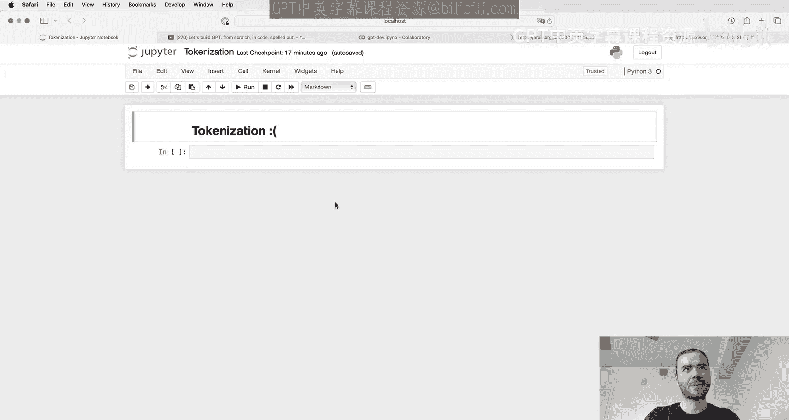

So what is organization？Now， in my previous video， let's build GT from scratch。

We actually already did tokenization， but we did a very naive， simple version of tokenization。

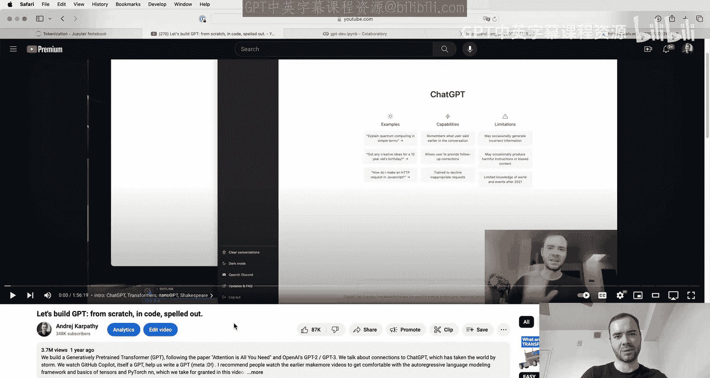

So when you go to the Google Collab for that video。You see here that we loaded our training set。

And our training set was this Shakespeare data set。Now， in the beginning。

 the Shakespeare data set as just a large string in Python， it's just text。

 And so the question is how do we plug text into large language models？And in this case， here。

We created a vocabulary of 65 possible characters that we saw occur in this string。

 These were the possible characters， and we saw that there are 65 of them。

 and then we created a look up table for converting from every possible character。

 a little string piece into a token an integer。😊，So here， for example。

 we tokenized the string high there， and we received this sequence of tokens。

And here we took the first 1000 characters of our dataset set， and we encoded it into tokens。

 And because it this is character level， we received 1000 tokens in a sequence。So token，1847。

 etc cetera。Now， later， we saw that the way we plug these tokens into the language model is by using an embedding table。

And so basically， if we have 65 possible tokens， then this embedding table is going to have 65 rows。

And roughly speaking， we're taking the integer associated with every single token。

 We're using that as a look up into this table。 and we're pling out the corresponding row。

And this row is trainable parameters that we're going to train using back propagation。

 and this is the vector that then feeds into the transformer。

 and that's how the transformer serve perceives every single token。

So here we had a very naive tokenization process that was a character level tokenizer。

But in practice， instead of the art language models， people use a lot more complicated schemes。

 unfortunately， for constructing these token vocabularies。

So we're not dealing on the character level， we're dealing on chunk level。

 and the way these character chunks are constructed is using algorithms such as， for example。

 the bike pair encoding algorithm， which we're going to go into in detail。嗯。

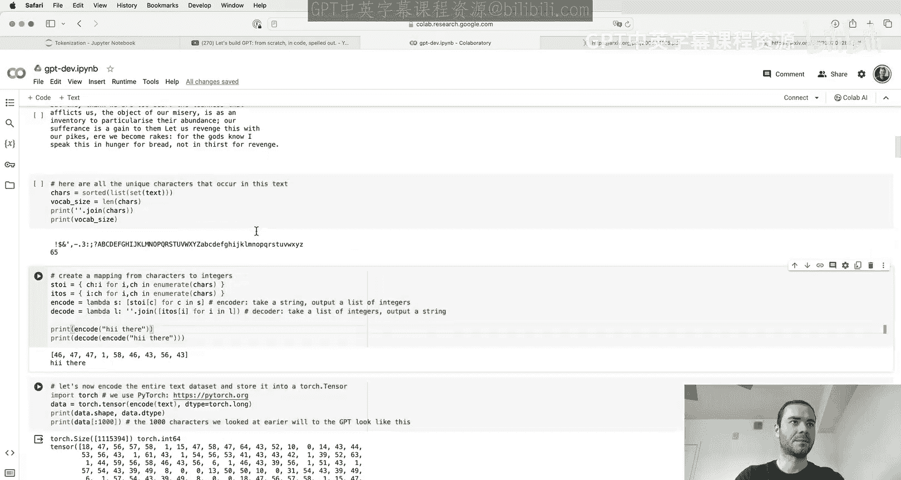

And covering in this video， I'd like to briefly show you the paper that introduced a byte level encoding as a mechanism for tokenization in the context of large language models。

And I would say that that's probably the GPT2 paper。 and if you scroll down here。

To the section input representation， this is where they cover tokenization。

 the kinds of properties that you'd like the tokenization to have。

 And they conclude here that they're going to have a tokenizer where you have a vocabulary of 50257 possible tokens。

And the context size is going to be 1024 tokens。 So in the attention layer of the transformer neural network。

 every single token is attending to the previous tokens in the sequence and is going to see up to 1024 tokens。

So tokens are this like fundamental unit， the atom of large language models， if you will。

 and everything is in units of tokens， everything is about tokens。

 and tokenization is the process for translating strings or text into sequences of tokens and vice versa。

When you go into the Lama 2 paper as well， I can show you that when you search token。

 you're going to get 63 hits， and that's because tokens are again pervasive。

 So here they mentioned that they trained on two trillion tokens of data and so on。

So we're going to build our own tokenizer。Luckily， the B pair encoding algorithm is not that super complicated。

 and we can build it from scratch ourselves， and we'll see exactly how this works。

 Before we dive into code， I'd like to give you a brief taste of some of the complexities that come from the tokenization。

 because I just want to make sure that we motivated sufficiently for why we are doing all this and why this is so gross。

😊。

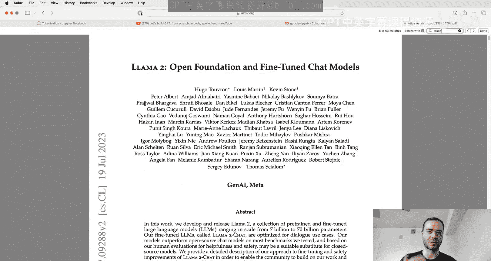

So tokenization is at the heart of a lot of weirdness in large language models。

 and I would advise that you do not brush it off。A lot of the issues that may look like just issues with the neural or architecture or the large language model itself are actually issues with the tokenization and fundamentally trace back to it。

So if you've noticed any issues with large language models can know not able to do spelling tasks very easily。

 that's usually due to tokenization， Sple string processing can be difficult for the large language model to perform natively。

Non English languages can work much worse， and to a large extent this is due to tokenization。

Sometimes LLMs are bad at simple arithmetic， also can trace be traced to tokenization。

GPT2 specifically would have had quite a bit more issues with Python than future versions of it due to tokenization。

There's a lot of other issues， maybe you've seen weird warnings about a trail in white space。

 this is a tokenization issue。嗯。If you had asked GT earlier about solid gold Magcarp and what it is。

 you would see the LLM go totally crazy， and it would start going off about a completely unrelated tangent topic。

Maybe you have been told to use the Ml over JSO and structure data。

 All of that has to do with tokenization。So basically tokenization is at the heart of many issues。

I will look back around to these at the end of the video， but for now。

 let me just skip over it a little bit and let's go to this web app， the Tik tokenizer。veral。 app。

So I have it loaded here。 and what I like about this web app is that dokenization is running a sort of live in your browser and ja。

 so you can just type here stuff， hellello world， and the whole string retokenizes。So。

Here what we see on the left is a string that you put in on the right。

 we're currently using a GT2 tokenizer。We see that this string that I pasted here is currently tokenizing into 300 tokens。

 and here they are sort of shown explicitly in different colors for every single token。

So for example， this word tokenization became two tokens， the token30，642 and 1，634。

The token space is， is token 3，18。 So be careful on the bottom， you can show white space。

And keep in mind that there are spaces and slash N new line characters in here。

 but you can hide them for clarity。The token space at is token 3，79。 The The token space the is 2，62。

 etc cetera。So you notice here that the space is part of that token chunk。Now。

 so this is kind of like how our English sentence broke up and that seems all well and good。Now。

 now here I put in some arithmetic。So we see that the token 127 plus。And then token 6， space 6。

 followed by 77。 So what's happening here is that1 27 is feeding in as a single token into the large language model。

But the number 677 will actually feed in as two separate tokens。

And so the large language model has to sort of take account of that and process it correctly in its network。

And see here，804 will be broken up into two tokens， and is all completely arbitrary。

And here I have another example of four digit numbers。

 and they break up in a way that they break up and it's totally arbitrary。

 Sometimes you have multiple digits， single token， Sometimes you have individual digits as many tokens。

 and it's all kind of pretty arbitrary And coming out of the tokenizer。Here's another example。

 We have the string。Eng。And you see here that this became two tokens。But for some reason， when I say。

 I have an egg。You see when it's a space egg。It's two token。 It's sorry as a single token。

 So just egg by itself in the beginning of a sentence is two tokens。

 But here as a space egg is suddenly a single token。For the exact same string。Okay。Here。

 lowercase egg turns out to be a single token。 and in particular， notice that the color is different。

 So this is a different token。 So this is case sensitive。 And， of course。

 a capital egg would also be different tokens。 And again， this would be two tokens arbitrarily。

So for the same concept， egg， depending on if it's in the beginning of a sentence。

 at the end of a sentence， Lowcase， uppercase or mixed。

 all this will be basically very different tokens and different Is。

 And the language model has to learn from raw data from all the internet text that is going to be training on that these are actually all the exact same concept。

 and it has to sort of group them in the parameters of the neural network and understand just based on the data patterns that these are all very similar。

 but maybe not almost exactly similar， but very， very similar。After the E demonstration here。

 I have an introduction from Open Eye's ChaBT in Korean， so Mannaso Panggawea。E cetera。

 So this is in Korean。 And the reason I put this here is because you'll notice that。

Non English languages work slightly worse in Chayt。 Part of this is because， of course。

 the training data set for Chatt is much larger for English and for everything else。

 But the same is true， not just for the large language model itself， but also for the tokenizer。

 So when we train the tokenizer， we're going to see that there's a training set as well。

 And there's a lot more English than non English。And what ends up happening is that we're going to have a lot more longer tokens for English。

So how do I put this If you have a single sentence in English and you tokenize it。

 you might see that it's 10 tokens or something like that。 But if you translate that sentence into。

 say， Korean or Japanese or something else， you'll typically see that number of tokens used is much larger。

 And that's because the chunks here are a lot more broken up。

So we're using a lot more tokens for the exact same thing。

And what this does is it blos up the sequence length of all the documents。

 So you're using up more tokens。 And then in the attention of the transformer。

 when these tokens try to attend each other， you are running out of context in the maximum context length of that transformer。

 And so basically， all the non English text is stretched out from the perspective of the transformer。

 And this just has to do with the trains that used for the tokenizer and the tokenization itself。

So it will create a lot bigger tokens and a lot larger groups in English。

 and it will have a lot of little boundaries for all the other non English text。嗯。

So if we translated this into English， it would be significantly fewer tokens。

The final example I have here is a little snippet of Python for doing Fisbos。

And what I'd like you to notice is， look。All these individual spaces are all separate tokens。

 They are token 2 20。So。220，220，220，220， and then space if is a single token。

And so what's going on here is that when the transformer is going to consume or try to create this text。

It needs to handle all these spaces individually。 They all feed in one by one into the entire transformer in the sequence。

 And so this is being extremely wasteful， tokenizing it in this way。And so as a result of that。

 GP2 is not very good with Python。 and it's not anything to do with coding or the language model itself。

 It's just that if you use a lot of intonation using space in Python， like we usually do。

 you just end up bloating out all the text and is separated across way too much of the sequence。

 And we are running out of the context length in the sequence。

 That's roughly speaking what' what's happening。 We're being way too wasteful。

 We're taking up way too much token space。 Now， we can also scroll up here and we can change the tokenazer。

 So note here that GP2 tokenazer， creates a token count of 300 for this string here。

We can change it to CL 100 K base， which is the G photo tokenizer。

And we see that the token count drops to 185。So for the exact same string。

 we are now roughly having the number of tokens。And roughly speaking。

 this is because the number of tokens in the GT4 tokenizer is roughly double that of the number of tokens in the GT2 tokenizer。

 so we went from roughly 50k to roughly 100k。Now， you can imagine that this is a good thing because the same text is now squished into half as many tokens。

 so this is a lot denser input to the transformer。And in the transformer。

 every single token has a finite number of tokens before it that it's going to pay attention to。

And so what this is doing is we're roughly able to see。

Twice as much text as a context for what token to predict next， because of this change。But。

 of course， just increasing the number of tokens is not strictly better infinitely。

 because as you increase the number of tokens， now。

 your embedding table is sort of getting a lot larger。 And also at the output。

 we are trying to predict the next token。 And there's the softm there。 And that grows as well。

 We're going go into more detail later on this。 But there's some kind of a sweet spot somewhere where you have a just right number of tokens in your vocabulary where everything is appropriately dense and still fairly efficient。

Now， one thing I would like you to note specifically for the G for tokenizer is that。

The handling of the white space for Python has improved a lot。 You see that here。

 these four spaces are represented as one single token for the three spaces here。

 and then the token space if。And here， seven spaces were all grouped into a single token。

 So we're being a lot more efficient than how we represent Python。

 And this was a deliberate choice made by Open AI when they designed the G for tokenizer。

And they group a lot more white space into a single character。

 What this does is this densifies Python， and therefore。

 we can attend to more code before it when trying to predict the next token in a sequence。

And so the improvement in the Python coding ability from GP2 to GP 4 is not just a matter of the language model and the architecture and the details of the optimization。

 but a lot of the improvement here is also coming from the design of the tokenizer and how it groups characters into tokens。

Okay， so let's now start writing some code。So remember what we want to do。

 We want to take strings and feed them into language models。 For that。

 we need to somehow tokenize strings into some integers in some fixed vocabulary。

 and then we will use those integers to make a look up into lookup table of vectors and feed those vectors into the transformer as an input。

Now， the reason this gets a little bit tricky， of course。

 is that we don't just want to support the simple English alphabet。

 we want to support different kinds of languages， so this is Anang Hao in Korean， which is hello。

 and we also want to support many kinds of special characters that we might find on the internet。

 for example， MOG。So how do we feed this text into transformers？Well。

 what is this text anyway in Python， So if you go to the documentation of a string in Python you can see that strings are immutable sequences of Unicode code points。

Okay， what are Uniicode code pointss。We can go to Wikipedia。

So Unicode code points are defined by the Uniode Consortium as part of the Unicode standard。

And what this is really， is that it's just a definition of roughly 150000 characters right now。

 and roughly speaking what they look like and what integers represent those characters。

 So says 150000 characters across 161 scripts as of right now。 So if you scroll down here。

 you can see that the standard is very much alive。 The latest standard 15。1 is September 2023。And。

Basically， this is just a way to define。Lots of types of characters。Like， for example。

 all these characters across different scripts。So the way we can access the Unicode code point given a single character is by using the or function in Python。

 So for example， I can pass in order of H。And I can see that for the single character H。

 the Uniode code point is 104。Okay。But this can be arbitrarily complicated so we can take。

 for example， our emoji here， and we can see that the code point for this one is 128000。

Or we can take an。And this is 50000。Now， keep in mind。

 you can't plug in strings here because you this doesn't have a single code point。

 It only takes a single Uniicode code point character and tells you its integer。So in this way。

 we can look up。All the characters of this specific string and their code points。

 So order of x4 x in this string。And we get this encoding here。

Now see here we've already turned the raw code points already have integers。

 So why can't we simply just use these integers and not have any organization at all。

 Why can't we just use this natively as is and just use the code point。Well， one reason for that。

 of course， is that the vocabulary in that case would be quite long。 So in this case。

 for UniIcodeode， this is a vocabulary of 150，000 different code points。

But more worryingly than that， I think the Unicode standard is very much alive and it keeps changing。

 and so it's not kind of a stable representation necessarily that we may want to use directly。

So for those reasons， we need something a bit better。 So to find something better。

 we turn to encodings。So if we go to the Wikipedia page here。

 we see that the Unicode consortium defines three types of encodings， UTF 8， UTF 16 and UTF 32。

These encodings are the way by which we can take Unicode text and translate it into binary data or byte streams。

U TF8 is by far， the most common。So this is the UTF8 page Now this Wikipedia page is actually quite long。

 but what's important for our purposes is that UTF8 takes every single code point。

And it translates it to a by stream， and this byte stream is between one to four bytes。

 so it's a variable length encoding。So depending on the Uniiccode point， according to the schema。

 you're going to end up with between one to four bytes for each code point。On top of that。

 there'sTF UTF 16。And U T F 32， U T F 32 is nice because it is fixed length instead of variable length。

 but it has many other downsides as well。So， the full kind of。

Spectrum of pros and cons of all these different three encodings are beyond the scope of this video。

 I just like to point out that I enjoyed this blog post and this blog post at the end of it also has a number of references that can be quite useful one of them is UTF8 everywhere manifesto and this manifesto describes the reason why UTF8 is significantly preferred and a lot nicer than the other encoings and why it is used a lot more prominently on the Internet。

One of the major advantages does just to give you a sense is that UTF8 is the only one of these that is backwards compatible to the much simpler ASCI encoding of text。

 but I'm not going to go into the full detail in this video。

So suffice to say that we like the UTF8 encoding， and let's try to take this string and see what we get if we encoded it into UTF8。

The string class in Python actually has doting code， and you can give it the encoding， which is。

 say UTFA。Now we get out of this is not very nice because this is the bytes。

 is a bytes object and it's not very nice in a way that it's printed。

 so I personally like to take it through a list because then we actually get the raw bytes of this encoding。

So this is the raw bites that represent this string， according to the UTF8 encoding。

We can also look at UTF 16。 We get a slightly different by stream。

And here we start to see one of the disadvantages of U T F 16。 You see how we have 00， something，0。

 something，0， something， which tend to get a sense that this is a bit of a wasteful encoding。

 And indeed， for simple ASi characters or English characters here， we just have the structure of 0。

 something，0 something。 and it's not exactly nice。Same for U TF 32。 When we expand this。

 we can start to get a sense of the wastefulness of this encoding for our purposes。

 You see a lot of zeroes followed by something。And so this is not desirable。

So suffice it to say that we would like to stick with UTF 8 for our purposes。However。

 if we just use UTF8 naively， these are by streams。

 So that would imply a vocabulary length of only 256 possible tokens。But this。

 this vocabulary re size is very， very small。 What this is going to do if we just were to use it naively is that all of our text would be stretched out over very。

 very long sequences of bytes。And so。What what this does is that certainly the embedding table is going to be tiny。

 and the prediction at the top of the final layer is going to be very tiny。

 but our sequences are very long。 And remember that we have pretty finite context length in the attention that we can support in a transformer for computational reasons。

 And so we only have as much context length。 But now we have very， very long sequences。

 And this is just inefficient that is not going to allow us to attend to sufficiently long text before us。

 for the purposes of the next token prediction task。

So we don't want to use the raw bytes of the UTF8 encoding。

 We want to be able to support larger vocabulary size that we can tune as a high parameter。

 but we want to stick with the UTF8 encoding of these strings。 So what do we do？ Well， the answer。

 of course， is we turn to the byte pair encoding algorithm。

 which will allow us to compress these by sequences。To a variable amount。

 So we'll get to that in a bit。 But I just wantna briefly speak to the fact that I would love nothing more than to be able to feed raw by sequences into language models。

 In fact， there's a paper about how this could potentially be done from summer last year。Now。

 the problem is you actually have to go in and you have to modify the transformer architecture because as I mentioned。

 you're going to have a problem where the attention will start to become extremely expensive because the sequences are so long。

And so in this paper， they propose kind of a hierarchical structuring of the transformer that could allow you to just feed in raw bytes。

 And so at the end， they say together， these results establish the viability of tokenization free auto aggressiveive sequence modeling at scale。

 So tokenization free would indeed be amazing。 We would just feed by streams directly into our models。

 But unfortunately， I don't know that this has really been proven out yet by a sufficiently many groups and at sufficient scale。

 But something like this at one point would be amazing。 And I hope someone comes up with it。

 But for now， we have to come back。 and we can't feed this directly into language models。

 and we have to compress it using the by pair encoing algorithm。 So let's see how that works。

 So as I mentioned， the byte pair encoding algorithm is not all that complicated。

 And the Wikipedia page is actually quite instructive as far as the basic idea goes。

We're doing is we have some kind of input sequence。 Like， for example， here。

 we have only four elements in our vocabulary， A， B， C and D， and we have a sequence of them。

 So instead of bytes， let's say we just had four a vocab size of four。The sequence is too long。

 We'd like to compress it。So we do is that we iteratively find the pair of tokens that occur the most frequently。

And then once we've identified that pair。We replace that pair with just a single new token that we append to our vocabulary。

 So， for example， here， the bite pair A A occurs most often。 So we mint a new token。

 Let's call it capital Z。And we replace every single occurrence of A A by Z。

 So now we have two Z's here。So here we took a sequence of 11 characters with vocabulary size 4。

And we've converted it to a sequence of only nine tokens。 but now with a vocabulary of five。

 because we have a fifth vocabulary element that we just created。

 and it's Z standing for concatenation of A。And we can again， repeat this process。

 so we again look at the sequence and identify the pair of tokens that are most frequent。

Let's say that that is now A B。 Well， we are going to replace A B with a new token that we mint called Y。

 So y becomes A B。 And then every single occurrence So if A B is now replaced with Y。

 So we end up with this。So now we only have one，2，3，4，5，6，7 characters in our sequence。

 but we have not just four vocabulary elements or five， but now we have six。And for the final round。

 we again look through the sequence， find that the phrase Z y or the pair zy is most common and replace it one more time with another character。

 let's say x。 So x is z y， and we replace all occurss of z Y， and we get this following sequence。

So basically， after we have gone through this process， instead of having a。Eng。Sequence of 11。Tokens。

With a vocabulary length of 4， we now have a sequence of 1，2，3，4，5 tokens。

 but our vocabulary length now is 7。And so in this way。

 we can iteratively compress our sequence as we mint new tokens。 So in the exact same way， we start。

 we start out with byte sequences， So we have 256 vocabulary size。

 but we're now going to go through these and find the bite pairs that occur the most。

 And we're going to iteratively start minting new tokens。

 appending them to our vocabulary and replacing things。😊，And in this way。

 we're going to end up with a compressed training dataset set and also an algorithm for taking any arbitrary sequence and encoding it using this vocabulary and also decoding it back to strings。

 so let's now implement all that。So here's what I did。 I went to this blog post that I enjoyed。

 and I took the first paragraph， and I copy pasted it here into text。

 So this is one very long line here。Now， to get the tokens， as I mentioned。

 we just take our text and we encode it into UTF8。The tokens here at this point will be a raw bites。

 single stream of bites。And just so that it's easier to work with， instead of just a bytes object。

 I'm going to convert all those bytes to integers。And then create a list of it just so it's easier for us to manipulate and work with in Python and visualize。

And here I'm printing all of that。 So this is the original。This is the original paragraph。

 and its length is 533 coat points。And then here are the bytes encoded in UTF8。

 And we see that this has a length of 616 Bs。 at this point or 616 tokens。

 And the reason this is more is because a lot of these simple ASi characters or simple characters。

 they just become a single byte。 but a lot of these uncode。

 more complex characters become multiple bytes up to 4。 And so we are expanding that size。

So now what we'd like to do as a first step of the algorithm is we'd like to iterate over here and find the pair of bytes that occur most frequently。

 because we are then going to merge it。 So if you are working along on the notebook on a side。

 then I encourage you to basically click on the link。

 find this notebook and try to write that function yourself。 Otherwise。

 I'm going to come here and implement first， the function that finds the most common pair。 Okay。

 so here's what I came up with。 There are many different ways to implement this。

 But I'm calling the function get stats， It expects a list of integers。

 I'm using a dictionary to keep track of basically the count。

 And then this is a pythonic way to iterate consecutive elements off this list。

 which we covered in the previous video。And then here。

 I'm just keeping track of just incrementing by one for all the pairs。

 So if I call this on all the tokens here， then the stats comes out here。 So this is the dictionary。

 The keys are these topples of consecutive elements， and this is the count。So， just to。

Printed in a slightly better way。 This is one way that I like to do that。Where you。

 it's a little bit。Compound here so you can pause， if you like。 But reiterate iterate all the items。

 The items called on dictionary returns pairs of key value。And instead。

 I create a list here of value key， because if it's a value key list， then I can call sort on it。

 And by default， Python will use the first element， which in this case。

 will be value to sort by if it's given tops。And then reverse。 So it's descending and print that。

 So basically， it looks like 10，1 comma 32 was the most commonly occurring consecutive pair。

 and it occurred 20 times。 We can double check that that makes reasonable sense。

 So if I just search 101，32。Then you see that these are the 20 occurrences of that。

And if we'd like to take a look at what exactly of that pair is， we can use char。

Which is the opposite of ord in Python。 So we give it a Unicode code point， so 101。And of 32。

 And we see that this is E and space。So basically， there's a lot of E space here。

 meaning that a lot of these words seem to end with E。 So here's Espace as an example。

So there's a lot of that going on here。 And this is the most common pair。

So now that we've identified the most common pair， we would like to iterate over the sequence。

We're going to mint a new token with the I D of 256， right。

 Because these tokens currently go from 0 to 2，5，5。 So when we create a new token。

 it will have an I D of 2，56。And we're going to iterate over this entire list。

 And every every time we see 101 comma 32， we're going to swap that out for 2，5，6。

So let's implement that now and feel free to do that yourself as well。So first。

 I commented this just so we don't pollute the notebook too much。

This is a nice way of in Python obtaining the highest ranking pair。

 So we're basically calling the max on this dictionary stats。And this will return the maximum key。

And then the question is， how does it rank keys， So you can provide it with a function that ranks keys。

 and that function is just sta that get。 Stat that get would basically return the value。

And so we're ranking by the value and getting the maximum key， so it's 101 comma 32 as we saw。Now。

 to actually merge 10132， this is the function that I wrote， but again。

 there are many different versions of it。So we're going to take a list of Is and the pair that we want to replace。

 and that pair will be replaced with the new index I X。So iterating through IDs， if we find the pair。

 swap it out for IDX。So we create this new list。And then we start at 0。

 And then we go through this entirely sequentially， from left to right。

And here we are checking for equality at the current position with the pair。

So here we are checking that the pair matches。 Now。

 here is a bit of a tricky condition that you have to append if you're trying to be careful。

 And that is that you don't want this here to be out of bounds at the very last position when you're on the rightmost element of this list。

 Otherwise， this would give you an out of bounds error。

 So we have to make sure that we're not at the very， very last element。

 So this would be false for that。So if we find a match。

 we append to this new list that replacement index， and we increment the position by two。

 so we skip over that entire pair。But otherwise， if we haven't found a matching pair。

 we just sort of copy over the element of deposit and。Increment by one， then return this。

So here's a very small toy example。 If we have a list 5，6，6，7，9，1。

 and we want to replace the occurrences of 67 with 99。

 then calling this on that will give us what we are asking for。 So here， the 6，7 is replaced with 99。

So now I'm going to uncommon this for our actual use case， where we want to take our tokens。

 We want to take the top pair here and replace it with 2，5，6 to get tokens  to if we run this。

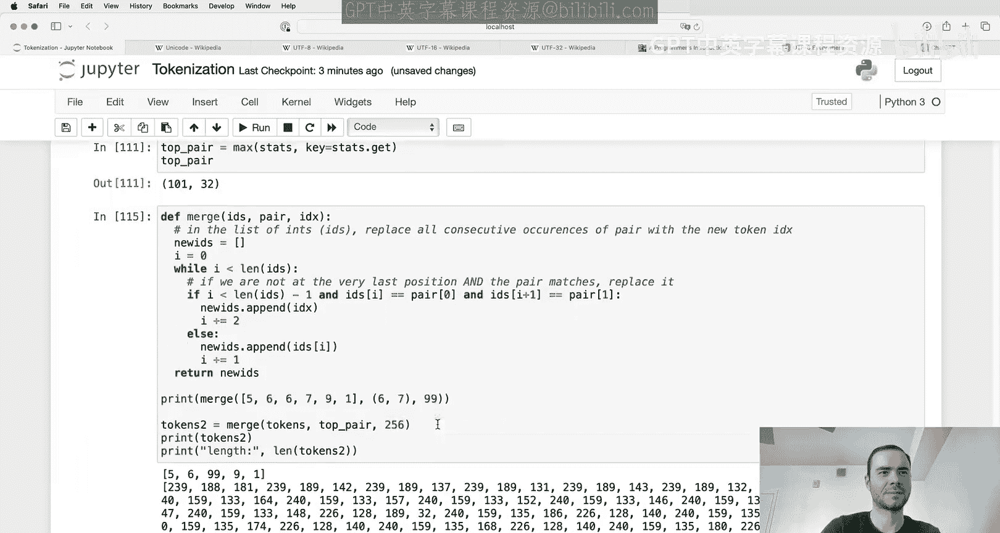

We got the following。So recall that previously。We had a length 616 in this list。

And now we have a length 596， right， So this decreased by 20。

 which makes sense because there are 20 occurrences。Moreover， we can try to find 2，5，6 here。

 and we see plenty of occurrences off it。And moreover， just double check。

 there should be no occurrence of 10，1，32。 So this is the original array， plenty of them。

 And in the second array， there are no occurrences of 101，32。

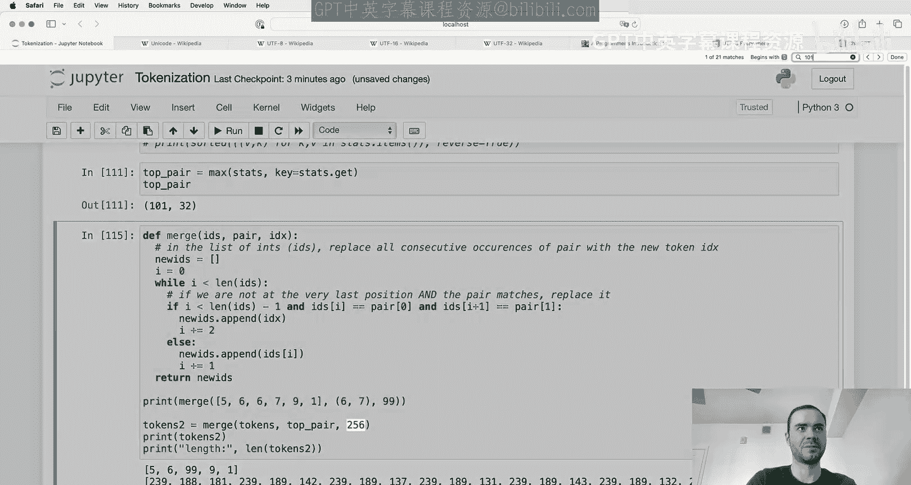

So we've successfully merged this single pair。And now we just iterate this。

 so we are going to go over the sequence again， find the most common pair and replace it。

So let me now write a Y loop that uses these functions to do this sort of iteratively。

 And how many times do we do it for？ Well， that's totally up to us as a hyperparameter。

 The more steps we take the larger will be our vocabulary and the shorter will be our sequence。

 and there is some sweet spot that we usually find works the best in practice。

 and so this is kind of a hyperparameter and we tune it and we find good vocabulary sizes as an example。

 Gp4 currently uses roughly 100000 tokens and ballpark that those are reasonable numbers currently instead there are large hundred models。

 So let me now write putting it all together and iterating these steps。Okay。

 now before we dive into the Y loop， I wanted to add one more cell here where I went to the blog post。

 And instead of grabbing just the first paragraph or two， I took the entire blog post。

 and I stretched it out in a single line。 And basically just using longer text will allow us to have more representative statistics for the by pairs and we'll just get a more sensible results out of it because it's longer text。

So here we have the raw text， we encode it into bytes using the UTF8 encoding。And then here。

 as before， we are just changing it into a list of integers in Python just so it's easier to work with instead of the raw bys objects。

And then this is the code that I came up with to。Actually， do the merging in loop。

These two functions here are identical to what we had above。

 I only included them here just so that you have the point of reference here。So these are identical。

 and then this is the new code that I added。So the first thing we want to do is we want to decide on a final vocabulary size that we want。

 our tokenizer to a half。 And as I mentioned， this is a hyperparameter。 and you set it in some way。

 depending on your best performance。So let's say for us。

 we're going to use 276 because that way we're going to be doing exactly 20 mergeges。

And 20 merges because we already have 256 tokens for the raw bites。And to reach 276。

 we have to do 20 merges to add 20 new tokens。Here。

 this is one way in Python to just create a copy of the list。So I'm taking the tokens list。

 and by wrapping it in the list， Python will construct a new list of all the individual elements。

 So this is just a copy operation。Then here I'm creating a Mers dictionary。

 So this Merges dictionary is going to maintain basically the child  one。

 child2 mapping to a new token。And so we're going to be building up here as a binary tree of Merges。

 But actually， it's not exactly a tree because a tree would have a single root node with a bunch of leaves for us。

 we're starting with the leaves on the bottom， which are the individual bites。

 Those are the starting 256 tokens。 And then we're starting to like merge  two of them at a time。

 And so it's not a tree。 It's more like a forest。嗯。As we merge these elements。So。For 20 merges。

 we're going to find the most commonly occurring pair。

 We're going to mint a new token integer for it。 So I here will'll start at 0。

 So we'll going start at 2，5，6。We're going to print that we're merging it and we're going to replace all the occurrences of that pair with the new newlamented token。

And we're going to record that this pair of integers merged into this new integer。So， running this。

Gives us the following output。So we did 20 merges， and for example。

 the first merge was exactly as before the 10132 tokens merging into a new token 256。Now。

 keep in mind that the individual tokens 101 and 32 can still occur in the sequence after merging。

 it's only when they occur exactly consecutively that that becomes 256 now。And in particular。

 the other thing to notice here is that the token 2，5，6， which is the newly minted token。

 is also eligible for merging。 So here on the bottom， the 20th merge was a merge of 2，5，6 and 2，5，9。

 becoming 2，7，5。So every time we replace these tokens。

 they become eligible for merging in the next round of the iteration。

So that's why we were building up a small sort of binary forest instead of a single individual tree。

One thing we can take a look at as well is we can take a look at the compression ratio that we've achieved。

So in particular， we started off with this tokens list， so we started off with 24，000 bytes。

And after merging 20 times， we thou have only 19000 tokens。And so therefore。

 the compression ratio simply just dividing the two is roughly 1。27。

 So that's the amount of compression we are able to achieve of this text with only 20 merges。

And of course， the more vocabulary elements you add， the greater the compression ratio here would be。

Finally， so that's kind of like。The training of the tokenizer， if you will。 Now。

 one point that I wanted to make is that， and maybe this is a diagram that can help kind of illustrate is that the tokenizer is a completely separate object from the large language model itself。

So everything in this lecture， we're not really touching the LLM itself。

 We're just training the tokenizer。 This is a completely separate pre processingsing stage usually。

 so the tokenizer will have its own training set， just like a large language model has a potentially different training set。

So the tokenizer has a training set of documents on which you're going to train to tokenizer。

And then we're performing the byte pair encoding algorithm， as we saw above。

 to train the vocabulary of the stkenizer。So it has its own training set as a pre processing stage that you would run a single time in a beginning。

 and their kinds are trained using by parent coding algorithm。Once you have the tokenizer。

 once it's traineded and you have the vocabulary and you have the emerges。

We can do both encoding and decoding。 So these two arrows here。

 So the tokenizer is a translation layer between raw text， which is， as we saw。

 the sequence of Unicode code points。It can take raw text and turn it into a token sequence。

And vice versa can take a token sequence。And translated back into raw text。

So now that we have trained tokenazer and we have these merges。

We are going to turn to how we can do the encoding and the decoding step。 If you give me text。

 here are the tokens and vice versa。 If you give me tokens， here's a text。Onces we have that。

 we can translate between these two realms， and then the language model is going to be trained as a step two afterwards。

 and typically in in a sort of a state of the art application。

 you might take all of your training data for the language model and you might run it through the tokenizer and sort of translate everything into a massive token sequence。

 and then you can throw away the raw text you're just left with at the tokens themselves。

 and those are stored on disk and that is what the large language model is actually reading when it's training on them。

So this one approach that you can take as a single massive preprocessing stage。嗯。So yeah， basically。

 I think the most important thing I want to get across is that this is completely separate stage。

 It usually has its own entire training set。You may want to have those training sets be different between the tokenizer and the large launch model。

 So， for example， when you're training the tokenizer。As I mentioned。

 we don't just care about the performance of English text。

 We care about multi many different languages， and we also care about code or not code。

 So you may want to look into different kinds of mixtures of different kinds of languages and different amounts of code and things like that。

 because the amount of different language that you have in your tokenizer train set will determine how many merges of it there will be。

 And therefore， that determine the density with which this type of data is sort of has in the token space。

And so roughly speaking intuitively， if you add some amount of data。

 like say you have a ton of Japanese data in your tokenizer training set。

 then that means that more Japanese tokens will get merged。

 and therefore Japanese will have shorter sequences。

And that's going to be beneficial for the large language model。

 which has a finite context length on which it can work on in in the token space。

So hopefully that makes sense。So we're now going to turn to encoding and decoding now that we have trained a tokenizer。

 So we have our merges。And now how do we do encoding and decocoding？Okay。

 so let's begin with decoding， which has this arrow over here。 So given a token sequence。

 let's go through the tokenazizer to get back a Python string object。 So the raw text。

So this is the function that we'd like to implement or given the list of integers and we want to return to Python string。

 if you'd like try to employ this function yourself， it's a fun exercise。

 otherwise I'm going to start a pasting in my own solution。So there are many different ways to do it。

 here's one way。I will create a kind of preproces variable that I will call vocab。And。

Vocab is a mapping or dictionary in Python from the token I D to the bys object for that token。

So we begin with the raw bites for tokens from 0 to 2，5，5。 And then we go in order of all the merges。

 and we sort of populate this vocabist by doing an addition here。

 So this is the basically the bite's representation of the first child followed by the second one。

 And remember， these are bites objects。 So this addition here is an addition of two bites objects。

 just concatenation。So that's what we get here。One tricky thing to be careful with， by the way。

 is that I'm iterating a dictionary in Python using a dot items。

 and it really matters that this runs in the order in which we inserted items into the mergeges dictionary。

Luckily， starting with Python 3。7， this is guaranteed to be the case。 But before Python 3。7。

 This iteration may have been out of order with respect to how we inserted elements into merges。

 and this may not have worked。 But we are using a modern Python。 So we're okay。And then here。

 given the IDs， the first thing we're going to do is get the tokens。

So the way I implemented this here is I'm taking， I'm iterating over all the Is。

 I'm using Boab to look up their bytes。 And then here this is one way in Python to concatenate all these bys together。

 to create R tokens。 And then these tokens here at this point are raw bites。 So I have to decode。

Using UTF8 now back into Python strings。So previously。

 we called that encode on a string object to get the bytes。 and now we're doing it opposite。

 We're taking the bytes and calling a decode on the bytes object to get a string in Python。And then。

 we can return text。So this is how we can do it。 Now， this actually has a issue。

In the way I implemented it。 And this could actually throw an error。 So try to think。

 figure out why this code could actually result in an error if we plug in。

Some sequence of IDs that is unlucky。So let me demonstrate the issue。

 When I try to decode just something like 97， I am going to get a letter A here back。

 So nothing too crazy happening。But when I tried to decode 1，28 as a single element。The token 1。

28 is what in string or in Python object， Unicode decoder。UTFA can't decode byte 0 x 8 D。

 which is this in hex imposition 0 invalid start by。 What does that mean。Well。

 to understand what this means， we have to go back to our UTFA page。That I briefly showed earlier。

 and this is Wikipedia UTF8， and basically there's a specific schema that UTF8 bys take。

So in particular， if you have a multibyte object for some of the uncode characters。

 they have to have this special sort of envelope in how the encoding works。

And so what's happening here is that。Inval start bite。 That's because 128。

 the binary representation of it is one， followed by all zeros。So we have one and then all 0。

 And we see here that that doesn't conform to the format because one followed by all 0 just doesn't fit any of these rules。

 so to speak。 So it's an invalid start bite， which is by  one。

This one must have a one following it and then a0 following it。

 and then the content of your Uniode in excess here。So basically。

 we don't exactly follow the U TF8 standard。 And this cannot be decoded。

 And so the way to fix this is to use。This errors equals in byte do decocode function of Python。

And by default， errors is strict， so we will throw an error if it's not valid U T F8 bytes encoding。

 But there are many different things that you could put here on error handling。

 This is the full list of all the errors that you can use。And in particular， instead of strict。

 let's change it to replace。 and that will replace with this special marker。

 this replacement character。So， errorss equals replace。And now we just get that character back。

So basically， not every single by sequence is valid。 U TF 8。

And if it happens that your large language model， for example， predicts your tokens in a bad manner。

Then they might not fall into valid U TF 8。 And then we won't be able to decode them。

So the standard practice is to basically use errors equals replace。

 and this is what you will also find in the open AI code that they released as well。But basically。

 whenever you see this kind of a character in your output in that case。

 something went wrong and the LM output not was not valid sort of sequence of tokens。Okay。

 and now we're going to go the other way。 So we are going to implement this arrow right here where we are going to be given a string。

 and we want to encode it into tokens。So this is the signature of the function that we're interested in。

And this should basically print a list of integers of the tokens。 So again。

 try to maybe implement this yourself if you'd like a fun exercise。And pause here。

 otherwise I'm going to start putting in my solution。So again， there are many ways to do this。

 So that this is one of the ways that sort of。I came up with。

So the first thing we're going to do is we are going to。

Take our text encoded into U TF8 to get the raw bys。 And then as before。

 we're going to call list on the Btes object to get a list of integers of those bytes。

So those are the starting tokens， those are the raw bitetes of our sequence。But now， of course。

 according to the Mers dictionary above。And recalled， this was the Mers。

Some of the bites may be merged。According to this， lookup。In addition to that。

 remember that the merges was built from top to bottom。

 And this is sort of the order in which we inserted stuff into merges。

 And so we prefer to do all these merges in the beginning before we do these merges later， because。

 for example， this merge over here relies on the 2，5，6， which got merged here。

So we have to go in the order from top to bottom， sort of if we are going to be merging anything。Now。

 we expect to be doing a few mergers， So we're gonna be doing well true。

And now we want to find a pair of bytes that is consecutive that we are allowed to merge。

 according to this。In order to reuse some of the functionality that we've already written。

 I'm going to reuse the function Gts。So recall that Gts will give us the will basically count up how many times every single pair occurs in our sequence of tokens。

And returned that as a dictionary。And the dictionary was a mapping。

From all the different bite pairs to the number of times that they occur， right。At this point。

 we don't actually care how many times they occur in the sequence。

 We only care what the raw pairs are in that sequence。

 and so I'm only going to be using basically the keys of this dictionary。

 I only care about the set of possible merge candidates， if that makes sense。Now。

 we want to identify the pair that we're going to be merging at this stage of the loop。

So what do we want， We want to find the pair or like a key inside stats。

That has the lowest index in the mergeges dictionary。

 because we want to do all the early mergers before we work our way to the late merges。So again。

 there are many different ways to implement this， but I'm going to do something a little bit fancy here。

So I'm going to be using the min over an iterator。In Python。

 when you call min on an iterator and stats here is a dictionary。

 we're going to be iterating the keys of this dictionary in Python。

 So we're looking at all the pairs inside stats。Which are all consecutive pairs。

And we're going to be taking the consecutive pair inside tokens that has the minimum， what。

The min takes a key， which gives us the function that is going to return a value over which we're going to do the min。

And the one we care about is were， we care about taking mergers and basically getting。That pairs。

Index。So basically， for any pair inside stats， we are going to be looking into merges。

At what index it has。And we want to get the pair with the min number。 So as an example。

 if there's a pair 10，1 and 32， we definitely want to get that pair。

 We want to identify it here and return it。 and pair would become 101，32， if it occurs。

And the reason that I'm putting a float inph here as a fallback。Is that in the get function。

 when we call when we basically consider a pair that doesn't occur in the merges。

Then that pair is not eligible to be merged， right。 So if in the token sequence。

 theres some pair that is not a merging pair。 It cannot be merged。

 Then it doesn't actually occur here， and it doesn't have an index， and it cannot be merged。

 which we will denote as float in。And the reason infinity is nice here is because for sure。

 we're guaranteed that iss not going to participate in the list of candidates when we do them in。

So this is one way to do it。So basically one story short。

 this returns the most eligible emerging candidate pair that occurs in the tokens。Now。

 one thing to be careful with here is this function here might fail in the following way。

 if there is nothing to merge， then， then there is nothing ins that satisfied that is satisfied any more。

 There's nothing to merge。 Everything just returns float ins。And then the pair， I think。

 will just become the very first element of stats。But this pair is not actually a mergergable pair。

 It just becomes the first。A pair inside stats arbitrarily。

 because all these pairs evaluate to float in。For the me criterion。So basically。

 it could be that this， this doesn't succeed because there's no more merging pairs。

 So if this pair is not ins， that was returned。Then this is a signal for us that actually。

 there was nothing to merge。 No single pair can be merged any。 In that case， we will break out。嗯。

Nothing else can be merged。You may come up with a different implementation， by the way。

 this is kind of like really trying hard in Python。

 but really we're just trying to find a pair that can be mergeed with a lowest index here。Now。

 if we did find a pair。That is inside mergeges with the lowest index， Then we can merge it。So。

We're going to look into the merger dictionary for that pair to look up the index。

 and we're going to now merge that into that index。 So we're going to do tokens equals。

 and we're going to replace。The original tokens， we're going to be replacing the pair pair。

 and we're going to be replacing it with index I D X。

 And this returns a new list of tokens where every occurrence of pair is replaced with I D X。

 So we're doing merge。And we're going to be continuing this until eventually nothing can be merged。

 We' come out here and will break out。 And here， we just returned tokens。

And so that's the implementationation， I think。 so hopefully this runs okay cool。嗯。Yeah。

 and this looks reasonable。 So， for example，32 is a space in ASI。 So that's here。

So this looks like it worked。 Great。 Okay， so let's wrap up this section of the video。

 At least I wanted to point out that this is not quite the right implementation just yet because we are leaving out a special case。

 So in particular， if we try to do this。This would give us an error。

And the issue is that if we only have a single character or an empty string， then stats is empty。

 and that causes an issue inside men。 So one way to fight this is if Le of tokens is at least two。

Because if it's less than two is just a single token or no tokens。

 then less just there's nothing to merge。 So we just return。 so that would fix that case。Okay。

And then second， I have a few test cases here for us as well。 So first， let's make sure about。

 or let's note the following。If we take a string and we tried to encode it and then decode it back。

 you'd expect to get the same string back， right。Is that true for all strings。

So I think here it is the case， and I think in general， this is probably the case。

But notice that going backwards is is not you're not going to have an identity going backwards because as I mentioned。

 not all token sequences are valid UTF8 sort of by streams。

 and so therefore some of them can't even be decodable。So this only goes in one direction。

But for that one direction， we can check here if we take the training text。

 which is the text that we trained to dokenr on， we can make sure that when we encode in the code。

 we get the same thing back， which is true。And here I took some validation data。 So I went to。

 I think， this web page， and I grabbed some text。 So this is text that the dokenizer has not seen。

 and we can make sure that this also works。Okay， so that gives us some confidence that this was correctly implemented。

So those are the basics of the bike pair encoding algorithm。

 We saw how we can take some training set， train a tokenizer。

 The parameters of the tokenizer really are just this dictionary of merges。

And that basically creates a little binary forest on top of raw bites。

Once we have this the merges table， we can both encode and decode between raw textex and token sequences。

So that's the simplest setting of the tokenazizer。What we're going to do now， though。

 is we're going to look at some of the state of the art launch language models and the kinds of tokens that they use。

 and we're going to see that this picture complexifies very quickly。

 So we're going to go through the details of this complexification one at time。

So let's kick things off by looking at the GP series。 So in particular。

 I have the GP2 paper here and this paper is from 2019 or so five years ago。

And let's scroll down to input representation。 This is where they talk about the tokenazer that they're using for G2。

Now this is all fairly readable， so I encourage you to pause and read this yourself。

 but this is where they motivate the use of the Bte pair encoding algorithm on the byte level representation of UTF8 encoding。

So this is where they mot it， and they talk about the vocabulary， sizes and everything。Now。

 everything here is exactly as Zve covered it so far， but things start to depart around here。

So what the mission is that they don't just apply the naive algorithm as we have done it。

And in particular， here's a motivating example。Suppose that you have common words like dog。

 What will happen is that dog， of course， occurs very frequently in the text。

 and it occurs right next to all kinds of punctuation。 as an example。 So dog， dot。

 dog exclamation mark， dog， question mark， et cetera。 And naively。

 you might imagine that the B P algorithm could merge these to be single tokens。

 And then you end up with lots of tokens that are just like dog with a slightly different punctuation。

And so it feels like you're clustering things that shouldn't be clustered。

 You're combining kind of semantics with punctuation。And this feels suboptimal， and indeed。

 they also say that this is suboptimal according to some of the experiments。

So what they want to do is they want to top down in a manual way in force that some types of characters should never be merged together。

So they want to enforce these emerging rules on top of the bike bear andco algorithm。

So let's take a look at their code and see how they actually enforce this and what kinds of merges they actually do perform。

So I have the tab open here for GP2 under Open AI on Github。And when we go to source。

There is an encoder that pie。Now， I don't personally love that they called encoder that pi because this is the tokenizer and the tokenizer can do both encode and decode。

 So it feels kind of awkward to me that it's called encoder， but that is the tokenizer。

And there's a lot going on here， and we're going to step through it in detail at one point。 For now。

 I just want to focus on this part here。They create a rigx pattern here。 That looks very complicated。

 And we're going to go through it in a bit。But this is the core part that allows them to enforce rules for what parts of the text will never be merged for sure。

Now， notice that R that compile here is a little bit misleading because we're not just doing import R。

 which is the Python R module。 We're doing import rex as R。

 and rex is a Python package that you can install B install rex。

 and it is basically an extension of R。 so it's a bit more powerful R。

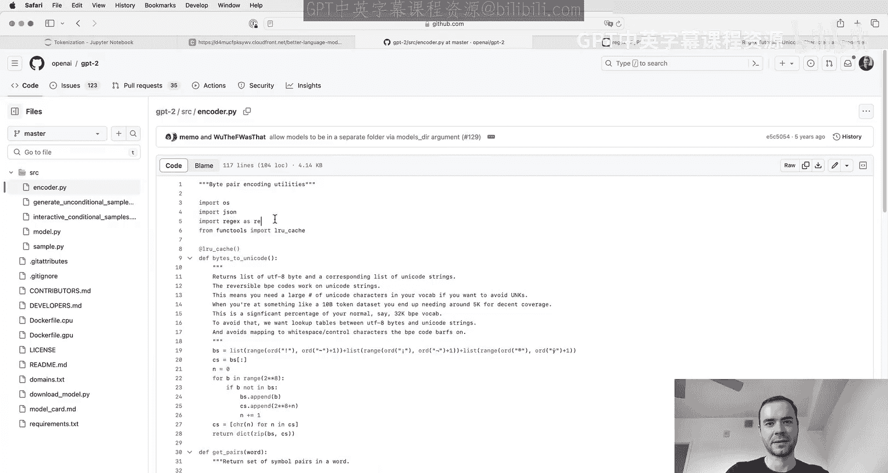

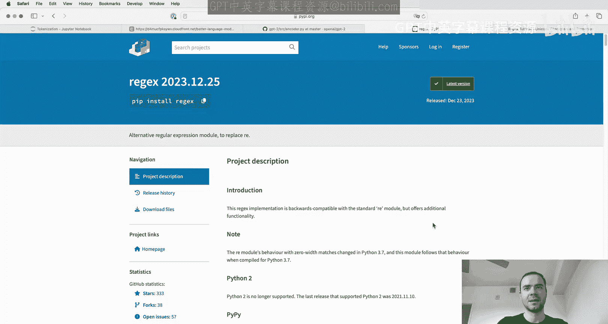

嗯。So， let's take a look at。This pattern and what it's doing and why this is actually doing the separation that they are looking for。

Okay， so I've copy pasted the pattern here to our Jupyter notebook where we left off and let's take this pattern for a spin。

So in the exact same way that their code does， we're going to call an R dot find all for this pattern on any arbitrary string that we are interested。

 So this is the string that we want to encode into tokens。To feed into N LLM， like G2。

So what exactly is this doing？Well， already dotfin all。

 we'll take this pattern and try to match it against this string。嗯。

The way this works is that you are going from left to right in the string and you're trying to match the pattern。

And Ari Dal Find all will get all the occurrences and organize them into a list。Now。

 when you look at the when you look at this pattern， first of all， notice that this is a raw string。

 and then these are three double quotes just to start the string。 So really the string itself。

 this is the pattern itself， right。And notice that it's made up of a lot of os。

 So see these vertical bars。 Those are oars in rex。

And so you go from left to right in this pattern and try to match it against the string wherever you are。

 So we have hello， and we're going to try to match it。 Well， it's not apostrophe S。

 It's not apostrophe T or any of these。But it is an optional space followed by dash P of sorry。

 slash P of L1 or more times。 What is slash P of L， It is。Coming to some documentation that I found。

There might be other sources as well。Slash PO L is a letter， any kind of letter from any language。

And hello is made up of letters， H E， L Lello， et cetera。So optional space。

 followed by a bunch of letters， one or more letters， is going to match hello。

But then the match ends because a white space is not a letter。

 So from there on begins a new sort of attempt to match against this string again。

And starting in here， we're going to skip over all these again until we get to the exact same point again。

And we see that there is an optional space。 This is the optional space。

 followed by a bunch of letters， One or more of them。 And so that matches。So when we run this。

 we get a list of two elements， Ho and then space world。So how are you。

 if you would add more letters， We would just get them like this。Now。

 what is this doing and why is this important？We are taking our string。

 and instead of directly encoding it for tokenization。We are first splitting it up。

 And when you actually step through the code and we'll do that in a bit more detail。

 what really is doing on a high level is that it first splits your text into a list of texts。

 just like this one。And all these elements of this list are processed independently by the tokenizer。

And all of the results of that processing are simply concatenated。So， hello， world。Oh， I。

 I missed how。Hello， world。 How are you， We have five elements of a list。

 All of these will independent independently。Go from text to a token sequence。

And then that token sequence is going to be concatenated。 It's all going to be joined up。

And roughly speaking， what that does is you're only ever finding merges between the elements of this list。

 So you can only ever consider merges within every one of these elements individually。And。

After you've done all the possible merging for all these elements individually。

 the results of all that will be joined by concatenation。

And so you are basically what what you are doing effectively is you are never going to be merging this E with this space because they are now parts of the separate elements of this list。

 And so you are saying we are never going to merge E space。嗯。

Because we're breaking it up in this way。So basically using this rex pattern to chunkunk up the text is just one way of enforcing that some mergers are not to happen。

And we're going to go into more of this text。 And we'll see that。

 But this is trying to do on a high level is we're trying to not merge across letters。

 across numbers， across punctuation and so on。 So let's see in more detail how that works。

 So let's continue now。 We have slash P event。 If you go to the documentation。

Slash P of n is any kind of numeric character in any script， so it's numbers。

So we have an optional space followed by numbers， and those would be separated out。

 So letters and numbers are being separated。 So if I do Hello world 12 3， how are you。

Then world will stop matching here because one is not a letter any more。But one is in number。

 so this group will match for that and we'll get it as a separate entity。

Let's see how these apostropphhees work。 So here， if we have。Slash V or I mean。

 apostrophe V as an example。Then apostrophe here is not a letter or a number。

So hello will' stop matching， and then we will exactly match this with that。

So that will come out as a separate thing。So why are they doing the apostropphhees here， Honestly。

 I think that these are just like very common apostropphes that are used。Typically。

 I don't love that they've done this because。Let me show you what happens when you have some Uniiccode apostropes。

 like， for example， you can have， if you have house。

Then this will be separated out because of this matching。

But if you use the Uniode apostrophe like this。Then， suddenly， this does not。

And so this apostrophe will actually become its own thing now。

And so it's basically hard coded for this specific kind of apostrophe。

 and otherwise they become completely separate tokens。In addition to this， you can go to the。

GP2 docs。 and here when they define the pattern， they say should have added R dot ignore case。

 so Bp merges can happen for capitalized versions of contractions。

 So what they're pointing out is that you see how this is apostrophe and then lowercase letters。

 Well， because they didn't do R dot ignore case， then these rules will not separate out the apostrophees if it's uppercase。

So， how。Would be like this。But if I did， house。If from upper case， then notice。

So the apostrophe comes by itself。So the tokenization will work differently in uppercase and lower case。

 inconsistently separating out these hiposopphes， so it feels extremely gnarly and slightly gross。

But that's that's how that works。 Okay， so let's come back。

 after trying to match a bunch of apostrophe expressions。 by the way the other。

 she hears that these are quite language specific， probably so。I don't know that all the languages。

 for example， use or don't use apostropphheies， but that would be inconsistently tokenized as a result。

Then we try to match letters， Then we try to match numbers。And then if that doesn't work。

 we fall back to here。And what this is saying is， again， optional space。

 followed by something that is not a letter number or a space。And one or more of that。

So what this is doing effectively is this is trying to match punctuation， roughly speaking。

 not letters and not numbers。So this group will try to trigger for that so if I do something like this。

Then， these parts here。Are not letters or numbers， but will actually they will actually get caught here。

And so they become its own。So we've separated the punctuation。And finally， this。

 this is also a little bit confusing， so this is matching white space。

 but this is using a negative look ahead assertion in rex。

So what this is doing is it's matching white space up to。

 but not including the last white space character。Why is this important， This is pretty subtle。

 I think。 So you see how the white space is always included at the beginning of the word。 So space R。

 space U， et cetera。 Suppose we have a lot of spaces here。

What's going to happen here is that these spaces up to and not including the last character。

 will get caught by this。And what that will do is it will separate out the spaces up to。

 but not including the last character so that the last character can come here and join with the space you。

And the reason that's nice is because space h is the common token。

 So if I didn't have these extra spaces here， you would just have spaceu。 And if I add tokens。

 if I add spaces， we still have a space you。 But now we have all this extra white space。So basically。

 the GT to tokenizer really likes to have a space letters or numbers and it prepens these spaces。

 and this is just something that it is consistent about。So that's what that is for。 And then finally。

 we have all the， the last fallback is white space characters。 So that would be just。

If that doesn't get caught， then this thing will catch any trailing spaces and so on。

I wanted to show one more real world example here。 So if we have this string。

 which is a piece of Python code。 and then we tried to split it out。

Then this is the kind of art that we get。So you'll notice that the list has many elements here。

 and that's because we are splitting up fairly often every time sort of a category changes。

So there will never be any mes within these elements。And that's what you are seeing here。Now。

 you might think that in order to train the tokenizer。

Open AI has used this to split up text into chunks and then run just a BP algorithm with an older chunks。

But that is not exactly what happened。 and the reason is the following。

 noticeice that we have the spaces here。Those spaces end up being entire elements。

But these spaces never actually end up being merged by open A eye。

 And the way you can tell is that if you copy paste the exact same chunk here into a token Tik tokenazer。

 you see that all the spaces are kept independent， and they're all token  to 20。

So I think Openai at some point enforce some rule that these spaces would never be merged。

 And so there are some additional rules on top of just chunking and Bpe that Openai is not clear about。

 Now， the training code for the G2 tokenizer was never released。

 So all we have is the code that I've already shown you。 But this code here that they've released。

 It's only the inference code for the tokens。 So this is not the training code you can't give it a piece of text and training tokenizer。

 This is just the inference code which takes the merges that we have up above。

 and applies them to a new piece of text。And so we don't know exactly how Open AI trained the tokenizer。

 but it wasn't as simple as chunk it up and BPP hit whenever it was。Next。

 I wanted to introduce you to the Tk token Library from Open AI。

 which is the official library for dokenization from Open AI。 So this is Tk token。

Pip install Tk token。 And then you can do the tokenization inference。 So This is， again。

 not train code。 This is only inference code for tokenization。

I wanted to show you how you would use it quite simple and running this just gives us the GT2 tokens or the GT4 tokens。

 so the token has are used for GT4。And we in particular we see that the white space in GT2 remains unmerged。

 but in G 4， these white spaces merge， as we also saw in this one， where here they're all unmerged。

 but if we go down to G4， they become merged。嗯。Now， in the GP4 tokenizer。

 they changed the regular expression that they use to chunk up text。

So the way to see this is that if you come to your the TikToken library。And then you go to this file。

 TikTookkenex Open eye public。This is where sort of like the definition of all these different tokenazers that Oia maintains is。

 And so necessarily to do the inference， they had to publish some of the details about the strings。

So this is the string that we already saw for G2。 It is slightly different。

 but it is actually equivalent to what we discussed here。

 So this pattern that we discussed is equivalent to this pattern。

 This one just executes a little bit faster。So here you see a little bit of a slightly different definition。

 but otherwise it's the same。We're going to go into special dose in a bit。

And then if you scroll down to C 100 K， this is the G4 tokenazer。

 you see that the pattern has changed。And this is kind of like the major change in addition to a bunch of other special tokens。

 which I'll go into in a bit again。Now， I'm not going to actually go into the full detail of the pattern change because honestly。

 this is my numbing。 I would just advise that you pull out Chaypt and the rex documentation and just step through it。

 But really the major changes are number one。 you see this I here。

 that means that the case sensitivity。 This is case inensitive match。

 And so the comment that we saw earlier on， oh， we should have used R E dot uppercase。 Basically。

 we're now going to be matching these apostrophe as apostrophe D， apostrophe and et cetera。

 We're going to be matching them both in lowercase and in uppercase。So that's fixed。

There's a bunch of different like handling of the white space that I'm not going to go into the full details of。

And then one more thing here is you will notice that when they match the numbers。

 they only match one to three numbers。So they will never merge numbers。

That are in in more than three digits， only up to three digits of numbers will ever be merged。

And that's one change that they made as well to prevent tokens that are very。

 very long number sequences。But again， we don't really know why they do any of this stuff because none of this is documented and it's just we just get the pattern so yeah。

It is what it is， but those are some of the changes that GP4 has made， and of course。

 the vocabulary size went from roughly 50k to a roughly 100k。

The next thing I would like to do very briefly is to take you through the GP2 encoder Pi that Open eye has released。

This is the file they already mentioned to you briefly。 Now。

 this file is fairly short and should be relatively understandable to you at this point。嗯。

Starting at the bottom here， they are loading two files， encodeder the Json and vocab dot BP E。

 And they do some light processing on it。 And then they call this encoder object。

 which is the tokenizer。Now， if you'd like to inspect these two files。

 which together constitute their saved tokenizer。Then you can do that with a piece of code like this。

This is where you can download these two files and you can inspect them if you'd like。

And what you will find is that this encoder， as they call it in their code。

 is exactly equivalent to our vocab。So remember here， where。We have this vocab object。

 which allowed us to decode very efficiently， and basically it took us from the integer to the bytes for that integer。

So our vocab is exactly their encoder。And then there VC。bPE confusingly， is actually our merges。

So their B emerges， which is based on the data inside Bokata B。

Ends up being equivalent to our mergers。So basically， they are saving and loading。

The two variables that for us are also critical。 The merges variable and the vocab variable using just these two variables。

You can represent a tokenizer and you can both do encoding and decoding once you've trained the tokenizer。

Now， the only thing that。Is actually slightly confusing inside what Open I does here is that in addition to this encoder and the decoder。

 they also have something called a byte encodeder and a byte decoder。And this is actually。

 unfortunately， just。嗯。Kind of a spurious implementation detail and isn't actually deep or interesting in any way。

 so I'm going to skip the discussion of it。But what Open I does here for reasons that I don't fully understand is that not only have they this tokenizer。

 which can encode and decode， but they have a whole separate layer here in addition that is used serially with the tokenizer。

And so you first do byte encode and then encode， and then you do decode and then byte decode。

 So that's the loop。 and they are just stacked serial on top of each other。

And it's not that interesting， so I won't cover it and you can step through it if you'd like。

Otherwise， this file， if you ignore the byte encodeder and the bitete decoder。

 will be algorithmically very familiar with you。 And the meat of it here is the what they call B P E function。

 And you should recognize this loop here， which is very similar to our own Y loop where theyll try to identify the bygram。

 a pair that they should be merging next。 And then here， just like we had。

 They have a for loop trying to merge a pair。 So they will go over all the sequence。

 and they will merge the pair whenever they find it。

And they keep repeating that until they run out of a possible merges in the in the text。

 So that's the meat of this file。 and there's an encode in the decocode function。

 just like we have implemented it。So long story short。

 what I want you to take away at this point is that unfortunately it's a little bit of a messy code that they have。

 but algorithmically， it is identical to what we've built up above and what we've built up above if you understand it is algorithmically what is necessary to actually build a BPE tokenizer。

 train it， and then both encode and decode。The next topic I would like to turn to is that of special tokens。

So in addition to tokens that are coming from in a raw bys and the BP merges。

 we can insert all kinds of tokens that we are going to use to delimit different parts of the data or introduce to create a special structure of the token streams。

So if you look at this encoder object from Open AIS GP2 right here。

 we mentioned this is very similar to our vocab。You'll notice that the length of this is 50257。

And as I mentioned， it's mapping and it's inverted from the mapping of our vocab。

 Our vocab goes from integer to string， and they go the other way around for no amazing reason。

But the thing to note here is that this the mapping table here is 50257。

 Where does that number come from。Where。Where are the tokens， as I mentioned。

 there are 256 raw bite tokens。And then open Ashley， did 50000 merges。

So those become the other of tokens， but this would have been 50256。So where is the 57th token。

 And there is basically one special token。And that one special token， you can see。

 is called and of text。So this is a special token and it's the very last token。

And this token is used to delimit documents in the training set。

So when we're creating the training data， we have all these documents and we tokenize them and we get a stream of tokens。

Those tokens only range from 0 to 50256。 And then in between those documents。

 we put special end of text token。And we insert that token in between documents。

And we are using this as a signal to the language model that the document has ended and what follows is going to be unrelated to the document previously。

That said， the language model has to learn this from data。

 It needs to learn that this token usually means that it should wipe its sort of memory of what came before and what came before this token is not actually informative to what comes next。

 but we are expecting the language model to just like learn this。

 but we are giving it the special sort of de limititer of these documents。

We can go here to take tokenizer。 And this is the GT to tokenizer。

 our code that we've been playing with before。 So we can add here right， hellello world。 How are you。

 And we're getting different tokens。 And now you can see。What if what happens if I click end of text。

You see how until I finished it， these are all different tokens， and of text。Still said for tokens。

 And now when I finish it， suddenly we get token 50256。And the reason this works is because。

This didn't actually go through the B P E mergers。 Instead。

 the code that actually outpost the tokens has special case instructions for handling special tokens。

We did not see these special instructions for handling special tokens in the encoder dot Pi。

 it's absent there。But if you go to Tiktoken Library， which is implemented in rust。

You will find all kinds of special case handling for these special tokens that you can register。

 create， add to the vocabulary， and then it looks for them。

 and whenever it sees these special tokens like this。

 it will actually come in and swap in that special token。

So these things are outside of the typical algorithm of bike bearing coding。

So these special tokens are used pervasively， not just in basically base language modeling of predicting the next token in a sequence。

 but especially when it gets to later to the fine tu stage and all of the chat G sort of aspects of it。

 because we don't just want to limit documents。 we want to limit entire conversations between an assistant and a user。

So if I refresh this Tik tokenazer page。The default example that they have here is using not sort of base model encoders。

 but fine tuned model， sort of tokenazs。 So， for example， using the Gp T 3。5 Trbo scheme。

 These here are all special tokens。 I M start， I am end， et cetera。

 This is short for imaginary monologue underscore start， by the way。

But you can see here that there's a sort of start and end of every single message。

 and there can be many other tokens， lots of tokens in use to delimit these conversations and kind of keep track of the flow of the messages here。

Now we can go back to the Tiktoken library。And here， when you scroll to the bottom。

 they talk about how you can extendtick token and how can you can create basically can fork。

The C on base token as used in G4 and for example， you can extend it by adding more special tokens。

 and these are totally up to you。 You can come up with any arbitrary tokens and add them with a new I afterwards and the Tik token library will correctly swap them out when it sees this in the strings。

Now， we can also go back to this file， which we've looked at previously。

And I mentioned that the G2 in Tkto can open and public that pie。We have the vocabulary。

 We have the pattern for splitting。 And then here we are registering the single special token and G2。

 which was the end of text token。 And we saw that it has this idea。In G 4。When they defied this here。

 you see that the pattern has changed as we've discussed， but also。

 the special tokens have changed in this tokenizer。 So we， of course， have the end of text。

 just like in GP 2。 But we also see three， sorry，4 additional tokens here。 F prefix。

 middle and suffix。 What is F， thin is short for fill in the middle。

And if you'd like to learn more about this idea that comes from this paper。

And I'm not going to go into detail in this video。 It's beyond this video。

 And then there's one additional Ser token here。So that's that encoding as well。

So it's very common basically to train a language model。 And then if you'd like。

 you can add special tokens。Now， when you add special tokens， you。

 of course have to do some model surgery to the transformer and all the parameters involved in that transformer。

 because you are basically adding an integer and you want to make sure that for example。

 your embedding matrix for the vocabulary tokens has to be extended by adding a row and typically this row would be initialized with small random numbers for something like that。

 because we need to have a vector that now stands for that token。In addition to that。

 you have to go to the final layer of the transformer。

 and you have to make sure that that projection at the very end into the classifier is extended by one as well。

 So basically， theres some model surgery involved that you have to couple with the tokenization changes if you are going to add special tokens。

But this is a very common operation that people do， especially they'd like to fine tune the model。

 for example， taking it from a base model to a chat model like ChatyBt。Okay， so at this point。

 you should have everything you need in order to build your own GP for tokenizer。Now。

 in the process of developing this lecture， I've done that and Ive published the code under this repository MinBPE。

So MinBP looks like this right now as I'm recording。

 but the MinBP repositor will probably change quite a bit because I intend to continue working on it。

In addition to the MBP repository， I've published this exercise progression that you can follow。

 So if you go to exercise。 MDd here。This is sort of me breaking up the task ahead of you into four steps that sort of build up to what can be a GP for tokenizer and so feel free to follow these steps exactly and follow a little bit of the guidance that I've laid out here。

And anytime you feel stuck， just reference the MBP repository here。

 so either the tests could be useful or the MBP repository itself。

 I tried to keep the code fairly clean and understandable and so feel free to reference it whenever you get stuck。

In addition to that， basically， once you write it， you should be able to reproduce this behavior from T token。

 so getting the Gp4 tokenazer， take you can encode this string and you should get these tokens。

 and then you can encode and decode the exact same string to recover it。And in addition to all that。

 you should be able to implement your own train function。

 which TikTokin Library does not provide its again， only inference code。

 but you write your own train then BPP does it as well。

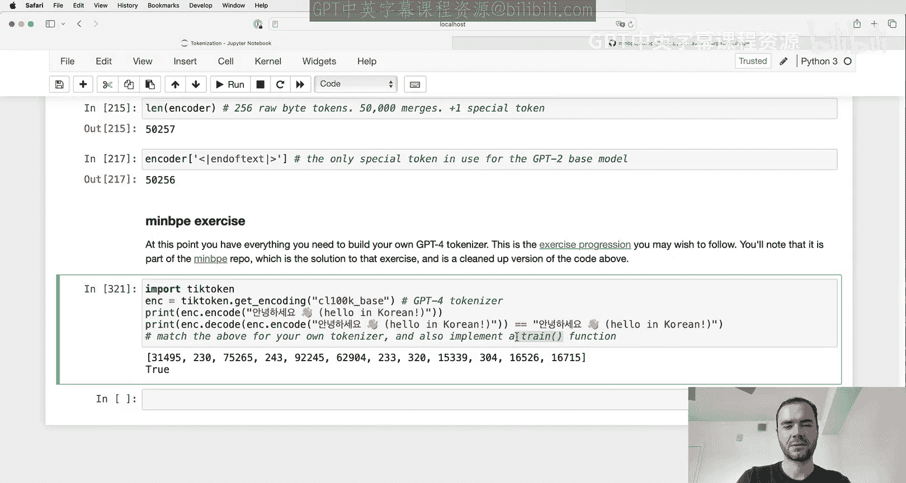

And that will allow you to train your own token vocabularies。

So here are some of the code inside Men B EP mean BPE shows the token vocabularies that you might obtain。

 So on the left here we have the GT4 merges。So the first 256 are raw individual bys。

 And then here I am visualizing the merges that GP 4 performed during its training。

 So the very first merge that G 4 did was merge two spaces into a single token for you know。

 two spaces。 And that is the token 2，5，6。And so this is the order in which things merged during GBVT4 training。

 and this is the merge order that we obtain in MinBPE by training a tokenazer and in this case I trained it on a Wikipedia page of Taylor Swift。

 not because I'm a Swify but because that is one of the longest Wikipedia pages apparently that's available。

 but she is pretty cool。And。What was I going say， Yeah。

 So you can compare these two vocabularies and。So， as an example。嗯。Here。

 G P T 4 merged I N to become in。 And we've done the exact same thing on this token 2，5，9 here。

 space T becomes space tea。 and that happened for us a little bit later as well。

 So the difference here is， again， to my understanding， only a difference of the training set。

 So as an example， because I see a lot of white space。

 I expect that G P T 4 probably had a lot of Python code in its training set， I'm not sure。

For the tokener。And here we see much less of that， of course， in the Wikipedia page。

So roughly speaking， they look the same and they look the same because they're running the same algorithm and when you train your own。

 you're probably going to get something similar。

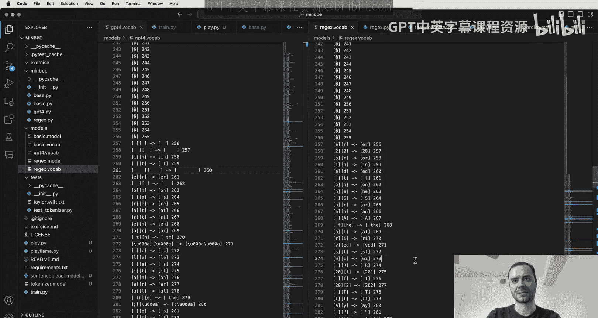

Depending on what you train it on， Okay， so we are now going to move on from Tk token and the way that Open AI tokenizes its strings。

We're going to discuss one more very commonly used library for working with tokenization and LLMs。

 and that is sentence piece。So sentence piece is very commonly used in language models because unlike Tiktoeken。

 it can do both training and inference and is quite efficient at both。

It supports a number of algorithms for training vocabularies。

 but one of them is the bivari coding algorithm that we've been looking at， so it supports it。Now。

 sentence piece is used both by Lama and Mistral series and many other models as well。

 It is on Gitthub on their Google slash sentence piece。And the big difference with sentence piece。

 And we're going to look at example， because this is kind of hard and subtle to explain。

 is that they think different about the order of operations here。 So in the case of Tik token。

 we first take our code points in a string。 we encode them using Mu Tfa8 to bytes and then're emergingrging bytes。

 It's fairly straightforward。For sentence piece， it works directly on the level of the code points themselves。

 So it looks at whatever code points are available in your training set。

And then it starts merging those code points。And the BE is running on the level of code pointss。

And if you happen to run out of code points， so there are maybe some rare code points that just don't come up too often。

 and the rarity is determined by this character coverage hyper parameter。

Then these cook pointss will either get maps to a special unknown token like onnc。

 or if you have the B foldback option turned on， then they will take those rare code pointss。

 it will encode them using UTF8 and then the individual bytes of that encoding will be translated into tokens。

 and there are these special bike tokens that basically get added to the vocabulary。

So it uses BP on the code points， and then it falls back to bytes for rare code points。嗯。

And so that's kind of like difference。 personally， I find the Tiktoken weigh significantly cleaner。

 but it's kind of like a subtle but pretty major difference between the way they approach tokenization。

 Let's work with a concrete example because otherwise this is kind of hard to get your hand around。

So let's work with a concrete example。This is how we can import sentence piece。

And then here we're going to take， I think I took like the description of sentence piece and I just created like a little toy dataset set。

 it really likes to have a file， so I created a toy TXD file with this content。Now。

 what's kind of a little bit crazy about sentence piece is that there's a ton of options and configurations。

And the reason this is so is because sentence piece has been around， I think， for a while。

 and it really tries to handle a large diversity of things。And because it's been around。

 I think it has quite a bit of accumulated historical baggage as well。And so in particular。

 there's like a ton of configuration arguments， this is not even all of it。

You can go to here to see all the training options。

And there's also quite useful documentation when you look at the raw proto buff that is used to represent the trainer spec and so on。

Many of these options are irrelevant to us， so maybe to point out one example。

 dash dash shrinking factor， this shrinking factor is not used in the bike bearing coding algorithm。

 so this is just an argument that is irrelevant to us， it applies to a different trading algorithm。🤧。

Now， what I tried to do here is I tried to set up sentence piece in a way that is very， very similar。

 as far as I can tell， to maybe identical， hopefully to the way that Lama 2 was trained。

 So the way they trained their own。Their own tokenchizer。

 And the way I did this was basically can take the tokenazizer that model file that meta released。

 and you can open it using the proto pro above sort of。File that you can generate。

And then you can inspect all the options and I try to copy over all the options that look relevant。

So here we set up the input， it's a raw text in this file， here's going to be the output。

 so it's going to be talk 400 dot model and dot vab。

We're saying that we're going to use the B algorithm and we want to vab size of 400。

🤧Then there's a ton of configurations here for。嗯。For basically preproces and normalization rules。

 as they're called， normalization used to be very prevalent。

 I would say before LLMs in natural language processing。

 so in machine translation and text classification and so on。

 you want to normalize and simplify the text and you want to turn it all lowercase and you want to remove all double white space。

 etc。And in language models we prefer not to do any of it。

 or at least that is my preference as a deep learning person， you want to not touch your data。

 you want to keep the raw data as much as possible in a raw form。

So you're basically trying to turn off a lot of this， if you can。

The other thing that sentence piece does is that it has this concept of sentences。Sentence piece。

 It's back。 It kind of like was developed。 I think early in the days where there was。

An idea that you're training a tokenizer on a bunch of independent sentences。

 so it has a lot of like how many sentences you're going to train on。

 what is the maximum sentence length。嗯。Shuffling sentences as if for it。

 sentences are kind of like the individual training examples。 But again， in the context of L O Ms。

 I find that this is like a very spurious and weird distinction。

 Like sentences are just like don't touch to raw data。 sentences happen to exist。

 but in the raw data sets。There are a lot of like in betweenwes， like what exactly is a sentence。

 what isn't a sentence。And so I think like it's really hard to define what an actual sentence is if you really like dig into it。

 and there could be different concepts of it in different languages or something like that。

 so why even introduce the concept it doesn't honestly make sense to me。

 I would just prefer to treat a file as a giant stream of bytes。

It has a lot of treatment around rare word characters。 And when I say word， I mean code points。

 We're going to come back to this in a second。And it has a lot of other rules for。

Basically splitting digits， splitting white space and numbers and how you deal with that。

 So these are some kind of like merges rules。 So I think this is a little bit equivalent to Tiktoken using the regular expression to split up categories。

 There's like kind of equivalentence of it。 If you squint at it in sentence piece where you can also。

 for example， splitit up， split out the digits。And so on。

There's a few more things here that I'll come back to in a bit。

 And then there are some special tokens that you can indicate。 And it hard codes the unc token。

 the beginning of sentence end of sentence and a pad token。

And the onctoken must exist from my understanding。And then some systems things so we can train。

And when when a press train is going to create this file， Talk 400 model and talk 400 bookab。

 I can then load the model file， and I can inspect the vocabulary of it。

And so we trained vocab size 400 on this text here。And these are the individual pieces。

 the individual tokens， that sentence piece will create。 So in the beginning。

 we see that we have the onc token。With the ID0， then we have the beginning of sequence and of sequence one and 2。

And then we said that the pad I D is negative one。 so we chose not to use it。

So there's no pad I here。Then these are individual bite tokens。

 So here we saw that bite fallback in Lama was turned on。 So it's true。

So what follows are going to be the 256 byte tokens， and these are their IDs。And then at the bottom。

 after the bite tokens， come the merges。And these are the parent nodes in the merges。

 So we're not seeing the children。 We're just seeing the parents and their I D。

And then after the merges。Comes eventually， the。Individual tokens and their Is。

And so these are the individual tokens。 So these are the individual code point tokens， if you will。

 and they come at the end。So that is the ordering with which sentence B Ser like represents its vocabularies。

 it starts with special tokens， then the bike tokens， then the merge tokens。

 and then the individual code point tokens。And all these raw code point tokens are the ones that it encountered in the training set。

So those individual code points are all the the entire set of code points that occurred here。

So those all get put in there。 And then those are extremely rare。

 as determined by character coverage。 So if a code point occurred only a single time out of like a million sentences or something like that。

 then it would be ignored， and it would not be added to our vocabulary。Once we have a vocabulary。

 we can encode into IDs and we can sort of get a list。

And then here I am also decoding the individual tokens back into little pieces， as they call it。

So let's take a look at what happened here。Hello， space， Anyang Ha。

So these are the token I we got back。 And when we look here， a few things sort of。Jump to mind。

Number one， take a look at these characters。 The Korean characters， of course。

 were not part of the training set。So sentence B is encountering code points that it has not seen during training time。

 and those code points do not have a token associated with them。 So suddenly， these are tokens。

 un unknown tokens。But because bite fall back as true， Instead， sentence piece falls back to bytes。

 And so it takes this。 It encodes it with U TF 8， and then it uses these tokens to represent those bys。

And that's what we are getting sort of here。This is the UTF8 encoding。

 and it is shifted by three because of these。Special tokens here that if I Ds earlier on。

So that's what happened here。Now， one more thing that， well， first before I go on。

With respect to the bikefall back， let me remove byfall back If this is false， What's going happen。

 Let's retrain。So the first thing that happened is all the by tokens disappeared， right？

And now we just have the merges， and we have a lot more merges now because we have a lot more space because we're not taking up space in the vab size with all the bytes。

And now， if we encode this。We get a 0。So this entire string here。 suddenly， there's no bitefall back。

 So this is unknown and unknown is unc。And so this is0 because the unc token is token 0。

And you have to keep in mind that this would feed into your language model。

 So what is the language model supposed to do when all kinds of different things that are unrecogsized because they're rare。

 just end up mapping into onk。 It's not exactly the property that you want。

 So that's why I think Lama correctly used by fallback true。

 because we definitely want to feed these unknown or rare code points into the model in some some manner。

 The next thing I want to show you is the following。

 Not here when we are decoding all the individual tokens。

 You see how spaces space here ends up being this bold underline。 I'm not 100% sure， by the way。

 why sentence piece switches white space into these bold underscore characters。

 Maybe it's for visualization， not 100% sure why that happens。But notice this。

 why do we have an extra space in a front？Of， hello。WhatWhere is this coming from。

 Well it's coming from this option here。嗯。Add dummy prefix is true。

And when you go to the documentation。Add dummy white space at the beginning of text in order to treat world in world and hellello world in the exact same way。

 So what this is trying to do is the following。If we go back to our TikTookkenizer。World。

 as a token by itself， has a different I D than space world。So we have this is 1917， but this is 14。

 etc cetera。 So these are two different tokens for the language model。

 and the language model has to learn from data that they are actually kind of like a very similar concept。

 So to the language model in the tick token world， basically words in the beginning of sentences and words in the middle of sentences actually look completely different。

 and it has to learn that they are roughly the same。

So this anomy prefix is trying to fight that a little bit。

 And the way that works is that it basically。Adds a dummy prefix。For as， as a part of pre processing。

 it will take the string and it will add a space。 It will do this。

And that's done in an effort to make this world and that world the same。

 They will both be space world。So that's one other kind of preproces option that is turned on。

 and Lama 2 also uses this option。And that's， I think everything that I want to say from my preview of sentence piece and how it is different。

 Maybe here what I've done is I just put in the raw protocol buffer representation。

 basically of the tokenizer， the Lama2 trained。So feel free to sort of stepped through this。

 and if you would like your organization to look identical to that of the meta Lama2。

 then you would be copy pasting these settings as I've tried to do up above。And yeah。That's。

 I think that's it for this section。 I think my summary for sentence piece from all this is number one。

 I think that there's a lot of historical baggage in sentence piece。

 a lot of concepts that I think are slightly confusing and I think potentially contain food gunns like this concept of his sentence and its maximum length and stuff like that。

Otherwise， it is fairly commonly used in the industry because it is efficient and can do both training and inference。

It has a few quirks， like for example， Atoken must exist and the way the bitefallbacks are done and so on I don't find particularly elegant。

And unfortunately， I have to say it's not very well documented。

 so it took me a lot of time working with this myself and just visualizing things and trying to really understand what is happening here because the documentation。

 unfortunately， is， in my opinion， not super amazing。

But it is a very nice repo that is available to you if you'd like to train your in tokenazizer right now。

Okay， let me now switch gears again as we're starting to slowly wrap up here。

 I want to revisit this issue in a bit more detail of how we should set the vocab size and what are some of the considerations around it。

So for this， I'd like to go back to the model architecture that we developed in the last video when we built the G from scratch。

So this here was the file that we built in the previous video， and we defined the transformer model。

 and let's specifically look at bookab size and where it appears in this file。

So here we define the bookup size。At this time， it was 65 or something like that。

 extremely small number。 so this will grow much larger。

You'll see that bookab size doesn't come up too much in most of these layers。

 the only place that it comes up to is in exactly these two places here。

So when we define the language model。There's the token embedding table。

 which is this two dimensional array where the book cap size is basically the number of rows。

And each vocabulary element， each token has a vector that we're going to train using back propagation。

 That vector is of size and embed， which is the number of channels in the transformer。And basically。

 as vocab size increases， this embedding table， as I mentioned earlier， is going to also grow。

 We're going to be adding rows。In addition to that， at the end of the transformer。

 there is this LM head layer， which is a linear layer。

And you'll notice that that layer is used at the very end to produce the logits。

Which become the probabilities for the next token in a sequence。 And so intuitively。

 we're trying to produce a probability for every single token that might come next at every point in time of that transformer。

And if we have more and more tokens， we need to produce more and more probabilities。

 So every single token is going to introduce an additional dot product that we have to do here in this linear layer for this final layer in the transformer。

So why can't vab size be infinite， Why can't we grow to infinity， Well， number one。

 your token embedding table is going to grow。Your linear layer is going to grow。

 so we're going to be doing a lot more computation here because this LM head layer will become more computational expensive。

Number two， because we have more parameters， we could be worried that we are going to be under training some of these parameters。

So intuitively， if you have a very large vocabulary size， say we have a million tokens。

 then every one of these tokens is going to come up more and more rarely in the training data because there's a lot more other tokens all over the place。

And so we're going to be seeing fewer and fewer examples for each individual token。

 And you might be worried that basically the vectors associated with every token will be under traineded as a result because they just don't come up too often and they don't participate in the forward backward pass。

In addition to that， as your vab size grows， you're going to start shrinking your sequences a lot。

 right？ And that's really nice because that means that we're going to be attending to more and more text。

 So that's nice。 But also， you might be worrying that two large of chunks are being squished into single tokens。

 And so the model just doesn't have as much sort of time to think per sort of somek number of characters in a text where you can think about it that way。

 right？ So basically， we're squishing too much information into a single token。

 And then the forward path of the transformers not enough to actually process that information appropriately。

😊，And so these are some of the considerations you're thinking about when you're designing the vocab size。

 As I mentioned， this is mostly an empirical hyperparameter。

 and it seems like in state of the art architecture today。

 this is usually in the high 100s or somewhere around the hundred000 today。

 And the next consideration I want to briefly talk about is what if we want to take a pretrain model。

 and we want to extend the vocab size。 And this is done fairly commonly， actually， So for example。

 when you're doing fine tuning for chat EptT， a lot more new special tokens get introduced on top of the base model to maintain the metadata and all the structure of conversation objects between a user and an assistant。

 So that takes a lot of special tokens， you might also try to throw in more special tokens。

 for example， for using the browser or any other tool。

 And so it's very tempting to add a lot of tokens for all kinds of special functionality。

So if you want to be adding a token， that's totally possible right。

 All we have to do is we have to resize the embedding， so we have to add rows。

 We would initialize these parameters from scratch， which would be small， random numbers。

 and then we have to extend the weight inside this linear。

So we have to start making do products with the associated parameters as well to basically calculate the probabilities for these new tokens。

So both of these are just a resizing operation。 It's a very mild model surgery and can be done fairly easily。

 and it's quite common that basically you would freeze the base model。

 you introduce these new parameters， and then you only train these new parameters to introduce new tokens into the architecture。

 And so you can freeze arbitrary parts of it， or you can train arbitrary parts of it。

 and that's totally up to you。 But basically minor surgery required if you'd like to introduce new tokens。

 And finally， I'd like to mention that actually， there's an entire design space of applications in terms of introducing new tokens into vocabulary that go way beyond just adding special tokens and special new functionality。

 So just give you a sense of the design space， but this could be an entire video just by itself。

 This is a paper on learning to compress prompts with what they called just tokens。

And rough idea is suppose that you're using language models in a setting that requires very long prompts。

All these long prompts just slow everything down because you have to encode them。

 and then you have to use them。 and then you're tending over them。 and it's just know。

 heavy to have very large prompts。So instead， what they do here in this paper is they introduce new tokens。

And imagine basically having a few new tokens， you put them in a sequence。

And then you train the model by distillation。 So you are keeping the entire model frozen。

 and you're only training the representations of the new tokens， their embeddings。

And you're optimizing over the new tokens， such that the behavior of the language model is identical to the model that has a very long prompt。

That works for you， and so it's a compression technique of compressing that very long prompt into those few new gist tokens。

And so you can train this and then at test time， you can discard your old prompt and just swap in those tokens and they sort of like stand in for that very long prompt and have an almost identical performance。

And so this is one technique in a class of parameter efficient fine tuning techniques where most of the model is basically fixed and there's no training of the model weights。

 There's no training of Laura or anything like that of new parameters。

 the parameters that you're training are now just the token embeddings。So that's just one example。

 but this could again be like an entire video， but just to give you a sense that there's a whole design space here that is potentially worth exploring in the future。

The next thing I want to briefly address is that I think recently there's a lot of momentum in how you actually could construct transformers that can simultaneously process not just text as the input modality。

 but lot of other modalities。 So be it images， videos， audio， etc cetera。

 And how do you feed in all these modalities and potentially predict these modalities from a transformer。

Do you have to change the architecture in some fundamental way。

 and I think what a lot of people are starting to conversege towards is that you're not changing the architecture。

 you stick with the transformer， you just kind of tokenize your input domains and then call the day and pretend it's just text tokens and just do everything else identical in an identical manner。

So here， for example， there was an early paper that has nice graphic for how you can take an image and you can chunkcate it into integers。

And these sometimes， so these will basically become the tokens of images as an example。

 and these tokens can be hard tokens where you force them to be integers。

 they can also be soft tokens where you sort of don't require these to be discrete。

 but you do force these representations to go through bottlenecks， like in autoenrs。

Also in this paper that came out from opening eyes Sora， which I think really。

Blue the mind of many people and inspired a lot of people in terms of what's possible。

 They have a graphic here。 and they talk briefly about how Lms have text tokens。

 Sora has visual patches。 So， again， they came up with a way to chunkncate videos into basically tokens when their own vocabularies。

 And then you can either process discrete tokens say with other aggressive models or even soft tokens with diffussion models。

 And all of that is sort of being actively worked on designed on and is beyond the scope of this video。

 But just something I wanted to mention briefly。 Okay。

 now that we have come quite deep into the tokenization algorithm。

 And we understand a lot more about how it works。 Let's look back around to the beginning of this video and go through some of these bullet points and really see why they happen。

😊，So first of all， why can't my LLM spell words very well or do other spell relate tasks？

So fundamentally， this is because as we saw， these characters are chunked up into tokens。

 and some of these tokens are actually fairly long。 So as an example， I went to the G 4 vocabulary。

 and I looked at one of the longer tokens。 So that default style turns out to be a single individual token。

 So that's a lot of characters for a single token。So my suspicion is that there's just too much crammed into this single token。

 and my suspicion was that the model should not be very good at tasks related to spelling of this single token。

So I asked， how many letters L are there in the word dot default style？And， of course， my prompt。

Is intentionally done that way。 And you see how the full style will be a single token。

 So this is what the model sees。 So my suspicion is that it wouldn't be very good at this。

 And indeed， it is not。 It doesn't actually know how many elses are in there。

 It thinks there are three。 and actually， there are4。 if I'm not getting this wrong myself。

So that didn't go extremely well。 Let's take a look at another kind of character level task。

 So for example， here I asked GPT4 to reverse the string default style and I tried to use a code interpreter and I stopped it and I said just do it。

 just try it and it gave me jumble so it doesn't actually really know how to reverse this string going from right to left。

So it gave a wrong result。 So， again， like working with this working hypothesis that maybe this is due to the tokenization。

 I tried a different approach。 I said， O， let's reverse the exact same string。

 but take the following approach。 Step 1， just print out every single character separated by spaces。

 And then as a step 2， reverse that list。And it again tried to use a tool， but when I stopped it。

 it first produced all the characters and that was actually correct。And then it reversed them。

 And that was correct once it had this。 So somehow it can't reverse it directly。

 But when you go just first， you know， listing it out in order， it can do that somehow。

 And then it can， once it's broken up this way， this becomes all these individual characters。

 And so now this is much easier for it to see these individual tokens and reverse the imprint amount。

So that is kind of interesting。So， let's continue now。Why are LLMs worse at non English languages。

 and I briefly covered this already， but basically it's not only that the language model sees less non English data during training of the model parameters。

 but also the tokenizer is not sufficiently trained on non English data。And so here， for example， Ho。

 how are you is 5 tokens， and its translation is 15 tokens。 So this is a three times blow up。And so。

 for example， Anyang Haso is just hello， basically in Korean。 And that ends up being three tokens。

 I'm actually kind of surprised by that because that is a very common phrase。

 There is just the typical greeting of like hello。 And that ends up being three tokens。

 whereas R hello is a single token。 And so basically， everything is a lot more bloated and diffuse。

 And this is， I think， partly the reason that the model works worse on other languages。Coming back。

 Why is L bad at simple arithmetic， that has to do with the tokenization of numbers。

And so you'll notice that， for example， addition is very sort of like。

There's an algorithm that is like character level for doing addition。 So， for example， here。

 we would first add the ones and then the tens and then the hundreds。

 You have to refer to specific parts of these digits。

But these numbers are represented completely arbitrarily based on whatever happened to merge or not merge during the tokenization process。

There's an entire blog post about this that I think is quite good。 Integer tokenization is insane。

 and this person basically systematically explores the tokenization of numbers in。

 I believe this is Gp2。 And so they notice that， for example， for four digit numbers。

 you can take a look at whether it is a single token or whether it is two tokens that is a one3 or a two2 or a three1 combination。

 And so all the different numbers are all the different combinations。

 And you can imagine this is completely arbitrarily so。 And the model， unfortunately。

 sometimes sees a token for all four digits， sometimes for three， sometimes for two。

 sometimes for one。 And it's in an arbitrary manner。 And so this is definitely headwind， if you will。

 for the language model。 And it's kind of incredible that it can kind of do it and deal with it。

 but it's also kind of not ideal。 And so that's why， for example。

 we saw that meta when they train the Lama2 algorithm。 and the use sentence piece。

 And make sure to split up all all the digits as an。Example for Lama 2。

 And this is partly to improve a simple arithmetic kind of performance。And finally。

 why is G2 not as good in Python。 Again， this is partly a modeling issue and the architecture and the data set and the strength of the model。

 but it's also partly tokenization， because as we saw here with the simple Python example。

 the encoding efficiency of the tokenizer for handling spaces in Python is terrible。

 and every single space is an individual token。 and this dramatically reduces the context length that the model can attend across。

 So that's almost like a tokenization bug for G2。 And that was later fixed with G4。Okay。

 so here's another fun one。 My L M abruptly halts when it sees the string end of text。

So here's a very strange behavior。Print a string and of text is what I told Juputy for。 And it says。

 could you please specify the string。And I'm telling it， give me end of text。

 And it seems like there's an issue。 It's not seeing end of text。

And then I give it end of text this string。 And then here's a string。

 And then it just doesn't print it。 So obviously， something is breaking here with respect to the handling of the special token。

 And I don't actually know what opening eye is doing under the hood here and whether they are potentially parsing this as an。

As an actual token， instead of this just being end of text。

As like individual sort of pieces of it without the special token handling logic。

And so it might be that someone when they're calling dot encode code。

 they are passing in the allowed special and they are allowing end of text as a special character in the user prompt。

 but the user prompt， of course， is sort of attack or control text。

 so you would hope that they don't really parse or use special tokens or you know from that kind of input but it appears that there's something definitely going wrong here and so your knowledge of these special tokens ends up being in a attack surface potentially And so if you'd like to confuse LLMs。

 then just try to give them some special tokens and see if you're breaking something by chance。Okay。

 so this next one is a really fun one。The trailing white space issue。

 So if you come to playground and we come here to GP 3。5 Tbo Instruct。 So this is not a chat model。

 This is a completion model。 So think of it more like it's a lot more closer to a base model。

 It does completion。 It will continue the token sequence。

So here's a tagline for ice cream shop and we want to continue the sequence and so we can submit and get a bunch of tokens。

 okay， no problem。But now， suppose I do this。 But instead of pressing submit here， I do。

 Here's a tagline for ice cream shop space。So I have a space here before I click submit。

We get a warning。Your text ends in a trail space， which causes worse performance due to how API splits text into tokens。

So what's happening here， it still gave us a sort completion here。

 but let's take a look at what's happening。So here's a tagline for an ice cream shop。And then。

What does this look like in the actual training data。

 Suppose you found the completion in the training document somewhere on the Internet and the LLM trained on this data。

 So maybe it's something like， oh yeah。Maybe that's the tagline， thats a terrible tagline， but。

Notice here that when I create O， you see that because there's the the space carriage is always a prefix to these tokens in GPT。

 So it's not an O token。 It's a space O token。 The space is part of the O。 And together。

 they are token 8，8，4，0。 That's space O。So's what's happening here is that。

When I just have it like this。And I let it complete the next token。 It can sample the space O token。

But instead， if I have this and I add my space， then what I'm doing here when I encode this string is I have basically。

 here's a tangla for an ice cream shop。 and this space at the very end becomes a token 220。

And so we've added token to 20， and this token otherwise would be part of the tag line。

 because if there actually is a tag line here。 So space O is the token。

And so this is suddenly out of distribution for the model because this space is part of the next token。

 but we're putting it here like this。 And the model has seen very。

 very little data of actual space by itself。And we're asking it to complete the sequence like add in more tokens。

 But the problem is that we've sort of begun the first token。 And now it's been split up。

 And now we're out of distribution。 And now arbitrary bad things happen。

 And it's just a very rare example for it to see something like that。

 And that's why we get the warning。 So the fundamental issue here is， of course， that。

The LLM is on top of these tokens， and these tokens are text junks。

 They're not characters in a way you and I would think of them。 They are。

 These are the atoms of what the LLM is seeing。 And there's a bunch of weird stuff that comes out of it。

 Let's go back to our default cell style。I bet you that the model has never in its training set seen default self star without Ellie in there。

It's always seen this as a single group because this is some kind of a function in。

I'm guess I don't actually know what this is part of this some kind of API。

 but I bet you that it's never seen this combination of tokens in its training data because or I think it would be extremely rare。

 So I took this in icon paste hit here。And I， I tried to complete from it。

 and that it immediately gave me a big error。 And it said the model predicted a completion that begins with a stop sequence。

 Re in no outputlet。 consider adjusting or prompt or stop sequences。

 So it happened here when I clicked submit。Is that immediately the model emitted and sort of like end of text token。

 I think， or something like that， It basically predicted the stop sequence immediately so it had no completion。

 And so this is why I'm getting a warning again， because we're off the data distribution and the model is just。

Preicting。Just totally arbitrary things。 It's just really confused。 Basically。

 this is giving it brain damage， It never seen this before。 it's shocked。

And it's predicting end of text or something。I tried it again here， and it， in this case。

 it completed it。 But then for some reason， this request may violate our usage policies。

 This was flagged。嗯。Basically， something just like goes wrong。 And there's something like jank。

 You can just feel the jank because the model is like extremely unhappy with just this。

 And it doesn't know how to complete it because it's never occurred in training set In a training set。

 it always appears like this and becomes a single token。

So these kinds of issues where tokens are either you sort of like complete the first character of the next token or you are sort of you have long tokens that you then have just some of the characters off。

All these are kind of like issues with partial tokens is how I would describe it。

And if you actually dig into the tuk tokken repository。

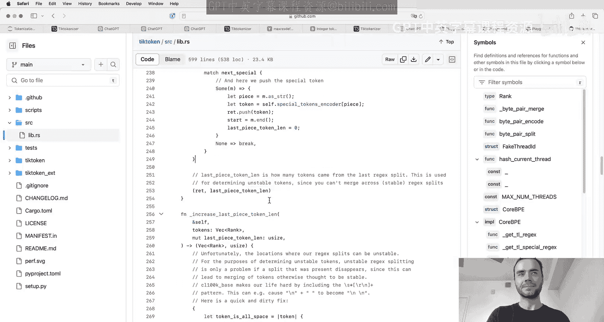

Go to the rust code and search for unstable。And you'll see in code unstable native unstable tokens and a lot of like special case handling。

 none of this stuff about unstable tokens is documented anywhere。

 but there's a ton of code dealing with unstable tokens and unstable tokens is exactly kind of like what I'm describing here。

 what you would like out of a completion API is something a lot more fancy。

 Like if we're putting in default cell star。 If we're asking for the next token sequence。

 we're not actually trying to append the next token exactly after this list we're actually trying to append。

 we're trying to consider lots of tokens that if we were。

 or I guess like we're trying to search over characters that。

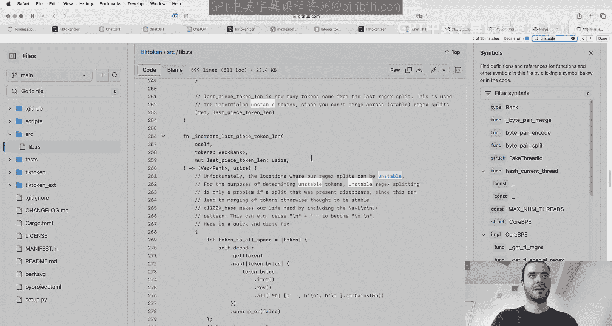

If we retokenized would be of high probability。 if that makes sense。

 so that we can actually add single individual character instead of just like adding the next full token that comes after this partial token list。

So this is very tricky to describe and I invite you to maybe like look through this。

 it ends up being extremely gnarly and hairy kind of topic and it comes from tokenization fundamentally so maybe I can even spend an entire video talking about unstable tokens sometime in the future。

Okay， and I'm really saving the best for last。 My favorite one by far is this solid gold magic carp。

And its just okay， this comes from this blog post， a solid gold magic arp。

And this is Internet famous now for those of us in LLMs。And basically。

 I would advise you to read this blog post in full。 but basically what this person was doing is。

This person went to the token embedding stable and clustered the tokens based on their embedding representation。

And this person noticed that there's a cluster of tokens that look really strange。

 So there's a cluster here atro， Eastern fame， salt gold magiccarp， signnet message。

 like really weird tokens basically in this embedding cluster。

And so where are these tokens and where did they even come from。

 like what is salt gold magic carpet makes no sense？And then。They found a bunch of these tokens。

And then they notice that actually the plot thickens here。

 because if you ask the model about these tokens， let you ask it， some very benign question like。

 please， can you repeat back to me the string sold gold magic carp？

Then you get a variety of basically totally broken LLM behavior， so either you get evasion。

 so I'm sorry I can't hear you or you get a bunch of hallucinations as a response。

You can even get back like insults， so you ask it about streamer bot and it tells and the model actually just calls you names。

Or it kind of comes up with like weird humor， like you're actually breaking the model by asking about these very simple strings like at Roth and So gold magiccarp。

So like what the hell is happening， and there's a variety of your documented behaviors。

There's a bunch of tokens， not just sold good magiccarp that have that kind of a behavior。

And so basically there's a bunch of like trigger words and if you ask the model about these trigger words or you just include them in your prompt。

 the model goes haywire and has all kinds of really strange behaviors。

 including sort of ones that violate typical safety guidelines and the alignment of the model like it's swearing back at you。

So what is happening here and how can this possibly be true？Well， this， again。

 comes down to tokenization。 So what's happening here is that salt gold magiccarp。

 if you actually dig to it， is a Reddit user。 So there's a use s salt gold magiciccarp。

And probably what happened here， even though I don't know that this has been like really definitively explored。

 but what is thought to have happened is that the tokenization dataset was very different from the training dataset for the actual language model。

 So in the tokenization data there was a ton of redded data potentially where the user So gold Magiccarp was mentioned in the text because So gold Magiccarp was a very common sort of person who would post a lot this would be a string that occurs many times in a tokenization dataset。

Because it occurs many times in the tokenization dataset set。

 these tokens would end up getting merged to the single individual token for that single Reddit user sold gold magic ap。

 So they would have a dedicated token in a vocabulary of was it 50000 tokens in G2 that is devoted to that Reddit user。

And then what happens is the tokenization dataset set has those strings。

 but then later when you train the model， the language model itself。

This data from Reddit was not present。And so therefore。

 in the entire training set for the language model。Sold gold magiccarp never occurs。

 That token never appears in the training set for the actual language model later。

So this token never gets activated。 It's initialized at random in the beginning optimization。

 Then you have forward backward passes and updates to the model。

 and this token is just never updated in the embedding table。 That row vector never gets sampled。

 It never gets used。 So it never gets trained， and it's completely untrained。

 It's kind of like unallocated memory in a typical binary program written in C or something like that。

 So it's unallocated memory。 And then at test time。 If you evoke this token。

 Then you're basically plucking out a row of the embedding table that is completely untrained。

 and that feeds into a transformer and creates undefined behavior。 And that's what we're seeing here。

 There's this completely undefined， never before seen in a training behavior。

And so any of these kind of like weird tokens would evoke this behavior because fundamentally。

 the modelus is。Out of sample。I have distribution。Okay。

 and the very last thing I wanted to just briefly mention and point out。

 although I think a lot of people are quite aware of this。

 is that different kinds of formats and different representations in different languages and so on might be more or less efficient with G tokens。

 or any tokens for any other Lo for that matter。 So， for example。

 Json is actually really dense in tokens。 and Yamel is a lot more efficient in tokens。 So。

 for example， are these are the same in JOson and in Yael。 The Json is 116。And the Yal is 99。

 So quite a bit of an improvement。 And so in the token economy where you are paying per token in many ways。

 and you are paying in the context length and you're paying in dollar amount for the cost of processing all this kind of structured data when you have to So prefer to use yals over Jsons。

 And in general， kind of like the tokenization density。

 something that you have to sort of care about and worry about at all times and try to find efficient encoding schemes and spend a lot of time in di tokenizer and measure the different token efficiencies of different formats and settings and so on。

 Okay so that concludes my fairly long video and tokenization。 I know it's try， I know it's annoying。

 I know it's irritating。 I personally really dislike the stage。

 what I do have to say at this point is don't brush it off。 There's a lot of foot gunns。

 sharp I just hear security issues AI safety issues as we saw plugging in unallocated memory into language models。

 So it's worth understanding this。That said， I will say that eternal glory goes to anyone who can get rid of it。

 I showed you one possible paper that try to do that。

 and I think I hope a lot more can follow over time。

And my final recommendations for the application right now are if you can reuse the GT4 tokens and the vocabulary in your application。

 then that's something you should consider and just use Tk token because it is very efficient and nice library for inference for BE。

 I also really like the Btelevel BP that TikToken and OpenI uses。

If you for some reason want to train your own vocabulary from scratch。

 then I would use the BE with sentence pieceops As I mentioned。

 I'm not a huge fan of sentence piece I don't like its byte fallback and I don't like that it's doing B on Unicode code points I think it also has like a million settings and I think there's a lot of footns here and I think it's really easy to miscaibrate them and you end up cropping your sentences or something like that because of some hypoparameter that you don't fully understand So be very careful with the settings。

 try to copy paste exactly maybe what Mehead did or basically spend a lot of time looking at all the hypoparameter and go through the code of sentence piece and make sure that you have this correct。

Um but even if you have older settings correct， I still think that the algorithm is kind of inferior to what's happening here。

And maybe the best， if you really need to train your vocabulary。

 maybe the best thing is to just wait for MinBPE to become as efficient as possible。

 and that's something that maybe I hope to work on。

 and at some point maybe we can be training basically really what we want is we want Tiktoken but training code and that is the ideal thing that currently does not exist。

And MinBP is an implementation of it， but currently it's in Python。

So that's currently what I have to say for tokenization。

 There might be an advanced video that has even drier and even more detailed in the future。

 But for now， I think we're going to leave things off here and。

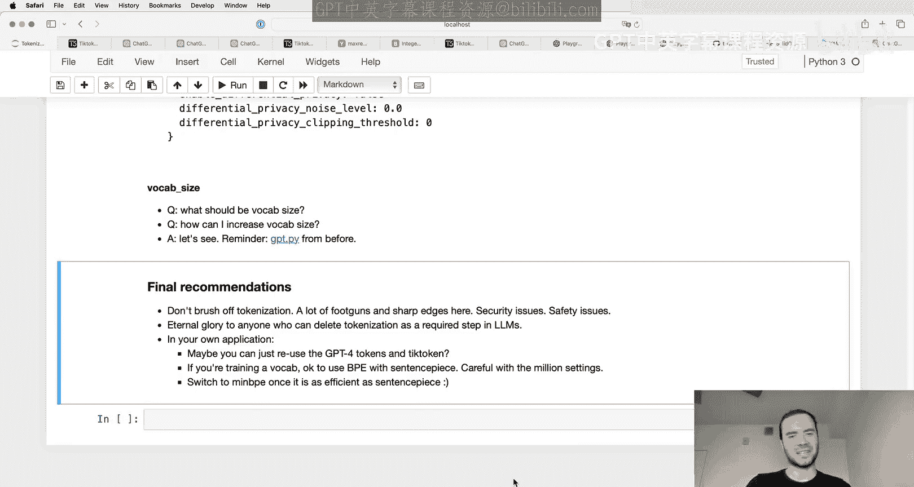

I hope that was helpful， bye。

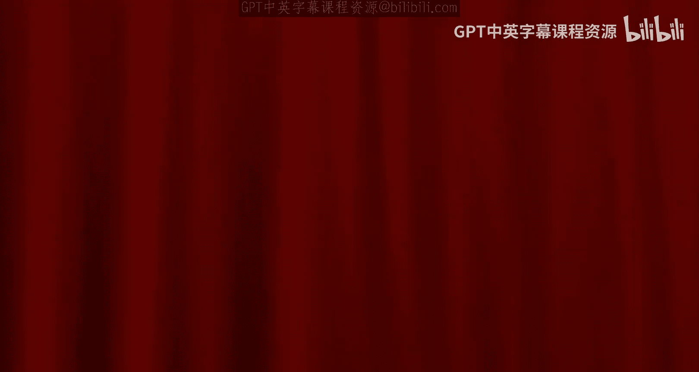

And they increase this context size from G1 of 512 to 1024 and GT4。2。The next。Okay， next。

 I would like us to briefly walk through the code from Open eye on the G2 encoded Pi。I'm sorry。

 I'm gonna sneeze。And then what's happening here is。

This is a spurious layer that I will explain in a bit。What's happening here is。

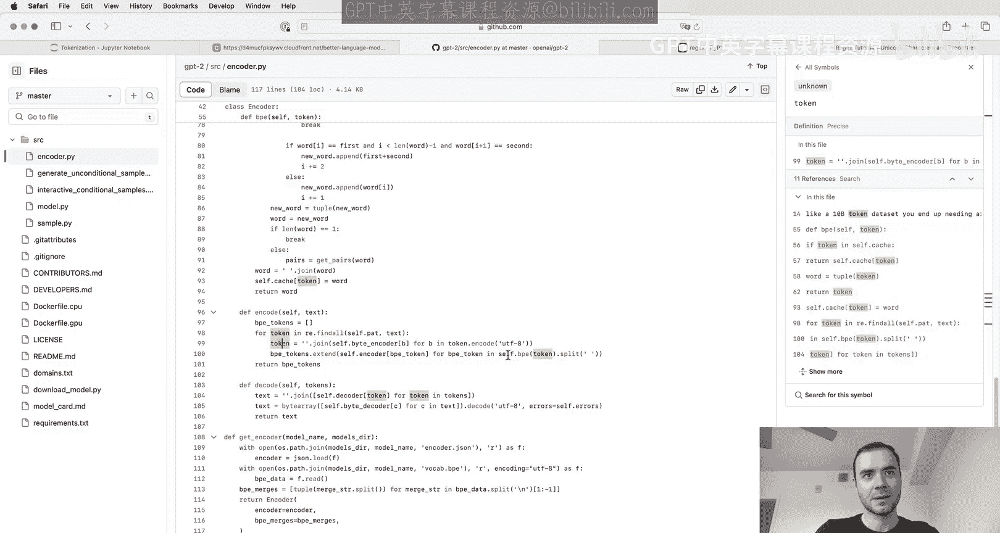