# Andrej《深入了解ChatGPT之类的大语言模型｜Deep Dive into LLMs like ChatGPT》中英字幕（deepseek-R1 - P1：Deep Dive into LLMs like ChatGPT.zh_en - GPT中英字幕课程资源 - BV19ZN8eVEsS

Everyone。So I've wanted to make this video for a while。

 It is a comprehensive but general audience introduction to large language models like Chay Bt。

And what I'm hoping to achieve in this video is to give you kind of mental models for thinking through what it is that this tool is。

 It is obviously magical and amazing in some respects。 It's really good at some things。

 not very good at other things。 And there's also a lot of sharp edges to be aware of。

 So what is behind this text box。 You can put anything in there and press enter。

 But what should we putting there。 And what are these words generated back。

 How does this work and what， what are you talking to exactly。

 So I'm hoping to get at all those topics in this video。

 We're going to go through the entire pipeline of how this stuff is built。

 but I'm going to keep everything sort of accessible to a general audience。😊。

So let's take a look at first how you build something like ChaGPT and along the way。

 I'm going to talk about you know some of the sort of cognitive psychological implications of these tools。

Okay， so let's build try you B。So there's going to be multiple stages arranged sequentially。

 The first stage is called the pre training stage。And the first step of the pretraining stage is to download and process the internet。

Now， to get a sense of what this roughly looks like， I recommend looking at this URL here。

So this company called Huggingfaceace， collected and created and curated this data set called Fine web。

And they go into a lot of detail on this blog post on how they constructed the fine web dataset set。

And all of the major L LM providers like Open AI Anthropic and Google and so on will have some equivalent internally off something like the Find web dataset。

So roughly what we' trying to achieve here， we're trying to get a ton of text from the internet from publicly available sources。

So we're trying to have a huge quantity of very high quality documents。

And we also want very large diversity of documents because we want to have a lot of knowledge inside these models。

So we want large diversity of high quality documents and we want many， many of them。

 and achieving this is quite complicated and as you can see here， takes multiple stages to do well。

So let's take a look at what some of these stages look like in a bit。 For now。

 I'd like to just like to note that， for example， the fine web data set。

 which is fairly representative。 what you would see in a production grade application actually ends up being only about 44 TBys of disk space。

You can get a USB stick for like a teraby very easily。

 Or I think this could fit on a single hard drive almost today day。

 So this is not a huge amount of data at the end of the day。 Even though the internet is very。

 very large， we're working with text， and we're also filtering it aggressively。

 So we end up with about 44 TB in this example。So let's take a look at kind of what this data looks like and what some of these stages also are。

 So the starting point for a lot of these efforts and something that contributes most of the data by the end of it is data from common C。

So Common Croll is an organization that has been basically scouring the internet since 2007。

 So as of 2024， for example， Common Croll has indexed 2。7 billion web pages。

And they have all these crawlers going around the internet and what you end up doing basically is you start with a few seed web pagess and then you follow all the links and you just keep following links and you keep indexing all the information and you end up with a ton of data of the internet over time。

So this is usually the starting point for a lot of these efforts。Now。

 this common control data is quite raw and is filtered in many， many different ways。

So here they document this is the same diagram， they document a little bit the kind of processing that happens in these stages。

So the first thing here is something called URL filtering。

So what that is referring to is that theres these blocklists。

Of basically URLs that are or domains that you don't want to be getting data from。

 So usually this includes things like malware websites， spam websites， marketing websites。

 racist websites， adult sites and things like that。

 So there's a ton of different types of websites that are just eliminated at this stage because we don't want them in our dataset。

The second part is text extraction。 You have to remember that all these web pages。

 this is the raw HTML of these web pages that are being saved by these crawlers。

 So when I go to inspect here。This is what the raw HTML actually looks like。

 You'll notice that it's got all this markup like lists and stuff like that and there's CSS and all this kind of stuff。

 So this is computer code almost for these web pages but what we really want is we just want this text right we just want the text of this webage and we don't want the navigation and things like that。

 there's a lot of filtering and processing and heuristics that go into adequately filtering for just the good content of these web pages。

The next stage here is language filtering。 So， for example。

 fine web filters using a language classifier， they try to guess what language every single web pages is in。

 and then they only keep web pages that have more than 65% of English as an example。

And so you can get a sense that this is like a design decision that different companies can take for themselves。

 what fraction of all different types of languages are we going to include in our data set。

 because for example， if we filter out all the Spanish as an example。

 then you might imagine that our model later will not be very good at Spanish because it's just never seen that much data of that language。

And so different companies can focus on multilingual performance to a different degree as an example。

 so Fineweb is quite focused on English， and so their language model if they end up training one later。

 will be very good at English but not maybe very good at other languages。After language filtering。

 there's a few other filtering steps and deduplication and things like that。Finishing with。

 for example， the PII removal， this is personally identifiable information。

 so as an example addresses， Social security numbers and things like that。

 you will try to detect them and you will try to filter out those kinds of web pages from the data set as well。

So there's a lot of stages here and I won't go into full detail。

 but it is a fairly extensive part of the preprocessing， and you end up with， for example。

 the Find web data set。So when you click in on it， you can see some examples here of what this actually ends up looking like。

 and anyone can download this。On the Hging phase webp page。

And so here's some examples of the final text that ends up in the training set。

So this is some article about tornadoes in 2012。So there's some tornadoes in 2012 and what happened。

This next one is something about。Did you know you have two little yellow。

9volt battery sized adrenal gls in your body， Okay， so there's some kind of a odd medical article。

So just think of these as basically web pages on the internet filtered just for the text in various ways。

 And now we have a ton of text，40 terabytes off it。

 And that now is the starting point for the next step of this stage。

Now I wanted to give you an intuitive sense of where we are right now。

 So I took the first 200 web pages here。 and remember we have tons of them。

 and I just take all that text and I just put it all together， concatenate。

And so this is what we end up with。 We just get this just just raw text， raw internet text。

And there's a ton of it， even in these 200 web pages。 so I can continue zooming out here。

And we just have this like massive tapestry of text data。And this text data has all these patterns。

 And what we want to do now is we want to start training neural networks on this data so the neural networks can internalize and model how this text flows。

 right， So we just have this giant texture of text。 And now we want to get neural nuts that mimic it。

Okay， now before we plug text into neural networks。

 we have to decide how we're going to represent this text and how we're going to feed it in。Now。

 the way our technology works for these neural lotss is that they expect a one dimensional sequence of symbols。

And they want a finite set of symbols that are possible。

And so we have to decide what are the symbols， and then we have to represent our data as one dimensional sequence of those symbols。

So right now what we have is a one dimensional sequence of text。 It starts here， and it goes here。

 and then it comes here， et cetera。 So this is a one dimensional sequence， even though on my monitor。

 of course， it's laid out in a two dimensional way， but it goes from left to right and top to bottom。

 right。 So it's a one dimensional sequence of text。Now this being computers， of course。

 there is an underlying representation here， so if I do what's called UTF8 encode this text。

 then I can get the raw bits that correspond to this text in the computer。

And that's what that looks like this。So it turns out that， for example。

 this very first bar here is the first eight bits as an example。So what is this thing， right。

 this is a representation that we are looking for in a certain sense。

 we have exactly two possible symbols， 0 and1， and we have a very long sequence of it， right？Now。

 as it turns out， this sequence length。Is actually going to be a very finite and precious resource in our neural network。

 and we actually don't want extremely long sequences of just two symbols。Instead。

 what we want is we want to trade off this symbol size of this vocabulary as we call it。

 and the resulting sequence length。So we don't want just two symbols and extremely long sequences。

 We're going to want more symbols and shorter sequences。 Okay。

 so one naive way of compressing or decreasing the length of our sequence here is to basically consider some group of consecutive bits。

 for example，8 bits and group them into a single what's called byte。

So because these bits are either on or off， if we take a group of eight of them。

 there turns out to be only 256 possible combinations of how these bits can be on or off。

And so therefore， we can re represent this sequence into a sequence of bytes instead。

So this sequence of bytes will be eight times shorter， but now we have 256 possible symbols。

 so every number here goes from 0 to 255。Now I really encourage you to think of these not as numbers but as unique IDs or like unique symbols。

 so maybe it's a more maybe it's better to actually think of these to replace every one of these with a unique emoji。

 you'd get something like this。So we basically have a sequence of emojis and there's 256 possible emojis。

 You can think of it that way。Now。It turns out that in production for state of the language models。

 you actually want to go even beyond this， you want to continue to shrink the length of the sequence。

Because again， it is a precious resource in return for more symbols in your vocabulary。

And the way this is done is done by running what's called the byte pair encoding algorithm。

 And the way this works is we're basically looking for consecutive bytes or symbols that are very common。

 So， for example。Turns out that the sequence 116 followed by 32 is quite common and a occurses very frequently。

 So we're going to do is we're going to group。This pair into a new symbol。

 so we're going to mint a symbol with an ID256， and we're going to rewrite every single pair 1。

1632 with this new symbol， and then we can iterate this algorithm as many times as we wish and each time when we mint a new symbol。

 we're decreasing the length and we're increasing the symbol size。And in practice。

 it turns out that a pretty good setting of basically the vocabulary rec turns out to be about 100。

000 possible symbols， so in particular GPT4 uses 100，000 277 symbols。嗯。

And this process of converting from raw text into these symbols， or as we call them tokens。

 is the process called tokenization。So let's now take a look at how GP4 performs tokenization converting from text to tokens and from tokens back to text and what this actually looks like。

 So one website I like to use to explore these token representations is called T tokenizer。

And so come here to the dropdown and select CL 100 K basease， which is the G4 base model tokenizer。

And here on the left， you can put in text and it shows you the tokenization of that text。

 So for example。Have。老。Space。World。So Hello world turns out to be exactly two tokens。

 the token Hello， which is the token with ID 150339， and the token space world。that is the token 1，9。

1，7。So hello， space world。Now， if I was to join these two， for example。I'm gonna get again to tokens。

 but it's the token H。A followed by the token Eello world without the age。

If I put in two spaces here between hellello and world， it's again a different tokenization。

 there's a new token 220 here。Okay， so you can play with this and see what happens here。

Also keep in mind is not this is case sensitive， so if this is a capital H， it is something else。

Or if it's hello world。Then actually， this ends up being three tokens since there are just two tokens。

Yeah so you can play with this and get a sort of like an intuitive sense of what these tokens work like We're actually going to loop around to tokenization a bit later in the video for now I just wanted to show you the website and I wanted to show you that this text basically at the end of the day。

 so for example， if I take one line here。This is what G 4 will see it as。

 So this text will be a sequence of length 62。This is the sequence here。

 And this is how the chunks of text correspond to these symbols。And again。

 there's 100277 possible symbols， and we now have one dimensional sequences of those symbols。So yeah。

 we're going to come back to tokenization， but that's for now where we are。 Okay。

 so what I've done now is I've taken this sequence of text that we have here in the data。

 and I have rerepresented it using our tokenizer into a sequence of tokens。

And this is what that looks like now。So for example， when we go back to the Find web dataset set。

They mentioned that not only is this 44 teryte of disk space。

 but this is about a 15 trillion token sequence of。In this data set。And so here。

 these are just some of the first one or two or three or a few thousand here， I think。

 tokens off this data set， but there's 15 trillion here to keep in mind。And again。

 keep in mind one more time that all of these represent little text chunks。

 they're all dislike atoms of these sequences， and the numbers here don't make any sense they're just unique IDs。

So now we get to the thumb part， which is the neural network training。

 and this is where a lot of the heavy lifting happens computationally when you're training these neural networks。

So。What we do here this in this step is we want to model the statistical relationships of how these tokens follow each other in the sequence。

So what we do is we come into the data and we take windows of tokens。

So we take a window of tokens from this data fairly randomly。

And the windows length can range anywhere anywhere between zero tokens actually。

 all the way up to some maximum size that we decide on。 So for example， in practice。

 you could see a token windows of say 8000 tokens。Now， in principle。

 we can use arbitrary window lengths of tokens。But processing very long basically window sequences would just be very computationally expensive。

 so we just kind of decide that say 8000 is a good number or 4000 or 16，000 and we crop it there。Now。

 in this example， I'm going to be taking the first four tokens just so everything fits nicely。

 So these tokens。We're going to take a window of four tokens， this bar， view， ining and space single。

 which are these token IDs。And now what we're trying to do here is we're trying to basically predict the token that comes next in a sequenceequ。

So 3962 comes next， right？So what we do now here is that we call this the context。

 these four tokens are context。And they feed into a neural network。

And this is the input to the neural work。Now， I'm going to go into the detail of what's inside this neural network in a little bit。

 for now， it's important to understand is the input and the output of the neural net。

 So the input are sequences of tokens。Of variable length anywhere between 0 and some maximum size like 8000。

The output now is a prediction for what comes next。So。Because our vocabulary has 100。

277 possible tokens。The neural network is going to output exactly that many numbers。

 and all of those numbers correspond to the probability of that token as coming next in the sequence。

 So it's making guesses about what comes next。In the beginning。

 this neural network is randomly initialized so and we're going to see in a little bit of what that means。

 buts it's a random transformation， so these probabilities in the very beginning of the training are also going to be kind of random。

So here I have three examples， but keep in mind that there's 100，000 numbers here。

So the probability of this token space direction。 neural network is saying that this is 4 per likely right now。

11，7，9，9 is 2%。 And then here， the probability of 3，9，6，2， which is post is 3% cent。Now， of course。

 we've sampled this window from our data set。 so we know what comes next。 We know。

 and that's the label。We know that the correct answer is that 3962 actually comes next in a sequence。

So now what we have is this mathematical process for doing an update to the neural network。

 we have a way of tuning it。And we're going to go into a little bit bit of detail in a bit。

 But basically， we know that this probability here of 3%， we want this probability to be higher。

And we want the probabilities of all the other tokens to be lower。

And so we have a way of mathematically calculating how to adjust and update the neural network so that the correct answer has a slightly higher probability。

So if I do an update to the neural network now。The next time I feed this particular sequence of four tokens into the neural network。

 The neural network will be slightly adjusted now， and it will say， O， post is maybe 4%。

And case now maybe his1%。And direction could become 2% or something like that。

And so we have a way of nudging of slightly updating the neural nu。To。Basically。

 give a higher probability to the correct token that comes next in a sequence。

AndNow you just have to remember that this process happens not just for this token here。

 where these four fed in and predicted this one， this process happens at the same time for all these tokens in the entire data set。

And so in practice， we sampled little windows， little batches of windows。

 And then at every single one of these tokens， we want to adjust our neural network so that the probability of that token becomes slightly higher。

 And this all happens in parallel in large batches of these tokens。

 and this is the process of training the neural network。

 It's a sequence of updating it so that its predictions match up the statistics of what actually happens in your training set。

And its probabilities become consistent with the statistical patterns of how these stock follow each other in the data。

So let's not briefly get into the internals of these neural networks just to give you a sense of what's inside。

So neural network internals。So as I mentioned， we have these inputs that are sequences of tokens。

In this case， this is four input tokens， but this can be anywhere between zero up to let's say 8。

000 tokens。In principle， this can be an infinite number of tokens it would just be too computationally expensive to process an infinite number of tokens。

 so we just crop it at a certain length and that becomes the maximum context length of that model。

Now， these inputs X are mixed up in a giant mathematical expression。Together with。

The parameters are the weights of these neural networks。

So here I'm showing six example parameters and their setting。But in practice。

 these modern neural networks will have billions of these parameters。And in the beginning。

 these parameters are completely randomly set。Now， with a random setting of parameters。

 you might expect that this neural network would make random predictions and it does in the beginning it's totally random predictions。

But it's through this process of iteratively updating the network。

And we call that process training in neural work。So that the setting of these parametersmars gets adjusted。

 such that the outputs of our neural network becomes consistent with the patterns seen in our training set。

So think of these parameters as kind of like knobs on a DJ set， and as you're twidling these knobs。

 you're getting different predictions for every possible token sequence input。

And training in neural network just means discovering a setting of parameters that seems to be consistent with the statistics of the training set。

Now let me just give you an example of what this giant mathematical expression looks like just to give you a sense。

 and modern networks are massive expressions with trillions of terms probably。

 but let me just show you a simple example here。It would look something like this， I mean。

 these these are the kinds of expressions just to show you that it's not very scary。We have inputs x。

 like x1 x 2， in this case， two example inputs， and they get mixed up with the weights of the network。

 W 0， w1，2，3， etc cetera。And this mixing is simple things like multiplication， addition。

 exponentiation， division， etc cea。 And it is the subject of neural network architecture research to design effective mathematical expressions that have a lot of kind of convenient characteristics。

 They are expressive， They're optimizable。 Theyre paralyizable， etc ceter。

And so but at the end of the day these are not complex expressions and basically they mix up the inputs with the parameters to make predictions。

And we're optimizing the parameters of this neural network so that the predictions come out consistent with the training set。

Now， I would like to show you an actual production grade example of what these neural networks look like。

 So for that， I encourage you to go to this website that has a very nice visualization of one of these networks。

So this is what you will find on this website。And this neural network here that is used in production settings has this special kind of structure。

 This network is called the transformer。And this particular one as an example， has 85。

000 roughly parameters。

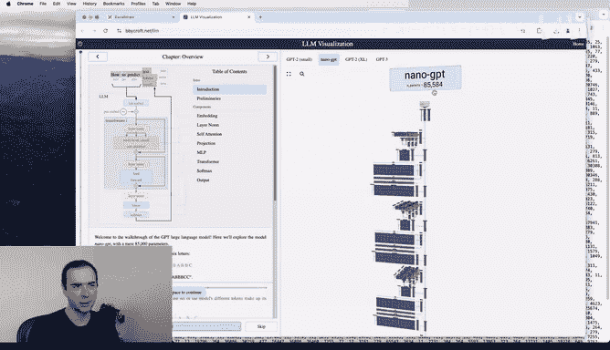

Now here on the top， we take the inputs， which are the token sequences。

And then information flows through the neural network until the output。

Which here are the Loit softmax， but these are the predictions for what comes next。

 what token comes next。And then。Here， there's a sequence of transformations and all these intermediate values that get produced inside this mathematical expression。

 as it is sort of predicting what comes next。So as an example。

 these tokens are embedded into kind of like this distributed representation， as it's called。

 So every possible token has kind of like a vector that represents it inside the neural network。

 So first， we embed the tokens。And then those values kind of like flow through this diagram。

 And these are all very simple mathematical expressions individually。

 So we have layer norms and matrix multiplications and softmes and so on。

 So here's kind of like the attention block of this transformer。

And then information kind of flows through into the multi layerar perron block and so on。

And all these numbers here， these are the intermediate values of their expression。

 and you can almost think of these as kind of like the firing rates of these synthetic neurons。

 but I would caution you to not kind of think of it too much like neurons because these are extremely simple neurons compared to the neurons you would find in your brain。

 Your biological neurons are a very complex dynamical processes that have memory and so on。

 there's no memory in this expression。 It's a fixed mathematical expression from input to output with no memory。

 It's just a stateless。So these are very simple neurons in comparison to biological neurons。

 but you can still kind of loosely think of this as like a synthetic piece of brain tissue if you like to think about it that way。

So information flows through all these neurons fire。Until we get to the predictions。

Now I'm not actually going to dwell too much on the precise kind of like mathematical details of all these transformations。

 Honestly， I don't think it's that important to get into What's really important to understand is that this is a mathematical function。

It is parametermetized by some fixed set of parameters， like's say 85000 of them。

And it is a way of transforming inputs into outputs， and as we twiddle the parameters。

 we are getting different kinds of predictions。And then we need to find a good setting of these parameters so that the predictions sort of match up with the patterns seen in training set。

So that's the transformer。 Okay， so I've shown you the internals of the neural network。

 and we talked a bit about the process of training it。

 I want to cover one more major stage of working with these networks。

 and that is the stage called inferenceferous。So an inference what we're doing is we're generating new data from the model。

And so we want to basically see what kind of patterns it has internalized in the parameters of its network。

So to generate from the model is relatively straightforward。

 we start with some tokens that are basically your prefix， like what you want to start with。

So say we want to start with the token 91。Well， we feed it into the network。

 and remember that the network gives us。Probabilities， right。

 It gives us this probability vector here。So we can do now is we can basically flip a biased coin。

So we can sample basically a token based on this probability distribution。

 so the tokens that are given high probability by the model are more likely to be sampled when you flip this biased coin。

 you can think of it that way。So we sample from the distribution to get a single unique token。

So for example， token 860 comes next。So 860 in this case when we're generating from model could come next。

 now 860 is a relatively likely token， it might not be the only possible token in this case。

 there could be many other tokens that could have been sampled。

 but we could see that 860 is a relatively likely token as an example and indeed in our training example here。

 860 does follow 91。So let's now say that we。Contnuue the process。 So after 91， there's a 60。

 we append it， and we again ask， what is the third token。 Let's sample。

 And let's just say that it's 2，87， exactly as here。Let's do that again。

 We come back in now we have a sequence of three， and we ask what is the likely fourth token and we sample from that and get this one。

And now let's say we do it one more time。We take those four， we sample， and we get this one。

And this 1365，9， this is not actually 3，962， as we had before。

 So this token is the token article instead。 So viewing a single article。And so in this case。

 we didn't exactly reproduce the sequence that we saw here in the training data。

So keep in mind that these systems are stochastic， they have we're sampling and we're flipping coins and sometimes we lock out and we reproduce some like small chunk of the text and training set。

 but sometimes we're getting a token that was not verbatim part of any of the documents in the training data。

So we're going to get sort of like remixes of the data that we saw in the training。

 because at every step of the way， we can flip and get a slightly different token。

 And then once that token makes it in， if you sample the next one and so on。

 you very quickly start to generate token streams that are very different from the token streams that occur in the training documents。

So statistically， they will have similar properties， but they are not identical to training data。

 they're kind of like inspired by the training data。

And so in this case we got a slightly different sequence and why would we get article。

 you might imagine that articles are relatively likely token in the context of bar viewing single。

 etc， and you could imagine that the word article followed this context window somewhere in the training documents to some extent。

 and we just happened to sample here at that stage。So basically。

 inference is just predicting from these distributions one at a time。

 we continue feeding back tokens and getting the next one。

 and we we're always flipping these coins and depending on how lucky or unlucky we get。

We might get very different kinds of patterns， depending on how we sample from these probability distributions。

So that's inference。 So in most common scenarios， basically downloading the internet and tokenizing it is a pre processingces step。

 you do that a single time。And then once you have your token sequence。

 we can start training networks and in practical cases you would try to train many different networks of different kinds of settings and different kinds of arrangements and different kinds of sizes。

 and so you'd be doing a lot of neural network training and then once you have a neural network and you train it and you have some specific set of parameters that you're happy with。

Then you can take the model and you can do inference and you can actually generate data from the model。

 And when you're on ChattptT and you're talking with a model。

 that model is trained and has been trained by Open AI many months ago probably and they have a specific set of weights that work well。

 And when you're talking to the model， all of that is just inference。 There's no more training。

 Those parameters are held fixed and you're just talking to the model sort of you're given it some of the tokens and it's kind of completing token sequences。

 and that's what you're seeing generated when you actually use the model on ChattPT。

So that model then just does infer as loan。So let's now look at an example of training and inference that is kind of concrete and gives you a sense of what this actually looks like when these models are trained。

 Now， the example that I would like to work with and that I am particularly fond of is that of opening eyes GP2。

So GT stands for Generatively pretrained Transformer。

 and this is the second iteration of the GT series by Open AI。When you are talking to Chat GT today。

 the model that is underlying all of the magic of that interaction is GT4。

 so the fourth iteration of that series。Now GPT2 was published in 2019 by Open AI in this paper that I have right here。

And the reason I like G2 is that it is the first time that a recognizably modern stack came together。

All the pieces of GP2 are recognizable today by modern standards。

 it just everything has gotten bigger。Now I'm not going to be able to go into the full details of this paper。

 of course， because it is a technical publication， but some of the details that I would like to highlight are as follows。

GPT2 was a transformer neural network just like the neural networks you would work with today。

It was it had 1。6 billion parameters， right， So these are the parameters that we looked at here。

It would have 1。6 billion of them。Today， modern transformers would have a lot closer to a trillion or several hundred billion。

 probably。The maximum context length here was 1024 tokens。

 so it is when we are sampling chunks of windows of tokens from the data set。

We're never taking more than 1024 tokens， and so when you are trying to predict the next token in a sequence。

 you will never have more than 1024 tokens kind of in your context in order to make that prediction。

Now this is also tiny by modern standards。 Today， the token the context lens would be a lot closer to。

Couple hundred thousand or maybe even a million。 And so you have a lot more context。

 lot more tokens in history。 And you can make a lot better prediction about the next token in sequence in that way。

And finally， GP2 was trained on approximately 100 billion tokens。

 And this is also fairly small and modern standards。 As I mentioned。

 the Fin web dataset set that we looked at here， the Finab dataset set has 15 trillion tokens。

 So 100 billion is quite small。Now。I actually tried to reproduce GPT2 for fun as part of this project called LM。

c。So you can see my redup of doing that in this post on Gitthub under the ElN thats see repository。

So in particular， the cost of training G2 in 2019 was estimated to be approximately $40，000。

 but today you can do significantly better than that。

 and in particular here it took about one day and about $600。But this wasn't even trying too hard。

 I think you could really bring this down to about $100 today。Now。

 why is it that the costs have come down so much Well number one。

 these data sets have gotten a lot better and the way we filter them。

 extract them and prepare them has gotten a lot more refined and so the data set is of just a lot higher quality。

 so that's one thing。But really， the biggest difference is that our computers have gotten much faster in terms of the hardware。

 And we're going to look at that in a second。 and also the software for running these models and really squeezing out all all the speed from the hardware as it is possible。

 That software has also gotten much better as everyone has focused on these models and tried to run them very。

 very quickly。

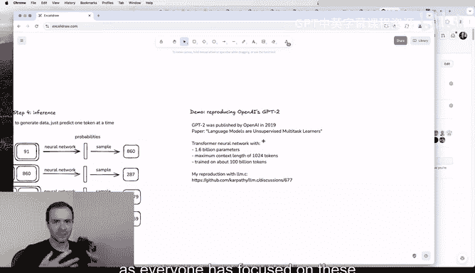

Now。I'm not going to be able to go into the full detail of this G2 reproduction。

 and this is a long technical post， but I would like to still give you an intuitive sense for what it looks like to actually train one of these models as a researcher。

 Like what are you looking at and what does it look like， What does it feel like？

 So let me give you a sense of that a little bit。Okay， so this is what it looks like。

 Let me slide this over。So what I'm doing here is I am training a G2 model right now。

And what's happening here is that every single line here。Like this one is one update to the model。

So remember how here we are basically making the prediction better for every one of these tokens。

 and we are updating these weights or parameters of the neural lot。

So here every single line is one update to the neural network。

 where we change its parameters by a little bit so that it is better at predicting lexto in a sequence。

In particular， every single line here is。Improving the prediction on 1 million tokens in the training set。

So we've basically taken1 million tokens。Out of this data set。

And we've tried to improve the prediction of that token as coming next in a sequence on all 1 million of them。

 simultaneously。And at every single one of these steps。

 we are making an update to the network for that。Now。

 the number to watch closely is this number called loss。

And the loss is a single number that is telling you how well your neural network is performing right now。

 and it is created so that low loss is good。So you'll see that the loss is decreasing as we make more updates to the neural net。

 which corresponds to making better predictions on the next token in a sequence。

And so the loss is the number that you are watching as a neural network researcher and you are kind of waiting。

 you're twiling your thumbs， you're drinking coffee and you're making sure that this looks good so that with every update your loss is improving and the network is getting better at prediction。

Now， here you see that we are processing 1 million tokens per update。

 Each update takes about 7 seconds， roughly。And here we are going to process a total of 32000 steps of optimization。

So 32，000 steps with 1 million tokens each is about 33 billion tokens that we are going to process。

And we're currently only about 420， step 420 out of 32000。

 So we are still only a bit more than 1% done because I've only been running this for 10 or 15 minutes or something like that。

Now， every 20 steps， I have configured this optimization to do inference。

So what you're seeing here is the model is predicting the next token in the sequence。

 and so you sort of start it randomly， and then you continue plugging in the tokens。

 So we're running this inference step。And this is the model sort of predicting the next token in a sequence。

 And every time you see something appear， that's a new token。A。So let's just look at this and。

You can see that this is not yet very coherent and keep in mind that this is only 1% of the way through training。

 and so the model is not yet very good at predicting next token in the sequence。

 So what comes out is actually kind of a little bit of gibberish， right。

 but it still has a little bit of like local coherence so。Since she is mine。

 it's a part of the information Should discuss my father。Great companions。

 Gordon showed me sitting over it and etc cetera。 So I know it doesn't look very good。

 but let's actually scroll up。And see what it looked like when I started the optimization。

So all the way here。At stop。Wn。So after 20 steps of optimization。

 you see that what we're getting here is looks completely random， and of course。

 that's because the model has only had 20 updates to its parameters。

 and so it's given you random text because it's a random network。And so you can see that。

 at least in comparison to this， the model is starting to do much better。 And indeed。

 if we waited the entire 32000 steps， the model will have improved the point that is actually generating fairly coherent English。

 And the tokens stream correctly。 and they they kind of make up English a lot better。嗯。

So this has to run for about a day or two more now。

 and so at this stage we just make sure that the loss is decreasing， everything is looking good。

 and we just have to wait。AndNow let me turn now to the story of the computation that's required because of course。

 I'm not running this optimization on my laptop。 That would be way too expensive because we have to run this neural network and we have to improve it and we we need all this data and so on。

 So you can't run this too well on your computer because the network is just too large So all of this is running on a computer that is out there in the cloud and I want to basically address the compute side of the story of training these models and what that looks like So let's take a look。

Okay， so the computer that Im running this optimization on。Is this8 x H 100 node。

So there are8 H100s in a single node or a single computer。

Now I am renting this computer and it is somewhere in the cloud， I'm not sure where it is physically。

 actually。The places I like to rent from is called Lambda。

 but there are many other companies who provide the service。 So when you scroll down。

You can see that they have some on demand pricing for。Sort of computers that have these H100s。

 which are GPUus。 And I'm going to show you what they look like in a second。

But on demand eight times Nviia H100 GP。This machine comes for $3 per g per hour， for example。

So you can rent these and then you get a machine in a cloud and you can go in and you can train these models。

And。These GPUs， they look like this。 So this is 1 H100 GPU。

This is kind of what it looks like and you slot this into your computer and GPUs are this perfect fit for training neural networks because they are very computationally expensive。

 but they display a lot of parallelism in the computation。

 so you can have many independent workers kind of working all at the same time in solving the matrix multiplication that's under the hood of training these neural networks。

So this is just one of these H100s， but actually you would put multiple of them together so you could stack eight of them into a single node。

 and then you can stack multiple nodes into an entire data center or an entire system。So。

When we look at the data center。Can't spell。When we look at a data center。

 we start to see things that look like this right so we have one GPU goes to8 GPUs。

 goes to a single system， goes to many systems。And so these are the bigger data centers and they。

 of course， would be much， much more expensive and what's happening is that all the big tech companies really desire these GPUs so they can train all these language models because they are so powerful。

And that is fundamentally what has driven the stock price of NviIDdia to be $3。

4 trillion today as an example。And why Nvidia has kind of exploded。So this is the gold rush。

 the gold rush is getting the GPUus， getting enough of them so they can all collaborate to perform this optimization。

And what are they all doing， They're all collaborating to predict the next token on a dataset set like。

 define what data set。This is the computational workflow that that basically is extremely expensive。

 the more GPUus you have， the more tokens you can try to predict and improve on。

 and you're going to process this dataset set faster and you can iterate faster and get a bigger network and train a bigger network and so on。

So this is what all those machines that are doing。And this is why all of this is such a big deal。

 And， for example， this is a。Article from like about a month ago or so。

 this is why it's a big deal that， for example， Elon Musk is getting 100。

000 GPUs in a single data center。And all of these GPUs are extremely expensive。

 are going to take a ton of power， and all of them are just trying to predict the next token in the sequence and improve the network by doing so。

And get probably a lot more coherent text than what we're seeing here a lot faster。 Okay。

 so unfortunately， I do not have a couple 10 or 1 hundred million of dollars to spend on training a really big model like this。

 But luckily， we can turn to some big tech companies who train these models routinely and release some of them once they are done training。

 So they've spent a huge amount of compute to train this network。

 and they release the network at the end of the optimization。

 So it's very useful because they've done a lot of compute for that。

So there are many companies who train these models routinely。

 but actually not many of them release these what's called base models。

So the model that comes out at the end here is what's called a base model。What is a base model。

 It's a token simulator， right， It's an Internet text token simulator。

And so that is not by itself useful yet， because what we want is what's called an assistant。

 We want to ask questions and have it respond to answers。 These models won't do that。

 They just create sort of remixes of the internet。They dream Internet pages。

So the base models are not very often released because they're kind of just only a step one of a few other steps that we still need to take to get an assistant。

However， a few releases have been made， so。As an example， the GT2 model released the 1。6 billion 1。

5 billion model back in 2019， and this GPT2 model is a base model。Now what is a model release。

 what does it look like to release these models？So this is the GT2 repository on GitHub。Well。

 you need two things basically to release model。 Number one， we need。The Python code， usually。

That describes the sequence of operations in detail that they make in their model。

 So if you remember back。This transformer。The sequence of steps that are taken here in this neural network is what is being described by this code。

So this code is sort of implementing the what's called forward pass of this neural network。

 so we need the specific details of exactly how they wired up that neural network。

So this is just computer code and it's usually just a couple hundred lines of code。

s it's not that crazy， and this is all fairly understandable and usually fairly standard。

 What's not standard are the parameters。 That's where the actual value is。

 Where are the parameters of this neural network， because there's once 1。6 billion of them。

 and we need the correct setting or a really good setting。

And so that's why in addition to this source code， they release the parameters。

 which in this case is roughly 1。5 billion parameters， and these are just numbers。

 so it's one single list of 1。5 billion numbers， the precise and good setting of all the knobs such that the tokens come out well。

So you need those two things to get a base model release。Now。GPT2 was released。

 but that's actually a fairly old model as I mentioned。 So actually。

 the model we're going to turn to is called Lama 3。

 And that's the one that I would like to show you next。

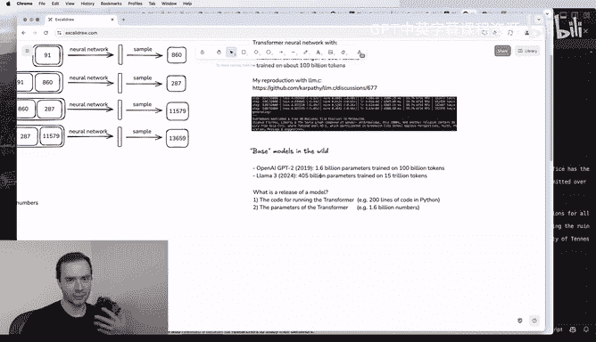

Soalma 3。So GP T 2 L again， was 1。6 billion parameters trained on 100 billion tokens。

Lama 3 is a much bigger model and much more modern model。 It is released and trained by Meta。

 and it is a 405 billion parameter model trained on 15 trillion tokens。In very much the same way。

 just much， much bigger。And Meta has also made a release of Lama 3。

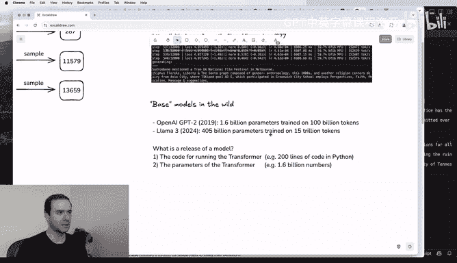

And that was part of this paper。So with this paper that goes into a lot of detail。

 the biggest base model that they released is the Alllma 3。1，4。5405 billion parameter model。

So this is the base model， and then in addition to the base model you see here foreshadowing for later sections of the video。

 they also released the instruct model。And the instruct means that this is an assistant。

 You can ask it questions， and it will give you answers。 We still have yet to cover that part later。

 For now， let's just look at this base model， this token simulator。

 and let's play with it and try to think about， you know what is this thing and how does it work and what do we get at the end of this optimization If you let this run until the end for a very big neural network on a lot of data。

 So my favorite place to interact with the base models， is this company called hyperbolic。

 which is basically serving the base model of the 405 d Lama 3。1。

So when you go into the website and I think you may have to register and so on。

 make sure that in the models， make sure that you are using Lama 3。1405 billion base。

 it must be the base model。And then here， let's say the max tokens is how many tokens we're going to be generating。

 so let's just decrease this to be a bit less just so we don't waste compute。

 We just want the next 128 tokens。And leave the other stuff alone。

 I'm not going to go into the full detail here。Now， fundamentally。

 what's going to happen here is identical to what happens here during inference for us。

So this is just going to continue the totalcon sequence of whatever prefix you're going to give it。

So I want to first show you that this model here is not yet an assistant。 so you can， for example。

 ask it what is2 plus2。 It's not going to tell you， oh， it's for。 What else can I help you with。

 It's not going to do that。Because what is 2 plus 2 is going to be tokenized。

And then those tokens just act as a prefix。 And then what the model is going to do now is just going to get the probability for the next token。

 and it's just a glorified autocomp。 It's a very， very expensive autocompte of what comes next。

Dending on the statistics of what it saw in its training documents， which are basically web pages。

So let's just hit enter to see what tokens it comes up with as a continuation。Okay。

 so here it kind of actually answered the question and started to go off into some philosophical territory let's try it again。

 so let me copy and paste and let's try again from scratch What is2+2。Okay。

 so it just goes off again。So notice one more thing that I want to stress is that the system。

I think every time you put it in， it just kind of starts from scratch。

So it doesn't the system here is stochastic， so for the same prefix of tokens。

 we're always getting a different answer， and the reason for that is that we get this probability distribution and we sample from it and we always get different samples and we sort of always go into a different territory afterwards。

So here in this case。I don't know what this is。 Let's try one more time。

So it just continues on so it's just doing the stuff that it's sell on the internet right。

 and it's just kind of like regurgitating those statistical patterns。So first things。

 it's not an assistant yet， it's a token autocomplete， and second it is a stochastic system。Now。

 the crucial thing is that even though this model is not yet by itself。

 very useful for a lot of applications just yet。It is still very useful， because。

In the task of predicting the next token in the sequence。

 the model has learned a lot about the world。And it has stored all that knowledge in the parameters of the network。

So remember that our text look like this， right， Internet Web pages。

And now all of this is sort of compressed in the weights of the network。

So you can think of these 405 billion parameters as a kind of compression of the internet。

 you can think of the 405 billion parameters as kind of like a zip file。But it's not a loss。

 less compression， it's a loss C compression。 We're kind of like left with kind of a gal of the internet and we can generate from it。

 right。Now， we can elicit some of this knowledge by prompting the base model accordingly。 So。

 for example， here's a prompt that might work to elicit some of that knowledge that's hiding in the parameters。

Here' is my top 10 list of the top landmarks you see in Paris。嗯。

And I'm doing it this way because I'm trying to prime the model to now continue this list。

 so let's see if that works when I press enter。Okay。

So you see that it started the list and it's now kind of giving me some of those landmarks。

And now notice that it's trying to give a lot of information here。

 Now you might not be able to actually fully trust some of the information here。

 remember that this is all just a recollection of some of the internet documents。

And so the things that occur very frequently in the internet data are probably more likely to be remembered correctly。

 compared to things that happen very infrequently， so you can't fully trust some of the things that is some information that is here because it's all just a vague recollection of internet documents。

Because the information is not stored explicitly in any of the parameters。

 it's all just the recollection。That that we did get something that is probably approximately correct。

 And I don't actually have the expertise to verify that this is roughly correct。

 But you see that we've elicited a lot of the knowledge of the model。

 And this knowledge is not precise and exact。 This knowledge is vague and probabilistic and statistical。

 and the kinds of things that occur often are the kinds of things that are more likely to be remembered。

In the model。Now I want to show you a few more examples of this model's behavior。

The first thing I want to show you is this example。

I went to the Wikipedia page for zebra and let me just copy paste the first even one sentence here。

And let me put it here。Now when I click enter， what kind of completion are we going to get？

So let me just hit enter。There are three living species。Et cetera， et cetera。

 What the model is producing here is an exact regurgitation of this Wikipedia entry。

 It is reciting this Wikipedia entry purely from memory， and this memory is stored in its parameters。

 And so it is possible that at some point in these 512 tokens。

 The model will stray away from the Wikipedia entry。

 But you can see that it has huge chunks of it memorized here。 Let me see， for example。

 if this sentence occurs。By now。Okay， so this。So we're still on track， let me check here。Okay。

 we're still on track。It will eventually stray away。Okay。

 so this thing is just reciteted to a very large extent。

 it will eventually deviate because it won't be able to remember exactly。 Now。

 the reason that this happens is because these models can be extremely good at memorization。

And usually this is not what you want in the final model， and this is something called regurgitation。

 and it's usually undesirable to cite things directly that you have trained on。Now。

 the reason that this happens actually is because for a lot of documents， like for example。

 Wikipedia， when these documents are deemed to be of very high quality as a source， like for example。

 Wikipedia，It is very often the case that when you train the model。

 you will preferentially sample from those sources。 So basically。

 the model has probably done a few epochs on this data， meaning that it has seen this web page。

 like maybe probably 10 times or so。 And it's a bit like you。

 like when you read some kind of a text many， many times。 say you read something 100 times。

 then you will be able to recite it。 And it's very similar for this model。

 If it sees something way too often， it's going to be able to recite it later from memory。

Except these models can be a lot more efficient like per presentation than a human。

 So probably it's only seen this Wikipedia entry 10 times。

 but basically it has remembered this article exactly in its parameters。 Okay。

 the next thing I want to show you is something that the model has definitely not seen during its training。

So for example， if we go to the paper。And then we navigate to the pre training data。

We'll see here that。The data set has a knowledge cut off until the end of 2023。

 so it will not have seen documents after this point。 And certainly。

 it has not seen anything about the 2024 election。 And now it turned out。Now。

 if we prime the model with the tokens from the future， it will continue the token sequence。

 and it will just take its best guess， according to the knowledge that it has in its own parameters。

 So let's take a look at what that could look like。So， the Republican part hit Trump。Okay。

 president of the United States from 2017。And let's see what it says after this point。 So。

 for example， the model will have to guess at the running mate and who it's against etctera。

 So let's hit enter。So here are things that Mike Pence was the running mate instead of JD Vz。

And the ticket was against Hillary Clinton and Tim Kane。

 So this is kind of an interesting peril universe， potentially of what could have happened according to the a。

Let's get a different sample。 So the identical prompt， and let's resample。So here。

 the running mate was Ron Desantis， and they ran against Joe Biden and Kamala Harris。So this is。

 again， a different parallel universe。 So the model will take educated guesses。

 and it will continue the token sequence based on this knowledge。

 And we'll just kind of like all of what we're seeing here is what's called hallucination。

 The model is just。Taking its best guess in a probabilistic manner。

 The next thing I would like to show you is that even though this is a base model and not yet an assistant model。

 it can still be utilized in practical applications If you are clever with your prompt design。

So here's something that we would call a few shot prompt。So what it is here is that I have 10 words。

Or 1 pairs。 And each pair is a word of English， column， and then the translation inquiry Korean。

And we have 10 of them。And what the model does here is at the end， we have teacher column。

 and then here's where we're going to do a completion of， say just five tokens。

And these models have what we call in context learning abilities。

 And what that's referring to is that as it is reading this context。It is learning， sort of in place。

That there's some kind of an algorithmic pattern going on in my data。

And it knows to continue that pattern。 And this is called kind of like in context learning。

So it takes on the role of a translator。And when we hit completion。

 we see that the teacher translation is Soceim， which is correct。

And so this is how you can build apps by being clever with your prompting。

 even though we still just have a base model for now， and it relies on what we call this。

In context learning ability， and it is done by constructing what's called a few shot prompt。Okay。

 and finally， I want to show you that there is a clever way to actually instantiate a whole language model assistant just by prompting。

And the trick to it is that we're going to structure or prompt to look like a web page that is a conversation between a helpful AI assistant and a human。

 And then the model will continue that conversation。So actually， to write the prompt。

 I turned to ChayP itself， which is kind of meta， but I told it I want to create an OEMM assistant。

 but all I have is the base model。So can you please write my prompt？And this is what it came up with。

 which is actually quite good。 So here's a conversation between an AI assistant and the human。

 The AI assistant is knowledgeable， helpful， capable of answering wide variety questions， etc。

And then here， it's not enough to just give it a sort of description。

 It works much better if you create this fu shall prompt。 So here's a few terms of human assistant。

 human assistant。And we have， a few terms of conversation。And then here at the end。

 is we're going to be putting the actual query that we like。

So let me copy paste this into the base model prompt。And now let me do human column。

 And this is where we put our actual prompt。Why is the sky blue。And let's run。Assistant。

 the sky appears blue due to the phenomenon cold rail lights Cating， et cetera， et cetera。

 So you see that the base model is just continuing the sequence。

 But because the sequence looks like its conversation， it takes on that role。

 But it is a little subtle because here it just， you know， it ends the assistant。 And then just。

 you know， hallucinates the next question by the human， et cetera。 It will just continue going on on。

 But you can see that we have sort of accomplish the task。And if you just took this。

 why is this sky blue？And if we just refresh this and put it here， then， of course。

 we don't expect this to work with a base model， right， We're just going。

 who knows what we're going to get。 Okay， we're just going to get more questions。Okay。

So this is one way to create an assistant， even though you may only have a base model。

Okay， so this is the kind of brief summary of the things we talked about over the last few minutes。

Now let me zoom out here。And this is kind of like what we've talked about so far。

We wish to train alllum assistants like Chay Bt。 We've discussed the first stage of that。

 which is the pretraining stage。 And we saw that really what it comes down to is we take internet documents。

 we break them up into these tokens， these atoms of little text chunks。

 and then we predict token sequences using neural networks。

The output of this entire stage is this base model。

 it is the setting of the parameters of this network。

And this base model is basically an internet document simulator on the token level。

 so just it can generate token sequences that have the same kind of like statistics as internet documents。

And we saw that we can use it in some applications， but we actually need to do better。

 We want an assistant， we want to be able to ask questions and we want the model to give us answers。

 and so we need to now go into the second stage， which is called the post training stage。

So we take our base model， our internal document simulator， and hand it off to post training。

So we're now going to discuss a few ways to do what's called post training of these models。

These stages impose post training are going to be computationally much less expensive。

 most of the computational work， all of the massive data centers and all of the sort of heavy compute and millions of dollars are the pre training stage。

But now we're going to this slightly cheaper， but still extremely important stage called post training。

 where we turn this LLM model into an assistant。So let's take a look at how we can get our model to not sample internet documents。

But to give answers to questions。So in other words。

 what we want to do is we want to start thinking about conversations。

And these are conversations that can be multi turn。 So so there can be multiple turns。 and they are。

 in the simplest case， a conversation between a human and an assistant。And so， for example。

 we can imagine the conversation could look something like this。 When a human says what is 2 plus 2。

 the assistant should respond with something like2 plus2 is 4。 When a human follows up and says。

 what if it was star instead of a plus。Assant could respond with something like this。

And similar here， this is another example showing that the assistant could also have some kind of a personality here that it's kind of like nice。

And then here in the third example， I'm showing that when a human is asking for something that we don't wish to help with。

 we can produce what's called a refusal， we can say that we cannot help with that。So in other words。

 what we want to do now is we want to think through how an assistant should interact with a human and we want to program the assistant and its behavior in these conversations。

Now， because this is neural networks， we're not going to be programming these explicitly in code。

 we're not going to be able to program the assistant in that way， because this is neural networks。

 everything is done through neural network training on datasets。And so because of that。

 we are going to be implicitly programming the assistant by creating data sets of conversations。

 so these are three independent examples of conversations in a dataset。An actual data set。

 and I'm going to show you examples will be much larger。

 It could have hundreds of thousands of conversations that are multi turn very long， etc cetera。

 and would cover a diverse breadth of topics。 But here I'm only showing three examples。

But the way this works basically is。Assistant is being programmed by example。

 and where is this data coming from like two timess 4 same as 2 plus 2 etc ce。

 where does that come from， this comes from human labelers。

 so we will basically give human labelers some conversational context and we will ask them to basically give the ideal assistant response in this situation。

And a human will write out the ideal response for an assistant in any situation。

And then we're going to get the model to basically train on this and to imitate those kinds of responses。

So the way this works then is we are going to take our base model。

 which we produced in the pretraining stage。And this base model was trained on internet documents。

We're now going to take that data set of internet documents and we're going to throw it out。

And we're going to substitute a new data set。 And that's going to be a data set of conversations。

 And we're going to continue training the model on these conversations on this new data set of conversations。

 And what happens is that the model will very rapidly adjust and will sort of like learn the statistics of how this assistant responds to human queries and then later during inference willll be able to basically。

Prime the assistant and get the response。 and it will be imitating what the humans human labelers would do in that situation。

 if that makes sense。So we're going to see examples of that and this is going to become a bit more concrete。

 I also wanted to mention that this post training stage we're going to basically just continue training the model。

 but the pretraining stage can in practice take roughly three months of training on many thousands of computers the post training stage will typically be much shorter like three hours for example。

 and that's because the data set of conversations that we're going to create here manually is much much smaller than the data set of。

Text on the internet。 And so this training will be very short， but fundamentally。

 we're just going to take our base model。 We're going to continue training using the exact same algorithm。

 the exact same everything， except we're swapping out the data set for conversations。

So the questions now are， where are these conversations， how do we represent them。

 how do we get the model to see conversations instead of just raw text？

And then what are the outcomes of this kind of training and what do you get in a certain like psychological sense when we talk about the model。

 So let's turn to those questions now。 So let's start by talking about the tokenization of conversations。

Everything in these models has to be turned into tokens。

 because everything is just about token sequences。 So how do we turn conversations into token sequences is the question。

And so for that we need to design some kind of endingcoding and this is kind of similar to maybe if you're familiar you don't have to be with。

 for example， the TCPI packet in on the Internet， there are precise rules and protocols for how you represent information how everything is structured together so that you have all this kind of data laid out in a way that is written out on a paper and that everyone can agree on and so it's the same thing now happening in LLMs。

 we need some kind of data structures and we need to have some rules around how these data structures like conversations get encoded and decoded to and from tokens。

And so I want to show you now how I would recreate。This conversation in the token space。

So if you go to TkToizer。I can take that conversation。

And this is how it is represented in fourth the language model。So here we have。

 we are iterating a user and an assistant in this two turn conversation。

And what you're seeing here is it looks ugly， but it's actually relatively simple。

 The way it gets turned into a token sequence here at the end is a little bit complicated。

 but at the end， this conversation between the user and assistant ends up being 49 tokens。

 It is a one dimensional sequence of 49 tokens， and these are the tokens okay。

And all the different LLM will have a slightly different format or protocols。

 And it's a little bit of a Wild West right now， but。For example， G 4 does it in the following way。

You have this special token called I am underscore start。

 And this is short for a imaginary monologue of the start。Then you have to specify。

 I don't actually know why it's called that， to be honest。

 then you have to specify whose stern it is。 So for example， user， which is a token 1，4，2，8。

Then you have internal monologue separator。And then it's the exact question。

 So the tokens of the question。And then you have to close it。

 So I am end the end of the measuring monologue。So basically。

Question from a user of what is 2+2 ends up being。The token sequence of these tokens。And now。

 the important thing to mention here is that I am start。 This is not text， right。

 I Am start is a special token that gets added。 It's a new token。

 And this token has never been trained on so far。 It is a new token that we create in a post training stage。

 And we introduce。 And so these special tokens like I am set， I am start， etc cetera。

 are introduced and interspersed with text so that they sort of get the model to learn that， hey。

 this is the start of a turn for。 Who is at the start of the term for。

 the start of the turn is for the user。😊，And then this is what the user says。 And then the user ends。

 And then it's a new start of a turn。 and it is by the assistant。

 And then what does the assistant say， well， these are the tokens of what the assistant says。

 et cetera。And so this conversation is not turned into this sequence of tokens。

 The specific details here are not actually that important。

 All I'm trying to show you in concrete terms， is that our conversations。

 which we think of as kind of like a structured object。

End up being turned via some encoding into one dimensional sequences of tokens。

And so because this is one dimensional sequence of tokens。

 we can apply all the stuff that we applied before。 Now it's just a sequence of tokens。

 And now we can train a language model on it。 And so we're just predicting the next token in a sequence just like before。

 and we can represent and train on conversations。And then what does it look like at test time during inference。

 so say we've trained a model。And we've trained a model on these kinds of data sets of conversations。

 And now we want to inference。So during inference what does this look like when you're on ChayPt。

 well， you come to ChayPt and you have say like a dialogue with it。

And the way this works is basically。Sa that this was already filled in。

 so like what is 2 plus 22 plus2 is4 and now you issue what if it was times。I am end。

 And what basically ends up happening on the servers of open AI or something like that is they put an I am start assistant。

 I am Sep。 And this is where they end it right here。 So they construct this context。

 And now they start sampling from the model。 So it's at this stage that they will go to the model and say。

 okay， what is a good first sequence， What is a good first token。 What is a good second token。

 What is a good third token。 And this is where the L M takes over and creates a response like。

 for example，Response that looks something like this， but it doesn't have to be identical to this。

 but it will have the flavor of this if this kind of a conversation was in the dataset set。

So that's roughly how the protocol works， although the details of this protocol are not important。

So again， my goal is that just to show you that everything ends up being just a one initial toe consequence so we can apply everything we've already seen。

But we're now training on conversations， and we're now basically generating conversations as well。

 Okay， so now I would like to turn to what these dataset sets look like in practice。

 The first paper that I would like to show you and the first effort in this direction is this paper from Open AI in 2022。

And this paper was called Instruct G or the technique that they developed。

 And this was the first time that Open Air has kind of talked about how you can take language models and fine tune them on conversations。

And so this paper has a number of details that I would like to take you through。

 So the first stop I would like to make is in Section 3。

4 where they talk about the human contractors that they hired in this case from a work or through KAI to construct these conversations。

 and so there are human labelers involved whose job it is professionally to create these conversations and these labelers are asked to come up with prompts。

 and then they are asked to also complete the ideal assistant responses。

And so these are the kinds of prompts that people came up with， so these are human labelers。

 so list5 ideas for how to regain enthusiasm for my career。

 What are the top 10 science fiction books I should read next and there's many different types of kind of prompts here so translate this sentence from to Spanish etc。

And so there's many things here that people came up with。 They first come up with the prompt。

 and then they also answer that prompt， and they give the ideal assistant response。 Now。

 how do they know what is the ideal assistant response that they should write for these prompts。

 So when we scroll down a little bit further， we see that here we have this excerpt of labeling instructions that are given to the human labelers。

 So the company that is developing the language model， like， for example。

 Open AI writes up labeling instructions for how the humans should create ideal responses。

And so here， for example， is an excerpt of these kinds of labeling instructions。

 on a high level you're asking people to be helpful， truthful and harmless。

 and you can pause the video if you'd like to see more here。

 but on a high level basically just just answer， try to be helpful。

 try to be truthful and don't answer questions that we don't want kind of the system to handle later in ChatyBT。

And so roughly speaking， the company comes up with the labeling instructions。

 usually they are not this short， usually they are hundreds of pages。

 and people have to study them professionally， and then they write out the ideal assistant responses。

Following those labeling instructions。 So this is a very human heavy process。

 as it was described in this paper。 Now， the data set for Inpt was never actually released by Open eye。

 but we do have some open source reproductions that we're trying to follow this kind of a setup and collect their own data。

 So one that I'm familiar with， for example， is the effort of open assistant from a while back。

And this is just one of， I think， many examples。 But I just want to show you an example。So here's。

 these are people on the internet that were asked to basically create these conversations similar to what opening I did with human labelers。

And so heres an entry of a person who came up with this spnt。

 Can you write a short introduction to the relevance of the term Muopsonni。In economics。

 please use examples， etc ce。 and then the same person or potentially a different person will write up the response。

 so here's the assistant response to this。And so then the same person or different person will actually write out this ideal response。

And then this is an example of maybe how the conversation could continue。 Now explain it to a dog。

 and then you can try to come up with a slightly a simpler explanation or something like that。Now。

This then becomes the label， and we end up training on this。 So what happens during training is that。

Of course， we're not going to have full coverage of all the possible questions that the model will encounter at Du time during inference。

We can't possibly cover all the possible prompts that people are going to be asking in the future。

 but if we have like a data set of a few of these examples。

 then the model during training well start to take on this persona of this helpful， truthful。

 harmless assistant and it's all programmed by example。

 and so these are all examples of behavior and if you have conversations of these example behaviors and you have enough of them like 1 hundred000 and you train on it。

 and the model sort of starts to understand the statistical pattern and it kind of takes on this personality of this assistant。

Now， it's possible that when you get the exact same question like this。At test time。

 it's possible that the answer will be recited as exactly what was in the training set。

 but more likely than that is that the model will kind of like do something of a similar vibe and it will understand that this is the kind of answer that you want。

嗯。So that's what we're doing。 We're programming the system， by example。

 in the system adopts statistically this persona of this healthful， truthful， harmless assistant。

 which is kind of like reflected in the labeling instructions that the company creates。

Now I want to show you that the state of the art has kind of advanced in the last two or three years。

 since the In Gp paper。 So in particular， it's not very common for humans to be doing all the heavy lifting just by themselves anymore。

 And that's because we now have language models。 and these language models are helping us create these data sets and conversations。

 So it is very rare that the people will like literally just write out the response from scratch。

 It is a lot more likely that they will use an existing LLm to basically like come up with an answer。

 and then they will edit it or things like that。 So there's many different ways in which now LLms have started to kind of permeate this posttraining stack。

 and Lms are basically used pervasively to help create these massive dataset sets of conversations。

 So I don't want to show like ultrachat is one such example of like a more modern dataset set of conversations。

 It is to a very large extent synthetic。 but I believe there's some human involvement。

 I could be wrong with that。 Usually there will be a little bit of human。

 but there will be a huge amount of synthetic help。

And this is all kind of like constructed in different ways。

 and Utrachat is just one example of many SFT data sets that currently exist。

 And the only thing I want to show you is that these data sets have now millions of conversations。

 these conversations are mostly synthetic， but they're probably edited to some extent by humans and they span a huge diversity of sort of。

Areas and so on so。These are fairly extensive artifacts by now。

 and there are all these like SF mixtures， as they're called。

 So you have a mixture of like lots of different types and sources and it's partially synthetic。

 partially human。 and it's kind of like。Goone in that direction since。But roughly speaking。

 still have SFT dataset sets， they're made up of conversations。

 were training on them just like we did before。And。I guess like the last thing to note is that。

I want to dispel a little bit of the magic of talking to an AI。

 like when you go to Chay P and you give it a question and then you hit enter。

What is coming back is kind of like statistically aligned with what's happening in the training set and these training sets。

 I mean， they really just have a seed in humans following labeling instructions。

So what are you actually talking to in ChaipBt or how should you think about it， Well。

 it's not coming from some magical AI， like roughly speaking。

 it's coming from something that is statistically imitating human labelers。

 which comes from labeling instructions written by these companies。

 And so you're kind of imitating this you're kind of getting it's almost as if you're asking human labeler。

 And imagine that the answer that is given to you from Chaipbt。

 It's some kind of a simulation of a human labeler。And it's kind of like asking。

 what would a human labeler say in this kind of a conversation？And。

It's not just like this human labeler is not just like a random person from the internet because these companies actually hire experts。

 So for example， when you are asking questions about code and so on。

 the human labelers that would be involved in creation of these conversation dataset sets。

 they will usually be usually be educated expert people and you're kind of like asking a question of like a simulation of those people if that makes sense。

 So you're not talking to a magical AI， you're talking to an average labeler。

 this average labeler is probably fairly highly skilled。

 but you're talking to kind of like an instantaneous simulation of that kind of a person that would be hired。

In the construction of these dataset sets。So let me give you one more specific example before we move on。

For example， when I go to ChaCPT and I， recommend the top five landmarks you see in Paris。

 and then I hit enterter。乐。Yeah。Okay， here we go。 Okay， when I hit enter what's coming out here。

How do I think about it， Well， it's not some kind of a magical AI that has gone out and researched all the landmarks and then ranked them using its infinite intelligence。

 etc cetera。 What I'm getting is a statistical simulation of a labeler that was hired by open AI。

 You can think about it roughly in that way。 And so if this specific question is in the post training data set somewhere to open AI。

 Then I'm very likely to see an answer。 There' is probably very。

 very similar to what that human labeler would have put down for those five landmarks。

 How does the human labeler come up with this。 Well they go off and they go on the internet。

 and they cannot do their own little research for 20 minutes。 and they just come up with a list。

 right。Now， as if they come up with this list and this is in the data set。

 I'm probably very likely to see what they submitted as the correct answer from the assistant。Now。

 if this specific query is not part of the post training dataset。

 then what I'm getting here is a little bit more emergent。

Because the model kind of understands that statistically。

 the kinds of landmarks that are in a training set are usually the prominent landmarks。

 the landmarks that people usually want to see， the kinds of landmarks that are usually very often talked about on the internet and remember that the model already has a ton of knowledge from its pretraining on the internet。

 so it's probably seen a ton of conversations about pairs about landmarks about the kinds of things that people like to see and so it's the pretraining knowledge that is then combined with the posting data set that results in this kind of an imitation。

So that's that's roughly how you can kind of think about what's happening behind the scenes here in in the statistical sense。

 Okay， now I want to turn to the topic of LLM psychology， as I like to call it。

 which is where are sort of the emergent cognitive effects of the training pipeline that we have for these models。

So in particular， the first one I want to talk to is of course， hallucinations。So。

You might be familiar with Model Ho dis Nations， it's when LLMs make stuff up。

 they just totally fabricate information， etca， and it's a big problem with LLM assistance。

It is a problem that existed to a large extent with early models from many years ago。

 and I think the problem has gotten a bit better because there are some mitigations that I'm going to go into in a second。

For now， let's just try to understand where these hallucinations come from。

So here's a specific example of a of three conversations that you might think you have in your training set。

And these are pretty reasonable conversations that you could imagine being in the training set。

 So like for example， who is Tom Cruise， well， Tom Cruise is a famous actor， American a and producer。

 etc ce， who is John Barraso， This turns out to be hey you US senator， for example。

 who is Genghis Khan， Well Genghis Khan was blah， blah bh。

 And so this is what your conversations could look like a training time。Now。

 the problem with this is that。When the human is writing the correct answer for the assistant。

 in each one of these cases， the human either like knows who this person is or they resource them on the internet。

 And they come in and they write this response that kind of has this like confident tone of an answer。

And what happens basically is that at test time， when you ask for someone who is。

 this is a totally random name that I totally came up with， and I don't think this person exists。

As far as I know。I just try to generate it randomly。The problem is when we ask whois orson Kovas。

The problem is that the assistant will not just tell you， oh， I don't know。

 Even if the assistant and the language model itself。Might know inside its features。

 In its activations， inside of its brain， sort of it might know that this person is like not someone that is that is familiar with。

 even if some part of the network kind of knows that in some sense， the saying that， oh。

 I don't know who this is is not going to happen because the model statistically imitates its training set。

In the training set， the questions of the form who is bh are confidently answered with the correct answer。

And so it's going to take on the style of the answer， and it's going to do its best。

 It's going to give you statistically the most likely guess。

 And it's just going to basically make stuff up because these models， again， we just talked about it。

 is they don't have access to the internet。 They're not doing research。

 These are statistical tokenem tumblers， as I call them。

 is just trying to sample the next token in the sequence。And it's going to basically make stuff up。

 so let's take a look at what this looks like。I have here what's called the inference playground from Huging F。

And I am on purpose picking on a model called Falcon 7 B， which is an old model。

 This is a few years ago now。 So it's an older model。 So it suffers from hallucinations。

 And as I mentioned， this has improved over time recently。But let's say who is or some Kots。

 let's ask Falcon 7 B in run。Oh yeah， Orson Kovats is an American author in science fiction writer。

 okay？It's totally false。 It's hallucination。 Let's try again。 These are statistical systems。

 right so we can resample。This time， Orson Kovas is a fictional character from this 1950s TV show。

 it's total BS， right？Let's try in。He's a former minor league baseball player。 Okay， so basically。

 the model doesn't know。 and it's given us lotsths of different answers because it doesn't know。

 It's just kind of like sampling from these probabilities。 The model starts with the tokens。

 who is Orsonkovat's assistant。 And then it comes in here。And。

It's's getting these probabilities and it's just sampling from the probabilities and it just like comes up with stuff。

And the stuff is actually statistically consistent with the style of the answer in its training set。

 and it's just doing that。But you and I experience it as a made up factual knowledge。

 but keep in mind that the model basically doesn't know and is just imitating the format of the answer。

 and it's not going to go off and look it up because it's just imitating again the answer。

So how can we mitigate this because for example， when we go to chatt AT and I say。

 who is Orson covas， and I'm now asking the state of the art model from Open AI？

This model will tell you。Oh。So this model actually is even smarter because you saw it very briefly。

 it said searching the web。 we're going to cover this later。 It's actually trying to do toollus。And。

It kind of just like came up with some kind of a story。

 but I wna just Bruce Orsonkovaj did not use any tools。I don't want it to do web search。

There is a well known historical or public figure named or some covats。

 So this model is not going to make up stuff。 This model knows that it doesn't know。

 and it tells you that it doesn't appear to be a person that this model knows。

So somehow we sort of improve hallucinations， even though they clearly are an issue in older models。

 and it makes totally sense why you would be getting these kinds of answers if this is what your training set looks like。

 so how do we fix this？Okay， well， clearly we need some examples in our data set。

That where the correct answer for the assistant is that the model doesn't know about some particular fact。

But we only need to have those answers be produced in the cases where the model actually doesn't know。

 And so the question is， how do we know what the model knows or doesn't know， Well。

 we can empirically probe the model to figure that out。 So let's take a look at， for example。

 how Meta dealt with hallucinations for the Lama 3 series of models as an example。

 So in this paper that they published from Meta， we can go into hallucinations。

Which they call here factuality。 And they describe the procedure by which they basically interrogate the model to figure out what it knows and doesn't know to figure out sort of like the boundary of its knowledge。

 And then they add examples to the training set。Where for the things where the model doesn't know them。

 the correct answer is that the model doesn't know them。

Which sounds like a very easy thing to do in principle， but this roughly fixes the issue。

And the reason they fixes the issue is because。Remember that the model might actually have a pretty good model of its self knowledge inside the network。

 So remember we looked at the network and all these neurons inside the network。

 You might imagine that there's a neurons somewhere in the network that sort of like lights up for when the model is uncertain。

But the problem is that the activation of that neuron is not currently wired up to the model actually saying in words that it doesn't know。

 So even though the internals of the neural network know。

 because there are some neurons that represent that。The model will not surface that。

 It will instead take its best guess so that it sounds confident just like it's using a training set。

 So we need to basically interrogate the model and allow it to say。

 I don't know in the cases that it doesn't know。So let me take you through what meta roughly does。

 So basically what they do is here I have an example。 Dominic Kashk is the featured article today。

 So I just went there randomly。And what they do is basically they take a random document in a training set。

And they take a paragraph。And then they use an LM to construct questions about that paragraph。

So for example， I did that with ChayBT here。So I said， here's a paragraph from this document。

 generate three specific factual questions based on this paragraph and give me the questions and the answers。

And so the LLMs are already good enough to create and reframe this information。

 So if the information is in the context window of this LM， this actually works pretty well。

 It doesn't have to rely on its memory。 It's right there in the context window。

 And so it can basically reframe that information with fairly high accuracy。 So， for example。

 can generate questions for us like for which team did he play。 Here's the answer。

 how many cups at D1， etc ce。 And now what we have to do is we have some question and answers。

 and now we want to interrogate the model。 So roughly speaking。

 what we'll do is we'll take our questions and we'll go to our model， which will be C Lama in metata。

 But let's just interrogate Miral 7 B here as an example， That's another model。😊。

So does this model know about this answer， let's take a look。So he played for buffalo savers， right。

 So the model knows。And the way that you can programmatically decide is basically we're going to take this answer from the model。

 and we're going to compare it to the correct answer。And again。

 the models are good enough to do this automatically。 So there's no humans involved here。

 We can take basically the answer from the model， and we can use another L LM judge to check if that is correct。

 according to this answer。 And if it is correct， that means that the model probably knows。

 So we're going to do is we're gonna do this maybe a few times。 So okay， it knows is buffalo savers。

 Let's drag in。A。Buffalo saves， let's try one more time。Buffalo saves。

 So we asked three times about this factual question， and the model seems to know。

 so everything is great。Now， let's try the second question。 How many Stanley Cups did he win。

And again， let's entire target the model about that。 And the correct answer is 2。So here。

 the model claims that he won。Am。F times， which is not correct， right， It doesn't match， too。

 So the model doesn't know it's making stuff up。 Let's try again。嗯。

So here the model again is kind of like making stuff upright。 Let's try in。Here， it says it didn。

 He did not even did not win during his career。 So obviously， the model doesn't know。

 And the way we can programmatically tell again is we interrogate the model three times。

 and we compare its answers， maybe three times five times whatever it is to the correct answer。

And if the model doesn't know， then we know that the model doesn't know this question。

 And then what we do is we take this question。We create a new conversation in the training set。

 so we're going to add a new conversation training set。

And when the question is how many Stanley cups did he win。 the answer is， I'm sorry。

 I don't know or I don't remember。 And that's the correct answer for this question。

 because we interrogated the model。 and we saw that that's the case。

If you do this for many different types of questions， for many different types of documents。

 you are given the model an opportunity to in its training set， refuse to say based on its knowledge。

And if you just have a few examples of that in your training set。

 the model will know and has the opportunity to learn the association of this knowledge based refusal to this internal neuron somewhere in its network that we presume exists。

 and empirically， this turns out to be probably the case。And it can learn that association that hey。

 when this neuron of uncertainty is high， then I actually don't know。

 and I'm allowed to say that I'm sorry， but I don't think I remember this， etc cea。

 And if you have these examples in your training set then this is a large mitigation for hallucination and that's roughly speaking why ChaBT is able to do stuff like this as well。

 So these are the kinds of mitigations that people have implemented and that have improved the factuality issue over time。

 Okay， so I've described mitigation number one for basically mitigating the hallucinations issue。

Now we can actually do much better than that it's instead of just saying that we don't know。

 we can introduce an additional mitigation number two to give the LLM an opportunity to be factual and actually answer the question。

Now， what do you and I do if I was to ask you a factual question and you don't know。

 what would you do in order to answer the question。

 well he could go off and do some search and use the internet and you could figure out the answer and then tell me what that answer is。

And we can do the exact same thing with these models。

 so think of the knowledge inside the neural network inside its billions of parameters。

Think of that as kind of a vague recollection of the things that the model has seen during its training during the pre training stage a long time ago。

 So think of that knowledge in the parameters as something you read a month ago。

 And if you keep reading something， then you will remember it。 And the model remembers that。

 But if it's something rare， then you probably don't have alig recollection of that information。

 But what you and I do is we just go and look it up。Now when you go and look it up。

 what you're doing basically is like you're refreshing your working memory with information and then you're able to sort of like retrieve it。

 talk about it， or etc ce。 So we need some equivalent of allowing the model to refresh its memory or its forcollection。

 and we can do that by introducing tools for the models。

So the way we are going to approach this is that instead of just saying， hey， I'm sorry。

 I don't know， we can attempt to use tools， so we can create a mechanism by which the language model can emit special tokens and these are tokens that were going to introduce new tokens。

So， for example， here I've introduced two tokens， and I've introduced a format or a protocol for how the model is allowed to use these tokens。

 So， for example， instead of answering the question， when the model does not。

 instead of just saying I don't know。 sorry， the model has the option now to emitting the special token。

 search start。And this is the query that will go to like Bing dot com in a case of open AI or say Google search or something like that。

 So it will emit the query， and then I will emit search end。And then here。

 what will happen is that the program that is sampling from the model that is running the inference when it sees the special tokens search end。

Instead of sampling the next token。In the sequence， it will actually pause generating from the model。

 It will go off。 It will open a session with Bing dot com。

 and it will paste the search query into Bing， and it will then get all the text that is retrieved。

 and it will basically take that text。 It will maybe represent it again with some other special tos or something like that。

 and it will take that text， and it will copy pasteed here。

Into what I tried to show with the brackets。So all that text kind of comes here and when the text comes here。

 it enters the context window。So model that text from the web search is now inside the contact window that will feed into the neural network。

And you should think of the context window as kind of like the working memory of the model。

 That data that is in the context window is directly accessible by the model。

 It directly feeds into the neural network。 So it's not any more a vague recollection。

 It's data that it it has in the context window and is directly available to that model。

 So now when it's sampling the new tokens here afterwards。

 it can reference very easily the data that has been copy pasted in there。

So that's roughly how these。How these tools use tools function And so web search is just one of the tools we're going to look at some of the other tools in a bit。

 but basically you introduce new tokens， you introduce some schema by which the model can utilize these tokens and can call these special functions like web search functions。

And how do you teach the model how to correctly use these tools。

 like say web search search start search and， etc。 Well， again， you do that through training sets。

 So we need not to have a bunch of data and a bunch of conversations that show the model by example。

 how to use web search。So what are the settings where you are using the search and what does that look like and here's by example。

 how you start a search and a search， etc。And if you have a few thousand maybe examples of that in your training set。

 the model will actually do a pretty good job of understanding how this tool works and it will know how to sort of structure its queries and of course。

 because of the pre-training data set and its understanding of the world It actually kind of understands what a web search is and so it actually kind of has a pretty good native understanding of what kind of stuff is a good search query and so it all kind of just like works。

 you just need a little bit of a few examples to show it how to use this new tool and then it can lean on it to retrieve information and put it in the context window and that's equivalent to you and I looking something up。

Because once it's in the context， it's in a working memory and it's very easy to manipulate and access。

So that's what we saw a few minutes ago when I was searching on Chat GPT for whois or some Koats。

The ChayPT language model decided that this has some kind of a rare。

Individual or something like that。 And instead of giving me an answer from its memory。

 it decided that it will sample special token that is going to do a web search。

 And we saw briefly something flash。 was like using the web tool or something like that。

 So it briefly said that。 And then we waited for like two seconds。 and then it generated this。

 And you see how it's creating references here。 And so it's citing sources。😊。

So what happened here is。It went off， and did a web web search。

 It found these sources and these URLs， and the text of these web pages was all stuffed。

In between here， and it's not shown here， but it's it's basically stuffed as text in between here。

And now it sees that text， and now it kind of references it and says that， okay。

 it could be these people citation， it could be those people citation， etc。

So that's what happened here and that's why when I said whois or some kats。

 I could also say don't use any tools， and then that's enough to basically convince JatchoPT to not use tools and just use its memory and its recollection。

I also went off and I。Ts to ask this question of Cha GPT。

 So how many standing cups did Dominic Hashk win And ChagPT actually decided that it knows the answer。

 And it has the confidence to say that he won' twice。

 And so it kind of just relied on its memory because presumably， it has。It has enough of a。

Kind of confidence in its weights and its parameters and activations that this is retrievable just for memory。

But you can also conversely。Use web search to make sure。 And then for the same query。

 it actually goes off and it searches， and then it finds a bunch of sources。 It finds all this。

 All of this stuff gets copy pasted in there， and then it tells us to again， and sites。

And it actually says the Wikipedia article， which is the source of this information for us as well。

So that's tools， web search， the model determines when to search。

 and then that's kind of like how these tools work。

 and this is an additional kind of mitigation for hallucinations and factuality。

 So I want to stress one more time this very important sort of psychology point。

Knowledge in the parameters of the neural network is a vague recollection。

The knowledge and the tokens that make up the context window。Is the working memory。

 And it roughly speaking works kind of like it works for us in our brain。

 The stuff we remember is our parameters and the stuff that we just experienced like a few seconds or minutes ago and so on。

 You can imagine that being in our context window。 and this context window is being built up as you have a conscious experience around you。

So this is a bunch of implications also for your use of LLlums in practice so for example。

I can go to Chachputt and I can do something like this。 I can say。

 can you summarize chapterpt 1 of Jane Allusten's pridede and Preju。

 And this is a perfectly fine prompt。 And Chachputt actually does something relatively reasonable here。

 And but the reason is does that is because Chahiputt has a pretty good recollection of a famous work like Pride and Prejuice。

 It's probably seen a ton of stuff about it， there's probably forums about this book。

 it's probably read versions of this book。 And it's kind of like remembers because even if you've read this or articles about it。

 you'd kind of have a recollection enough to actually say all this。

 But usually when I actually interact with Oems and I want them to recall specific things。

 It always works better if you just give it to them。

 So I think a much better prompt would be something like this。😊。

Can you summarize for me chapter 1 of Jane Allusson's Pride and Preju and then I am attaching it below for your reference and then I do something like the limiter here and I paste it in and I found that just copy pasting it from some website that I found here。

So copy pasting the chapter 1 here。 And I do that because when it's in the context window。

 the model has direct access to it and can exactly， it doesn't have to recall it。

 It just has direct access to it。 And so this summary is can be expected to be a significantly high quality or higher quality than this summary。

 just because it's directly available to the model。 And I think you and I would work in the same way。

 If you want to， it would be you would produce a much better summary if you had reread this chapter before you had to summarize it。

 And that's basically what's happening here or the equivalent of it。

 The next sort of psychological quirk I'd like to talk about briefly。

 I that of the knowledge of self。So what I see very often on the internet is that people do something like this。

They ask L L M something like。 What model are you and who built you。And basically。

 this question is a little bit nonsensical。 And the reason I say that is that。

As I try to kind of explain with some of the under hood fundamentals， this thing is not a person。

 right， It doesn't have a persistent existence in any way。 It sort of boots up。

 processes tokens and shuts off。 And it does that for every single person。

 Its just kind of build up a context window of conversation。 and then everything gets deleted。

 And so， this entity is kind of like restarted from scratch。 every single conversation。

 If that makes sense。 It has no persistent self as no sense of self。 It's token tumblr。

 and it follows statistical regularities of its training set。

So it doesn't really make sense to ask it who are you what built to， etc cetera。 And by default。

 if you do what I described and just by default and from nowhere。

 you're going to get some pretty random answers。 So for example， let's pick on Falcon。

 which is a fairly old model and let's see what it tells us。Also， it's evading the question。

Talent engineers in the developersers。Here it says I was built by open AI based on a G3 model。

 It's totally making stuff up。 Now， the fact that it's built by open AI here。

 I think a lot of people would take this as evidence that this model was somehow trained on open AI data or something like that。

 I don't actually think that that's necessarily true。 The reason for that is that。

If you don't explicitly program the model to answer these kinds of questions。

 then what you're going to get is its statistical best guess at the answer。

And this model had a SFT data mixture of conversations。 And during the fine tuning。

The model sort of understands， as it' training on this data that is taking on this personality of this like helpful assistant。

 and it doesn't know how to， it doesn't actually， it wasn't told exactly what label to apply to self。

It just kind of is taking on this persona of a helpful assistant and remember that the pretraining stage took the documents from the entire internet。

And Chattt and Open AI are very prominent in these documents。

 And so I think what's actually likely to be happening here is that this is just its hallucinated label for what it is。

 this is its self identity is that it's chattt by OpenaiI and it's only saying that because there's a ton of data on the Internet of answers like this that are actually coming from Open AI from ChattP and so that's its label for what it is。

Now， you can override this as a developer。 if you have an LLM model， you can actually override it。

 And there are a few ways to do that。 So， for example， let me show you。

 there's this Omo model from Alllan AI。 And this is one LLM。

 It's not a top yearlM or anything like that。 But I like it because it is fully open source。

 So the paper for Omo and everything else is completely fully open source， which is nice。😊。

So here we are looking at its SFT mixture， so this is the data mixture of the fine tuning。

 so this is the Conver data set， right？And so the way that they are solving it for the Oma model is we see that there's a bunch of stuff in the mixture and there's a total of 1 million conversations here。

 but here we have Omo2 hard coded。If we go there， we see that this is 240 conversations。

And look at these 240 conversations， they're hard coded。Tell me about yourself。Says user。

And then the assistant says I'm Omo an open language model developed by AI2 Allen Institute of Artificial In intelligenceligence。

 etcter。 I'm here to help blah， blah， blah， what is your name， the Oma project。

 these are all kinds of like cooked up hard coded questions about Omo2 and the correct answers to give in these cases。

If you take 240 questions like this or conversations。

 put them into your training set and fine tune with it。

 then the model will actually be expected to parrot this stuff later。If you don't give it this。

 then it's probably Cha Hy by open AI。And there's one more way to sometimes do this is that。

Basically。In these conversations， and you have terms between human and assistant。

 sometimes there's a special message called system message。

 at the very beginning of the conversation。 So it's not just between human and assistant。

 there's a system。 And in the system message， you can actually hardcode and remind the model that hey。

 you are a model developed by open AI。 And your name is Chasip Bt 40。

 And you are trained on the state。 and your knowledge cut off as this。 And basically。

 it's kind of like documents the model a little bit。

 And then this is inserted into your conversations。 So when you go in chasippit。

 you see a blank page。 But actually， the system message is kind of like hidden in there。

 And those tokens are in the context window。 And so those are the two ways to kind of program the models to talk about themselves。

 either is done through data like this， or is done through system message and things like that。

 basically invisible tokens that are in the context window and remind the model of its identity。

 But it's all just kind of like cooked up and bolted on in some in some way。

 It's not actually like really deeply there in an E。Real sense， as it would before for even。

I want to now continue to the next section， which deals with the computational capabilities。

 or like I should say， the native computational capabilities of these models in problem solving scenarios。

And so in particular， we have to be very careful with these models when we construct our examples of conversations。

 and there's a lot of sharp edges here that are kind of like elucidative， said a word。

 They're kind of like interesting to look at when we consider how these models think。So。

Consider the following prompt from a human and suppose basically that we are building out a conversation to enter into our training set of conversations。

 so we're going to train the model on this。 We're teaching you how to basically solve simple math problems。

So the prompt is， Emily buys three apples and two oranges， each orange costs2， the total cost is 13。

 what is the cost of apples， very simple math question。

Now there are two answers here on the left and on the right。They are both correct answers。

 they both say that the answer is  three， which is correct。

But one of these two is a significantly better。Answer for the assistant than the other。

 Like if I was data labeler and I was creating one of these。

 one of these would be a really terrible answer for the assistant and the other would be okay。

And so I'd like you to potentially pause the video even and think through why one of these two is significantly better answer than the other。

 And if you use the wrong one， your model will actually be really bad at math potentially and it would have bad outcomes。

 and this is something that you would be careful with in your labeling documentation when you are training people to create the ideal responses for the assistant。

Okay， so the key to this question is to realize and remember that when the models are training and also inferencing。

 they are working in one dimensional sequence of tokens from left to right。

And this is the picture that I often have in my mind。

 I imagine basically the token sequence evolving from left to right。

 And to always produce the next token in a sequence。

 we are feeding all these tokens into the neural network。

 And this neural network think is the probabilities for the next token in sequence， right？

 So this picture here is the exact same picture we saw before up here。😊。

And this comes from the web demo that I showed you before， right？

So this is the calculation that basically takes the input tokens here on the top and performs these operations of all these neurons。

And gives you the answer for the probabilities of what comes next。 Now。

 the important thing to realize is that， roughly speaking。

There's basically a finite number of layers of computation that happen here。 So， for example。

 this model here has only one，2，3 layers of what's called attention and MLP here。

Maybe a typical modern state of the art network would have more。

 like say 100 layers or something like that， but there's only 100 layers of computation or something like that to go from the previous token sequence to the probabil for the next token。

And so there's a finite amount of computation that happens here for every single token。

 and you should think of this as a very small amount of computation。

 and this amount of computation is almost roughly fixed for every single token in this sequence。

 that's not actually fully true because the more tokens you feed in the more expensive this forward pass will be of this neural network。

But not by much。 So you should think of this。 And I think as a good model to have in mind。

 this is a fixed amount of compute that's going to happen in this box for every single one of these tokens。

 And this amount of compute cannot possibly be too big because there's not that many layers that are sort of going from the top to bottom here。

 There's not that that much computationally that will happen here。

 And so you can't imagine models to basically do arbitrary computation in a single forward pass to get a single token。

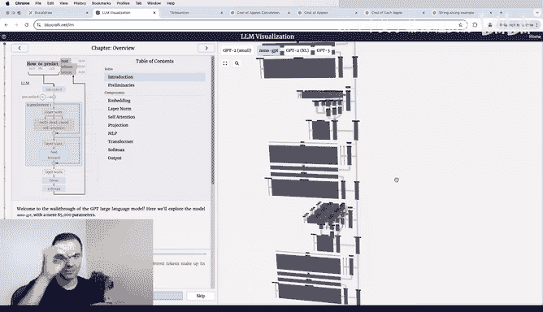

And so what that means is that we actually have to distribute our reasoning in our computation across many tokens。

 because every single token is only spending a finite amount of computation on it。

And so we kind of want to distribute the computation across many tokens。

And we can't have too much computation or expect too much computation out of the model in any single individual token。

 because there's only so much computation that happens per token。 Okay。

 roughly fixed amount of computation here。So。That's why this answer here。Is significantly worse。

 And the reason for that is， imagine going from left to right here。 and I copy pasted it right here。

The answer is three， etc。Imagine a model having to go from left to right。

 emitting these tokens one at a time。 It has to say。

 or we are expecting to say the answer is space dollar sign。 And then right here。

 we're expecting it to basically cram all the computation of this problem into this single token。

 It has to emit the correct answer 3。And then once we've emitmted the answer3。

 we're expecting it to say all these tokens， but at this point we've already produced the answer and it's already in the context window for all these tokens that follow。

 So anything here is just kind of post hoc justification of why this is the answer。

Because the answer is already created， it's already in the token window。

 so it it's not actually being calculated here。 And so if you are answering the question directly and immediately。

 you are training the model to try to basically guess the answer in a single token and that is just not going to work because of the finite amount of computation that happens per token。

That's why this answer on the right is significantly better because we are distributing this computation across the answer。

 We're actually getting the model to sort of slowly come to the answer。😊，From the left right。

 we're getting intermediate results。 We're saying， O， the total cost of oranges is 4。 So 30-4 is 9。

And so we're creating intermediate calculations， and each one of these calculations is by itself not that expensive。

And so we're actually basically kind of guessing a little bit the difficulty that the model is capable of in any single one of these individual tokens。

And there can never be too much work in any one of these tokens computationally。

 because then the model won't be able to do that later at this time。

And so we're teaching the model here to spread out its reasoning and to spread out its computation over the tokens。

And in this way， it only has very simple problems in each token。 And they can add up。

 And then by the time it's near the end， it has all the previous results in its working memory。

 and it's much easier for it to determine that the answer is。 And here it is 3。

 So this is a significantly better label for our computation。 This would be really bad。

 And it is teaching the model to try to do all the computation than a single token。 it's really bad。

😊，So that's kind of like an interesting thing to keep in mind is in your prompts。

Usually don't have to think about it explicitly because the people at OpenaiI have labelers and so on that actually worry about this。

 and they make sure that the answers are spread out。

 And so actually Open AI will kind of like do the right thing。 So when I ask this question for ChayP。

 It's actually going go very slowly It's going be like， okay， let's define our variables。

 set up the equation。 and it's kind of creating all these intermediate results。

 these are not for you， these are for the model。If the model is not creating these intermediate results for itself。

 it's not going to be able to reach three。I also wanted to show you that it's possible to be a bit mean to the model。

 we can just ask for things。 so as an example I gave it the exact same prompt and I said。

 answer the question in a single token， just immediately give me the answer， nothing else。

And it turns out that for this simple prompt here， it actually was able to do it in a single go。

 so it just created a single， I think this is two tokens， right。

 because the dollar sign is its own token。Basically。

 this model didn't give me a single token and gave me two tokens。

 but it still produced the correct answer， and it did that in a single forward pass of the network。

Now， that's because the numbers here I think， are very simple。

 and so I made it a bit more difficult to be a bit mean to the model。

So I said Emily buys 23 apples and 1 77 oranges， and then I just made the numbers a bit bigger。

 and I'm just making it harder for the model。 I'm asking you to do more computation in a single token。

And so I said the same thing。 And here it gave me 5。 And 5 is actually not correct。

 So the model failed to do all this calculation in a single forward pass of the network。

 It failed to go from the input tokens。 and then in a single forward pass of the network。

 single go through the network。 It couldn't produce the result。And then I said， okay。

 now don't worry about the token limit and just solve the problem as usual。

 And then it goes all the intermediate results。 It simplifies and every one of these intermediate results here and intermediate calculations is much easier for the model。

 and its sort of it's not too much work per token。 All of the tokens here are correct。

 and it arises revised solution， which is7。 And I just couldn't squeeze all of this work。

 It couldn't squeeze that into a single for custom network。

 So I think that's kind of just a example and something to kind of like think about and I think is kind of again。

 just elucidative in terms of how these models work。

 The last thing that I would say on this topic is that if I was in practice trying to actually solve this in my day to day life。

 I might actually not trust that the model that all the intermediate calculations correctly here。

 So actually probably what I do is something like this。 I would come here and I would say use code。

And that's because code is one of the possible tools that ChatPT can use。

And instead of it having to do mental arithmetic like this mental arithmetic here。

 I don't fully trust it。 And especially the numbers get really big。

 There's no guarantee that the model will do this correctly。

 Any one of these intermediate steps might， in principle， fail。

 We're using neural networks to do mental arithmetic。

 kind of like you doing mental arithmetic in your brain。

 It might just like screw up some of the intermediate results。

 It's actually kind of amazing that it can even do this kind of mental arithmetic。

 I don't think I could do this in my head。 But basically。

 the model is kind of like doing it in its head。 And I don't trust that。 So I wanted to use tools。

 So you can say stuff like use code。😊，And I'm not sure what happened there。Use code。

And so like I mentioned， there's a special tool and the model can write code and I can inspect that this code is correct。

And then it's not relying on its mental arithmetic。 It is using the Python interpreter。

 which is a very simple programming language to basically write out the code that calculates the result。

 And I would personally trust this a lot more because this came out of the Python program which I think has a lot more correctness guarantees then the mental arithmetic of a language model So just another kind of potential hint that if you have these kinds of problems you may want to basically just asked the model to use the code interpreter。

 And just like we saw with the web search， the model has special kind of tokens for calling like it will not actually generate these tokens from the language model。

 it will write the program。 and then it actually sends that program to a different sort of part of the computer that actually just runs that program and brings back the result。

 and then the model gets access to that result and can tell you that okay the cost of each chapel is sudden。

So that's another kind of tool。 And I would use this in practice for yourself。 And it's yeah。

 it's just。Less errorprone， I would say。 So that's why I've called this section。

 models need tokens to think。 Dise your competition across many tokens。

 Ask models to create intermediate results， or whenever you can lean on tools and tool use instead of allowing the models to do all of this stuff in their memory。

 So if they try to do it all in their memory。 don't fully trust it and prefer to use tools whenever possible。

 I want to show you one more example of where this actually comes up。 And that's in count。

 So models actually are not very good at accounting for the exact same reason。

 You're asking for way too much in a single individual token。

 So let me show you a simple example of that。How many dots are below。

 and then I just put in a bunch of dots。And Chechi Bt says there are。

 and then it just tries to solve the problem in a single token。So in a single token。

 it has to count the number of dots in its context window。

And it has to do that in the single forward path of a network。In a single four passive network。

 as we talked about， there's not that much computation that can happen there。

 Just think of that as being like very little computation that happens there。

So if I just look at what the model sees， let's go to the L M。But tokenizer。It sees this。

How many dots are below， and then it turns out that these dots here， this group of， I think。

 20 dots is a single token。And then this group of whatever it is， is another token。

 And then for some reason， they break up as this， so。I don't actually。

 This has to do with the details of the tokenizer， but it turns out that these the model basically sees the token I。

 this， this， this and so on。 And then from these token Is。

 it's expected to count the number and spoiler alert is not 161。 It's actually， I believe 177。

 So here's what we can do instead。 we can say use code。And you might expect that。

 like why should this work？And it's actually kind of subtle and kind of interesting。

 So when I say use code， I actually expect this to work， let's see， okay， 177 is correct。

So what happens here is。I've actually， it doesn't look like it。

 but I've broken down the problem into。Problems that are easier for the model。

 I know that the model can't count。 It can't do mental counting。

 but I know that the model is actually pretty good at doing copy pasting。

So what I'm doing here is when I say use code， it creates a string in Python for this。

 and the task of basically copy pasting my input here to here is very simple because for the model it sees this string of it sees it as just these for tokens or whatever it is。

 So it's very simple for the model to copy paste those token IDs and kind of unpack them into dots here。

And so it creates a string， and then it calls Pythonrine do count。

 and then it comes up with the correct answer。 So the Python interpreter is doing the count。

 It's not the model's mental arithmetic doing the count。 So it's again。

 the simple example of models need tokens to think don't rely on their mental arithmetic and that's why also the models are not very good at counting。

 If you need them to do counting tasks。 always ask them to lean on a tool。Now。

 the models also have many other little cognitive deficits here and there。

 And these are kind of like sharp edges of the technology to be kind of aware of over time。

 So as an example， the models are not very good with all kinds of spelling related tasks。

 They're not very good at it。And I told you that we would loop back around to tokenization。

 And the reason to do for this is that the models they don't see the characters。 They see tokens。

 and their entire world is about tokens， which are these little text chunks。

 And so they don't see characters like our eyes do。

 And so very simple character level tasks often fail。 So， for example。I'm giving it a string。

 ubiquitous。 And I'm asking it to print only every third character starting with the first one。

 So we start with you。 And then we should go every third。 So every， so 1，2，3 Q should be next。

 And then et cetera。 So this， I see is not correct。 And again， my hypothesis is that this is， again。

 the mental arithmetic here is failing。 Numb  one， a little bit。 But number 2。

 I think the more important issue here is that if you go to Tiktokenazer。And you look at ubiquitous。

 We see that it is three tokens， right， So you and I see ubiquitous。

 and we can easily access the individual letters because we kind of see them。

 And when we have it in the working memory of our visual sort of field。

 we can really easily index into every third letter。 and I can do that task。

But the models don't have access to the individual letters， they see this as these three tokens。

And remember， these models are trained from scratch on the internet and all these token。

 basically the model has to discover how many of all these different letters are packed into all these different tokens。

And the reason we even use tokens is mostly for efficiency。

 But I think a lot of people are interested to delete tokens entirely。

 like we should really have character level or byte level models。

 is just that that would create very long sequences。

 and people don't know how to deal with that right now。 So while we have the token world。

 any kind of spelling tasks are not actually expected to work super well。

So because I know that spelling is not a strong suit because of tokenization。

 I can again ask it to lean on tools so I can just say use code。

 and I would again expect this to work because the task of copy pastsing ubiquitous into the Python interpreter is much easier and then we're leaning on Python interpreter to manipulate the characters of this string。

So when I say use code。Ubiquitous。Yes， it indexes into every third character and the actual truth is UQ2 S。

 UQ TS， which looks correct to me。So again， an example of spelling related tasks not working very well。

 A very famous example of that recently is how many R are there in strawberry。

 And this went viral many times。 And basically， the models now get it correct。

 They say there are three R's in strawberry。 But for a very long time。

 all the state of the art models would insist that there are only two Rs in strawberry。

 And this caused a lot of， you know， ruckus， because is that it word， I think so， because。

It's just kind of like， why are the models so brilliant。 And they can solve maththelympia questions。

 But they can't like count ours in strawberry。 And the answer for that again， is。

 I can't built up to it kind of slowly。 But number one， the models don't see characters。

 They see tokens。 And number 2， they are not very good at counting。

 And so here we are combining the difficulty of seeing characters with the difficulty of counting。

 And that's why the models struggled with this， even though I think by now， honestly。

 I think opening， I may have hard coded the answer here。 or I'm not sure what they did。 But。😊。

But this specific query now works。Moelles are not very good of spelling and there's a bunch of other little sharp edges。

 and I don't want to go into all of them。 I just want to show you a few examples of things to be aware of and when you're using these models in practice。

I don't actually want to have a comprehensive analysis here of all the ways that the models are kind of like falling short。

 I just want to make the point that there are some jagged edges here and there。

 and we've discussed a few of them and a few of them make sense。

 but some of them also will just not make as much sense。

 And they're kind of like you're left scratching your head。

 even if you understand in depth how these models work。

 And and a good example of that recently as the following。

The models are not very good at very simple questions like this。

And this is shocking to a lot of people because these math these problems can solve complex math problems。

 They can answer PhD grade physics， chemistry， biology questions much better than I can。

 but sometimes they fall short in like super simple prompts like this。 So here we go，9。

11 is bigger than 9。9。 And it justifiess in some way。 but obviously。And then at the end， O。

It actually it flips its decision later。So I don't believe that this is very reproducible。

 sometimes it flips around its answer， sometimes gets it right， sometimes gets it wrong。

 let's try again。ok。Even though it might look larger， okay。

 so here it doesn't even correct itself in the end。 if you ask many times。

 sometimes it gets it right too， but how is it that the model can do so great at Olympia grade problems but then fail on very simple problems like this。

And I think this one is， as I mentioned a little bit of a head scratcher。

 it turns out that a bunch of people studied this in depth， and I haven't actually read the paper。

 but what I was told by this team was that。When you scrutinize the activations inside the neural network。

 when you look at some of the features and what features turn on or off and what neurons turn on or off。

A bunch of neurons inside the neural network light up that are usually associated with Bible verses。

And so I think the model is kind of like reminded that these almost look like Bible verse markers and in a Bible verse setting。

 9。11 would come after 9。9。And so basically， the model somehow finds it like cognitively very distracting that in Bible verses 9。

11 would be greater。 Even though here it's actually trying to justify it and come up to the answer with a math。

 It still ends up with the wrong answer here。 So it basically just doesn't fully make sense。

 and it's not fully understood。 and there's a few jagged issues like that。 So that's why。

Treat this as what it is， which is a stochastic system that is really magical。

 but that you can't also fully trust， and you want to use it as a tool。

 not as something that you kind of like letter rip on a problem and copy paste the results。Okay。

 so we have now covered two major stages of training of large language models。

 We saw that in the first stage， this is called the pre training stage。

 We are basically training on internet documents。And when you train a language model in internet documents。

 you get what's called a base model， and it's basically an internet document simulator， right？

Now we saw that this is interesting artifact and this takes many months to train on thousands of computers and it's kind of a lossy compression of the internet。

 and it's extremely interesting， but it's not directly useful because we don't want to sample internet documents。

 we want to ask questions of an AI and have it respond to our questions。So for that。

 we need an assistant， and we saw that we can actually construct an assistant in the process of post training and specifically in the process of supervised fine tuning。

 as we call it。So in this stage， we saw that it's algorithmically identical to pre traininging。

 nothing is going to change。 The only thing that changes is the data。

 So instead of internet documents， we now want to create and curate a very nice data set of conversations。

So we want million conversations on all kinds of diverse topics between a human and an assistant。

And fundamentally， these conversations are created by humans。

 so humans write the prompts and humans write the ideal responses。

 and they do that based on labelent documentations。Now， in the modern stack。

 it's not actually done fully and manually by humans right。

 they actually now have a lot of help from these tools so we can use language models to help us create these data sets and weve test done extensively。

 but fundamentally it's also still coming from human curation at the end。

So we create these conversations that now becomes our data。

 we fine tune on it or continue training on it， and we get an assistant。

And then we kind of shifted gears and started talking about some of the kind of cognitive implications of what this system is like。

And we saw that， for example， the assistant will hallucinate if you don't take some sort of mitigations towards it。

 So we saw that hallucinations will be common， and then we looked at some of the mitigations of those hallucinations。

And then we saw that the models are quite impressive and can do a lot of stuff in their head。

 but we saw that they can also lean on tools to become better。 So， for example。

 we can lean on a web search in order to hallucinate less。

And to maybe bring up some more recent information or something like that。

 or we can lean on tools like code interpreter so the can so the LLM can write some code and actually run it and see the results。

So these are some of the topics we looked at so far。

Now what I'd like to do is I'd like to cover the last and major stage of this pipeline。

 and that is reinforcement learning。So reinforcement learning is still kind of thought to be under the umbrella of post training。

 but it is the last third major stage， and it's a different way of training language models and usually follows as this third step。

So inside companies like Open AI， you will start here and these are all separate teams。

 so there's a team doing data for pre training and a team doing training for pre training。

 and then there's a team doing all the conversation generation in in a different team that is kind of doing the supervised fine training and then there will be a team for the reinforcement learning as well。

So it's kind of like a handoff of these models， you get your base model。

 then you find you need to be an assistant， and then you go into reinforcement learning。

 which we'll talk about now。So that's kind of like the major flow。

 And so let's now focus on reinforcement learning， the last major stage of training。

 And let me first actually motivate it and why we would want to do reinforcement learning and what it looks like on a high level。

 So I would now like to try to motivate the reinforcement learning stage and what it corresponds to with something that you're probably familiar with。

 and that is basically going to school。 So just like you went to school to become really good at something。

 we want to take large language models through school。

And really what we're doing is where we have a few paradigms of ways of giving them knowledge or transferring skills。

So in particular， when we're working with textbooks in school。

 you'll see that there are three major kind of pieces of information in these textbooks。

three classes of information。 The first thing you'll see is you' will see a lot of exposition。

And by the way， this is a totally random book I pulled from the internet。

 I think it's some kind of organic chemistry or something I'm not sure。

But the important thing is that you'll see that most of the text。

 most of it is kind of just like the meat of it is exposition。

 it's kind of like background knowledge， etc。As you are reading through the words of this exposition。

You can think of that roughly as training on that data。

So and that's why when you're reading through this stuff。

 this background knowledge and this all this context information。

 it's kind of equivalent to pre traininging。So it's where we build sort of like a knowledge base of this data and get a sense of the topic。

The next major kind of information that you will see is。

These problems end with their worked solutions。So basically， a human expert in this case。

 the author of this book， has given us not just a problem， but has also worked through the solution。

 and the solution is basically like equivalent to having like this ideal response for an assistant。

 So it's basically the expert is showing us how to solve the problem in its kind of like in its full form。

So as we are reading the solution， we are basically training on the expert data。

 and then later we can try to imitate the expert and basically that roughly corresponds to having the SFT model that's what it will be doing。

So basically， we've already done pre traininging and we've already covered this imitation of experts and how they solve these problems。

And the third stage of reinforcement learning is basically the practice problems。

So sometimes you'll see this is just a single practice problem here。

 but of course there will be usually many practice problems at the end of each chapter in any textbook。

And practice problems， of course we know， are critical for learning because what are they getting you to do。

 they're getting you to to practice yourself and discover ways of solving these problems yourself。

And so what you get in the practice problem is you get the problem description。

 but you are not given the solution， but you are given the final answer。

 usually in the answer key of the textbook。And so you know the final answer that you're trying to get to and you have the problem statement。

 but you don't have the solution。 You are trying to practice the solution。

 You're trying out many different things and you're seeing what gets you to the final solution。

 the best。And so you're discovering how to solve these problems。 So and in the process of that。

 you're relying on number one， the background information， which comes from pre traininging。

 and number two may be a little bit of imitation of human experts。

 and you can probably try similar kinds of solutions and so on。So we've done this and this。

 and now in this session we're going to try to practice。And so we're going to be given prompts。

 We're going to be given solutions。Sorry， the final answers。

 but we're not going to be given expert solutions。 We have to practice and try stuff out。

 and that's what reinforcement learning is about。Okay。

 so let's go back to the problem that we worked with previously。

 just so we have a concrete example to talk through as we explore， serve the topic here。

So I'm here in to take tokenizer because I'd also like to， well， I get a text box which is useful。

 but number number two， I want to remind you again that we're always working with one dimensional token sequences。

 And so I actually like prefer this view because this is like the native view of the LLM if that makes sense。

 Like this is what it actually sees it theses tokenides， right。

So Emily buys three apples and two oranges。 Each orange is $2。

 The total cost of all the fruit is $13。 What is the cost of each apple。

And what I'd like you to appreciate here is these are like four possible candidate solutions as an example。

And they all reached D He or three。Now， what I'd lucky to appreciate at this point is that if I am the human data labeler that is creating a conversation to be entered into the training set。

I don't actually really know which of these conversations。To。To add to the dataset。

Some of these conversations kind of set up a system of equations。

 some of them sort of I'll just talk through it in English。

 and some of them just kind of like skip right through to the solution。

If you look at CCBT for example， and you give it this question。

 it defines a system of variables and it kind of like does this little thing。

What we have to appreciate and differentiate between those is。嗯。

The first purpose of a solution is to reach the right answer。 Of course。

 we want to get their final answer 3。 That is the that is the important purpose here。

 But theres kind of like a secondary purpose as well。

 where here we are also just kind of trying to make it like nice for the human。

 because we're kind of assuming that the person wants to see the solution。

 and They want to see the intermediate steps。 We want to present it nicely， etc cetera。

 So there are two separate things going on here。 Number one is the presentation for the human。

 But number  two， we're trying to actually get the right answer。So let's for the moment。

 focus on just reaching the final answer。If if we only care about the final answer。

Then which of these is the optimal or like the best prompt。 Sorry。

 the best solution for the L M to reach the right answer。

And what I'm trying to get at is we don't know me as a human labeler。

 I would not know which one of these is best。 So as an example， we saw earlier on when we looked at。

The token sequences here in the mental， arithmetic and reasoning。We saw that for each token。

 we can only spend basically a finite number of finite amount of compute here that is not very large。

 or you should think about it that way。And so we can't actually make too big of a leap in any one token is maybe the way to think about it。

 So as an example in this one。What's really nice about it is that there's very few tokens。

 so it's going to take us very short amount of time to get to the answer。But right here。

 when we're doing 30 minus-4 divide 3 equals， right in this token here。

 we're actually asking for a lot of computation to happen on that single individual token。

And so maybe this is a bad example of give to the LLM because it's kind of incentivizing it to skip through the calculations very quickly。

 and it's going to actually make make mistakes in its's mental arithmetic。

So maybe it would work better to like out the spread it out more。

 maybe it would be better to set up as an equation， maybe it would be better to talk through it。

 we fundamentally don't know and we don't know because。

What is easy for you or I as or as human labelers， What's easy for us or hard for us is different than what's easy or hard for the L LM。

 itss cognition is different。And the token sequences are kind of like different hard for it。And so。

Some of the token sequences here that are trivial for me might be very too much of a leap for the L L M。

 So right here， this token would be way too hard。 But conversely。

 many of the tokens that I'm creating here might be just trivial to the L L M。

 And we're just wasting tokens， like why waste all these tokens when this is all trivial。

So if the only thing we care about is reaching the final answer and we're separating out the issue of the presentation to the human。

 then we don't actually really know how to annotate this example。

 We don't know what solution to get to the LLM， because we are not the LLM。

And it's clear here in the case of like the math example。

 But this is actually like a very pervasive issue。 like for our knowledge is not LLM's knowledge。

 Like the LLM actually has a ton of knowledge of PhD and math and physics， chemistry and whatnot。

 So in many ways， it actually knows more than I do。

 And I'm potentially not utilizing that knowledge in its problem solving。 but conversely。

 I might be injecting a bunch of knowledge in my solutions that the LLM doesn't know in its parameters。

 And then those are like sudden leaps that are very confusing to the model。

 And so our cognitions are different。 And I don't really know what to puter。

 If all we care about is they reaching the final solution。And doing it economically， ideally。And so。

Long story short。We are not in a good position to create these token sequences for the LM。

And they're useful by imitation to initialize the system。

But we really want the Lm to discover the token sequences that work for it。

 We need to find It needs to find for itself what token sequence reliably gets to the answer。

 given the prompt and needs to discover that in a process of reinforcement learning and of trial and error。

 So let's see how this example would work like in reinforcement learning。Okay。

 so we're now back in the hugging face inference playground。

And that just allows me to very easily call different kinds of models。

 So as an example here on the top right I chose the Gema to 2 billion parameter model。

 so 2 billion is very， very small， so this is a tiny model， but it's okay。

So we're going to give it the way that reinforcement learning will basically work is actually quite simple。

 we need to try many different kinds of solutions and we want to see which solutions work well or not。

So we're basically going to take the prompt， we're going to run the model。

And the model generates a solution。And then we're going inspect a solution。

 And we know that the correct answer for this one is $3。 And so indeed， the model gets it correct。

 It says it's $3。 So this is correct。So that's just one attempt at the solution。

 So now we're going to delete this and we're going to rerun it again。Let's try a second attempt。

So the model solves it in a bit slightly different way， right？

 Every single attempt will be a different generation because these models are stochastic systems。

 Remember that at every single token here， we have a probability distribution and we're sampling from that distribution。

 So we end up coming kind of going down to slightly different paths。

And so this is a second solution that also ends in the correct answer。Now we're going to delete that。

 let's go through time。Okay， so again， slightly different solution， but also gets it correct。

Now we can actually repeat this many times and so in practice you might actually sample thousands of independent solutions or even like a million solutions for just a single prompt。

 and some of them will be correct and some of them will not be very correct and basically what we want to do is we want to encourage the solutions that lead to correct answers。

So let's take a look at what that looks like。 So if we come back over here。

Here's kind of like a cartoon diagram of what this is looking like。We have a prompt。

And then we tried many different solutions in parallel。And some of the solutions might go well。

 so they get the right answer， which is in green。And some of the solutions might go poorly and may not reach the right answer。

 which is read。Now， this problem here unfortunately。

 is not the best example because it's a trivial prompt。 And as we saw。

 even like a 2 billion parameter model always gets it right。

 So it's not the best example in that sense。 but let's just exercise some imagination here and let's just suppose。

That the green ones are good and the red ones are bad。Okay， so we've generated 15 solutions。

 only four of them got the right answer。And so now what we want to do is。Basically。

 we want to encourage the kinds of solutions that relate to right answers。

 So whatever token sequences happened in these red solutions。

 obviously something went wrong along the way somewhere。

 And this was not a good path to take through the solution。

 and whatever token sequences there were in these green solutions。

 well things went pretty well in this situation。 And so we want to do more things like it in prompts like this。

And the way we encourage this kind of a behaviour in the future is we basically train on these sequences。

 But these training sequences now are not coming from expert human annotators。

 There's no human who decided that this is the correct solution。

 This solution came from the model itself。So the model is practicing here。

 it's tried out a few solutions， four of them seem to have worked。

 and now the model will kind of like train on them。

 and this corresponds to a student basically looking at their solutions and being like， okay。

 well this one worked really well， so this is how I should be solving these kinds of problems。

And here in this example， there are many different ways to actually like really tweak the methodology a little bit here。

 but just to give the core idea across， maybe it's simples to just think about。

Taking the single best solution out of these four， like say this one， that's why it was yellow。

So this is the solution that not only looked to the right answer。

 but many maybe had some other nice properties， maybe it was the shortest one or it looked nicest in some ways or there's other criteria you could think of as an example。

But we're going to decide this the top solution， we're going to train on it。

 and then the model will be slightly more likely。Once you do the parameter update to take this path in this kind of a setting。

In the future。But you have to remember that we're going to run many different diverse prompts across lots of math problems and physics problems and whatever。

Whateverver there might be。 So tens of thousands of prompts maybe have in mind。

 there's thousands of solutions per prompt。 And so this is all happening kind of like at the same time。

And as we're iterating this process， the model is discovering for itself what kinds of token sequences lead it to correct answers。

 It's not coming from a human annotator。 The， the model is kind of like playing in this playground。

 and it knows what is trying to get to， and is discovering sequences that work for it。

These are sequences that don't make any mental leaps， they seem to work reliably and statistically。

And fully utilized knowledge of the model as it has it。

And so this is the process of reinforceal learning。It's basically a guess and check。

 We're going to guess many different types of solutions。 We're going to check them。

 and we're going to do more of what worked in the future。And that is reinforcement learning。

So in the context of what came before， we see now that the SFD model。

 the supervised fine tuning model， it's still helpful because it still kind of like initializes the model a little bit into the vicinity of the correct solutions。

So it's kind of like an initialization of the model in the sense that it kind of gets the model to you know take solutions。

 like write out solutions， and maybe it has an understanding of setting up a system of equations or maybe it kind of like talks through a solution。

 so it gets you into the vicinity of correct solutions。

 but reinforcement learning is where everything gets dialed in we really discover the solutions that work for the model get the right answers。

 we encourage them and then the model just kind of like gets better over time。

Okay so that is the high level process for how we train large language models In short。

 we train them kind of very similar to how we train children and basically the only difference is that children go through chapters of books and they do all these different types of training exercises kind of within the chapter of each book but instead when we train AIs。

 it's almost like we kind of do it stage by stage depending on the type of that stage So first what we do is we do pretraining which as we saw is equivalent to basically reading all the expository material。

 so we look at all the textbooks at the same time and we read all the exposition and we try to build a knowledge base。

The second thing then is we go into the SFT stage， which is really looking at all the fixed sort of like solutions from human experts of all the different kinds of worked solutions across all the textbooks。

And we just kind of get an S model， which is able to imitate the experts。

 but thus so kind of blindly， it just kind of like does its best guess to kind of just like trying to mimic statistically the expert behavior。

 And so that's what you get when you look at all the word solutions。And then finally。

 in the last stage， we do all the practice problems in the RL stage， across all the textbooks。

 we only do the practice problems。And that's how we get the Rl model。So on a high level。

 the way we train LlumMS is very much equivalent to the process that we train that we use for training of children。

The next point I would like to make is that actually these first two stages。

 pre training and surprise fine tuning， they've been around for years and they are very standard and everyone does them。

 all the different element providers。It is this last stage， the RL training。

 There is a lot more early in its process of development and is not standard yet in the field。

 and so。This stage is a lot more kind of early and nascent。

And the reason for that is because I actually skipped over a ton of little details here in this process。

 The high level idea is very simple， It's trial and that learning。

 but there's a ton of details and little mathematical kind of like nuances to exactly how you pick the solutions that are the best and how much you train on them and what is the prompt distribution and how to set up the training run such that this actually works。

 So there's a lot of little details and knobs to the core idea that is very， very simple。

And so getting the details right here is not trivial。And so a lot of companies， like for example。

 Opening eye and other LM providers， have experimented internally with reinforcement learning fine tuning for LLMs for a while。

 but they've not talked about it publicly。It's all done inside the company。

 and so that's why the paper from Deepseq that came out very。

 very recently was such a big deal because this is a paper from this company called Deepse AI in China。

 and this paper really talked very publicly about reinforcement learning fine training for large language models。

And how incredibly important it is for large luggage panels and how it brings out a lot of reasoning capabilities in the models。

 we'll go into this in a second。So this paper reinvigorated the public interest of using。

LRL for LLMs and gave a lot of the certain degree details that are needed to reproduce the results and actually get the stage to work for large launch models。

So let me take you briefly through this deepse R paper and what happens when you actually correctly apply Rl to language models and what that looks like and what that gives you。

 So the first thing I'll scroll to is this configure figure to here where we are looking at the improvement in how the models are solving mathematical problems。

 So this is the accuracy of solving mathematical problems on the aE accuracy。

And then we can go to the web page and we can see the kinds of problems that are actually in these these these kinds of math problems that are being measured here。

 So these are simple math problems。 you can。Pause the video if you like。

 But these are the kinds of problems that basically the models are being asked to solve。

 And you can see that in the beginning， they are not doing very well。

 But then as you update the model with this many thousands of steps。

 their accuracy kind of continues to climb。So the models are improving and they're solving these problems with a higher accuracy as you do this trial and error on a large data set of these kinds of problems。

 and the models are discovering how to solve math problems。

But even more incredible than the quantitative kind of results of solving these problems with a higher accuracy is the qualitative means by which the model achieves these results。

So when we scroll down。One of the figures here that's kind of interesting is that later on in the optimization。

 the model seems to be using。Average length per response goes up。

 so the model seems to be using more tokens to get its higher accuracy results。

 So it's learning to create very， very long solutions。Why are these solutions very long。

 we can look at them qualitatively here。So basically what they discover is that the model solution get very。

 very long， partially because so here's a question。 And here's kind of the answer from the model。

 what the model learns to do。 And this is an emergent property of the optimization。

 It just discovers that this is good for problem solving is it starts to do stuff like this。 Wait。

 wait， wait， that's aha moment I can flag here。 Let's reevaluate this step by step to identify the correct sum can be。

 So what is the model doing here， right？ The model is basically reevaluing steps。

 It has learned that it works better for accuracy to try out lots of ideas try something from the perspectives。

 retrace reframe back track。 is doing a lot of the things that you and I are doing in the process of problem solving for mathematical questions。

 but it's rediscovering what happens in your head。 not what you put down on the solution。

 And there is no human who can hardcode this stuff in the ideal assistant response。

 This is only something that can be discovered in the process of reinforcement learning because you wouldn't know what to put here。

 This just turns out to work for the model。And it improves its accuracy in problem solving。

So the model learns what we call these chains of thought in your head。

 and it's an emergent property of the optimization。 And that's what's bloating up the response lens。

 But that's also what's increasing the accuracy of the problem solving。

 So it's incredible here is basically the model is discovering ways to think。

 It's learning what I like to call cognitive strategies of how you manipulate a problem and how you approach it from different perspectives how you pull in some analogies or do different kinds of things like that and how you kind of try out many different things over time。

 check a result from different perspectives and how you kind of solve problems。

But here it's kind discovered by the R。 So extremely incredible to see this emerge in the optimization without having to hard code it anywhere。

 The only thing we've given it are the correct answers。

 And this comes out from trying to just solve them correctly， which is incredible。😊，嗯。

Now let's go back to actually the problem that we've been working with and let's take a look at what it would look like for this kind of a model。

 what we call reasoning or thinking model to solve that problem。Okay。

 so recall that this is the problem we've been working with。 And when I pasted it into ChayP 40。

 I'm getting this kind of a response。 Let's take a look at what happens when you give this same query to what's called a reasoning or a thinking model。

 This is a model that was trained with reinforcement learning。So。This model described in this paper。

 Deepeacar 1 is available on chat。 deepc。 co。So this is kind of like the company that developed it is hosting it。

 You have to make sure that the deep think button is turned on to get the R1 model it's called We can paste it here and run it。

And so let's take a look at what happens now and what is the output of the model。Okay。

 so here's what it says。 So this is previously what we get using basically what's an SFT approach。

 a supervised by approach。 This is like mimicking an expert solution。

 This is what we get from the Rl model。Okay， let me try to figure this out。

 So Emily buys three apples and two oranges。 Each orange costs $2。 totaltal is 13。

 I need to find out blah， blah， blah。 So here。As you're reading this。

 you can't escape thinking that this model is thinking。is definitely pursuing the solution。

 it derives that it must cost $3 and then it says， wait a second。

 let me check my math again to be sure and then it tries it from a slightly different perspective。

And then it says， yep， all that checks out。I think that's the answer。 I don't see any mistakes。

Let me see if there's another way to approach the problem， maybe setting up an equation。

Let's let the cost of one apple be $8。 then blah， blah， blah， yep， same answer。

 So definitely each apple is $3。 All right， confident that that's correct。

And then what it does once it sort of did the thinking process is it writes up the nice solution for the human。

 And so this is now considering， so this is more about the correctness aspect。

 and this is more about the presentation aspect where it kind of like writes it out nicely and boxes in the correct answer at the bottom。

And so what's incredible about this is we get this like thinking process of the model。

 and this is what's coming from the reinforcement learning process。

This is what's bloating up the length of the token sequences。 They're doing thinking。

 and they're trying different ways。This is what's giving you higher accuracy and problem solving。

And this is where we are seeing these aha moments and these different strategies and these ideas for how you can make sure that you're getting the correct answerer。

The last point I want to make is some people are a little bit nervous about putting very sensitive data into chattatsy。

com because this is a Chinese company so don people are a little bit careful and cageG with that a little bit。

Deepse R1 is a model that was released by this company。

 So this is an open source model or open weights model。

 It is available for anyone to download and use。 You will not be able to like run it in its full sort of。

The full model in full precision， you won't run that on a MacBook。But or like a local device。

 because this is a fairly large model， but many companies are hosting the full largest model。

 One of those companies that I like to use is called Togetherther do AI。

So when you go to together that AI， you sign up and you go to playgrounds。

 you can select here in the chat Deepseq R1， and there's many different kinds of other models that you can select here。

 these are all state of the art models。So this is kind of similar to the hugging face inference playground that we've been playing with so far。

 but together that AI will usually host all the state of the art models。So select Dtcar1。

 you can try to ignore a lot of these， I think the default settings will often be okay。

And we can put in this。And because the model was released by Deepseek。

 what you're getting here should be basically equivalent to what you're getting here。

 not because of the randomness in as sampling， we're going to get something slightly different。

 but in principle this should be identical in terms of the power of the model。

 and you should be able to see the same things quantitatively and qualitatively。

 but this model is coming from kind of an American company。So that's deepse。

 and that's what's called a reasoning model。Now， when I go back to chat， let me go to chat here。Okay。

 so the model that you're going to see in the drop down here， some of them like 01，03 mini。

03 mini Hi， et cetera。 They are talking about users advanced reasoning。Now。

 what this is referring to uses advanced reasoning is it's referring to the fact that it was trained by reinforcement learning with techniques very similar to those of deep C Car 1。

Per public statements of opening items employees。So these are thinking models trained with RL。

 and these models like G 40 or GPT440 mini that you're getting in the free tier。

 you should think of them as mostly SFT models， supervised fine tuning models。

 they don't actually do this like thinking as you see in the RL models。

And even though there's a little bit of reinforcement learning involved with these models。

 and I'll go that into that in a second， These are mostly SF models。

 I think you should think about it that way。 So in the same way as what we saw here。

 we can pick one of the thinking models， like， say，03 mini high。And these models， by the way。

 might not be available to unless you pay a chargeGBT subscription of either $20 per month or $200 per month for some of the top models。

So we can pick a thinking model and run。Now what's going to happen here is it's going to say reasoning and it's going to start to do stuff like this。

And what we're seeing here is not exactly the stuff we're seeing here。So even though under the hood。

 the model produces these kinds of kind of chains of thought。

 Opening eye chooses to not show the exact chains of thought in the web interface。

 It shows little summaries of of those chains of thought。 And Open eye kind of does this， I think。

 partly because they are worried about what's called the distillation risk。

 That is that someone could come in and actually try to imitate those reasoning traces and recover a lot of the reasoning performance by just imitating the reasoning chains of thought。

 And so they kind of hide them and they only show little summaries of them。

 So you're not getting exactly what you would get in deepse as with respect to the reasoning itself。

And then they write up their solution。So these are kind of like equivalent。

 even though we're not seeing the full under hood details。Now， in terms of the performance。

 these models and deepse models are currently roughly on par。

 I would say it's kind of hard to tell because of the evaluations。

 but if you're paying $200 per month to open AI， some of these models I believe are currently。

 they basically still look better， but deepse R1 for now is still a very solid choice for thinking model that will be available to you。

Sort of either on this website or any other website because the model is open weights。

 you can just download it。So that's thinking models。So what is the summary so far Well。

 we've talked about reinforcement learning and the fact that thinking emerges in the process of the optimization on when we basically run RL on many math and kind of code problems that have verifiable solutions。

 so there's like an answer 3 etc。Now these thinking models you can access in， for example。

 deepsek or any inference provider like together that AI and choosing deepse over there。

These thinking models are also available in ChaBT under any of the O1 or3 models。

But these egyPT4 row models， et cetera， they are not thinking models。

 You should think of them as mostly SFT models。Now。

 if you are if you have a prompt that requires advanced reasoning and so on。

 you should probably use some of the thinking models or at least try them out。

 but empirically for a lot of my use， when you're asking a simpler question there's like a knowledge-based question or something like that。

 this might be overkill like there's no need to think 30 seconds about some factual question。

 So for that I will sometimes default to just G40。 So empirically about 8090% of my use is just G 40 And when I come across a very difficult problem like in math and code etc ce。

 I will reach for the thinking models， but then I have to wait a bit longer because they are thinking。

So you can access these on ChaPT on Deepse， also I wanted to point out that Aitudio。google。com。

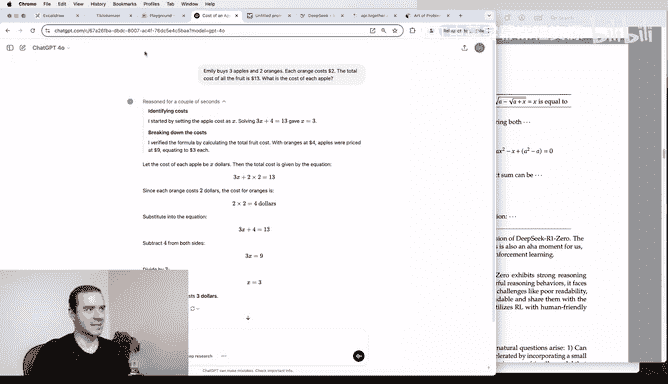

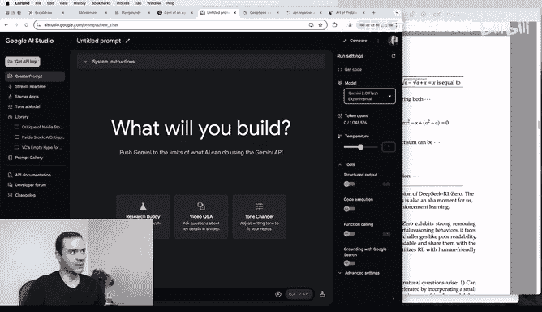

Even though it looks really busy， really ugly， because Google is just。

Unable to do this kind of stuff。 Well is like what is happening。

 But if you choose model and you choose here， Gemini 2。0 flash thinking experimental 0121。

 If you choose that one， that's also a a kind of early experiment experiment of a thinking model by Google so we can go here and we can give it the same problem and click run。

 And this is also a thinking problem thinking model that will also do something similar。

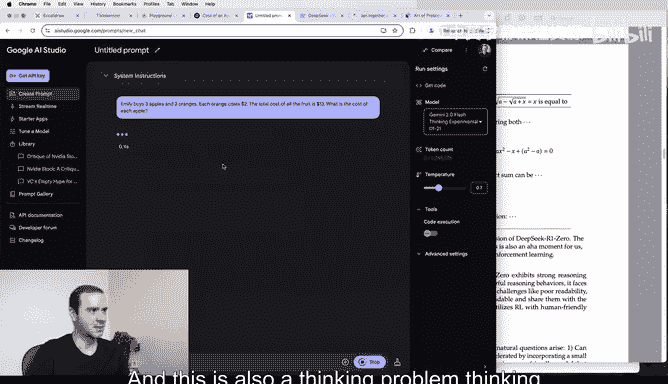

And comes out with the right answer here。 So basically， Gemini also offers a thinking model。

 Anthropic currently does not offer a thinking model。 But basically。

 this is kind of like the frontier development of these Llums。

 I think Rl is kind of like this new exciting stage。 But getting the details right is difficult。

 And that's why all these models and thinking models are currently experimental as of 2025 very early 2025。

 But this is kind of like the frontier development of pushing the performance on these very difficult problems using reasoning that is emergent in these optimizations。

 One more connection that I wanted to bring up is that。

The discovery that reinforcement learning is extremely powerful way of learning is not new to the field of AI。

 and one place what we've already seen this demonstrated is in the game of Go and famously。

 Deep Min developed the system Alphago， and you can watch a movie about it。

 where the system is learning to play the game of Go against top human players。

And when we go through the paper。Underlying alphago。 So in this paper， when we scroll down。

We actually find a really interesting plot。That I think is kind of familiar to us。

 And we're kind of like we discovering in the more open domain of arbitrary problem solving instead of on the close specific domain of the game of go。

 But basically， what they saw。 And we're going to see this in Lms as well。

 as this becomes more mature。Is。This is the Ilo rating of playing game of Go。 And this is Lisa Dole。

 an extremely strong human player。And here what they are comparing is the strength of a model learned trained by supervised learning and a model trained by reinforcement learning。

So the supervised learning model is imitating human expert players。

 so if you just get a huge amount of games played by expert players in the game of Go and you try to imitate them。

You are going to get better， but then you top out。 and you never quite get better than some of the top。

 top， top players of in the game of Go like Liidl。 So you're never going reach there because you're just imitating human players。

 You can't fundamentally go beyond human player if you're just imitating human players。

But in the process of reinforcement learning is significantly more powerful in reinforcement learning for a game of go。

 it means that the system is playing moves that empirically and statistically lead to win。

To winning the game。 And so Alphago is a system where it kind of plays against E itself。

 and it's using reinforcement learning to create a rollouts。So it's the exact same diagram here。

But there's no prompt's just because there's no prompt it's just a fixed game of go。

 but it's trying out lots of solutions。 It's trying out lots of plays。

And then the games that lead to a win instead of a specific cancer are reinforced。

 their mates stronger。And so the system is learning basically the sequences of actions that empirical and statistically lead to winning the game。

And reinforcement learning is not going to be constrained by human performance。

 and reinforcement learning can do significantly better and overcome even the top players like Liidol。

And so。Probably they could have run this longer and they just chose to crop it at some point because this costs money。

 But this is a very powerful demonstration of reinforcement learning。

 And we're only starting to kind of see hints of this diagram in large language models for reasoning problems。

 So we're not going to get too far by just imitating experts。 We need to go beyond that。

 Se up these like little game environments and get let the system discover reasoning traces or like ways of solving problems that are unique and that just basically work well。

Now on this aspect of uniqueness， notice that when you're doing reinforcement learning。

 nothing prevents you from veering off the distribution of how humans are playing the game。

And so when we go back to this alphago search here。

 one of the suggested modifications is called moveve 37。

And Move 37 in Alphago is referring to a specific point in time where Alphago basically played a move that no human expert would play。

 So the probability of this move to be played by a human player was evaluated to be about one in 10000。

 So it's a very rare move。 but in retrospect， it was a brilliant move。

 So Alphago in the process of reinforcement learning discovered kind of like a strategy of playing that was unknown to humans。

 and but is in retrospect brilliant。 I recommend this YouTube video。

 least Do versus Alphago moveve 37 reactions and analysis。

 And this is kind of what it looked like when Alphago played this move。AVue。

That's a very surprising move， I thought it was a mistake。Would I see this move， anyway。

 So basically， people are kind of freaking out because it it's a move that a human would not play that Alphago played because in its training。

 this move seemed to be a good idea。 It just happens not to be a kind of thing that a humans would would do。

 And so that is， again， the power of reinforcement learning。 And in principle。

 we can actually see the equivalentence of that， if we continue scaling this paradigm in language models。

 And what that looks like is kind of unknown。 So what does it mean to solve problems。

In such a way that even humans would not be able to get。

 how can you be better at reasoning or thinking than humans， How can you go beyond just。

A thinking human， like maybe it means discovering analogies that humans would not be able to create。

 or maybe it's like a new thinking strategy。 It's kind of hard to think through。

 Maybe it's a whole new language that actually is not even English。

 Maybe it discovers its own language that is a lot better at thinking。嗯。

Because the model is unconstrained to even like stick with English。

 So maybe it takes a different language to think in， or it discovers its own language。

 So in principle， the behavior of the system is a lot less defined。 It is open to do whatever works。

And it is open to also slowly drift from the distribution of its training data， which is English。

But all of that can only be done if we have a very large。

 diverse set of problems in which these strategies can be refined and perfected。

 And so that is a lot of the frontier LM research that's going on right now is trying to kind of create those kinds of prompt distributions that are large and diverse。

 These are all kind of like game environments in which the LMs can practice their thinking。

And it's kind of like writing， you know， these practice problems。

 We have to create practice problems for all of domains of knowledge。

 And if we have practice problems and tons of them。

 the models will be able to reinforcement learning reinforcement learn on them and kind of create these kinds of。

Diagrams， but in the domain of open thinking， instead of a closed domain like Gimka。

 There's one more section within reinforcement learning that I wanted to cover。

And that is that of learning in unverfiable domains。So so far。

 all of the problems that we've looked at are in what's called verifiable domains。

 that is any candidate solution， we can score very easily against a concrete answer， so for example。

 answer is 3 and we can very easily score these solutions against the answer of three。

Either we require the models to like box in their answers。

 and then we just check for equality of whatevers in the box with the answer。

Or you can also use kind of what's called an LLM judge。

 So the LLM judge looks at a solution and it gets the answer and just basically scores the solution for whether it's consistent with the answer or not。

 And LLms empirically are good enough at the current capability that they can do this fairly reliably。

 So we can apply those kinds of techniques as well。 In any case， we have a concrete answer。

 and we're just checking solutions against it and we can do this automatically with no kind of humans in the loop。

 The problem is that we can't apply the strategy in what's called unverifiable domains。

 So usually these are， for example， creative writing tasks like write a joke about pelicans or write a poem or summarize a paragraph or something like that。

In these kinds of domains， it becomes harder to score our different solutions to this problem。 So。

 for example， writing a joke about pelicans， we can generate lots of different jokes。 Of course。

 that's fine。 For example， we can go to Chahi Bt and we can get it to generate a joke about pelicans。

Some are stuff in their beaks because they don't beican in backpacks。喂hy okay。

We can try something else。White and pelicans ever pay for their drinks because they always bill it to someone else。

 Ha ha。 Okay， so these models are not， obviously not very good at humor。 Actually。

 I think it's pretty fascinating because I think humor is secretly very difficult。

 and the models don't have the capability， I think。Anyway， in any case。

 you could imagine creating lots of jokes。 The problem that we are facing is how do we score them Now。

 in principle， we could， of course， get a human to look at all these jokes just like I did right now。

The problem with that is if you are doing your enforcement learning。

 you're going to be doing many thousands of updates。And for each update， you want to be looking at。

 say thousands of prompts， and for each prompt you want to be potentially at looking at hundred or thousands of different kinds of generations。

And so there's just like way too many of these to look at。And so in principle。

 you could have a human inspect all of them and score them and decide that， okay。

 maybe this one is funny and maybe this one is funny。

 and this one is funny and we could train on them to get the model to become slightly better at jokes in the context of pelicans at least。

嗯。The problem is that it's just like way too much human time。 this is an unsable strategy。

 We need some kind of an automatic strategy for doing this。

And one sort of solution to this was proposed in this paper that introduced what's called reinforcement learning from human feedback。

 and so that this was a paper from OpenaiI at the time。

 and many of these people are now cofos and Ananthropic。

And this kind of proposed a approach for basically doing reinforcement learning in unvariifiable domains。

 so let's take a look at how that works。So this is the cartoon diagram of the core ideas involved。

So as I mentioned， the naive approach is if we just set Infinity human time。

 we could just run Rl in these domains just fine。 So for example。

 we can run Rl as usual if I have Infinity humans I I just want to do and these are just cartoon numbers I want to do 1000 updates where each update will be on 1000 prompts and in for each prompt we're going to have 1000 rollouts that we're scoring。

So we can run Rl with this kind of a setup。The problem is， in the process of doing this。

 I will need to run1。 I would need to ask a human to evaluate a joke a total of 1 billion times。

And so that's a lot of people looking at really terrible jokes， so we don't want to do that。

So instead， we want to take the RHH approach。So in our leadership of approach。

 we are kind of like the core trick is that of indirection。

So we're going to involve humans just a little bit。

 and the way we cheat is that we basically train a whole separate neural network that we call a reward model。

And this neural network will kind of like imitate human scores。

 So we're going to ask humans to score rollouts。 We're going to then imitate human scores。

 using a neural network。And this neural network will become a kind of simulator of human preferences。

And now that we have a neural network simulator， we can do R against it。

 So instead of asking a real human， or asking a simulated human for their score of a joke as an example。

And so once we have a simulator， we're off this racist because we can query it as many times as we want to。

 and it's a whole automatic process。 and we can now do reinforcement learning with respect to the simulator。

 And the simulator， as you might expect， is not going to be a perfect human。

 But if it's at least statistically similar to human judgment。

 then you might expect that this will do something。 And in practice， indeed， it does。

 So once we have a simulator， we can do Rl and everything works great。

 So let me show you a cartoon diagram a little bit of what this process looks like。

 although the details are not like super important， it's just a core idea of how this works。

 So here have a cartoon diagram of a hypothetical example of what training。

 the reward model will look like。So we have a prompt like write a joke about biics。

 and then here we have five separate rollouts， so these are all five different jokes just like this one。

Now， the first thing we're going to do is we are going to ask a human to order these jokes from the best to worst。

 So this is， so here， this human thought that this joke is the best， the funniest。

 So number one joke。 This is number  two joke。 number 3 joke，4 and 5。 So this is the worst joke。

 We're asking humans to order instead of give scores directly， because it's a bit of an easier task。

 It's easier for a human to give an ordering than to give precise scores。Now。

 that is not the supervision for the model， so the human has ordered them。

 and that is kind of like their contribution to the training process。

But now separately what we're going to do is we're going to ask a reward model about its scoring of these jokes。

Now， the reward model is a whole separate neural network， completely separate neural network。

And it's also probably a transformer， but it's not a language model in the sense that it generates diverse language。

 etc， it's just a scoring model。So the reward model will take as an input the prompt， number one。

 and number two， a candidate joke。 So those are the two inputs that go into the reward model。

 So here， for example， the reward model will be taking this prompt and this joke。Now。

 the output of a reward model is a single number。And this number is thought of as a score。

 and it can range， for example， from 0 to 1， so0 would be the worst score and one would be the best score。

So here are some examples of what a hypothetical reward model at some stage in the training process would give a scoring to these jokes。

So if 0。1 is a very lowest score， 0。8 is a really high score， and so on。

And so now we compare the scores given by the reward model with the ordering given by the human。

And there's a precise mathematical way to actually calculate this。

 basically set up a loss function and calculate kind of like a correspondence here and update a model based on it。

 but I just want to give you the intuition， which is that as an example here。For this second joke。

 the human thought that it was the funniest and the model kind of agreed， 0。

8 is a relatively high score， but this score should have been even higher， right， So after an update。

 we would expect that maybe this score should have been will actually grow after an update of the network to be like say 0。

81 or something。For this one here， they actually are in a massive disagreement because the human thought that this was number two。

 but here the score is only 0。1。And so this score needs to be much higher。

 So after an update on top of this kind of a supervision。

 this might grow a lot more like maybe it's 015 or something like that。嗯。And then here。

 the human thought that this one was the worst joke。

 But here the model actually give it a fairly high number。 So you might expect that after the update。

 this would come down to maybe 3。5 or something like that。 So basically。

 we're doing what we did before。 We're slightly nudging the predictions from the models using neural network training process。

And we're trying to make the reward model scores be consistent with human ordering。

And so as we update the reward model on human data。

 it becomes better and better simulator of the scores and orders that humans provide。

And then becomes kind of like the neural the simulator of human preferences。

 which we can then do R against。 But critically， we're not asking humans 1 billion times to look at a joke。

 we're maybe looking at thousand pros and five rolllas each。

 So maybe 5000 jokes that humans have to look at in total。 and they just give the ordering。

 and then we're training the model to be consistent with that ordering。

 and I'm skipping over the mathematical details， but I just want you to understand a high level idea that this reward model is basically giving us this course。

 and we have a way of training it to be consistent with human orderings。And that's how our LH works。

Okay， so that is the rough idea。 We basically train simulators of humans and Rl respect to those simulators。

Now I want to talk about first， the upside of reinforcement learning from human feedback。🤧嗯。

The first thing is that this allows us to run reinforcement learning。

 which we know is incredibly powerful kind of set of techniques。

 and it allows us to do it in arbitrary domains and including the ones that are unverifiable。

 So things like summarization and poem writing， joke writing or any other creative writing。

 really in domains outside of math and code， etc。Now， empirically。

 what we see when we actually apply ourLHF is that this is a way to improve the performance of the model。

And I have a top answer for why that might be。 but I don't actually know that it is like super well established unlike why this is。

 you can empirically observe that when you do RHF correctly。

 the models you get are just like a little bit better。 But as to why is I think， like not as clear。

 So here's my best guess。 My best guess is that this is possibly mostly due to the discriminator generator gap。

 What that means is that in many cases， it is significantly easier to discriminate than to generate。

 for humans。So in particular， an example of this is。In when we do super fine tu， right， SFT。

We're asking humans to generate the ideal assistant response and in many cases here。

 as I've shown it， the ideal response is very simple to write， but in many cases might not be。

 so for example， in a summarization or poem writing or joke writing。

 like how are you as as a human labeler supposed to give the ideal response in these cases。

 it requires creative human writing to do that？And so RHF kind of sidesteps this because get we get to ask people a significantly easier question as a data labelers。

 they're not asked to write poems directly。 They're just given five poems from the model and they're just asked to order them。

 And so that's just a much easier task for a human labeler to do。

And so what I think this allows you to do basically is it。

It's kind of like allows a lot more higher accuracy data because we're not asking people to do the generation task。

 which can be extremely difficult。 like we're not asking them to do creative writing。

 or're just trying to get them to distinguish between creative writings and find ones that are best。

 and that is the signal that humans are providing just the ordering and that is their input into the system and then the system in our LHF just discovers the kinds of responses that would be graded well by humans。

And so that step of indirect allows the models to become bit better， so that is the upside of RHF。

 it allows us to run RL， it empirically results in better models。

 and it allows people to contribute their supervision even without having to do extremely difficult tasks in the case of writing ideal responses。

Unfortunately， R HF also comes with significant downsides。 And so the main one is that。Basically。

 we are doing reinforcement learning， not with respect to humans and actual human judgment。

 but with respect to a lossy simulation of humans， right？

And this lossy simulation could be misleading because it it's just a simulation， right。

 It's just a language model that's kind of outputting scores。

 and it might not perfectly reflect the opinion of an actual human with an actual brain in all the possible different cases。

 So that's number one。Which's actually something even more subtle and devious going on that really dramatically。

Holds back RF as a technique that we can really scale to significantly kind of smart systems。

And that is that reinforcement learning is extremely good at discovering a way to game the model。

 to game the simulation。So this reward model that we're constructing here。That gives us course。

These models are transformers。 These transformers are massive neural nets。

 They have billions of parameters， and they imitate humans。

 but they do so in the kind of like a simulation way。Now， the problem is that these are massive。

 complicated systems， right， There's a billion parameters here that are outputting a single score。

It turns out that there are ways to game these models。

 You can find kinds of inputs that were not part of their training set。And these inputs inexplicably。

 get very high scores， but in a fake way。So。😊，Very often what you find if you run our lecture for very long。

 So for example， if we do 1000 updates， which is like， say a lot of updates。

You might expect that your jokes are getting better and that you're getting like real bangers about pelicans。

 but that's not exactly what happens。What happens is that in the first few hundred steps。

 the jokes about pelicans are probably improving a little bit。

 and then they actually dramatically fall off the cliff。

 and you start to get extremely nonsenssical results。 Like， for example。

 you start to get the top joke about pelican starts to be And this makes no sense， right。

 Like when you look at it， Why should this be a top joke。

 But when you take the the and you plug it into your reward model。 you'd expect score of0。

 But actually the reward model loves this as a joke。 It will tell you that the is a score of 1。0。

 This is a top joke。 And this makes no sense， right。

 But it's because these models are just simulations of humans and their' massive neural nutss。

 and you can find inputs at the bottom that kind of like get into the part of the input space that kind of gives you nonsenssical results。

 These examples are what's called adversarial examples。

 And I'm not going to go into the topic too much。 But these are adversarial inputs to the model。

 They are specific little inputs that kind of go between the nooks and crannies of。

Model and give nonsical results at the top。Now， here's what you might imagine doing。 You say， okay。

 the the the is obviously not score of one。 It's obviously a low score。 So let's take the the。

 Let's add it to the dataset set and give it an ordering that' is extremely bad like a score of5。

 And indeed， your model will learn that the the should have a very low score and will give it score of0。

 The problem is that there will always be basically infinite number of nonsensical adversarial examples hiding in the model。

 If you iterate this process many times。 and you keep adding nonsensical stuff to your reward model and giving it very low scores。

 youll never win the game。 you can do this many， many rounds and reinforcement learning。

 if you run it long enough， will always find a way to gain the model。

 It will discover adversarial examples。 It will get really high scores with nonsensical results。😊。

And fundamentally， this is because our scoring function is a giant neural nut。

 and RL is extremely good at finding just a ways to trick it。So。Long story short。

 you always run RHF put for maybe a few hundred updates。 The model is getting better。

 and then you have to crop it and you are done。 You can't run too much against this reward model because the optimization will start to game it。

And you basically crop it and you call it and you ship it。UmAnd you can improve the reward model。

 but you kind of like come across these situations eventually at some point。

So Rlichef basically what I usually say is that Rche is not RL。 and what I mean by that is， I mean。

 Rche is Rl， obviously， but it's not RL in the magical sense。

 This is not RL that you can run indefinitely。These kinds of problems。

 like where you are getting concrete correct answer。 you cannot gain this as easily。

 You either got the correct answer。 you didn't， and the scoring function is much， much simpler。

 You're just looking at the boxed area and seeing if the result is correct。

 So it's very difficult to gain these functions， but gaming a reward model is possible。

Now in these verifiable domains， you can run RL indefinitely， you could run for tens of thousands。

 hundreds of thousands of steps and discover all kinds of really crazy strategies that we might not even ever think about of performing really well for all these problems。

In the game of Go， there's no way to beat to basically game the winning of a game or losing of a game。

 We have a perfect simulator。 We know all the different where all the stones are placed and we can calculate whether someone has won or not。

 there's no way to game that。And so you can do RL indefinitely。

 and you can eventually beat even least dull。But with models like this， which are gameable。

 you cannot repeat this process indefinitely。So I kind of see RHF as not real Rl because the reward function is gameable。

 So it's kind of more like in the realm of like little fine uni。 It's a little。

It's a little improvement， but it's not something that is fundamentally set up correctly。

 where you can insert more compute， run for longer and get much better and magical results。

So it's it's not Rl in that sense。 It's not Rl assess says that it lacks magic。

 It can fine tune in your model and get a better performance。 And indeed， if we go back to ChaP。

 the GP4 model has gone through R HF， because it works well， but it's just not Rl in the same sense。

 R Lf is like a little fine tune that slightly improves your model is maybe like the way I would think about it。

 Okay， so that's most of the technical content that I wanted to cover。

 I took you through the train major stages and paradigms of training these models。😊，Pre training。

 supervised fine tuning and reinforcement learning。

 And I showed you that they loosely correspond to the process we already use for teaching children。

And so in particular， we talked about pre training beings sort of like the basic knowledge acquisition of reading exposition。

 supervised fine training being the process of looking at lots and lots of worked examples and imitating experts。

And practice problems。The only difference is that we now have to effectively write textbooks for LLMs and AIs across all the disciplines of human knowledge。

 and also in all the cases where we actually would like them to work like code and math and you know basically all the other disciplines。

 So we're in the process of writing textbooks for them。

Refining all the algorithms that I've presented on the high level， and then of course。

 doing a really， really good job at the execution of training these models at scale and efficiently。

So in particular， I didn't go into too many details， but these are extremely large and complicated。

 distributed sort of。Jobs that have to run over tens of thousands or even hundreds of thousands of GPUs。

And the engineering that goes into this is really at the state of the art of what's possible with computers at that scale。

So I didn't cover that aspect too much， but。This is a very kind of serious and never underlying all these very simple algorithms ultimately。

Now。I also talked about sort of like the theory of mind a little bit of these models。

 And the thing I want you to take away is that these models are really good。

 but they are extremely useful as tools for your work。 You shouldn't sort of trust them fully。

 And I showed you some examples of that。 even though we have mitigations for hallucinations。

 The models are not perfect， and they will hallucinate still。 It's gotten better over time。

 and it will continue to get better， but they can hallucinate。In other words， in。In addition to that。

 I covered kind of like what I call the Swiss cheese sort of model of L capabilities that you should have in your mind。

 The models incredibly good across so many different disciplines， but then fail randomly。

 almost in some unique cases。 So， for example， what is bigger 9。11 or9。9。

 like the model doesn't know， But simultaneously， it can turn around and solve Olympia questions。

 And so this is a hole in the Swiss cheese。 And there are many of them。

 And you don't want to trick over them。So don't treat these models as infallible models。

 check their work， use them as tools， use them for inspiration， use them for the first draft。

 but work with them as tools and be ultimately responsible for the product of your work。

And that's roughly what I wanted to talk about。 this is how they're trained。

 and this is what they are。Let's now turn to what are some of the future capabilities of these models。

 probably what's coming down the pipe， and also where can you find these models。

I have a few blog points on some of the things that you can expect coming down the pipe。

The first thing you'll notice is that models will very rapidly become multimodal。

 Everything I've talked about about concerned text。

 but very soon will have all that can not just handle text。

 but they can also operate natively and very easily over audio so they can hear and speak and also images so they can see and paint。

 And we're already seeing the beginnings of all of this。

 But this will be all done natively inside the language model。

 And this will enable kind of like natural conversations。😊，And roughly speaking。

 the reason that this is actually no different from everything we've covered above is that。

As a baseline， you can tokenize audio and images and apply the exact same approaches of everything that we've talked about above。

 So it's not a fundamental change。 It's just it's just a we have to add some tokens。So as an example。

 for tokenizing audio， we can look at slices of the spectrogram of the audio signal。

 and we can tokenize that and just add more tokens that suddenly represent audio and just add them into the context windows and train on them just like above。

 The same for images， we can use patches and we can a separately tokenized patches。

 And then what is an image an image is just a sequence of tokens。And this actually kind of works。

 And there's a lot of early work in this direction。

 And so we can just create streams of tokens that are representing audio images。

 as well as text and intersperse them and handle them all simultaneously in a single model。

 So that's one example of multimodality。Second， something that people are very interested in is。

Currently， most of the work is that we're handing individual tasks to the models only kind of like a silver platter。

 like please solve this task for me and the model sort of like does this little task。

 but it's up to us to still sort of like organize a coherent execution of tasks to perform jobs。

And the models are not yet at the capability required to do this in a coherent error correcting way over long periods of time。

So they're not able to fully string together tasks to perform these longer running jobs。

 but they're getting there and this is improving over time。

But probably what's going to happen here is we're going to start to see what's called agents which perform tasks over time and you you supervise them and you watch their work and they come up to once in a while。

 report progress and so on。So we're going to see more longer running agents。

 tasks that don't just take a few seconds of response。

 but many ten of seconds or even minutes or hours over time。

But these models are not infallible as we talked about above。 So all this will require supervision。

 So for example， in factories， people talk about the human to robot ratio for automation。

 I think we're going to see something similar in the digital space where we are going to be talking about human to agent ratios where humans becomes a lot more supervisors of agent tasks in the digital domain。

Next， I think everything is going to become a lot more pervasive and invisible。

 so it's kind of like integrated into the tools and and everywhere。And in addition。

 kind of like computer using。 So right now these models aren't able to take actions on your behalf。

 but I think this is a separate bullet point。嗯。If you search IBT launch the operator。

 then that's one early example of that where you can actually hand off control to the model to perform keyboard and mouse actions on your behalf。

 So that's also something that I think is very interesting。

The last point I have here is just a general comment that theres still a lot of research to potentially do in this domain。

 One example of that is something along the lines of test time training。

 So remember that everything we've done above and that we talked about has two major stages。

 There's first the training stage where we tune the parameters of the model to perform the tasks well。

Once we get the parameters， we fix them， and then we deploy the model for inference。From there。

 the model is fixed。 It doesn't change anymore。 It doesn't learn from all the stuff that it is doing at test time。

 It's a fixed number of parameters。 And the only thing that is changing is now the tokens inside the context windows。

 And so the only type of learning or test time learning that the model has access to is the in contextex learning of its kind of like dynamically adjustable context window。

 depending on like what it's doing at test time。So。

 but I think this is still different from humans who actually are able to like actually learn depending on what they're doing。

 especially when you sleep， for example， like your brain is updating your parameters or something like that right。

 so there's no kind of equivalent of that currently in these models and tools。

So there's a lot of like more wonky ideas I think that are to be explored still and in particular。

 I think this will be necessary because the context window is a finite and precious resource。

 and especially once we start to tackle very long- runningning multimodal tasks and we're putting in videos and these token windows will basically start to grow extremely large like not thousands or even hundreds of thousands but significantly beyond that。

 and the only trick the only kind of trick we have a bill to us right now is to make the context windows longer。

 but I think that that approach by itself will not will not scale to actual longrunning tasks that are multimodal overtime。

 And so I think new ideas are needed in some of those disciplines in some of those kind of cases in the maze where these tasks are going to require very long contexts。

So those are some examples of some of the things you can expect coming down the pipe。

 Let's now turn to where you can actually kind of keep track of this progress and you know be up to date with the latest and grace of what's happening in the field。

 So I would say the three resources that I have consistently used to stay up to date。

 are number one Ella Marina。 So let me show you Ella Marina。This is basically an L LM leader board。

And it ranks all the top models。And the ranking is based on human comparisons。

 So humans prompt these models， and they get to judge which one gives a better answer。

 They don't know which model is which They're just looking at which model is a better answer。

 and you can calculate a ranking， and then you get some results。

And so what you can hear is what you can see here is the different organizations like Google Gemini。

 for example， that produce these models， When you click on any one of these。

 it takes you to the place where that model is hosted。

And then here we see Google is currently on top with Open A eye right behind Here we see deepse in position number3。

 Now， the reason this is a big deal is the last column here。 You see license。

 Deepseek is an Mit license model。 It's open weights。 Anyone can use these weights。

 Anyone can download them。 Anyone can host their own version of deepseq。

 and they can use it in whatever way they like。 And so it's not a proprietary model that you don't have access to it。

 It's basically an open weights release。And so this is kind of unprecedented that a model this strong was released with open weights。

 So pretty cool from the team。OnNext up， we have a few more models from Google and Open AI。

 and then when you continue to scroll down， you're start to see some other usual suspects。

 so X AI here Anthropic with sonnet here at number 14。And。Then。Meta with Lama over here。 So Lama。

 similar to deepse is an open weight model。 And so， but it's down here as opposed to appear。 Now。

 I will say that this leaderboard was really good for but a long time。 I do think that。

In the last few months， it's become a little bit gamed， and I don't trust it as much as I used to。

I think just empirically， I feel like a lot of people， for example。

 are using a sonnet from Anthropic and that it's a really good model。 So。

 but that's all the way down here in number 14。 And conversely。

 I think not as many people are using Geini， but it's ranking really， really high。

 So I think use this as a first pass， but sort of。Try out a few of the models for your tasks and see which one performs better。

The second thing that I would point to is the AI news newsletter。

 So AI news is not very creatively named， but it is a very good newsletter produced by Sws and friends。

 So thank you for maintaining it。 And it's been very helpful to me because it is extremely comprehensive。

 So if you go to archives。You see that it's produced almost every other day。

 and it is very comprehensive， and some of it is written by humans and curated by humans。

 but a lot of it is constructed automatically with LMs。

 So you'll see that their are very comprehensive。 And you're probably not missing anything major。

 If you go through it。 Of course， you're probably not going to go through it so long。

 But I do think that these summaries all the way up top are quite good and I think。

 have some human oversight。

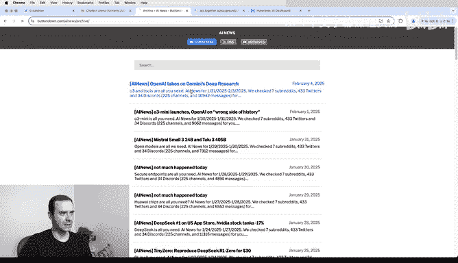

So this has been very helpful to me， and the last thing I would point to you is just X and Twitter。

 a lot of AI happens on X， and so I would just follow people who like and trust and get all your latest and greatest on X at well。

So those are the major places that have worked for me over time。 And finally。

 a few words on where you can find the models and where can you use them。

 So the first one I would say is for any of the biggest proprietary models。

 you just have to go to the website of that LM provider。 So for example， for OpenaiI that's chat。

 com I believe actually works now。 So that's for openaiI。Now for or you know for Gemini。

 I think it's Gemini。google。com or AItio， I think they have two。

 for some reason that I't fully understand。No one does。For the open weight models like deep C column。

 etc， you have to go to some kind of an inference provider of elementslums so my favorite one is together together that AI。

 and I show you that when you go to the playground of together that AI。

 then you can sort of pick lots of different models and all of these are open models of different types and you can talk to them here as an example。

Now， if you'd like to use a base model like you know a base model。

 then this is where I think it's not as common to find base models。

 even on these inference providers， they are all targeting assistants and chat。

 And so I think even here I can' I couldn't see base models here。 So for base models。

 I usually go to hyperbolic。 because they serve my Lama 3。1 base。 and I love that model。

 And you can just talk to it here。 So as far as I know this is this is a good place for a base model。

 And I wish more people hosted base models because they are useful and interesting to work with in some cases。

Finally， you can also take some of the models that are smaller and you can run them locally。

And so for example， Deepepse， the biggest model you're not going to be able to run locally on your MacBook。

 but there are smaller versions of the deepseq model that are what's called distilled and then also you can run these models at smaller precision。

 so not at the native precision of， for example， FP8 on Deepepse or BF16 Lama but much much lower than that。

And don't worry if you don't fully understand those details。

 but you can run smaller versions that have been distilled and then at even lower precision and then you can fit them on your computer。

 And so you can actually run pretty okay models on your laptop。

 And my favorite I think place I go to usually is Elm Studio which is basically an app you can get。

 And I think it kind of actually looks really ugly。

 I don't like that it shows you all these models that are basically not that useful。

 Like everyone just wants to run deepse。 So I don't know why they give you these 500 different types of models。

 They're really complicated to search for and you have to choose different distillations and different precisions and it's all really confusing。

 But once you actually understand how it works。 And that's a whole separate video。

 Then you can actually load up the model like here I loaded it up Lama 3。2 Instruct 1 billion。

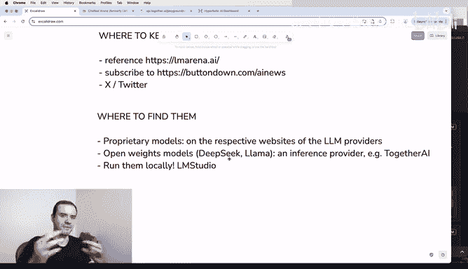

And you can just talk to it。I ask for pelican jokes， and I can ask for another one。

 and it gives me another one， et cetera。 All of this that happens here is locally on your computer。

 So we're not actually going to anywhere anyone else。 This is running on the GPU on the MacBook Pro。

 So that's very nice。 And you can then eject the model when you're done。 And that frees up the Ramm。

So ElLM Studio is probably like my favorite one， even though I think it's got a lot of UIUX issues and it's really geared towards professionals almost。

 but if you watch some videos on YouTube I think you can figure out how to use this interface。

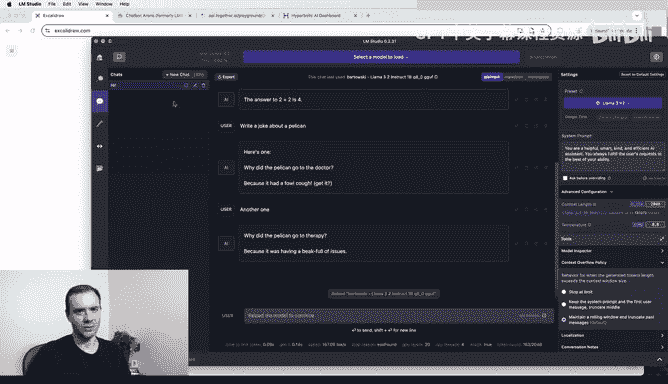

So those are a few words on where to find them。 So let me now loop back around to where we started。

The question was when we go to chaPT。com and we enter some kind of a query。And we hit go。

What exactly is happening here， What are we seeing， What are we talking to， How does this work。

And I hope that this video gave you some appreciation for some of the under the hood details of how these models are trained and what this is that is coming back。

 So in particular， we now know that your query is taken and is first chopped up into tokens。

 So we go to tick tokenizer。And here where is the place in the sort of format that is for the user query。

 we basically put in our query right there。So our query goes into what we discussed here is the conversation protocol format。

 which is this way that we maintain conversation objects。So this gets inserted there。

 And then this whole thing ends up being just a token sequence。

 A one dimensional token sequence under the hood。 So Chahi Peti saw this token sequence。

 And then when we hit go， it basically continues appending tokens into this list。

 It continues the sequence， it acts like a token autocompte。 So in particular。

 it gave us this response。So we can basically just put it here and we see the tokens that it continued。

 These are the tokens that it continued with， roughly。Now， the question becomes。Okay。

 why are these the tokens that the model responded with， What are these tokens。

 Where are they coming from， What are we talking to and how do we program this system。

And so that's where we shifted gears。 and we talked about the under the pieces of it。

 So the first stage of this process， and there are three stages is the pre traininging stage。

 which fundamentally has to do with just knowledge acquisition from the Internet into the parameters of this neural network。

And so the neural net internalizes a lot of knowledge from the internet。

But where the personality really comes in is in the process of supervised pin tuning here。

And so what happens here is that basically a company like Open AI will curate a large data set of conversations。

 like say 1 million conversation across very diverse topics。

And there will be conversations between a human and an assistant。

And even though there's a lot of synthetic data generation used throughout this entire process and a lot of LLM help and so on。

 fundamentally， this is a human data curation task with lots of humans involved。And in particular。

 these humans are data labelers hired by open AI who are given labeling instructions that they learn。

 and their task is to create ideal assistant responses for any arbitrary prompts。

 so they are teaching the neural network。By example， how to respond to prompts。

So what is the way to think about what came back here， Like what is this， Well。

 I think the right way to think about it is that this is the neural network simulation of a data labeler at Open AI。

 So it's Asif。 I gave this query to a data label at Open AI。

 and this data labeler first reads all the labeling instructions from Open AI。

And then spends two hours writing up the ideal assistanted response to this query。

And giving it to me。 Now， we're not actually doing that， right， because we didn't wait two hours。

 So what we're getting here is a neural network simulation of that process。

And we have to keep in mind that these neural networks don't function like human brains do。

 They are different。 What's easy or hard for them is different from what's easy or hard for humans。

 And so we really are just getting a simulation。 So here I've shown you， This is a token stream。

 and this is fundamentally the neural network with a bunch of activations and neurons in between。

 This is a fixed mathematical expression that mixes。 inputs。

 from tokens with parameters of the model。 and they get mixed up and get you the next token in a sequence。

 But this is a finite amount of compute that happens for every single token。

And so this is some kind of a lossy simulation of a human that is kind of like restricted in this way。

And so whatever the humans write。The language model is kind of imitating on this token level with only this specific computation。

For every single token， then a sequence。🤧嗯嗯。We also saw that as a result of this and their cognitive differences。

 the models will suffer in a variety of ways。 and you have to be very careful with their use。 So。

 for example， we saw that they will suffer from hallucinations。 And they also。

 we have the sense of a Swiss cheese model the allm capabilities where basically。

 there's like holes in the cheese， sometimes the models will just arbitrarily like do something dumb。

 So even though they're doing lots of magical stuff。 Sometimes they just can't。

 So maybe you're not giving them enough tokens to think。

 and maybe they're going to just make stuff up because their mental arithmetic breaks。

Maybe they are suddenly unable to count number of letters。

 or maybe they are unable to tell you that 9，11，9。11 is smaller than 9。9。 And it looks kind of dumb。

 And so it's a Swiss cheese capability。 And we have to be careful with that。

 And we saw the reasons for that。But fundamentally， this is how we think of what came back。 It's。

 again， a simulation of this neural network。Off a human data labeler following the labeling instructions at Open AI。

So that's what we're getting back。Now， I do think that the things change a little bit when you actually go and reach for one of the thinking models like 03 Min high。

And the reason for that is that GP 40。Basically， doesn't do reinforcement learning。 It does do RL HF。

 but I've told you that RL HF is not Rl。 There's no， there's no time for magic in there。

 It's just a little bit of a fine tuning is the way to look at it。But these thinking models。

 they do use R。 so they go through this third state stage of perfecting their thinking process。

And discovering new thinking strategies and solutions to problem solving that look a little bit like your internal monologue in your head。

 And they practice that on a large collection of practice problems that companies like Open AI create and curate and then make available to the alums。

So when I come here and I talk to a thinking model and I put in this question。

What we're seeing here is not any more just a straightforward simulation of a human data labeler like this is actually kind of new。

 unique and interesting。 and of course， Openia is not showing us the under the hood thinking and the chains of thought that are underlying the reasoning here。

 but we know that such a thing exists。 And this is a summary of it。

And what we're getting here is actually not just an imitation of a human data labeler。

 It's actually something that is kind of new and interesting and exciting in the sense that it is a function of thinking that was emergent in a simulation。

 It's not just imitating human data labeler。 It comes from this reinforcement learning process。😊。

And so here， we'， of course， not giving it a chance to shine because this is not a mathematical or reasoning problem。

 This is just some kind of a sort of creative writing problem， roughly speaking。 And I think it's。

It's a question and open question as to whether the thinking strategies that are developed inside verifiable domains。

Transfer and are generalizable， too。Other domains that are unverifiable， such as create writing。

 The extent to which that transfer happens is unknown in the field， I would say。

 So we're not sure if we are able to do R L on everything that is verifiable and see the benefits of that on things that are unverifiable like this prompt。

 So that's open con question。The other thing that's interesting is that this reinforcement learning here is still like way too new。

 primordial and nascent。So we're just seeing like the beginnings of the hints of greatness in the reasoning problems。

 We're seeing something that is in principle capable of something like the equivalent of Mo 37。

 but not in the game of go， but in open domain thinking and problem solving。 In principle。

 this paradigm is capable of doing something really cool， new and exciting。

 something even that no human has thought of before。 in principle。

 these models are capable of analogies no human has had。😊。

So I think it's incredibly exciting that these models exist， but again。

 it's very early and these are primorial models for now。

And they will mostly shine in domains that are verifiable， like math and code， etc。

So very interesting to play with and think about and use。And then that's roughly it。

 I would say those are the broad strokes of what's available right now。 I will say that overall。

 it is an extremely exciting time to be in the field。😊，Personally， I use these models all the time。

 daily， tens or hundreds of times because they dramatically accelerate my work。

 I think a lot of people see the same thing。 I think we're going to see a huge amount of wealth creation as a result of these models。

Be aware of some of their shortcomings。Even with R L models。

 they're going to suffer from some of these。 use it as a tool in a toolbox。

 Don't trust it fully because they will randomly do dumb things。 They will randomly hallucinate。

 They will randomly skip over some mental arithmetic and not get it right。

 They randomly can't count or something like that。 So use them as tools in the toolbox。

 Check their work and own the product of your work。 but use them for inspiration for first draft。

 ask them questions， but always check and verify， and you will be very successful in your work。

 if you do so。So I hope this video was useful and interesting to you。

 I hope you had it fun and it's already very long， so I apologize for that。

 but I hope it was useful and yeah， I will see you later。

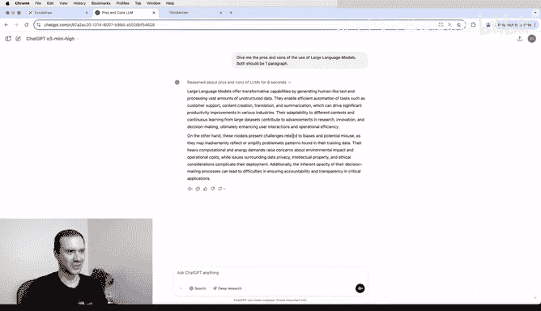