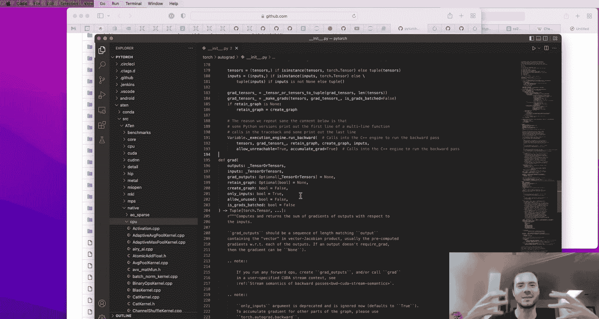
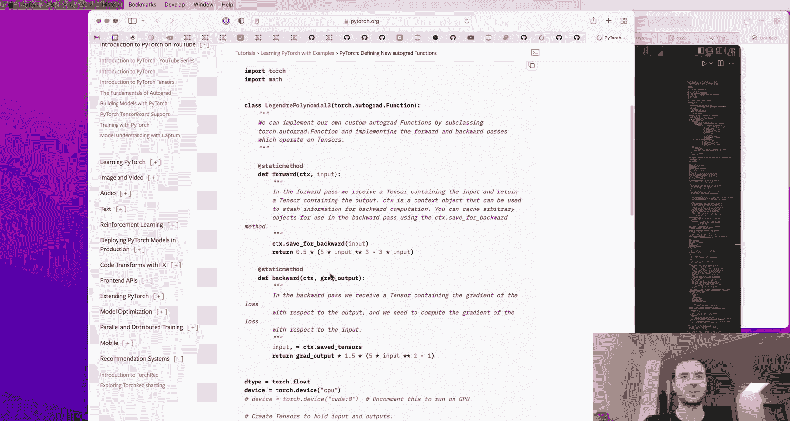
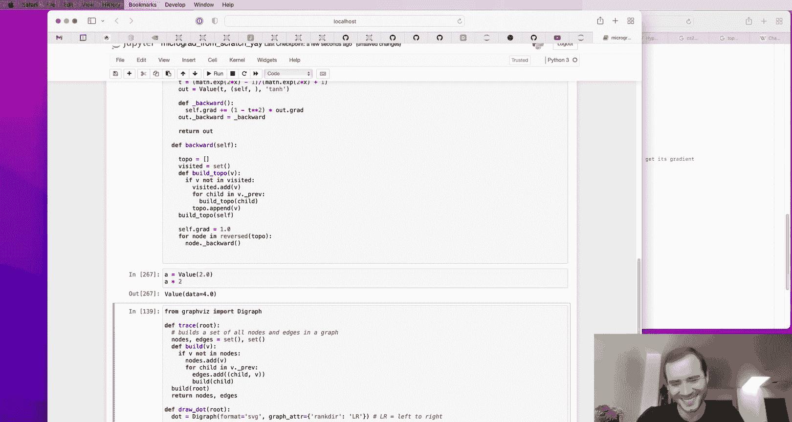

# Andrej《神经网络和反向传播的详细介绍：构建 micrograd》中英字幕（deepseek-R1 - P1 - GPT中英字幕课程资源 - BV1kE421A7cZ

Hello， my name is Andre。And I've been training deep neural networks for a bit more than a decade。

 And in this lecture， I'd like to show you what neural network training looks like under the hood。

So in particular， we are going to start with a blank Jupipyter notebook and by the end of this lecture we will define and train in neural net and you'll get to see everything that goes on under the hood and exactly sort of how that works on an intuitive level。

Now， specifically what I would like to do is I would like to take you through building of microcrograd。

 Now， Micrograd is this library that I released on Github about two years ago。

 but at the time I only uploaded the source code and you'd have to go and by yourself and re。

Figure out how it works So in this lecture I will take you through it step by step and kind of comment in all the pieces of it。

 So what is micrograd and why is it interesting。9。Micrograd is basically an autograd engine。

 Autograd is short for automatic gradient， and really what it does is it implements back propagation。

 Now back propagation is this algorithm that allows you to efficiently evaluate the gradient of some kind of a loss function with respect to the weights of a neural network and what that allows us to do then is we can ititiveatively tune the weights of that neural network to minimize the loss function and therefore improve the accuracy of the network。

 So back propagation would be at the mathematical core of any modern deep neural network library like say Pytorch or jaX。

So the functionality of micrograd is， I think best illustrated by an example。

 so if we just scroll down here。You'll see that micrograd basically allows you to build out mathematical expressions。

And here what we are doing is we have an expression that we're building out where we have two inputs。

 A and B。And you'll see that A and B are native 4 and 2。

 but we are wrapping those values into this value object that we are going to build out as part of micrograd。

So this value object will wrap the numbers themselves。

And then we are going to build out a mathematical expression here where A and B are transformed into C。

 D， and eventually E， F and G。And I'm showing some of the functionality of microgrid and the operations that it supports。

 so you can add two value objects， you can multiply them， you can raise them constant power。

 you can offset by one， negate， squash at zero， square， divide by constant， divide by it， etc。

And so we're building out an expression graph with these two inputs A and B。

 and we're creating an output value of G。And micrograd will， in the background。

 build out this entire mathematical expression， so it will， for example， know that C is also a value。

 C was a result of an addition operation and the child nodes of C are A and B because the and will maintain pointers to A and B value objects。

 So we'll basically know exactly how all of this is laid out。

And then not only can we do what we call the forward pass where we actually look at the value of G of course that's pretty straightforward。

 we will access that using the dot data attribute， and so the output of the forward pass。

 the value of G is 24。7， it turns out， but the big deal is that we can also take this G value object and we can call dot backward。

And this will basically initialize back propag at the node G。

And what back propplication is going to do， this is going to start a G and it's going to go backwards through that expression graph and it's going to recursively apply the chain rule from calculus。

And what that allows us to do then is we're going to evaluate basically the derivative of G with respect to all the internal nodes like E。

 D and C， but also with respect to the inputs A and B。

 And then we can actually query this derivative of G with respect to a。 for example。

 that's a dot grad。 in this case， it happens to be 138。 in the derivative of G with respect to B。

 which also happens to be here 645。And this derivative we'll see soon is very important information。

 because it's telling us how A and B are affecting G through this mathematical expression。

 So in particular， a God grad is 138。 So if we slightly nudge a and make it slightly larger。

138 is telling us that G will grow， and the slope of that growth is going to be 1，38。

And the slope of growth of B is going to be 645。 So that's going to tell us about how G will respond if A And B get tweaked a tiny amount in a positive direction。

Okay。Now， you might be confused about what this expression is that we built out here。

 and this expression， by the way， is completely meaningless。 I just made it up。

 I'm just flexing about the kinds of operations that are supported by micrograd。

 what we actually really care about our neural networks。

 But it turns out that neural networks are just mathematical expressions， just like this one。

 but actually slightly a bit less crazy even neural networks are just a mathematical expression。

 They take the input data as an input， and they take the weights of a neural network as an input and mathematical expression。

 and the output are your predictions of your neural net or the loss function。

 We'll see this in a bit。But basically， neural networks teachers just happen to be a certain class of mathematical expressions。

But back propagation is actually significantly more general。

 It doesn't actually care about neural works at all。

 It only care about arbitrary mathematical expressions。

 and then we happen to use that machinery for training of neural networks。

 Now one more note I would like to make at the stage is that as you see here。

 micrograd is a scalar valued autograd engine So it's working on the level of individual scalarrs like negative4 and 2 and we're taking neural nets and we're breaking them down all the way to these atoms of individual scalarrs and all the little pluses and times and it's just excessive And so obviously you would never be doing any of this in production it's really just done for pedagogical reasons because it allows us to not have to deal with these ndimenal tensors that you would use in modern deep neural or library。

 So this is really done so that you understand and refactor out backproag and chain rule and understanding of neural training。

 And then if you actually want to train bigger networks。

 you have to be using these tensors but none of the math changes。

 This is done purely for efficiency we are basically taking scale value。All the scalealar values。

 we're packaging them up into tensors which are just arrays of these scalealrs and then because we have these large arrays。

 we're making operations on those large arrays that allows us to take advantage of the parallelism in a computer and all those operations can be done in parallel and then the whole thing runs faster but really none of the math changes and that them purely for efficiency so I don't think that is pedagogically useful to be dealing with tensors from scratch and I think and that's why fundamentally wrote micrograd because you can understand how things work at the fundamental level and then you can speed it up later。

Okay， so here's the fun part。 My claim is that micrograd is what you need to train neural networks and everything else is just efficiency。

 so you'd think that micrograd would be a very complex piece of code。

 and that turns out to not be the case So if we just go to micrograd and you'll see that there's only two files here in micrograd。

 this is the actual engine it doesn't know anything about neural net and this is the entire neural nuts library on top of micrograd。

 So engine and and end up pi So the actual back propagation autograd engine。

That gives you the power of neural networks is literally。

H0d lines of code of like very simple Python。Which well understand by the end of his lecture。

And then N end up pi， this neural network supplyberry built on top of the autograd engine。

Is like a joke。 It's like we have to define what is a neuron。

 And then we have to define what is a layer of neurons。

 And then we define what is a multi layerer perceptron。

 which is just a sequence of layers of neurons。 And so it's just a total joke。 So basically。

 there's a lot of power that comes from only 150 lines of code。

 And that's only need to understand to understand neural or training and everything else is just efficiency。

 And， of course， there's a lot to efficiency。 but fundamentally， that's all that's happening。 Okay。

 so now let's dive right in and implement micrograds step by step。

 The first thing I'd like to do is I'd like to make sure that you have a very good understanding intuitively of what a derivative is。

 And exactly what information that gives you。 So let's start with some basic imports that I copyied based in every Jupyter notebook always。

And let's define the function， scalar reality function， F of x。That's what。

So I just made this up randomly， I just wanted to scale a value function that takes a single scalar x and returns a single scalar Y。

 and we can call this function of course， so we can pass in say 3。0 and get to 20。

Now we can also plot this function to get a sense of its shape。

 you can tell from the mathematical expression that this is probably a parabola， it's a quadratic。

And so if we just create a set of。Ski values that we can feed in using， for example。

 range from negative5 to 5 and steps of 。25。So this is x's is just from negative 5 to5。

 not including 5 in steps of 0。25。And we can actually call this function on this nonpy array as well。

 so we get a set of y's if we call F on axis。And these wises are basically also applying the function on every one of these elements independently。

And we can plot this using Mabotland， so PLT do plot x' is and Y's。And we get nice parabola。

 So previously here， we fed in 3。0 somewhere here， and we received 20 back， which is here。

 the Y coordinate。 So now I'd like to think through what is the derivative。

Of this function at any single input point x。So what is the derivative at different points X of this function Now if you remember back to your calculus class。

 you've probably derived derivatives， so we take this mathematical expression。

 3 x squared minus 4 x plus 5， and you would write out on a piece of paper and you would apply the product rule and all the other rules and derive the mathematical expression of the great derivative of the original function and then you could plug in different texts and see what the derivative is。

We are not going to actually do that because no one in neural networks actually writes out the expression for the neural net。

 it would be a massive expression， it would be you know thousands ten of thousands of terms no one actually derives the derivative of course and so we're not going to take this kind of symbolic approach instead what I'd like to do is I'd like to look at the definition of derivative and just make sure that we really understand what derivative is measuring what is's telling you about the function。

And so if we just look out derivative。We see that okay so this is not a very good definition of derivative。

 This is a definition of what it means to be differentiable， but if you remember from your calculus。

 it is the limit as H goes to0 of f of x plus h minus f of x over H So basically what it's saying is if you slightly bump up you're at some point x that you're interested in or he。

 and if you slightly bump up you know you slightly increase it by small number H。

How does the function respond with what sensitivity does it respond。

 Where is the slope at that point， Does the function go up or does it go down and by how much。

 and that's the slope of that function， the slope of that response at that point。

And so we can basically evaluate the relative here numerically by taking a very small H。

 of course the definition would ask us to take H to0， we're just going to pick a very small H， 0。001。

And let's say we're interested 0。3。0。 so we can look at F of x， of course， as 20。

And now f of x plus H。 So if we slightly nu x in a positive direction。

 how is the function going to respond？And just looking at this。

 do you expect F of x plus to be slightly greater than 20 or do you expect it to be slightly lower than 20？

And since this 3 is here， and this is 20。 If we slightly go positively。

 the function will respond positively。 So you'd expect this to be slightly greater than 20。

 And by how much is' telling you the sort of the。The strength of that slope， right。

 the size of the slope。 So F of x positive f of x， this is how much the function responded in a positive direction。

 and we have to normalize by the run。 So we have the rise over run to get the slope。So this。

 of course， is just a numerical approximation of a slope because we have to make age very。

 very small to converge to the exact amount。Now if I'm doing too many zeros。At some point。

I'm going to get an incorrect answer because we are using floating point arithmetic and the representations of all these numbers in computer memory is finite and at some point we get into trouble so we can converge towards the right answer with this approach。

But basically， at3， the slope is 14。And you can see that by taking 3 x squared -4 x plus 5 and differentiating it in our head。

 So 3 x square would be 6 x minus-4。And then we plug in x equals 3， so that's 18 minus4 is 14。

 so this is correct。So that's a3。 Now， how about the slope at， say， negative3。Would you expect。

 would you expect for the slope now， telling the exact value is really hard。

 But what is the sign of that slope。So with negative 3。

If we slightly go in the positive direction at x， the function would actually go down。

 And so that tells you that the slope would be negative。 So we'll get a slight number below below 20。

 And so if we take the slope， we expect something negative。Negative 22， okay。And at some point here。

 of course， the slope would be 0。 Now， for this specific function， I looked it up previously。

 and it's at02 over 3。So at roughly two over three that's somewhere here。

 this derivative will be zero。 so basically at that precise point。Yeah。At that precise point。

 if we nudge in a positive direction， the function doesn't respond。 This stays the same almost。

 And so that's why the slope is 0。 Okay， now let's look at a bit more complex case。

So we're going to start you know， complexifying a bit。 So now we have a function here。

With output variable D， that is a function of three scalar inputs， A， B， and C。

So A B and C are some specific values， three inputs into our expression graph， and a single output D。

And so if we just print D， we get four。And now what I'd like to do is I'd like to again look at the derivativeivus of D with respect to A。

 B， and C。And think through， again， just the intuition of what this derivative is telling us。

So in order to evaluate this derivative， we're going to get a bit hacky here。

 we're going to again have a very small value of H。

And then we're going to fix the inputs at some values that we're interested in。

So this is the point ABC at which we're going to be evaluating the derivative of B with respect to all A B and C at that point。

So there are the inputs， and now we have D1 is that expression。And then we're going to， for example。

 look at deterative of D with respect to A， so we'll say A and we'll bump it by age。

And then we'll get D2 to be the exact same function。And now， we're going to print。You know，c F1。

 D1 is D1。D2 is D2 and print slope。So the derivativeive or slope。Here will be。Of course。D2 minus D1。

 divide age。So D2 minus d1 is how much the function increased。

When we bumped the specific input that we're interested in by a tiny amount。

And this is then normalized by H， to get the slope。So。Yeah。So this， so I just from this。

 we're going to print D1。Which we know is4。Now D2 will be bumped， A will be bumped by H。

So let's just think through。A little bit what D2 will be printed out here。In particular。D1 will be4。

 Will D2 be a number slightly greater than4 or slightly lower than4。

 And it's going to tell us the sign of the derivativeative。So。We're bumping A by age。B as -3。

 C as 10。So you can just internal think through this derivative on what is's doing。

 A will be slightly more positive。And but B is a native number。So if aid is slightly more positive。

Because B is negative 3。We're actually going to be adding less to D。

So you'd actually expect that the value of the function will go down。So， let's just see this。Yeah。

 and so we went from 4 to 3。9996。And that tells you that the slope will be negative and then will be a negative number because we went down and then the exact number of slope will be exact amount of slope is negative 3。

And you can also convince yourself that negative 3 is the right answer mathematically and analytically。

 because if you have a times b plus C and are you have calculus。

 then differentiating a times b plus C with respect to A gives you just B。And indeed。

 the value of b is negative 3， which is the derivative that we have。

 so you can tell the that correct。So now if we do this with B。

So if we bump B by a little bit in a positive direction， we'd get a different slopes。

 So what is the influence of B on the output D。So if we bump B by a tiny amount in a positive direction。

 then because a is positive。Will be adding more to D。Right， so， and now what is the。

 what is the sensitivity， What is the slope of that addition。

 And it might not surprise you that this should be。2。And y is it two because D of D by Db。

 the with respect to B would give us a and the value of a is 2， so that's also working well。

And then its seek is bumped a tiny mount in H by H。Then， of course， H times B is unaffected。

 And now C becomes slightly bit higher。 What does that do to the function。

 It makes it slightly bit higher because we're simply adding C。

 and it makes it slightly bit higher by the exact same amount that we add it to C。

 And so that tells you that the slope is one。That will be the。The rate at which。

D will increase as we scale。C。Okay， so we now have some intuitive sense of what this derivative is telling you about the function。

 and we'd like to move to neural networks Now， as I mentioned neural networks will be pretty massive expressions。

 mathematical expressions， so we need some data structures that maintain these expressions and that's what we're going to start to build out now。

So we're going to build out this value object that I showed you in the Readme page of microcrograd。

So let me copy paste a skeleton of the first very simple value object。

So class value takes a single scalar value that it wraps and keeps track of， and that's it。We can。

 for example， do value of 2。0， and then we can。Get we can look at its content and Python will internally use the Reper function to return this string clip。

得噶。So this is a value object with data equals 2 that we're creating here。Now。

 we'd like to do is like， we'd like to be able to。Have not just like two values。

But we'd like to do hiway， right， We'd like to add them。So currently。

 you would get an error because Python doesn't know how to add two value objects。

 so we have to tell it。So， here's addition。So you have to basically use these special double underscore methods in Python to define these operators for these objects。

 So if we call the if we use this plus operator， Python will internally call a dot add of B。

 That's what will happen internally。 And so B will be the other。And a self will be a。

And so we see that what we're going to return is a new value object。

 and it's just is going to be wrapping the plus of their data。

But remember now because data is the actual like numbered Python number。

 so this operator here is just the typical floating point plus addition now。

 it's not an addition of value objects。And we'll return a new value。So now a plus B should work。

 and it should print value of negative one。Because that's two plus minus three。There we go。Okay。

 let's now implement multiply。Just so we can recreate this expression here。So multiply。

 I think it won't surprise you， will be fairly similar。So instead of add。

 we're going to be using Mole。 And then here， of course， we want to do tons。

And so now we can create a seam value object， which will be 10。0。

 And now we should be able to do a times B。Well， let's just do eight times B first。嗯。

That's value of negative six now。And by the way， I skipped over this a little bit。

 supposeose that I didn't have the Reper function here。

 then it's just that you'll get some kind of an ugly expression。

 So what Reper is doing is it's providing us a way to print out like a nicer looking expression in Python so we don't just have something cryptic。

 We actually are you know it's value of negative6。So this gives us the times。

 and then this we should now be able to add C to it because we've defined and told the Python how to do mo and add。

 and so this will call this will basically be equivalent to a dot mo。Of B。

 And then this new value object will be dot add of C。And so let's see if that worked。Yep。

 so that worked well that gave us four， which is what we expect from before。

And I believe we can just pull them manually as well。 There we go。Okay。

 so now what we are missing is the connective tissue of this expression。 As I mentioned。

 we want to keep these expression graphs so we need to know and keep pointers about what values produce what other values。

So here， for example， we are going to introduce a new variable which will call children。

 and by default， it will be an empty tuple。And then we're actually going to keep a slightly different variable in the class。

 which we'll call underscore Pv， which will be the set of children。

This is how I I did it in the original micrograd looking at my code here。

 I can't remember exactly the reason I believe it was efficiency。

 but this underscored children will be a topple for convenience。

 but then when we actually maintain it in the class it will be just this set。

 I believe for efficiency。嗯。So now when we are creating a value like this with a constructor。

 children will be empty and prep will be the empty set。

 But when we are creating a value through addition or multiplication。

 we're going to feed in the children of this value， which in this case is self and another。

So those are their children。So now we can do D dot prep。And we'll see that the children of the。

 we now know are this a value of negative 6 and value of 10， and this， of course。

 is the value resulting from a times B and the C value， which is 10。

Now the last piece of information we don't know， so we know not the children of every single value。

 but we don't know what operation created this value， So we need one more element here。

 let's call it underscore P。And by default， this is the set for leaves。

And then we'll just maintain it here。And now the operation will be just a simple string。

 And in the case of addition， it's plus in the case of multiplication is times。

So now we not just have D dot prepped。 We also have a D dot。

And we know that D was produced by an addition of those two values。

 and so now we have the full mathematical expression and we're building out this data structure and we know exactly how each value came to be by what expression and from what other values。

Now， because these expressions are about to get quite a bit larger。

 we'd like a way to nicely visualize these expressions that we're building out。

 so for that I'm going to copy pastse a bunch of slightly scary code that's going to visualize these expression graphs for us。

So here's the code， and I'll explain it in a bit。 But first。

 let me just assure you what this code does。Basically。

 what it does is it creates a new function draw dot that we can call on some root node。

And then it's going to visualize it。So if we call drawdo on D， which is this final value here。

 that is a times b plus C。It creates something like this。 So this is D。

 and you see that this is a times B， creating interpret value plus C gives us the output but node D。

So that's brought out of B and I'm not going to go through this in complete detail。

 You can take a look at Gs and its API Gs is an open source graph visualization software and what we're doing here is we're building out this graph in G this API and you can basically see that trace is this helper function that enumerates all of the nodes and edges in the graph so that just builds a set of all the nodes and edges and then we iterates through all the nodes and we create special node objects for them in。

Using dot node。 and then we also create edges using dot dot edge。

And the only thing that's like slightly tricky here is you'll notice that I basically add these fake nodes。

 which are these operation nodes。 So for example， this node here is just like a plus node。

And I create these。Special op nodes here。 And I connect them accordingly。 So these nodes， of course。

 are not actual nodes in the original graph。 They're not actually a value object。

 The only value objects here are the things in squares。

 Those are actual value objects or representation thereof。

 And these op nodes are just created in this draw dot routine so that it looks nice。

Let's also add labels to these graphs just so we know what variables are where。

 So let's create a special underscore label。嗯。Or let' us do label equals empty by default and save it in each node。

And then here， we're going to do label as a。label is B。Label us C。嗯。And then。Let's create a special。

Equals a times B。And that label will be E。It's kind of not。And E will be E plus C。

And a Ddot label will be。B。Okay， so nothing really changes。 I just added this new E function。

 new E variable。And then here， when we are printing this， I'm going to print the label here。

 so this will be a percent S。Bar， and this will be end on label。And so now。

We have the label envelope the left here， so it says A B creating E， and then E plus C creates D。

 just like we have it here。And finally， let's make this expression just one layer deeper。

So D will not be the final output node。Instead， after D， we are going to create a new value object。

Called F。 we're going to start running out of variable soon。 F will be negative 2。0。

And its label will， of course， just be F。And then L， capital L will be the output of our graph。

And L will be t times out。So L will be negative 8 is the output。So。Now we don't just draw a D， we。

Okay。And somehow， the label of。E was undefined oops。 All that label has to be explicitly。Given to it。

There goes so L is the output。So let's quickly recap what we've done so far。

 We are able to build out mathematical expressions using only plus in times so far。

They are scalar valued along the way， and we can do this forward pass。

And build out a mathematical expression。 So we have multiple inputs here， A， B， C。

 and F going into a mathematical expression that produces a single output L。

And this here is visual the forward pass。 So the output of the forward pass is negative 8。

 That's the value。Now， what we'd like to do next is we'd like to run back propagation。

And in back propagation， we are going to start here at the end。

 and we're going to reverse and calculate the gradient along， along all these intermediate values。

 And really what we're computing for every single value here。

 we're going to compute the derivative of that node with respect to L。

So the derivative L with respect to L is just 1。And then we're going to derive what is the derivative of L with respect to F with respect to D。

 with respect to C， with respect to E， with respect to B and with respect to A。

And in a neural network setting， you'd be very interested in the derivative of basically this loss function。

 L。With respect to the weights of a neural network。And here， of course， we have just these variables。

 A，B， C and F。 But some of these will eventually represent the weights of a neural net。

 And so we'll need to know how those weights are impacting the loss function。

 So we'll be interested basically in the derivative of the output with respect to some of itss leaf nodes。

 and those leaf nodes will be the weights of the neural net。And the other leaf node， of course。

 will be the data itself。 but usually we will not want or use the derivative of the loss function with respect to data because the data is fixed。

 but the weights will be iterated on。Using the gradient information。 So next。

 we are going to create a variable inside the value class that maintains the derivative。

OfL with respect to that value。And we will call this variable grad。

So there's a dot data and there's a Seela grad。And initially， it will be 0。

 And remember that 0 is basically means no effect。 So at initialization。

 we' assuming that every value does not impact does not affect the output。

Because if the gradient is0， that means that changing this variable is not changing the loss function。

So by default， we assume that the gradient is zero and then。Now that we have grad and it's 0。0。

We are going to be able to visualize it here after data。 So here， grad is 04。

And this will be in that graph。And now we are going to be showing both the data and the grad。

Initialized at zero。And we are just about getting ready to calculate the back propag。 And， of course。

 this gra， again， as I mentioned， is representing the derivative of the output。 In this case。

 L with respect to this value。 So with respect to， So this is the derivative of L with respect to F。

 with respect to D and so on。 So let's now fill in those gradients and actually do back propag manually。

 So let's start filling in these gradients and start all the way at the end， as I mentioned here。

First， we are interested to fill in this gradient here。

 So what is the derivative of L with respect to L。In other words， if I change L by a tiny amount H。

How much does L change。It changes by H。 So it's proportional。 and therefore derivative will be one。

 We can， of course， measure these or estimate these numerical gradients numerically。

 just like we've seen before。 So if I take this expression and I create a de LOL function here。

And put this here Now the reason I'm creating a gating function hell here is because I don't want to pollute or mess up the global scope here。

 This is just kind of like a little staging area。 And as you know in Python。

 all of these will be local variables to this function。

 So I'm not changing any of the global scope here。So here， L1 will be L。

And then copy pasting this expression。We're going to add a small amount age。And for example， A。

And this would be measuring the derivative of L with respect to A。So here this will be L2。

And then we want to print that derivative。 So print。L 2 L1。

 which is how much L changed and then normalize it by H。 So this is the rise over run。

And we have to be careful because L is a value node， so we actually want its data。嗯。

So that these are floats divided by H， and this should print the derivative of L with respect to a because a is the one that we bumped a little bit by H。

So what is the。In derivative of Els back to a， it's6。Okay， and obviously。If we change L by H。Then。

 that would be。Here effectively， this looks really awkward， but changing L by age。

You see the derivative here is one。嗯。That's kind of like the base case。What we are doing here。

So basically， we can comp here and we can manually set El dot grad to one。

 This is our manual back application。How dog gra is one， and let's redraw。

And we'll see that we filled in Gr is one fort hill。We're now going to continue to back propag。

 So let's here look at the derivatives of L with respect D and F。Let's do a D first。

So what we are interested in， if I create a marked tunnel here is we'd like to know basically。

 we have that L is D times up。And we'd like to know what is DL by DD。What is that？

And if you know your calculus L is d times F， so what is DL by DD， it would be F。

And if you don't believe me， we can also just derive it because the proof would be fairly straightforward。

 we go to the definition of the derivativeroative， which is I of x plus H minus f of x。Divide age。

As a limit， limit of H goes to 0 of this kind of expression。So when we have El is d times F。Then。

 increasing D by H。Would give us the output of v plus H times up。That's basically a for X plus H。

 right？Minus D times F。And then divide H。And symbolically， expanding out here。

 we would have basically D times F plus H times F minus D times F divide H。

And then you see how the Df minus Df cancels。 So you're left with H times F。Divide H， which is a。

So in the limit， this age goes to 0 off。You know， deroative。Definition， we just get F in a case of。

地毯上。So symmetrically， DL by Df will just be D。So what we have is that F dot grad we see now is just the value of D。

 which is4。And we see that D dot grad。Is just the value of F。And so the value of F is negative2。

So we'll set those manually。Let me erase this markdown node， and then let's redraw what we have。Okay。

And let's just make sure that these were correct， so we seem to think that DL by D D is native too。

 so let's double check。Let me erase this plus H from before。

 and now we want the derivative it with respect to F。

So let's just come here when I create F and let's do a plus H here。

 and this should print a derivative of L with respect to F。 so we expect to see4。

And this is for up to floating point funiness。And then DL by DD should be F， which is negative2。

Grad is negative2。So if we again come here and we change D。Dduct data plus equals H right here。

So we expect， so we've added a little H， and then we see how L changed and we expect to print。

Native2。There we go。So we've numerically verified what we're doing here is kind of like an inline gradient check gradient check is when we are deriving this like back propagation and getting the derivative expect to all the intermediate results。

 and then numerical gradient is just， you know， estimating it to using small step size。

 Now we're going to the crux of back propagation。 So this will be the most important node to understand。

 because if you understand the gradient for this node。

 you understand all of back propagation and all of training on neural。 Basically。

So we need to derive DL by B。In other words， the derivative of L with respect to C。

Because we've computed all these other gradients already。

 Now we're coming here and we're continuing the back propag manually。

So we want DL by Dc and then we'll also derive D L by DE。Now here's the problem。

How do we derive DL by DC？We actually know the derivative L with respect to D。

 so we know how L is sensitive it to D。But how is L sensitive to C， So if we wiggle C。

 how does that impact L through D。So we no deal by DC。And we also here know how C impacts D。

 and so just very intuitively， if you know the impact that C is having on D and the impact that D is having on L。

Then you should be able to somehow put that information together to figure out how C impacts L。

And indeed， this is what we can actually do。 So in particular， we know just concentrating on D first。

 Let's look at how what is the derivative basically of D with respect to C。 So in other words。

 what is D D by D C。So here we know that D is C time C plus E。That's all we know。

 And now we're interested in D D by D C。 If you just know your calculus again and you remember。

 then differentiating C plus E with respect to C， you know that that gives you 1。0。

 And we can also go back to the basics and derive this because， again。

 we can go to our F of x plus H minus F of x derived divide by H。

That's the definition of a derivative as age goes to0。And so here， focusing on C and its effect on D。

 we can basically do the F of x plus H will be C is ined by H plus E。

That's the first evaluation of our function， I miss。是不是。And then， divide age。

And so what is this just expanding this out， This will be C plus H plus E minus C minus E。Divide H。

 and then you see here how C minus E cancels E minus E cancels were left with H over H， which is 1。0。

And so。By symmetrymmetry， also， D， D by D。E will be 1。0， as well。So basically。

 the derivative of a sum expression is very simple。 And and this is the local derivative。

 So I call this the local derivative because we have the final out of value all the way at the end of this graph。

 And were now like a small node here。 And this is a little plus node。

 And the little plus node doesn't know anything about the rest of the graph that it's embedded in。

 All it knows is that it did a plus。 It took a C and an E added them and created D。

 And this plus node also knows the local influence of C and D。

 rather rather the derivative of D with respect to C。

 And you also knows the derivative of D with respect to E。😊，But that's not what we want。

 That's just a local derivative。 What we actually want is D， L by D， C。

 And L could L is here just one step away。 But in a general case。

 this little plus note is could be embedded in like a massive graph。So。Again。

 we know how L impacts D， and now we know how C and E impact D。

 How do we put that information together to arrive D L by D C， And the answer， of course。

 is the chain rule in calculus。And so。I pulled a chain rule here from Kipedia。

And I'm going to go through this very briefly。 So chain rule。

Wikippedia sometimes can be very confusing and calculus can be very confusing like this is the way I learned。

Chain rule， and it was very confusing。 Like what is happening。 It's just complicated。

 So I like this expression much better。If a variable z depends on a variable y。

 which itself depends on variable x。Then z depends on x as well， obviously。

 through the intermediate variable y。And in this case， the chain rule is expressed as。

 if you want Dy by D X。Then you take the Dz by Dy and you multiply it by Dy by Dx。

So the channel fundamentally is telling you how we chain these derivatives together。Correctly。

 so to differentiate through a function composition。

 we have to apply a multiplication of those derivatives。So that's really what Cha rule is telling us。

 and there's a nice little intuitive explanation here， which I also think is kind of cute。

The channel says that knowing the instantaneous rate of change of z with respect to y and y relative 2 x allows one to calculate the instantaneous rate of change of z relative to x。

As a product of those two rates of change， simply the product of those two。So here's a good one。

 If a car travels twice as fast as bicycle and the bicycle is four times as fast as walking men。

Then the car travels  two times 4， eight times as fast as a man。

And so this makes it very clear that the correct thing to do， sort of is to multiply。

So car is twice as fast as a bicycle， and bicycle is four times as fast as men。

 So the car will be eight times as fast as the men。

And so we can take these intermediate ratess of change， if you will， and multiply them together。

 And that justifies the chain rule intuitively。 So have a look at Cha rule。 But here， really。

 what it means for us is there's a very simple recipe for deriving what we want， which is D， L by D。

 C。And what we have so far is we know。完。🎼And， we know。What is the。🎼Impact of D on L。

 So we know D L by D D， the derivative of L with respect to D D。 We know that that's negative2。

 And now， because of this local reasoning that we've done here， we know D D by D C。

🎼So how does C impact D， And in particular， this is a plus node。 So the local derivative is simply 1。

0， is very simple。And so the chain rule tells us that D L by Dc。

Going through this intermediate variable。Will just be simply D， L by。D times。DD by D C。

That's chain rule。So this is identical to what's happening here， except Z is RL， Y is R D。

 and x is RC。So we literally just have to multiply these。And because。These local derivativeatives。

 like DD by D C， are just one。We basically just copy over DL by DD because this is just times 1。

So what is it so because DL by DD is negative2， what is DL by DC？Well， it's the local gradient 1。

0 times deal by Dd， which is negative2。So literally what a plus node does。

 you can look at it that way is it literally just routes the gradient because the plus nodes local derivatives are just one。

 And so in the chain rule one times。Deal by DD。Is。Is is just deal by D D。

 And so that derivative just gets routed to both C and to E in the case。So basically。

 we have that heatduct grad。Or let's start with C， since that's the one we look at。Is。

Negative 2 times1。L it too。And in the same way， by symmetrytry， EDt grad will be negative to。

That's to claim。So we can set those。We can redraw。And you see how we just assign negative to negative2。

 so this backdrop gating signal， which is carrying the information of like what is the derivative of L with respect to all the intermediate notes？

We can imagine it almost like flowing backwards through the graph。

 and a plus node will simply distribute the derivative to all the leaf nodes。

 sorry to all the children nodes of it。So this is a claim， and now let's verify it。

So let me remove the plus H here from before。And now instead what we want to do is we want to in C。

 So C dot data will be by H。 And when I run this， we expect to see negative 2。没 it调。And then。

 of course， for E。So Ew data plus equals H， and we expect to see negative here。simple不。

So those are the derivatives of these internal notes。

And now we're going to recurse our way backwards again。And we're again going to apply the chain rule。

 So here we go， our second application of chain rule。

 and we will apply it all the way through the graph。

 which just happened to only have one more known remaining。We have that D L by D E。

As we have just calculated， is negative too。 So we know that。

So we know the derivative well with respect to E。And now we want D， L by。D A， right？

And the train rule is telling us that that's just DL by DE。N it two。Times， the local gradient。

So what is the local gradient， basically D？By the a。We have to look at that。

So I'm a little times node。Inside a massive graph。And I only know that I did a times B。

 and I produced an E。So now what is D E by D and D E by Db。

 that's the only thing that I sort of know about that's my local gradient。

So because we have that E a times B。We're asking what is D by DA？And of course。

 we just did that here。 We had times， so I'm not going to rerive it。

 but if you want to differentiate this with respect to A， you'll just get B， right the value of B。

Which in this case is negative 3。0。So basically， we have that D L by D。Well。

 let me just doing right here。 We have that ado grad， and we are applying chain rule here。

Is D L by D E， which we see here is native2。Times。What is D E by D？It's the value of B。

 which is negative 3。啊对。And then we have B done grad is again DL by D， which is negative2。

Just the same way， times。What is D E by DB is the value of a， which is 22。0。As the value of8。

So these are our claimeded derivative Redus。Whats。Readraw。

And we see here that a dut grad turns out to be6 because that is negative 2 times negative3。

 and B du grad is negative4。Times sorry， is negative2 times 2， which is negative4。

So those are our claims。 Let's delete this， and let's verify them。We have。A here。

 a dot data plus equals H。So the claim is that a dot grad is6。 that's very fine。6。

And we have neither that they are。What' equals H。So nudging B by H and looking at what happens。

 we claim it's negative4。And indeed， its negative 4 plus minus again， float oddness。嗯。And。That's it。

 This， that was the manual back。All the way from here to older leaf node。

 And have done it piece by piece。 And really all be done is， as you saw。

 we iterated through all the nodes 1 by one and locally applied the chain rule。

 We always know what is the derivative of L with respect to this little output。

 And then we look at how this output was produced。 This output was produced through some operation。

 And we have the pointers to the children nodes of this operation。And so in this little operation。

 we know what the local derivatives are， and we just multiply them onto the derivative always。

So we just go through and recursively multiply on the local derivatives。

 and that's what back propag is， iss just a recursive application of chain rule backwards through the computation graph。

Let's see this power in action。 just very briefly。 What we're going to do is we're going to nudge our inputs to try to make L go up。

So in particular， what we're doing is we want ADdoT data we're going to change it。

And if we want L to go up， that means we just have to go in the direction of the gradient。诶。😊。

Should increase in the direction of gradient by like some small step。This is the step size。

And we don't just want this for B， but also for B。Also， for C。Also， for。Those are leaf nodes。

 which we usually have control over。And if we nudge in direction of the gradient。

 we expect a positive influence on L。 so we expect L to go up positively。

 so it should become less negative， It should go up to say negative know6 or something like that。

It's hard to tell exactly。 And we'd have to rerun the forward pass。 So let me just。Do that here。嗯。

This would be the forward pass。 F would be unchanged。 This is effectively the forward pass。

 And now if we print Eldo data。We expect because we nudged all the values or the inputs in the Russian gradient。

 we expected a less negative L， we expected it to go up。So maybe it's negative 6 or so。

 Let's see what happens。Okay，那 get son。And this is basically one step of an optimization that willll end up running and really this gradient just give us some power because we know how to influence the final outcome。

 and this will be extremely useful for training alls as we'll soon see。

So now I would like to do one more example of manual back propagation using a bit more complex and useful example。

We are going to back propagate through a neuron。So。

We want to eventually build up neural networks and in the simplest case。

 these are multilateral perceptrons as they're called， so this is a two layer neural net。

And has got these hidden layers made up of neurons。

 and these neurons are fully connected to each other。 Now， biologically。

 neurons are very complicated devices， but we have very simple mathematical models of them。

 And so this is a very simple mathematical model of a neuron。 You have some inputs， axis。

And then you have these synapses that have weights on them。 So the Ws are weights。

And then the synapse interacts with the input to this neuron multiplicatively。

 So what flows to this cell body of this neuron is W times x， but there's multiple inputs。

 So there's many w times x's flowing to the cell body。The cell body then has also like some bias。

 So this is kind of like the in innate sort of trigger happiness of this neuron。

 So this bias can make it a bit more trigger happy or a bit less trigger happy。

 regardless of the input。But basically， we're taking all the Do Time Xs。Of all the inputs。

 adding the bias， and then we take it through an activation function。

And this activation function is usually some kind of a squashing function。

 like a sigmoid or 10H or something like that。 So as an example。

 we're going to use the 10h in this example。Numpy has a NP do10h， so we can call it on a range。

Comp plot it。This is the 10h function and you see that the inputs as they come in get squashed on the white coordinate here。

 So right at 0， we're going to get exactly0。 and then as you go more positive in the input。

 then you'll see that the function will only go up to one and then plateau out。

And so if you pass in very positive inputs， we're going to cap it smoothly at one。

 and on the negative side， we're going to cap it smoothly to negative 1。So that's 10 H。

And that's the squashing function or an activation function。

 And what comes out of this neuron is just the activation function applied to the dot product of the weights and the inputs。

So let's write one out。嗯。I'm going to copy paste， because。I don't want to type too much， but okay。

 so here we have the inputs。X 1， x2。 So this is a two dimensional neuraln。

 So two inputs are going to come in。These are thought of as the weights of the neuron， weights W1 W2。

 and these weights， again， are the synaptic strengths for each input。

And this is the pious of the neuro。不定。And now what we want to do is， according to this model。

 we need to multiply x1 times w1。And x 2 times W 2。And then we need to add bias on top of it。

And it gets a little messy here。 But all we are trying to do is x 1， W 1 plus x 2， W 2。

And these are multiplly here。Except I'm doing it in small steps so that we actually have pointers to all these intermediate nodes。

 So we have x1 W1 variable， x times x 2， W2 variable， and I'm also labeling them。

So n is now the cell body raw。Activation without the activation function for now。

And this should be enough to be plotted。 So draw out of N。Gives us x1 times w1， x2 times w2。

Being added。Then the bias gets added on top of this。 And this n is this sum。

So we're now going to take it through an activation function， and let's say we use the 10H。

So that we produce the output。So what we'd like to do here is we'd like to do the output。

 and I'll call it O is n dos 10h。Okay， but we haven't yet written the 10 H。Now。

 the reason that we need to implement another 10 H function here is that 10 H is a。

hyperbolic function， and we've only so far implemented a plus and a times and you can't make a 10H out of just pluses and times。

You also need expiation， So 10h is this kind of a formula here。

 you can use either one of these and you see that there is exp involved。

 which we have not implemented yet for our low value node here。

 So we're not going to be able to produce 10H yet and we have to go back up and implement something like it。

Now， one option here。Is we could actually implement exponentiation。Right。

And we could return the X of a value instead of a 10 h of a value。Because if we had X。

 then we have everything else that we need。 So because we know how to add and we know how to。

We know how to add and we know how to multiply。 so we'd be able to create10 H if we knew how to X。

 but for the purposes of this example， I specifically wanted to show you that we don't necessarily need to have the most atomic pieces in in this value object。

 We can actually like create functions at arbitrary。Points of abstraction。

 They can be complicated functions， but they can be also very， very simple functions like a plus。

 and it's totally up to us。 The only thing that matters is that we know how to differentiate through any one function。

 So we take some inputs and we make an output。 The only thing that matters can be arbitrarily complex function。

 As long as you know how to create the local derivative。

 If you know the local derivative of how the inputs impact the output。 Then that's all you need。

 So we're going to cluster up。All of this expression。

 and we're not going to break it down to its atomic pieces。

 We we're just going to directly implement N H。 So let's do that。Daf 10 H。

And then out will be a value。Of。And we need this expression here so。Let me， actually。Copy paste。

Let's grab n， which is solveda theta。And then this， I believe， is the 10h。Math do X of。2。No。

 n M -1 over2 n plus one。Maybe I can call this X。Just so that it matches exactly。Okay。

 and now this will be T。And children of this node， they're just one child。

And I'm wrapping it in a couple。 So this is a couple of one object， just self。And here。

 the name of this operation will be 10 H。And we're going to return that。

So now values should be implementing10 H， and now we can scroll all the way down here。

And we can actually do end do 10h， and that's going to return the 10 h。Aber of an。

And now we should be able to draw that of O， not of。So let's see how that worked。There we go。

 N went through 10 H。To produce this up。So now 10 H is a sort of。

Our little micrograd supported note here， as an operation。

And as long as we know derivativeative of 10 H， then we'll be able to backproligate through it。 Now。

 let's see this 10 H in action。 Currently， it's not squashing too much because the input to it is pretty low。

 So the bias was increased to say 8。Then we'll see that what's flowing into the 10 H now is。wo。

And 10 H is squashing it to 0。96。 So we're already hitting the tail of this 10 H。

 and it will sort of smoothly go up to one and then plateau out over there。Okay。

 so now I'm going to do something slightly strange。

 I'm going to change this bias from 8 to this number， 6。88， etc。

And I'm going to do this for specific reasons， because we're about to start back propagation。

 And I want to make sure that our numbers come out nice。 They're not like very crazy numbers。

 They' are nice numbers that we can sort of understand in our head。 Let me also add O label。Oh。

 as short for a hook but here。So that's zero。Okay， so 0。8 flows into 10h comes out 0。7 and so on。

So now we're going to do back and we're going to fill in all the gradients。

So what is the derivative O with respect to all the inputs here？And of course。

 in the typical neural network setting， what we really care about the most is the derivative of these neurons on the weights。

 specifically the W2 and W1， because those are the weights that we're going to be changing part of the optimization。

And the other thing that we have to remember is here we have only a single neuron。

 but in the neural now， you typically have many neurons and they're connected。

So this is only like a one small neuron， a piece of a much bigger puzzle。

 and eventually there's a loss function that sort of measures the accuracy of the neural net and we're back propagating with respect to that accuracy and trying to increase it。

So let's start off back propag here and end。What is the derivative of O with respect to O。

 the base case sort of we know always is that the gradient is just 1。0。So let me fill it in。And then。

 let me。Split out。The drawing function。嗯。Here。And then here， cell。Clear this up but here， okay。

So now when we draw O， we'll see that O that the gra is1。

So now we're going to back propagate through the 10 H。 So to back propagate through 10 H。

 we need to know the local derivativeative of 10 H。We have that。 O is 10 H of。And。

Then what is D O by DN？Now what you could do is you could come here and you could take this expression and you could do your calculus stative taking。

And that would work。 but we can also just scroll down Wikipedia here into a section that hopefully tells us that derivative。

D by Dx of 10 H of x is。Any of these， I like this one，1 minus10 each square of x。

So this is 1 minus10 H of x squared。 So basically， what this is saying is that D O by D N。Is1-10 H。

搞饭。Squared。And we already have 10 men。 It's just oh。So it's  one minus o squared。

So O is the output here， so the output is this number。好得地噶。Is this number。And then。

What this is saying is that D O by D N is 1 minus this squared。 So1 minus or without D squared。It's 。

5 conveniently。So the local derivative of this tanage operation here is 0。5。

And so that would be D O by DN so。We can fill in that in thatrad。Hiss 。5。 we'll just fill it in。

So this is exactly 。51 half。So now we're going to continue the back propag。This is 0。5。

 and this is a plus node。So going what is backp going to do here？

And if you remember our previous example， a plus is just a distributor of gradient。

 So this gradient will simply flow to both of these equally。

 And that's because the local jative of this operation is one for every one of its nodes。

 So 1 times 0。5 is 05。So therefore， we know that this note here， which we called this。

It's grad It's just 0。5。And we know that B dot grad is also  quite5。So let's set those。

 and let's draw。So those 0。5。Continuing， we have another plus，5， again will just distribute。 So 。

5 will flow to both of these so we can set。It's GW 2 as well。 That grad is 。5。

And let's red pluses are my favorite operations to back propagate through because it's very simple。

So now what's flowing into these expressions is 0。5。 And so really again。

 keep in mind what de derivative is telling us at every point in time along here。

 this is saying that。If we want the output of this neuron to increase。

Then the influence of these expressions is positive on the output， Both of them are positive。嗯。

Contribution to the output。So now back propagating to X2 and W2 first。This is a times node。

 So we know that the local derivative is the other term。 So if we want to calculate x2 grad。

Then can you think through what it's going to be？So X2 that grid will be W2 dot data times。

This x2 W2 by grad， right？And W2 dot grad will be。X 2 down datata times x 2 double2 dot grad。Right。

 so that's the little local piece of chain rule。Let's September and let's redr。

So here we see that the gradient on our weight2 is0 because x2's data was0。

But x2 will have the gradient 。5 because data here was one。And so what's interesting here， I。

 is because the input x2 was0 then because of the way the times works。Of course。

 this gradient will be zero and think about intuitively why that is。

Derivative always tells us the influence of this on the final output。If I wiggle W E2。

 how is the output changing？It's not changing because we're multiplying by 0。

So because it's not changing， there is no derivative and 0 is the correct answer。

Because were little we are squing with at 0。And let's do it here。0。

5 should come here and flow through this times。And so we'll have that X1 that grad is。

Can you think through a little bit what what？This should be。The local delivery of times。

With respect to x1 is going to be double1。W1's data times。X 1， W 1， dot grad。

And W1 that grad will be x 1 that data at times。X 1 W2， W1 graph。Let's see what those came out to be。

So this is 0。5， so this would be negative 1。5， and this would be1。

And we've got propagated through this expression。 These are the actual final derivatives。

 So if we want this neurons output to increase。We know that what's necessary is that W2。

 we have no gradient。 W2 doesn't actually matter to this neuron right now， but this neuron。

 this weight should go up。So if this weight goes up。

 then this neurons output would have gone up and proportionly because the gradient is one。 Okay。

 so doing the backward obligation manually is obviously ridiculous。

 so we are now going to put an end to this suffering and we're going to see how we can implement the backward pass a bit more automatically。

 We're not going to be doing all of it manually out here。

It's now pretty obvious to us by example how these pluses and times are back the ingredients。

 so let's go up to the value。Object， and we're going to start。

Coodeefing what we've seen in the examples below。So we're going to do this by storing a special cell dot backward。

And underscore backward。 And this will be a function。

 which is going to do that little piece of chain rule at each little node that took inputs and produced output。

 we're going to store how we are going to chain the output's gradient into the inputs gradients。So。

 by default。This will be a function that doesn't do anything。So。

And you can also see that here in the value in micrograd。So with this backward function。

 my default doesn't do anything。This is a a motion。And that would be sort of the case， for example。

 for a leaf node， for a leaf node， there's nothing to do。But now。

 if when we're creating these out values， these out values are an addition of self and other。

And so we will want to sell the set。Outs backward to be the function that propagates the gradient。So。

Let's define what should happen。And we're going to start it in a closure。

 let's define what should happen when we call outsgrad。🤧。For addition。Our job is to take。

Out grad and propagate it into self grad and other do grad。

 So basically we want to self self up grad to something and we want to set other step grad to something。

Okay。And the way we saw below how Cha rule works， we want to take the local derivative times the sort of global derivative I should call it。

 which is the derivative of the final output of the expression with respect to outs data。

Let respect to out。So。The local derivative of self， in an addition， is 1。0。So it's just 1。0 times。

Pos， Brad。That's the train。And others up grad will be 1。0 times up grad。

And basically what you're seeing here is that outs Scd will simply be copied onto self Scrad and others Scrad。

 as we saw happens for an addition operation。So we're going to later call this function to propagate the gradient。

 having done an addition。Let's not do the multiplication。 We were going to also define that backward。

And we're going to set its backward， to be backward。And we want to chain outgrad into soft grad。

And others that grabbed。And this will be a little piece of chainable for multiplication。So。

 we'll have。So what should this be？Can you think through。So what is the local derivative？Here。

 the local derivative was others than data。And then。

Other stuff data and then times outputll that gra。That's channel。

And here we have solve that data times of that graph。That's what we've been doing。And finally。

 here for 10H。大滚。And then we want to set outs backwards to P just backward。

And here we need to back propagate， we have Al grad， and we want to chain it into salt out grad。

And salta grad will be。The local derivative of this operation that we've done here， which is 10 H。

And so we saw that the local degree gradient is 1 minus the 10 H of x squared， which here is T。

That's the local derivative because as t is the outputbe of this1。

 So 1 minus t square is the local derivative。 and then gradient as we multiplied because of the channel。

 So algrad is chained through the local gradient into salt at grad。And that should be basically it。

 So we're going to redefine our value node。We're going to swing all the way down here。

And we're going to。Refine our expression。 Make sure that all the grads are0。Okay。

 but now we don't have to do this manually anymore。

We are going to basically be calling the dot backward in the right order。So first。

 we want to call oaths。But。So O was the outcome of10h。RightSo calling goes backward。

Will be this function。 This is what it will do。Now， we have to be careful。

Because theres a times out that grad and out that grad remember is initialized to zero。

So here we see grad0， so as a base case， we need to set ota grad to 1。0。To initialize this with one。

And then once this is one， we can call O that backward。

And what that should do is it should propagate this grad through 10 H。

 So the local derivative times the global derivative， which is initialized at one， so。This should。嗯。

dope， so I thought about redoing it， but I figured I should just leave the error in here because it's pretty funny。

 Why is Nty object not callable Its because。I screwed up。 We're trying to save these functions。

 So this is correct。 this here。We don't want to call the function because that returns none。

 these functions return none， which is want to store the function。

So let me redefine the value object。And then we're going to come back in， redefine the expression。

 draw dot。Everything is great。 Odaal grad is one。Odgrad is one， and now now this should work。

 of course。Okay， so hold that backward trueith。This grant should now be 0。5 if we redraw。

 and if everything went correctly。5 ya。Okay， so now we need to call N Doudgrad。And it's not backward。

 sorry。Ends backward。So that seems to have worked。So end step backward。

 wrappedd the gradient to both of these， so this is looking great。Now we could of course。

 call P dot grad。Me that backward， sorry。What's going to happen？Well， B doesn't have it backward。

Bes backward。Because B is a leaf node。Beat backward is bin initialization， the empty function。

So nothing would happen， but we can call it on it。But when we call。This one。backward。

Then we expect this 0。5 to get further routed。Right， so there we go， 0。5。5。And then， finally。

We want to call it here on x to W2。And on X 1， W1。Let's do both of those。And there we go。So we get 0。

5， negative 1。5 and 1， exactly as we did before。 But now we've done it through。Calling that backward。

Serve， manually。So we have one last piece to get rid of。

 which is us calling underscore backward manually， so let's think through what we are actually doing。

We've laid out a mathematical expression， and now we're trying to go backwards through that expression。

 So going backwards through the expression just means that we never want to call a dot backward for any node。

Before we've done sort of everything after it。 So we have to do everything after it before ever going to call that backward on any one node。

 we have to get all of its full dependencies。 Everything that it depends on has to propagate to it before we can continue that propagation。

So this ordering of graphs can be achieved using something called topological sort。

So topological sort。Is basically a laying out of a graph such that all the edges go only from left to right。

 basically， so here we have a graph a director acyclic graph， a dag。

And this is two different topological orders of it， I believe。

 where basically you'll see that it's a laying out of the notes such that all the edges go only one way from left to right。

And implementing topological sort， you can look in Wikipedia and so on。

 I'm not going to go through it in detail。But basically， this is what builds a topological graph。

We maintain a set of visited notes， and then we are。Going through starting at some root node。

 which for us is O， that's where I want to start the topological sort。 And starting at O。

 we go through all of its children， and we need to lay them out。From left to right。And basically。

 this starts at O。 If it's not visited， then it marks it as visited。

 and then it iterates through all of its children。And calls built topological on them。

And then after it's gone through all the children， it adds itself。So basically。

 this node that we're going to call it on， like， say O is only going to add itself to the topo list after all of the children have been processed。

 And that's how this function is guaranteeing that you're only one going to be in the list once all your children are in the list。

 and that's the invariant that is being maintained。

 So if we built topon O and then inspect this list。

We're going to see that it ordered our value objects。And the last one is the value of 0。707。

 which is the output。So this is O， and then this is n。

And then all the other nodes get laid out before it。

So that builts the topological graph and really what we're doing now is we're just calling thatt underscore backward on all of the nodes in a topological order。

So if we just reset the gradient， they're all 0。What did we do？We started by。Setting odot grad。

To be one。That's the base case。Then we built a topological order。And then we went for node。

In reversed。Opttoppo。No。In the reverse order， because this list goes from， you know。

 we need to go through it in reverse order。So starting at O。Note that that。And this should be。It。

There we go。Those are the correct derivatives Finally， we are going to hide this functionality。

So I'm going to copy this and we're going to hide it inside the valley class because we don't want to have all that code lying around。

So instead of an underscore backward， we're now going to define an actual backward。

 So that backward without the underscore。And that's going to do all the stuff that we just arrived。

So let me just clean this up a little bit。We're first， going to。Build a topological graph。

Starting at self。So build topo of self。Will populate the topological order into the toppo list。

 which is a local variable。Then we set salt up Gr to be one。

And then for each note in the reversed list。 So starting at us and going to all the children。

on your score backward。And that should be it， so。死。😊，Come down here， red defineine。Okay。

 all the gras are zero。And now what we can do is without backward without the underscore and。

There we go。😊，And that's back propagation。Pce for one mu。

We shouldn't be too happy with ourselves actually because we have a bad bug and we have not surfaced the bug because of some specific conditions that we have to think about right now。

So here's the simplest case that shows the bug。Say I create a single node a。

And then I create a bee that is elosque。And then， I called backward。

So what's going to happen is a is 3， and then b is a plus A。

 so there's two arrows on top of each other here。🤧。Then we can see that B is， of course。

 the forward pass works B is just a plus a， which is 6。But the gradient here is not actually correct。

That we calculate it automatically。And that's because。Of course， just doing calculus in your head。

 the derivative of B with respect to A should be2。1 plus one。It's not one。

Intuly what's happening here， right so B is the result of a plus a。

 and then we called backward on it。So let's go up and see what that does。嗯。B is a result of addition。

 so out as B。And then when called backward， what happened is self that grad was set to one。

 and then other that grad was set to one。But because we're doing a plus A。

 self and other are actually the exact same object。So we are overriding the gradient。

 We are setting it to one， and then we are setting it again to one。 And that's why it stays at one。

So that's a problem。There's another way to see this in a little bit more complicated expression。

So here we have。A and B。And then D will be the multiplication of the two。

 and E will be the addition of the two。And then we multiply E and P to get F。

 And then we called F that backward。And these gradients， if you check， will be incorrect。

So fundamentally， what's happening here again is。嗯 mean。Basically。

 we're going to see an issue any time we use a variable more than once until now in these expressions above。

 every variable is used exactly once。 so we then't see the issue。But here。

 if a variable is used more than once， what's going to happen during backward pass。

We're back propagating from F to E to D So far so good。 but now es a backward。

 and it deposits its gradients to A And B。 But then we come back to D and called backward。

 and it overrites those gradients at A And B。So that's obviously a problem。And the solution here。

 if you look at the multivariate case of the chain rule and its generalization there。

 the solution there is basically that we have to accumulate these gradients。 these gradients add。

And so instead of setting those gradients。We can simply do plus equals。

 We need to accumulate those gradients。Plus equals， plus equals。Bosyes。Plus equals。

And this will be okay。 remember， because we are initializing them at  zero。

 So they start  zero and then any。Contribution。That flows backwards。Well simply add。So now。

 if we redefine。This one。Because the plus equals， this now works because a dot grad started at0。

 and when we called B dot backward， we deposit one and then we deposit one again， and now this is 2。

 which is correct。And here， this will also work and we'll get correct gradients because when we call Et backward。

 we will deposit the gradients from this branch， and then we get to back to Dt backward。

 It will deposit its own gradients。 And then those gradients simply add on top of each other。

 And so we just accumulate those gradients and that fixes the issue。 Okay， now before we move on。

 let me actually do a bit of cleanup here and delete some of these。 some of this intermediate work。

I'm not going to need any of this now that we've derived all of it。

We are going to keep this because I want to come back to it。Delete the 10H， delete harmonic example。

Need the step。Didn't this keep the code that draws。And then delete this example。

And leave behind only the definition of value。AndNow let's come back to this non nonlinearity here that we implemented the 10H Now I told you that we could have broken down 10H into its explicit atoms in terms of other expressions if we had the X function。

 So if you remember 10H is defined like this and we chose to develop 10H is a single function and we can do that because we know it's derivativeive and we can back properly through it。

But we can also break down 10h into and express it as a function of X and I would like to do that now because I want to prove to you that you get all the same results and all the same gradients。

 but also because it forces us to implement a few more expressions， it forces us to do exponentation。

 addition subtraction， division and things like that and I think it's a good exercise to go through a few more of these。

Okay， so let's scroll up。To the definition of value。And here。

 one thing that we currently can't do is we can do like a value of say 2。0。But we can't do， you know。

 here， for example， we want to add constant one and we can't do something like this。

And we can't do it because it' says in object has no attribute data。

 That's because a plus1 comes right here to add。 and then other is the integer 1。

 And then here Python is trying to access1 dot data and that's not a thing。

 And that's because basically one is not a value object。 and we only have addition for value object。

 So as a matter of convenience so that we can create expressions like this and make them make sense。

We can simply do something like this。Basically。We let other alone if other is an instance of value。

 but if it's not an instance of value， we're going to assume that it's a number like an antitegerro float and we're going to simply wrap it in in value。

 and then other will just become value of other and then other will have a data attribute and this should work。

 So if I just say this read the farm value， then this should work。There we go Okay。

 and now let's do the exact same thing for multiply because we can't do something like this。Okay。

 for the exact same reason， so we just have to go to Mo and if other is not a value。

 then let's wrap it in value。Let's read the value， and now this works。Now。

 here's a kind of unfortunate and not obvious part。 A times two works。 We saw that。Two times a。

 is that going to work？You'd expect it to write， but actually， it will not。

 And the reason it won't is because Python doesn't know。 Like when when you do a times 2。

 basically so a times 2， Python will go and it will basically do something like a dot mo of2。

 That's basically what it will call。 But to it two times a is the same as2 dot mo of a。

 and it doesn't too can't multiply。Value。 And so it's really confused about that。 So instead。

 what happens is in Python， the way this works is you are free to define something called the armmal。

And Arold。It is kind of like a foldback， so if Python can't do two times a。

 it will check if by any chance a knows how to multiply it too， and that will be called into ArO。

So because Python can't do two times a， it will check is there an R mole in value and because there is。

 it will now call that。And what we'll do here is we will swap the order of the opera。 So basically。

 two times a will redirect to Ar， and Ar will basically call a times 2。

 And that's how that will work。So redefining that with Ar two times a becomes4。 Okay。

 now looking at the other elements that we still need。

 we need to know how to exponentiate and how to divide。

 So let's first the exponential the exponentiation part。 we're going to introduce。

A single function X here。And X is going to mirror 10h in the sense that it's a single function that transforms a single scalar value and outputs a single scalar value。

So we pop out the Python number， we use Matt X to exp it， create a new value object。

Everything that we've seen before， the tricky part， of course。

 is how do you backproagate through each of the X？And so here you can potentially pause the video and think about what should go here。

Okay， so basically we need to know what is the local derivative of e to the x。

 so D by d x of e to the x is famously just e to the x。

 and we've already just calculated e to the x and it's inside out that data so we can do out that data times。

And out that gra， that's the Cha。So we're just chaining on to the current running grad。

And this is what the expression looks like。 It looks a little confusing， but this is what it is。

 and that's the expplanation。So redefining we should not be able to call aotx。

And hopefully the backward pass works as well， Okay， and the last thing we'd like to do， of course。

 is if we'd like to be able to divide。Now， I actually will implement something slightly more powerful than division because division is just a special case of something a bit more powerful。

So in particular， just by rearranging， if we have some kind of a b equals value of 4。0 here。

 we'd like to basically be able to do a divide B， and we'd like this to be able to give us 0。5。Now。

 division actually can be reshuffled as follows。If we have a divide B。

 that's actually the same as a multiplying1 over B。

And that's the same as a multiplying B to the power of negative one。

And so what I'd like to do instead is I basically like to implement the operation of x to the k for some constant K。

 so it's an integer or a float， and we would like to be able to differentiate this。

 and then as a special case， negative one will be division。

And so I'm doing that just because it's more general and yeah you might as well do it that way。

 So basically what I'm saying is we can redefine division。Which we will put here somewhere。Yeah。

 we can put this here somewhere what I'm saying is that we can redefine division so self divide other can actually be rewritten as self times other to the power of negative  one。

And now。Value raised to the power of negative one， we have to now defined that。So here's。

 so we need to implement the P function， where am I going to put the P function。

 maybe here somewhere。This is this color for it？So this function will be called when we try to raise a value to some power and other will be that power。

Now， Id like to make sure that other is only an int or a floatat。

 Usually other is some kind of a different value object， but here。

 other will be forced to be an int or a floatat。 Otherwise。

 the math won't work for we were trying to achieve in the specific case。

 That would be a different derivative expression if we wanted other to be a value。

So here we create the up the value， which is just you know。

 this data raised to the power of other and other here could be， for example， negative one。

 that's what we are hoping to achieve。And then this is the backward stub and this is the fun part。

 which is what is the chain rule expression here for back for。

Back propagating through the power function where the power is to the power of some kind of a constant。

So this is the exercise， and maybe pause the video here and see if you can figure it out yourself as to what we should put here。

Okay， so。You can actually go here and look at derivative rules as an example。

 and we see lots of derivative rules that you can hopefully know from calculus in particular what we're looking for is the power rule。

Because that's telling us that if we're trying to take d by dx of x to the n。

 which is what we're doing here。Then that is just n times x to the n -1， right？Okay。

So that's telling us about the local derivative of this power operation。So all you want here。

Basically， n is now other， and selfta datata is x。 And so this now becomes。Other， which is n times。

Self that data。Which is now a Python int or afloat。 It's not a value object。

 we're accessing the data attribute raised。To the power of other -1 or n -1。

I can put brackets around this， but this doesn't matter because。

Power takes precedence over multiply and Pyalm， so that would have been okay。

And that's the local derivative only。 But now we have to chain it。

 and we chain it just simply by multiplying by on top ground。 that's chain rule。

And this should technically work。And we're going to find out soon， but now if we do this。

 this should now work。And we get 0。5 so the forward password works。

 but does the backward password work And I realized that we actually also have to know how to subtract so right now a minus B will not work。

To make it work， we need one more。Some code here。And。Basically， this is the。

Subtraction and the way we're going to implement subtraction is we're going to implement it by addition of a negation and then to implement negation。

 we're going to multiply by negative one So just again。

 using the stuff we've already built and just expressing it in terms of what we have and a minus B is not working。

Okay， so now let's scroll again to this expression here for this neuron。

And let's just compute the backward pass here once we've defined O， and let's draw。

So here's the gradients for all these leak nodes for this two dimensional neuron that has a 10H that we've seen before。

So now what I'd like to do is I'd like to break up this 10H into this expression here。

So let me copy paste this here。And now instead of we'll preserve the label。

 and we will change how we define O。So in particular， we're going to implement this formula here。

 So we need e to the 2 x -1 over E to the x plus 1。 So E to the2 x， We need to take two times n。

 and we need to exponentiate it。That's E to the2 x。 And then because we're using it twice。

 let's create an intermediate variable E。And then define O as E plus one over。E -1 over E plus1。

E-1 over。いま one。And that should be it， and then we should be able to draw dot O。

So now before I run this， what do we expect to see？Number one。

 we're expecting to see a much longer graph here because we've broken up 10H into a bunch of other operations。

But those operations are mathematically equivalent and so what we're expecting to see is number one。

 the same result here， so the forward pass works and number two。

 because of that mathematical equience， we expect to see the same backward pass and the same gradients on these leaf nodes。

 so these gradients should be identical。So let's run this。So number one。

 let's verify that instead of a single 10h node， we have now X and we have plus。

 we have times negative 1， this is the division。And we end up with the same forward pass here。

 and then the gradients， we have to be careful because they're in slightly different order。

 potentially。The gradients for W2 x2 should be 0 and。5 W2 and x2 are 0 and。5。

 and W1 x1 are 1 and negative 1。5。1 and negative 1。5。

So that means that both our forward passes and backward passes were correct because this turned out to be equivalent to 10h before。

And so the reason I wanted to go through this exercise is number one。

 we got to practice a few more operations and writing more backwards passes。 And number two。

 I wanted to illustrate the point that the。The level at which you implement your operations is totally up to you。

 You can implement backward passes for tiny expressions like a single individual plus or a single times。

Or you can implement that for， say， 10h， which is kind of a potentially can see as a composite operation because it's made up of all these more atomic operations。

But really， all of this is kind of like a fake concept。

 All that matters is we have some kind of inputs and some kind of an output。

 and this output is a function of the inputs in some way。

 And as long as you can do forward path and the backward path of that little operation。

 it doesn't matter what that operation is and how composite it is。

If you can write the local gradients， you can chain the gradient and you can continue back application。

 so the design of what those functions are is completely up to you。

So now I would like to show you how you can do the exact same thing by using a modern deep neural network library like。

 for example， Pytorch， which I've roughly modeled micrograd by。

And so Pytorch is something you would use in production。

 and I'll show you how you can do the exact same thing， but in Pytorch API。

 so I'm just going to copy paste it in and walk you through it a little bit。

 this is what it looks like。So we're going to import pytorrch。

 and then we need to define these value objects like we have here。 Now。

 micrograd is a scalar valued engine， so we only have scalar values like 2。0， but in pytorrch。

 everything is based around tensors， and like I mentioned tensors are just n dimensional arrays of scals。

So that's why things get a little bit more complicated here。 I just need a scalar value to tensor。

 a tensor with just a single element。But by default， when you work with Pythtorarchch， you would use。

More complicated tensors like this， so if I import pytorch。Then I can create tensors like this。

 and this tensor， for example， is a two by three array of scalarrs in a single compact representation。

we see that it's a two by three array and so on。So this is usually what you would work with in the actual libraries。

 so here I'm creating a tensor that has only a single element 2。0。

And then I'm casting it to be double because Python is by default using double precision for its floating point numbers。

 So Id like everything to be identical By default， the data type of these tensors will be float 32。

 So it's only using a single precision float， So I'm casting it to double。So that we have flow 64。

 just like in Python。So I'm casting to double and then we get something similar to value of2。

 The next thing I have to do is because these are leaf nodes by default Pytorrch assumes that they do not require gradients。

 so I need to explicitly say that all of these nodes require gradients。Okay。

So this is going to construct scalar valued one element tensors。

Make sure that the F source knows that they require gradients。Now， by default。

 these are set to false， by the way， because of efficiency reasons。

 because usually you would not want gradients for leaf nodes。Like the inputs to the network。

 and this is just trying to be efficient in the most common cases。

So once we've defined all of our values in Pytorch land。

 we can perform arithmetic just like we can here in microcrogradland， so this would just work。

 and then there's a torchdo 10h also。And what we get back is a tensor again。And we can。

 just like in microcrograd， it's got a data attribute and it's got grad attributes。

So these tensor objects， just like in micrograd， have a dot data and a dot grad。

 And the only difference here is that we need to call a dot item because otherwise pytorrch。

That item basically takes a single tensor of one element， and it just returns that element。

 stripping out the tensor。So let me just run this and hopefully we are going to get this is going to print the forward pass。

 which is 。707， and this will be the gradients， which hopefully are。50， negative 1。5 and1。

 So if we just run this。There we go。7， so the forward pass agrees， and then 050，81。5 and1。

So Patroch agrees with us。And just to show you here， basically， oh。

Here's a Tensor with a single element。And it's a double。

 and we can call that item on it to just get the single number out。So that's what Hiem does。

 and O is a tensor object like I mentioned， and it's got a backward function just like we've implemented。

And then all of these also have a dot grad， so like x2， for example， in the grad， and it's a tensor。

 and we can pop out the individual number with dot item。So basically。

Trch can do what we did in micrograrad as a special case when your tensors are all single element tensors。

But the big deal with Pytorch is that everything is significantly more efficient because we are working with these tensor objects。

 and we can do lots of operations in parallel on all of these tensors。But otherwise。

 what we've built very much agrees with the API high of Pytorch。Okay。

 so now that we have some machinery to build out pretty complicated mathematical expressions。

 we can also start building out neural nets， and as I mentioned。

 neural net are just a specific class of mathematical expressions。

So we're going to start building out a neural net piece by piece and eventually we'll build out a two layer multilay layer preceptron as it's called。

 and I'll show you exactly what that means。 Let's start with a single individual neuron。

 We've implemented one here， but here I'm going to implement one that also subscribes to the Pytorrch API in how it designs its neural network modules。

So just like we saw that we can like match the API of Pytorch on the autograd side。

 we're going to try to do that on the neural network modules。So here's class one。

And just for the sake of efficiency， I'm going to copy paste some sections that are relatively straightforward。

So the constructor will take number of inputs to this neuron。

 which is how many inputs come to a neuron。 So this one， for example， is three inputs。

And then it's going to create a weight that is some random number between negative  one and  one for every one of those inputs。

And a bias that controls the overall trigger happiness of this neuron。

And then we're going to implement a de underscore underscore call。Of self and x，7 but x。

 And really what we now and do here is w times x plus B。

Or W times X here is a dot product specifically。Now， if you haven't seen call。Let me just return 0。

0 here from now。 The way this works now is we can have an x， which is， say like 2。03。0。

 Then we can initialize a neuron that is two dimensional。Because these are two numbers。

 And then we can feed those two numbers into that neuron to get an output。

And so when you use this notation， and of X， Python will use call。So currently， colleges return 0。0。

Now we'd like to actually do the forward pass of this neuron instead。

So what we're going to do here first is we need to basically multiply all of the elements of W with all of the elements of x pairwise。

 we need to multiply them。So the first thing we're going to do is we're going to zip up Sta W and X。

And in Python， zip takes two iterators， and it creates a new iterator that iterates over the topples of their corresponding entries。

So， for example， just to show you， we can print this list。And still there terms 0。0 here。Sorry。还没有买。

So we see that these ws are paired up with the x's， w with x。And now what we want to do is。

4 WY X I in。We want to multiply W times W times X I。

And then we want to sum all of that together to come up with an activation。And add also sub B on top。

So that's the raw activation。 And then， of course， we need to pass that through a normal nonlinearity。

 So what we're going to be returning is act dot 10 H。And here's out。

So now we see that we are getting some outputs， and we get a different output from a neuron each time because we are initializing different weights and biases。

And then to be a bit more efficient here， actually， sum， by the way。

 takes a second optional parameter， which is the start。And by default， the start is zero。

 so these elements of this sum will be added on top of 0 to begin with。

 but actually we can just start with Celta B。And then we just have an expression like this。

And then the generator expression here must be parentthesized by film。Yep。

 so now we can forward a single neuron Next up， we're going to define a layer of neurons。

 So here we have a schematic for a MLP。 So we see that these MLPs， each layer， this is one layer。

 has actually a number of neurons and they're not connected to each other。

 but all of them are fully connected to the input。So what is a layer of neurons。

 it's just a set of neurons evaluated independently。So in interest of time。

 I'm going to do something fairly straightforward here。It's。Literally。

 a layer is just a list of neurons。And then how many neurons do we have。

 we take that as an input argument here， how many neurons do you want in your layer。

 number of outputs in this layer。And so we just initialize completely independent neurons with this given dimensionality。

 and when we call on it， we just independently evaluate them。So now， instead of a neuron。

 we can make a layer of neurons。 They are two dimensional neurons， and let's have three of them。

And now we see that we have three independent evaluations of three different neurons。Okay。

 and finally， let's complete this picture and define an entire multier perception or MLP。

And as we can see here in an MLP， these layers just feed into each other sequentially。

So let's come here and I'm just going to copy the code here in interest of time。

So an MLP is very similar。Were taking the number of inputs。As before。

 but now instead of taking a single n out， which is number of neurons in a single layer。

 we're going to take a list of nouts and this list defines the sizes of all the layers that we want in our MLP。

So here we just put them all together and then iterate over consecutive pairs of these sizes and create later objects for them。

And then in the call function， we are just calling them sequentially。 So that's an MLP， really。

And let's actually reimplement this picture， so we want three input neurons and then two layers of four and an output unit it。

So， we want。3 dimensional input say this is an example input。

 We want three inputs into two layers of 4 and one output。 And this， of course， is an MLP。

And there we go， that's a forward pass of an MLP。To make this a little bit nicer。

 you see how we have just a single element， but it's wrapped in a list because layer always returns lists。

Cir for convenience， return outs at 0。 If lend out is exactly a single element else returned fullest。

And this will allow us to just get a single value out at the last layer that only has a single neuron。

And finally， we should be able to draw dot to the N of X。And。As you might imagine。

 these expressions are now getting。Relatively involved。

So this is an entire MLP that we're defining now。All the way until a single output。Okay。

And so obviously， it would never differentiate on pen and paper these expressions。

 but with micrograd， we will be able to back propagate all the way through this。

And back propagate into these weights of all these neurons。 So let's see how that works。 Okay。

 so let's create ourselves a very simple。Example data set here。So this data set has four examples。

 and so we have four possible inputs into the neural lens。And we have four desired targets。

 So wed like the neural nu to。Asign or output but 1。0 when it's fed this example。

 negative  one when it's fed these examples and one when it's fed this example。

 so it's a very simple binary classifier neural net basically that we would like here。

Now let's think what the neuralette currently thinks about these four examples。

 we can just get their predictions。Basically， we can just call n of x for x and excess。And then。

 we can print。So these are the outputs of the neural net on those four examples。The first one is 0。

91， but we like it to be one， so we should push this one higher， this one we want to be higher。

This one says 。88， and we want this to be negative 1。This is 08。 We want it to be negative 1。

 and this one is 。8。 We want it to be 1。So how do we make the neural nu and how do we tune the weights to better predict the desired targets？

And the trick used in deep learning to achieve this is to calculate a single number that somehow measures the total performance of your neural net。

 And we call this single number the loss。So， the loss。

First is is a single number that we're going to define that basically measures how well the neural nut is performing Right now。

 we have the intuitive sense that is not performing very well because we are not very much close to this。

 So the loss will be high and will want to minimize the loss。So in particular， in this case。

 what we're going to do is we're going to implement the mean squared error loss。

So what this is doing is we're going to basically iterate。For why ground truth？

And y output in zip of ys and my breadread。 So we're going to pair up the ground truths with the predictions。

And the zip iterates over tuples of them。And for each。

Why ground truth and why output but we're going to subtract them。And square。

So let's first what these losses are。 These are individual loss components。And so， basically。

 for each。One of the four， we are taking the prediction and the ground truth。

 we are subtracting them and squaring them。So because this one is so close to its target。

091 is almost one。Subtracting them gives a very small number。So here we would get like a negative 。

1 and then squaring it just makes sure that regardless of whether we are more negative or more positive。

 we always get a positive number。Instead of squaring with sh up， we could also take， for example。

 the absolute valley， we need to discard the sign。And so you see that the expression is ranged so that you only get zero exactly when y out is equal to y ground truth when those two are equal。

 so your prediction is exactly the target， you are going to get zero and if your prediction is not the target。

 you are going to get some other number。 so here， for example。

 we are way off and so that's why the loss is quite high。And the more off we are。

 the greater the loss will be。So we don't want high loss， we want low loss。

And so the final loss here will be just the sum。Of all of these numbers。

So you see that this should be zero， roughly plus zero roughly。But plus 7。

So loss should be about7 here。And now we want to minimize the loss。 We want the loss to be low。

 because if loss is low。Then every one of the predictions is equal to its target。So the loss。

 the lowest it can be is 0 and the greater it is， the worse off， the neural net is predicting。So now。

 of course， if we do loss that backward。Something magical happened when I hit enter。

And the magical thing， of course， that happened is that we can look at endO layers。

neurn endot layers at say like the zip the first layer。That neurons at 0。

Because remember that MLP has the layers， which is a list。And each layer has neurons。

 which is a list， and that gives us an individual neuron， and then it's got some weights。

And so we can， for example， look at the weights at zero。嗯。Oops， it's not called weights。

 it's called W。And that's a value， but now this value also has a gra because of the backward pass。

And so we see that because this gradient here on this particular weight of this particular neuron of this particular layer is negative。

We see that its influence on the loss is also negative。

 So slightly increasing this particular weight of this neuron of this layer would make the loss go down。

And we actually have this information for every single one of our neurons and all of their parameters。

 actually， it's worth looking at also a draw dot loss， by the way。So previously。

 we looked at the draw dot of a single neuron forward pass， and there was already a large expression。

 But what is this expression， We actually forward it。Every one of those four examples。

 and then we have the loss on top of them with the mean squared error。

And so this is a really massive graph。Because this graph that we've built up now。Oh my gosh。

 thiss graph that we've built up now。Which is kind of excessive。

It's excessive because it has four forward passes of a neural net for every one of the examples。

 and then it has the loss on top， and it ends with the value of the loss which for 7。12。

And this loss will now back propagate through all the forward forward passes all the way through just every single intermediate value of the neural net。

All the way back to， of course， the parameters of the weights， which are the input。

So these weight parameters here are inputs to this neural net。And these numbers here。

 these scalealrs are inputs to their neural nu。So if we went around here。

 we will probably find some of these examples， this 1。0， potentially maybe this 1。

0 or you know some of the others， and you'll see that they all have gradients as well。

The thing is these gradients on the input data are not that useful to us。

 and that's because the input data is seems to be not changeable， it's a given to the problem。

 and so it's a fixed input we're not going to be changing it orre messing with it。

 even though we do have gradients for it。But some of these gradients here。

Well before the neural network parameters， the Ws and the Bs。 and those s， of course。

 we want to change。Okay， so now we're going to want some convenience code to gather up all of the parameters of the neuralm so that we can operate on all of them simultaneously and every one of them。

 we will nudge a tiny amount。Based on the gradient information。

 So let's collect the parameters of the neural at all in one array。

 So let's create a parameters of self。That just returns。St that W， which is a list。Concateated with。

A list of salta be。So this will just return a list。List， plus， list just， you know， gives you a list。

So that's parameters of neuron， and I'm calling it this way because also pytorch has a parameters on every single and in module。

 and it does exactly what we're doing here， it just returns the parameter tensors for us is the parameter scalrs。

Now， layer is also a module， so it will have prim。And basically。

 what we want to do here is something like this like。Pms is here， and then for。

Neuron in salt out neurons。We want to get neuronsn that parameters。

And we want to perhaps that extent。Right so these are the parameters of this neuron。

 And then we want to put them on top of parametersm。 So parameters dot extend。

And then we went our return prime。So this， there's way too much code。 So actually。

 there's a way to simplify this， which is。Return。皮。For neuron in self。That neurons。For。

P in neuron dot parameters。So it's a single list comprehension in Python。

 you can sort of nest them like this and you can then create the desired array。

 So these are identical。We can take this up。And then let's do the same here。De parameters。稍。

And return a bra for layer in self dot layerss。4our。P in layer dot parameters。

And that should be good。Now， let me pop out this so we don't re initialize our network because we need to re initialitize our。

Okay， so unfortunately， we will have to probably re initialalize network because we just had functionality because this class。

 of course， I want to get all the endO parameters that's not going to work because this is the old class。

Okay。So unfortunately， we do have to re initialitialize the network。

 which will change some of the numbers。But let me do that so that we pick up the new API。

 we can now do end up parameters。And these are all the weights and biases inside the entire neural net。

So in total， this MLP has 41 parameters。And now we'll be able to change them。

we recalculate the loss here， we see that unfortunately， we have slightly different。

Predictions and slightly different loss。嗯。But that's okay。Okay。

 so we see that this neurons gradient is slightly negative。 We can also look at its data right now。

Which is 0。85， so this is the current value of this neuron， and this is its gradient on the loss。

So what we want to do now is we want to iterate for every P in and do parameters。

 So for all the 41 parameters in this neural nu。We actually want to change Pda data。Slightly。

 according to the gradientding information。Okay， so。Dt dat dot to do here。

But this will be basically a tiny update。In this gradient descent scheme and gradient descent。

 we are thinking of the gradient as a vector pointing in the direction of。Increased。Loss。

And so in gradient decent， we are modifying。ピタ data。

By a small step size in the direction of the gradient。 So the step size， as an example。

 could be like a very small number， like 0。01 is the step size times P up grad。Right。

But we have to think through some of the signs here。So in particular。

 working with this specific example here。We see that if we just left it like this。

 then this neurons value。Would be currently increased by a tiny amount of the gradient。

The gradient heat is negative， so this value of this neuron would go slightly down。

 it would become like 0。8 you know4 or something like that。But if this neurons value goes lower。

That would actually。Increase the loss。That' because。The derivative of this neuron is negative。

 So increasing this makes the loss go down。 So increasing it is what we want to do instead of decreasing it。

 So basically， what we're missing here is we're actually missing a negative sign。And again。

 this other interpretation， and that's because we want to minimize the loss。

 we don't want to maximize the loss， we want to decrease it。And the other interpretation。

 as I mentioned， is you can think of the gradient vector。

 So basically just the vector of all the gradients。As pointing in the direction of increasing。

The loss。 But then we want to decrease it。 so we actually want to go in the opposite direction。

And so you can convince yourself that this sort like does the right thing here with the negative because we want to minimize the loss。

So if we notch all the parameters by tiny amount。Then we'll see that this data will have changed a little bit。

 So now this neuron is a tiny amount greater。Value， so 0。854 went to 0。857。

And that's a good thing because slightly increasing this neuron。

Data makes the loss go down according to the gradient。

 and so the correct thing has happened sinewise。And so now what we would expect， of course。

 is that because we've changed all these parameters。

 we expect that the loss should have gone down a bit。So we want to reevaluate the loss。

 let me basically。This is just a data definition that hasn't changed。But the forward pass here。

Of the network， we can recalculate。AndActually， let me do it outside here so that we can compare the two loss values。

So here， if I recalculate the loss。We'd expect the new loss now to be slightly lower than this number。

 So hopefully what we're getting now is a tiny bit lower than 4。84。4。36 and remember。

 the way we've arranged this is that low loss means that our predictions are matching the targets。

 So our predictions now are probably slightly closer to the targets。

And now all we have to do is we have to iterate this process。So again。

 we've done the forward pass and this is the loss。Now we can lost that backward。

Let me take these out and we can do a step size。And now we should have a slightly lower loss， 4。

36 goes to 3。9。And okay， so。We've done the forward pass。 here's the backward pass。

And now the loss is 3。66。3。47。And you get the idea。

 we just continue doing this and this is gradient descent。 We're just editorably doing forward pass。

 backward pass， update。Forward pass， Ac pass update， and the neural net is improving its predictions。

So here， if we look at ypreread now。Quite bread。We see that。

This value should be getting closer to one。 So this value should be getting more positive。

 These should be getting more negative， and this one should be also getting more positive。

 So if we just iterate this。A few more times。Actually。

 we may be able to afford fortgo to go a bit faster， let's try a slightly higher learning rate。Oops。

 okay， there we go。 So now we're at 0。31。If you go too fast， by the way。

 if you try to make it too big of a step， you may actually overstep。

Of confidence because again remember we don't actually know exactly about the loss function。

 the loss function has all kinds of structure and we only know about the very local dependence of all these parameters on the loss。

 but if we step too far we may step into you know a part of the loss that is completely different。

And that can destabilize training and make your loss actually blow up even。So the loss is now 0。04。

 so actually the predictions should be really quite close。 Let's take a look。

So you see how this is almost one， almost negative one， almost one， we can continue going。So yep。

 backward。Update。Oops there we go， so we went way too fast and。We actually overtped。

 so we got too eager。Where are we now， oops。Okay，7 e negative9， so this is very， very low loss。

And the predictions。Or basically perfect。So somehow basically we were doing way too big updates and we briefly exploded。

 but then somehow we ended up getting into a really good spot。😊。

Usually this learning rate and a tuning of it is a subtle art you want to set your learning rate if it's too low。

 you're going to take way too long to converge， but if it's too high。

 the whole thing gets unstable and you might actually even explode the loss depending on your loss function so finding the step size to be just right it's a pretty subtle art sometimes when you're using sort of vanilla gradient descent。

But we happen to get into a good spot we can look at end do parameters。

So this is the setting of weights and biases that makes our network。Predict the desired targets very。

 very close。And。Basically， we've successfully trained in neural nu。Okay。

 let's make this a tiny bit more respectable and implement an actual training loop and what that looks like。

So this is the data definition that states。This is the forward pass。So。For K in range， you know。

 we're going to。Take a bunch of steps。First， you do do the for pass。We value the loss。

Let let's re initialialize the neural light from scratch。And here's the data。

And we first do the forward pass， then we do the backward pass。

Then we do an update that's great innocent。And then we should be able to iterate this。

 and we should be able to print the current step。The current loss。Let's just print the sort of。

Number of the loss。And。That should be it。And then the learning rate， 0。01 is a little too small， 0。

1 we saw is like a little bit dangerously too high， let's go somewhere in between。

And we'll optimize this for not 10 steps， but let's go for， say 20 steps。Let me erase all of this。

 junk。And let's run the optimization。And you see how we've actually converged slower in a more controlled manner and got to a loss that is very low。

So I expect white bread to be quite good。There we go。嗯。And。二つ。Okay， so this is kind of embarrassing。

 but we actually have a really terrible bug in here， and it's a subtle bug。

 and it's a very common bug， and I can't believe I've done it for the 20th time in my life。

especially on camera and I could have reshot the whole thing。

 but I think it's pretty funny and you you get to appreciate a bit what working with neural maybe is like sometimes。

We are guilty of。Come bug。 I've actually tweeted the most common neuraln got mistakes a long time ago now。

And I'm not really going to explain any of these except for we are guilty of number three。

 you forgot to zero grad before that backward。What is that。

Basically what's happening and it's a subtle bargain， I'm not sure ify side。

Is that all of these weights here have a dot data and a dot grad。And dot grad starts at zero。

And then we do backward and we fill in the gradients。And then we do an update on the data。

 but we don't flush the grad。 It stays there。So when we do the second forward pass and we do backward again。

 remember that all the backward operations do a plus equals on the grad。

And so these gradients just add up and they never get reset to zero。So basically we didn't zero grad。

 so here's how we zero grad before。Backward。We need to iterate to roll the parameters。

And we need to make sure that P do grad is set to zero。We need to reset it to 0。

 just like it is in the constructor。So remember all the way here for all these value nodes。

 grad is reset to0 and then all these backward passes to a plus equals from that grad。

But we need to make sure that。We reset these graphs to zero so that when we do backward。

 all of them start at zero and the actual backward pass accumulates the loss derivatives into the gras。

So this is zero gra in Pytorch。And maybe we'll get a slightly different optimization。

 let's reset the neural。The data is the same。 This is now， I think， correct。

And we get a much more slower descent。We still end up with pretty good results。

 and we can continue this a bit more。To get down lower。And lower and lower。Yeah。

So the only reason that the previous thing worked， it' it's extremely buggy。

 The only reason that worked is that。This is a very， very simple problem。

And it's very easy for this neural net to fit this data。And so the grads ended up accumulating。

 and they effectively gave us a massive step size， and it made us converge extremely fast。嗯。

But basically， now we have to do more steps to get to very low values of loss and get widespread bread to be really good。

 We can try to step a bit greater。Yeah， we're going to get closer and closer to 1-1 and 1。So。

Working with neural lots is sometimes tricky because。哦。

You may have lots of bugs in the code and your network might actually work just like ours worked。

But chances are is that if we had a more complex problem then actually this bug would have made us not optimize the loss very well。

 and we were only able to get away with it because the problem is very simple。

So let's now bring everything together and summarize what we learned。What are neural nets。

 Ne nets are these mathematical expressions。Fairly simple mathematical expressions in case of multito perceptron。

That take input as the data， and they take input the weights and the parameters of the neural。

 mathematical expression for the forward pass， followed by a loss function。

 and the loss function tries to measure the accuracy of the predictions。

 and usually the loss will be low when your predictions are matching your targets or where the new network is basically behaving well。

 So we， we manipulate the loss function so that when the loss is low。

 the network is doing what you want it to do on your problem。And then we backward the loss。

 use back propagation to get the gradient。And then we know how to tune all the parameters to decrease the loss locally。

But then we have to iterate that process many times in what's called the gradient descent。

 so we simply follow the gradient information and that minimizes the loss and the loss is arranged so that when the loss is minimized。

 the network is doing what you want it to do。And。Yeah。

 so we just have a blob of neural stuff and we can make it do arbitrary things。

 and that's what gives neural less power。 It's you know this is a very tiny network with 41 parameters。

But you can build significantly more complicated neural nets with billions， at this point。

 almost trillions of parameters， and it's a massive blob of neural tissue， simulated neural tissue。

Roughly speaking， and you can make it do extremely complex problems。

 and these neural then have all kinds of very fascinating emergent properties in when you try to make them do significantly hard problems。

 As in the case of G， for example， we have massive amounts of text from the Internet。

 and we're trying to get a neural nets to predict， to take like a few words and try to predict the next word in a sequence。

 that's the learning problem。And it turns out that when you train this on all of Internet。

 the neural net actually has like really remarkable emergent properties。

 But that neural net would have hundreds of billions of parameters。

But it works on fundamentally these exacting principles。 The neural net， of course。

 will be a bit more complex， but otherwise， the evaluating the gradient is there and will be identical and the gradient descent will be there and will be basically identical。

 but people usually use slightly different updates。

 This is a very simple stochastic gradient descent update。

And loss function would not be a mean square error。

 They would be using something called the cross entropy loss for predicting the next token。

 So there's a few more details。 but fundamentally， the neural network set up and neural network training is identical and pervasive。

 And now you understand intuitively how that works under。 in the beginning of this video。

 I told you that by the end of it， you would understand everything in micrograd。

 And though it would slowly build it up。 Let me briefly prove that to you。

So I'm going to step through all the code that is in micrograd as of today。 Actually， potentially。

 some of the code will change by the time you watches video because I intend to continue developing micrograd。

 But let's look at what we have so far， at least in it， that pi is empty。

 When you go to engine thatt pi that has the value。 Everything here， you should mostly recognize。

 So we have the dead dot data that grad attributes。 we have the backward function。

 We have the previous set of children and the operation that produced this value。

We have addition multiplication and raising to a scalar power。We have the re non nonlinearity。

 which is slightly different type of non nonlinearity than 10 H that we used in this video。

 Both of them are non nonlinearities， and notably，10 H is not actually present in micrograd。

 as of right now， but Inintento added later。With the backward。

 which is identical and then all of these other operations。

 which are built up on top of operations here。 So values should be very recognizable。

 except for the no nonlinear used in this video。There's no massive difference between RELlu and 10H and sigmoid and these other nonlinearities。

 they're all roughly equivalent and can be used in MLPs。

 so I use 10H because it's a bit smoother and because it's a little bit more complicated than RELlu and therefore it's stressed a little bit more the local gradients and working with those derivativeatives。

 which I thought would be useful。An end up Pi is the neural networks library as I mentioned。

 so you should recognize identical implementation of neuron layer and MLP。

 notably or not so much we have a class module here there is a apparent class of all these modules。

 I did that because theres an N endU module class in Pytorch and so this exactly matches that API and an NO module in Pytorch has also a zero grad which I refactored out here。

So that's the end of micrograd， really。 Then there's a test。

 which you'll see basically creates two chunks of code，1 in micrograd and one in pytorch。

 And we'll make sure that the forward and a backward path agree identically for a slightly less complicated expression and slightly more complicated expression。

 Everything agrees。 So we agree with Pytorch on all these operations。And finally。

 there is a demo that I pi Y and B here， and it's a bit more complicated binary classification demo than the one I covered in this lecture。

 So we only had a tiny data set of four examples here we have a bit more complicated example with lots of blue points and lots of red points。

 and we're trying to again build a binary classifier to distinguish two dimensional points as red or blue。

It's a bit more complicated MLP here with its bigger MLP。

The loss is a bit more complicated because it supports batches。 So because our data set is so tiny。

 we always did a forward pass on the entire dataset set of four examples。

 But when your dataset set is like a million examples。

 what we usually do in practice is we we basically pick out some random subset。 We call that a batch。

 And then we only process the batch forward backward and update。

 So we don't have to forward entire training set。So this supports batching because there's a lot more examples here。

We do a forward pass。 The loss is slightly more different。

 This is a max margin loss that I implement here。 The one that B used was the mean squared error loss。

 because it's the simplest one。There's also the binary cross entropy loss。

 all of them can be used for binary classification and don't make too much of a difference in the simple examples that we looked at so far。

There's something called L2 regularization used here。

 This has to do with generalization of the neural net and controls the overfitting in machine learning setting。

 but I did not cover these concepts in this video potentially later。

 and the training loop you should recognize so forward backward with zero grad。And update and so on。

 You'll notice that in the update here， the learning rate is scaled as a function of number of iterations。

 and it shrinks。And this is something called learning rate decay。

 so in the beginning you have a high learning rate and as the network sort of stabilizes near the end。

 you bring down the learning rate to get to some of the fine details in the end。And in the end。

 we see the decision surface of the neural net， and we see that it learned to separate out the red and the blue area based on the data points。

So that's the slightly more complicated example in the demo that Iy Y and B that you're free to go over。

 but yeah， as of today that is micrograd， I also wanted to show you a little bit of real stuff so that you get to see how this is actually implemented in a production grade library like by Torch。

So in particular I wanted to find and show you the backward password for 10h in Pytorch。

 so here in micrograrad we see that the backward password for 10h is1 minus t square where t is the output of the 10h of x。

Times of that grad， which is the chain rule。 So we're looking for something that looks like this。

 Now， I went to Pytorch， which has an open source Gitthub code base。

 And I look through a lot of its code。

And honestly， I spent about 15 minutes and I couldn't find 10h and that's because these libraries。

 unfortunately they grow in size an entropy and if you just search for 10h。

 you get apparently 2800 results and 00 and 406 files。

 so I don't know what these files are doing honestly。

And why there are so many mention of 10 H。 But unfortunately， these libraries are quite complex。

 They're meant to be used， not really inspected。 Eventually。

 I did stumble on someone who tries to change the 10age backward code for some reason。

And someone here pointed to the CPU kernel and the Kuda kernel for 10 inch backward。

So this so basically depends on if you're using Pytorch on a CPU device or on the GPU。

 which these are different devices and I haven't uncover this。

 but this is the 10 inch backward kernel。for CPU and the reason it's so large is that number one。

 this is like if you're using a complex type， which we haven't even talked about。

 if you're using a specific data type of Bflow 16， which we haven't talked about。

And then if you're not， then this is the kernel and deep here。

 we see something that resembles our backward path。 So they have a times1 minus B square。

 So this B B here must be the output of the 10h and this is the outdo grad。

 So here we found it deep inside。Pytor on this location。

 for some reason inside binary ops kernel when10H is not actually a binary op。

And then this is the GPU kernel。We're not complex， we're here and here we go with one line of code。

So we did find it， but basically， unfortunately these code base are very large and micrograd is very。

 very simple， but if you actually want to use real stuff finding the code for it。

 you'll actually find that difficult。I also wanted to show you a example here where Pytorch is showing you how you can register a new type of function that you want to add to Pytorch as a Lego building block。

 so here if you want to for example， add a gender polynomial3。Here's how you could do it。

 you will register it as a class that subclasses Dostep autogra that function。

And then you have to tell Pytorch how to forward your new function。And have to backward through it。

So as long as you can do the forward pass of this little function piece that you want to add。

 and as long as you know the local derivative， the local gradients。

 which are implemented in the backward， Pytorch will be able to backproagate through your function。

 and then you can use this as a Lego block in a larger Lego castle of all the different Lego blocks that Pytorrch already has。

And so that's the only thing you have to tell Pytorch and everything would just work and you can register new types of functions in this way following this example and that is everything that I wanted to cover in this lecture so I hope you enjoyed building a micrograd with me I hope you find interesting。

 insightful and。

Yeah I will post a lot of the links that are related to this video in the video description below。

 I will also probably post a link to a discussion forum or discussion group where you can ask questions related to this video and then I can answer or someone else can answer your questions and I may also do a follow- up video that answers some of the most common questions。

But for now that's it， I hope you enjoyed it if you did。

 then please like and subscribe so that YouTube knows to feature this video to more people and that's it for now。

 I'll see you later。

Now here's the problem。We know D L by。Wait， what is the problem？

And that's everything I wanted to cover in this lecture。

 so I hope you enjoyed us building a micro microcrb。Okay。

 now let's do the exact same thing for multiply because we can't do something like a times 2。Oops。

I know what happened there。