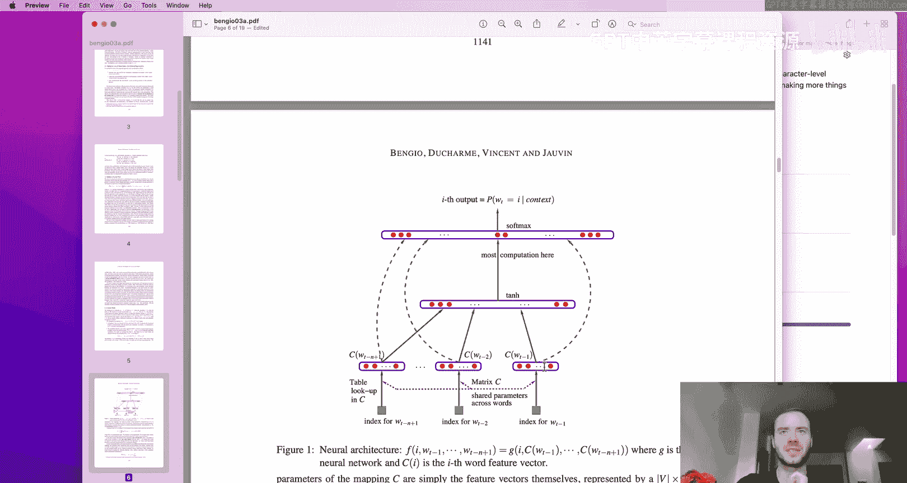
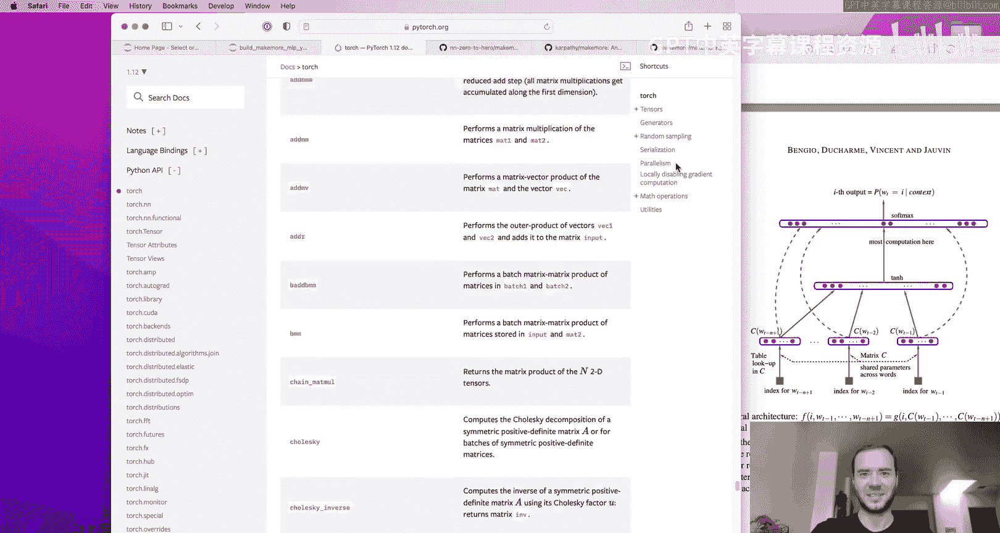
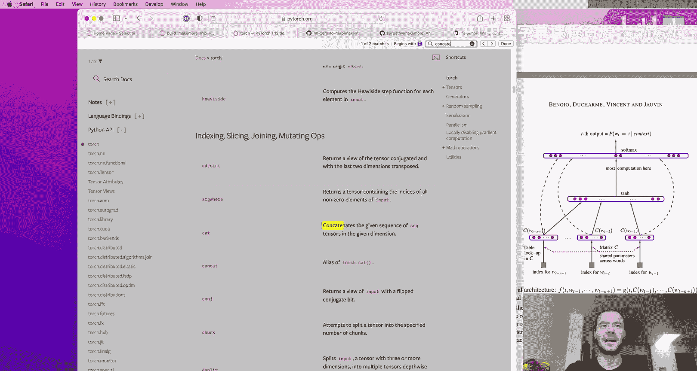
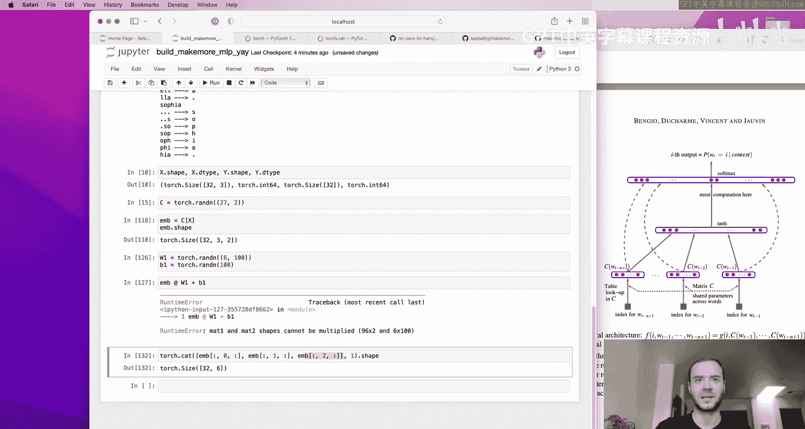
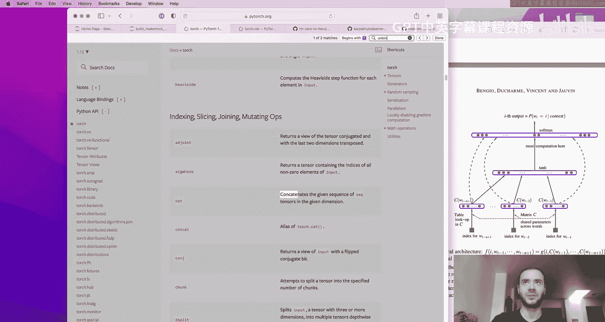
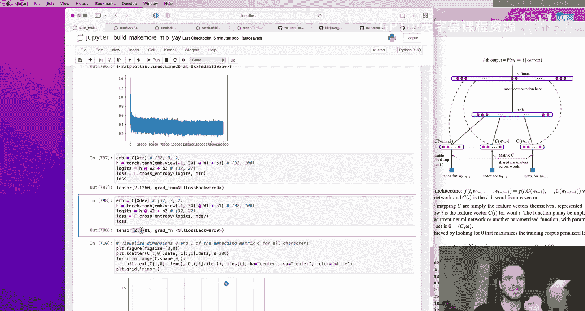
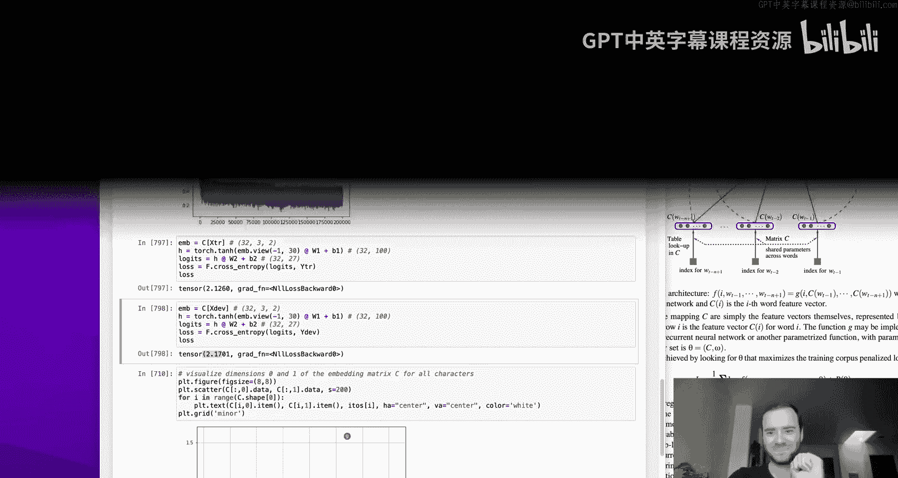
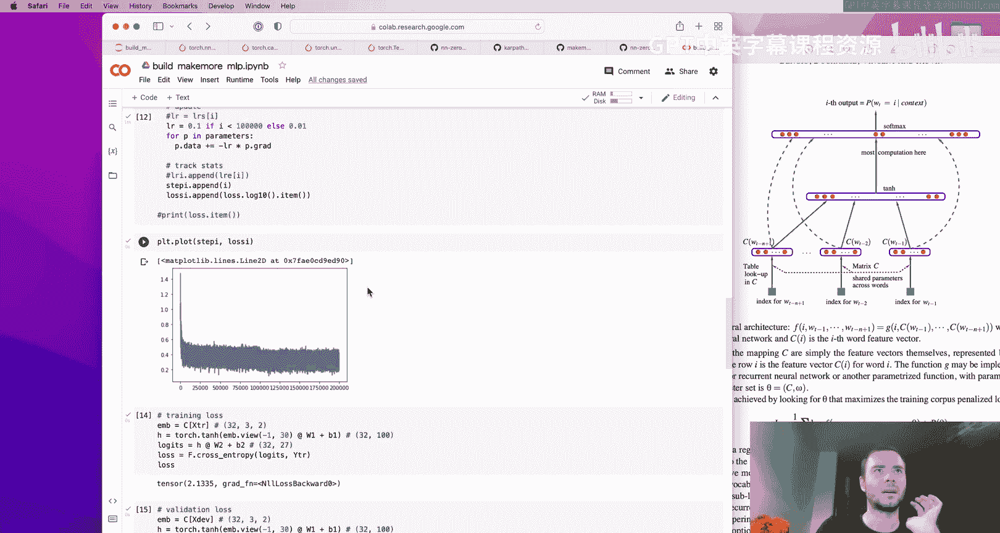

# Andrej《语言建模的详解入门：构建 makemore》中英字幕（deepseek-R1 - P2：Building makemore Part 2_ MLP.zh_en - GPT中英字幕课程资源 - BV1SDRxYKEfM

Hi， everyone。Today， we are continuing our implementation of make more。Now， in the last lecture。

 we implemented the bygram language model， and we implemented both using counts and also using a super simple neural network that has a single linear layer。

Now， this is the Jupyter notebook that we built out last lecture。

And we saw that the way we approached this is that we looked at only the single previous character。

 and we predicted the distribution for the character that would go next in the sequence。

 And we did that by taking counts and normalizing them into probabilities so that each row here sums to one。

Now， this is all well and good if you only have one character of previous context。And this works。

 and it's approachable。 The problem with this model， of course。

 is that the predictions from this model are not very good because you only take one character of context。

 So the model didn't produce very name like sounding things。Now， the problem with this approach。

 though， is that if we are to take more context into account when predicting the next character in a sequence。

 things quickly blow up。 And this table， the size of this table grows， and， in fact。

 it grows exponentially with the length of the context。

Because if we only take a single character at a time， that's 27 possibilities of context。

But if we take two characters in the past and try to predict the third one。

 Sudden the number of rows in this matrix， you can look at it that way is 27 times 27。

 So there are 729 possibilities for what could have come in the context。

If we take three characters as the context， suddenly we have 20000 possibilities of context。

And so that's just way too many rows of this matrix。 it's way too few counts。For each possibility。

 and the whole thing just kind of explodes and doesn't work very well。

So that's why today we're going to move on to this bullet point here。

 and we're going to implement a multi layerer perceptron model to predict the next character in a sequence。

 and this modeling approach that we're going to adopt follows this paper， Benjitel 2003。

So I have the paper pulled up here。Now， this isn't the very first paper that proposed the use of multitoerrons or neural networks to predict the next character or token in a sequence。

 but it's definitely one that is was very influential around that time。

 It is very often cited to stand in for this idea。 And I think it's a very nice write up。

 And so this is the paper that we're going to first look at and then implement。 Now。

 this paper has 19 pages。 So we don't have time to go into the full detail of this paper。

 but I invite you to read it。 It's very readable， interesting and has a lot of interesting ideas in it as well。

In the introduction， they described the exact same problem I just described and then to address it。

 they proposed the following model。Now， keep in mind that we are building a character level language model。

 So we're working on the level of characters。 In this paper。

 they have a vocabulary of 17000 possible words， and they instead build a word level language model。

 but we're going to still stick with the characters， but will take the same modeling approach。Now。

 what they do is basically they propose to take every one of these words， 17000 words。

 and they're going to associate to each word， a say 30 dimensional feature vector。

So every word is now embedded into a 30 dimensional space。 You can think of it that way。

 So we have 17000 points or vectors in a 30 dimensional space。 And that's。

 you might imagine that's very crowded。 That's a lot of points for a very small space。Now。

In the beginning， these words are initialized completely randomly， so they are spread out at random。

But then we're going to tune these embeddings of these words using that propag。

 So during the course of training of the neural network。

 these points or vectors are going to basically move around in this space。

 And you might imagine that， for example， words that have very similar meanings， or there are indeed。

 synonyms of each other might end up in a very similar part of the space and conversely words that mean very different things would go somewhere else in a space。

Now， their modeling approach otherwise， is identical to ours。

 They are using a multiar neural network to predict the next word。

 Given the previous words and to train the neural network。

 they are maximizing the log likelihood of the training data， just like we did。

So the modeling approach itself is identical。 Now， here they have a concrete example of this intuition。

Why does it work？Basically， suppose that， for example。

 you are trying to predict a dog was running in a blank。Now。

 suppose that the exact phrase a dog was running in a has never occurred in a training data。

 And here you are at sort of test time later when the model is deployed somewhere。

 and it's trying to make a sentence。 and it's saying a dog was running in a blank。

And because it's never encountered this exact phrase in the training set， you're out of distribution。

 as we say， like， you don't have fundamentally any reason to suspect what might come next。

But this approach actually allows you to get around that because maybe you didn't see the exact phrase a dog was running in a something。

 but maybe you've seen similar phrases。 Maybe you've seen the phrase the dog was running in a blank。

 And maybe your network has learned that a and the are like frequently are interchangeable with each other。

 And so maybe it took the embedding for a and the embedding for the。

 And it actually put them like near by each other in the space。

 And so you can transfer knowledge through that embedding， and you can generalize in that way。

 Similarlyly， the network could know that cats and dogs are animals and they cooccur in lots of very similar contexts。

 And so even though you haven't seen this exact phrase。

 Or if you haven't seen exactly walking or running。 you can， through the embedding space。

 transfer knowledge。 and you can generalize to novel scenarios。

So let's now scroll down to the diagram of the neural network。 They have a nice diagram here。

And in this example， we are taking three previous words。

And we are trying to predict the fourth word in a sequence。Now， these three previous words。

 as I mentioned， we have a vocabulary of 17，000 possible words。

 so every one of these basically are the index of the incoming word。And because there are 17。

000 words， this is an integer between0 and 16，999。Now， there's also a lookup table that they call C。

This look up table is a matrix that is 17000 by， say 30。

And basically what we're doing here is we are treating this as a lookup table。

 And so every index is pling out a row of this embedding matrix so that each index is converted to the 30 dimensional vector that corresponds to the embedding vector for that word。

So here we have the input layer of 30 neurons for three words， making up 90 neurons in total。

And here， they're saying that this matrix C is shared across all the words。

 So we're always indexing into the same matrix C over and over。For each one of these words。

Next up is the hidden layer of this neural network。

 The size of this hidden neural layer of this neural net is a hop parameterameter。

 So we use the word hyperparameter when it's kind of like a design choice up to the designer of the neural net。

 And this can be as large as you'd like or as small as you'd like。 So， for example。

 the size could be 100。And we are going to go over multiple choices of the size of this hidden layer。

 and we're going to evaluate how well they work。So say there were 100 neurons here。

 All of them would be fully connected to the 90 words or 90。Numbers that make up these free words。

So this is a fully connected layer。Then there's a 10" longity。 And then there's this output layer。

 And because there are 17000 possible words that could come next， this layer has 17000 neurons。

 and all of them are fully connected to all of these neurons in the hidden layer。

So there's a lot of parameters here because there's a lot of words， so most computation is here。

 this is the expensive layer。Now， there are 17000 loits here。 So on top of there。

 we have the softm layer， which we've seen in our previous video as well。

 So every one of these logits is expd， and then everything is normalized to sum to one so that we have a nice probability distribution for the next word in the sequence。

Now， of course， during training， we actually have the label。

 We have the identity of the next word in a sequence。

That word or its index is used to pluck out the probability of that word。

And then we are maximizing the probability of that word with respect to the parameters of this neural net。

So the parameters are the weights and biases of this output layer。

 the weights and biases of the hiddenon layer and the embedding look up table C。

 and all of that is optimized using back propagation。

And these dashed arrows ignore those that represents a variation of a neural nut that we are not going to explore in this video。

So that's the setup and now let's implement it。

Okay， so I started a brand new notebook for this lecture。We are importing by torch。

 and we are importing mat pottletps so we can create figures。

Then I am reading all the names into a list of words like I did before。

 and I'm showing the first8 right here。Keep in mind that we have a 32，000 in total。

 these are just the first eight。And then here I'm building out the vocabulary of characters and all the mappings from the characters as strings to integers and vice versa。

Now， the first thing we want to do is we want to compile the data set for the neural network。

And I had to rewrite this code。 I'll show you in a second， what it looks like。

So this is the code that I created for the DS creation。

 so let me first run it and then I'll briefly explain how this works。So first。

 we're going to define something called block size。

 and this is basically the context length of how many characters do we take to predict the next one。

 So here in this example， we're taking three characters to predict the fourth one。

 So we have a block size of three。 That's the size of the block that supports the prediction。

Then here I'm building out the X and Y。 The X are the input to the neural net。

 and the Y are the labels for each example inside X。Then I'm airing over the first five words。

 I'm doing first five just for efficiency while we are developing all the code。

 but then later we are going to come here and erase this so that we use the entire training set。

So here I'm printing the word， Emma。And here I'm basically showing the examples that we can generate。

 the five examples that we can generate out of the single sort of word Emma。

So when we are given the context of just dotta dot， the first character sequence is E。

In this context， the label is M。 When the context is this， the label is M。And so forth。

And so the way I build this out is first， I start with a padded context of just zero tokens。

Then I read over all the characters。 I get the character in the sequence。

 and I basically build out the array Y of this current character and the array X。

 which stores the current running context。And then here， see， I print everything。

 And here I crop the context and enter the new character in a sequence。

 So this is kind of like a roll in window of context。Now， we can change the block size here to。

 for example 4。And in that case， we would be predicting the fifth gearher given the previous four。

Or it can be 5。And then it would look like this。Or it can be， say 10。

And then it would look something like this。 We're taking 10 characters to predict the 11th one。

And we're always patting with dots。So let me bring this back to three just so that we have what we have here in the paper。

And finally， the data set right now looks as follows。From these five words。

 we have created a data set of 32 examples。And each inputet of the neural lot is three integers。

 And we have a label that is also an integer。 Y。 So X looks like this。

 These are the individual examples。And then why are the labels。So。Given this。

Let's now write to a neural network that takes these x's and predicts to Ys。 First。

 let's build the embedding look up table C。So we have 27 possible characters。

 and we're going to embed them in a lower dimensional space。In the paper， they have 17000 words。

 and they bid them in spaces as small dimensional as 30。

 So they cram 17000 words into 30 dimensional space。 In our case。

 we have only 27 possible characters。 So let's cram them in something as small as to start with。

 for example， a two dimensional space。So this look up table will be random numbers and we'll have 27 rows and we'll have two columns。

Right， so each20， each one of 27 characters will have a two dimensional embedding。

So that's our matrix C of embeddings in the beginning， initialized randomly。Now。

 before we embed all of the integers inside the input X using this lookup table C。

Let me actually just try to embed a single individual integer like say5。

So we get a sense of how this works。Now， one way this works， of course。

 is we can just take the C and we can index into row 5。And that gives us a vector。

 the fifth row of sea。And。This is one way to do it。

The other way that I presented in the previous lecture is actually seemingly different。

 but actually identical。 So in the previous lecture。

 what we did is we took these integers and we used the one hot encoding to first encode them。

 So if that one hot。We want to encode integer 5， and we want to tell it that their number of classes is 27。

 so that the 26 dimensional vector of all zeroes， except the fifth bit is turned on。

Now this actually doesn't work。The reason is that this input actually must be a tot tensor。

And I'm making some of these errors intentionally just so you get to see some errors and how to fix them。

 So this must be a tensor， not an int， fairly straightforward to fix。 We get a one hot vector。

 The fifth dimension is  one， and the shape of this is 27。

And now notice that just as I briefly alluded to in a previous video。

 if we take this one hot vector and we multiply it by C。Then。Whatho would you expect。Or， number one。

First， you'd expect an error because expected scalotype long， but found float。

 So a little bit confusing， but。The problem here is that one heart， the data type of it。Is long。

 It's a 64 B integer， but this is a float tensor。 And so Pytor doesn't know how to multiply an end with a float。

 And that's why we had to explicitly cast this to a float so that we can multiply。Now。

 the output actually here。Is identical。And that it's identical because of the way the matrix and multiplication here works。

 We have the one hot factor multiplying columns of C。 And because of all the zeroes。

 they actually end up masking out everything in C， except for the fifth row， which is plucked out。

And so we actually arrive at the same result。And that tells you that here we can interpret this first piece here。

 this embedding of the integer。 We can either think of it as the integer indexing into a look up table C。

But equivalently， we can also think of this little piece here as a first layer of this bigger neural nu。

This layer here has neurons that have no non nonlinearity。 There's no10 H。

 There are just linear neurons， and their weight matrix is C。

And then we are encoding integers into one hot and feeding those into a neural net。

 And this first layer basically embeds them。So those are two equivalent ways of doing the same thing。

 We're just going to index because it's much， much faster。

 And we're going to discard this interpretation of one hot inputs into neural nets。

 And we're just going to index integers and create and use embedding tables。 Now。

 embedding a single integer like 5 is easy enough。We can simply ask by torch to retrieve the fifth row of C or the row index 5 of C。

But how do we simultaneously embed all of these 32 by three integers stored in array X。Luckily。

 Pytorch indexing is fairly flexible and quite powerful。

 So it doesn't just work to ask for a single element 5 like this。 You can actually index using lists。

 So， for example， we can get the rows 5，6 and 7， and this will just work like this。

 We can index with a list。It doesn't just have to be a list。

 It can also be actually a tensor of integers， and we can index with that。

So this is a integer tensor 5，6，7， and this will just work as well。In fact， we can also， for example。

 repeat， row 7 and retrieve it multiple times and。That same index will just get embedded multiple times here。

So here we are indexing with a one dimensional tensor of integers。

 but it turns out that you can also index with multidial tensors of integers。

 Here we have a two dimensional tensor of integers。 so we can simply just do C at X。

And this just works。And the shape of this is。32 by 3， which is the original shape。

 And now for every one of those 32 by3 integers， we've retrieved the embedding vector here。

So basically， we have that as an example。The 13th or example， index 13。

 The second dimension is the integer1 as an example。And so here， if we do C of x。

 which gives us that array， and then we index into 13 by 2 of that array。

 then we we get the embedding。Here。And you can verify that C at one。

Which is the integer at that location is indeed equal to this。You see， they're equal。So basically。

 a long story short Pyrch indexing is awesome and to embed simultaneously。All of the integers in X。

 we can simply do C of X， and that is our embedding。And that just works。Now。

 let's construct this layer here， the hidden layer。So we have that W1， as I'll call it。

Are these weights， which we will initialize randomly。Now。

 the number of inputs to this layer is going to be three times2， right。

 because we have two dimensional embeddings and we have three of them。 So the number of inputs is 6。

And the number of neurons in this layer is a variable to us。 Let's use 100 neurons， as an example。

And then biases will be also initialized randomly as an example and lets and we just need 100 of them。

Now， the problem with this is we can't simply normally we would take the input， in this case。

 that's embedding， and we like to multiply it with these weights。

And then we would like to add the bias。 This is roughly what we want to do。

But the problem here is that these embeddings are stacked up in the dimensions of this impotenssor。

So this will not work this matrix multiplication because this is a shape 32 by 3 by 2。

 and I can't multiply that by 6 by 100。So somehow， we need to concatenate these inputs here together so that we can do something along these lines。

 which currently does not work。So how do we transform this 32 by 3 by 2 into a 32 by 6 so that we can actually perform this multiplication over here。

 I'd like to show you that there are usually many ways of implementing what you'd like to do in torch。

 and some of them will be faster， better， shorter， et cetera。

And that's because torch is a very large library and it' got lots and lots of functions。

 So if we just go to the documentation and click on torch。

 you'll see that my slider here is very tiny and that's because there are so many functions that you can call on these tensors。

To transform them， create them， multiply them， add them。

 perform all kinds of different operations on them。And so， this is kind of like。

The space of possibility， if you will。

Now， one of the things that you can do is if we can control here， control of for concatenate。

 And we see that there's a function torque out cat， short for a concatetnate。

And this concatenateates a given sequence of tensors in a given dimension。

And these sensors must have the same shape， et cetera。 So we can use the concatenate operation to。

 in a naive way， concatenate these three embeddings for each input。So in this case， we have M of。

Enmp of the shape。 And really， what we want to do is we want to retrieve these three parts and concatenate them。

So we want to grab all the examples。We want to grab。First， the zero。A。Index， and then all of。This。So。

 this plucks out。The 32 by 2 embeddings of just the first word here。And so basically。

 we want this guy。We want the first dimension， and we want the second dimension。

And these are the three pieces individually。And then we want to treat this as a sequence。

 and we want to torch that cat on that sequence。 So this is the list。Tt cat takes a sequence。

Of tensors。 And then we have to along which dimension to concatenate。So in this case。

 all these are 32 by 2， and we want to concatenate not across dimension 0， but across dimension 1。So。

 pass in one。Gives us a result。The shape of this is 32 by 6 exactly as we'd like。

So that basically took 32 and squashed these backcateing them into 32 by6。Now。

 this is kind of uglyque because this code would not generalize if we want to later change the block size。

 Right now， we have three inputs。3 words。 But what if we had five。

 then here we would have to change the code because I'm indexing directly。

Well， torch comes to rescue again because there turns out to be a function called unbind。

And it removes a tensor dimension。So it removes a tensor dimension。

 returns a tuple of all slices along a given dimension without it。So this is exactly what we need。

And basically， when we called Torshdt Unbind。Torch， dot and bind。

Of M and passing dimension 1 index 1。This gives us a list of。

A list of tensors exactly equivalent to this。So， running this。Gives us a length。3。

And it's exactly this list。 And so we can call Torched out cat on it。And along the first dimension。

And this works。And this shape is the same。But now this is。

 it doesn't matter if we have block size three or five or 10， this will just work。

So this is one way to do it， but it turns out that in this case。

 there's actually a significantly better and more efficient way。

 and this gives me an opportunity to hint at some of the internals of Torrstrat Tensor。

So let's create an array here。Of elements from 0 to 17。 And the shape of this。Is just 18。

 It's a single vector of 18 numbers。It turns out that we can very quickly re represent this as different sized and dimensional tensors。

We do this by calling a view。And we can say that actually， this is not a single vector of 18。

 This is a2 by9 tensor。Or alternatively， this is a 9 by2 tensor。

Or this is actually a3 by3 by two tensor。As long as the total number of elements here multiply to be the same。

 this will just work。And in Pytorch， this operation， calling that view， is extremely efficient。

And the reason for that is that in each tensor， there's something called the underlying storage。

And the storage is just the numbers always as a one dimensional vector。

 And this is how this tensor is represented in the computer memory。

 It's always a one dimensional vector。But when we call that deal。

 we are manipulating some of attributes of that tensor that dictate how this one dimensional sequence is interpreted to be an enddial tensor。

And so what's happening here is that no memory is being changed， copied。

 moved or created when we call that view。 The storage is identical， but when you call that view。

 some of the internal attributes of the view of the ssor are being manipulated and changed。

 in particular that something there are something called storage offset strides and shapes。

 and those are manipulated so that this one dimensional sequence of bytes is seen as different and dimensional arrays。

There's a blog post here from Eric called Pytorch Interternals。

 where he goes into some of this with respect to tensor and how the view of a tensor is represented。

And this is really just like a logical construct of representing the physical memory。

And so this is a pretty good black post that you can go into。

 I might also create an entire video on the internals of torch Tensor and how this works。For here。

 we just note that this is an extremely efficient operation。

And if I delete this and come back to our M。We see that the shape of our M is 32 by 3 by 2。

 but we can simply ask for Pytorch to view this instead as a 32 by 6。

And the way this gets flattened into a 32 by6 array。Just happens that。

These two get stacked up in a single row。 And so that's basically the concatenation operation that we're after。

And you can verify that this actually gives the exact same result as what we had before。

So this is an element y equals， and you can see that all the elements of these two tensors are the same。

And so we get the exact same result。So long story short， we can actually just come here。

 And if we just view this as a 32 by 6。Instead， then this multiplication will work and give us the hidden states that we're after。

 So if this is H。Then H stretch shape is now the 0 dimensional activations for every one of our 32 examples。

And this gives the desired result。 Let me do two things here。 Number one， let's not use 32。 We can。

 for example， do something like。Ear shape at 0。So that we don't hard code these numbers。

 and this would work for any size of this M。Or alternatively， we can also do negative one。

 When we do negative  one， Pytor will infer what this should be。

Because the number of elements must be the same。 And we're saying that this is 6 by To derived that this must be 32 or whatever else it is。

 if M is of different size。The other thing is， here。One more thing I'd like to point out is。Here。

 when we do the concatenation， this actually is much less efficient because this concatenation would create a whole new tensor with a whole new storage。

 So new memory is being created because there is no way to concatenate tensors just by manipulating the view attributes。

 So this is inefficient and creates all kinds of new memory。😊，So let me delete this now。

We don't need this。And here to calculate H， we want to also dot 10 H。Of this ticket are。Whoops。

 to get our H。So these are now numbers between 81 and 1 because of the 10H。

 And we have that the shape is 32 by 100。And that is basically this hidden layer of activations here for every one of our 32 examples。

Now， there's one more thing I've gloss over that we have to be very careful with。 and that this。

 and that's this plus here。In particular， we want to make sure that the broadcasting will do what we like。

The shape of this is 3to by 100 and B one shape is 100。

So we see that the addition here will broadcast these two， and in particular。

 we have 3 to by 100 broadcasting to 100。So broadcasting will align on the right。

 createate a fake dimension here。 So this will become a 1 by00 row vector。

 and then it will copy vertically。For every one of these rows of 32 and do an element wise edition。

So in this case， the correct thing will be happening because the same bias vector will be added to all the rows。

off。This matrix。 So that is correct。 That's what we'd like。 And it's always good practice。

 just make sure so that you don't treat yourself in the foot。 And finally。

 let's create the final layer here。So， let's create。W2 and B2。The input now is 100。

And the output number of neurons will be for us 27。

 because we have 27 possible characters that come next。So the biases will be 27 as well。So therefore。

 the logits， which are the outputs of this neural net。Are going to be。H。Multipliied by W2 plus B2。

Los that shape is 32 by 27。And lo look。Now， exactly as we saw in the previous video。

 we want to take these logits and we want to first expientiate them to get our fake counts。

 and then we want to normalize them into a probability。So Prob is counts divide。

And now counts that sum along the first dimension and keep them as true。

 exactly as in the previous video。And so。Prob， that shape now is to reach2 by 27。

And you'll see that every row of prob。Sums to one。 So it's normalized。

So that gives us the probabilities。 Now， of course， we have the actual letter that comes next。

 and that comes from this array， why。whichhich we which we created during the dataset creation。

 So why is this last piece here， which is the identity of the next character in a sequence that we'd like to now predict。

So what we'd like to do now is just as in the previous video。

 we'd like to index into the rows of Prob。 and in each row we'd like to pluck out the probability assigned to the correct character。

As given here。So first we have Tordot a range of 32。

 which is kind of like an iterator over numbers from 0 to 31。

And then we can index into Pro in the following way。Prob in torchdo a range of 32。

 which it erasse the roads。 And then in each row， we'd like to grab this column， as given by y。

So this gives the current probabilities， as assigned by this neural network with this setting of its weights。

To the correct character in the sequence。And you can see here that this looks okay for some of these characters。

 like this is basically 02。But it doesn't look very good at all for many other characters。

 like this is 0。0，701 probability。 And so the network thinks that some of these are extremely unlikely。

 But， of course， we haven't trained a neural network yet， so。This will improve。 and ideally。

 all of these numbers here， of course， are one， because then we are correctly predicting the next character。

Now， just as in the previous video， we want to take these probabilitybabil。

 We want to look at the log probability and then we want to look at the average log probability and the negative of it to create the negative log likelihood losss。

So the loss here is 17。And this is the loss that we'd like to minimize to get the network to predict the correct character in the sequence。

 Okay， so I rewrote everything here and made it a bit more respectable。 So here's our dataset set。

 Here's all the parameters that we defined。I'm now using a generator to make it reproducible。

 I clustered all the parameters into a single list of parameters so that， for example。

 it's easy to count them and see that in total， we currently have about 3400 parameters。

And this is the forward pass as we developed it。 And we arrive at a single number here。

 the loss that is currently expressing how well this neural network works with a current setting of parameters。

Now， I would like to make it even more respectable。 So in particular， see these lies here。

 where we take the logits and we calculate the loss。We're not actually reinventing the wheel here。

 This is just classification， and many people use classification。

 and that's why there is a functional dot cross entropy function in Pytorch to calculate this much more efficiently。

 So we could just simply call at dot cross entropy， and we can pass in the logicits。

 and we can pass in the array of targets Y。And this calculates the exact same loss。So in fact。

 we can simply put this here。And erase these three lines。

 And we're going to get the exact same result。 Now。

 there are actually many good reasons to prefer if that cross entropy over rolling your own implementation like this。

 I did this for educational reasons， but you'd never use this in practice。 Why is that。Number one。

 when used at that cross entropy， Pytorch will not actually create all these intermediate tensors because these are all new tensors in memory。

 and all this is fairly inefficient to run like this。Instead。

 Pythtorch will cluster up all these operations and very often have fused kernels that very efficiently evaluate these expressions that are sort of like clustered mathematical operations。

Number 2， the backward pass can be made much more efficient。

 and not just because it's a fused kernel， but also analytically and mathematically。

 much it's often a very much simpler backward pass to implement。

We actually sell this with the micrograd。You see here when we implemented 10 H。

 the forward path of this operation to calculate the 10 H was actually a fairly complicated mathematical expression。

But because it's a clustered mathematical expression。 when we did the backward pass。

 we didn't individually backward through the X and the two times and the -1 and division， et cetera。

 We just said it's 1 minus t squared。 And that's a much simpler mathematical expression。

And we were able to do this because we are able to reuse calculations and because we are able to mathematically and analytically derive the derivative。

 And often， that expression simplifies mathematically。 And so there's much less to implement。😊。

So not only can it be made more efficient because it runs an aff fused kernel。

 but also because the expressions can take a much simpler form mathematically。So that's number one。

 number two。Under the hood， F that cross entropy can also be significantly more。

Nummerically well behaved。 Let me show you an example of how this works。

Suppose we have the logits of negative 2，3， negative 3，0， and 5。

And then we are taking the exponent of it and normalizing it to sum to 1。

 So when logits take on these values， everything is well and good。

 and we get a nice probability to distribution。Now。

 consider what happens when some of these logs take on more extreme values。

 and that can happen during optimization of the neural network。

Suppose that some of these numbers grow very negative， like say negative 100。

Then actually everything will come out fine。 We still get the probabilities that you know。

 are well behaved and they sum to one and everything is great。But because of the way the exports。

 if you have very positive logits， let's say， positive 100 in here。

You actually start to run into trouble and we get not a number here。

And the reason for that is that these counts。Have an inph here。

So if you pass in a very negative number to X， you just get a very negative， sorry， not negative。

 but very small number， very very near 0。 and that's fine。

But if you pass in the very positive number， suddenly we run out of range in our floating point number that represents these counts。

So basically， we're taking E and we're raising it to the power of 100。

 and that gives us in because weve run out of dynamic range on this floating point number。

 that is count。And so we cannot pass very large hologits through this expression。Now。

 let me reset these numbers。 Do something reasonable。

The way Py torch solve this is that you see how we have a well behave result here。

It turns out that because of the normalization here。

 you can actually offset logits by any arbitrary constant value that you want。 So if I add one here。

 you actually get the exact same result， or if I add two。Or if I subtract 3。

Any offset will produce the exact same probabilities。So because negative numbers are okay。

 the positive numbers can actually overflow this exp。

What Pe just is it internally calculates the maximum value that occurs in thelogits。

 and it subtracts it。 So in this case， it would subtract 5。And so therefore。

 the greatest number in logits will become0， and all the other numbers will become some negative numbers。

And then the result of this is always well behaved。 So even if we have 100 here， previously。

 Not good。But because pyotal subtract 100， this will work。

And so there's many good reasons to call cross entropy。 Number one。

 the forward pass can be much more efficient。 The backward pass can be much more efficient and also thinks can be much more numerically well behaved。

 Okay， so let's now set up the training of this neural map。We have the forward pass。

We don't need these is that we have the losses equal to after crosscenttropy。

 that's the forward pass。Then we need the backward pass。 First， we want to set the gradient to be 0。

 So for ping parameters。We want to make sure that Pout grad is none。

 which is the same as setting it to zero and pytorch。

And then lost them backward to populate those gradients。Oncet we have the gradients。

 we can do the parameter update。 So for p parameters。

 we want to take all the data and we want to nudge it。Learning rate time， speed dot grad。

And then we want to repeat this。A few times。然后。And let's print the loss here， as well。Now。

 this won't suffice， and it will create an error because we also have to go for PN parameters。

 and we have to make sure that P dot requires grad is set to true by torch。And this should just work。

Okay， so we started off with loss of 17 and we're decreasing it。What's run longer。

Can you see how the last decrease is。A lot here， so。If we just run for thousand times， we get a very。

 very low loss。 And that means that we're making very good predictions。 Now。

 the reason that this is so straightforward right now is because we are only。Overfitting，32 examples。

So we only have 32 examples of the first five boards。And therefore。

 it's very easy to make this neural mat fit only these two 32 examples。

 because we have 3400 parameters and only332 examples。

 So we're doing what's called overfitting a single batch off the data and getting a very low loss。

And good predictions。 But that's just because we have so many parameters for so few examples。

 So it's easy to make this be very low。Now we're not able to achieve exactly zero。

 and the reason for that is we can， for example， look at logs。Which are being predicted。

And we can look at the max along the first dimension。And in Pytorch。

 Max reports both the actual values that take on the maximum number， but also the indiceice of these。

And you'll see that the indices are very close to the laps。But in some cases， they differ。

 For example， in this very first example， the predicted index is 19， but the label is 5。

And we're not able to make loss P 0。 And fundamentally， that's because here。

The very first or the0th index is the example where dot dot dot is supposed to predict E。

 but you see how dot dot dot is also supposed to predict an O and dot dot is also supposed to predict an I and then S as well。

 And so basically， E O A or S are all possible outcomeses in a training set for the exact same input。

 So we're not able to completely overfit and make the loss be exactly0。

But we're getting very close in the cases where there's a unique input for a unique output。

 In those cases， we do what's called overfit。 and we basically get the exact same and the exact correct result。

So now all we have to do。Is we just need to make sure that we read in the full data and optimize the neural lot。

Okay， so let's swing back up where we created the dataset。

And we see that here we only use the first five words。 So let me now erase this。

And let me erase the print statements。 Otherwise we be printing way too much。

And so when we process the full dataset set of all the words， we now had 228。

000 examples instead of just 32。So let's now scroll back down。The is is much larger。

 we initialize the weights， the same number of parameters。 They all require gradients。

And then let's push this printer。 I lost that item to be here。

And let's just see how the optimization goes if you run this。Okay。

 so we started with a fairly high loss。 and then as we were optimizing， the loss is coming down。

But you'll notice that it takes quite a bit of time for every single iteration。

 So let's actually address that because we're doing way too much work forwarding and backwarding 228000 examples。

In practice， what people usually do is they perform forward and backward pass an update on many batches of the data。

So what we will want to do is we want to randomly select some portion of the data set。

 and that's a mini batch。 And then only forward backward and update on that little mini batch。

 And then we iterate on those many batches。 So in Pytorwe， for example， you store start random。

We can generate numbers between 0 and 5 and make 32 of them。嗯。I believe this size has to be a tuple。

In my torch。So we can have a couple 32 of numbers between 0 and 5。

 but actually we want x shape of0 here。And so this creates integers that index into our data set。

 and there's 32 of them。So if our mini batch size is 32。

 then we can come here and we can first do mini batch。Construct。

So integers that we want to optimize in this single iteration are in the IX。

And then we want to index into X with I X to only grab those rows。

 So we're only getting 32 rows of x。 and therefore， embeddings will again be 32 by 3 by 2。

 not 200000 by 3 by 2。And then this I X has to be used not just to index into X。

 but also to index into y。And now this should be mini batches， and this should be much， much faster。

 so。Okay， so it's instant almost。So this way， we can run many， many examples。

Nearly instantly and decrease the loss much， much faster。Now。

 because we're only dealing with many batches， the quality of our gradient is lower。

 So the direction is not as reliable。 It's not the actual gradient direction。

But the grading direction is good enough， even when it'sestimating on only 32 examples that it is useful。

And so it's much better to have an approximate gradient and just make more steps than it is to evaluate the exact gradient and take fewer steps。

 So that's why in practice， this works quite well。So let's now continue the optimization。

🤧Let me take out this lost that item from here。And place it over here at the end。Okay。

 so we're hovering around 2。5 or so。However， this is only the loss for that mini batch。

 So let's actually evaluate the loss。Here。For all of X。And for all of why。

 just so we have a full sense of exactly how well the model is doing right now。

So right now we're at about 2。7 on the entire training set。So let's。

Rund the optimization for a while。Okay， write 2。6。2。57。2。53。O。So one issue， of course。

 is we don't know if we're stepping too slow or too fast。So this point one， I just guessed it。

 So one question is， how do you determine this learning rate？

And how do we gain confidence that we're stepping in the right？Sort of speed。

 So I'll show you one way to determine a reasonable learning rate。It works as followss。

 Let's reset our parameters。To the initial settings。And now， let's。Print in every step。

But let's only do 10 steps or so。Or maybe， maybe 100 steps。

 We want to find like a very reasonable set search range， if you will。 So， for example。

 this is like very low。Then。We see that the loss is barely decreasing， so that's not。

That's like too low， basically。 So let's try。This one。Okay， so we're decreasing the loss。

 but like not very quickly。 So that's a pretty good low range。Now， let's reset it again。

And now let's try to find the place at which the loss kind of explodes。So maybe at negative one。Okay。

 we see that we're minimizing the loss， but you see how it's kind of unstable。

 It goes up and down quite a bit。So negative one is probably like a fast。Learning rate。

 Let's try N 10。Okay， so this isn't optimizing。 This is not working very well。

 So negative 10 is way too big。 Negg one was already kind of big。So therefore。

 make it one most like somewhat reasonable if I reset。

So I'm thinking that the right learning rate is somewhere between negative 0。001 and。N one。

So the way we can do this here is we can use torque shott lens space。

And we want to basically do something like this between0 and one but。嗯。

Oh number of steps is one more parameter that's required， let's do 100 steps。

This creates 1000 numbers between 0。001 and1。But it doesn't really make sense to step between these linearly。

 So instead， let me create learning rate exponent。And instead of 0。001， this will be a negative 3。

 and this will be a 0。 and then the actual errorrs that we want to search over are going to be 10 to the power of LR。

So now what we're doing is we're stepping linearly between the exponents of these learning rates。

 This is 0。001， and this is 1， because 10 to the power of 0 is 1。And therefore。

 we are spaced exponentially in this interval。So these are the candidate learning rates。

That we want to serve like search over， roughly。So now what we're going to do is。

Here we are going to run the optimization for 1000 steps。And instead of using a fixed number。

 we are going to use learning rate。Indexing into here， L R of I， and make this I。So basically。

 let me resetcept this to be again， starting from random。

Creating these learning rates negative between 0。001 and one， but exponentially stopped。And here。

 what we're doing is we're iterating a thousand times。We're going to use the learning rate。

That's in the beginning， very， very low， in the beginning is going to be 0。001， but by the end。

 it's going to be one。And then we're going to step with that learning rate。

And now what we want to do is we want to keep track of the。Learning race that we used。

 And we want to look at the losses。That resulted。And so， here， let me。Trrack stats。

So LRI dot append LR。And lost side that append。Loss that item。Okay。So， again， reset everything。

And then， run。And so basically， we started with a very low learning rate and we went all the way up to learning rate of negative one。

And now what we can do is we can p T that plot。And we can plot the two。

 so we can plot the learning rates on the X axis and the losses we saw on the y axis。And often。

 you're going to find that your plot looks something like this。Where in the beginning。

 you had very low learning rates， so basically anything， barely anything happened。

Then we got to like a nice spot here。 And then as we increased the learning rate enough。

 we basically started to be kind of unstable here。So a good learning rate turns out to be somewhere around here。

And because we have LRI here。嗯。We actually may want to。Do not L R， not the learning rate。

 but the exponent。 So that would be the L R E and I is maybe what we will log。

 So let me reset this and redo that calculation。 But now on the X axis， we have the。

Exponent of the learning rate。 And so we can see that the expon of the learning rate that is good to use。

 It would be sort of like roughly in the valley here because here。

 the learning rates are just way too low。 And then here where we expect relatively good learning rate somewhere here。

 And then here， things are starting to explode。 So somewhere around negative one as the exponent of the learning rate is a pretty good setting。

 And 10 to the negative1 is 0。1。 So  point。1 is actually 。

1 was actually a fairly good learning rate around here。😊。

And that's what we had in the initial setting。But that's roughly how you would determine it。

And so here now we can take out the tracking of these。

And we can just simply set allow to be 10 to the negative one or。Basically otherwise point。

1 as it was before。And now we have some confidence that this is actually a fairly good learning rate。

And so now what we can do is we can crank up the iterations。We can reset our optimization。

And we can run for a pretty long time， using this learning rate。Oops， and we don't want to print。

 It's way too much printing。So， let me again reset。And run 10，000 steps。Okay， so we're at 022。48。

 roughly， let's run another 10000 steps。2。46。And now let's do one learning rate decay。

 What this means is we're going to take our learning rate， and we're going to 10 x lower it。

 And so of we're at the late stages of training potentially。 And we may want to go a bit slower。

 Let's do one more， actually， at point1， just to see if。We're making an indent here。Okay。

 we're still making dent， and by the way， the bigram loss that we achieved last video was 2。45。

 so we've already surpassed the bigram model。And once I get a sense that this is actually kind of starting to plateau off。

 people like to do， as I mentioned this learning rate decay。 So let's try to decay the loss。

 the learning rate， I mean。And we achieve at about 2。3 now。

Obviously this is genie and not exactly how you will train it in production。

 but this is roughly what you're going through。 You first find a decent learning rate using the approach that I show you。

Then you start with that learning rate， and you train for a while。 And then at the end。

 people like to do a learning rate decay where you decay the learning rate by say a factor of 10。

 and you do a few more steps。 And then you get a trained network， roughly speaking。

 So we've achieved 2。3 and dramatically improved on the bigram language model using this simple neural net。

 as described here， using these 3400 parameters。Now， there's something we have to be careful with。

I said that we have a better model because we are achieving a lower loss，2。3， much lower than 2。

45 with the bigra model previously。Now， that's not exactly true。

 And the reason that's not true is that。This is actually a fairly small model。

 but these models can get larger and larger if you keep adding neurons and parameters。

 So you can imagine that we don't potentially have 1000 parameters。

 We could have 10000 or 100000 or millions of parameters。

 And as the capacity of the neural network grows。It becomes more and more capable of overfitting your training set。

What that means is that the loss on the training set on the data that you're training on will become very。

 very low as low as 0。 But all that the model is doing is memorizing your training set verbatim。

 So if you take that model and it looks like it's working really well， but you try to sample from it。

 You will basically only get examples exactly as they are in the training set。

 you won't get any new data。In addition to that， if you try to evaluate the loss on some withheld names or other words。

 you will actually see that the loss on those can be very high。 And so basically。

 it's not a good model。So the standard in the field is to split up your dataset set into three splits。

 as we call them。 We have the training split， the de split or the validation split。

And the test split。So， training splin。Test or sorry， dev or validation split。And test split。

And typically this would be， say 80% of your data set， this could be 10% and this 10% roughly。

So you have these three splits of the data。Now， these 80% of your trainings of of the dataset set。

 the training set is used to optimize the parameters of the model， just like we're doing here。

 using gradient descent。These 10% of the examples， the dev or validation split。

 they' are used for development over all the hyperparameter of your model。 So hyper parameterss are。

 for example， the size of this hidden layer， the size of the embedding。 So this is 100 or a2 for us。

 but we could try different things。Of the strength of the realization。

 which we aren't using yet so far。 So there's lots of different hyper parameters and settings that go into defining a neural lot。

 And you can try many different variations of them and see whichever one works best on your validation split。

So this is used to train the prim。 This is used to train the hyper prim。

And test split is used to evaluate basically the performance of the model at the end。

So we're only evaluating the loss on the test split very， very sparingly and very few times。

 because every single time you evaluate your test loss and you learn something from it。

 You are basically starting to also train on the test split。

 So you are only allowed to test the loss on the test set very， very few times。

 Otherwise you risk overfitting to it as well as you experiment on your model。

So let's also split up our training data into train， dev and test。

 and then we are going to train on train and only evaluate on test very， very sparingly。Okay。

 so here we go。Here is where we took all the words and put them into X and Y tensors。So instead。

 let me create a new cell here and let me just copy paste some code here。

Because I don't think it's that。Complex， but。We're going to try to save a little bit of time。

I'm converting this to be a function now， and this function takes some list of words and builds the arrays X and Y for those words only。

And then here I am shuffling up all the words。 So these are the input words that we get。

We are randomly shuffling them all up。And then we're going to set n1 to be the number of examples。

 that' is 80% of the words and N2 to be 90% of the way of the words。 So basically。

 if length of words is 30000， N1 is。Well， sorry， I should probably run this。

N1 is 25000 and N2 is 28000。 And so here we see that I'm calling build data set to build a training set X and Y by indexing into up to N1。

 So we're going to have only 25000 training words。And then we're going to have。Roughly。N 2 minus N1。

3，3000 validation examples or dev examples。 And we're going to have。N of words。

 basically minus and 2。Or 3204 examples here for the test set。

So now we have x's and y's for all those three splits。嗯。Oh， yeah。

 I'm printing their size here inside it function as well。But here we don't have words。

 but these are already the individual examples made from those words。So let's now scroll down here。

And the data set now for training is。More like this。And then when we reset the network。

When we're training， we're only going to be training using X train。X train and Y train。

So that's the only thing we're training on。Let's see where we are on it。Sing batch。

Let's not train maybe a few more steps。Training neural or can take a while。 Usually。

 you don't do it in line。 You launch a bunch of jobs and you wait for them to finish。

 can take in multiple days and so on。Luckily， this is a very small network。Okay。

 so the loss is pretty good。 Oh， we accidentally used a learning rate。 That is way too low。

So let me actually come back。We used the decay learning rate of 0。01。So this will train much faster。

And then here when we evaluate， let's use the dev set here。X dev。Hand wine dev， to evaluate the loss。

Okay。And let's not indicate the learning rate and only do， say，10000 examples。

Unless e valued that dev've loss。Once here。Okay， so we're getting about 2。3 on dev。

 And so the neural network when was training did not see these dev examples。

 It hasn't optimized on them。 And yet， when we evaluate the loss on these dev。

 we actually get a pretty decent loss。 And so we can also look at what。

Losssses on olive of training set。よ。And so we see that the training and the dev loss are about equal。

 So we're not overfitting。 This model is not powerful enough to just be purely memorizing the data。

 And so far we are what's called underfitting。 because the training loss and the dev or test losses are roughly equal。

 So what that typically means is that our network is very tiny。 very small。

 And we expect to make performance improvements by scaling up the size of this neural nu。

 So let's do that now。 So let's come over here。 and let's increase the size of the neural net。

 The easiest way to do this is we can come here to the hidden layer， which currently has 100 neurons。

 And let's just bump this up。 So let's do 300 neurons。And then this is also 300 biases。

 and here we have 300 inputs into the final layer。So。Let's initialize our neural net。

 We now have 1000010000 parameters， instead of 3000 parameters。And then， we're not using this。

And then here what I'd like to do is I'd like to actually keep track of T。嗯。Okay， let's just do this。

 let's keep stats again。And here， when we're keeping track of the。Loss。

 let's just also keep track of the steps。 and let's just have a eye here。And let's train on 30，000。

Or rather， say。I， let's try 30000。And we are at 0。1。And。We should be able to run this。

And optimizeim your lot。And then here， basically， I want to peel Tductt plot。The steps。

Repaced the loss。So these are the x and the y。And this is。

The loss function and how it's being optimized。Now。

 you see that there's quite a bit of thickness to this。

 and that's because we are optimizing over these mini batches and the mini batches create a little bit of noise in this。

Where are we in the deficit， we are at 2。5， so we still haven't optimized this neural very well。

And that's probably because we make it bigger， it might take longer for this neural net to converge。

And so， let's continue training。嗯。Yeah， let's just continue training。

One possibility is that the batch size is so low that we just have way too much noise in the training and we may want to increase the batch size so that we have a bit more correct gradient and we're not thrashing too much and we can actually like optimize more properly。

Okay，This will now become meaningless because we've re initialitialized these。Yeah。

 this looks not pleasing right now。 but the probably is like a tiny improvement。

 but it's so hard to tell。Let's go again。2。52。Let's try to decrease the learning rate by factor of  two。

Okay， we're at 2。32。Let's continue training。We basically expect to see a lower loss than what we have before。

 because now we have a much， much bigger model and we were underfitting。

 so we'd expect that increasing the size of the model should help the neural on that。2。32。 Okay。

 so that's not happening too well。Now， one other concern is that even though we've made the 10 H layer here or the hidden layer much。

 much bigger， it could be that the bottlene of the network right now are these embeddings that are two dimensional。

 It can be that we're just cramming way too many characters into just two dimensions。

 and the neural net is not able to really use that space effectively。

 and that that is sort of like the bottleneck to our network's performance。Okay，2。23。

 So just by decreasing the learning rate， I was able to make quite a bit of progress。

 Let's run this one more time。And then evaluate the training and the dev loss。Now。

 one more thing after training that I'd like to do is I'd like to visualize the。

Ebedding vectors for these characters before we scale up the embedding size from2。

Because we'd like to make this bottlelight potentially go away。But once I make this greater than two。

 we won't be able to visualize them。So here， okay， we're at 2。23 and 2。24。

 So we're not improving much more。 And maybe the bottleck now is the character embedding size。

 which is 2。So here I have a bunch of code that will create a figure。

 and then we're going to visualize。The embeddings that were trained by the neural nut。

On these characters， because right now the embedding size is just 2。

 so we can visualize all the characters with the x and the y coordinates as the two embedding locations for each of these characters。

And so here are the X coordinates and the Y coordinates， which are the columns of C。

And then for each one， I also include the text of the little character。So here。

 what we see is actually kind of interesting。嗯。The network has basically learned to separate out the characters and cluster them a little bit。

 So， for example， you see how the vowels， A， E， I， O U are clustered up here。

 So what that's telling us that is that the neural nut treats these as very similar， right。

 Because when they feed into the neural nut， the embedding for all these characters is very similar。

 And so the neural nu thinks that they' are very similar and kind of like interchangeable。

 if that makes sense。嗯。Then the the points that are like really far away are， for example， Q。

 Q is kind of treated as an exception， and Q has a very special embedding vector， so to speak。

Similarly， dot， which is a special character， is all the way out here。

And a lot of the other letters are sort of like clustered up here。

And so it's kind of interesting that there's a little bit of structure here after the training。

 and it's not definitely not random and these embeddings make sense。

So we're now going to scale up the embedding size and won't be able to visualize it directly。

 but we expect that because we're underfitting。And we made this layer much bigger and did not sufficiently improve the loss。

 We're thinking that the。Constraint to better performance right now could be these embedding pictures。

 So let's make them bigger。 Okay， so let's scroll up here。

And now we don't have two dimensional embeddings。 We are going to have。

Say 10 dimensional embeddings for each word。Then this layer will receive  three times 10。

 So 30 inputs will go into。The hidden layer。Let's also make the hidden layer a bit smaller。

 so instead of 300， let's just do 200 neurons in that hidden layer。

So now the total number of elements will be slightly bigger at 11000。

And then here we have to be a bit careful because， okay， the learning rate we set to 0。1。

Here we are hard codeing 6。 And obviously， if you're working in production。

 you don't want to be hard coding magic numbers。 But instead of 6， this should now be 30。嗯。

And let's run for 50000 iterations。 and let me split out the initialization here outside。

So that when we run this multiple times is's not going to wipe out our loss。In addition to that。Here。

Let's， instead of logging and lost that item， let's actually log them。Let's do Lo 10。

I believe that's a function of the loss。And I'll show you why in a second。 Let's optimize this。

Basically， I'd like to plot the log loss instead of a loss， because when you plot the loss。

 many times it can have this hockey stick appearance and log squashhees it in。

 So it just kind of like looks nicer。 So the X axis is step I。And the y axis will be the loss I。

And then here this is 30。Ideally， we wouldn't be hard coding these。Because let's look at the loss。

Okay， it's， again， very thick because the mini batch size is very small。

 but the total loss over the training set is 2。3， and the the Tuss or the def set is 2。38 as well。

So so far so good， let's try to now decrease the learning rate。By a factor of 10。

And train for another 50000 generationerations。We'd hope that we will be able to beat 2。32。But again。

 we're just kind of like doing this very haphazardly。

 So I don't actually have confidence that our learning rate is set very well。

 that our learning rate decay， which we just do at random， is set very well。

And so the optimization here is kind of suspect， to be honest。

 And this is not how you would do it typically in production。 In production。

 you would create parameters or hyperpar out of all these settings。

 And then you would run lots of experiments and see whichever ones are working well for you。Okay。

So we have 2。17 now and 2。2。 Okay， so you see how the training and the validation performance are starting to slightly slowly depart。

So maybe we're getting the sense that the neural nu is getting good enough or。

That number of parameters is large enough that we are slowly starting to overfit。

Let's maybe run one modeeration of this。And see where we get。But yet， basically。

 you would be running lots of experiments， and then you are slowly scrutinizing whichever ones give you the best depth performance。

 And then once you find all the hyperparmeters that make your depth performance good。

 you take that model and you evaluate the test set performance a single time。

 And that's the number that you report in your paper or wherever else you want to talk about and brag about your model。

So let's then rerun the plot and rerun the train end do。And because we're getting lower loss now。

 it is the case that the embedding size of these was holding us back very likely。Okay， so 2。16，2。

19 is what we're roughly getting。So there's many many ways to go from here。

 we can continue tuning the optimization。We can， continue， for example。

 playing with the sizes of the neural net， or we can increase the number of words or characters in our case that we are taking as an input。

 So instead of just three characters， we could be taking more characters than as an input。

 and that could further improve the loss。Okay， so I changed the code slightly， so we have here 200。

000 steps of the optimization， and in the first 100，000， we're using a learning rate of 0。1。

 and then in next 100，000 we're using a learning rate of 0。01。This is the loss that I achieve。

 and these are the performance on the training and validation loss。And in particular。

 the best valuation loss I've been able to obtain in the last 30 minutes or so is 2。17。

So now I invite you to beat this number， and you have quite a few knobs available to you to。

 I think surpass this number。So number one， you can， of course。

 change the number of neurons in the hidden layer of this model。

 You can change the dimensionality of the embedding lookup table。

 You can change the number of characters that are feeding in as an input as the context into this model。

And then of course， you can change the details of the optimization， how long are we running。

 what is the learning rate， how does it change over time？How does it decay？

You can change the batch size and you may be able to actually achieve a much better convergence speed in terms of how many seconds or minutes it takes to train the model and get your result in terms of really good loss。

And then， of course， I actually invite you to read this paper。 It is 19 pages。

 but at this point you should actually be able to read a good chunk of this paper and understand。

Pretty good chunks of it。And this paper also has quite a few ideas for improvements that you can play with。

So all of those arenobs available to you and you should be able to beat this number。

 I'm leaving that is an exercise to the reader and that's it for now and I'll see you next time。

Before we wrap up， I also wanted to show how you would sample from the model。

So we're going to generate 20 samples。At first， we begin with all dots。 So that's the context。

And then until we generate the zeroth character again。We're going to embed the current context。

Using the embedding table C。Now， usually here， the first dimension was the size of the training set。

 but here we're only working with a single example that we're generating。

 so this is just dimension 1， just for simplicity。And so this embedding then gets projected into the hidden state。

 You get the logits。 Now， we calculate the probabilities for that， you can use F dot softmax。

Oflogits。 and that just basically expents logits and makes them sum to one。

And similar to cross entropy， it is careful that there's no overflows。Once we have the probabilities。

 we sample from them using Torssha multinomial to get our next index。

 and then we shift the context window to append the index and record it。

And then we can just decode all the integers to strings and print them out。

And so these are some example samples。 And you can see that the model now works much better。

 So the words here are much more word like or name like。 So we have things like ham， Jos。啊，来了啊。

You know， it started to sound a little bit more namelike， so we're definitely making progress。

 but we can still improve on this model quite a lot。Okay， sorry。 theres some bonus content。

 I wanted to mention that I want to make these notebooks more accessible。

 And so do I don't want you to have to like install Jupipyter notebooks and torch and everything else。

 So I will be sharing a link to a Google coab。And the Google collab will look like a notebook in your browser。

 And you can just go to a URL， and you'll be able to execute all of the code that you saw in the Google collab。

 And so this is me executing the code in this lecture。 And I shortened it a little bit。

But basically you're able to train the exact same network and then plot and sample from the model。

 and everything is ready for you to tinker with the numbers right there in your browser。

 no installation necessary。So I just wanted to point that out and the link to this will be in the video description。

