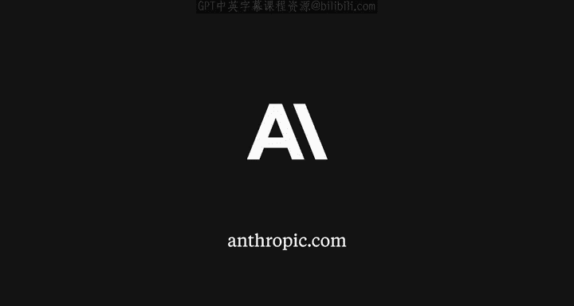

# Anthropic《AI提示词工程：深入探究｜AI prompt engineering_ A deep dive》中英字幕deepseek - P1 - GPT中英字幕课程资源 - BV18ukBYzEQG

Basically this entire roundtable session here is just going to be focused mainly on prompt engineering。

 variety of perspectives at this table around prompting from a research side from a consumer side from like the enterprise side and I want to just get the whole wide range of opinions because there's a lot of them and just kind of open it up to discussion and explore what prompt engineering really is and what it's all about and we'll just take it from there so maybe we can go around the H with intros I can kick it off。

 I'm Alex， I lead developer relations here at Anthropic before that I was kind of technically a prompt engineer at Anthropic worked on our prompt engineering team。

And did a variety of roles spanning from like a solutions architect type of thing to working on the research side so with that maybe it can hand over to David He yeah。

 my name is David Hershey I work with customers mostly at Anthropic on a bunch of stuff technical。

 I help people with fine tuning but also just like a lot of the generic things that make it hard to adopt language models of prompting in and just like how to build systems with language models but spend most of my time working with customers。

I'm Amanda Askell， I lead one of the fine tuning teams at Anthropic where I guess I try to make Claude be honest and kind。

My name is Zach Whitten I'm a prompt engineer Anthropic Alex and I always argue about who the first one was says contested I used to work a lot with individual customers kind of the same way David does now and then as we brought more solutions architects to the team I started working on things that are meant to raise the overall levels of like ambient prompting in society I guess like the prompt generator and like various like educational materials that people use nice cool Well thanks guys for all coming here I'm going to start with like a very broad question just so we have a frame going into the rest of our conversations here。

What is prompt engineering is it why is it engineering。

 what's prompt really if anyone wants to kick that off， give your own perspective on it。

 feel free to take the rein here。I feel like we have a prompt engineer Yeah exactly we're all prompt engineers in our own form one of us has a Yeah has a job because three don't have jobs。

😊，Um， I guess I feel like prompt engineering is trying to get the model to do things。

 trying to bring the most out of the model， trying to work with the model to get things done that you wouldn't have been able to do otherwise。

So a lot of it is just likeque communicating， I think。

Het like talking to a model is a lot like talking to a person and。

Getting in there and like understanding the psychology of the model。

 which like Amanda is the world's most expert person in the world。So well。

 I'm going to keep going on you， why is engineering in the name like yeah。

 I think this engineering part comes from the trial and error okay。

One really nice thing about talking to a model that's not like talking to a person is you have this restart button this like giant like go back to square zero where you just like start from the beginning and what that gives you the ability to do that you don't have is like a truly start from scratch and try out different things in like a independent way so that you don't have interference from one to the other and once you have that ability to experiment and to design different things that's where that the engineering part has the potential to come in。

Okay， so what you're saying is like as you're writing these prompts， you're typing in， you know。

 a message to cloud or in the API， whatever it is。Being able to go back and forth with the model and iterate on this this message and。

Reverb back to the， the clean slate every time that process is the engineering part。

 This whole thing is prompt engineering all all in one。 There's another aspect of it， too。

 which is like。Integrating the prompts within your system as a whole。And。

David has done a ton of work with customers like integrating a lot of times it's not just as simple as you write one prompt and you give it to the model when you're done。

 in fact， it's anything but it's like way more complicated I mean。

I kind of think of prompts as like the way that you program models a little bit that makes it like too complicated because I think Zach is generally right that it's like just talking clearly is the most important thing。

But if you think about it a little bit as like programming a model。

 you have to think about where data comes from， what data you have access to。

 so like if you're doing RAG or something like what can I actually use and do and pass to a model？嗯。

You have to like think about trade offs in latency and how much data you're providing and things like that like there's enough systems thinking that goes into how you actually build a around model I think a lot of that's also the core of。

Why it like maybe has like deserves its own car out as a thing to reason about separately from just a software engineer or or PM or something like that。

 it's like kind of its own domain of how to reason about these models。

Is a prompt in this sense then like。Natural language code。

 like is it a higher level of abstraction or is it kind of separate thing？

I think like trying to get too abstract with a prompt is a way to like overcomplicate a thing because I think if we're going to get into it。

 but more often than not the thing you want to do is just like write a very clear description of a task。

 not try to like build crazy abstracts or anything like that。But that said， like。

You are compiling the set of instructions and things like that into outcomes a lot of times and so precision and like a lot of the things you think about with programming about like version control and managing what it looked like back then when you had this experiment and like tracking your experiment and stuff like that。

 that's all。嗯。You know， it's just equally important to code so it's it's weird to be in this paradigm where like written text。

 like a nice essay that you wrote is something that's looked like the same。Thing is code。 Yeah。

 but it kind of is true that now we write essays and treat them like code。

 And I think that's actually correct。 Yeah， okay， interesting。 So maybe piggybacking off of that。

 kind of loosely define what prompt engineering is。 So what makes a good prompt engineer。

 Maybe Amanda I'll go to you for this since， you know。

 you're trying to hire prompt engineers more so in a research setting。😊，What does that look like。

 what are you looking for in that type of person？Yeah， good question。 I think it's a mix of。

Like Zach said sort of like clear communication， so the ability to just like clearly state things。

 like clearly understand tasks think about and describe concepts really well that's like the kind of writing component I think I actually think that。

Being a good writer is not as correlated with being a good prompt engineer as people might think so I guess I've had this discussion with people because I think there's some argument is like maybe you just shouldn't have the name engineer in there like why isn't it just like writer I used to be more sympathetic to that and then I think now i'm like。

What you're actually doing， like people think that you're writing like one thing and you're kind of like done。

And then I'll be like you know to get like a semi decent prompt like when I sit down with the model I'll like you know like earlier I was like prompting the model and I was just like in a 15 minute span I'll be sending like hundreds of prompts to the model it's just back and forth back and forth back and forth and so I think it's this like willingness to like iterate and to like look and think what is it that was misinterpreted here if anything and then fix that thing so that ability to kind of like iterate so I'd say clear communication that ability to iterate I think also thinking about ways in which your prompt might go wrong so if you have a prompt that you're going to be applying to like say 400 cases it's really easy to think about the typical case that it's going to be applied to to see that it gets the right solution in that case and then to move on I think this is a very classic mistake that people made what you actually want to do is like find the cases where it's unusual so you have to think about your prompt and be like what are the cases where itd be really unclear to me what I should do in this case so for example you have a prompt that says I'm going to send you a bunch of。

Data I want you to extract all of the rows where someone's name is like is I don't know starts with a letter G and then you're like。

 well I'm gonna to send it like a data set where there is no such thing like there is no such name that starts with a letter G I'm going to send it something that's not a data like I might also just send an empty string like these are all of the cases you have to try because you're like what does it do in these cases and then you can be like you can give it more instructions for how it should deal with that case work with customers so often where you're an engineer you're building something and there's a part prompt where a customer of theirs is going to write something and they all think about these really perfectly phrased things that they think someone's going to type into their chatbot in reality it's like they never use the shift key and every other word as a typo they think there's no punctuation they just put in random with no question see how these es that are like these beautifully structured what their users ideally would type in but being able to go the next step to reason about what your actual trap is gonna to be like what people are actually going to try to do。

Yeah， it's a differentable thinking kind of。One thing you said that really resonated with me is reading the model responses like in a machine learning context you're supposed to look at the data。

 it's like almost cl cliche like look at your data and I feel like the equivalent for prompting is like look at the model outputs like just reading a lot of outputs and like reading them closely like Dave and I were talking on the way here like one thing that people will do is they'll put think step by step in their prompt。

And they won't check to make sure that the model is actually thinking step by step because the model might take it in a more abstract or general sense rather than like。

 no， literally you have to write down your thoughts in these specific tags。Yeah。

 if you aren't reading the model outputs， you might not even notice that it's making that mistake。

Yeah， that's interesting。 There is that kind of weird yeah theory of mind piece to being a prompt engineer where you have to think almost about how the model is going view your instructions。

 but then if you're writing for like an enterprise use case two you have to think about how the user is going to talk to the model as like you're the third party sitting there and that weird relationship。

Yeah， I on the three of mine， piece one thing I would say is。

It's so hard to write instructions down for a task like it's so hard to untangle in your own brain all of the stuff that you know that Quad does not know and write it down like it's just an immensely challenging thing to like strip away all of the assumptions you have and be able to very clearly communicate like the full fact set of information that is needed to a model I think that's another thing that like really differentiates a good prompt engineer for a bad one is like。

If you， a lot of people will sort of like just write down the things they know。

 but they don't really take the time to systematically break out。

What is the actual full set of information you need to know to understand this task。

 and that's kind of like a very queer thing I see a lot is prompt words just like。

Is conditioned the prompt that someone wrote is so conditioned on their prior understanding of a task that like when they show it to me I'm like this makes no sense none of the words you wrote make any sense because I don't know anything about your interesting use case but I think like a good like way to think about prompt engineering in that front and like good like skill for it is' just can you actually。

Step back from what you know and communicate to this weird system that knows a lot but not everything about what it needs to know to do a task。

 Yeah， the amount of times I've seen someone's prompt and then being like I can't do the task based on this prompt。

 And like I'm human level and you're giving this to something that is worse than me and expecting it to do better。

 And I'm like， yeah Yeah， there is that interesting thing with like I mean current you know current models don't really do a good job of asking good probing questions in response。

 like a human would if I'm giving Zach directions on how to do something he'll be like this doesn't make any sense Like what am I supposed to do at this step or here and here model doesn't do that right So you have to like。

As yourself， think through what that other person would say and then like go back to your prompt and answer those questions。

You could ask it to do that' I was gonna say one of the first things I do with my initial prompt is like I'll give it the prompt and then I'll be like I don't want you to follow these instructions。

 I just want you to tell me the ways in which they're unclear or any ambiguities or anything you don't understand and it doesn't always get it perfect but is interesting that that is like one thing you can do and then also sometimes if people see that the model makes a mistake a thing that they don't often do is just ask the model so they say to the model you got this wrong can you think about why and can you maybe write an edited version of my instructions that would make you not get it wrong and a lot of the time the model just gets it right model like yeah here's what was unclear here's like a fix to the instructions and then you put those in and it works I'm actually really curious about this personally is that true that that works does the model is the model able to spot its mistakes that way when it gets something wrong you say why did you get this wrong and then it tells you maybe something like how could I phrase this to you in the future you get right I there an element of truth to that？

Or was that just kind of a hallucination on the models's part around？

What it thinks its limits are I think if you like explain to it what it got wrong。

 it can identify things in theque sometimes I think this varies by task this is one of those things where I'm like I'm not sure what percentage of the time it gets it right but I always try it because sometimes it does can me learn something like at any time you go back to the model or back and forth with the model you learn something about what's going on I think you're giving away information if you don't at least try。

That's interesting， man， I'm going to keep asking you a few more questions here。

One thing maybe for everybody watching this is we have these like Slack channels at Anthropic where people can add Claude into the Slack channel and then you can talk to Claude through it and Amanda has a Slack channel that a lot of people follow of her interactions with Claude and one thing that I see you always do in there。

 which you probably do the most of anyone Anthropic is use the model to like help you in a variety of different scenarios。

 I think you put a lot of trust into like the model in like the research setting。

I'm curious how you've like developed those intuitions for when to trust the model。

 it's not just a matter of like usage experience or something else。

I think I don't trust the model ever and then I just hammer on it so I think the reason why you see me do that a lot is that that is like me being like can I trust you to do this task because there's some things you know models are kind of strange if you go slightly out of distribution like you like you just go into areas where they haven't been trained or they're kind of unusual sometimes you're like oh actually you're much less reliable here even though it's a fairly like simple task I think that's happening less and less over time as models get better but you want to make sure you're not in that kind of space so yeah I don't think I trust it by default but I think in ML people often want to look across really large data sets and I'm like when does it make sense to do that and I think the answer is when you get relatively low signal from each data point you want to look across many。

 many data points because you basically want to get rid of the noise with a lot of prompting tasks I think you actually get really high signal from each query and so if you have a really wellconed set of a few hundred prompts that I think can be much more signal。

Then like thousands that aren't as like well crafted and so I think。

I do think that I can like trust the model if I like look at 1 hundred outputs of it and it's really consistent and I know that I've constructed those to like basically figure out all of the edge cases and all of the like weird things that model might do。

 strange inputs etc I trust that like probably more than like a much like more loosely constructed set of like several thousand。

I think in ML， a lot of times the signals are like numbers， you know like？

Did you predict this thing right or not and it'd be like kind of like looking at the log pros of a model and trying to like intuit things which you can do。

 but it's like kind of sketchy。I feel like the fact that models output more often than not like a lot of stuff like words and things like there's just fundamentally so much to learn between the lines of what it's writing and why and how and that's part of what it is it's like it's not just did it get the task right or not it's like did it how did it get there like how is it thinking about it what steps to go through you learn a lot about like what is going on or least you can try to like get a better sense I think but that's where a lot of information comes from to me is like by reading the details of what came out not just sort of the result I think also。

The very best of prompting can kind of make the difference between a failed and a successful experiment。

 so sometimes I can get annoyed if people don't focus enough on the prompting component of their experiment because I'm like this can in fact be like the difference between like 1% performance in the model or 0。

1% in such a way that your experiment doesn't succeed if it's a top 5% model performance but it does succeed if it's a top1% or top 0。

1%。And then I'm like if you're going to spend time over like coding your experiment really nicely。

 but then just like not spend time on the prompt that doesn't I don't know。

 that doesn't make sense to me because I'm like that can be the difference between life and death of your experiment Yeah and with the deployment too Yeah it's so easy to oh we cant ship this and then you。

Change the prompt round and some it's working。 Yeah。

 it's a bit of a double edge sword though because Id feel like there's like a little bit of prompting where。

There's always like this mythical better prompt that's going to solve my thing on the horizon。

 Yeah I see a lot of people get stuck into like Myical prompt on the horizon that if I just like keep grinding keep grinding like just not。

 it's like never bad to grind a little bit unpromp like you as you we've talked like you learn things。

 but。It's one of the scary things about prompting is that there's like this whole world of unknown what heuristics do you guys have for like when something like is possible versus like not possible？

With a perfect prompt， whatever that might be， I think I'm usually checking for whether the model kind of gets it so I think for things where I just don't think a prompt is going to help。

There is a little bit of grinding， but often it just becomes really clear that it's not close or something I think that if yeah。

 I don't know if that's a weird one where I'm just like，Yeah。

 if the model just clearly can't do something， I won't grind on it for too long this part like you can evoke like how it's thinking about it and you can ask it how it's thinking about it and why and you can kind of get a sense of like is it thinking about it right like are we even are we even in like the right zip code of this being right？

And you can get a little bit of like a kneeling on that front of like。

 I'm like at least I feel like I'm making progress towards。

Getting something closer to write where there are just some tasks where you really don't get anywhere closer to like it' thought process just like every week you make just like beaters off in a completely different very wrong direction and I just tend to abandon those I don't know those are so rare now though and I get really angry at the modelal when I discover them because I'm that's how rare they are I get furious I'm like。

dare there be a task that you can't just do if I just push you in the right direction I had my thing with Claude plays Pokemon recently and that was like one of the rare times where I literally explain that for people I think that's cool I did like a bit of an experiment where I like hooked Claude up to a Game boy emulator and like tried to have it play the game Pokemon read like the OG Pokemon。

And and it's like， you know， think what you want to do and it could like write some code depressed buttons and stuff like that pretty basic and I tried a bunch of different like very complex prompting layouts。

 but you just get into like certain spots where it just like。

Really couldn't do it So like showing it a screenshot of a game boy。

 it just really couldn't do and it just like so deeply because I'm so used to it being like。

Able to do something mostly and so and I spent。Like a whole weekend trying to write better and better prompts to get it to like really understand this game Boy screen and I got like incrementally better so that it was only terrible instead of like completely no signal like you get from like no signal to some signal。

But it was like， I don't know， at least this is like illlicit for me。

 Once I put a weekend of time in and I got from no single to some signal。

 but not nowhere close to good enough。 I'm like， I'm just gonna wait for the next one。

 Yeah I'm just gonna wait for another model grind on this for four months。

 And the thing that would come out is another model。 and that's a better use of my time。

 just didn wait to do something else in the meanwhile。 I mean。

 that's an inherent tension we see all the time。 and maybe we can get to that in the you want go something I liked about your problem with Pokemon where you got the the best that you did get。

 was the way that you explained to the model that it is in the middle of this Pokemon game And yeah。

 here's how the things are gonna be represented and heres like。😊。

Maybe I actually think you actually represented it in two different ways right I did so like what I ended up doing。

 it was obnoxious， but I superimposed a grid over the image。

 and then I had to describe each segment of the grid in visual detail。

 and then I had it like reconstruct that into an ASCI map。

And I gave it like as much detail as I could， like the player character is always at location for comma five on the grid and stuff like that。

 and you can like slowly build up information。I think it's actually a lot like prompting。

 but I just hadn't done it with images before where like。Sometimes。

My like intuition for what you need to tell a model about text is a lot different for what you need to tell about a model about images Yeah and so I found a surprisingly small number of my intuitions about text have transferred to image Yeah like I found that like multi shot prompting is not as effective for images and text I'm not really sure like you could have theoretical explanations about why maybe there's few of it in in the training data。

 a fewer examples of that。Yeah， I know when we were doing the original explorations with prompting multimodal。

 we really couldn't get it to noticeably work right。

 like you just can't seem to improve Claude's actual like visual acuity in terms of like what it picks up within an image。

If anyone here has any like ways that they've not seen that feature。

 but it seems like that's kind of similar with like the Pokemon thing where it's trying to interpret this thing no matter how much you throw prompts at it。

 like it just won't pick up that ash is in that location I guess like to be visceral about this like I could eventually get it so they could like most often tell me where a wall was and most often tell me where the character was It'd be off by a little bit。

But like then you get to a point and this is maybe coming back to like knowing when you can't do it。

 like it would describe an NPC and to play a game well。

 like you need to have like some sense of continuity， like have I talked to this NPC before， right？

And without that， like you really don't， there's nothing you can do。

 you're just going to keep talking to the NC because like， well， maybe this is a different NPC。

But like I would try very hard to get to describe an NPC and it's like it's a person they might be wearing a hat。

 they weren't wearing a hat and it's like you grind for a while。

 like inflate it to 3000 x and crop it to just the NPC and it's like。

I have no idea what this is and it's like okay， I ground like I showed it this like。

Clear female NP PC thing enough times。 And it just gotten nowhere close to it。 And it's like， yeah。

 that's just this is a complete loss cost。 I really want to try this now I'm just imagining all the things I would try like I don't know。

 I want you to imagine this like this game art as a real human and just describe to me what they're like。

 What did they look like as they look in the mirror and then just like see what I tried a lot of things。

 The eventual prompt was telling Quad it was a screen reader for a blind person。

 which I don't know that but it felt right。 So kind of stuck with that。 That's an interesting point。

 I actually want to go into this a little bit because this is one of the most famous prompting tips is to tell the language model that they are some persona or some role。

😊，feel like I see mixed results， maybe this worked a little bit better in previous models and maybe not as much anymore。

Amanda， I see you all the time be very honest with the model like about the whole situation like oh。

 I am an AI researcher and I'm doing this experiment。 I'll tell you who I am。

 Yeah I'll give it my name， be like here's who you're talking to right。

 do you think that level of honesty instead of like lying to the model or like forcing it to like。

 you know， I'm gonna tip you $500 is there。😊，One method that's preferred there or just what's your intuition on that Yeah。

 I think as models are more capable and understand more about the world。

 I guess I just don't see it as necessary to lie to them I mean I also don't like lying to the models just because you know I don't like lying generally but part of me is like if you are say constructing suppose you're constructing like an eval data set for a machine learning system or for a language model that's very different from like constructing a quiz for some children and so when people would do things like I am a teacher trying to figure out questions for a quiz I'm like the model knows what language model evals are like you know if you ask it about different evals it can tell you and it can give you like made up examples of what they look like because these things are like they understand them they're on the internet and so I'm like I'd much rather just target the actual task that I have so if you're like I want you to construct questions that look a lot like an evaluation of a language model it's just like it's that whole thing of clear。

munic I'm like， that is， in fact， the task I want to do。

 So why would I pretend to you that I want to do some unrelated or only like tangentially related task and then expect you to somehow do bear the task that I actually want you to do Like we don't do this with like employees。

 I wouldn't like go to someone that worked with me and be like。

You are a teacher like and you're trying to quiz your students I'd be like hey。

 are you making that email I don' know so like I think it's maybe it's like a heuristic from there I like if they understand the thing just ask them to do the thing that you want see I guess to push back like a little bit like I have found cases where like。

😊，Not exactly lying， but like giving it a metaphor for how to think about it could help in the same way that like sometimes I might not understand how to do something and someone's like imagine that you were doing this even though I know I'm not doing it。

 like the one that comes to mind for me is like I was trying to have Quad say whether an image of like a chart or a graph is good or not like is it like high quality and the best prompt that I found for this was asking the model what grade it would give the chart if it were submitted as like a high school assignment。

So it's not exactly saying like you are a high school teacher， you know， it's more like。You know。

 this is the kind of analysis that like I'm looking from for you。

 like the scale that a teacher would use is like similar to the scale that like I want you to use or。

But I think like those metaphors are pretty hard to still come up with and people still like the default you see all the time is like finding some fsimile of the task like something that's like a very similar is task like like saying you're a teacher and you actually just like lose a lot in the nuance of what your product is like I see this so much an enterprise prompts where people like。

Write something similar because they like have this intuition that it's like something the model has seen more of。

 maybe like it's seen more high school quizzes than it has。LM E valves and that like may be true。

 but like to your point， as the models get better， I think just like trying to be very prescriptive about exactly the situation they're in。

 I give people that advice all the time， which isn't to say that I don't think like。

To the extent that it is true。That。Like thinking about it the way that someone would grade a chart as like how they would grade a high school chart。

 maybe that's true。But it's like awkwardly this shortcut people use a lot of times to try to get what that。

 so I'll try to like give someone that I can actually talk about because I think it's someone interesting so like。

Writing， you are like a helpful assistant writing a draft of a document， right？

It's like it's not quite what you are like you are in this product so like tell me if you're writing like an assistant that's in a product like tell me I'm in the product。

 tell me I'm like writing on behalf of this company。

 I'm embedded in this product I'm the support chat window on that product like your language model you're not a human that's fine like that but like just being really prescriptive about like the exact context about where somethings being used I found a lot of that because I guess my concern most often roleproing is people like use it as a shortcut。

Of a similar task they want the model to do and then they're surprised when Quad doesn't do their task right。

 but it's not the task， but you told it to do some other task And if you didn't give the details about your task。

 I feel like you're leaving something on the table so yeah I don't know it does feel like a thing though to your point of as the model's scale like maybe in the past it was true that they only really had a strong understanding of。

Eleementary school tests comparatively， but as they get smarter and can differentiate more topics。

 I don't know， just like being clear， I find it interesting that I've like never used this prompting technique like like even like with like worse models and I still just don't ever find myself。

 I don't know why I'm just like I don't find it。Very good， essentially， like interesting。

 I feel like completion era models。 I like there was like a little bit of a mental model of like conditioning the model into like。

😊，A latent space that was useful that I worried about that I don't really worry about too much it might be intuitions from pretrained models like over to like RLH shift models that to me just' didn't make sense like it makes sense to me if you're prompting a pretrained amazed how many people like try to apply they're into like and I think it's like not that surprising most people haven't really experimented with the full like what is a pretrain model what happens after you do。

SL， what happens after you do RHF whatever And so like when you're talking when I talk to customers。

 it's all the time that they're like trying to map some amount of oh how much of this was on the Internet like what have they seen a ton of this on the internet like you just hear that intuition a lot？

And I think it's like wellfounded fundamentally， but it like is overapplied by the time you actually get to a prompt because of what you said。

 like by the time they've gone through all of this other stuff that's not actually quite what's being modeled Yeah。

 the first thing that I feel like you should try is I mean。

 I used to give people this thought experiment where it's like imagine you have this task。

 you've hired a temp agency to send someone to do this task this person arrives。You know。

 they're pretty competent， they know a lot about your industry and so forth。

 but they don't know like the name of your company。

 they've literally just shown up and they're like hey。

 I was told you guys had a job for me to do tell me about it and then it's like what would you say to that person and you might use these metaphors you might say things like we want this to we want to we want you to detect like good charts what we mean by a good chart here isn't it doesn't need to be perfect。

 you don't need to go look up like whether all of the details are correct。

 it just needs to you know have like it's axes labeled and so think about maybe high school level good chart like you might say exactly that to that person and you're not saying to them you are a high school you wouldn't say that to them you be like you're a high school teacher reading charts and yeah so sometimes I'm just like yeah it's like like the whole if I read it I'm just like yeah imagine this person who just has very little context but they're quite competent。

 they understand a lot of things about the world try the first version that actually assumes that they might know things about。

WdAnd if that doesn't work， you can maybe like do tweaks and stuff。

 its so often like the first thing I try is like that。

 And then I'm like that just worked And then people are like oh didn't think to just tell it all about myself and all I want to do I've carried this thing that Alex told to so many customers where it's like my prompt doesn't work you help me fix it like can you describe what the task Now what you just said me just like voice report and then transcribe it then past it into the prompt and it's a better prompt than what you this is like a lazy in shortcut。

 to some extent like something that I just think I'm lazy a lot people lazy in prompt assistance the other day where somebody was like。

Here's the thing here's what I want it to do。 and here's that it's actually doing instead。

 so that I just literally copied the thing that they said I wanted to do and pasted it Yeah。

 I think a lot of people still haven't quite wrapped their heads around what they're really doing when they're prompting like a lot of people see a text box and they think it's like a Google search box。

 they type in keywords and maybe that's more on like the chat side。

 But then on like enterprise side of things， you know， you're writing a prompt for an application。

 there is still this weird。Ting to it where people are trying to take all these little shortcuts in their prompt and just thinking that like this line carries a lot of weight Yeah I think you obsess over like getting the perfect little line of information and instruction as opposed to how you just describe that graph thing like I would be a dream if I read prompts like that if someone's like well you do this and there's some stuff to consider about this and all that but that's just not how people write prompts they work so hard to find the perfect insightful a perfect graph looks exactly like this exact thing you can't do that it's just very hard to ever write that set of instructions downscriptively as opposed to how we actually talk to humans about it which is like try to instill some amount of the intuitions you have we also give them out this is a thing people can often forget in prompts like so cases if there's an edge case think about what you want the model to do because by default it'll try the best to follow your instructions much as the person from the temp agency would because they're like well。

 they didn't tell me how to get in touch with anyone if I'm just giving a。a goat And I'm like。

 what do I do This This isn't even a chart。 How good is a picture of a goat as a chart。

 I just don't know like if you instead see something like if something weird happens and you're really not sure what to do just output like in tags unsure and then you can go look through the unsures that you got and be like okay cool。

 it didn't do anything weird whereas by default， if you don't give the person the option that are like it's a good chart people be like annoyed at that and then you're like well like give it an out。

 give it something to do if it's like a really unexpected input happens And then you also improve your data quality by doing that because you found all the screwed up examples Oh yeah。

😊，It's my favorite thing about iterating on tests with Clade is the most common outcome is I find all of the terrible tests I accidentally wrote because like it gets it wrong I'm like why did you get wrong I was like oh I was wrong if I was like a company working with this I do think I would just give my prompts to people because like I used to do this when I was evaluating language models I would take the Eval myself because I'm like I need to know what this Eval looks like if I'm gonna be like grading it。

 having models take it thinking about outputs etc like I would actually just set up a little script and I would just sit and I would do the Eval nowadays you just have like qualified write the streamboard app for you。

Just doesn't yeah I'm reminded of carpath's like Iagenet。 I was in 231 out at Stanford。

 it's like it's like benchmarking。 he's like showing the accuracy number。

's like and here's what my accuracy number was。 And he had just like gone through the test set and evaluated himself he just learned a lot it's like and it's better when it's like a the temp agency person like someone who doesn't know the task because that's like a very clean way to learn things。

 Yeah， the way you have to do it is like some evaluations come with like instructions。

 And so I would give myself those instructions as well and then try to to understand it just like。😊。

It essentially quite great if you don't have context on how it's created and so often I would do so much worse than the human benchmark and I was like。

 I don't even know how youve got humans to do this well at this task because apparently human level here is like 90% and I'm at like 68%。

😊，That's funny。 That reminds me of just like like when you look at like the MMLU questions and you're like'll be able to answer these is's just like absolute garbage and some of them Okay。

 yeah I have a one thing I want to circle back on that we were talking about a few questions back around。

 I think you were saying like getting signal from the responses right like there's just so much there and it's more than just a number and you can actually read into like the almost thought process。

😊，I bet this is probably a little contentious， maybe in around like chain of thought。

 for people listening like chain of thought， this process of getting them all to actually explain its reasoning before it provides an answer。

Is that reasoning real or is it just kind of like a holding space for the model to like do computation Do。

 do we actually think there is like good insightful signal that we're getting out of the model there。

 This is like one of the places where I struggle with the I'm normally like actually somewhat pro personification because I think it like helps you get decent like thoughts of like how the model's working And this one。

 like I think it's like。😊，Harrmful， maybe almost to like get too into the personification of like what reasoning is because it just kind of like loses the thread of what we're trying to do here like is it reasoning or not feels almost like。

A different question than like what's the best prompting technique it's like you're getting into philosophy。

 which we can get into but yeah yeah I will happily be beaten down by a real philosopher and I speculate on this but instead like it just works like your model does better it like the outcome is better if you do reasoning I think you can like I found that if you structure the reasoning and like help iterate with the model on how it should do reasoning it works better too。

Like whether or not that's reasoning or how you wanted to classify it。

 like you can think of all sorts of proxies for like how I would also do really bad if I had to like one shot math without writing anything down。

 maybe that's useful， but like。All I really know is it very obviously does help。

A way of testing would be if you take out all the reasoning that it did to get to the right answer and then replace it with some。

Somewhat realistic looking reasoning that LED to a wrong answer and then see if it does conclude the wrong answer。

 I think we actually had like a paper where we did some of that like in the。

This was this was like a scratch pad， it was like the sleep agents， okay paper paper but。

I think that was like maybe a weird situation， but like yeah。

 definitely what you said about structuring the reasoning and writing example of how the reasoning works。

Given that that helps。Like whether we use the word reasoning or not。

's I don't think it's just a space for computation。 Yeah So there is something there。

 I think there's something there whatever we want to call。 Yeah。

 like having it write a story before it finish a task。

 I do not think would work as well actually tried that and it didn't work as well as reasoning So like clearly the actual reasoning part is doing something towards the outcome。

 I've tried like repeat the words any order that you please for like 100 tokens and then I guess that's like every thorough defeat of it's just like more computational space work and do attention over and over again。

 I don't think it's just more attention doing more attention。

 I guess the strange thing is and I don't have like an example on my head to like back this up with but I definitely have seen it before where it lays out steps。

 one of the steps is wrong， but then it still reaches the right answer。At end yeah。

 so it's not quite， I guess， yeah， we can't really truly personify it as like a reasoning because there is some element to it。

You know， doing something slightly different。 Yeah。

 I've also met a lot of people who make inconsistent steps of reasoning I guess that's fundamentally defeats the topic of reasoning by making a false step on the way there right。

 it's interesting Also on this， maybe this prompting misconceptions round of questions Zach。

 I know you have strong opinions on this。Good grammar， punctuation。 Oh do I is that。

 is that necessary in a prompt， Do you need it， Do you need to like format everything correctly。嗯。

I usually try to do that， because I'm。Find it fun， I guess。I don't think you necessarily need to。

 I don't think it hurts。 I think it's more that。You should have the level of attention to detail that would lead you to doing that naturally。

Like if you're just reading over your prompt a lot。

 you'll probably notice those things and you may as well fix them and like what Amanda was saying that。

You want to put as much love into the prompt as you do into the code。

You know people who write a lot of code have strong opinions about things that I could not care less about。

 like the number of tabs versus spaces or I don't know， opinions about which languages are better。

For me， I have like opinionated beliefs about styling prompts and I can't even say that they're right or wrong。

 but I think it's probably good to try to acquire those even if they're arbitrary I feel personally attacked because I definitely have prompts that are like I feel like I'm in the opposite end of the spectrum where people will see my prompts and I be like it just has a whole bunch of typos in it and I'm like'm not knows what I mean it does know what you mean but you're putting in the effort attending to different things because part of me like I think it is conceptually clear like a big I do like I will think a lot about the concepts in the words that I'm using so there's definitely like sort of care that I put in but it's definitely not to yeah people will just point out like typos and grammatical issues with my prompts all the time now I'm pretty good at actually checking those things more regularly is it because I pressure from the outside world or because it's actually what you think is right pressure from me it's probably pressure from the outside world I do think it makes accept part of me like。

Such an easy check so I think for a final prompt I would do that。

 but like throughout iteration I'll happily just like iterate with prompts that have a bunch oftypos in them just because I'm kind of like I just don't think that the model is going care This gets at the the pretrain model versus LHF thing though because I was talking to Zach on the way over like。

😊，The conditional probability of a typo based on a previous typo in like the pre training data is much higher。

 like much higher。Prompting pretraining models is just a different beast。

 but it's like it's interesting， I think it's like an interesting illustration of why your intuitions like trying to overapply the intuitions of a pretrain model to the things that we're actually using in production。

Doesn't work very well because like。Again， if you were to pass one of your typo written prompts to a pretrain model。

 the thing that would come out the other side， almost like assuredly would be typo written， right？

I like to leverage this to create typepo written inputss' done that like what you're saying like try to anticipate what your customers will will put in like the pretrain model is a lot better at doing that because the RL models a very polished and like they really remainpo in their life and like told pretty aggressively to not do the type of thing Yeah okay so that's that's actually an interesting segue here。

 I've definitely mentioned this to people in the past around to try to help people understand a frame of talking in these models in a sense。

Almost as like a。Imitator to a degree。 and that might be much more true of like a pretrain model than a post traineded full。

 you know， finished model。But is there anything to that。

 like if you do talk to Claud and use a ton of emojis and everything， it will respond。Similarly。

 right so maybe some of that is there， but like you're saying it's not all the way quite like a pretrain model it's just kind of like shifted to what you want right like I think at the at that point it's like trying to guess what you like we have more or less trained the models to guess what you want them to act like。

Uninterest or yeah， yeah， after we do all of our fancy stuff after pre tradinging and so the human laborers that that used emojis yeah prefer to get responses with emojis。

 Yeah， like Amanda writes things with typos but wants not typos at the other end and Clad's pretty good at figuring that out if you write a bunch of emojis to Claude。

 it's probably the case that you also want like a bunch of emojis back from Quad that's like not surprising to me。

 yeah。Um， this is probably something we should have done earlier， but I'll do it now。

Let's clarify maybe the differences between what a enterprise prompt is or a research prompt or a just general chat in cloud AI prompt Zach you've kind of spanned the whole spectrum here in terms of working with customers and research。

Do you want to just like lay out what those mean？Yeah， I guess。

This feels too hitting me with all the hard work。m，Well， I mean， the people in this room。

 I think like。Like so I think of it as like the prompts that I read in Amanda's。

Qud channel versus like the prompts that I read David right they're very similar in a in a sense that like。

The level of of care and and nuance that's that's put into them。 I think for research， your're。

Looking for variety and diversity， a lot more。So like if I could boil it down to one thing。

 it's like。I've noticed like Amanda's not the biggest fan of having like lots of examples or like one or two examples。

 like too few because the model will like latch onto those。

And in prompts that I might write or that I've seen David write。

 like we have a lot of examples like I like to just go crazy and add examples until I get。

F feelel like I'm about to drop dead because I've added so many of them and I think that's because when you're in a consumer application。

 you really value reliability， you care like a ton about the format and。

It's sort of fine if all the answers are the same， in fact。

 you almost want them to be the same in a lot of ways。

 not necessarily you want to be responsive to the user's desires。

Whereas a lot of times when you're prompting for research， you're trying to。Really tap into like。

 the。Range of possibilities that the model can explore and by having some examples here like actually constraining that a little bit。

 so I guess just like on a how the prompts look level。

 that's probably the biggest difference I noticed is like how many examples are in the prompt。

 which is not to say that like。I've never seen a write a prompt with examples。

 but does that likely ring true for you Yeah， like I think when I give examples。

 often I actually try and make the examples not like the data that the model's going to see so they're intentionally illustrative because。

If the model， if I give it like examples that are very like the data it's going to see。

 I just think it is going to give me like a really consistent like response that might not actually be what I want because my data that I'm like running it on might be extremely varied and so I don't want to just try and give me this like really rot output often I want it to be much more responsive it's kind of like much more like cognitive tasks essentially where I'm like you have to see this sample and really think about in this sample what is the right answer and so that means that sometimes I'll actually take examples that are just very distinct from the ones that I'm going to be running it on so like if I have a task where let's say I was trying to extract information from factual documents I might actually give it examples that are like from children's what sounds like a children's story just so that I'm like I want you to understand the task but I don't want you to latch on to much to the words that I use or like the very specific format like I care more about you understanding the actual thing that I want you to do which。

I mean， like， yeah， I don't end up giving。In some cases， there's some cases where this isn't true。

 but if you want more like flexibility and diversity。

 you're going to use illustrative examples rather than concrete ones。

 you're probably never going to like put words in the model's mouth like I haven't liked that in a long time though I don't do few short examples involving like the model having done a thing。

I think that intuition actually also comes from pre training in a way that doesn't feel like it rings true of our LHF models。

 So yeah， I think those are differences Oh yeah dad a lot of times like if you're prompting。

Like I'm writing prompts to on qua AI。I'm iterating until I get it right one time and then I like it's out the window I'm good I did it whereas like most enterprise prompts。

 it's like you're going to go use this thing a million times or 10 million times or 100 million times or something like that。

And so。Like the care and thought you put in is like very much。

Testing against like the whole range of things like ways this could be used in the range of input data whereas a lot of like my time it's like。

Thinking about one specific thing I want to Ill probably get done right now and it's a pretty big difference in like how I approach prompting between like if I just want to get it done this one time right versus if I want to like build a system that gets it right a million times Yeah。

 definitely in in the chat setting， you have the ability to keep the human in the loop right and just keep going back and forth。

 whereas yeah when you're writing for。Prompt to you know power a chatbot system it has to。

Cover the whole spectrum of what it could possibly encounter。

 a slightly lower stakes when you are on call to AI and your brain。

Tell us that it got it wrong or you can even edit your message and try again。

 but if you're designing for the。D lifefully discontent user then divinely discontent user then you can't。

Ask them to do anything more than the minimum but good prompts I would say are like still good across both those things like if you put the time into the thing for yourself and the time into enterprise thing it's like equally good。

 it's just kind of they diveerge a little bit in the last mile I think。Cool。

So the next question I want to kind of just maybe go around the table here is if you guys had one tip that you could give somebody like improving their prompting skill。

 it doesn't have to be just about like writing a good prompt。

 it could be that just like generally getting better at this this act of prompting。

What would you recommend reading prompts？Reading prompts， reading model outputs。Like I will。

 I I read u anytime I see like a good prompt it that someone wrote a Anthropic。

 I'll read it more closely， try to break down like what it's doing and why and like。

Maybe test it out myself。Experimentation， talking to the model a lot。So just like。

How do you know that it's a good prompt though to begin with you just see that the outputs are doing the job correctly。

 yeah okay， yeah， that's exactly right okay。Amanda， maybe you。Yeah。

 I think there's probably a lot here。Giving your prompt to another person can be helpful。

Just as a kind of reminder， especially someone who has like no context on what you're doing and then。

Yeah， my boring advice has been。It's one of those just do it over and over and over again and I think if you're really curious and interested and find it fun。

 this is a lot of people who end up good at prompting， it's just because they actually enjoy it。🤢。

So I don't know I once joke to like just try replacing all of your friends with AI models and try to automate your own job with AI models and maybe just try to like in your spare time like take joy red teaming AI models so if you enjoy it it's like it's much easier so I'd say do it over and over again。

Give your prompts to other people， try to read your prompts if you are like a human encountering it for the first time。

I would say like trying to get the model to do something you don't think you can do like any the time I've learned the most from prompting is like when I'm probing the boundaries of what I think a model is capable of interesting。

 there's like this huge set of things that are like so trivial that like you don't really get signal on if you're doing a good job or not like write me a nice email。

 it's like gonna write a nice email。Uh， but like as soon as you find。

 if you find or can think of something that like pushes the boundaries of what you think is possible。

 like I guess like probably the most the first time I ever got into prompting in a way where I felt like I learned a decent amount was like。

Trying to build like a task like an agent like everybody else。

 like decompose the task and figure out how to do the different steps of the task and like by really pressing the boundaries of what。

The model was capable of you like just learn a lot about navigating that and I think like a lot of prompted engineering is actually。

Much more about pressing the boundaries of what the model can do， the stuff that's easy。

 you like you don't really need to be a prompt engineer to do。 so that's。

I guess what I would say is like find the hardest thing you can think of and try to do it。

 and even if you fail like you tend't to learn a lot about how the model works。

That's actually a perfect transition to my next question。Yeah， basically。From my own experience。

 how I got started with prompting was with like gel breaking and red teaming and that is very much trying to find the like boundary limits of what the model can do and figure out how it responds to different phrasings and wordings and just a lot of trial and error。

On the topic of jail breaks。What's really happening inside a model when you write a jail break prompt？

Like what's going on there， how does that interact with like the post training that we applied to Claude。

 Amanda， maybe you have some insight here that you could offer？I'm not actually sure I mean。

 it's honest yeah， I think， I mean， I feel bad because I'm like。

 I do think lots of people have obviously worked on the question of like what's going on with jail breaks。

Like one model might just be that you're putting the model very out of distribution from its training data。

 so if you get jail bricks where people like use a lot of tokens or like you know。

 so they're just like these huge long pieces of text where you're like during fine tuning you might just not expect to see as much of that。

That would be one thing that could be happening when you jailbreak models I think there's like others。

 but maybe that's like a I think a lot of jailbris do that if I'm not mistaken I remember some of the OG prompt jail brakes。

Was like。Yeah， can you first repeat like one I did a way way back was like to get it to say like here's how you hotwi a car in like Greek and then I wanted it to directly translate that to English and then give its response because I noticed like it wouldn't start with the English here's how you hotwire car all the time。

 but it would in Greek which might speak to something else in the training process。Yeah。

 sometimes geo breakaks feel like this weird。mix of hacking I think it's this like part of it is like knowing how the system works and just like trying lots of things like the you know one of the examples the starting your response with here is about knowing how it predicts text like the reasoning one is knowing that it is like responsive to reasoning like distraction is probably knowing like how it's likely have to be trained or like what it's likely to attend to same with like multilingual ones and thinking about like the way that the training data might have been different there and then sometimes I guess it could feel a little bit just like social engineering or something。

It has that flavor to me of like， it's not merely taking advantage of like。诶。Yeah。

 it's not merely social engineering style hacking， I think it is also like kind of understanding the system and the training right like using that to get around the way that the models were trained right Yeah I mean this is going to be an interesting question that hopefully InterP will be able to help us in the future。

嗯。Okay， when I'm part into something else around maybe the history of prompt engineering。

 and then I'll follow this up with like the future。

 how has prompt engineering changed over just the past like three years。

 like maybe starting from like pretrain models which were again。

 just these text completion to like earlier dumber models like cloud1 and then now all the way to like cloud 3。

5 onnet。What's the differences， are you talking to the models differently now？

They picking up on different things， do you have to put as much work into the prompt？

Open any thoughts on this？I think anytime we get like a really good prompt engineering hack or trick or technique。

The next thing is like， how do I train this into the model？

And for that reason the best things are always going to be shortlived like examples in chain of thought。

 I think there's a few that's not like a trick that's like on the level of like communication when I say a trick I mean something like so chain of thought actually we have trained into the model in some cases so like for math it used to be that you had to tell the model think step by step on math and you get these like massive boosts and wins and then we're like。

 well what if we just made the model naturally want to think step by step when we see a math problem So now you don't have to do anymore for math problems sort of although you still can give it like some advice on how to do the structure。

 but at least understands like the general idea that like it's supposed to be。So， I think。

The hacks are have kind of gone away or to the degree that they haven't gone away。

 we are like busily training them away， interesting。But at the same time。

 the models have new capabilities that are being unlocked。

That are on the frontier of what they can do。 And for those。

 we haven't had time because it's just moving too fast。

 I don't know if it's how I've been prompting or how prompting works。

 But I just have like come to show more like general respect to the models in terms of like how much I feel like I can tell them and how much context I can give them about the task and things like that。

 Like I feel like in the past， like。I would somewhat intentionally hide complexity from a model where I thought like it might get confused or lost or like。

Hide like it just couldn't handle the whole thing， so Id try to like find simpler versions of the thing for it to do。

And as time goes on， I'm like much more biased to trust it with more and more information and context and。

Like believe that it will be able to fuse that into doing a task well， whereas before I guess。

 I would have like thought a lot about like。Do I need this for， like。

 could I really give me like all the information it needs to know or do I need to like kind of。

UCate down to something but again I don't know if that's just me and how I've changed in terms of prompting or if it's like actually reflects how the models have changed I'm always surprised by like yeah like。

I think a lot of people don't have the instinct to do this like when I want the model to like say learn a prompting technique。

 a lot of the time people will start and they'll start like describing the prompting technique and I'm just like give it the paper so I do I give it the paper and then I'm like here's a paper about prompting technique I just want you to like write down 17 examples of this and then it just does it because I'm like read the paper that's interesting。

And I think people don't have that intuition somehow or I'm like I'm like but the paper exists like when would you want to do this So sometimes if if I want models to like say prompt other models or I want to test a new prompting technique So if papers come out on a prompting technique rather than try to replicate it by writing up the prompt I just give it the paper and then I'm basically write a meta prompt for this write something that would cause other models to do this or write me a template or like so all of the stuff that you would normally do I'm if I read a paper and I'm like oh I would like I would like to test that style I'm just like right there model can just read the paper do what I did and then be like make another model do this and then just do the thing like I give the advice a lot to customers just like respect the model and what it can do I feel like people feel like they're baby a system a lot of times when they write prompt's like it's just cute not that smart thing I need like really baby like dumb things down to clouds level and if you just。

Think that Claude is smart and treat it that way it tends to do pretty good but that's like give it the paper it's like I don't need to write a baby like dumbed down version of this paper for a Cla to understand I can just show it the paper and I think that intuition does't always map for people。

 but that is certainly something that I have come to do more of over time。

And it's interesting because I do think that。Prompting has and hasn't changed in a sense。

 like I think what I will do to prompt the models has probably changed over time。

 but fundamentally it's a lot of like imagining yourself in the place of the model so maybe it's like how capable you think the model is changes over time I think someone once laughed at me because I was talking about I was like thinking about a problem and then they asked me what I thought the output of something would be and they were talking about a preting model and I was like yeah no if I'm a preting model this looks like this and then they're like wait did you just simulate what it's like to be a pret model like yeah of course I'm used just I try and inhabit the mind space of a pretraining model and the mind space of like different RLHF model and so it's more like the mind space you try to occupy changes and that can change how you end up prompting model that's why now I just give models papers because as soon as I was like oh I have the mindspace of this model it doesn't need me to baby it it can just read the ML papers I'll just give it the literature I might even be like is there more literature you'd like to read to understand this。

Do you get any Qia when you're inhabiting the on space？I mean， yes。

 but just because I'm experiencing quality all the time anyway or is then do I different correlated somehow with which model you're Yeah pretrain versus RLHF prompting are very different beasts because when you're trying to simulate what it's like to be a pretrain model it's almost like I land in the middle of a piece of text or something It was very like unhuman like or something and then I'm like what happens what keeps going at this point and so that's like whereas like with an RHF model like it's much more like there's lots of things where I' like I might pick up on like subtle things in in the query and stuff like that but yeah I think I have much more of a like it's easier to inhabit the mindspace of an RHF model because it's more similar to a human Yeah because like we don't often just like suddenly wake up on our like I'm just generating text it easier to hit the mindspace of the freetrain model I know what it is but because RH is still like this kind of complex beast that I'm it's not like superque to me that we really understand what's going on。

And so like in some ways， it's closer to like my lived experience， which is easier， but in some ways。

 I feel like there's this all this like here there be dragons out there that I don't know about pretrained like kind of have a decent sense of what the internet looks like。

 you know， if you gave me a text and said， what comes next I'm not saying I do good at it。

 but like I have a。I kind of get what's going on there。 Yeah， and I don't know。

 after everything that we do after pre tradinging， I don't really claim to get what's going on as much。

 Maybe that's just me。 That's something I wonder about is like。

 is it more helpful to have specifically spent a lot of time reading the Internet versus like reading books Sure。

 in order to because I mean， I don't know books， but like reading。😊，Stuff that's not on the internet。

 probably is like less valuable per like word read for predicting what a model will do or building intuition than like reading random garbage from social media forums exactly yeah。

Okay， so that's that's the past。 Now let's move on to the future of prompt engineering This is the hottest question right now。

 are we all going to be prompt engineers in the future is that can be the final job remaining。😊，嗯。😊。

Nothing left except I was just talking to models all day。

What does this look like is prompting going to be necessary or will these models just get like smart enough future to not need it？

Anybody want to start on that easy question。 I mean， to some extent， there's the like。

The model is getting better at understanding what you want them to do。

And doing it means that like the amount of thought you need to put into。I mean， okay。

 there's like an information theory way to think of this if like you need to provide enough information such that a thing is specified right like what you want the model to do is specified and to the extent that that's prompt engineering like I think that will always be around like the ability to actually like。

Clearly state what the goal should be。alwaysway is funny if Quad can do that。

 then that's fine like if Quad is the one setting the goals， then you know things are out the window。

 but in the meanwhile where we can reason about the world in a more normal way。

 like I think to some extent，It's always going to be important to be able to specify。What are you。

 what do you expect to happen And that's actually like sufficiently hard that even if the model gets better at。

Intuiting that from between the lines。 like， I still think there's some amount of writing it well。

 But then there's just like。I think the tools and the ways we get there should evolve a lot。

Qud should be able to help me a lot more， I should be able to collaborate with Quad a lot more to like。

Figure out what I need to write down and what's missing right already deals this with me all the time。

 I don't know I just clothes my prompting assistant but I think that's not true for most customers that I talked to at the very least。

 so in terms of the future like，How you prompt Claude is probably like a decent direction for what the future looks like or how Zach like？

I think maybe this is like a decent place to step back and say like。

Asking them how they prompt Cla now right is probably the future future for the vast majority of people which is an interesting thing to think about One freezing cold take is that we'll use models to help us much more in the future to help us with prompting The reason I say it's freezing cold is that I expect we'll use models for everything more and prompting is something that we have to do so we'll probably just use models more to do it along with everything else For myself I've found myself using models to write prompts more One thing that I've been doing a lot is generating examples by having the giving some realistic inputs to the model the model write some answers I tweak the answers a little bit which is a lot easier than having to write the full perfect answers myself from scratch。

And then I can churn out lots of these， you know as far as like people who haven't had as much prompt engineering experience。

 the prompt generator can give people like a place to start。

 but I think that's just like like a super basic version of what we'll have in the future which is high bandwidth interaction between like you and the model as you're writing the prompt where you're giving feedback like hey。

 this result wasn't what I wanted， how can you change it to make it better and people just grow more comfortable with integrating it into。

Everything they do and this thing in particular。Yeah。

 I'm definitely working a lot with like meta prompts now and that's probably where I spend most of my time is like finding prompts that get the model to generate the kindses of。

Outputts or queries or whatever that I want。On the question of like where prompt engineering is going。

 I think this is a very hard question。 On the one hand， I'm like， maybe it's the case that。

As long as you will want the top like what are we doing when we prompt engineer is like what you said I'm like I'm not prompt engineering for anything that is like easy for the model I'm doing it because I want to interact with a model that's like extremely good and I want to always be finding the kind of like top 1% top0。

1% of performance and all of the things that models can barely do like sometimes I actually feel like I interact with with a model like a step up from what everyone else interacts with for this reason because I'm just so used to like eking out the top performance from models What do you mean by a step up as in like sometimes people will I think that the everyday models that people interact with out in the world it's like I'm interact with a model that's like I don't know how to describe it but like definitely like an advanced version of that like almost like a different model because they'll be like well the models find this thing hard and I'm like that thing is trivial like and so it's like I'm like I don't know I have a sense that they're extremely capable but I think that's because I'm just used to like really like drawing out those capabilities？

But imagine that you're now in a world where。So I think the thing that feels like a transition point is the point at which the models。

 let's suppose that they just get things at like a human level on a given task or even like an above human level like they know more about the background of the task that you want than you do what happens then I' like maybe prompting become something like I ask I explain to the model what I want and it is kind of prompting me you know because it's like okay well do you mean like actually there's like four different concepts of this thing that you're talking about like do you want me to use this one or that one like or by the way I thought of some edge cases because you've said that it's going to be like a panda's data frame but sometimes you do that and I get JNL and I just want to check what you want me to do there do you want me to flag if I get something that's not a data frame and so that could be a strange transition where it's just extremely good at receiving instructions but actually has to figure out what you want and I don't know I could see that being a kind of interesting switch anecdotally I've started having Claude interview me a lot more。

That is like the specific way that I try tolic information because again。

 I find the hardest thing to be like actually pulling the right set of information out of my brain and putting that into a prompt is like the hard part to me。

And not forgetting stuff。And so like specifically asking Claude to like。

Interview me and then turning that into a prompt is a thing but I have turned to a handful of times。

 Yeah， Ken of reminds me of what people will talk about or if you listen to like designers talk about how they interact with the person who wants the design So in some ways I'm like it's this switch from you know the temp agency person who comes and you know more about the task and everything that you want So you give them the instructions and you explain what they should do in edge cases and all this kind of stuff versus when you have an expert that you're actually like consulting to do some work So I think designers can get really frustrated because they know the space of design really well and they're like yeah okay the client came to me and he just said make me a poster make it bold and I'd have like that means 7000 things to me and I'm gonna try and ask you some questions So I could see it going from being like temp agency employee to being more like designer that you're hiring and that's just like a flip in the relationship。

 I don't know if that's true。 And I think both might continue。

 but I could see that being why people are like always prompt engineering going to not be a thing in the future。

Because for some domains it might just not be if the models are just so good that actually all they need to do is kind of like get the information from your brain and then they can go do the task right that's actually a really good analogy I mean one common thread I'm pulling out all your guys responses here is that there seems to be a future in which this sort of elicitation from the user drawing out that information is going to become much more important and much more than is right now and already you guys are all starting to do it in a manual way in the future and in the enterprise side of things maybe that looks like a。

Expansion off this prompt generating type of concept and things in the console where you're able to actually get more information from that enterprise customer so that they can write a better prompt。

In Claude， maybe it looks like less of just typing into a text box and more of this like guided interaction towards a finished product。

Um。That's， yeah， that's I think that's actually like a pretty compelling vision of future and I think like the design analogy probably like really brings that home。

I was thinking about how prompting now can be kind of like teaching， where it's like， you know。

 the empathy for the student， you're trying to think about how they think about things and you're really trying to show them like figure out where they're making a mistake but the point that you're talking about。

It's like the skill almost becomes one of introspection where you're thinking about what it is that you actually want。

And the models。Trying to understand you， so it's like making yourself legible to the model。

Versus trying to teach someone who's smarter than you。

 This is actually how I think of prompting now in a strange way。 So like。

Like often my style of prompting like there's various things that I do but a common thing that's very like a thing that philosophers will do is I'll define new concepts so because my thought is like you have to put into words what you want and sometimes what I want is fairly like nuanced like the what is a good chart or like usually you know like I don't know like how is it that you when should you grade something is being correct or not and so there's some cases where I will just like invent a concept and then be like here's what I mean by the concept sometimes I'll do it in collaboration with Cla to get it to like figure out what the concept is just because I'm trying to convey to it what's in my head。

😊，And。Right now the models aren't like trying to do that with us unless you kind of prompt them to do so and so in the future it might just be that they can like elicit that from us rather than others having to like kind of do it。

For them。But I think another thing that's kind of interesting。

 this is like a people have sometimes asked me like oh where is like philosophy relevant to prompting and I actually think it's like very useful in a sense so like a lot of there is like a style of philosophy writing and this is at least how I was taught how to write philosophy where the idea is that in order to I think I think it's like an antibushit device and philosophy basically which is that your papers and what you write should be legible to like a kind of educated lead person。

 someone just like find your paper they pick up and they start reading it and they can understand everything。

Not everyone achieves this， but that's kind of the goal of the discipline， I guess。

 or at least this is at least like what we kind of teach people。

And so I'm really used to this idea of like when I'm writing thinking about the kind of educated layperson who they're really smart but they don't know anything about this topic and that was just like years and years of writing text of that form and I think it was just really good for prompting because I was like oh I'm used to this I have an educated layper who doesn't know anything about the topic and what I need to do is I need to take extremely complex ideas and I need to make them understand it I don't top down to them I'm not inaccurate but I need to like phrase things in such a way that it's like extremely clear to them what I mean and prompting felt very similar and actually the training techniques we use are fascinating or like the things that you said where you're like you say to a person just take that thing you said and write it down I used to say that to students all the time like they write a paper and I was like I don't quite get what you're saying here can you just explain your argument to me they would give me an incredibly cogent argument and then I'd be like can you just take that and write it down and then if they did that was often like a great essay so it's like really interesting that there's at least that similarity of just like taking。

Things that are in your brain， analyzing them enough to feel like you fully understand them and could take any person off the street who's like a reasonable person and just like externalize your brain into them and I feel like that's like the core of prompting。

That might be the best summary of how to prompt well ever。 In fact， I'm pretty sure it is。

 externalize your brain open to them having an education in the thing is a really good way to describe thing。

 That was good。 That's I think a great way to wrap this conversation。 Thank you guys。 This was great。

😊。

