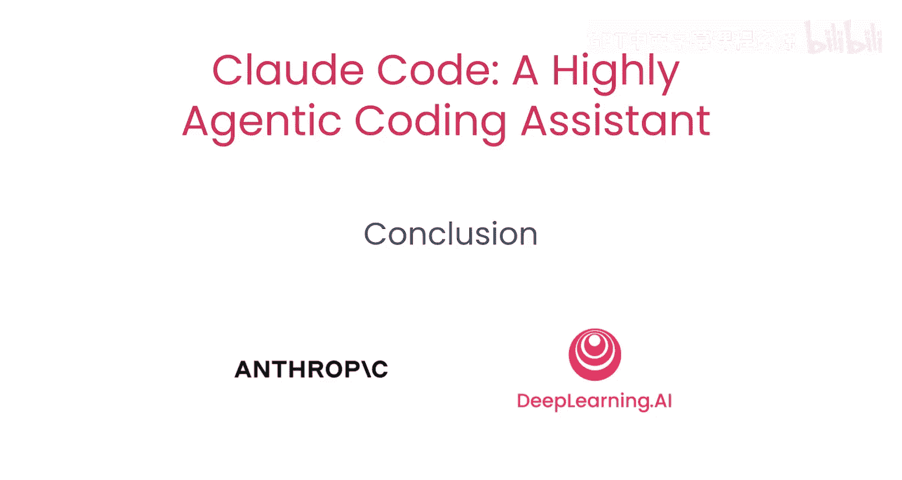
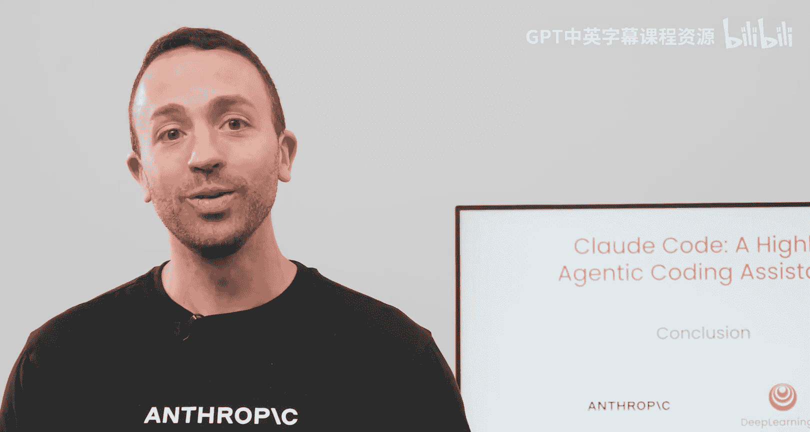

# Anthropic《Claude Code 高度主动式编程助手｜Claude Code A Highly Agentic Coding Assistant》中英 - P10：10.conclusion.zh_en - GPT中英字幕课程资源 - BV176t2zSEpr

Congratulations on making it this far you've learned how to use cloudcode to explore， test。

 refactor and debug codebas， you can make the best at of cloud code when you give it clear instructions。

 clarify the context and point it to the relevant files in your codebase。

 make sure to add your codebase rules to CloudMD and any information that you'd like cloudcode to remember about your project。

 consider extending cloudcode capabilities and connecting it to MCP servers like playwright and Figma。

 Thank you for joining me on this journey and I can't wait to see what you'll build with cloudcode。

