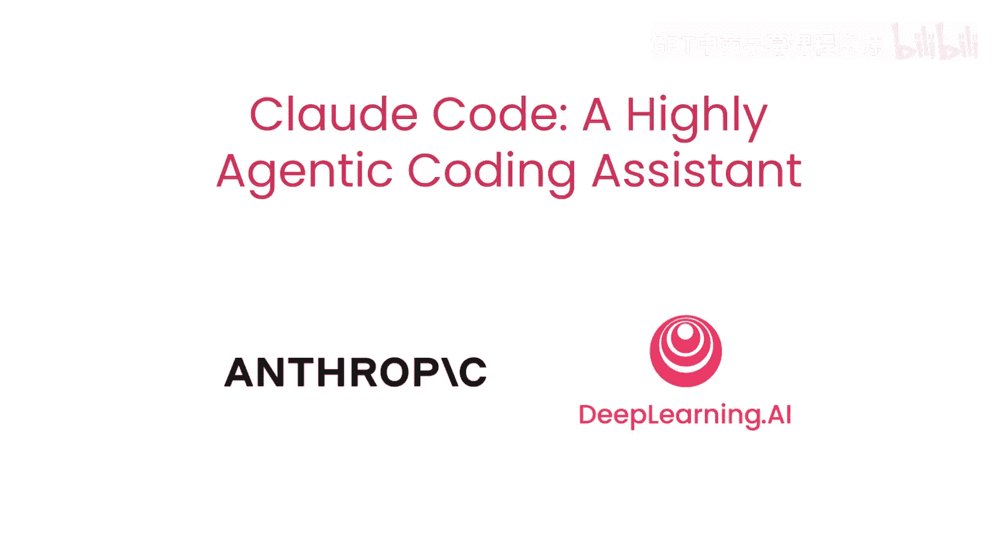
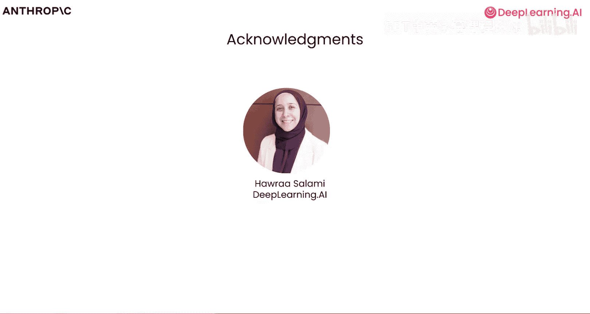
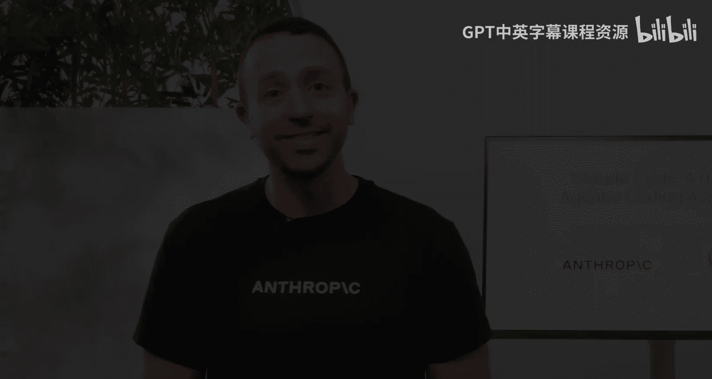

# Anthropic《Claude Code 高度主动式编程助手｜Claude Code A Highly Agentic Coding Assistant》中英 - P1：1.introduction.zh_en - GPT中英字幕课程资源 - BV176t2zSEpr

Welcome to Cloudcode， the highly agent coding assistantist。

 this Sho CosBuild partnership with Anthropic and Anthics Edchoic is back to share us theres practices how to use cloudcode I'm really excited about this short course。

 Cloudco's my Pre favorite coding assistant right now and it has boosted my and many other developers productivity by large margin and it is a tool with a lot of depth to it and so we want to get with Anthropic to teach hopefully the definitive cause on all of the most important ideas behind how to use it in the systematic way Thanks Andrew。

 I'm excited to be back here and start like you mentioned from explaining what the tool is how it works all the way towards using it in parallel with many different tools including Gitwork trees and MCP servers。

What I've seen over the last couple years is AI assisted coding has evolved rapidly。

 It started from maybe people asking Om's occasional coding questions to then GiHub autocomplete to then your various tools that became more and more autonomous and Ch code when it was released was definitely a step up in terms of the degree of agency or the amount of stuff that the coding assistant could do by itself and so I think many people are surprised that you could set a task that cloud will work on for many minutes or sometimes even more than a few minutes and now there are developers that are orchestrating not just a single cloud instance but even several of them working in parallel on different parts of a codeb。

 but coordinating all this has to set the best practices that is not widely known and if you have not worked with people close to the best practices I think they could be a big uplift still for mastering these best practices and knowing how to drive that amazing productivity that I'm seeing many developers have。

CSo as we start to talk about those best practices。

 a key tip for working with cloudcode is providing clear context to help cloudcode achieve the task you want efficiently。

 This means pointing cloud code to the relevant files clearly describing the features and functionality that you want and making sure that you're properly extending the capabilities of cloud code with MCP servers and other tools in that ecosystem In this course you'll apply those best practices to three different examples We'll start with a ragg chatbot and you'll implement the features from the frontend to the backend including refactoring code writing tests and then using the Github integration to work with pull requests and fixing issues you'll make use of many cloud code features like planning thinking modes。

 creating parallel sessions and managing cloud's memory for the second example will shift gears and work with Jupyter notebooks to explore ecommerce-commerce data will refactor notebooks using cloud code remove redundant code and create powerful dashboards with web applications。

We'll move to create a visual mockup based in Figma and use cloud code。

 the Figma MCP server and a different MCP server to import the design。

 iterate test and build agentally a powerful frontend application。

 If you are not currently a cloud code user I think learning this set of ideas will give you a meaningful acceleration in the radar Michigan engineer systems and even if you are a current cloud code user I think having El share these best practices with you in a comprehensive and systematic way will I hope leave you with quite a few new things you try that will be useful for your work I'd like to thank from D AI salami who had contributed to this course in the next video。

 El will share codes underlying architecture and you might be surprised by how simple the architecture is Cloud code relies on just a small number of tools to search for patterns within your files to this directors look at files do rex。

😊。

It does not rely on semantically embedding your code in a codebase or transform it into a searchable structure。

 And one of the things that I think has made cloud code effective is how it agentally con through your code to take notes in a file cloud do MD to figure out autonomously What is going on your codebase that drive decision making on how to advance your code。

 That's right。 And because of that and not having a need to index the codebase。

 you can ensure the codebase stays local。 We'll talk about some of the security ramifications with that。

 So let's get started。 and I'll see you in the next video。😊。

