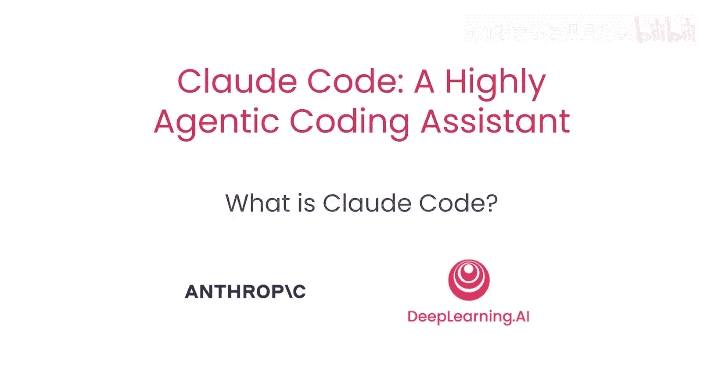
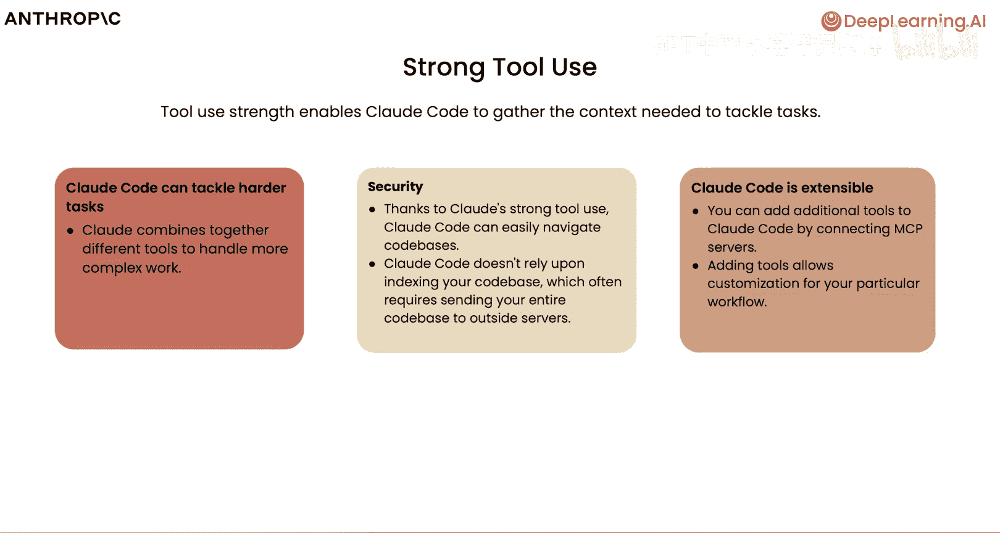
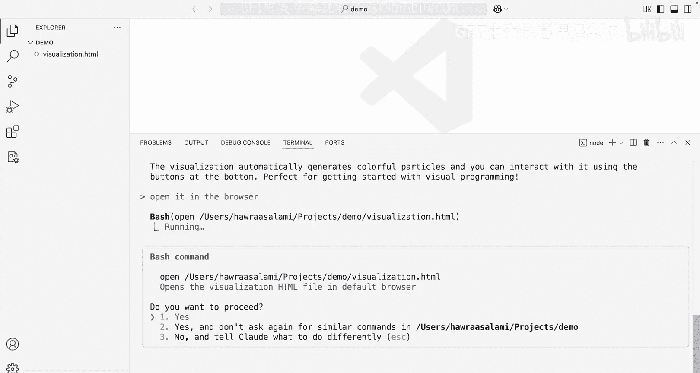

# Anthropic《Claude Code 高度主动式编程助手｜Claude Code A Highly Agentic Coding Assistant》中英 - P2：2.what-is-claude-code.zh_en - GPT中英字幕课程资源 - BV176t2zSEpr

In this first lesson， we'll go through the agent workflow of cloud code。

 the tools it uses to navigate your codebase and the memory it keeps across sessions。 Let's dive in。

 So let's talk a little bit about what cloud code actually is when we talk about agent systems we think a lot about a model a set of tools and some environment to run those tools。

 models are great at handling input and returning output。

 but in many situations those models don't know about your codeb how to fine files and at a handle multiple tasks。

 So instead of just talking directly to a model， we're going to provide a very lightweight harness for that model and through the command line we're going to use that harness to leverage the model's intelligence to perform complex coding tasks So instead of giving a task directly to the model and trying to find all kinds of information in a code base we're going to provide a set。

😊。

Tools we're going to provide an environment and a couple other pieces of functionality to enable the model to comb through codebas and solve much more complex problems What are those pieces of functionality that we're talking about here。

 enabling the model to have memory enabling our model here to remember preferences of the user and the codebase we're going through or the task at hand We're also going to give the model and environment where it can figure out what data it means formulate a plan and then take action with just a small amount of code we can leverage the model intelligence to achieve quite remarkable results with cloud code your options are opus or sonnet depending on the complexity the kind of taskca handling and your subscription when we talk about what cloud code can do It's very tempting to just think this is the tool for writing lots of code but as we progress in this course we're actually going to start with one of。

😊，The most powerful features of cloud code， which is its ability to discover。

 explain and design Before you start writing code with cloud code。

 use it as a way to get up to speed on a code basease We'll talk quite a bit about writing code with cloud code but we'll also talk about ways in which you can use it outside of the terminal in environments like Github willll talk a bit about refactoring。

 debugging errors and where this tool really shines not only is this useful for coding but also across data analysis and any environment where the model's intelligence can create compelling visualizations。

 assets or deliverables for you。 We mentioned that we give the model a harness we give the model in environment to gather context and take in action。

 we talked a bit about the memory that we provide to the model and in a little bit we'll talk about what that underlying memory looks like。

 Now let's talk about the tools or additional functionality。

That we let the model know about to give an illustration of tool use。

 you can imagine that the user asks what code is written in a particular file。

 The model does not know how to navigate or find files and that's or tool use comes into play out of the box cloud code provides a relatively small list of tools one of those being the ability to read a file Now that the model knows what to do can go ahead and read that file get the contents of that file and return the data to a user This ability of tool use allows the model to go from a simple assistant to an extremely sophisticated he tool We mention some of the tools that cloud code comes built in with here is a list of the tools that we have some of those for editing across different kinds of files。

 some of those for reading across different files and some for doing additional actions like finding patterns searching things across the web and even creating or running。

Subagents to handle very difficult and challenging tasks。 Finally， since we're in the command line。

 we're going to need a tool to execute bash or shell commands tool use is what allows cloud code to gather the context and information that it needs This allows cloud code to tackle harder problems it also allows cloud code to not have to index your entire code basease and lead into potential security concerns Finally cloud code is quite extensible while you just saw the list of tools that cloudcode comes built in with you can also add additional tools by connecting to MCP servers MCP or the model context protocol is an open source model agnostic protocol that allows for data and AI systems to communicate easily these MCP servers can add functionality to cloud code for a variety of different tasks and will explore a few of them over this course I want to take a little more time to talk about what we mean by not。

Indexing a codebase instead of creating a structured representation of the codebase and constantly analyzing that Cloudcode instead uses a feature called a Gen search。

 instead of requiring that that codebase is sent to a server and potentially leaving the ecosystem that you're in Cloudcode instead uses one or many different agents and sets of tools to find what it's looking for in your codebase This allows your code to not have to be completely added to context or to have to leave the ecosystem that it's in。

 which can create certain security considerations When we talk about the memory of cloud or its ability to remember what has happened in previous conversations or across all kinds of actions this is done using a markdown file called cloud。

m in your cloudM file， you can define common configurations or style guidelines these files get automatically loaded。

Into context when launched the conversation that you have with cloud code is stored locally on your machine。

 You can clear that over the course of a conversation。 so you can start with a new context window。

 But if for some reason you need to continue that previous one or resume the earlier conversation you can do so easily。

 I'm going to head over to the terminal that I have inside a Vs code。

 and we can see I have a folder here called demo with nothing in it。

 So let's start by opening up cloud code using the cloud command。 depending on where this file is。

 and especially the first time。 It may ask if I trust the files in this folder， which I do。

 We've got a couple nice tips here for getting started。

 but I'm just going start with a very simple prompt。 Make a cool visualization for me。

 I'm just getting started。 what we're going to see here is cloud code start to make a to do list of actions to take。

 you can imagine this task might be to search across a code base to edit files。😊。

To write tests to deliver insights or in our case to create a visualization depending on how Cla is feeling。

 this might be particles or fireworks or something else。

 but I just want to show you how quickly out of the box you can start to see changes with cloud code Since we're doing this inside of visual studio code and cloud code has an integration with that editor。

 we're going to see visually the changes that are being made。

 I'll accept those and in future additions。 I'll let cloud code do that without requesting permission from me。

 We can see here we have a visualization that's built。 let's go ahead and open it in the browser。

 I'll ask cloud code to do that for me。 it will confirm this is the command。

 let's go see what it looks like。 and here we are with our visualization can add some particless looking a bit better we can toggle the animation see what's going on and clear what we have here we can expand on this as much as we want we can change the functionality we can add whatever we want right here but I just want to show you out of the box how seamless it is to get up and running。

😊。

With this particular tool in the next lesson， we'll explore how to use cloud code across a larger code base and take a step back and see just how powerful it is for explaining larger and more complex codebs。

