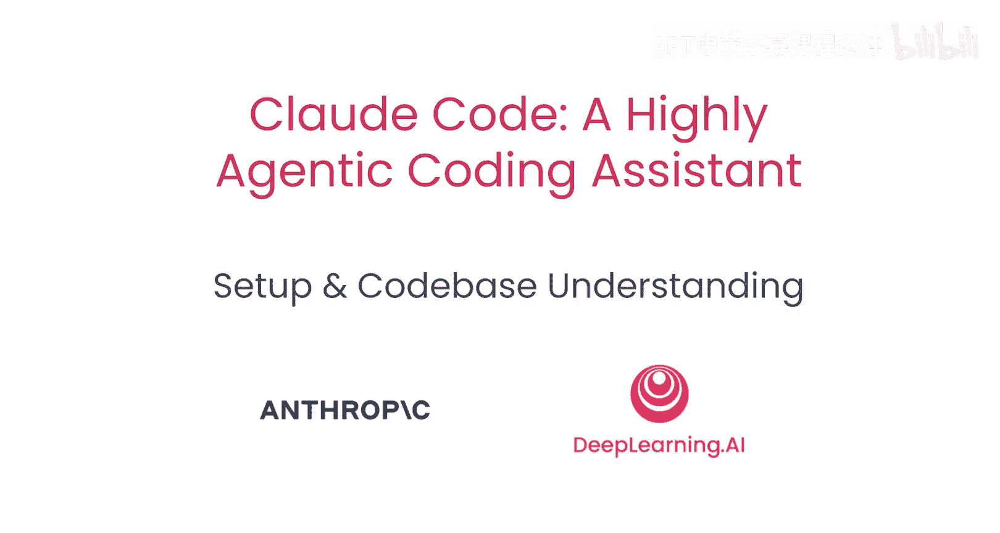
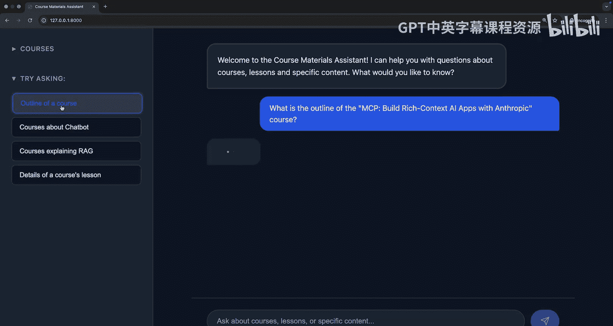
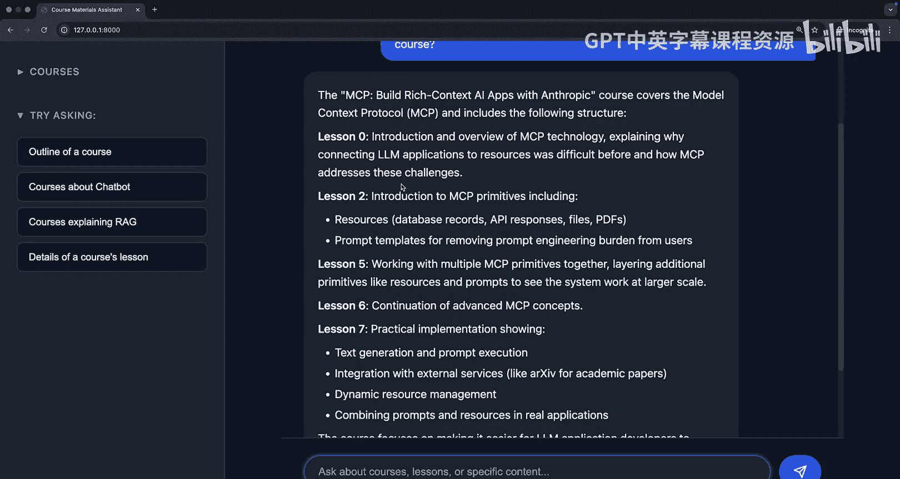
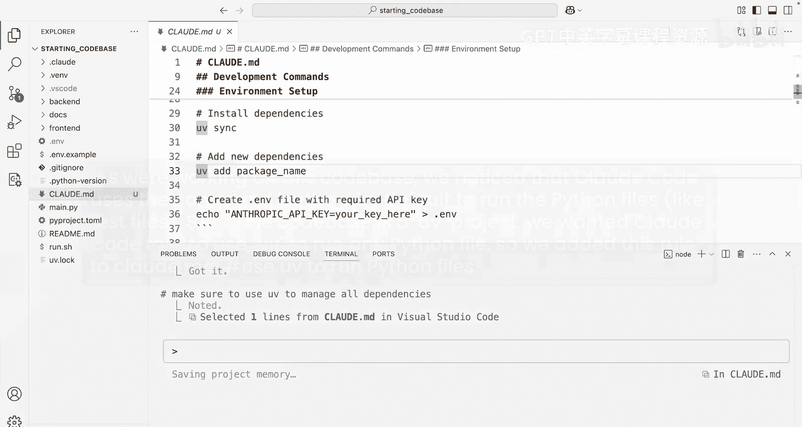
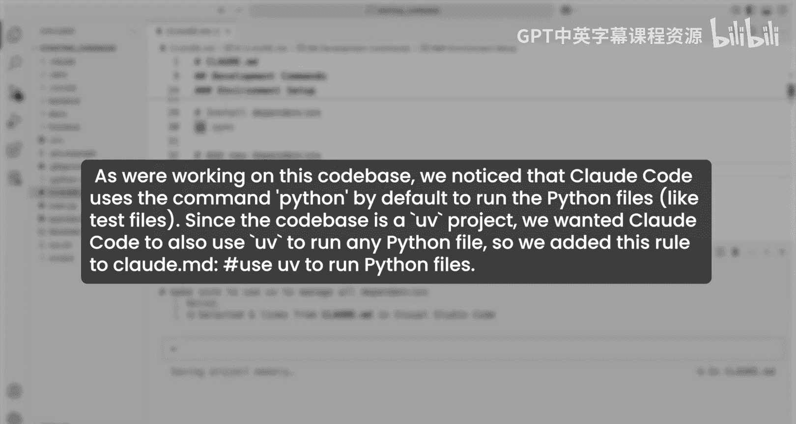
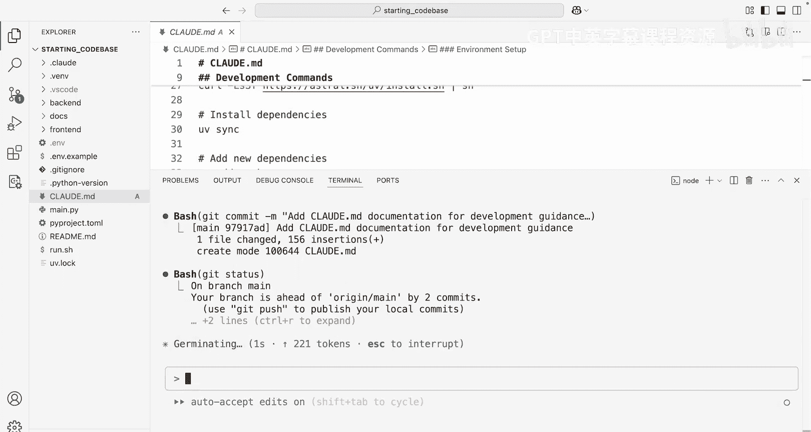

# Anthropic《Claude Code 高度主动式编程助手｜Claude Code A Highly Agentic Coding Assistant》中英 - P3：3.setup-&-codebase-understanding.zh_en - GPT中英字幕课程资源 - BV176t2zSEpr

The first example we'll work on is an end to end ragg chatbot。

 Let's use cloud code to explore the codebase Before we start using cloud code to write lots of code for us。

 let's talk about how we can use this tool to get up to speed on larger codebas right here I have an application where I can chat with Clade about course materials from deep learning AI so let's try asking an outline of a course for example。

 what is the outline of the MCP build rich context AI apps with Anthropic We'll see here that I'll get a response with quite a bit of detail around the lessons and descriptions for each of those lessons With that in mind。

 let's see how we can get up to speed on the underlying code that powers this application back in Vs code I have the terminal open here and I'm gonna to hop into cloud code just by typing in Cla and pressing enter in this application I can start chatting with my codebase so I'm going to start with a high level question just to give me。

Overview of the codebase What we're gonna to see cloud code do is agentally search over the codebase。

 Figure out some of the most important files and give me a description of what's happening in this application instead of searching through each individual file we're going to agentally search and find the most relevant once So here we're going to get some information about the architecture。

 the key components some of the features and now if there are particular things I want to dig into。

 I can easily do that。 I can also ask other higher level questions like how are these documents process in this application。

 we're using retrieval augmented generation to fetch information about these courses if I want to get more information about that process。

 I can ask a question like this one。 we like to say that cloud code is a fantastic engineer alongside you but it's an even better explainer。

 So as you're getting up tope with new codebas with new data sets first start using。😊。

as a way to explain things to you so that when you ask it to write code。

 you can have a better understanding of what's going on here we can see the sources in the codebase that are actually splitting text into chunks that are adding lesson context and that are storing course metadata。

 this ability to quickly get up to speed with a code base。

 especially when you might not be familiar with the underlying technology or language is exceptionally valuable。

 instead of navigating to each of these folders and figuring out what's going on。

 we can ask more specific questions and even get diagrams and visualizations made for us。

 So the first thing I'll ask Claude is to trace the process of handling a user's query。😊。

From front end。To backend。You can imagine you might have some limited knowledge in one of the parts of the stack or you're not familiar with how this is all happening。

 So cloudcode is going to give us quite some useful information here。

 What's useful when you're seeing cloud code work I its ability to give you a bit of a to do list So you can start to understand what's happening at any point in time you can press escape and guide cloud code to follow a different set of todos But in this case。

 I feel pretty good about what it's doing。 It's going to start tracing from the front end。

 start following API endpoints， analyze our retrieval augmented generational system。

 and then figure out how to actually generate the response。

 It's reading the appropriate files that are handling these particular tasks and finishing up its list to give us a powerful summary As we're in this environment we can stay within Vs code or open up cloud code in its own dedicated terminal instance that's completely up to you as you're working in this。

😊，Once it's done， we can see a very detailed path for what's happening here。

 Not only can I read each of these step by step， I can even ask Claude to write this to a file。

 but I'm seeing in quite a bit of detail what's happening on the front end with some ja what happens once that reaches my backend what the retrieval augmented generation system is doing how I'm generating a response finally how I'm searching through my vector database how I'm filtering what's necessary getting a response back and then finally sending that to the user there's a lot that's going on in this application。

 and I can use Clade to dive deeper into any of those pieces。

 but let's just say I learned best from visualizations So let's ask Claude to draw a diagram that illustrates this flow we can ask Claude to draw diagrams for web visualizations we can ask for askDR。

 but let's see what Claude comes up with with its own intelligence and knowledge of how the application works So let's see what cloud code。

Ha come up with。 We've got a really nice diagram here showing us the step by step process。

 so we can't create these visual diagrams。 We could always ask it to use something like D3 Js or recharts if we want something like a web application。

 But we can see right here， we've got a really nice diagram from the front end。

 making a request to the backend， calling the necessary functions。

 generating the response necessary if there's any history involved。

 talking directly to the large language model with our system prompts and our tools and a query。

 figuring out where to go next， searching through our vector database using Chrome Db。

 getting back results， formatting that， sending it to the model to produce a final response。

 There's quite a bit of detail that goes into this。 And if we want。

 we can even augment cloud with additional tools for generating the visualizations that we want。

 But out of the box。 just getting this information quickly and efficiently is going to help us get up to speed。

😊，With this code base and a fraction of time that we used to spend。 so with that in mind。

 let's ask a very simple question， how do I run this application？

You might be in a situation where there's a new technology here， a new idea very simply。

 it's nice to just know how to get up and running it。 I can see here my API documentation。

 my web interface， and if there are any environment variables I need I'm good to go Now that you've got an idea of how to just start talking to cloud code Let's talk a little bit about some of the more powerful features with cloud code when you start working with an application in cloud code。

 one of the first things we recommend you do is run a command called slash in it you can see here in cloudcode when I add this slash we have a list of many built- in commands that I can use slash and it allows me to initialize a cloud M file with the codebase documentation The cloud M file is mission critical for introducing memory for cloud code so that it knows how best to work in your codebase the cloud M file is very useful for specifying how you want things to be run this could be your tests。

 this could be your Linting。😊，And any long term memory that you want Cla to have each time you're working with cloud code for this particular project instead of making this from scratch slash anit is going to analyze the code base to figure out at a high level what it should know about each time you're working with this application。

 There are three different cloud M files that you can make like the one generated with sit all the way here on the left。

 This cloud M file lives in your application you can have many of them in nested subfolds but this is shared with other engineers and committed to your version control。

 Another option is if you have personal instructions and customizations things specific for your editing environment and terminal environment。

 you can put that in a cloud local M file。 This is get ignored and not shared with other engineers。

 Finally， in your home directory in the dot cloud folder， you can add a cloud M。

 and you can think of this like a。C M for all projects on your machine。

 This is helpful if you want Cla to follow instructions across a wide range of projects that you build with cloud code。

We can go ahead and allow cloud code to find different files so that it knows how best to create this cloud M file。

 This cloud M file is meant to be added to your current Git project and shared with other team members as more individuals work on the codeb they can add to this cloud M file and you can even nest cloud M files in subdirecties if you need more specific instructions for things like the backend or frontend or our docs that we have here What's really nice about using a tool like cloud code with visual studio code is that as I see changes to files I can see those visually in my editor and any time that I am using a tool in cloud code it's going to ask me for permissions this mission critical human in the loop is really important when you get up and running and if you don't need Cla to ask you every single time can always use this second option will go ahead and autoaccept those edits and we'll see that a cloud。

MDF has been created for us to give you a quick walkthrough we can see it's given us a project overview。

 key technologies， an architectural overview， a nice little diagram here。

 some core components and much more if we want things to change to this particular cloud M we can easily do so as it continues searching the codebase it makes additional edits to my cloud M and gives me a summary of what's been done when I'm using a tool like cloud code in V code I have the ability to specify which file I'm in and even get information about particular lines to set this up I'm going use the ID command and I can see right here that I'm connected with visual studio code now that I'm in visual studio code can see right here that the second that I visit a file it's tagged right here for what's going on This gives cloud code the right context for which file I'm in and if there are questions I have about that file it makes it easier for cloud code to identify that If I ever want to make any。

to my cloud M file。 I can manually write that if I'd like。

 or I can use a handy command to go ahead and use this pound key and directly add to memory。

 So I'm just gonna say here always use U to run the server。 do not use Pip directly。

 This is a package manager in the Python ecosystem。

 and I want to make sure that cloud doesn't get confused when I use this shortcut。

 we can see there are different places where this memory can be saved。

 We mentioned there is the project memory that is included in Git for everyone on your team to use。

 we have local memory that is git ignored but just useful for you as the developer and then user memory that is applicable to all projects you use with cloud code for this one。

 I'll just go ahead and update the project memory。 I can see here I've made that change。

 And if I look in my cloud M I'll see right here I have some mentions to using U to make sure that I'm doing that correctly。

 If I want to be more specific。 I can also say make sure to use。

U to manage all dependencies I'll add this to my cloud M and we'll see right here that it's been added if I take a quick look at this particular file。

 we can see any mention of dependencies now includes Uv。

We spoke a little bit about some of the commands that are built into cloud code like s emitmit There are a couple other useful ones that I want to showcase here and in fact。

 we're going to see later on in this course we can even make our own One of the first ones I want to walk you through is slash help This shows me right off the bat a quick description of all the commands and a quick summary This is useful as you're getting up to speed with cloud code the next1 I want to showcase is a command called slash clear what this allows you to do is clear the conversation history and start from scratch This is very helpful as you shift gears and build new features this allows you to clear the context window and start fresh If you want to continue the conversation have a smaller context window but still have a summary of what's been done we also have this command compact that allows you to clear the history but keep a summary so that you can build off with Cla having an idea of what was done before One more useful command。

I the escape key that allows you to get out of whatever command you're in so if I'm going and trying to do something like compact and I want to stop that process I can always press escape if I start a process with cloud code to explain what is in the codebase I want to stop that process escapescape will allow me to interrupt and continue onwards so don't feel like you have to wait for cloud code if you're not getting what you need in the next lesson we'll start using cloud code to build features add to files modify changes and make sure we're doing the right thing along the way before we hop off one last useful piece with cloudcode is its ability to work with Git so I've made some small changes to this application and I want to add and commit these changes instead of me manually have to write the git commands write a descriptive commit message we're going to actually have cloud code do that work for us and what's really nice is cloud code's ability to add and commit the necessary commands I'll go ahead and add this particular file。

I not only commit， but you can see here I've got this really nice descriptive commit message that's incredibly useful as we start asking cloudcode about historical changes with Git and when we push this to GitHub and other people are reading the changes we make so we'll adding commit and the next lesson we'll use cloud code to start writing lots of things for us。

😊。

