# Anthropic《Claude Code 高度主动式编程助手｜Claude Code A Highly Agentic Coding Assistant》中英 - P4：4.adding-features.zh_en - GPT中英字幕课程资源 - BV176t2zSEpr

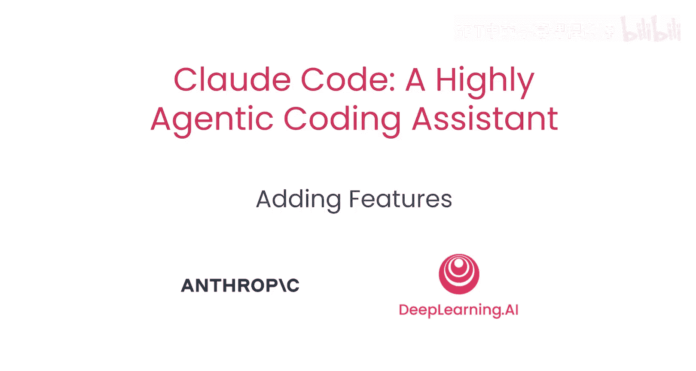

Now that you have an understanding of the chatbot codebase。

 let's add features to the UI and implement a new tool for the chatbot。

Now that we've gotten up to speed on this codebase。

 let's talk a little bit about some features we might want to add。

 We saw before in this application when we ask for an outline of a course。

 we get some really detailed information。 And we even see some of the sources that are referenced at the same time。

 when we see these sources that are referenced。 It would be really nice to be able to click on these as links and go to the source of truth。

 So we want to build an interface where the front end and backend are correctly rendering links to show where this data is coming from and not just some text。

 So let's hop over to Claude and talk a little bit about how to get started。

 What we're going to do here， instead of just asking Claude to implement the feature necessary。

 We're going make use of two important pieces。 The first one is referencing the correct file and the second is using plan mode。

 When we talk about referencing the correct file。 Cla code is。😊。

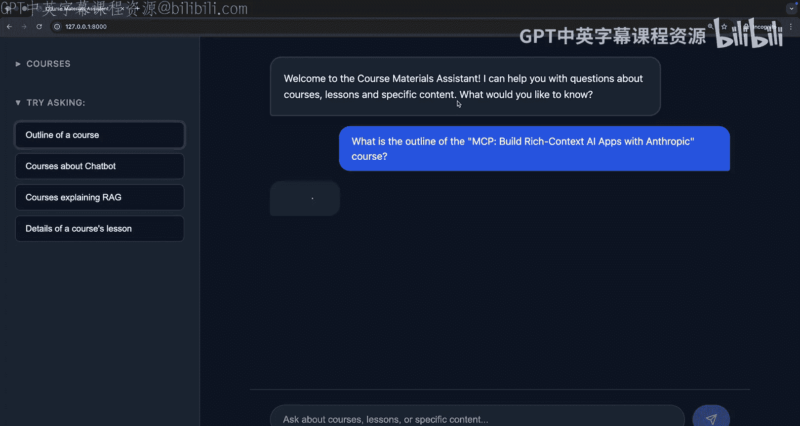

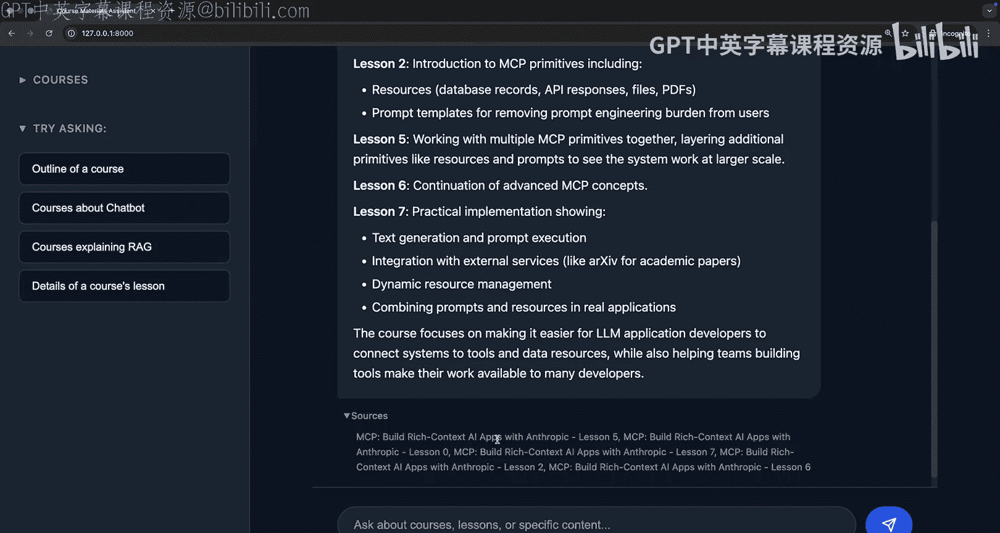

Only as good as the context that you give it。 So when you ask Cla code to make changes。

 it's important to make sure that we're figuring out the right files we need to modify。

 We can have cloud code try to figure this out。 But if we know out of the box what files need to be modified giving cloud code this context right away。

 makes the tool much more efficient。 So let's see how that stuff。

 I'm going open up cloud code and to reference a file。

 I simply use this and tag that file for a folder I can reference files inside for a file directly I can go ahead and even use tab to complete for the full file name with that in mind。

 let's talk next about the second important piece when building features or making larger changes instead of having claw trying to figure out what needs to be done and write the code right away。

 We're going follow a slightly different pattern。 We're going plan first we're going。

CCreate a detailed plan for what changes need to be done。 And if we approve that plan。

 we're then going to have cloud code make changes to quite a few files。

 when you have slightly larger changes to make。 we always recommend starting with plan mode so you can give Cla the opportunity to figure out what needs to be done before it needs to make those changes to activate plan mode I'm going press shift tab twice。

 and we'll see here that plan mode is on。 let's showcase what needs to be done。

 I'm going to bring in a prompt that I have here and I'm going to ask it to build an interface with source citations You can notice here that I'm referencing the correct files as well as referencing other files where changes need to be make。

 So let's give Clade the opportunity to come up with a plan for how to solve this particular problem As always。

 it's going to read through the files that it thinks are most necessary It's going trace its way from the front end to the backend and understand what needs to be implemented once we。

😊，getting a plan。 we're gonna to have the opportunity to either approve it or to give Claude some feedback for what might need to be changed。

 But here Claud is not directly writing any code as we see here we can accept and then continue to auto accept edits so we don't have to keep asking for permission we can manually approve them or we can tell Cla to change the plan taking a quick look at this I feel pretty good about what we need to do so let's use that plan with our auto accept edits if you ever want to turn this on on its own you can press shift tab just one time。

 we'll see the to do list necessary。 We'll see what changes need to be made。

 and now we're gonna let cloud code right to the files that it deems necessary and then we can test that the implementation works correctly We'll see here files are being modified changes are being made to the codeb and since we added the auto accept we don't have to keep giving permission over and over very common workflow that we see is users start by asking。

For permission each time。 and as more trust is given by the human to cloud code。

 the auto accept edits come on a bit more。 We can see here finally。

 that we can start the application to test the implementation。 but in fact。

 the server is running already。 So I'm just going tell Clade。 No， thank you。

 I'll say right off the bat， the server is running no need to start it yourself。

 If I want cloud code to always do that。 This is a great opportunity to just put something into the cloud M file as well。

 Now that I've let cloud code know that。 It's going to tell me the changes that have been made。

 So let's test this。 Now， let's try asking the same question。 Let's ask for an outline of a course。

 And if this has been built correctly。 we should be able to see links below for each one of these particular features。

 If I take a look right here， I have links that will take me to the right place。

 but the interface is a little bit difficult to see because of this blue link color if I'd like。😊。

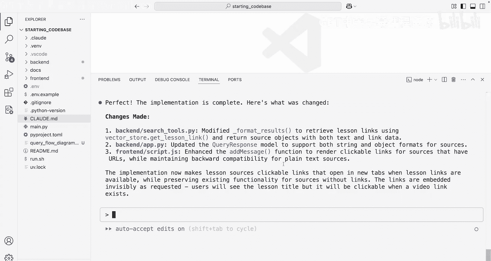

I can go ahead and ask cloud code to make the change necessary to do so。

 So let's go and follow up with Claude and ask it to make this interface a little bit more pleasant。

 One option that I have here is just to tell Clade here is what I want。

 Another option is to use Clade's visual ability to take a look at a screenshot and analyze what needs to be changed So let's take a screenshot of what this interface looks like and we're going go ahead and paste that into cloud code back in Cla code when I paste that screenshot I'm going to say these links are hard to read can you make this more visually appealing We're going go ahead and give Cla the ability to analyze that image and figure out where things need to be changed on the front end。

 and we can see here I can see the issue the links are using a default blue color let me go ahead and make a change when you need Cla code to make visual changes taking screenshots and showing Cla code the screenshot。

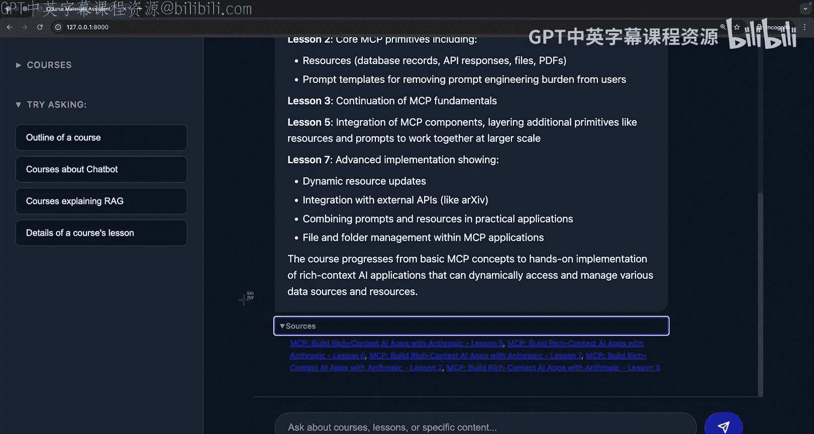

Very powerful way of quickly iterating against what we need。

 Let's go back to the browser and see what things look like now。

 We'll ask again for an outline of a course。 And if this is done what we've expected。

 we should see that these links are a bit nicer to take a look at。

 Let's take a look at our sources and look at that。 much better。

 The ability for cloud code to see screenshots and make changes。

 it's one of the most commonly used features we see an incredibly valuable to build things quickly。

 If I want to see those changes to files。 I can open those up in Vs code。

 and clo code here we notice I'm in that particular script and I can ask questions and get information necessary for those files。

 This is looking good。 let's add a new feature。 Instead of building off in the context window what I have now。

 I'm going to start completely from scratch and clear the conversation history。

 This is going to allow me to have a longer context window to work with。 and not have claw。😊。

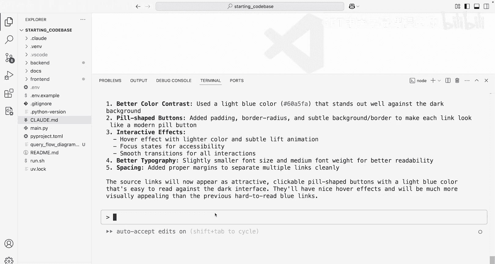

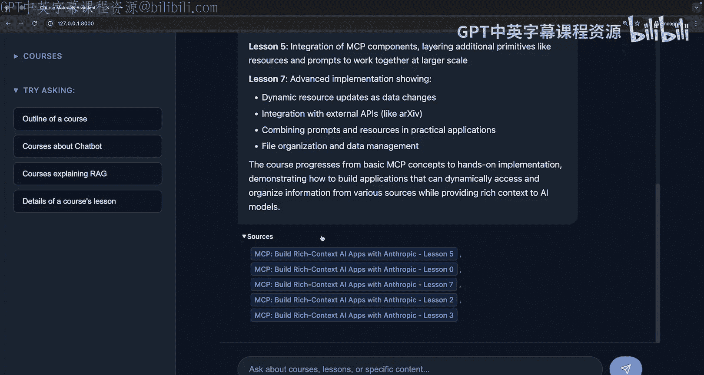

Yet potentially confused with things that it's seen before that are not relevant to what I'm building now。

 As we saw before， when we want to build newer features。

 we're gonna use plan mode in this particular application。

 I want to add the ability to start a new chat in my interface。

 So instead of having to refresh the page each time Id love for a button here to allow me to reset the conversation and start a new chat again。

 So let's build that。 I'm going activate plan mode。

 and I'm going to go ahead and bring in the prompt that I have here。

 I'll ask cloud code to add a new chat button， and when clicked。

 it should clear the conversation in the chat window start a new session and handle the necessary cleanup。

 If you ever need to make a new line and add a more context。 you can use backslash and press enter。

 So if there is more I want to add here， I can easily do so that's a bit more visually appealing。

 So let's have cloud code figure out what needs to be built here。 As we saw before if there are。😊。

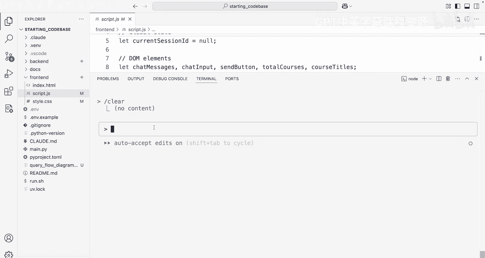

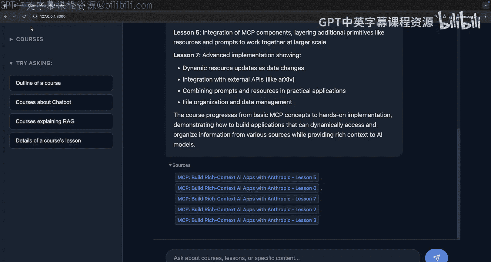

Changes to the front end that we need。 It will find the necessary folders， changes to the backend。

 the same kind of thing。 And here it's going to come up with a comprehensive plan。

 This idea of being able to plan and think before taking actions。

 is incredibly valuable to build the interfaces that you want。

 I can take a quick look through this plan。 I can see what it's trying to do。 And I feel good。

 So let's build it。 if at any point in time， I don't like what's being done。

 I can always press escape and navigate cloud code in a different direction。

 As always we'll see our to do list that needs to be built willll see these files being updated since I have auto acceptcept edits on。

 And once that's done， we'll move on to the next step。

 we'll start seeing some jascript being added for when clicks occur starting new conversations。

 we'll see clearing inputs and focusing and now building a little bit of styling to match existing sections。

 We can see here it's going to test the new functionality And if I need to tell cloud to not run the server。

 I can glad。😊，Do so if I want So here， instead of running the server。

 I'll just tell Claude don't do it。 And since I'm gonna find myself doing that a lot now is a good time to say don't run the server using run S I will start it myself I'm gonna put this actually in the project memory if I want all other developers to do the same。

 but maybe other developers might want to run the server themselves。

 so I'll put that in the project memory that's local and get ignored so this might be a situation where I like to run the server myself。

 but maybe other developers don't great use case for that Cla local M file Now let's go back to the browser and see what will be built。

 I'll refresh the page and we've got this new chat button here let's see if it works。

 ask again for an outline of the course。 we can make sure that our source links look great and if this does what's expected we can click on this button and start a new conversation that's looking good。

 let's start a new chat So even though this is working。

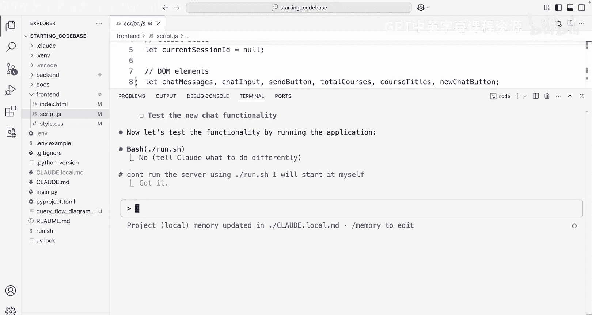

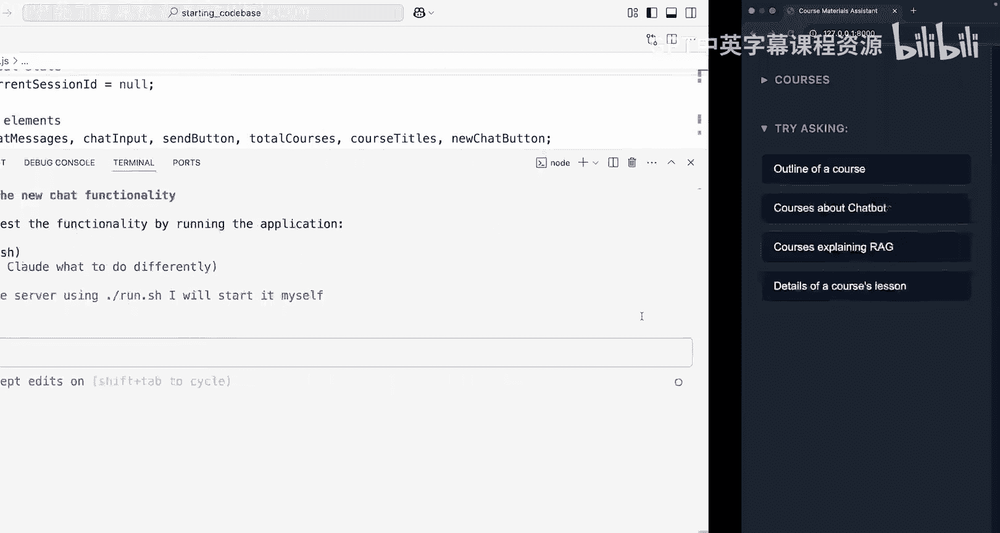

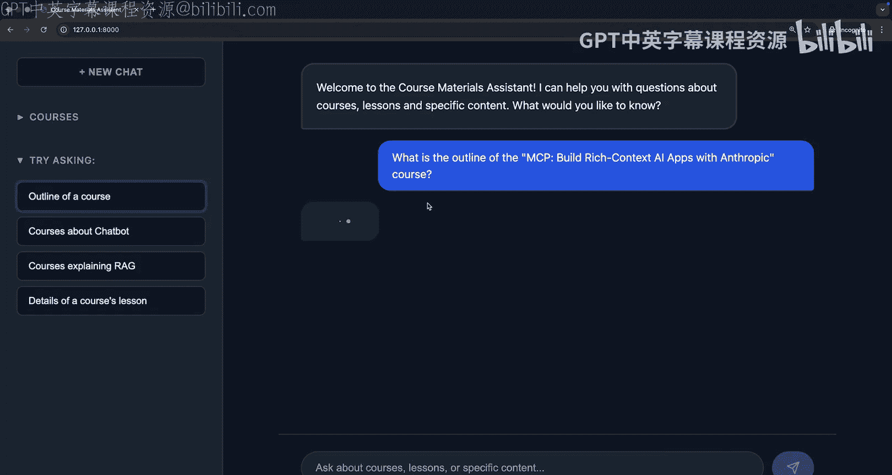

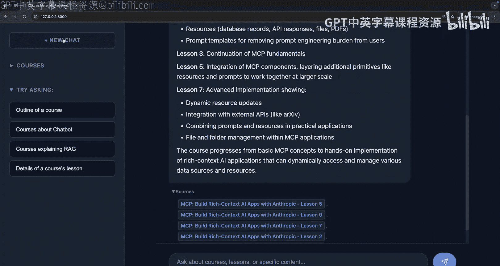

Still doesn't look exactly the way that I want。 and I can take screenshots and go back and forth with Clade。

 or I can enhance the tools that Cla code has out of the box using MCP servers。

 MCP or the model context protocol allows for tools like Cla code to gain additional functionality to external data sources and systems。

 What I'm going to do here is add an MCP server for playwright。

 a popular tool for opening up a browser， taking screenshots and analyzing those screenshots。

 So instead of me manually having to take the screenshot and have a conversation with Cla。

 We're going to let Cla do it all by itself。 The first thing I'm going to do is quit out of Cla code and add the necessary MCP server。

😊。

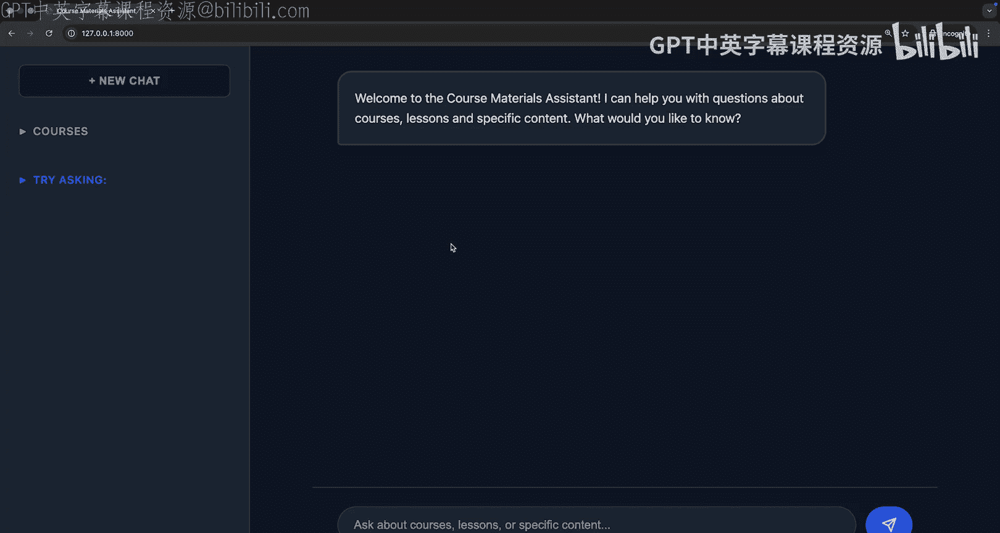

In the command to do so is Cla MCP add the name of our MCP server， which is playwright。

 and then the underlying command to start that MCP server that is done using MPx playwright s MCP at latest for any MCP server that you want to include You can reference the documentation。

 All MCP servers will specify the necessary command to connect to that particular server。

 Let's open up cloud again and we'll see what our MCP server looks like。

 We can use the s MCP command。 And here we can see that we have connected successfully to the playwright MCP server。

 and we can see the tools available that the playwright server is giving us things like evaluating jascript uploading files pressing a key navigating。

 going back all of these things that we might manually test playwright can do that programmatically for us。

 I'll press escape to go back a few times。And let's ask cloud code to navigate to figure out how to build the necessary content。

 So let's go and ask cloud code using the playwright MCP server。

 visit the page that we're at and view the new chat button。

 I want that button to look the same as the other links below for courses and try asking。

 Make sure this is left aligned and that the border is removed。 before it starts taking this action。

 it's going to ask me for approval for these particular tools。

 We'll see that it will visit that page。 Take a screenshot。😊，And do what's necessary。

 Let's follow that and not ask for permission each time to use this particular tool。

 We can see here that the browser has opened a new tab programmatically to our page to take a screenshot will ask cloud code to take that screenshot and analyze what it sees Here。

 it can see the exact issue that's happening And instead of us manually having to take the screenshots necessary。

 It can programmatically fix itself。 We can have a more specific prompt as well。

 that keeps asking cloud code to make those changes necessary。 Since I don't have auto accept on。

 I can see the change that's being made in Vs code。 And right out of the box。

 I don't see a border and background with this new change that looks good to me。

 Let's make those changes and continue making other changes。 I can see left a line looking good。

 and any other changes that need to be made here。 It's gonna take another screenshot to verify that the changes it's made look correct。

 that it has the right icon prefixes use to match other sections。😊。

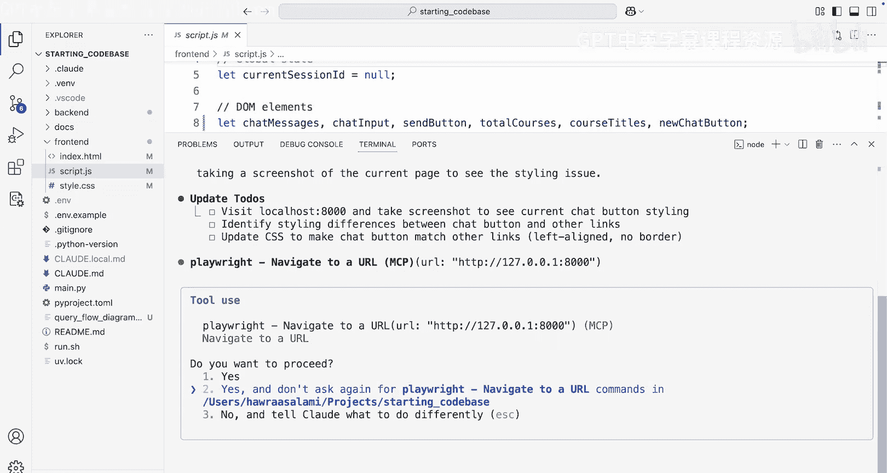

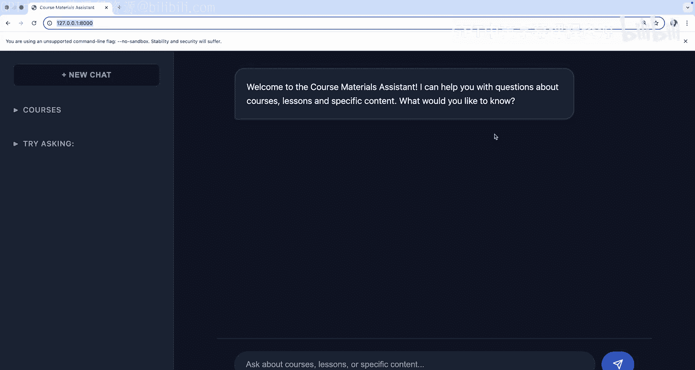

With that in mind， let's go see how he did。 I'm going refresh the page and it's looking good。

 It's got an extra plus here。 So why don't we go ahead and ask it to take that out。

 but it's left aligned and it's using the icon that we like before。

 So let's go ahead and fix this up and say。😊。

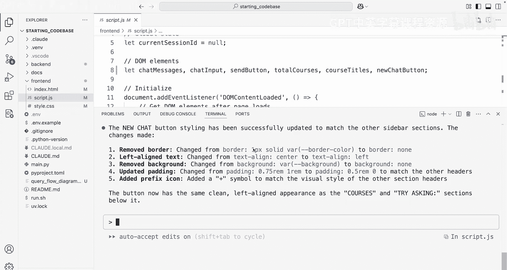

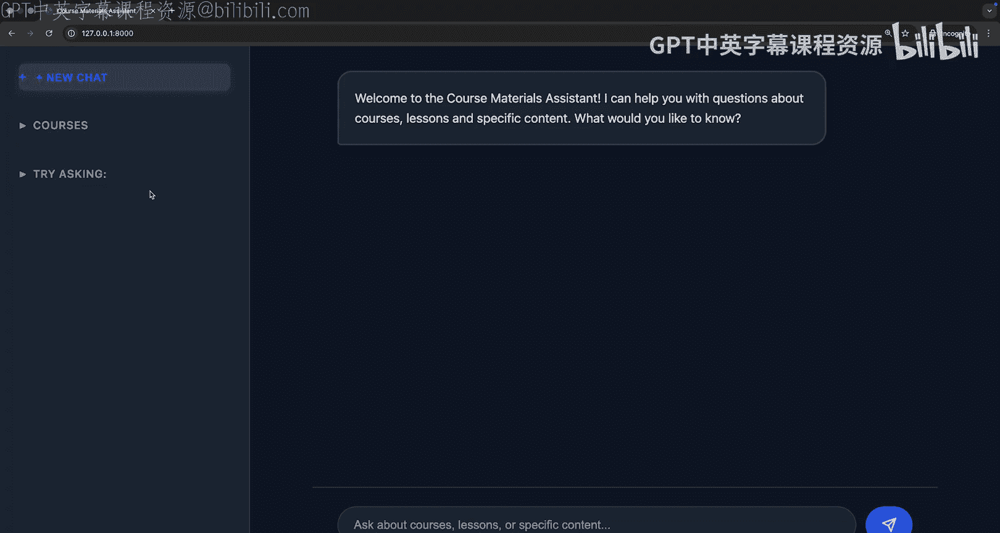

There are now two plus icons Remove the one closer to the text plus new chat。

 We can see here there's already a plus in the H content。 So we'll remove that。

 And let's see what's done here。 So instead of adding that extra plus we can see here what's being done。

 if we need another snapshot。 we can visit and take a snapshot necessary。 As we can see here。

 cloud code saw there was not an open tab， So it fixed itself opened it up again and took the necessary screenshot。

 Let's see what that looks like Now， much better。 As you can imagine， building complex interfaces。

 using tools like MCP playwright makes building designing and testing a breeze。

 We need some really nice front end changes。 let's now go and visit the backend。 Like we did before。

 We're gonna start fresh。 And instead of building off of this conversation。

 we're gonna start with a new one。 So let's clear the conversation history and start again this time we want to go some features on the backend。

😊。

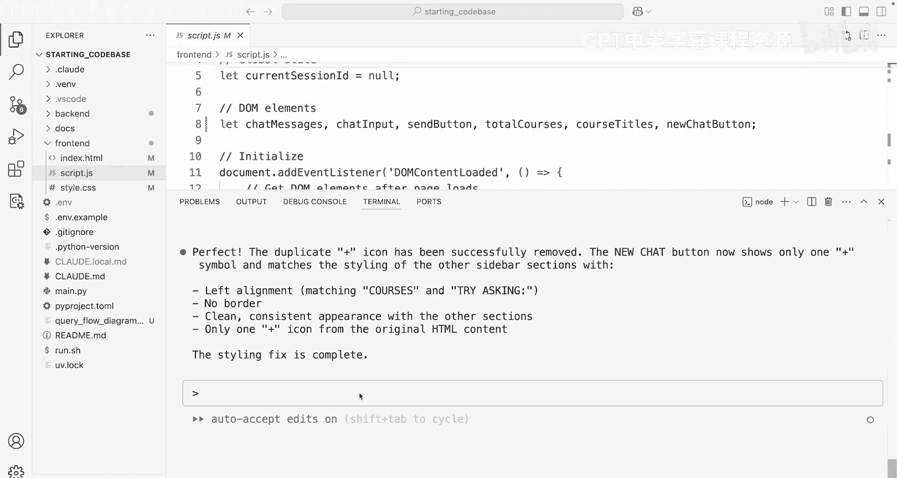

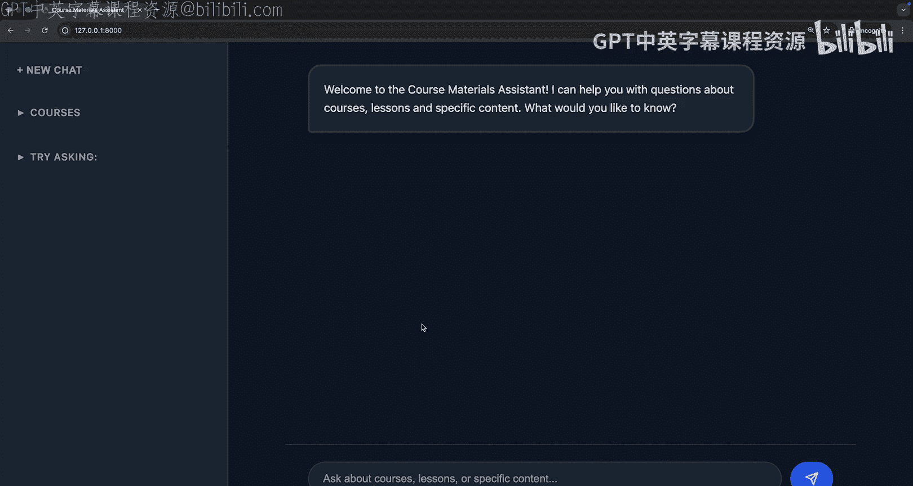

Put in a prompt。 talk about what's going to be done here。

 I need to add another tool that allows me to visit a particular course。

 And for each of those courses， see the lesson number and the lesson title and description about that as well。

 Right now， the data that I get when I take a look at a course is relatively high level。

 Let's see what I mean。 what we're gonna ask clouddecode to do here is to make a change to our search tools do pi file。

 let's take a look at that And in this file we can see right now that we just have one tool for searching content and getting details about that particular course。

 This second tool is going to allow us to get more descriptive information for each of the lessons in these courses。

 So let's see what cloudde can do as we've done previously Let's make a plan and make sure we're first okay with that plan before we start making changes to individual files。

 Clouddecode can see the current architecture。😊，implementmplement the outline tool。

 And since we have that cloud M previously， it's going to more quickly be able to understand what needs to be done。

 We can take a look at what needs to be implemented。

 We can make sure that we're doing the right things in the right files。

 we can see that once we create this tool， we update the system prompt to make sure that we get that additional data and then we register that tool in our ragg system。

 As always， if there's anything we want to change or suggest we can do that now。

 let's see what cloud code can do for us。 if this works as expected。

 we should be able to ask questions about a course and get much more detail for those particular lessons in the course。

 we can see here that not only are we modifying the underlying python code。

 but also the system prompt。 And here we're registering that new tool that we've made once we finished our to do list we can head back to the browser and see what things look like and if this has been implemented correctly。

 we'll see a nice summary of what's been made we。😊，Can always change things at any point in time。

 Back in the browser。 Let's go ahead and try asking for some information about a course。

 if this works as expected， We should be able to get more detailed information including a link for that particular course here。

 we can see the names of the lessons。 And if we would like。

 we can even build additional functionality to get sources for each one of those。 In the next lesson。

 We'll talk about what happens when things go wrong and how we can use cloudcode to debug to write tests and make sure that we feel confident in the software that we are writing alongside cloud code。

😊。

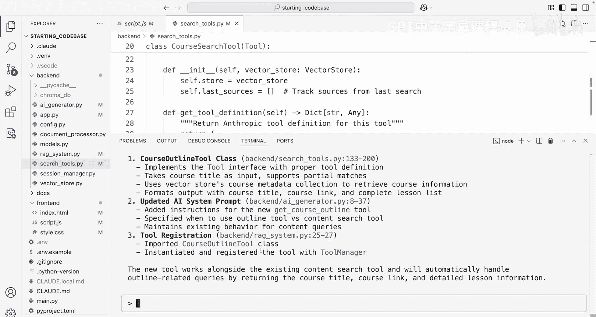

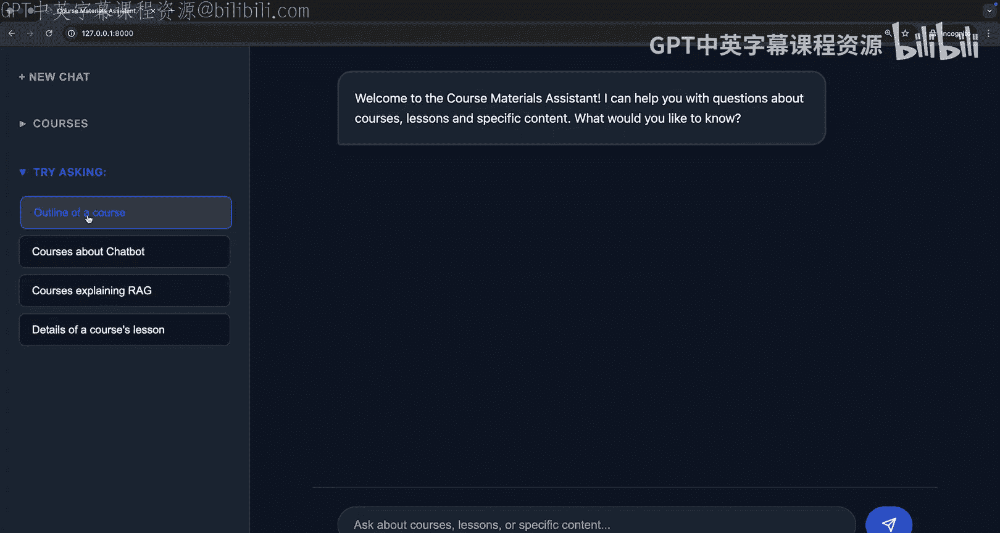

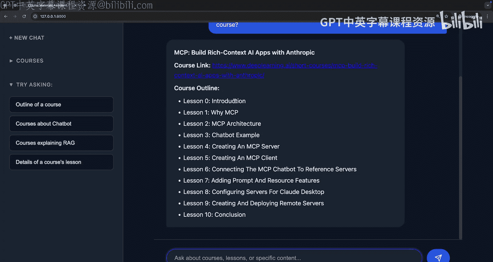