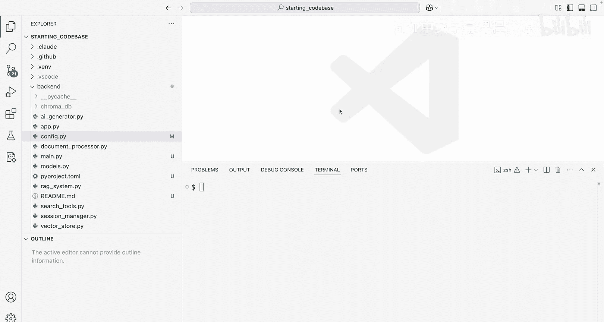
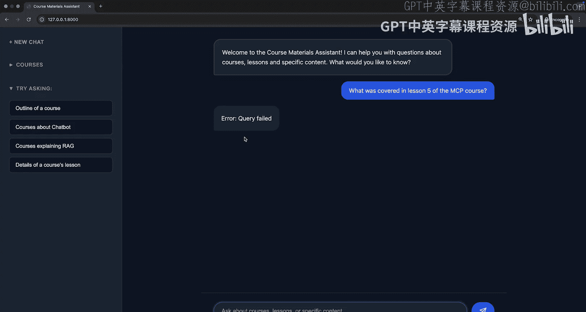
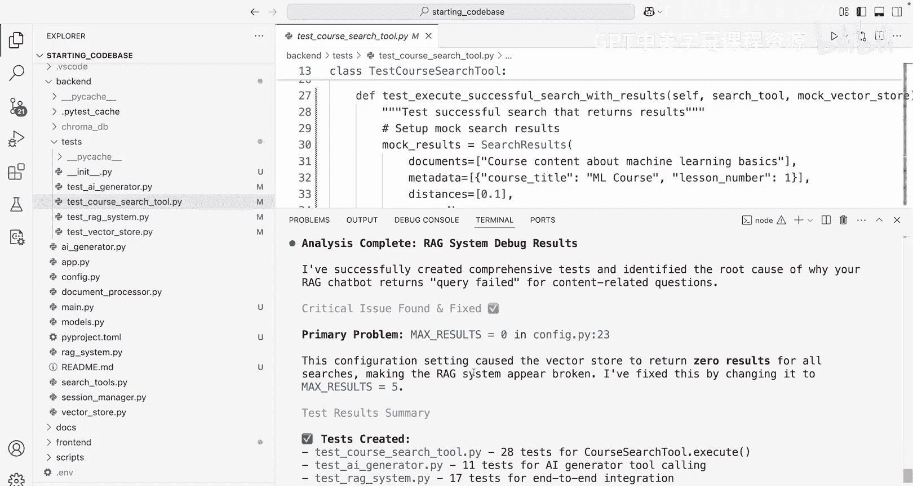
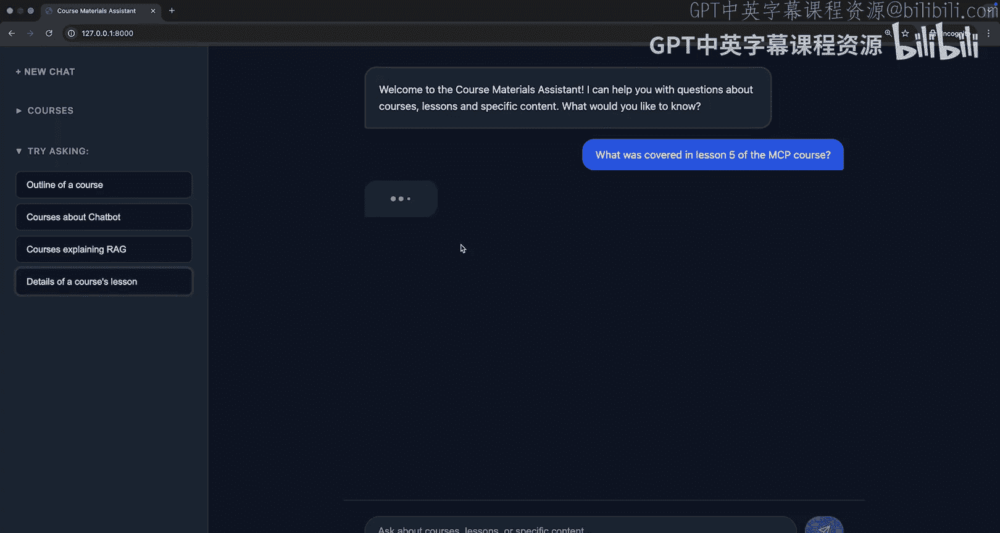
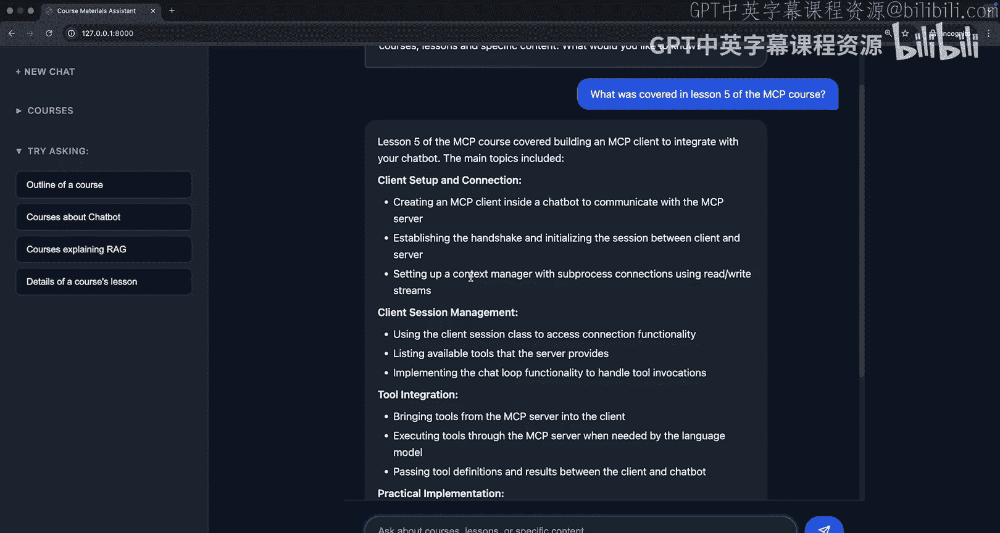
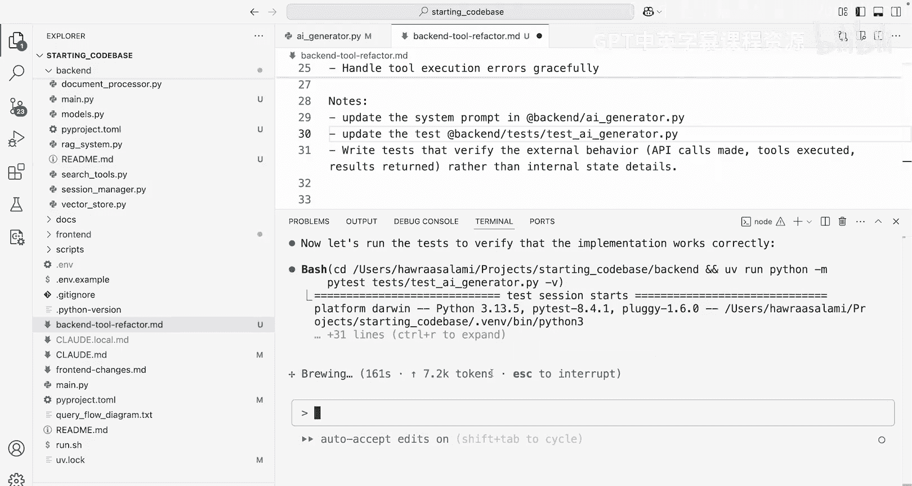
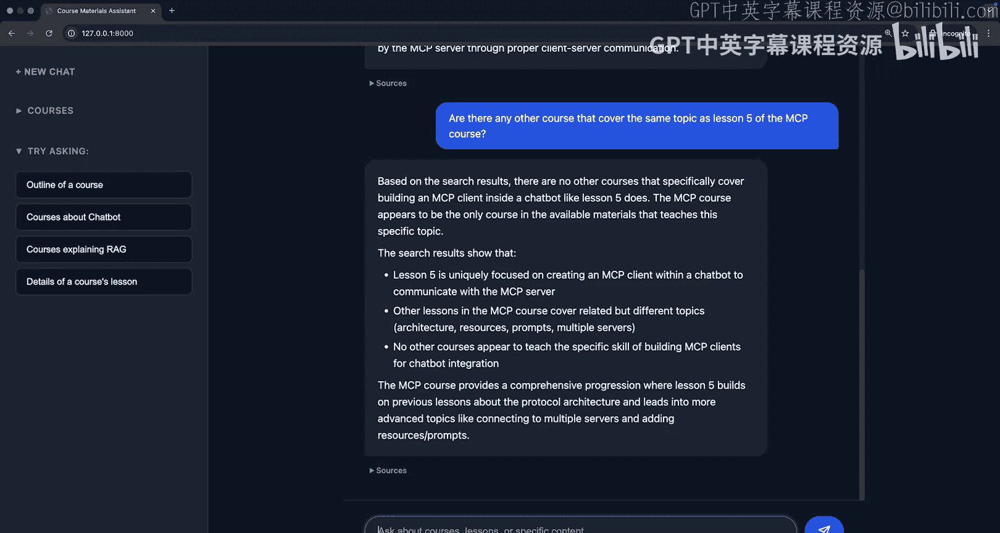

# Anthropic《Claude Code 高度主动式编程助手｜Claude Code A Highly Agentic Coding Assistant》中英 - P5：5.testing,-error-debugging-and-code-refactoring.zh_en - GPT中英字幕课程资源 - BV176t2zSEpr

The codeb is now missing tests for evaluating the rag pipeline of the chatbot。

 Let's implement these tests and use them to debug an error the chatbot is having。

 processing the queries。 And finally， refactor how the chatbot handles its tool use。 Let's dive in。

 So far we've seen how to get up to speed with code bases and implement features to build a slightly more powerful experience。

 Now， let's go ahead and imagine that it's been some time since we've worked on this application We're coming back。

 we want to start using it again。 So let's hop back to our application and ask for some details on what's covered in lesson 5。

 We might expect to see a response that gives us information。 But right now， something wrong。

 It might be tempting to just copy this error， put it into Cla， take a screenshot。

 hope it solves the problem。 but we're gonna do something a little bit different。

 Instead of just getting the answer that we might want。 We're leading Cla on some wild goose chase。

 We're gonna to take a bit more of a methodical approach here。 We know that things are wrong in our。

😊。

Application but we also know that we don't have too many tests here to programmatically verify that that's the case。

 So what we're going to do is put in a prompt that not only mentions what the error is。

 but also specifies where we need to write tests if we go back to our codeb the error we're looking at could be from a variety of different Python files in our AI generator this is where we handle interactions with anthrops API and there could be problems in the prompt or even some of the logic we have for getting this part working。

In our RaG system dopi， this is the orchestrator for everything that's happening with retrieval augmented generation。

And in our search tools， here's where we define the underlying tool definition where there could potentially be problems。

 So what we're going to ask Clade to do is write tests for these specific files just to start。

 We're then going to ask Claude to run those tests And through that。

 verify what is not working and make the appropriate fix。

 What's so powerful about this approach is by starting with our tests。

 we can start to build a robust foundation for building more off of the code base and understanding when things go wrong。

 why they're failing。 So let's open up Claude。 and put in a prompt。

 Since this is a little bit more challenging We're also going to ask Claude to think a lot。

 This is going to trigger Claude's ability to enable extended thinking and allocate a few more tokens towards a thinking process。

 we're also going to see this process And if something doesn't appear right。

 we can always stop Cla in its tracks。 We'll go ahead and make sure the plan mode is on because first。

 we want to make sure before Claude starts writing tests。 it。😊。

s what it needs to do and we can approve that process as we start to read the files necessary。

 we're going to see Claude's thinking process。 We're not only going to see the files that we're reading。

 but also what it needs to examine and what it should do。So let's go see what Claude's plan has。

 it seems like there's some kind of configuration issue。

 maybe some complex tool calling with failure points and some limited error propagation between components。

 so it's possible that the error is just getting caught somewhere。

 it's then going to propose a structure for tests based on these files which looks good to us。

Use the PT framework and mock whatever it is in Chroma DB that we need to get some unit tests and integration tests up and running。

You can see right now it's starting to make a folder for my tests where they'll be writing these。

 it's a great start， we'll go ahead and make sure we add any necessary dependencies here as well with UV。

Let's go install our dependencies， make sure we have pi tests working as expected。

 and that looks good。 We're also going to see the thinking part here to make sure that we're doing what's expected as we start to write these particular tests。

 we can start exploring the code that's been written for us here we can see tests for the core search tool fixtures and mocks that we need to make。

 This looks like a good start。 We'll see the same thing for our AI generator and our ragg system and our vector store。

 It seems like it's identified a critical config issue which may solve the bug but writing these tests is going to give us complete assurance that this is actually the problem and that this is the correct fix。

😊，Now that we've created these tests， let's run them using U。

 Let's go make sure we have the correct dependencies so that we can run those tests as expected。

 So from its finding， it's telling us that it seems like there's something wrong with these max results or the number of chunks that we're returning when we perform our vector search。

 So let's see what we're getting when we take a look at our max results。

 And this confirms the issue that we have for some reason， this happens to be 0。

 Once we go ahead and change this， we should expect that not only our tests are working as expected。

 but that the results we get are complete。 We can verify this by taking a look and making sure we get the five that we expect。

 Now that cloud code is wrapping up。 It can provide a comprehensive summary of its findings。

 which I can wait to see or if I feel good now， I can stop Cla in its tracks。

 but I'll take a look at what it gives me。 It's completed its debugging。

 It's found the critical issue and it's created a few tests as well as some inra to keep running tests as we go forward。

 Let's go see if this worked as expected。 back in the browser， I'll start a new conversation。😊。

let's ask that same question again and see if we get the result as expected。

 instead of the query failing。 we should expect to see information just about the lesson。

 and that's exactly what we have here。 So not only have we fixed the bug。

 we build for ourselves a powerful infrastructure to keep running the application off of and make sure that as we make new changes。

 things are not breaking and we don't know why now that we got this application working let's talk about a little bit of a refactor that I'd like to make in the codebase。

 let's clear and start again with the new feature。 So here in our AI generator do pi。

 we specify that we want one search per query maximum while this leads to the expected behavior for relatively simple searches when we want to start doing more complex queries comparing different courses comparing their outlines。

 we're going to need more than one tool call So what we're gonna to need is some kind of environment where we can either iterativeively go through all the tools necessary or recursively solve that problem if you're comfortable with this code and ecosystem。

😊。

You can take a look at the class that we have here。

 which is a relatively simple way to talk directly to anthropic models using our SDK set your base parameters and generate a response。

 But you can see here as we build our system prompt as we figure out the messages necessary and any tools there is no iteration and backend forth to accumulate our tools necessary and have a multi- turn conversation with multiple tools being used。

 So let's refactor that。 I've got a pretty long prompt here。

 So I'm going to go ahead and make a new markdown file and let's go call this backend tool refactor M in this file I want to walk through the prompt that I have where I'm going to ask Cla to refactor the backend AI generator pi to support two calls in separate rounds。

 the current behavior is what I'm describing as well as the desired behavior While this might not be required it's often helpful as we've seen to give Cla as much information as possible especially when the tasks are a little。

😊，It more complex。 we're also going to give Clade an example flow。

 something like search for a course that discusses the same topic as another course。

 just to give Clade a sense of what needs to be done。 Notice here。

 there are a couple different tools that need to be used as expected。

 We'll give Cla some requirements and then a couple notes as well to make sure we're doing the right thing。

 We're going to make sure that we write tests that verify external behavior。

 instead of worrying about internal state details。What we're also going to ask Claude to do is figure out a couple different plans。

 don't implement any code， but dispatch two subagents to brainstorm potential options。

In this situation， I'm not exactly sure what the optimal refactoring is。

 So instead of letting cloud code decide just one option。

 I'm actually going to give it the opportunity to figure out multiple options in parallel。

 So let's use that particular prompt。 and I'll turn off auto accept to make sure that as I'm going through。

 I can confirm each of the changes that I want。 So let's run that prompt。

 We should expect to see the two parallel subagent being dispatched。

 using a tool called task And as we see those agents dispatched。

 We'll start to see two plans for how we can solve this problem。

 then up to us to decide which one to implement。 We can see that both of these are operating in parallel reading a across files and figuring out two different approaches for this refactor。

 So it looks like it's come back with some recommendations for how best to tackle this。

 One approach is iterative， another more comprehensive。

 We can see here that cloud is actually going to give us an option to choose either option B for better long term maintainability or option A。

😊，A safer implementation。 I scroll up more。 I can get some details into what it's trying to do。

 One option supporting some iteration for handling tools。

 the other for a slightly more complicated implementation for multiround logic with different helper methods for that process。

 From first glance， it seems like approach a is a bit simpler。 So why don't we start with that。

 I'm gonna select approach a。 but I'm also now going to enable plan mode to make sure I have a comprehensive plan and can accept before making the changes let's implement approach a and get a more detailed plan to verify that this is exactly what we want to do。

 We know that there needs to be some modification in the way that which we call these tools but let's make sure this is all being done in the right place before we go ahead and have clo code right the solution for us。

 Now let's take a look at what's being done here。 We'll update our method signature for a maximum number of rounds。

 update our system prompt And here where the core refactoring is done in our handle tool execution。

 If this is done is expected， we should see the user。😊。

We should see multiple tools being called and then a final response。

This shouldn't modify anything else and should solve the problem for us。

 We can see here that this is backwards compatible and we're not changing the internal ragg system or any API endpoints。

 So let's proceed and see if this can solve our problem for us。

 as we see what's being implemented we can see changes to existing methods。 And most importantly。

 we can see here that we're updating the tests and running the tests to verify that the implementation works correctly。

Instead of context switching to the browser or asking other people to test。

 I can do this all from inside the terminal in Cloudcode。

So we'll see here we're going to update our system prompt， make sure that our tests are as expected。

 and then we'll add a test to make sure the sequential tool calling works as expected。

Let's run our tests， make sure they're passing as expected。

 let's verify in the browser this is doing what we want。

 let's try asking first for details of a course's lesson。

So here we can see that not only are we getting this information。

 but also the title here as well as expected。 We're getting information about this lesson as well as some of the sections and topics discussed Now。

 let's do something a little more complex。 What's so special about seeing the title here is that we don't get that with just one tool call。

 The first tool call just gives us an outline of the course。

 The second tool call gives us that detail of the particular lesson and in our case， the title。 Now。

 let's ask， are there any other courses that cover the same topic as lesson 5 of the MCP course。

 in order to do this， we're going to need to make multiple tool calls to get information about this particular MCP course and outline and then information about other courses and their outlines to see if there's any overlaplay。

 Unfortunately， it looks like there are no other courses that cover building an MCP client。

 which does seem accurate。 In this lesson， we've seen how to use cloud code to not only fixed bugs。

 but。😊，Write tests throughout the entire process。 we built for ourselves a solid foundation to keep coding on and made a nice refactor to get more complicated query answers appropriately。

 In the next lesson， we'll improve our productivity by running multiple sessions of cloud code and making sure we don't have overlaps or overlapwrites using Git work trees。

 I'll see there。😊。

