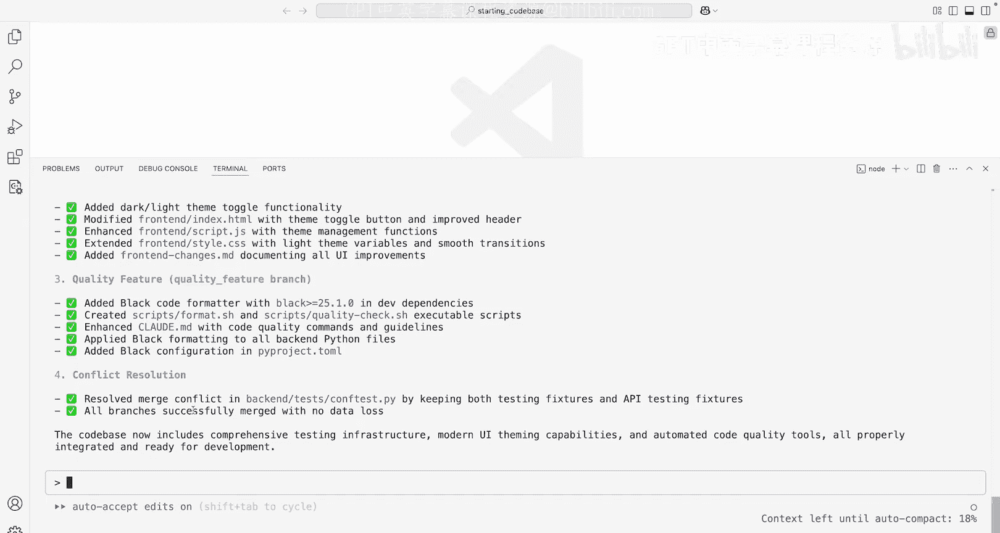
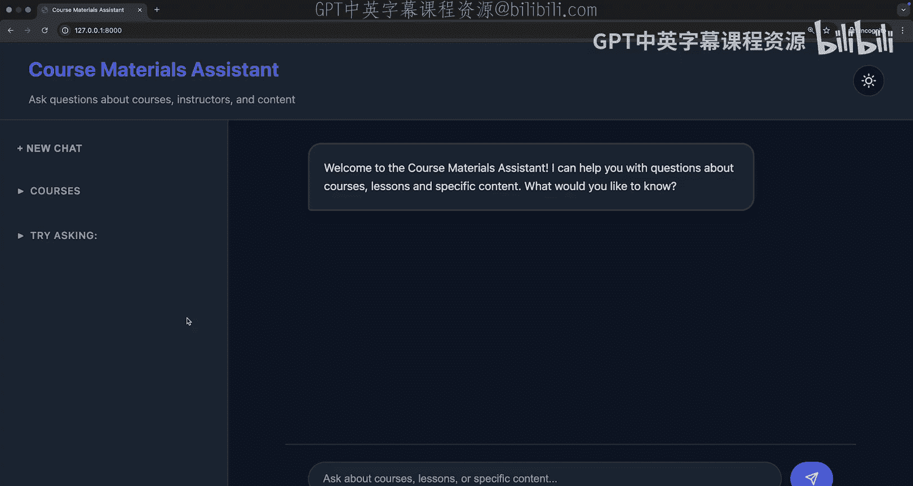
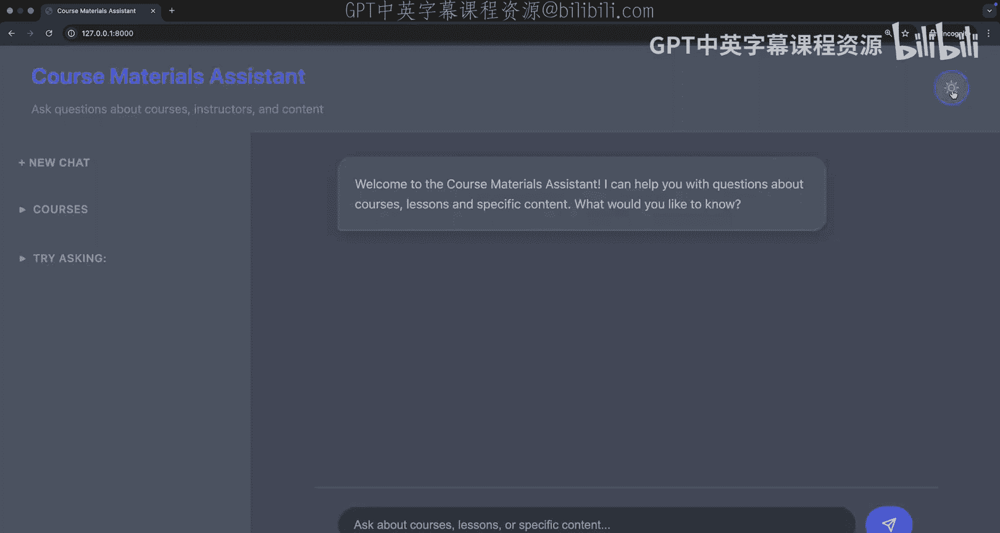
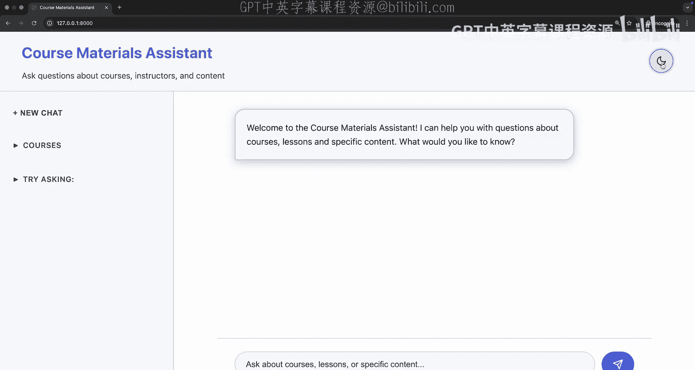

# Anthropic《Claude Code 高度主动式编程助手｜Claude Code A Highly Agentic Coding Assistant》中英 - P6：6.adding-multiple-features-simultaneously.zh_en - GPT中英字幕课程资源 - BV176t2zSEpr

。You can open multiple sessions with cloud code to work on many features in parallel to manage these sessions and make sure you're not overr the same file。

 you can use Gitwork trees So let's add Gitwork trees to add three features to the chatbot in parallel。

 I'll see you there So I'm going to hop back into cloud and as we saw earlier。

 cloud code comes built in with quite a few slash commands。

 but you can also make your own to make your own custom commands inside of the dot cloud folder。

 let's make a new folder called commands。 and inside of here we're going to make a markdown file with the name of the command that we'd like the command here that I'm going to make is called implement feature。

 So I'll create a markdown file called implement feature M inside here。

 I can place whatever I'd like。 But what I want to show you that's very special is if you have any arguments you want to pass to your custom command you can reference it using this dollar sign。

😊，Arguments variable。 So what I'm asking for here is that when this command is used。

 I'll be specifying that you're implementing a new feature。

 the user can then specify whatever that feature is。

 and then I want to make sure that cloud code is well aware to only do this for front end features and to write the changes made to a file called frontend changes M。

 you can imagine there are many different use cases for custom commands。

 certain ways you want to run tests or run files and anything that you put in here。

 does not automatically get added to your context， unlike a cloud M。

 So if you want something to be applied to every single instance of cloud code that you make。

 use your cloud M file。But if you just have specific commands that you may or may not use across different conversations。

 right here is a great place to put them。 I'm going to be using this custom command when I start talking about work trees。

 But before we do that， let's quit at a cloud code hop back in。

 and just verify that we can see that custom command。 And here I see implement feature。

 And I see the description is coming from the first part of this markdown file。

 now that Ive added this custom command， let's go ahead and add and committed。

 I could do this from the command line， but I'm actually going to ask Clade to do that for me。😊。

Add and commit change is made。 This is nice so that cloud code can create a nice commit message with some descriptive information for what was done。

 We'll see that it's adding the dot cloud folder and committing with the commands necessary。

 we can see here that this has been added to the repository。

 And since we've granted permissions for this already， we don't have to respond again。

 if you're ever curious where that lives inside of the cloud folder。

 there is a settings dot local dot Json file inside of this file。

 we can specify what commands we've allowed， so that we don't need to confirm every single time。

 as you can see here as well， when we use playwright we gave permissions and if you'd like to add your own。

 you can easily do so in this file， or even with the handy slash permissions command。

 Now that we've got that custom command set。 Let's talk a little bit about how we might want to work in parallel with cloud code。

 instead of just opening up multiple terminal windows and working directly on this code base。😊。

We're going to use Git to make sure that we don't overwrite existing files when we have multiple instances of cloud code。

 I might have two different instances of cloud code operating on the same file。

 and if I do that with the environment that I'm in right now。

 there' is going to be overr bug creation and quite a bit of confusion。

 Thankly Git has an excellent option here to use a feature called worktes and worktes allow me to essentially create copies of the code base operate in isolation and then at the end。

 merge those in together， and in fact， I can use Cla to help with that merging and management of my worktes to get started with worktes。

 I'm going to first make a folder called dottes。 and inside of this worktes folder I'm going to go ahead and add a couple work treeses。

 Let's add a work tree using the git work tree add command。And then we'll specify the folder。

 as well as the name of the work tree that I want to add。 we'll call this one UI feature。

 We'll then go ahead and add another one called testing feature。

 and then finally a third one called quality feature。To confirm I've created all of these。

 I can take a look， and I can see that I'm on the main branch currently and that I've created three separate work trees to set up correctly in each of these environments。

 I'm going to open up the trees folder。 and I'm going to open up a terminal for each one of them。

 I'll start with my UI feature and bring that over here。 I'll then go ahead。

 bring in my testing feature and I'll move that right to the side Finally。

 let's bring in our quality feature。 Go ahead， bring that over up here to give us a little more room。

 We'll make this a bit smaller。 And now we have three dedicated terminal windows。

 and we'll hide the Expr as well。 Now， let's open up Claude for each one of these environments。

 What we can do now is run cloud code in parallel。 and make sure that if the same files are modified。

 We're not overwriting。 and we can fix that later when we merge in these work trees。😊。

I'm going to use this implement feature command， and then I'm going to put in a particular feature that I'd like here and that feature allows me to add a toggle button to switch between dark and light themes so let's go ahead and create a toggle button position it and make sure that I can navigate for this particular toggle button we'll start with this part and then add in the light theme variant while this is running。

 I can now move to another workte and in this second work tree let's start thinking a little bit about what I want to do for this testing framework going to pass in a prompt here to enhance the existing testing framework and add additional tests for fast API endpoints while that's going。

 let's add some essential code quality tools to our development workflow as we do this we can start to see that changes are being requested So let's go ahead and shift between these environments and confirm the changes that we want Our tests are being written and our additional development dependencies for analyzing codebased structure and formatting。

Are being added as well What we're going to see here is that we're modifying a file called piprojectal and we're also going to see that there is a request being added to edit that particular file as well as we continue these options will make edits to these files and we'll go ahead and see at the same time that our frontend code is being done as expected。

 we can work in parallel and make sure that none of these particular changes are being overwritten by other parts of the codebase If there happen to be changes that we've made to similar files we can make sure that those merge conflicts are fixed and we can do that using cloud our frontend changes are being written orre adding more tests and we're adding some formatting tools and development scripts for quality checks So we're gonna to proceed as expected making sure that quality scripts are being done and it looks like our frontend features are being added Now add that light theme the same way that we did previously we'll use our implement feature custom command to make sure we're writing。

To our change log we'll add a light theme as well。 Once that's done。

 we'll go ahead and queue up a few other prompts we'd like for ja functionality and implementation details。

 So while that's running， I can check in on other scripts I can confirm I want to run those and if there's something going on cloud code can fix per necessary See like there are some scripts but Cla doesn't know about So we'll go ahead and either install dependencies or make sure we're running things as expected。

 and see here we're starting some code quality checks we've written our API endpoint testing and we're adding more frontend functionality。

 once this is all done， we can head over to the browser。

 we can confirm our checks are done but before we go ahead and do that let's bring in all of these individual changes if we wanted to run the tests we can confirm this is as expected we want to head to the browser for our UI testing we can do so and here we can see codebased formatting is done development scripts have been added and documentation has been updated。

 We saw before there was a pi project tomo file that was added across two。Different work trees。

 So there might be some conflicts when figuring out these individual pieces。

 Now that we feel good about each of these changes， let's add and commit with a descriptive message。

 Let's also do the same thing on this work tree。 Since we're gonna to be merging in these particular commits。

 We're gonna want to make sure we have descriptive commit messages。

 we can understand what was done in each of these work trees。 We've committed this particular commit。

 we're doing the same on this one right here。 We've finished up our Ui enhancement So let's do the same add and commit with a descriptive message。

 If you find yourself writing these kinds of prompts like add and commit with the descriptive message。

 this also could be another use case for a nice custom command where we can specify exactly some styling that we want or the way that our company operates with best git practices。

 Now that I finished committing across all three of these。

 I can now go back to my main branch and merge some things in。

 So I'm gonna to close these terminal environments and hop back to our main one。

 So now I'm gonna to ask cloud code。 to use the git merge command。 to merge in。😊。

All of the work trees。And the dot trees folder。And fix any conflicts if there are any。

 so let's have clo code merge all of these particular trees。And make sure that they work as expected。

 We can see here there are three work trees available。

 So we're gonna start by merging in each of these work trees。

 We'll confirm this is the command we want to use。 and then this should work as expected。

 Look like our testing feature doesn't have any conflicts。 let's bring on our UI feature。 And again。

 we could write these commands on our own。 a cloud code knows exactly what to do from our prompt。

 Now we can merge in the quality feature branch。 And here we'll see if there are any conflicts。

 And as we can see， in this particular file， there are conflicts。

 So what we're gonna have cloud code do is analyze these conflicts and complete the merge。

 and this can be quite valuable when you have small merge conflicts that you don't want to manually go through each time having tests here is also quite valuable to make sure that once we've finished。

 we can run our tests and the codebased works as expected。

 It now continuing with the merge as expected。 and it can commit all of these changes with the resolve merge conflicts。

 If I'd like after I can ask for it to remove these work trees or I can keep them there if I need。

 They'll do a quick。😊，Tests to make sure that these files are here as expected and that the merge configurations are what are expected here as well。

 We can also head back to the browser and see if our frontend changes are implemented as expected。

 Look like cloud code is finished up we've added necessary dependencies。

 We've modified our pi project Tomo。 We've added tests。 We've implemented the light dark themes。

 we've implemented our black code formatter to make sure that code is as expected in a certain format and added that configuration in the same file that we worked on with another work tree。

 we've fixed up any conflicts。 let's make sure this is working as expected。

 So back in the browser I now see here I have this lovely theme and as I toggle through I can see a light theme and a dark theme。

 There might be some more things I want to tweak here and there。

 but I've been able to edit across all parts of the stack even do things in the linting and Devop side of things all without overr causing challenging headaches through the power of Gitworkre。

😊。

In the next lesson， we're going to see how we can use cloud code outside of the terminal through an integration with GitHub to allow for reviewing poll requests。

 making changes， and being helpful outside of the terminal ecosystem。

