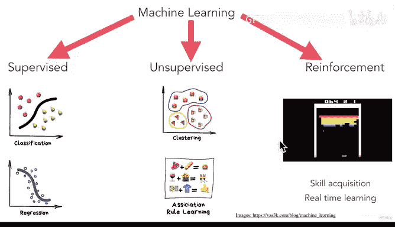

# Bourne《机器学习和数据科学训练营｜Zero to Mastery Data Science and Machine Learning Bootcamp》 - P10：010_02_007 机器学习的类型.zh_en - GPT中英字幕课程资源 - BV1yhrvBVEv2

Welcome back。Up until now， I've been blabbering on about what machine learning is。

 And I hope you have a bit of an idea of why we have it and why it's useful。

 But at the end of the day， the only reason that we care about machine learning。

 is that we're able to use machines to predict results based on incoming data。 That's it。

Now this idea of machine learning and don't worry， I know we keep talking about theory。

 but I promise we're going to get some coding exercises first。

 but I do want to talk quickly about some of the machine learning categories that you often see。😡。

And keep in mind what I said， that is， machine learning is simply about predicting results based on incoming data and all these subcategories simply do that。

For example， we have the idea of a supervised learning。Which is a subset of machine learning。

In this supervised learning， the data that we received already has categories。

 Think of it as a CSv files with rows and columns label。

 We have labeled data and a test data that is labeled so we know if our function is right or wrong。

So in a supervised learning scenario， we can do things like classification to decide。

 is this an apple or is this a pair Mach learning model simply draws a line to decide， hey。

 this is an apple and this is a pe。😡，Or we might do something called regression instead of classification based on inputs。

😡，For example， predicting stock prices， Another way that we might use supervised learning is。

 for example， to hire engineers based on inputs， based on years of experience， based on maybe age。

 maybe where they live， what type of computers they have， all these sorts of inputs。

 that are labeled。Can be used in a supervised learning system to decide。

 should I hire this engineer or should I not Now， sometimes we have data that doesn't have labels。

 and this is called unsupervised learning。 again， think of it as a CV file without perhaps the column names label。

 Sometimes with things like clustering。 we need to create these groups。

 or at least the machine to create these groups， For example， we give it a bunch of data points。

 and then the machine decides， oh， this is a group， this is a group， and this is a group。

 or we can have something like association rule learning， where we associate different things。😡。

To predict what a customer perhaps might buy in the future， when groups don't exist。

 we call it unsupervised learning。 We can' tell the machine that they are right or wrong。

 like we can when we do apples versus pairs， since there are no true categories。

 but we let the machines just create these categories for us。 Finally。

 we have this idea of reinforcement learning。And reinforcement learning is really interesting because it's all about teaching machines through trial and error。

 through rewards and punishment。So the program simply learns a game by playing it millions of times until。

 well， it gets the highest score， it doesn't know what it's doing at first。

 but then it tries to maximize。😡，The score and eventually figures out that， hey， maybe I should。

Try and move where the ball is coming。So this is seen for skill acquisition or real time learning。

 and you see it a lot in machine learning programs that play， for example， video games。

 but the idea here is that machine learning has different categories and different ways to accomplish its goal。

😡，And topics like neural networks， decision trees support vector machines。

 K nearest neighbor are simply algorithms that are used with these sub fields in order to come to these predictions。

😡，But remember the key thing， all of these， what they're doing is trying to learn from the data that it receives and predict something。

I'll see you in the next one。

Bye by。