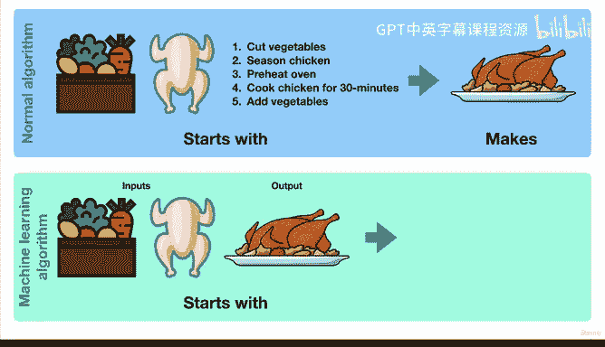

# Bourne《机器学习和数据科学训练营｜Zero to Mastery Data Science and Machine Learning Bootcamp》 - P11：011_02_009 什么是机器学习（第二轮）.zh_en - GPT中英字幕课程资源 - BV1yhrvBVEv2

Let's start from the top with what is machine learning。😡，While machine learning is broad。

 it contains many different aspects and you'll see many different definitions of it online。

 but for the sake of this course， we're going to keep it practical in a single sentence。

 machine learning is using an algorithm or computer program to learn about different patterns in data and then taking that algorithm and what it's learned to make predictions about the future using similar data。

😊，Machine learning algorithms are also called models and will use the term interchangeably throughout the course。

😡，How machine learning algorithms differ from normal algorithms and computer programs is the learning aspect。

😊，Let's use an example。Where a normal algorithm could be a set of instructions。

 such as how to turn a pile of raw ingredients into your favorite honey mustard chicken dish。😡。

The set of instructions might start out by saying， first， cut up the vegetables。

 then season the chicken， then preheat the oven， et cetera。 And if you follow these steps correctly。

 you'll end up with your favourite honey mustard chicken dish。 Or that's make me hungry， actually。

We'll get back to it what's important to note here is you started with an input。

 your set of ingredients and a set of instructions on what to do to get to your favourite dish。😊。

What happens with a machine learning algorithm is instead of starting with an input and a set of instructions。

 you start with an input and ideal output In our case。

 the ingredients is the input and the output is our favorite chicken dish。

 and what a machine learning algorithm does is it looks at the input， the raw ingredients。

 and then it looks at the output。 The favorite chicken dish。

 and it tries to figure out the set of instructions in between these two。😊。

Now think about this。 if you tried to do this on your first try， you might not get great results。😡。

You might put in too much spice and the dishes come out far too hot。 On your second try。

 you get a little closer。 But when it comes to machine learning， sometimes there may be hundreds。

 thousands or tens of thousands of these combinations of inputs and outputs。

If you looked at the set of ingredients and ideal outputs， your favorite chicken dish 100 plus times。

 you'd probably get pretty good or pretty close to figuring out what the set of instructions are to make that dish。

😡，Now。We're missing out a few steps here， but this is what machine models do in a nutshell。

 They find patterns collected in data so we can use those patterns for future problems。

In our chicken dish example， a machine learning algorithm might find a way to create a delicious chicken dish。

 given the right ingredients that way， instead of thinking about what dish we could make with what's in the fridge。

 the machine learning algorithm tells us。😊，You might not be thinking， hey。

 I've heard about data analysis and data science as well。 How are all these different。Great question。

Data analysis is looking at a set of data and gaining an understanding of it by comparing different examples。

 Different features and making visualizations like graphs， for our example。

 this might be looking at different samples of ingredients and comparing them。

 What do all the ingredients have in common。 Are some of the missing something。

 which have the most of a certain type of thing。Data science is running experiments on a set of data with the hopes of finding actionable insights within it。

😡，One of these experiments may be to build a machine learning model。

 This model might look at 10000 different sets of ingredients and 10000 different chicken dishes。

 Then tell us based on a set of new ingredients that we have which chicken dish these ingredients are most likely to make。

You can consider data analysis and machine learning as a part of data science。

Don't worry if all of this seems unclear for now， by the end of this course。

 you'll have had plenty of hands on experience with all of these。😡，Before the next lesson。

 take a minute to think about an example of a set of instructions you followed before。

 Do you think if you were shown the inputs and the end goal of something enough times。

 you could work backwards and figure out the instructions it took to get there。😡。

