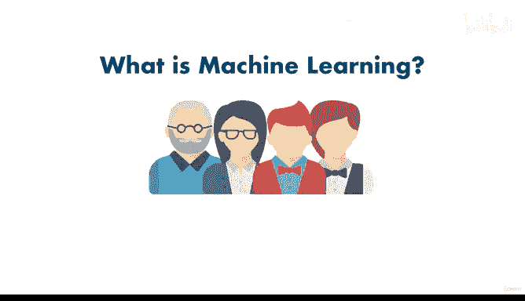

# Bourne《机器学习和数据科学训练营｜Zero to Mastery Data Science and Machine Learning Bootcamp》 - P12：012_02_010 章节回顾.zh_en - GPT中英字幕课程资源 - BV1yhrvBVEv2

So what is machine learning now that you've gotten an inputs from both myself and Daniel。

 you should feel comfortable answering your coworkers， right？As a final challenge。

 I want you to pause this video and go to our Discord server and to our machine learning and data science channels。

And just in brief five sentences or less explain what is machine learning。

If you can explain it in less than five sentences， good then you've comprehended this first section。

 we're just getting started， but that's all we want to do for now。So what is machine learning？Well。

 we learned that computers are really good at processing large amounts of data。

 data that we're creating more and more of。Machine learning lets computers make decisions about data。

 it lets computers learn from data and they make predictions and decisions。

What product does a YouTube recommend Does this person have a heart disease is this em spam all use machine learning。

 so we essentially let computers decide for us， although computers only understand numbers at the end of the day。

 only ones and zeros using machine learning we found ways to essentially let computers decide for us and answer hard questions that in the past only humans could answer。

 but machine learning at the end of the day is just a general term for when computers learn from data。

 It allows computers to do tasks that in the past required humans and make our lives hopefully easier。

I'll see you in the next section。Bye bye。