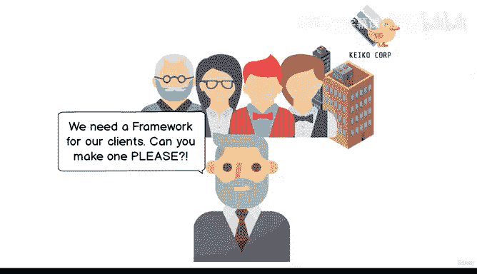

# Bourne《机器学习和数据科学训练营｜Zero to Mastery Data Science and Machine Learning Bootcamp》 - P13：013_03_001 章节概述_1.zh_en - GPT中英字幕课程资源 - BV1yhrvBVEv2

Hey， it's Bruno here。 Just want to say welcome， congratulations on your second day。

 It seems like the coworkers are impressed with you。

 They told me that you talked to them about what machine learning is and they were impressed with your amount of knowledge。

 So good job。 But anyway。😊，We got to get you working because we have a lot of clients and they really need us。

 So we have a client right now that needs to implement their own machine learning data science framework for their employees。

 they have about 20 data scientists，20 machine learning engineers and everybody's kind of doing their own thing We need a way to standardize their practices into one so that they can manage all their employees would you mind creating a framework that our clients can use and maybe we can use it our company as well。

 Kcocorp needs something standardized so that when we hire more people like you。

 we're able to have a nice clear framework that they can use。

Shouldn't be a problem for you， right， genius？

Right， there you are。 You passed the first day。 but second day， we got to create this framework。

 And and Bruno wants it done by tomorrow。 So what do you do， Well， it's time to ask your friend。

 Andre and Daniel。 So in this section， we're gonna to build our own machine learning and data science framework。

 That is a template that we can use throughout the rest of the course throughout the rest of your career to think about how to solve problems。

 Here's the thing with this section。 This is the last section of the course where we talk about theory and we look at some slides and look at some diagrams。

 After this section， we go into full coding。 We're going to start actually building our own models。

 actually working with data for the rest of the course。😊，But this section is really。

 really important because when you go through it the first time。

 it's not going to stick automatically。This section。

 we left it this way so that you can come back to it every once in a while throughout your career。

 also throughout the course to be reminded of the framework that we're using of the steps that we're using and the rest of the course is going to build on this framework and build our skills so that we become better and better with this framework。

 but like I said， it's not going to stick right away So every once in a while if you feel a little bit overwhelmed throughout the course or maybe you're not getting something。

 maybe hit pause and come back to this section and rewatch it。

 And at the very end of the course when you've finished all the lectures。

 I want you to come back to this section and realize how much you've learned how much clearer this framework becomes once you've completed the course。

And like I said， this is going to be the last section where we're just talking without you actually getting to practice and code。

 but once we build this， we're ready to dive deep。😡，So let's get started。

 let's create our own framework。😡，And hopefully， go into work the next day and make Bruno happy once again。

 survive day two。

Let's get started。