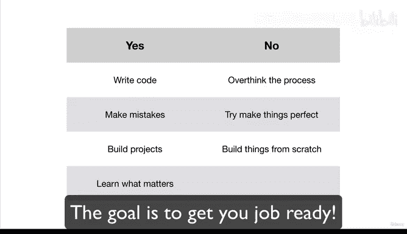

# Bourne《机器学习和数据科学训练营｜Zero to Mastery Data Science and Machine Learning Bootcamp》 - P14：014_03_002 介绍我们的框架.zh_en - GPT中英字幕课程资源 - BV1yhrvBVEv2

Now， if you've looked up machine learning before， you know there's a lot out there。

 Some resource recommend learning mathematics， statistics， probability。

 and even more before getting started with data science and machine learning。

And while these topics that are important， trying to learn them all before getting started。

 getting hands on is like trying to boil the ocean。😡，Instead。

 what we're going to be doing is focusing on building practical solutions and writing machine learning code to get insights out of data。

😡，If you're a programmer now and had some experience with Python， by the end of this course。

 you'll be able to use your programming skills to build predictive machine learning models。😡。

Machine learning comes in three parts， data collection， data modeling and deployment。

 where you might take your machine learning model after you've gone through these steps here。

 don't worry we're going to cover this framework in depth shortly。😡。

You might take this machine learning model and deploy it to users through your application or through an API or some sort。

 This is what we're going to cover。 We're going to cover data modeling。

 which means you'll be able to take a data set and apply machine learning algorithms to find insights on that dataset set。

The steps we're going to cover is number one， create a framework。

 You saw a little bit of an outline of that in the previous slide。 Ner two。

 we're going to match that framework once we've gone through it to available data science and machine learning tools。

 This means that people have already had similar problems to what we're going to try and solve in the future in the past。

 and so they've created tools for those problems So we're going to learn what tools are used for what machine learning projects。

 and then to learn all of this we're going to learn by doing by going through projects which involve step1 and step 2 to build a portfolio to show off your work and your skills。

😡，The utmost care has been taken to focus on what matters When I started learning machine learning。

 I found myself confused about what to do Too often。

 I'd spend too much time thinking about something instead of writing code and taking action。

 So we've designed this course to avoid that。 Instead of doing anything and everything from scratch。

 we're going to be using what works to build practical solutions and at the same time learning about machine learning and data science。

 Now， let's take a deeper look at the framework we're going to be using。

