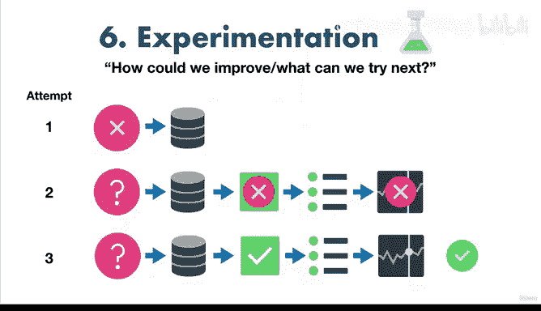

# Bourne《机器学习和数据科学训练营｜Zero to Mastery Data Science and Machine Learning Bootcamp》 - P15：015_03_003 六步机器学习框架.zh_en - GPT中英字幕课程资源 - BV1yhrvBVEv2

Since machine learning projects can cover many different topics。

 it's important to design a framework you can use to approach different kinds of problems。

 You can consider what we're about to go through as like a little field guide that you can use for machine learning So when you come up against a problem。

 you can refer back to this field guide and go， hold on。

 I need to break this problem down into a few little steps， what does a field guide say。

The framework we're going to be using comprises six steps After working on many machine learning projects across multiple different industries。

 these are the steps Ive found which come up time and time again we're going to see this diagram a lot in the next few lectures。

 but in this one we're going to dive into each of these steps individually in and see what kind of components they have。

Step one is problem definition since we'll be focused on code first practical solutions。

 it's important to define what problem we're trying to solve is it a supervised or unsupervised learning problem I it a classification or regression problem don't worry we'll see how to figure these out in the next few lectures。

Step two is data Since machine learning involves using algorithms to find and learn different patterns in data。

 data is a requirement for any machine learning project。

The question we're trying to answer here in step two is what kind of data do we have？

Depending on the problem， there are different kinds of data。

 structured data such as rows and columns or what you'd expect to find in an Excel spreadsheet。

Or unstructured data， such as images or audio。😡，Once we know what kind of data we have。

 we can start to make decisions on how to use machine learning with it。

Step 3 is evaluation here will define what success means to us since machine learning。

Since much of machine learning actually is experimental。

 you could keep going forever trying to improve your results in search of the perfect model。😊。

However， since we're practitioners， we know the perfect model doesn't exist。 Instead。

 we begin by saying for this machine learning， real estate project to be feasible。

 we need at least a 95 per cent accurate model at predicting the cost of houses。 Of course。

 in the beginning， this evaluation metric won't be exact and will likely change over time。

 but having this at the start of a project gives us something to aim for。😊，Step 4 is features。

The question we answer here is， what do we already know about the data？Now。

 even within different types of data， there are different kinds of features。 For example。

 for predicting whether or not someone has heart disease。

 you might use their body weight as a feature。 since body weight is a number。

 it's called a numerical feature。 and after talking to a doctor。

 they might tell you if someone's body weight is over a certain number。

 they're more likely to have heart disease。There are more kinds of features such as categorical and derived。

 we're going to look at these in future lessons。😊，But the premise remains a machine learning algorithm's goal is to turn these features such as weight。

 sex， blood pressure and chest pain。Into patterns to make predictions。

 such as whether or not a patient， we've got unique patient IDs here， has heart disease or not。

Step 5 is modeling。Once you've learned a little bit about your data， the next step is to model it。😡。

The question here is based on our problem and data， what machine learning model should we use？

Unlike other algorithms and sets of instructions you have to write from scratch。

 many of the most useful machine learning algorithms have already been coded for you。

 which is beautiful for us。😊，Some models work better on different problems than others。

 and in the beginning your focus will be to figure out the right model for the right kind of problem。

Step 6 is experimentation。 All of the steps we've just been through happen in a cycle。

 You might start out with one problem definition and find your data isn't suited to it。

 Then you might build a model and find it doesn't work as well as you outlined in your evaluation metric。

😊，So you build another one and you find out this one actually works pretty good。

 but what's important to remember is although these steps are here。

 the steps that we've been through in this framework。

 it doesn't mean that they have to befo in order， nor are they set in stone。

 consider them a rough guide。😡，Now we've been through each of them briefly。

 let's look at each one in a little bit more detail。

