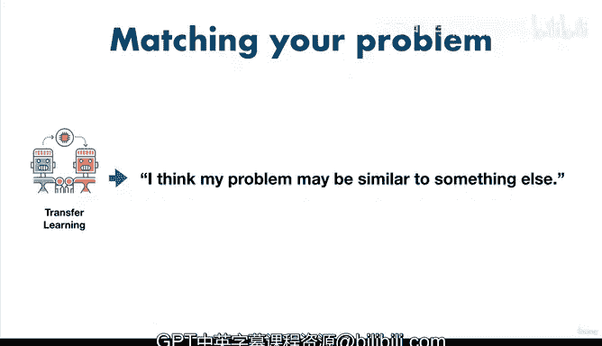

# Bourne《机器学习和数据科学训练营｜Zero to Mastery Data Science and Machine Learning Bootcamp》 - P16：016_03_004 机器学习问题类型.zh_en - GPT中英字幕课程资源 - BV1yhrvBVEv2

Look at this beautiful framework。 Now， we've covered each of these steps briefly。 We're going。

 we're going to dive into each of them one by one。 The first one is problem definition。

The question you're trying to answer in the first step is what problem are we trying to solve？

But before we get into different types of machine learning problems。

 it's important to know machine learning isn't the solution to every problem。

 You might think that that's weird been in a machine learning course， but this is。

 this is an important concept to remember。So when shouldn't you use machine learning？Well。

 will a simple hand codeed instruction based system work。

Then you should favor the simpler system over the machine learning system。

Such as if you wanted to make the favourite chicken dish we used before an example。

If you had the ingredients and you knew the exact steps you had to take to create your favorite chicken dish。

 it's probably best that you choose a simple system over using machine learning to try and figure the steps out。

Other than these kind of scenarios where you know the simple hand codeed instruction based system already。

 most of the time， you can probably find value using machine learning。

Now comes the first step in identifying the problem we're trying to solve as a machine learning problem。

 We can do this by matching our problem， The one we're working on it might be a business problem or some other kind of problem to the main types of machine learning problem。

These are supervised learning。Unsupervised learning， transfer learning and reinforcement learning。

 We're going to be focused on supervised learning， unsupervised learning and transfer learning。Why。

 because these are the most common ones you'll find and you'll come across in practice and they the ones when I was a machine learning engineer or when I work on machine learning problems that have proven time and time again to be useful。

😡，Supervised learning is called supervised learning because you have data and labels。

 A machine learning algorithm tries to use the data to predict a label。

 If it guesses the label wrong， the algorithm corrects itself and tries again。

 This act of correction is why it's called supervise。

 It's like if you were trying to guess the steps it took to turn a set of ingredients。

 the data into your favorite chicken dish。 the label， if you tried once and got it wrong。

 you'd tell yourself this was wrong。 Maybe next time will try something different。

 A supervised learning algorithm repeats this process over and over and over again。

 Try to get better。The main types of supervised learning problems are classification and regression。

Classification involves predicting if something is one thing or another。

 such as if you wanted to predict whether or not a patient had heart disease or not based on their medical records or what type of dog breed was in an image。

If there are only two options， it's called binary classification， if there are more than two options。

 it's called multiclass classification。😊，So trying to predict heart disease or not heart disease would be binary classification because there's only two classes。

 heart disease or not heart disease， and trying to predict different dog breeds based on photos in images would be multiclass classification because there are many different kinds of dog breeds。

😊，Regression problems involve trying to predict a number。

 You might hear it referred to as a continuous number as well。

 which just means a number which can go up or down。

A classical regression problem is trying to predict the sale price of a house based on things like number of rooms。

 the area it's in， how many bathrooms it has， or trying to predict how many people will buy a new app based on website visits and clicks。

😊，Unsupervised learning has data， but no labels。 For example。

 you might have the purchase history of all customers at your store。

 and your marketing team wants to send out a promotion for next summer。

 but they know not everyone will be interested in new summer clothes So they come to you as the inhouse data science and machine learning engineer and ask。

 do you know who's interested in summer clothes。Well the thing is you don't either。

 but you know you can figure it out from the data you have。😡。

So you decide to run an algorithm to find patterns in the data and group customers who purchase similar things together。

Once it's finished， you notice two groups。One group of customers who purchase only during wintertime and one group of customers who purchase mostly during summertime。

You label them with winter customers and summer customers and send them to your marketing team。

And they thank you for saving them sending out thousands of unwanted emails。

 I'm sure you've probably got some of those kind of emails in your email inbox before。😊。

What's important to note here is that you provided the labels， they weren't there to begin with。

 but the patterns were， and that's what the machine learning algorithm found。😡。

And after inspecting the groups， you're the one who saw the commonalities and applied the labels such as summer or winter。

Problems like this are also called clustering or putting groups of similar examples together recommendation problems such as recommending what music someone should listen to based on their previous music choices often start out as unsupervised learning problems like this。

Transfer learning leverages what one machine learning model has learned in another machine learning。

For example， Sare trying to predict what dog breed appears in a photo as a cute dog。 That's my。

 ass my py 7。 And that's Ber in the background there。She's posing。

 shes she knows she's on this lecture。😊，You could find an existing model which is learned to decipher different car types and fine tuned for your task。

Why is this valuable？😡，Because training a machine learning algorithm。

 which means letting it find all the patterns in data。Can be a very expensive task。

To find patterns in data， a machine learning algorithm has to make millions of calculations。

 and although computers are very fast at making calculations。😊，Making calculations aren't free。😊。

So instead of learning everything about different photos from scratch， such as what patterns。

 different trees look like， what different shapes are like the rectangle down here。

 what grass looks like， the car type model， the machine learning model which has figured out what kind of different cars look like has already done most of these things if you've already trained a model。

 it might have already figured out， okay， these are trees not cars， these are grass。

 and so it kind of has an idea of what different patterns look like。😊，Now。

 you can think of this as being the same as when you write an essay versus writing poetry。

 although the writing styles are different， the writing that you do uses the same fundamental principles。

So we can take this car model that it identifies different cars and use its foundational patterns and apply it to our dog breed problem。

 Of course， there's a few more steps involved here。

 but that's the basic premise of transfer learning。

Reinforcement learning involves having a computer program perform some actions within a defined space and rewarding it for doing it well or punishing it for doing poorly。

 a good example is teaching a machine learning algorithm to play chess。

 The chess board is the divine space。 and the actions are moving pieces。

 And when I say punishment or reward。 these things could be as simple as updating a score with plus one。

 if it wins， a negative one， if it loses， the machine learning's algorithm's goal could be to maximize the score。

 So this means if you've done it right， it should learn moves which lead to wins。😊。

Reinforcement learning is what was used for Deep Minds Alphago to become the best go。

 a complicated Chinese ball game， far more complicated than chess， player of all time。

Defeing many go world champions， and although promising。

 reinforcement learning has yet to find its way into to many practical applications。

 And since we're focused on building practical solutions。

 we've decided to focus on the other kinds of learning， such as supervised learning。

 unsupervised learning and transfer learning throughout this course。😊，Now。

 you know the major types of learning。 you've now got the tools to tackle step  one in the framework。

 problemble definition， aligning the problem you're trying to solve to a machine learning problem。

So for supervised learning， you might say， I know my inputs and outputs such as I've got patient records could be the inputs and the outputs whether or not the patient has heart disease。

Or your inputs could be the parameters of a different house and the number of rooms where it's located。

 how many bathrooms there are and your outputs are how much the house， of course。

 so that's a regression problem and for unsupervised learning。

 you might say I'm not sure of the outputs， but I do have inputs such as customer purchases and you're trying to figure out which customers are most similar to each other。

Or for transfer learning， you may think my problem might be similar to something else。

 can I leverage what an existing machine learning model has learned and use it in my own？😡，Now。

 don't worry if these kinds of learning are sort of going over your head at the moment。

 We're going to be building a hands on project for each of these learning types， supervised。

 unsupervised and transfer throughout the course。 In the meantime。

 Have a think about some of the problems you face day to day。

 Could any of them be classified as a machine learning problem。

 Are you trying to to classify whether one thing is something or another。

 That's a classification problem。 Do you ever try to predict what what a number might be。

 That could be a regression problem。

