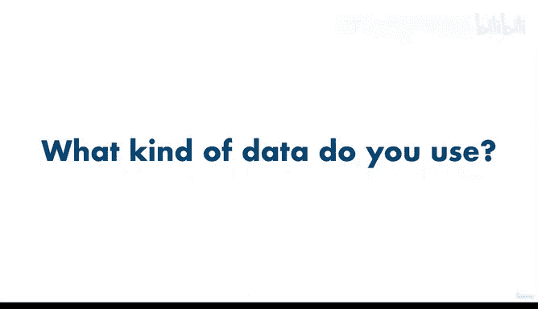

# Bourne《机器学习和数据科学训练营｜Zero to Mastery Data Science and Machine Learning Bootcamp》 - P17：017_03_005 数据类型.zh_en - GPT中英字幕课程资源 - BV1yhrvBVEv2

Now we figured out what problem we're trying to solve We've matched our specific problem to a different type of machine learning problem。

 It's time to have a look at what data we have， As you may have guessed。

 the question we're trying to answer here is what kind of data do we have Data comes in many different shapes and sizes。

 but the main two types are structured and unstructured。

Structured data is something you'd expect to see in an Excel file。

 such as rows and columns of different patient medical records and whether or not they have heart disease or not。

 or customer purchase transactions。😊，It's called structured data because all of the samples。

 the different patient records are typically in similar format。

 meaning one column might contain numbers of a certain type。

 such as average blood pressure or sex or weight of a patient and another column might have whether they have chest pain or not and what the level of intensity is。

😊，Unstructured data are things like images， natural language text， such as transcribed phone calls。

 videos， and audio files。😊，Although we can turn these into numbers and create structure。

 they typically come in many varying formats， one picture of a dog may look completely different to another image of a dog。

 and the emails you write back and forth with a friend may have a completely different structure to the emails you write to a co。

 Now within these two data types， there's static and streaming data。

 static data is data which doesn't change over time。

 you may have a spreadsheet of patient records in a dot csv format。

 which stands for comma separated values， which simply means all of the different data is in one file separated by commas。

 It looks like this。 So you check this table， we've got the I comma weight comm sex。

 And if we were to read that in to a data frame using a tool like pandas。

 we'll have a look at this in a future lesson It would look something like this。

 So a lot of data you'll actually come across comes in a simple format。

This but to turn it into something that is a little bit more structural， you can convert it to this。

Now CSV is one of the most common types of static data formats。

 we're getting to get very used to this by the end of the course。

And since these values won't really change over time。

 they're called static usually what you'll want is a lot of these examples in machine learning。

 there's a saying the more data， the better， which makes sense if you think about it。

 the more examples you have of something such as the inputs and outputs of patient records。

 where the inputs， are a patient's body parameters and the outputs are whether they have heart disease or not。

😡，The more chances you'll have defined patterns between them。

 the same goes for machine learning algorithms， the more examples they can look at。

The more chance they have at finding patterns and thus using those patterns to predict something in the future。

 like whether a new patient who comes along who isn't in this table。

 whether they have heart disease or not。Streaming data is data。

 which is constantly changed over time。 For example。

 say you wanted to predict how a stock price will change based on news headlines。

 You'd be working with streaming data since news headlines are being updated constantly。

 You'll want to be the first to see how they change stocks。

Most of the work you will do in practice will start on static data。

 and then if your data analysis and machine learning efforts prove to show some insights。

 you'll move towards streaming data for when you go to deployment or in production a common data science workflow begins by opening a CSv file in a Jupyter notebook。

 a tool for building machine learning projects， then exploring the data and performing data analysis using pandas。

 a Python library for data analysis， and making visualizations such as graphs and comparing different data points using Mapllib。

 then building machine learning models on the data using PsKt learn。

 such as a machine learning model to predict using these patterns here。

 whether or not a patient has heart disease。Don't worry if you're thinking what's a Jupiter notebook and pandas what are we at the zoo we've got dedicated sections and projects coming up for each of these tools。

😡，For now， think about the different kinds of data you create or use every day。😊。

Are they structured or unstructured， How much data is there？

