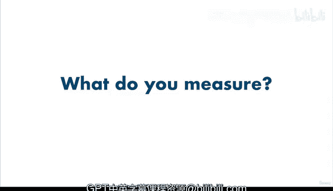

# Bourne《机器学习和数据科学训练营｜Zero to Mastery Data Science and Machine Learning Bootcamp》 - P18：018_03_006 评估类型.zh_en - GPT中英字幕课程资源 - BV1yhrvBVEv2

Now we've gone through step one and two problem definition and data it's time for step three evaluation。

Now every machine learning problem you come across will have the similar goal of finding insights in data to predict the future in some way。

😊，An evaluation metric is a measure of how well a machine learning algorithm predicts the future。

And in this step， the question you'll want to answer is what defines success for us？For example。

 if your problem is to use patient medical records to classify whether someone has heart disease or not。

 you might start by saying for this project to be valuable。

 we need a machine learning model with over 99% accuracy because predicting whether or not a patient has heart disease is an important task。

 so you'll want a highly accurate model。And as you could imagine。

 there are different evaluation metrics for different problems for classification or predicting whether something is one thing or another。

 accuracy， precision and recall a common for regression or predicting a number such as how much a car will sell for。

 You'll probably want to minimize how different the number your model predicts to the actual sale price for this。

 mean absolute error and mean squared error are common options。 or for recommendation problems。

 you may have thousands of different products to recommend to someone， But in reality。

 you only care about the top 10 recommendations and how well they align to a customer's potential interest to measure this。

 you could use precision at K where in our case， K is 10。😊。

Sitting down and thinking about an evaluation metric at the start of a project ensures everyone on it has a similar goal to work towards。

😊，But it's important to remember these don't have to be exact either as you find out about more about the data。

 you might find the evaluation metric changes as the project goes on。For now。

 don't worry if you're not too sure about each of these。

 we'll see different examples of these as we build projects。

As an example of an evaluation metric being used in practice。

 we had a project where we wanted to use the text from car insurance claims to predict who caused the accident。

😊，The person submitting the claim or the other person involved。😡。

The car insurance company we partnered with wanted at least a 95% accurate model to consider the project worth continuing。

This meant the model I was building had to be able to read a car insurance claim and predict with 95% accuracy who caused the accident。

This meant it was only allowed to get it wrong， one out of 20 claims。Again。

 we'll learn more about evaluation metrics when we get hands on for different projects。

 But the thing to remember is， as you go， you'll start to define a problem， like in step 1。

 Then you'll start to remember， oh， this is a classification problem。

 I should use accuracy as my evaluation metric to get an idea of how my model is doing。😊。

Before we go on to step 4， have a think about different things you measure every day。

How do you measure them， Are there different kinds of measurements for different tasks？

