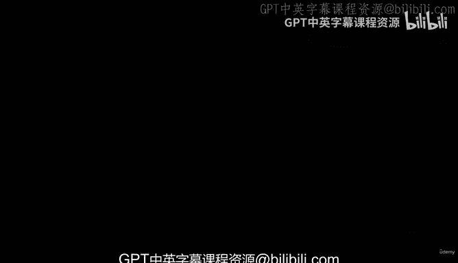
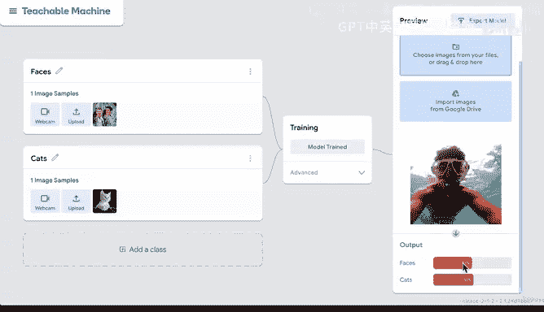
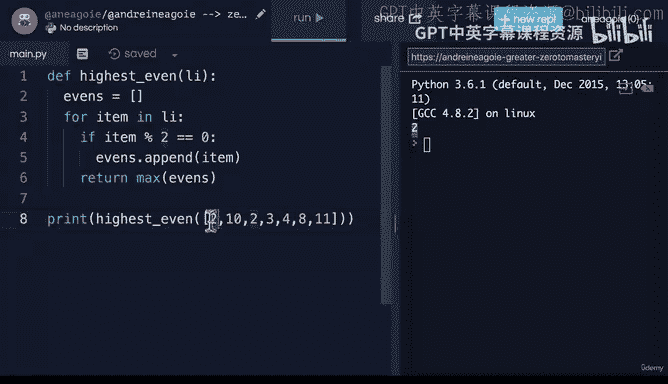
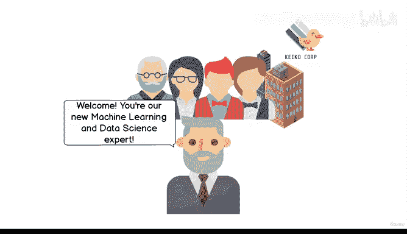

# Bourne《机器学习和数据科学训练营｜Zero to Mastery Data Science and Machine Learning Bootcamp》 - P1：001_01_001 课程大纲.zh_en - GPT中英字幕课程资源 - BV1yhrvBVEv2

Hello， I'm super super excited to start and hopefully you are too。

 but in order for us to uncover this world of data science and machine learning。

 we need to understand what we are learning and where we're going to end up so we have a clear path to success。

Now， this course has over 200 H videos that are broken down into sections。

 so let's go over the section so you know what the plan is。

First we start off with a really fun section Machine learning 101 What is machine learning we're going to play around some fun tools and understand what this whole craze around machine learning is so that you're able to explain this to your friends。

 family and dog okay maybe not the dog once we get comfortable with the idea of machine learning we understand the history and how we got here and how it works on a high level we then have two paths for you to follow one is if you don't know Python or have never programmed in your life Well we're going teach you some python so that you're able to follow the rest of the course。

The other path is for those who are already familiar with programming and Python and want to just dive straight in so you can pick Python or we keep going with the course The next part is about work environment we want to have a professional setup that you're going to use in real life scenarios so we're going to introduce you to topics like Jupiter notebooks。

 Connda and virtual environments so that by the end of the section you have a professional setup and when you go into work on your first day on the job you understand exactly what you need to install on your computer。

We then move on to data analysis， how do we analyze this data that we have using libraries like Pandadas？

Then we learn about a very important library when it comes to data science， and that is Numpy。

 a fundamental tool for all data scientists。Then we move on to data visualizations this is going to be really fun because we get to work with libraries like MatplotLiB that allows us to make really neat graphs and visuals to describe our data。

We then go into the very popular PsyD Learn if you want to get into machine learning。

 you need to know this library and PsyI Learnearn allows us to use models and train models and check how accurate our machine learning models are In that section。

 we're going to learn a complete workflow for machine learning project。

Then things get interesting this is when we start working on real life project and actually dive deep into machine learning。

We're going learn about supervised learning about neural networks， transfer learning。

 deep learning we're going to do projects on classification。

 regression we're going to build models around time series data Now we're not going to shy away from difficult topics here We're going to introduce you。

 especially later on in the course to advance topics like deep learning neural networks and transfer learning and we use the latest version of TensorF and care us to do fun projects like image classifications transfer learning We're even going to show you how to use GPUs on your models to accelerate the training This is going be a really fun part where we actually work on reallife projects and we're going to have notebooks and workbooks by the end of it to show off on your portfolio。

We then get into data engineering Data engineering is actually a whole field in itself。

 but as a data scientist you need to understand what they do and what the big high levelvel concepts are on topics like Hadoop and Spark so that you know how they're used in the industry and you can communicate with data engineers。

This is a part that's often missing in a lot of courses。

But one of my favorite parts is this last part， the storytelling and communication。

 something that we're very excited about because it's a topic so important but often forgotten。

 that is in order for you to be a successful machine learning and data science engineer。

 you need to be able to communicate your work， present your work to management to boss to your coworkerworks。

🎼So using our experience working in the industry， we're going to show you how to work on your storytelling communication to present your project and to really stand out from all your colleagues Data science is a popular field and in order for you to succeed。

 we want to go beyond just the basics and communication is a big part of that As you can see we have a lot to cover here a lot of videos and a lot of exercises but I promise you it's going to be a lot of fun as a matter of fact。

 we're going to follow a storyline where you get hired at a company and all these tasks are going to be thrown at you by a boss and we've mimicked these tasks based on our experience working for companies so that when you land your first job。

 well， you won't have any surprises or at least your use to the work environment By the end of it all。

 this is all going to fit in together and make sense from the very beginning machine learning and data science basics to the very end with building our own projects We're going to take you from zero。

mastery but you know what， the best part of this course is our online community We have thousands of developers chatting every day。

 helping each other out solving problems together and just talking about the latest and greatest in programming。

 data and the tech world。Now this is an optional resource for you to use so you can have back and forth conversation with other students and myself and Daniel。

 the idea is for you to feel like you're part of a classroom and you're not doing this all by yourself。

But you know what in off talk， I know you're getting excited， I am too。

 so let's get started in the next video it's your first day at work and we're going to start this course。

Let's start learning and see why being a data scientist has become one of the most in demand skills in the world。

Let's get started。