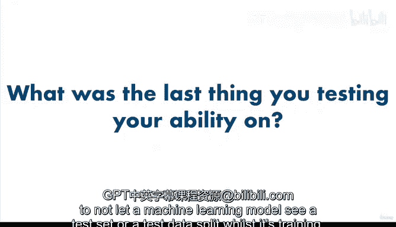

# Bourne《机器学习和数据科学训练营｜Zero to Mastery Data Science and Machine Learning Bootcamp》 - P20：020_03_008 建模 - 数据拆分.zh_en - GPT中英字幕课程资源 - BV1yhrvBVEv2

Look at us go。 We're moving to this framework at lightning pace。 We've done problem definition。

 we've looked at data， we've decided on an evaluation metric we've understood a few of the features we've got in our data now we're up to step 5 which is modelling Now there's a few parts to modelling so we've broken this down into four different sections this is we're in section1 this is probably the most important concept of machine learning at three sets and now over the whole of modelling we want to answer the question based on our problem and data What machine learning model should we use。

😊，Modeling can be broken down into three parts。Choosing and training a model。

Tuning a model and model comparison Before we get into these， though。

 Part one of modelling is and the most paramount topic to discuss in this whole entire course is the most important concept in machine learning。

The train， validation and test splits， or commonly referred to as three sets。Now。

 since you want to be using machine learning models to gain insights on some data to predict the future。

 it's important to test how well they would go and do in the real world to do this。

 you split your data into three different sets， a training set to train your model on a validation set to tune your model on and a test set to test and compare your different models。

Why is this important？😡，Think of it like this When you're at university。

 you might study the course materials all through the semester。😡，Then before the final exam。

 you might see how you can improve your knowledge on a practice exam After doing well on the practice exam。

 you're confident you'll do well on the final exam。WhenYou take the final exam。

 and although some of the problems you've never seen before。

 you're able to adapt the knowledge you've learned from the study materials to the slightly different but similar questions on the final exam。

 because of this， you pass the final exam with great marks。

This adaptation that you had from the course materials and practice exams to the final exam。

Is referred to in machine learning as generalization。

 or the ability for a machine learning model to perform well on data it hasn't seen before because of what it's learned on another data set。

Now， where might this go wrong？Well， if your professor accidentally sent out the final exam for everyone to practiceracise on。

 when it came time to the actual exam， everyone would have already seen it。Now。

 since people know what they should be expecting。They go through the exam。

 they answer all the questions with ease， and everyone ends up getting top marks。😊。

Now Tom Marx might appear good， but did the students really learn anything or were they just expert memorization machines？

For your machine learning models to be valuable at predicting something in the future on unseen data。

 you'll want to avoid them becoming memorization machines。This is where training。

 validation and test bs come in。In our heart disease example， let's say there were 100 patients。

 We start off with 100。One way to create these splits is to shuffle these patients。

Then select 70% for training。Which would mean that would be that about 70 patient records there and 15% for validation and 15% for testing。

 which means to be70 patients in the training set，15 patients in the validation split and 15 patients in the test split。

 Now， the percentages of each of these may vary。 but standard practice is usually around 70 to 80% for training。

10 to 15 for validation and 10 to 15 for test， you may see in some examples that some sets or some data sets only get split into training and test。

 but that's case by case scenario， usually you'll have 3 different sets。

Then once you've got these splits using a model you've chosen。

 you'd feed at the training data or the information of these 70 patient records and once your model had trained。

 you can check its results and see if you can improve them on the validation set this is where you do model tuning so just because your machine learning model has got one set of results on the patient records。

 you can actually improve them and we'll see this in a future lesson on the validation split well the validation split is where you should be testing to see if you can improve it。

Finally， once you've improved your model， you can check the model's results as well as any other model's results that you might have done during experimentation on the test set。

What's important to remember is that all three of these sets are separate during training the model never sees a validation split or the test split。

 and during testing you're doing it on the test split， not the training set。

It's the same as when you were studying for your exam if you saw the final exam whilst practicing。

 that would be cheating and your final result wouldn't reflect how well you'd learned。For now。

 think about the last time you went for a test。 Did you practicerac beforehand。

 Was the practice you were doing helpful for the test。And when you're thinking about this。

 try and think of how it aligns to why it's important to not let a machine learning model see a test set or a test data split whilst it's training。

