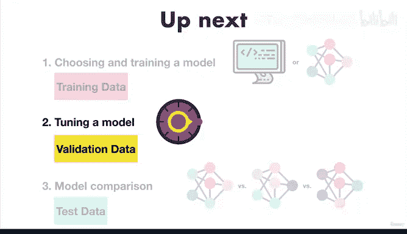

# Bourne《机器学习和数据科学训练营｜Zero to Mastery Data Science and Machine Learning Bootcamp》 - P21：021_03_009 建模 - 选择模型.zh_en - GPT中英字幕课程资源 - BV1yhrvBVEv2

Step 5， modeling part two， choosing。😡，We mentioned in the last lesson。

 there were three parts to modeling， choosing a model， tuning a model， and comparing models。

Once you've got your data split into training， validation and test sets。

 you can start to go through each of these steps in this lesson we're going to cover some points on choosing a model which is you choose a model and train it on your training data。

 unlike creating your own algorithms from scratch， there are many pre-built machine learning models which you can take advantage of。

When you first begin， your main goal will be knowing what kind of machine learning algorithm to use with what kind of problem。

 This is because some algorithms work better than others on different types of data。

 We'll have a look at this specifically when we get hands on with our projects。 But for now。

 a tidbit to remember， is if you're working with structured data。

 Decion trees such as random forests and gradient boosting algorithms like cat boost and X G boost tend to work best。

And if you're working with unstructured data， deep learning。

 neural networks and transfer learning tend to work best Once you've chosen a model。

 your next step is to train them， the main goal here will be to line up the inputs and outputs。

For example， in our heart disease problem， we want our model to look at the feature variables。

 the inputs， and then find the patterns and use them to predict the target variable so remember from a previous lesson。

These variables here are the feature variables we want to use these to predict the target variables Another common naming setting is to use X。

 which is the data to predict Y， which is the labels。

Different machine learning algorithms have different ways of doing this。

 We'll see how to do it for a handful of useful ones in future projects。 And remember。

 training a model takes place on the training data split。

 This is where your model learns the course material。

 We don't want to let our models cheat and see the final exam before they do their study。

Depending on how much data you have and how complex your model is， training may take a while。

One of your biggest goals when training a model is to minimize the times between experiments。

 So sometimes this will mean to use a small portion of your data first。 For example。

 if your training data set Hu 100000 examples， you might start training a model with only the first 10000 and see how it goes。

 You might also decide to use a less complicated model to begin with。

 Deep models such as neural networks generally take longer to train than other kinds of models。 Now。

 this is something worth considering when it comes to training your own models。For an example。

 if an experiment takes you three hours or even up to a couple of days for a small percentage use and performance of your model。

 you might consider， is this experiment actually worth it。

 because machine learning is highly iterative， we want to minimize this experimentation time that we can go from step 1 to step 2 to step3。

 but again， if this looks confusing， we'll see it in practice in the hands on projects。😊。

And things to remember。Some models work better than others in different problems。

Don't be afraid to try things and this is really important。 Machine learning is。

 as we said before a highly editative process， so some things that you try out may not work the first time and that means you just neglect that thing going forward and try something else。

 start small and build up， add complexity as you need what this means is for example。

 if you had 100000 examples， we're going to start on 10。

000 we're going to use a simple model first to begin with rather than going to the biggest and latest and greatest model because what we're after is practical results。

 not something that's the best on paper we want to see something that can actually be used in the real world。

And part of your experiments will involve tuning a model。

 which shows good initial results to get better results like tuning a car。

 if your car does well on one track it might not do well on another track， so you tune it up。

Let's have a look at how to do that， but instead of for cars。

 we'll do it for machine learning models。

