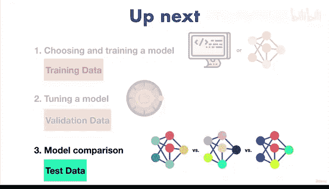

# Bourne《机器学习和数据科学训练营｜Zero to Mastery Data Science and Machine Learning Bootcamp》 - P22：022_03_010 建模 - 调参.zh_en - GPT中英字幕课程资源 - BV1yhrvBVEv2

Al right， all right， all right， modeling part three tuning。😡。

Once you're happy with your model's initial performance on your training data。

 the next step is to try and improve it。Like what we said in last lesson。

 how a car can be tuned for different styles of driving。

 a model can be tuned for different types of data， specifically your data。

Usually this tuning will take place on a validation data split， however。

 if you don't have access to a validation set due to how you've done your training validation and test data split。

 it can also happen on the training data。Many models have different hyperparameters which can be adjusted。

You can think of these as the same as dolls on an oven。 For example。

 when you're learning to cook your favourite chicken dish that。Oh that delicious。

 sweet honey mustard dish。 I'm getting hungry making these lectures。😊。

You notice that cooking it at 180 degrees for an hour meant it came out a little raw。

 not ideal right we want this chicken to be nice and crispy。

 but at 200 degrees that's when we get the glory that's 200 degrees for an hour the chicken came out just right。

😊，So like a little dial here， Ryan， this is how you can tune your oven。

 you can change it from 180 degrees to be 200 degrees if you leave it on 180 degrees chicken doesn't turn out well if you take it up 200 degrees chicken does turn out well。

Depending on what kind of model you're using will depend on what kind of hyperparameter you can tune。

For example， a random forest will allow you to adjust the number of trees in this one we've got three trees and this one we've got five trees。

 don't worry， we'll have a look at the random forest。

 This is a type of machine learning algorithm we'll check this out in a future lesson。

And a neural network will allow you to adjust the number of layers again。

 we'll look at a neural network in a future lesson and just giving an example of different hyperparameter like the temperature on an oven。

 you can adjust on different kinds of algorithms。The main things for you to remember are machine learning models have hyper parametersa you can adjust。

 However， depending on what model you're going to use， the hyper parametersa will be different。

The goal of tuning hyperparameter is to improve your model's performance。

 and you should do model tuning on your training and or validation sets。

 meaningan you train a model using an initial set of hyperparameter。 These might be the defaults。

 like say， for example， you put your chicken ingredients in the oven。

 You press chicken roast chicken on the oven， and it goes for an hour on the ovens default settings。

 and then you find it doesn't turn out how you want it to be。 You might adjust them as you go。

 This is exactly what you'll do with a machine learning model。

 You might try a machine learning model with an initial set of hyperparameters， the defaults。

And it turns out it does okay， but not exactly how you want it。

 so you might try and improve it by adjusting some of the hyperparameters。😊，Up next。

 we've got model comparison。 Now this happens during your experimentation。

 say you've trained multiple different models on the same data set。

 We're going to look at how you might compare those and this is done on the test data。

 So let's do it。

