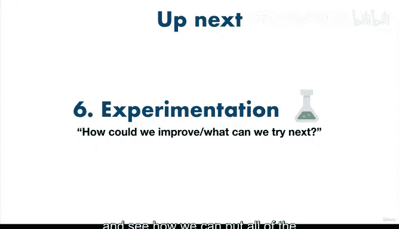

# Bourne《机器学习和数据科学训练营｜Zero to Mastery Data Science and Machine Learning Bootcamp》 - P23：023_03_011 建模 - 模型比较.zh_en - GPT中英字幕课程资源 - BV1yhrvBVEv2

Moodeling part 4， this is the final part of modeling and its comparison。

 wanting to know here is how will our model perform in the real world。

 So after you've tuned and improved your model's performance through hyperparameter tuning。

 it's time to see how it performs on the test set。The test set is like the final exam for machine learning models If you've created your data splits correctly。

 it should give you an indication on how your model will perform once deployed in production that means customer facing rather than just being on your local computer。

Since your model has never seen data in the test set。

 evaluating your model on it is a good way to see how it generalises and remember by generalising。

 I mean adapts to data it hasn't seen before， such as how our heart disease prediction machine learning model would perform at classifying whether a patient has heart disease or not on a patient who wasn't in our original data set。

A good model will yield similar results on the training validation and test sets。

 and it's not uncommon to see a slight decline in performance from the model on the training and validation set to the test set。

For example， your model might achieve 98% accuracy on the training data set and 96% accuracy on the test set。

What you should be worried about is if the training set performance is dramatically higher than the test set。

 also known as underfitting， and if the test set performance is higher than the training set performance。

 also known as overfitting。Overfitting and underfitting are both examples of a model not being able to generalise well。

 which is what we don't want。The ideal model shows up in the Goldilock zone。 It fits just right。

 Not too well， but not too poorly。 You see here this， this machine learning model。

 if this was your data， these green data points。 This line here。 It kind of fits the shape。

 but this would be classified as as underfitting。 This is not what we want our model to do。

 And this one over here。 Well， it's doing a good job of fitting all the data points。

 but it's going far too close。 It's almost too perfect model is just snaking between them。

 So this example would mean that the model has learned the patterns too well in this data set。

 it would be like seeing the final exam before actually taking the final exam。

This one here is the Goldilocks zone， right， this is an iterative process。😊。

Where exactly this Goldilock zone is like a balanced model will really depend on your data and the problem you're trying to solve That's why again it's an iterative process finding this balanced zone and now after some experience and practice working on different machine learning problems you'll be able to start to tell whether your model is overfitting or underfitting。

Now， there are several reasons why underfetting and overfitting can happen。

 but the main ones are data leakage and data mismatch。

Data leakage happens when some of your test data leaks into your training data。

And this often results in overfitting or a model doing better on the test set than on the training data set。

It's like remember， it was like if you were to have a look at the final exam or everyone had a look at the final exam as the practice exam。

 your machine learning model has just learned what it's about to be test on so when it comes time to modeling it just learned it way too well and it starts to fit the data like this。

And this is why it's important to do your splits correctly and ensure that machine learning and model training happens only on the training dataset set。

 validationation and model tuning happens only on the validation or training dataset and that testing and model comparison happens on the test dataset set。

And remember some different approaches use only a training and testing set and do model tuning on the training set。

 but testing always stays the same。 It's like when when you go to university you're doing a course you want to make sure that the final exam is kind of an indication of how well you understand things same with the test data set for machine learning The test data set is used as an indication of how well your model will generalize in the real world so you want to avoid data leakage。

Data mismatch happens when the data you're testing on is different to the data you're training on。

 such as having different features in the training data to the test data。

 having this kind of mismatch can lead to models performing poorly on test data compared to training data。

This is why it's important to ensure that training is done on the same kind of data as you'll be testing on and as close as possible to what you'll be using in your future applications。

Other ways to combat underfitting include using a more advanced model。

 This could mean a totally different model or increasing the number of hyperparameter on your current model。

 Remember， when we are cooking our chicken dish， we might alter one of the hyperparameters of our oven by turning it up。

 That might be something that you might do on a machine learning model instead of only using two layers in a neural network。

 you might use four。 We'll see more of this in the future project。

You could also reduce the number of features you're trying to model。

 maybe your data has too many features， and the model you're using is struggling to find patterns in them。

Finally， you could train your model for longer。 Sometimes models take longer to train or longer to learn than you'd expect。

 One of your experiments may involve a longer training phase。To reduce overfitting。

 useful solutions are to collect more data， more data will provide more potential patternss for a model to find and thus lower the potential for it to find them all。

Or you could try use a less advanced model。 This is uncommon。

 but it's possibility the model you're using is too good at learning。

 and it models your data too well。Be cautious of models performing too well。

 as they might lead to incorrect predictions。 Remember， no model is perfect。

 So be sure to check your good results as much as you check your poor results。Finally。

 when comparing two different models to each other。

 it's important to ensure you're comparing apples with apples and oranges with oranges。 For example。

 Model2 trained on data set1 versus Model 3， trained on data1。During comparison。

 you'll want to make sure you take into account not only the final result。

 but what it took to get there。If Model 2 takes one second to make a prediction at 93。1% accuracy。

 Model3 takes4 seconds to make a prediction at 94。7 accuracy is that extra 3% accuracy worth that extra three seconds of prediction time now this will depend on what the goal is but if you are optimizing for prediction time right you want to make predictions as fast as possible。

 it might choose model2 because it makes predictions four times faster than model 3 but at a higher accuracy level again。

 this will be different depending on what kind of application or production use case you want to use but just some things to keep in mind is more than just how model performs that goes into choosing which one you should use。

A couple of things you want to remember from this lesson。

Avoid overfitting and underfitting you want a model that heads towards generality it's like when you do your practice exam if you saw the final exam you might just become an expert memorization machine rather than someone who could use their knowledge in the real world。

Keep the test set separate at all costs when you split your data。

 you want to have a training set and then throw away the test data set and lock it up and once your model has been trained then you can open up the test data you can unlock it take it out of the safe and see how your model performs when you're comparing models。

 compare apples to apples have Model1 and Model2 on data1 and data1 you want to make sure the two models you're comparing have been created in the same sort of environment so that you can ensure that what you're comparing is legitimate comparisons。

Finally， one best performance metric does not equal the best model remember in our example you may be optimizing for prediction time。

 so although a model that makes a faster prediction doesn't get as high accuracy as another model that takes a little bit longer。

 it might not matter to you because you need something that can predict as fast as possible。ho。

That was a lot， but we'll see plenty more of this in action throughout the course you'll also be using it throughout your entire machine learning career so it's important to remember these concepts let's push on to the next step and see how we can put all of this previous steps together in step6 experimentation。

