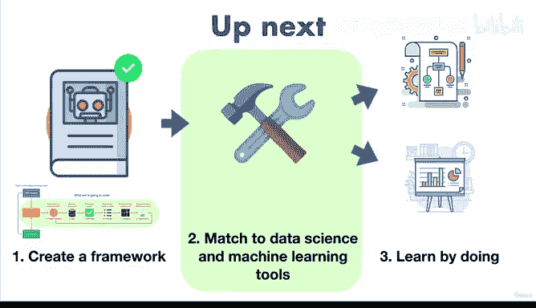

# Bourne《机器学习和数据科学训练营｜Zero to Mastery Data Science and Machine Learning Bootcamp》 - P24：024_03_013 实验.zh_en - GPT中英字幕课程资源 - BV1yhrvBVEv2

Y'all ready for this， we've got step six， which is experimentation。And it's important to remember。

 all of these steps here are a highly iterative process， meaning you might try one thing。

 find out it doesn't work， then try another， and another and another and just keep going through this loop。

 right。But how would all of these look in practice Well， with a process like the one we've got here。

 machine learning projects become tool matching projects。 and that's what we're going to do。

 We're going to use this process。And learn the different tools for each step。

So eventually you'll be able to start to look at a machine learning problem and think about， okay。

 I know what tools I can use for each of this step， we can break it down。

 I can use this for that and apply this process to whatever kind of problem you're working on。

For example， someone might come to you with a data set and ask you to find insights on it。

 you might start by defining a problem with them which is step1。

 then you'll go through to step2 and look at the data This part is called data analysis here you might define an evaluation metric based on the problem at the same time as inspecting the different features of the data which is step3 and step4。

Once you know a little bit more about the data， you decide to build a machine learning model using the features you found to predict some target。

 Now this is step 5。And your first model goes pretty well， we've got the little green tick here。

 you've managed to line up the input， so you've got a good model。

 you've matched the model to the problem and it's producing some good outputs。

So you decide to report what you found and after your initial report。

 your project manager asks to see if the model can be improved to get better results。

So you do your research and find there's another approach you can take。 This is step 6。

 experimenting。You might try a different model and we've got model 2 and see how it goes and it performs pretty well。

Then if that didn't work when you reported it， it was like， oh， maybe you can do a little bit better。

 you might try vary the input slightly。And change your desired outputs and try a new model。 again。

 don't worry if all of this looks confusing。 We're going to have plenty of practice doing this with hands on projects throughout the course。

Remember at the start how we said there were three major steps we were going to do， one。

 create a framework， two， matchsh the framework to data science and machine learning tools and three learn by doing。

Well after going through the last couple of lectures you've just ticked off step one We've now got a framework to use for the modeling section of machine learning projects Look how beautiful that is we're step one problem definition。

 step two data， step three evaluation， step four features。

 step5 modeling step6 experimentation all of this is an iterative process。

Next up we're going to learn what tools we can use to apply the framework to different projects。

 and of course to do all this， we're going to be working hands on。

 writing machine learning code and creating projects of our own。

And remember to check the resources section for anything extra you may need。

 you can find all of what we've talked about there。

