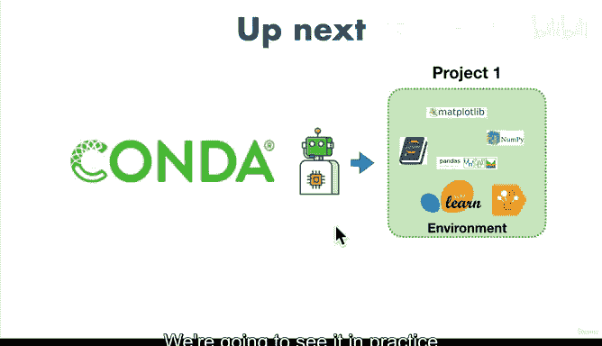

# Bourne《机器学习和数据科学训练营｜Zero to Mastery Data Science and Machine Learning Bootcamp》 - P29：029_05_003 什么是Conda.zh_en - GPT中英字幕课程资源 - BV1yhrvBVEv2

Okay， okay。So now you've got a little idea。Between the difference of Ananaconda and Minconda。

Hopefully you're not sick of snakes yet because we've got one more condor to cover and that's Conr itself。

If anyconda and miniconda are like the hardware store and workbench of data scientists。

 Conda is like a data scientist's personal assistant。It can help you set up your workbench。

 order new tools when you need， make a copy of what tools you're using to share with someone else。

 and more。Formerally， Anaconda and Minconda are known as software distributions and Conda is known as a package manager。

Remember how a package is a collection of code someone else has written， which you can use？

Well Conda helps you download， install and manage these packages when you download Anaconda or Minconda and install it to your computer。

 Conda comes with them。But because we're using Minconda。

Miniconda comes with the essentials to get started， like Python。

 not the entire hardware store of data science tools like Anaconda。

 but Minconda also comes with Conda。So I know this can seem confusing to begin with and trust me。

 took me a while to understand this。But what Conda allows us to do is install other tools。

 so we've got miniconda， which is like the base，'ve got Python to get started。

 that's on our computer， and then we use Conda， the package manager to install these other packages。

you might be thinking， Daniel， why do we do it this way。

 This seems so confusing Theres so many steps。 Yeah， I already have my computer。

 You're telling me I have to download miniconda。 Minconda comes with Conda。

 Condas like some personal assistant that helps me install packages。

 packageages of code other people have written。 and I totally get you。

 I was the same when I first started。 But after working different teams。

 I started to see how important it was to get this type of setup for each kind of project you're working on up next。

 we're going to see how Conda。 Our personal assistant for our data science tools can help us to create an environment。

😊，Which contains different packages that we can use to work on different projects。Now again。

 I can understand you if you're a bit confused at the moment。

 this concept took me a little while to understand too。

 but we're going to see it in practice throughout a bunch of different examples throughout the course。

