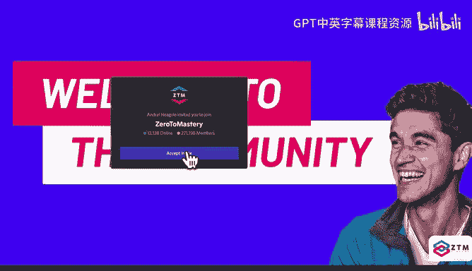
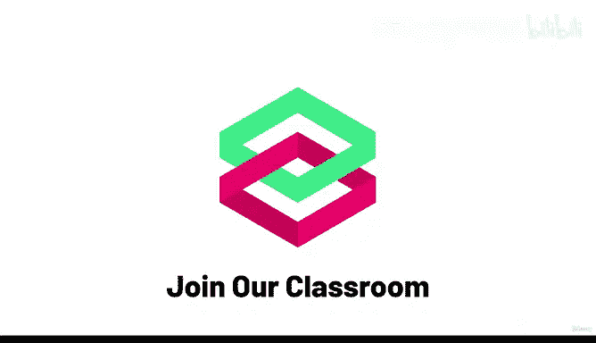

# Bourne《机器学习和数据科学训练营｜Zero to Mastery Data Science and Machine Learning Bootcamp》 - P2：002_01_002 加入我们的在线课堂！.zh_en - GPT中英字幕课程资源 - BV1yhrvBVEv2

Hey there， This is Andre。 You're about to dive into the course。But here's the truth。

 most people won't finish this course。Why it's because doing a course from the comfort of your home is going to take something away that is one of the most critical parts of doing anything challenging and worthwhile。

Accountability， it's a lot harder to stop going to elementary school than to stop watching an online course。

 right。But here's the thing there is a way to guarantee right now that you will finish the course and you will get through the ZTM courses no matter how hard they get。

 and trust me， it's going to get hard because we want to teach you really valuable skills and they are valuable because they're hard to acquire。

And this is why you're here。If you don't finish the course， it's a waste of your money。

But if you finish the course， we truly believe it will get you the skills that you want。

So this is what you're going to do that might put you outside your comfort zone。

 but it will be extremely effective in increasing your chances of success。😡，Ready for it。

 you're going to come join our online classroom。In the next lecture。

 I'll provide a private link only for ZTM students in there。

 there are three things I will ask you to do。 One is to introduce yourself to the community。

 You can share as little or as much as you want about yourself。

 I'm going to finish X course by this date and put that date in your calendar， too。

Number two， go to Accountability Budies channel that's that's a mouthful and find someone who is starting a ZTM course right now at the same time。

 it doesn't have to be the same course and you can have multiple partners You're going to make sure that you each finish the course and the goals you set out to do。

Finally， number three， hang out in the general chat and talk about anything that you want。

 You will also have course specific channels that you can chat in。

 You want to be surrounded by other learners like you to stay motivated in being part of a class。

Now in here we're also going to have virtual hangout sessions with myself。

 other ZTM instructors and students。 I recommend having the Disccourse server open as you go through the course and as you are learning。

Now， I'm not saying this to sell you something。 This is simply a fact of learning。

 when you learn in a group， when you surround yourself with other learners。

 when you have accountability， You are more likely to succeed。 It's a fact。Finally。

 throughout the course as you encounter problems or challenges， don't give up。

 come back to our Discord server and ask questions and get help， but most importantly。

 as you start to learn and grow your skills， come here and help out other students。

Teaching and helping others is one of the best ways to retain the information you just learned。

If you create this routine around your learning， opening up discord， start watching the lessons。

 Sur yourself with others that have similar goals to you。

 You will have the accountability and the support system to finish the course。 I promise you。Oh。

 and another fun bit。 When you finish the course， you post your certificate and the alumni channel to become an alumni。

 And then who knows the people that really are stars of the community become star mentors。oo， Now。

 this all may sound silly。 You may say that you don't need anybody。 But trust me。

 we've been doing this for many years。 And there is this consistent trend of those that finish the course。

 get hired and find success in their careers。😊，You have to do the things that are uncomfortable sometimes to succeed。

So that's it， see you in the next lecture and see you in our community。

