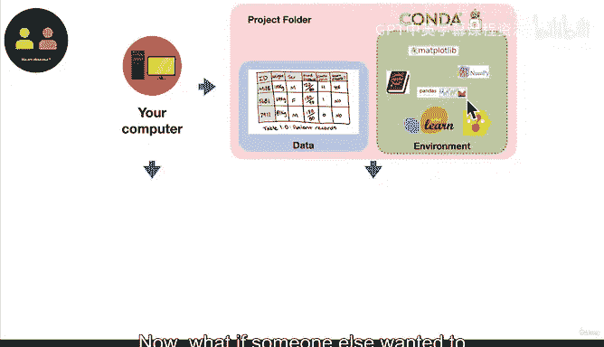

# Bourne《机器学习和数据科学训练营｜Zero to Mastery Data Science and Machine Learning Bootcamp》 - P30：030_05_004 Conda环境.zh_en - GPT中英字幕课程资源 - BV1yhrvBVEv2

You might be thinking， why are we going through all these steps， I've got my computer。

 Why do I have to download miniconda with Python and then Conda and then I' install all these packages。

I just want to get started coding and so you should be it's good to hear you want to code we'll be doing lots of that soon。

 but getting your computer and getting our computer set up with Minconda and Conda are important steps which will save a lot of time in the future。

When you download minicon and subsequently Conda Conda gives you the ability to create environments。

 you'll hear a lot of these in different projects that you're working on。Let me give you an example。

A workflow for our classifying heart disease project might involve starting with our computer and then creating a project folder which contains the data we're using。

 patient records， and the tools we're using for our machine learning project after a little bit of experience we know there's a collection of tools we might want to use such as pandas and Matpl libb for data analysis。

A collection of tools or packages is called an En。We use Conda to create the environment and then use it again to install different packages。

 data science and machine learning tools to it。Then every time we work on our project。

 say classifying heart disease， we use the tools within our environment。So let's walk through this。

 youve got your computer you want to start a new project such as working on heart disease you might create just a separate folder maybe on the desktop or something like that and then within that one single folder you keep everything that you're going to use with that project in that folder such as the data remember the patient records could be the data and the conduct environment which are these are all the tools you're going to be working on to find insights on that data to try and predict heart disease Con is what you use to create this environment。

 install and update the tools that you need。Now why is this helpful。

 why would we do it in this kind of way？😡，Well， here's where it comes in handy。Say， for example。

 you're working on your heart disease project since much of machine learning is experimental。

You might be using a number of different tools for a single project。Now。

 what if someone else wanted to start working on what you're working on with you？

Instead of setting up their own workbench from scratch。😊。

Conda allows you to share with them the exact same set of tools and packages you've been using so they can get started straight away。

This may not seem helpful if you're working largely by yourself at the moment。

 but I can ensure you it is one of the biggest problems when you start working on a team。

 There would be days where me and my teammates， we would literally spend all day working on the same project。

Or trying to set up or trying to work on the same project。

 but we couldn't because we ran into dependency issues。

A dependency issue is a term that's used when you don't have the right package for the problem that you're working on。

 because this problem， this project， this classifying heart disease。

 will be dependent on these tools here and when we ran into dependency issues。

 it mean that we couldn't install some of these tools。

Conda helps to fix that dependency issue It ensures that you can create this environment that's easily shareable and updatable that you can share with someone else so if you had multiple people on your team and you're all working on a similar project with similar data and similar data science and machine learning tools the reason being we do this workflow is so that you can create a project folder and then if you had to share it with someone else's computer or someone else on your team you could just send them the project folder that contains the data and your Con environment and they would be able to get started straight away。

Now again， if this seems like a lot and it is a lot to take in。

 we're going to have hands on practice setting up a project folder。

 as well as an environment for each of the hands on projects we're going to cover throughout this course。

😊。