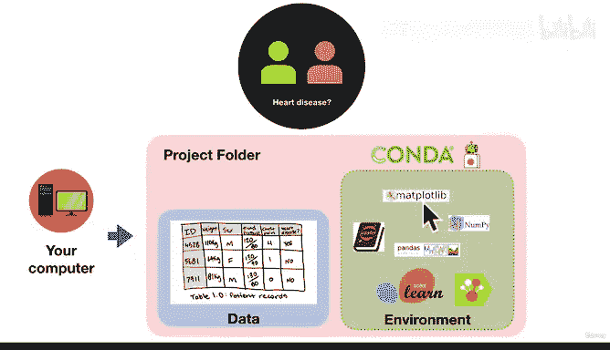

# Bourne《机器学习和数据科学训练营｜Zero to Mastery Data Science and Machine Learning Bootcamp》 - P31：031_05_005 Mac环境设置.zh_en - GPT中英字幕课程资源 - BV1yhrvBVEv2

Okay， now I know you've been through a lot。And this kind of diagram here can seem very confusing to begin with。

 and don't you worry it took me a few times to really understand what was going on here。

And as well as this setup here right so you've got your computer。

 you probably you probably understand that， but this， this。

 if you've never worked on a machine learning project before。This might seem a little out of whack。

 youve got a project folder， you've got data， you've got an environment Con helps you create this environment and within that environment you have different data science and machine learning tools。

🤢，Well， what we're going to do in this lecture and this is for Mac O， by the way。

 So if you're using a Windows computer， you might want to look at the other version of this lecture which goes through the same steps。

But what we're going to do in this section or this lecture and bear with me because it is。

 this is a little bit of an involved process， but we're going to work through it together。

 there's documentation in the resources section that will help you along if you get stuck but don't worry this kind of concept takes a while to get it first but once you get it you'll start to realize okay I see where it's valuable and you'll be able to use it throughout your data science and machine learning career。

Now， first of all， we have your computer， what we're going to do is download Minconda along with Conda and then use Conda to create an environment which contains some of these tools。

 so this is what we'll do。We download miniconda， which Conda will come with。

 will create a project folder， and then we'll create an example environment like this。

 And what we can use this environment for is because there's tools in here for data science and machine learning。

 We can use it for our future projects。 This lecture kind of sets up the the whole entire rest of the course。

 So once we have these environments set up， we can start to work on projects， get hands on。

 start working with data sub building machine learning models。

 But setting up the right foundation is very important。😊，So in saying that。

I've developed a little flow chart here and again this link will be in the resources section of just some steps of what we're going to do with Anaconda Minconda andconda and don't worry we're not going to go through this while we actually will go through this step by step。

 but for now I'll let you have a look at this on your own。

 but these are the steps we're going to take Down Minconda， let me zoom in。Download miniconda。

 install it to your computer， test the installation by a terminal。

 create a project folder and change into it。 So this project folder is kind of like the workflow that we're going to be setting up for each of the projects They'll each have their own project。

Create a custom environment within the project folder。 Now an environment， remember。

 is a collection of packages or tools that we use for data science projects。

 We're going to activate our new environment。And then we're going to load up a Jupyter notebook which is one of the tools。

 don't worry if you' not sure what a Jupyter notebook is， we'll look into that in a second。

 but Jupyter notebook is one of the tools we use most often for data science and machine learning。

All right。So the first step is to download miniconda and what we're going to do。

 there's a link here in this flowchar， but I'll just show you how you'd find it。 So minicon download。

 we open up a browser。So we go to Mincon。Now， remember we're using Minconda because it's about 10 times less space than than Ananaconda now。

 because I'm using Mac OS。I'm going to download the Mac version。

 want to download the latest version because Python 2。7 is or Python 2。

 anything is getting phased out as of 2020。So remember， if you're on Windows。

 you might want to look at the Windows version of this lecture， but if you're on Mac OS。

 these are the steps for you。So when download this as a PKG version。

 just trust me when I say the PKG version。Download that， what that's going to do。

 is is going to download to our download section of the computer， it doesn't take too long。

 so we'll just wait for that to happen。Beautiful， once that's finished， we can open it up。

This is going to open up the Minconda 3 installer。So you'll be guided through the necessary steps to install this software。

 beautiful， we're going to walk through these。Click agree。

Choose installation Now this is the default here。RightInstall for me only you want to click on this one as well installsaling this software requires 195 of space。

 So remember Ananaconda even though it's got the Ananeconda logo here。

 you want to have pay attention to up here， Minconda 3 So this is taking up Anaconda is going to take up about 3 gig。

 this takes up about 200 MBte which is fine and now installing miniconda is going to come with it some of the foundational tools that we need to get started with data science and machine learning remember manycon is like a data scientist workbench。

So we click continue install。Excellent， so after a few seconds didn't actually take too long。

 it'll automatically change to this little window here where it says the installation was completed successfully beautiful we can close that now。

 move to Ben。😊，So what have we actually done？What we've done is we've got our computer and we've just done this step。

 we've installed miniconda plus Conda and remember Minconda is going to come along with something like Python。

 which is what we need to use these packages All of these packages are written in Python code。Now。

 what we can do。Is we're going to set up this little workflow。 We've got our computer。

We're going to set up a project folder， and then we're going to use Conda。

 which came with miniconda to create an environment。 So let's do that。 Now， if you're on a Mac。

 you can do this through terminal， so we're going to open up terminal。

And I'll make this a bit bigger。So we can zoom in。Now if you've never experienced this before。

 what this what terminal does is essentially lets you type in commands that's going to tell your computer to do something and that's what we want We want to tell our computer to go hey。

 create this project folder and then we'll use Conda to create this environment。

And you can do that with commands in the command line， which is where we are now As I just said。

 you may hear this referred to as bash command line， terminal。

 if you're on Windows might be something else， but if you ever hear those words terminal bash command line。

 it's probably within the terminal app on Mac。So remember， you can find that by going terminal。Now。

Before installing Minconda， this wouldn't have been here， but because we have installed Minconda。

 we've now got a little thing here called base and what these brackets are at the start of your name。

 You see this is my MacBook Pro and I'm in my user account， Daniel。

What this means is that we're currently in the base environment when we download Mincon。

To our computer， it's going to set up a base environment。 Now。

 this base environment comes with the default tools。

 but we want to create our own custom environment within our own custom project folder。

 So how would we do that？ Well， first of all， we're going to change directory。

To the desktop and we can do that by pressing CD desktop where CD means change directory and if you're wondering what directory is。

 it's kind of like a folder So if we look in Finder and I go to Daniel。

Let me just zoom in on that for you too。So this is where we are now， Daniel。

 and what I want to do is change to the desktop。So I'll change to here and we're going to create a folder on the desktop called sample project and this will be just an example of how we create a project folder and an environment within that project folder so that we can set ourselves up for the future for each project we go through in this course we'll create a new project exactly like this。

So we're going to change the desktop。And now to create a folder。

 we can do makeD called sample project。喂。MKDIR stands for make Directory， so if we hit enter。

While we do that。We should be able to see if we hit Ls， which stands for list。

 which means list all the files which are on the desktop。It says ML Cose and sample project。

 so let's go back to the desktop in Finder。You can see sample project was created today at 121 pm and there's ML course。

So by the end of this course you'll have maybe a sample project folder to begin with through this lecture and then probably three or four others or depending on how many projects there are you'll have a folder for each project that we work on and remember we've done step one here。

 we've got our project folder This is what we've just created your computer downloaded Minconda we haven't used Minconda yet。

But we've created this project folder a sample project now we're going to use Conda to create an environment which contains the machine learning and data science tools that we need。

So let's go back。To terminal， this is where we can use Conr again。

 so we're going to change directory into our sample project。With Cd sample project。

 now we're inside sample project。 and if we hit Ls。There's going to be nothing in here。

 go back to find out。Nothing in here， which makes sense， right， because it's a brand new folder。

Now to create a sample or to create an environment， we can use the command Con create。

 and in our casere we're going to use specifically the Conda create。Prefix。Dot slash M。

 don't worry I'll step through this in a second。Paands， nu pie。That top rib。So I kit learn。

You might be looking at this going holly hell Daniel。

 there's a lot of commands there and a lot of these names don't even make sense to me and there's what is even going on here well great question because it took me a it took me a while to get around this as well。

So in a nutshell， what is this saying， we've got Conda create， so Conda create environment。

Prefix M what is this even saying Conda creator is just basically the introduction to any time you want to create one of these environments。

 you'll type Conda creator saying Conda， you're querying your personal assistant going hey。

 I want to create something Now that's something in our case has a prefix This dot M means that we're going to use the prefix of the current folder。

To be at the start of this， this environment folder that we're going to create。

And then these panndadas， Ny Mapl Leb Psyit Learn are the tools or packages we want to put into our environment。

Now that was a quick overview of this line of code and we could unpack it more。

 but most often it's important to just try run the code and see what happens so let's do that。Now。

 what's going to happen is that what we've just done， see your list here。

I'll show you what we've just done， so here's our line of code Connda createate prefix。

/m pandas nu mappl Lib psyit loan， beautiful。Now， environment location。

See where I said that was the prefix so we've got prefix then dot this is what I mean that means it's going to use the prefix of this sample project folder or the the path。

 the file path at the front of this end folder to create another M folder inside the sample project and you're thinking no Daniel is you've lost me don't worry when I first figured out this or went through this workflows like what the hell is going on there's just we've got slashes and folders and everything and everything's everywhere but after doing this a few times it'll start to make sense and you'll realize the value in having a setup like this。

So this is saying that our environment location， remember， this is what we're creating。

Environment is going to be at users slash Daniel on the desktop。

It's in our folder sample project now this name might change depending on the project we're working on and it's going to be M it's calledM is short for En it's like one of those shorthand ways of typing something like CD is for the change directory you'll see this very common commonly throughout your data science and machine learning career my environment might be shortened to M。

And now Conr is telling us we're going to add slash update these packages in there， why these ones？

Well， because we've typed them pandas， nuumpy， map popli， psyit learn。 Now you might be thinking。

 Daniel， why did you choose these Well， let's go over here。We'll zoom in。 We look here。

 This is the environment we want to create with some of these tools。 There's mapplwe。 There's pandas。

 there'sst loan， and there's nupi。 So let's go back to the terminal。 and we scroll down。

Connda is going to tell us a few things， so the following packages will be downloaded。

The following new packages will be installed。 Y， so this is saying Numpy is going to be installed。

 Panda is going to be installed。 But remember how Con is our personal assistant。

 even though we've only typed in four packages for tools。 Malolib Numpy pandass loan。

 Connder is our assistant。 And these these are standalone packages on themselves。

 but they also depend on other code So because Conda is our personal assistant， it's going to go hey。

 ask the internet， what do I need to run these and then Conda is going to go and grab all of these extra things for us automatically。

 we're going say yes， thank you Conda， Please proceed。

And so now what's going to happen is going to download from the internet and extract different packages extract just means similar to how we installed Mincon extract just means it's going to download it and go through the install steps for us。

 Now this is going to take a few seconds because it's going to go through pandas， nuie。

 mappotlib and psyit loan。We'll just wait till that completes。Excellent。

 so that took a few seconds to download a few things from the Internet。

 But now what have we just done。 Well， preparing transaction， done， verifying transaction， done。

 executing transaction， done， beautiful。Now to activate this environment， use。

 this is a message from Conda， Conda activateivate users s Daniel s desktop s sampleproject/ M。Okay。

 so if we go back into the sample project folder， we can see here now we've got an M folder。

 So what we've done， we go back to our presentation。 We look here。

 we've created a project folder called sample data。Now we've created an environment folder。cal M。

 which contains Jupiter sorry we haven't installed Jupiter yet that's a little spoiler for what's coming up with pandas。

 Mattpllibb andsyKt Lo thanks to conduct。So we're going to pay attention to what Connda says。

Let's run this code Con Activator。 Now I like to type things out。

 instead of copying and pasting because it gets gets me used to typing these different commands and you will get to。

 you might see these and think， my goodness this is so much， but don't worry， as I said。

We're not in it for the easy thing， we're in it to do things right and make practical machine learning solutions and this is part of it。

So you might want to write this one down。This your special activate might be similar to mine might have your name here。

To can use it in the future。Now， once we've written it down。

We're going to hit enter so what you'll see change here is， look， we've gone from base。

To now use Daniel desktop sample project M。 Now， this section here is the M prompt。 Remember。

 that's the active environment。 So if we go Connda M list， which is going to say， hey， Connda。

 list the environments that we have。We've got base， and we've got。

The M folder in our sample project Now the star indicates which one is active。Which makes sense。

 because this one。Is the same as this one。Okay， now we've set up an environment。

With some tools that we need。What we're going to do is start up a Jupiterter notebook。

And try to import the tools that we need。 remember， importing in Python is like saying， hey， Python。

 go and grab these tools I need to use them。

