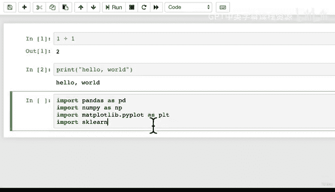
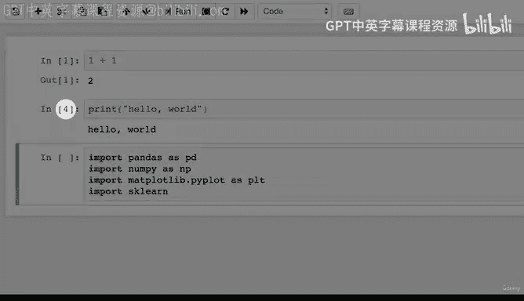
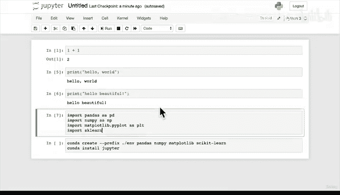
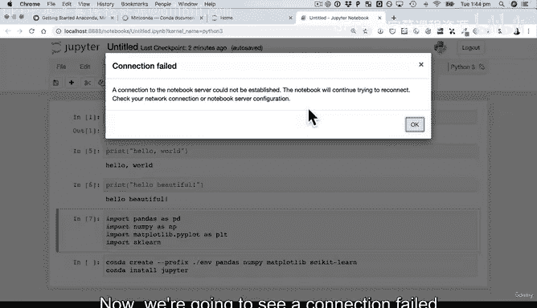
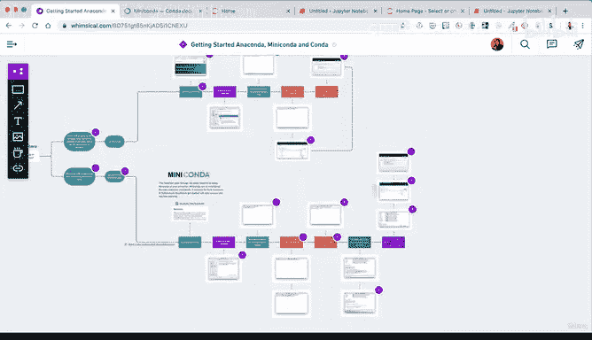

# Bourne《机器学习和数据科学训练营｜Zero to Mastery Data Science and Machine Learning Bootcamp》 - P32：032_05_006 Mac环境设置2.zh_en - GPT中英字幕课程资源 - BV1yhrvBVEv2

So to start up a Jupyter notebook， we type in Jupyter notebook and don't worry if you're not sure what a Jupyter notebook is。

 we'll have a section on that， which goes through how you can use Jupyter notebooks。

 All you need to know for now is that a Jupyter notebook is somewhere where you can write Python code especially machine learning and data science code and write text around it and share your work with others。

 It's kind of like a big workpad that you can use and just pass it around online。

We'll have plenty of experience with that as we go on。Well hit enter。や whatて。

Jupiter command not found。 Why is that。Well， let me go over here。

When we ran the command before for Conda Create， we had mappllibb， pandas， numy， psychit loan。

But we missed out on the Jupiter package。 Hold on。 Let's go up。Did we install the Jupiter package？

We didn't Mount plot lib， nuie， pandas， psychic learn。No Jupiter， so that's why。

It's come back Jupiter command， not found。 So how do we fix this？ Well， again。

 we can use our personal assistant Conda， Conda， install。Now install is a command where it's like。

 okay I'm missing a package and I want to use it a package I'm missing a tool and I need to use it so I'm going to say Conda install this tool for me in our case we want the Jupiter tool so Conda install Jupiter now of course we could have typed this up here before。

But I've missed out Jupiter on purpose so I could show you this condoda install。

 we could have put Jupiter here on the end aftersykt learn。But we're going to run it here。Okay。

 enter。Now again， this is going go Connda is it's going tell Conda we want Jupiter it's going to query the internet and Connda is like。

 okay， the following new packages to use Jupiter， I'm going to install all of these for you。

 I're going hit yes， thank you Connda。Now this is going to take a few seconds again。

Now I know this is getting to be a long process， but once we've gone through this we'll be able to automate this to almost just one line of code so in the future for future projects。

 once you understand that they're the concept of creating a project folder， creating an environment。

 we'll just be able to make it nice and simple and do it in one step。

For now we're just going through it step by step so we can get the concepts as well as get a baseline environment set up for our future projects。

And trust me， it took me a long time to get these concepts。 So don't go thinking， oh。

 Daniel's entering these codes。 And he knows what to do is it's， well。

 it's only because I've had a little bit of practice with this。 All right。

 And I know this setting up environments is one of the biggest problems that we ran into working on a team of machine learning engineers。

 So once you get this down part， everything else becomes a breeze。 Not really。 but， but yeah。

 you'll see， Okay， so what did we just do then。 We ran the command。 Conda install Jupiter。

Now we're not going to run that again， but what do you think this has done？If we go back here。

 we've got our project folder， we've got our environment folder。Now， if we had。

 we might get rid of this one。Because that's not what we're going to install now we've got this in our environment that was catbu。

 but we'll see that we don't need that for what we're doing now we can use that in another project。

So what have we done， We've got now an environment that we've created with Jupiter， mappl Le， pandas。

 Psyitt Learn and nupiy。 Now what you need to know is that we're going to use Jupiter notebooks and we're going to use these tools for the majority of our data analysis steps。

 So this is kind of what we've just set up。 We've set up an environment with these tools。

 but there's no use just talking about it。 Let's see it。

 What can we actually do now Now we've got Jupiter。

 Can we run the Jupyter notebook command we tried to before。

Juuppyter notebook if we've done this ride。This should load up the Jupyter interface。Beautiful。

And we're going to go through this in a future lecture。 But for now。

 what you need to know is what we can see here is the M folder。 Why can we see that。Or if we go here。

The M folder， this is what we're seeing。 Let's click on this one。So it's got all these things， pin。

 condoda， meta， dock， etcter。Same thing。 bin condoa， dock， etc cea。Beautiful。

 we don't have to worry about that。 Conndas taken care of that。

 This is our environment with all our tools in it。 What we care about for making Jupiter in Jupiter's interface。

Is creating a new Jupyter notebook You can do that over here。For Python 3。Let's try it now。

So this is going to create a new Jupyter notebook。 And look， this is our workspace。

 You're gonna get very used to using this beautiful interface。

 I actually really love Jupyter notebooks。 So you can write code。 It's Python code， right。

 so you can do one plus one。 You can do print， hello。😊，Hello， world。

So you can do a few things in here you can even write full functions we're not going to do that because we're just focusing on seeing if our environment is set up now there's a few more steps that we can do or one more step really we can do to check it Now remember we've installed Maplleb pandassyt loan and Nie into our environment and we've ticked off Jupiter because this is a Jupyter notebook so we've ticked that off now we want to check if these are available how do we do that Well we can import them。

Remember， import is saying， hey Python， go and grab these tools so I can use them in my notebook。

Import pandas as PD Now pandas get shortened into PD because it saves us typing out pandas a lot。

 so just know that pandas whenever you see PD， it probably means pandas。Import nuie as MP。

Numb I get shunton NP import， mappllibb dot。But got pi plot as PLT。 Now。

 the plots we want to make are from the pi plot module of Matpl Lib and that gets shortened into PLT。

Import SK loan。Which is short for psyt learn。 All these， all these little acronyms。

 Don't worry about knowing them too much off my heart。 For now， you can just copy。

 copy and paste this sort of stuff。 I'll make sure there's a demo notebook in the in the resources section。

 But to test this， we're going to hit shift and enter shift and enter is how you run a cell and Jupiter。

 Watch as that number goes up on the left，3，4，4，5。 We do another one。

Escape B creates a new cell。We'll learn all these in Jupiter， so print。Hello， beautiful。

That's going to be cell six because that's how many cells we've run。

 so this one should be seven if we hit shift and enter。Excellent， now why did this work Well。

 remember the code that we ran， we're not going to run it in terminal again。

 but it's going to be condo create。Prefix。🎼This line of code is what helped us set this up， prefix。

 pandas， nuump， matpl lip， psyit loan。What we've done is we've created a condo environment。

In our sample project folder and we've installed pandas， nuumpy Mountpott Leb Pst learn。

 but then we tried to run Jupiter but we couldn't， so we used Conda installed Jupiter。

And then we could access this Jupyter notebook。So that's the workflow。We have our computer。

 we downloaded Minconda， which came along with Python。And Conda came along with miniconda。

 so then we came into this one and what we did on our computer was we created a project folder。

And then within that project folder， we used Conda to create an environment which now contains these tools。

So what does that mean Well， that means that we can now use this environment to work with our data and start to build machine learning models start to analyze data and because we've done it with Connda。

 if we wanted to share our environment with someone in the future。We can。But don take my word for it。

 Let's go back over to Finder。 if we look in the sample project folder。

We've got M and untitled I P and B。 That stands for I Python notebook。

 which is the old name for Jupiter notebooks。 So now our notebook with all of this code that we've just done。

Is also within our project folder you' starting to see the value of having everything in one place。

 So now we could just go， hey， friend or colleague or anyone else that you want to share your work with。

 send them this folder。And make sure the folder contains our environment。

 which is the tools we use so our workbench and the code we're going to write well we don't have much code but it'll send this across to our colleague or teammate。

Now there's one more thing before we finish up and that's closing an environment and exiting Jupiter So when you start a Jupiter notebook we're back in terminal here。

 it'll have all these come up in in your terminal。

Now to get out of it， to close your Jupyter notebook down。

 you might do this at the end of your day or whenever you're finished work and you want to start a new project or work on another project。

 we're going to hit control and C at the same time that control and C whenever you're in terminal or something like that is like saying hey。

 kill the current running process。So we're going to do that control C。

 shut down this notebook server， yes， we're going to hit yes， oh， maybe we timed out for that。

We'll try again。So we're shutting it down。Now we're going to see a connection failed here because we're no longer connected to our Jupiter notebook。

 which makes sense because we just shut it down， that's okay。

But you see， we're still back in our environment。We've got our environment active。 Now， say。

 for example。We wanted to change to another project。

 So another project of this in a different environment。

 we want to exit the one we're currently in to go to another one so we can go Conda to deactivate an environment。

 You type Connda， deactivate。Which is telling conduct， hey。

 exit me out of the environment I'm currently in because I want to go into another one。

So we'll do that。 Conda deactivate。 Now， look， we're back to base。 So if we go to Conda and list。

 that'll tell us the list of environments we have， we have base。 Now， when we downloaded miniconda。

 remember how I said it comes with the bare essentials。

 What do you think would happen if we tried to run a Jupyter notebook from the base environment。

Let's try。Jupit， I command on， not found。Why is that Well。

 Because remember when we created this environment， we installed Jupiter。Base doesn't have that。

 It has the bare necessities。 we had to create our own custom M before we could access Jupyter。

 Now how would we get back into this back into working on our project Now。

 these steps I'll include in the resources section。

 but this is what you'll probably get most used to when working on different projects， All right。

 So we go here。Com to activate。Remember Connda， we wrote this one down earlier。Conda activate。

 which is sayingconnda， hey， activate my environment。Called this one。 We're going type that out。

 Use Yours might be different。 I remember， this is custom。

 depending on what you've labeled your your projects or your environments。

 The the standard name is M though， So that might not change。 This project will folder might change。

 depending on what project we're working on and this user might change depending on on your actual user and you might know not even have it on the desktop。

 So remember， this line of code will be custom depending on your own settings。

We're going to hit enter。So see how we've just changed from base back to this。

 so now we're active in our M so if we type in Jupyter notebook。Remember， this is the workflow。

Jupiter notebook， we come back， we're going to see。

This is the Jupiter interface and this is the notebook we created five minutes ago。

And we come in here。Now， whenever you come back to a Jupyter notebook。

 these cells are going to reset。 So one， two， that was just five。 that was six。

 Now it's going to be three。 This will be four。And again。

 we're going to have a whole section on Jupyter notebooks。

 but this is the main thing we need to remember for now。Beautiful， we're back in our environment。

 we're back working， let's just do a quick recap of what we've actually done。😊，Have our computer。

 That's all we started with。 We downloaded miniconda， which came along with Conda。

 and we come into this one。 We wanted to set up an environment to work on our heart disease project。

So what did we do， We had our computer， we created a project folder。

On our desktop called sampleple project。And then we used Conda to create an environment and installed these tools。

 Jupiter， Mapottlibb， Numpy， Padas， Psyit learn into our environment。And what we were left with。

 we come back to find her。Is we've got an environment。

Folder within our sample project folder and a Jupyter notebook with some template code。 Now。

 you'll see in the future projects that these lines here are going to form the basis of many future projects。

 These， these four tools themselves like a fundamental tool to machine learning and data analysis as a whole。

 So you'll probably get very familiar， or you will get very familiar if you go through this course。

 importing them and using them。But that's enough for now， remember if you get stuck。

 check the resources section， don't forget to look at something like this flow chart。

 there's also a blog post that goes along with it， but that'll all be in the resources section。

