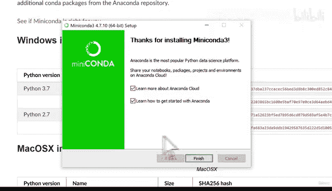
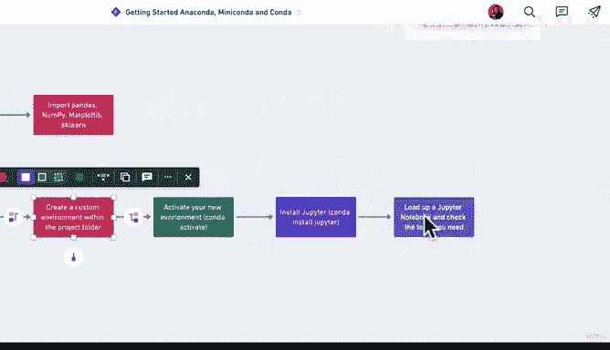

# Bourne《机器学习和数据科学训练营｜Zero to Mastery Data Science and Machine Learning Bootcamp》 - P33：033_05_007 Windows环境设置.zh_en - GPT中英字幕课程资源 - BV1yhrvBVEv2

Now you might be looking at this kind of graphic and going， okay， I get my computer。

 but what is this miniconda， Hoda， Python， all these graphics I've never seen before what is actually going on here and don't worry if you're feeling like that It took me a long time to get my head around this kind of workflow more specifically this one here。

 So this is what we're going to be setting up in this lecture Now remember this one is for Windows So if you're on a Mac you may want to go to the Mac version of this。

 but if you're on Windows you can stay here and watch right through this。

 We're going to build out this little workflow from scratch this is what you likely have。

 you're probably watching this video on your computer。

What we're going to do is set up this project folder and then use Conda or worry about data later in a future future lesson。

 but we're going to set up a project folder， and then use Conda。

 the personal assistant of our data science and machine learning tools to create this environment。

Now remember this is the kind of workflow that you would do for each new project and for this lecture we're going to set up a sample project folder。

 but we're going to have experience setting up this kind of workflow in each of the handson projects throughout this course。

 but this is just to get your head around it to understand what this kind of workflow looks like and so we can just practice setting up a new project and getting our tools ready for data science and machine learning。

More specifically， we're going to be going through these steps here now this flow chart will be in the resources section。

 but if we have a look here， this is the Minconda one we're going to be taking because we've chosen to use Minconda because it is the data scientist workbench and it takes up 10 times less space on our computer than Ananaconda but offers all the value of what Conda can offer。

Let start with download miniconda， install it to your computer， test the installation。

 create a project folder and change into it， createate an environment folder with the project within the project folder。

 Activate the new environment， which will give us access to the tools we've installed to our environment。

Install Jupiter。Load up a Jupyter notebook and check the tools you need。So let's get stunned。

To begin， we open up a web browser。🎼And it's conveniently got Minconda download here already done。

 So we're going to search Minconda download。Click on the link will take you to the Minconda download page。

 the link is look something like this。 what you should see is a few options here for downloads。

 a few more links。Now， because we're doing the Windows version。

 we're going to download the Windows version of Minconda if remember， if you're on Mac OS。

 you might want to look into the Mac OS version， but this lecture we're using Windows。

So we're going to choose the latest one， which is Mincon Windows 64 bit。Python 3。7 because Python 2。

7 is getting deprecated after 2020 so we're going to focus on Python 3 plus。So we click that。

I'm going to click run on。A Windowsdow is going to run a security scan over that and we'll wait for the download to download。

 We might skip this video a little bit forward once the download is complete。

Once a download is complete， this little icon here， which is the Minconr icon。

 might appear in your bar down here， but otherwise if it doesn't check your downloads folder for the file name that we download it should look something like this and click on it and you should see something like this appear。

Now， to go through these steps， we're just going to hit next， I agree。

We're going to keep it on the recommended settings which is going to install now you're going to see the Anaconda logo here。

 but don't be confused by that。 We're installing miniconda。

 This is the one you want to pay attention to。We're going to click Just me， keep it recommended。Next。

Now in my case， it's going to be in my user account so users slash Daniel slash Minconda 3。

 you might want to store it somewhere different， but make sure it's easily accessible in the user folder is easily accessible for me。

 so I'm going to keep it there。Again， we're going to keep this on the recommended setting。

 as you can see here， not recommended。Install。And I will just wait for this to install。 beautiful。

 Now， the installation is complete。 It might have taken a few minutes， but that's okay。

 We're going to untick these。

Then I'm going to click finish。So now we should have， if you've gone through those setup steps。

 you should have minicon installed on your computer。So what does this mean， Well。

 we've gone through step one and two of what we're going to go through。

Now we're going to end this lecture here Im might be thinking Daniel。

 there's still a bunch of steps we haven't done， but yeah。

 to prevent this lecture from getting too long。We're going to take care of these。

 test the installation， create a project folder， and all the rest in the next video。

 so I'll see you there。

