# Bourne《机器学习和数据科学训练营｜Zero to Mastery Data Science and Machine Learning Bootcamp》 - P34：034_05_008 Windows环境设置2.zh_en - GPT中英字幕课程资源 - BV1yhrvBVEv2

Welcome back in the last video we went to the Minconda homepage or downloads page。

 remember this is for Windows， and we downloaded the Windows version Python 3。

7 of Minconda and installed it to our computer。More specifically。

 this is what we did download Miconda， install it to your computer Now for this lecture。

 we're going to take care of these steps， test the installation， create a project folder。

 create a custom environment with it， activate your new environment。

 install Jupiter and load to Jupiter notebook。Now again。

 I realize you might be thinking Daniel this is a whole lot of steps I just want to get into coding and you're right I'm the same with these sort of things but trust me setting up this workflow is what we're doing we've got your computer we're going to create a project folder and then build an environment using Conda and environment which contains all of our machine learning and data science tools it's going to be foundational and paramount for future projects going forward。

So let's do it。Now we've gone through the download steps of Minconda and installed it to our computer。

We can check to see if it's there by typing in search and looking for something called Ananaconda prompt。

Minicon。 This will be here once you've installed Minconda。

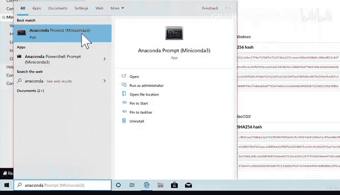

So we're going to click on that。There we go。 And what you're seeing here is this Anaconda prompt。

 what it's referred to in Mac OS is a terminal， but it's essentially a little part of your computer。

 little program where you can type in code。And have your computer executed。

So what this means is this little section here is called the M Pro。

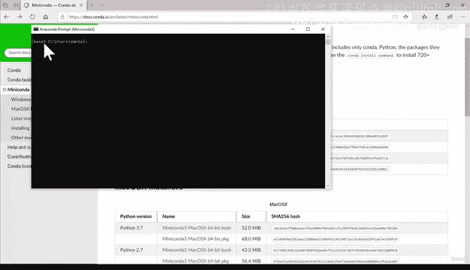

And remember， we're setting up an environment。Base is the default environment that gets installed automatically when you download Minconda and subsequently Conda。

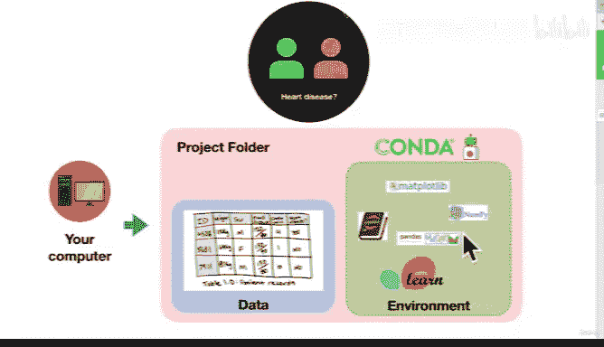

And this here is the file path that we're in。 So I'm on the C drive in the userss folder in the users's folder。

 Daniel， yours might be slightly different depending on what your name is。

So now we've got this setup。

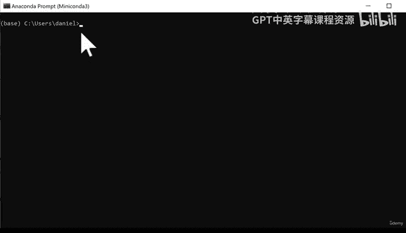

First things first is that we need to create a project folder。 So let's do that。

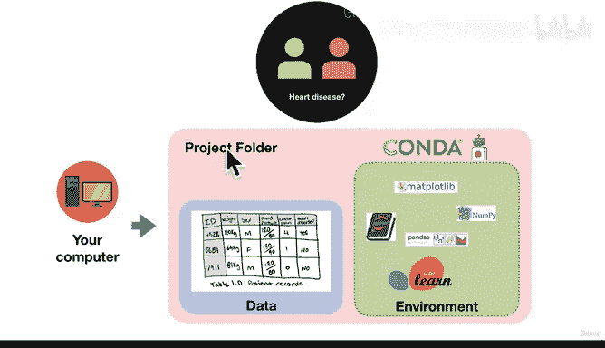

To do so。We're going to have a look at what current folders exist in the folder， Daniel。

We can do that in Windows by pressing DIR which stands for directory and that's going to list out a series of folders and if we wanted to see these。

 you might be seeing this for the first time in thinking， oh my goodness， this is a bit confusing。

 but let me show you what exactly it's printing out。

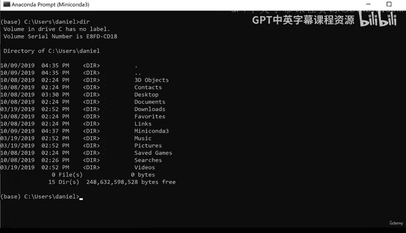

We go into the file browser here。When go to PC。Now we want to copy this so see there's C users Daniel。

 that's what we' want to look for。 I'm going to go to the local De C users because remember we have users here and then we're going to go users Daniel。

So if we actually type this out， C slash users slash Daniel。

 it's the same as is what we can see over here。So now if we compare this list here。

 we have 3D objects， contacts， desktop documents。Downloads， etc cea。

What we want to do is for this use case， we're going to create it in the we'll create it on the desktop so we have easy access to it And what I mean by this is we're going to create this project folder。

 which is just another one of these， which is going to contain all of our project information on the desktop so we have easy access to it。

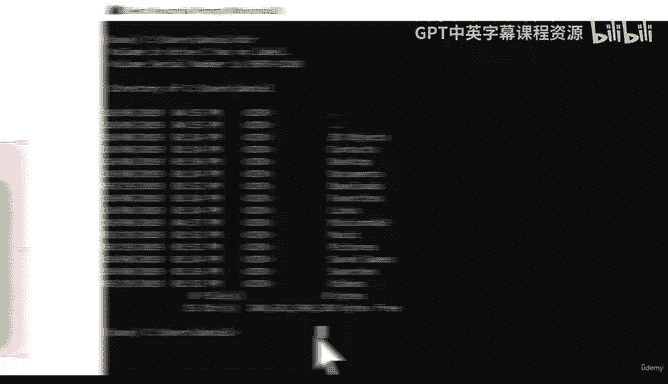

So let's change to the desktop。 What I mean by that is see how this path is used as slash Daniel to change to the desktop。

I'm going to press CD desktop and what CD stands for is change directory to the desktop。So， now。

If I go。D IR， which is going to list all the folders on the desktop。

It's going to show me sample projects if we go to desktop。

We've got sample project now we're going to be creating another one of these so you might not have this already。

 but this is what we're going to be creating we'll call it sample project one for this lecture I've already got a demonstration here。

 but we'll create a new one。So to create a folder， we can type the command MKDIR。

 which stands for make directory。

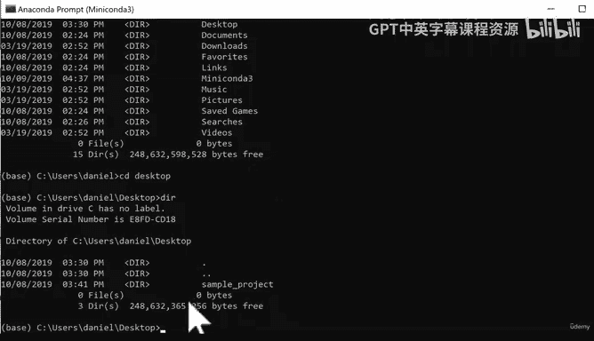

Because we're going to call it sample Project one。That's what we tell us。

 So we're telling our computer， hey。We're in this drive， we're in the user's folder， we're in Daniel。

 we're on the desktop， and I want to make a directory called sample Project One。

 we're going to hit En。Now you can see that is created sample Project1。We'll go back here。

 So what have we just done Well we've done the first step， we've created the project folder。

 So now we're going to use Conda to build this environment。 If we go back to our flow chart。

 create a project folder and change into it。 So that's what we have to do。 C the project folder。

 but we're not in it yet， so we need to change into it。

 remember to change directory and press C into sample project one。

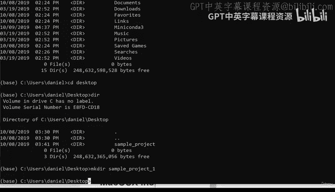

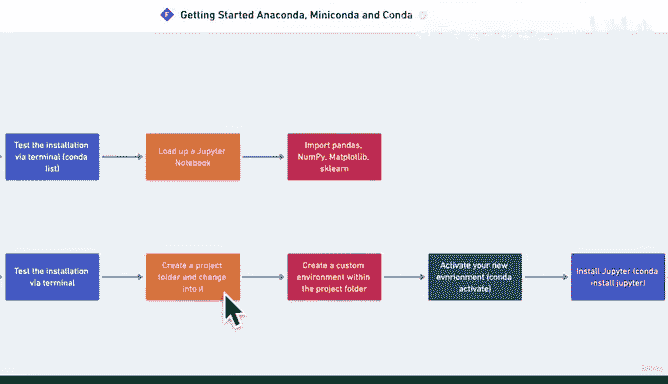

So， now。This is what we have we have We're in here。

 we're on the desktop we've got sample project one and if we go DIr to see what files are in here。

 there's actually nothing in here， So zero bytes， zero files if we look sample project one。

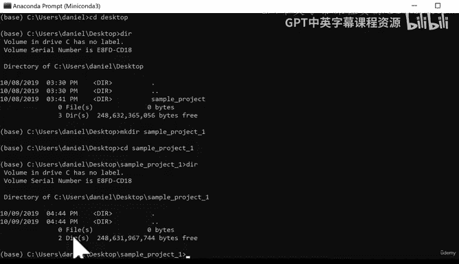

This folder is empty， so that makes sense。 Okay， now what's the next steps。

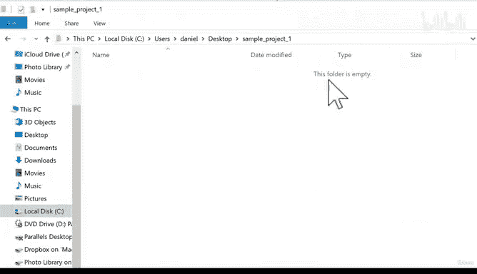

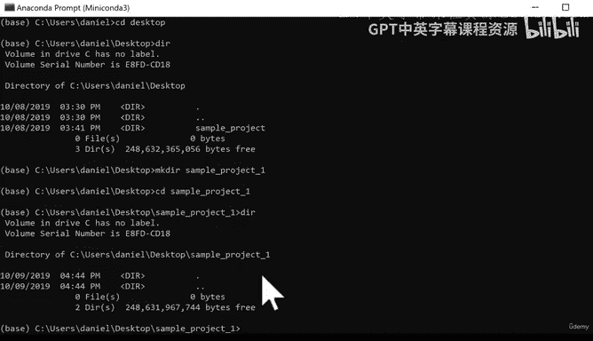

changeded into it， create a custom environment within the project folder。

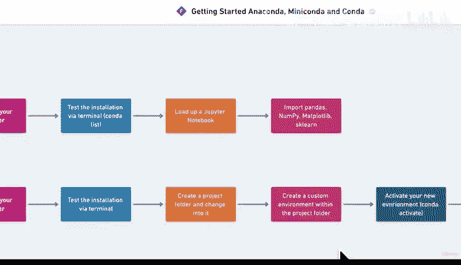

Well， let's do that。So to use Connda to create an environment， remember if we look at this。

 we're going to use Connda to create this， so that's this step。

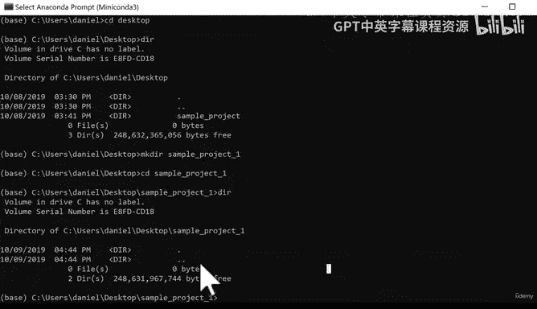

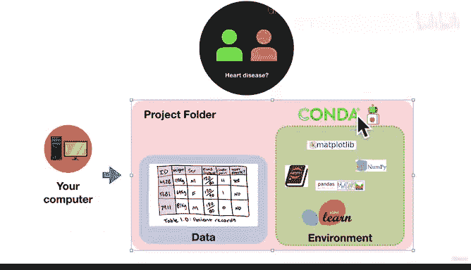

You can run the command Connda， that's like saying， hey， condonda， our personal assistant， create。

🎼Then we're going to pass it the prefix tag， and now I'm going to write this out， slash and。Ps， nump。

 mappl Lib。And psyche learn。You might be looking at this going， my goodness， Daniel。

 what what is going on here？Well， that's a great question。 So remember what we're saying is Con hey。

 personal assistant Con create we're not actually that was a bit。

 that was a bit mean we're not yelling that pretend this is saying， please Con。

 create prefix when you see these double hashtags， it's like a little command that can go to the create function。

This dot means it's going to use this file path here。 So essentially saying the dot saying within。

The sample project one folder。En create a folder called M and within that end and this shortfall environment。

 which is this。

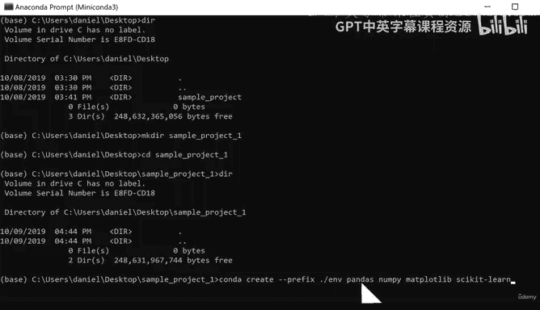

Within that end， install pandas， nuumpy， mappltlibb and psyit Learn。

 Now what are these Well if we look here Matpottlibb。

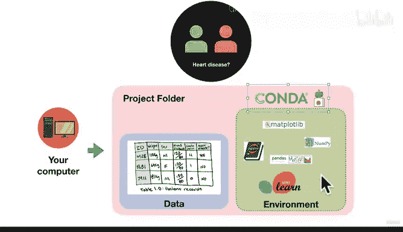

Numpie， pandas， psychic learn。So let's run this by pressing enter and see what happens。

So now our personal assistant conduct what just happened。A whole bunch of code just appeared。

Because we've ran this command here， Connda create， prefix and， etc。

What this is going to do is con our personal assistant for collecting data science tools。

 remember these are data science tools here。Is going to go to the internet and download or query the internet。

And go， hey。Daniel wants to create an environment on his computer with Matplotlibb， Nmpy， Padas。

 and psychet Learn。And so the following packages will be downloaded。 This is a message from Conda。

 All we do with pressenter。 What Connda is going to do is because these packages themselves or these tools require some other tools within them to operate So lots of code lots of the reason why is because people have written lots of code in the past and to prevent rewriting all the code。

 a lot of existing tools leverage another bunch of existing tools。

 So Conda is automatically So this is a beautiful thing about Conda。

 It's going to download all of the extra tools that we need to get started。

 and this is what this is listing out here。

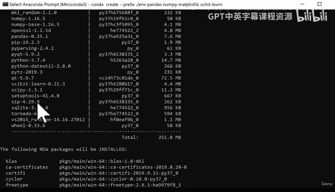

So we want to proceed to do so， we'll press why。

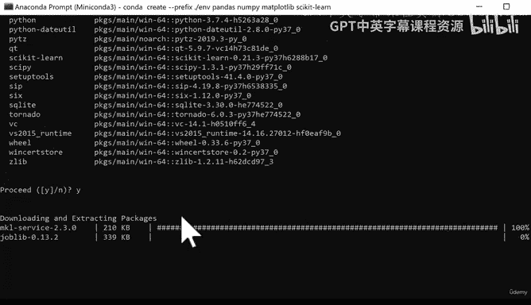

Now Conda is going to download and extract， extract means install all of the packages it requires to get set up。

 So now this might take a minute or so or maybe a little bit longer depending on your internet connection or hard drive speed。

 so I'll let this run through and we'll resume the lecture once it's finished。Excellent。

 Conda has now finished that took a few about a minute or so on my computer。😊。

What is actually done is it's gone to the internet， it's downloaded and installed these packages。

 so a big long list of them into our environment。And let's have a look over here。

 so this is what it's done。Create project folder。Now we've asked Conda using the Conda create command to create this environment。

 So if we go back。To our sample project One folder。

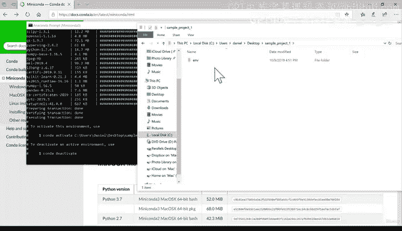

There's now a folder in here called N， which is remember short for environment。We go in here。

 We click in here。 It's going to have a whole bunch of different files in here。 Now， to be honest。

 I don't even understand what's going on in here。 What is important to know is that this contains all of our data science and machine learning tools。

 So now we have a project folder。With an environment with all our tools ready to go。

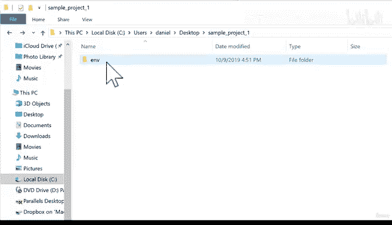

So to access that environment and to access the tools that we want to use。

Conda tells us to activate this environment， use the command。

 Conda activate C users Daniel desktop sample Project 1 M Now you might want to write this one down if you're doing this for the first time yours might be slightly different to mine your username might be different and you might have called this something else because you can call this whatever you like you should really call M always call Mm that's a universal name for or shortened version of environment。

🎼To activate this environment that we've just created。

 we can use this command and now I'm a big fan of typing out commands。

 so we're going to go instead of just copying and pasting， which we could definitely do。

 but to practice typing out these things because we want to after all。

 that's what we want to do we want to start writing our own code。I'm going to type this out。

 sample project one。Slashmp。Run。Now what you'll notice has changed。

 so I just literally just type this out and press enter。 if we hit enter。

 you'll notice this base has now changed to this file path here。

Which means this is the environment prompt。So now we've activated this environment。

 what that means will'll have access to all of the tools in this environment。

 So the ones we just installed。So let's try and test it out to do so。

 we'll try and load a Jupyter notebook using the command Jupiter notebook and if you've never used a Jupyter notebook before。

 don't worry there'll be a section on that， but a Jupyter notebook is what you need to know is kind of like a data scientist' workpad。

 you can write code， you can write you can write text you can work on projects In fact。

 all of the projects we work on will be within Jupyter notebooks。

 It's like the basis of all of our machine learning work。So let's try and start one up。Okay。

 we're getting an error here。Jupiter is not recognized as an internal or external command。Now。

 the reason being is if you remember the exact code that we ran before， and it's okay if you don't。

We did Con create。Prefix M Padas nuie mappottlib psychit loan。 So if we go back to our diagram。

 what do we have Padas Mapottlib nuumpie psychit loan？But no Jupiter。

 we forgot to include Jupiter in this line。Not to worry， Conda。

 our personal assistant is back to the rescue because there's a handy command called Conda In。

what this means is if we type in Jupiter。Conda Install is going to install a new tool to our current active environment。

 which is exactly what we want， and since we want to use Jupyter notebooks。

 we need the Jupiter package。So let's run that by hitting enter。

Conda is going to do the same thing as what？What it did before， we go up here。

 we've seen all these before， except this time it's only focused on Jupiter in the environment location uses Daniel desktoptop sample Project 1 M。

So if we follow this through， it's going to install all of these extra packages because Conr is amazing it's our personal assistant and remember all these packages are our tools that we need for data scientists。

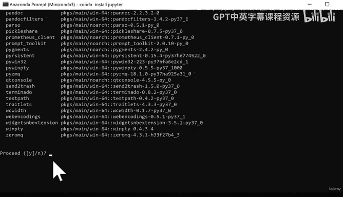

And we go， why？To run and again， it's going to go through these download and extracting steps。

We'll pause the lecture， wait for this to finish and we'll come back once it is done。Beautiful。

 now that that's finished， we should have access to Jupiter。 So let's。

 let's do a quick recap of what we've done。So we've created a project folder changed into it that's sample project one。

 create a custom environment， we've done that with Conda Create。Activate our new environment。

 yet we've done that with Conda Activate。Instalall Jupiter because we tried to access Jupiter。

 but it didn't work with Conda In Jupiter。Now we have to load up a Jupyter notebook and check the tools we need。

Okay， let's try that So if we've actually installed Jupiter。

 we should be able to run the command again， Jupiter notebook。

 the one we tried before that didn't work。 So we'll type that in Jupiter notebook and hit enter。

So now what this is going to do is going to automatically open your browser， your default one。

 and launch the Jupyter interface。So we can see here a few maybe a few new things here that if you've never seen it before。

 what's important to note is that the Jupiter interface has been created。

From within the folder that we're currently in on terminal。So。

Users Daniel desktop sample Project 1 Jupiter notebook， it's like telling your computer hey。

 start a Jupyter notebook within the sample Project1 folder。So we look here。

 we've got the end folder。We compare back to our sample Project one。We've got an end folder as well。

 Now to start a Jupyter notebook over the workspace where a data scientist or machine learning engineer will do a lot of coding。

 working on different projects。 you can go up to here， new。

Notebook Python 3 and again we're going to have a whole entire section on Jupiter notebooks。

 so don't worry too much if you're not sure what's happening here。And so what this is going to do。

What's happened here？Oh， there we go。 It just took a little while to load。 So what we did there。

 we've actually got， two， because that took a， there was something going on there with my computer。

 and it took a while to start up。 There we go， Untitled I P N B， with standsza I Python notebook。

 which was Jupiter's previous name。And so this is the Jupyter interface。 Abutely beautiful space。

 We're going to get very familiar with using this throughout the course。 And again。

 we're going to have an entire section on this。 But what you need to know for now is that you can run Python code in here。

 So hello world， and then press shift and enter。 and that'll come through。

 This is a cell in Jupiter notebooks。 This is referred to as a cell。 you can also change it to。😊。

Markdown， which is like saying text and say this cell。Does a simple sum。

And the one below is going to do one plus one shift and enter。

 But what we're focused on doing is testing to see if our environment is set up。 So specifically。

 we've ticked off Jupiter。 We've got access to Jupiter because we're in the Jupiter interface。

Now we want to see if we have access to pandas，syit Learn， nuumpy and Mapottlib。

 we can do that by importing them and remember the import statement is like saying hey Python。

 go and get these packages or tools for us and bring them into our workspace so we can access them。

So do we import pandas as PDd？Import nu as N。Import。Mat plot lib dot pie plot。

 Oh least we got Lib dot pi plot。As PLT import SK loan。

 which is short for psychet loan Now these you might be like pandas as PD what nuies NP might plo The reason why we shorten it to these things is so we don't have to always type pandas Now if you ever see P or NP or PLT。

 you can probably be safe to assume that they're pandas nuy mappllib or Pilo。To test these。

 if we actually do have access to them and our environment is set up。We can run this cell。

 and if there's no errors， we should have an environment ready to start doing data science and machine learning work。

 fingersing crossed。Beautiful， and we can tell that there was no errors because you'll see a number here。

 Every time you run a Jupiter cell， we'll go over this in a future lecture。 The number will go up。

 So the first one you run will be  one。 That's 7 Now， because we've run 7 different cells。😊。

But this is exciting。 We've just set up an environment to work on machine learning and data science projects。

 Let's have a look。😊，We started with this， your computer。 and we downloaded miniconda。

 which came with Python and Conda。 Then we used Conda to install these tools。

 specifically within an environment。 Now， if we go back here， we've gone through these steps。

 in a previous lecture， we downloaded installed Minconda。

 We tested our installation via the Ananaconda prompt。 We created a project folder。

 sample project one and changed into it。We created a custom environment within the project folder。

 We activated the new environment， so we had access to tools。We installed Jupiter。

 then we loaded up a Jupiter notebook and checked to see if we had the tools we needed， which we did。

Who。There was a lot to take in， but don't worry we'll have plenty of practice going through this in future projects and lectures。

So。What do we do now we've got our Jupyter notebook running。

 but maybe you want to you finished for the day and you want to close it what I've just done is saved so to save a Jupyter notebook you can either click this save icon and that'll save it once it loads or you can press command S or controlr S or something like that。

 but to close it down we go back to our Anaonnder prompt。

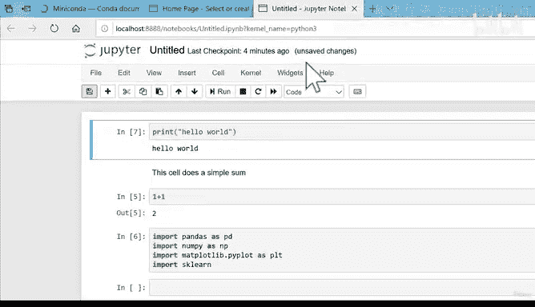

And we're going to press control C。So there we go。 me press control C。

 Now it says shutting down one kernel。 kernel shut down。

 The kernel is what runs our Jupiter notebook in the background。 So now you'll see here。

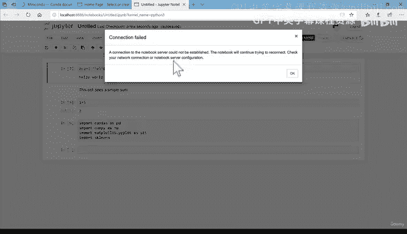

That the connection has failed to our Jupyter notebook， so we'll go， okay。

 that means our Jupyter notebook we're no longer connected to it。So we're back here。

And we're still in our environment。 But to deactivate the environment。

 maybe you wanted to get out and to create a new environment。 So we're going to type in Con。

 deactivate。What this will do is take us back to base Now why would we want to do that or maybe want to create a new environment。

 maybe you want to work on another project such as sample Project 2 and that uses a different environment and might be a plethora of reasons。

However， how do you get back into your environment？Well。Luckily。

 we wrote down that piece of code before if you didn't， it's okay， it's a condo。Activate。死。

We're going to write this， this out， slashmpmp。🎼Now， this is。

 if you were coming back to your work and wanted to get back into your project， Daniel slash。

 as this is where we created our environment， sample project 1。Now this might be in the future。

 it might be sample， might be project two， might be project three or something like that。

ButWe usually have M at the end here to conduct activate。Out environment。Beautiful。

 now we're back from base to having our environment active。 So then we can type in Ju at a notebook。

😊，Low back upper a Jupyter notebook is going to take us to the homepage。There we go。

 we've got our untitled I MB， which was saved two minutes ago。Click on that。

And there's our code from before。 So then we could continue work on our project。

 saveve it when we need to and exit when we we don't need to work on it。

 we're going to see this more and more for each single project that we work on。

 what's important to remember is that this is what we've done。 We've set this up for the future。

 We have our computer。 We've created a project folder。

 Sa we wanted to work on heart disease classification。 You'd make a folder for that。

 You create an environment， install the tools that you need using Conda。

 Then if you're working by yourself， you might not need to do this。

 But in the future when you're on when you're on teams。

 This is one of the biggest challenges we work through as a machine learning team。

It was sharing these environments so other people could work on the same projects as us。

 So that's what we've done。 So in upcoming lectures and projects， we're going to do the same steps。

 create a project folder， build an environment with the tools we need using Conda。

 And then every time we're going to go in， activate our environment so we have access to the tools and then work on our projects in Jupyter notebooks。

Okay that was a lot to take in， but don't worry there's attached resources and if you want rewatch this video go through it step by step。

 check out the resources section for a step by step guide and if you get stuck。

 don't worry I got stuck plenty of times when I was figuring this out it took me a few goes。

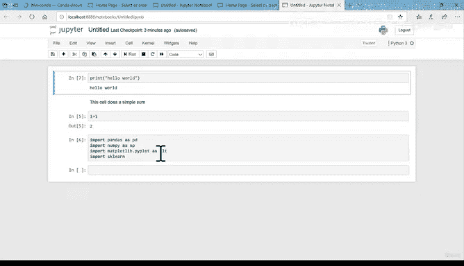