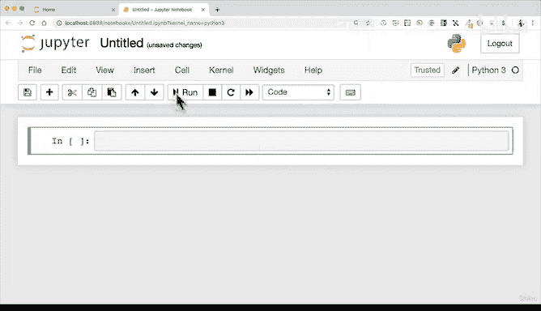
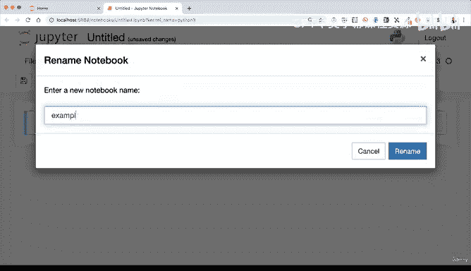
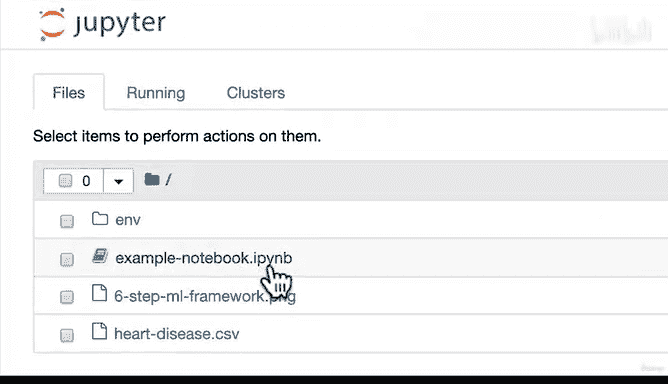
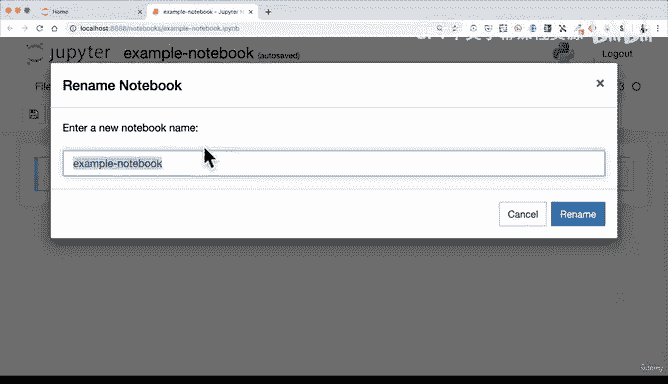
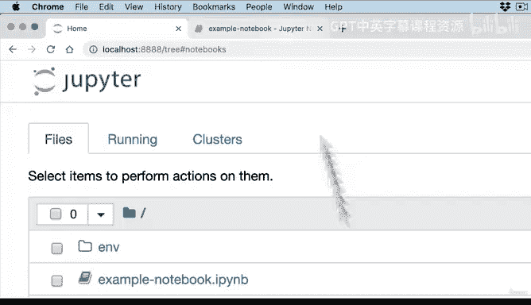

# Bourne《机器学习和数据科学训练营｜Zero to Mastery Data Science and Machine Learning Bootcamp》 - P35：035_05_011 Jupyter Notebook 演练.zh_en - GPT中英字幕课程资源 - BV1yhrvBVEv2

Welcome back。I'm so excited for this section， why because we're going to start getting hands on with one of my favourite tools in all of machine learning and data science。

😊，Now in the past couple of sections we've gone through this kind of workflow。

 we've got your computer， we've set up a project folder。

 we created an environment with some machine learning and data science tools using Conda now we're going to start diving deeper into each one of these tools and more specifically in this section we're going to be focused on Jupiter notebooks。

Now， if this diagram， this arrow pointing here， these arrows going here。

 you're like what's going on here， Daniel， don't worry we're going to have a look at this over the next few sections。

 but what we're focused on for the moment are Jupiter Notes。

 which is kind of like the workspace of where you work through all of your machine learning and data science projects。

And now this is the workflow we're going to be using。

 You'll have a project folder which we've already created。 We'll have an environment。

 so we'll need to make sure we activate our environment so we have access to these tools。

 But then once we've kind of got our heads around Jupyter notebooks and these other ones。

 This is what it'll look like in practice you'll have some data you'll import it into your Jupyter notebook and then you'll use a bunch of these tools within your environment to derive insights and gain information out of that data。

That's enough of the overview for now， let's get hands on and work with a Jupiter notebook。

So what I'm going to do is open up terminal。 If you're on Windows， you may want to open up。

 I'm going to clear that。 So we've got a clean workspace。

 If you're on Windows you may want to open up the Anaconda prompt。And now remember how I said。

 we're going to have to activate our environment to have access to these tools。

 that's what we'll do first。But actually we're going to change into our project folder now for me。

 I'm going to change to the my desktop。And I've got all of my information。

 all of the project folders that I'm working on in the ML course folder， so we're going to go here。

 mine's called sample project yours might be different。

But I'll just show you what's in this using LS。Remember CD stands for change directory。

 so now I'm in my sample project folder and inside the sample project folder is a folder called M just to reemphase where we are。

 let's go I'll go into Finder this might be folder navigator on Windows or something like that。

So I mean ML course。And if I go over here， I'm in sample project There we go。 We've got M。

 Now what I'm going to have to do is activate this environment。

 so I have access to all of my machine learning tools。

 so let's do that Conda activate you're going to have to type in the file path yours may be different to mine depending on where your environment is stored。

 but that's what we covered in the last lecture is setting up an environment in activating it。

 So you want to go ahead and activate that environment again。Desktop， M， L course。Sample project。And。

So if I press enter here。You'll notice that it changes from base。To having this path name activated。

 So now my environment is active， I should be able to start up a Jupiter notebook。We made a mistake。

 notebook by typing in the command， Jupiter notebook。And hitting enter。

What this is going to do is automatically load up your browser。

 your default browser and it's going to come to the Jupyter dashboard very simple here again this is just another view of what we can see in the sample project folder so here we have our M folder if we looked inside that if we go back into Finder we look inside M。

We've got the exact same folders here， this is where we're working。Now。

 what should you pay attention to on this First， we'll go back to the home section。We look here。

 this is showing the files that we've currently got in this folder。

 remember we're in this sample project folder。Then if you come over here。

 we've got a couple of buttons upload and new， we'll have a look at those in a second。

And you've got two other tabs here runningning will show you any terminals that you have running in your Dpyter interface。

 Notes will show you any notebooks that you have running。

 And because we have neither of these running at the moment， it says there are no terminals running。

 There are no notebooks running。 Now， clusters， you don't really have to worry about for now。

 I've been working on machine learning projects for last couple of years and have never looked at the clusters tab。

 So we'll come back here， we'll focus on on what really matters。

So what are these upload and new buttons Well， let's have a look when click upload what happens。

 This is going to open up your folder interface。Now what if we did want to upload something？

For example， I've got a heartdisease。 CSsv document here for the sake of this lecture。

 but you might be have another type of data folder here。So what we can do is if we wanted to。

 we can open that， and this is going to upload it to the Jupyter dashboard， but in reality。

 all it's actually doing is if we come back to sample project。Where we were before。

Now we can see we've got M。M and heart disease and heart disease。

 so realistically this upload button is just like another form of transfer one folder to another region so we can do that again。

Let's try an image this time and now this upload will work with any folder or any file that you want to try out。

 so try it out on your own if you want a link to these resources that I'm using will be available in the resources section。

So we'll upload this image， click there。And so now if we go back to Finder。

Go to where we were sample project。So we can see now。We've got the exact same thing in here。

 M6 stepml framework dopNG and heart diseaseisease。csv。Okay。

 and there's one more button we should pay attention to， that's the new。

We click on new and this is the most exciting part We can start a notebook Now it says Python3 because when we click on this it's going to create a new notebook and the notebook will be able to run Python3 code。

 which is what we want right we want to be writing Python code we want to be writing machine learning code you can also create text files。

 create another folder if you wanted to or create a terminal window We won't have a look at those now because we're focused on notebooks which is where we'll spend the majority of our time。

So we click here。This will open up a new window。And here we go。

 The most beautiful thing in all of data science and machine learning。

 maybe aside from an algorithm that's working really well is the Jupiter notebook book。😊。

And so again， this interface might look a bit confusing if you've never seen it before。

 but don't worry we're going to go through it。

To start off up here is the title of your notebook， so maybe we call it example notebook。

This will rename your file， and if we click this little save icon。

It's going to click say that it's auto saved here， but really we click save， but that's all right。

 we come back here。 What do we notice？We've got example notebook。ip and B。

So see what I mean if you type in here， example notebook， let's just change this for demonstration。

 example notebook1 rename， that's going to change this name and so if we come back to our sample project folder。

You'll notice we now have。Example notebook。 i pi and B。Now， what does I Pi and B stand for？Well。

Ipyython Notebook， which is what Jupiter used to be called。

 but they've kept the file extension as this so that older versions of notebooks don't break so wherever you see this extension。

 some name dot ipyy and B， this is actually a Jupiter notebook。Now， if we check the running tab。

 we can see that we now have a notebook running， we don't have to pay too much attention to this shutdown button from from this running tab because we can we can shut down our notebook elsewhere。

 but we'll look at that in a future video。The next thing to think about。

 let's rename this back to example notebook， is what is actually going on here。

 Now as a quick overview。 Remember， this is the title。This is going to be the menu bar。

 which is similar to what you may have seen in other applications where you've got file edit。

 you've got a few different controls here， This is the toolbar。

So these are commands that you can use on different cells and this is a cell。

The most important thing to remember about this is that this cell can contain code。

Or markdown can contain other things as well。 But the two main ones you'll be worried about are code and markdown code was what allows you to write Python code in here。

 and markeddown allows you to write formatted text。 Sa if we wanted to write Ho world。

 we're going press shift and enter。 there we go。 we've got， we've got some text there。All right。

 save this lecture from getting too long。We're going to have a look at different things that we can do with cells。

 different things that we can do with these these little tools here in the next video。

 but the takeaway from this is that you can start a Jupyter notebook once you've got your environment activated if your terminal window changes to something like this after you run the command Jupyter notebook that is completely normal what this is saying is basically a Jupyter notebook is running at the local host which is on your computer you can see here local host so it just means that a document is running in your browser。

So keep this as it is， we'll return back in the next video to look at more controls and things we can do within Jupyter notebooks。

