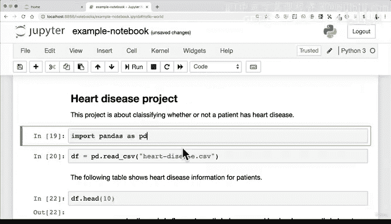

# Bourne《机器学习和数据科学训练营｜Zero to Mastery Data Science and Machine Learning Bootcamp》 - P36：036_05_012 Jupyter Notebook 演练2.zh_en - GPT中英字幕课程资源 - BV1yhrvBVEv2

Welcome back。 Okay， now we've got a Jupypiter notebook running。

 It's time to see what we can actually do in this notebook。

 So remember in the last lesson we went through this， this is like your standard menu bar。

 this is a toolbar。 But we're going to avoid using the toolbar because we want to become experts at using our keyboard。

 all of the the things here that you can do like saving， adding， cutting， copying， pasting。

 etc cetera。 you can do with the keyboard。 So what will this save you。 Well， instead of clicking。

 run on a cell。 So run is how you run some code。 So if we go here。

 maybe we want to print a nice message。😊，Eello world。I'm learning。About Jupiter notebooks。

We hit shift and enter。We could have done that。 I'll see。 I've done that out of habit， right。

 And that's what we're gonna be going to be focused on。

 I in rather than just learning how to use this toolbar to begin with。

 We're going to be focused from the start on using the keyboard。

 So I could keep pressing run here or I could keep pressing shift enter。

 And now what you might be noticing， I that the number on the left is going up every time I hit shift and enter。

 So remember， I've just got this cell highlighted pressing shift， enter。

 That's how you run a piece of code in a Jupyter notebook beautiful， isn't it。😊。

Now this cell number is going up， all that' saying is that this is a 13th cell。

 Remember this is a cell could be code or markeddown。 We'll see that in a second。This cell。

Or there have been 13 cells run in total in Jupiter。

Where this is helpful is if you had something like a equals 5， 14， then you go A。Oh。

 we didn't mean that a equals 6。So does what do you think a equals now。

 Because this is 14 and this is 16 if we hit this and hit shift enter。A is going to equal 6。

 so these numbers are helpful to show us what order our notebook has been run in。 So for example。

 if we had 1 hundred of these different cells with different information in an ideal world a notebook is run from top to bottom。

 but in some cases you might be working on project and run a cell up here and then rerun it down here and later on in your notebook a few hundred cells down you've got some kind of error this is what you can use to figure out what order your notebook was run in。

Now， because we've got code here， we can run all of Python's functionality from right in the Jupiter notebook shift Nta 1 plus 2。

You'll notice some cells have in， and some cells have out。Now。

 if a cell has an output like some sort of code output， it will usually have an outnumb。

 the outnumber matches the in number， so this is just saying。

 hey there's some input code here and we've got some output code here。

Now we did have a brief look at this before code and Markdown。

 This is where the absolute beauty of Jupyter notebook comes into play is that you can have code and format a text。

 which is what markdown is within the same notebook Let me show you an example say we wanted to start our project called heart disease。

Project。And remember， Jupyter notebooks are the workspace of your data science projects so you can run machine learning code and describe what you're doing right from the notebook we're going to see this in practice throughout。

 but I just want to highlight what turning a cell into markdown does。

So we can change that to mark down。 But remember， where。

 we don't want to get used to using the toolbar。 So how do we do that？ Well。

 another beautiful thing about Jupiter is that it the cells have two simple modes。

 One is called edit。 and you'll notice this little pencil up here。And this green box around it。

 the other is called command mode。 Now， how do we switch between the two？ Well。

 as you might have guessed， we can also use the keyboard because remember。

 we're not getting used to using this toolbar。 You may as well' pretend it's not even there。

So to change from edit to command mode， we're going to press escape beautiful。

 Now we notice that the little green bar has changed to a blue bar and the pencil has gone away。Now。

 before we run this cell， how do we get back to edit mode to do that， and press enter。

Now we get our green box back and the little pencil comes back。 Excel。

 but we actually want to be in command mode。 so we'll go back， escape。Blue box is back。

 Pencil is gone。 You'll get used to running this， E and enter after you've had some experience。

 I just know how to do these things'ca I've run thousands of cells in， in my experience。

And we're going to press。M for Markdown， I have to think about that because to change it back to code is why。

So watch this little box up here while we're in。Edit command mode。 Sorry with the blue box。

 we can press M for markdown。Or why for code， But we want marked down in this case。M。

And to run this cell， we're going to hit shift enter。 Now， you see。

 this is some nicely formatted text。 So what you could imagine in the future is for a project you might start it off with a heading up here。

 and then you might add some information below it。 So this project is about classifying。

Whether or not。A patient has heart disease。So this is how you can start to communicate your work right from the。

 right from the very beginning of a project。 Now what else could you do here， Well， let's。

 let's see some data if we go back to our keynote。We want to set up this kind of setup。

 So we want some data in our project folder。 We want to run this data through our workspace。

 which is a Jupyter notebook and try to use some of these tools。 Well。

 let's get a little taste of that。So if we go here， import pandas as PD。

 what this is saying is this is code， it's telling Python to go hey Python， go and get pandas。

 import it as the shortcut P， which is very common for pandas we'll see a little bit more of pandas in a future video what I'm doing is exemplifying the different types of things you can do in a Jupyter notebook and please if you're following along。

 make sure you're typing this code out by yourself。

 but if we go type this line of code and hitshift En。

What that's going to do is import pandas to this notebook。 So now we have access to use panndadas。

 which is one of the tools we installed in our environment within our workspace。

 the Jupiter notebook。So do you remember in the last lesson how we uploaded some files here？

How would we get these files？ So this is a heart disease dot CS S V， How would we get that。 Now。

 if you've never heard of C SV， it's a format called comma separated values。

 It's a very common way to store data。But how do you think we'd get that into here？That's right。

 if you don't know， because you might not have ever gone through this before。

 but what we're going to do is use pandas to create a data frame。And DF stands for data frame。

I'm going to read CSv。And we're going to use the file name。

 Now another beautiful thing about Jupyter notebooks is that if you have a file in here。

You can use Tab for autocomplete。 so if we press T， it's going to pick up heartdisease。 csv。

 and we've already got the other inverted comm so we're going to selected this one。

So what is this line of code doing while it's going data frame equals PD， so pandas dot read CSv。

 so this is a function， and we're passing the file name。

Heart disease dot CS Sv to the read CSv function。 We'll have a complete section on pandas later on。

 but。This is just to exemplify what you can do within a Jupyter notebook。

 So we're going to hit shift enter。 We can see that it's run because that number has gone up。

But how would we view our data？So another beautiful thing about Jupiter Notes is that you can view what you're working on straight away。

 So Df dot head shows the first five rows of your data frame。😊，So if we look here。

 we've got different columns， we've got different examples。

 maybe we wanted to view the first 10 to get a better look。 There we go。

 We'll have a look at this in a future project， but this is just to show you what kind of data Jupiter notebooks can display so we might even put a cell in here so we go escape B for a new cell below。

 you can also press a for a new cell above， but we're going to remove this one so escape。

Double D for delete， beautiful。Let me go， the following。Table shows， heart disease。

Information for patients。Escape and press M for mark down。 shift enter。

Now we've got some communication happening here。Okay， well， we've seen a table。

 what if we wanted to to maybe put in a little graph or something like that and see what this information actually looked like because this is pretty confusing。

We've got a target column which is full of ones and zeros。

 I only know that because I've seen this table before。

 but one means someone has heart disease and a0 you can't see any on this at the moment means someone doesn't have heart disease。

 So what if we wanted to graph that quickly and have a look at how many patients have heart disease and how many don't。

And each row here by the way， is an individual patient， and so these are their parameters。

Let's have a look， we're going go Df。t， which just means access the target value of Df。

We're going to go value counts， which just means count the number of occurrences of different。

 different values in this column。Then dot plot， which means create a plot of kind。

YouGo that mixed up Co bar， which just means let's create a bar graph。 Let's see hit shift enter。

 by the way。Why didn't that show up？Well， M Blaunntly have got access。 We go back to L。

Little environment set up here。 We've been using pandas to look at this data frame。

But we need Mat plot Lib to look at graph， okay。The reason I know that is because I've had experience。

 but we're going to have a look at each of these tools in depth。 So what could we do here。

 Maybe we try to go import mapplot Lib dot Pi plot as P L T。 P L T is a shortcut for mappllib。

We hit shift enter。Nothing happened。Why is that。 Well， remember。

 Jupiter notebooks are executed in order of operation。

 So just because we ran a cell out down here doesn't mean it's going to influence the cell up here。

 So what we'll have to do is come back up here and rerun this cell。There we go。

 So now if we look at the numbers in 24。In 25 out 25。

You see what just happened there because we ran this cell before is 24， and this was 23。

Running this piece of code didn't affect this until we reran it。

 So that's a very important thing to think about with Jupyter notebooks is that they're executed in order of operation。

 And so the other takeaway here is that not only can we look at our data in a table format。

 we can start to look at it in graph format。 So you might be starting to see here， okay。

 if I can run code cells as well as text cells as well as image cells。

I could do my entire project from within this notebook， which is exactly right。 See one more thing。

 And that's if we wanted to import another image。So we'll change this cell to mark down escape M。

We're going to use exclamation mark if you've never written Markdown code before there's some great guides online on how to write markdown code。

 but essentially any kind of markdown code you can write you can write in a Jupyter cell。

 so we're going to we want to import the image that we uploaded earlier。

PNG and you can do this with any image， so this is within this file folder here。

We're just writing it here， you can do this with your own image。

 basically what this is is mark down code for saying importm this image to the notebook if we hit shift enter。

There we go。 So this is our framework。 Okay， we've seen this before。Now。

 what we might do is create a section for each of these steps so you could do markdown again。

 escape M。Number one， problem definition。Where we could say， predict heart disease。

 I'm typing out something small here。 You might want to do something longer。

And then we could have escape BBB to create five or six cells。Before I can't really count to data。

This is the data we're using。 We're going to hit escape M。And then shift enter。

 So now you can start to imagine we've got our framework。

 We could start off with a problem definition。 We could then look at a data。

 just like we've done here， we could move this down。To the data section。

 then we could create an evaluation metric。 Then we could look at the features of our data。

 We could do some modelling， and then we could run experiments all of this from within a Jupiter notebook。

Now， there's one more thing before we finish up this lecture because it's getting a bit long that you can do within a Jupyter notebook。

 The main two takeaway so far is that you can run code， text and images all within the same space。

And the final thing is that you can also run terminal commands from within a Jupyter notebook。

 So say， for example， we wanted to run Ls just as if we were running L S on the terminal。

 So if I go here。And I put in Ls， it's going to list all of the files in my user account。

If we do the same in Jupyter notebook， if we just ran LS in a code cell。And hit shift enter。

 that's interesting。 That might be an update I haven't seen before。 Usually。

 you'd have to type in exclamation mark L S。Well there you go， you learn something new every day。

 maybe you don't need the exclamation mark， but generally to run a command like LS like L。

 you would need the exclamation mark in front of the terminal command and what this is going to do is go in Jupiter instead of executing this command like some Python code executing it because it's got the exclamation mark there as if I was running it on the terminal like this。

And so the Ls command is just showing us the different files that we have here。All right。

 Well that's enough for this lesson。Remember， sound like a broken record here。

 but this is important to take away is that Jupyter notebook cells are run in order of the number。

 So if we ran here a equals 5， if we came down to this one and skip this one。

 it's going to be a equals 5 but then if we ran this。A would equal 6。And you can run markdown cells。

Code cells， as well as。

Plot different images all within the notebook。We're going to have plenty of hands on experience with this throughout the rest of the course。

 so stay tuned。