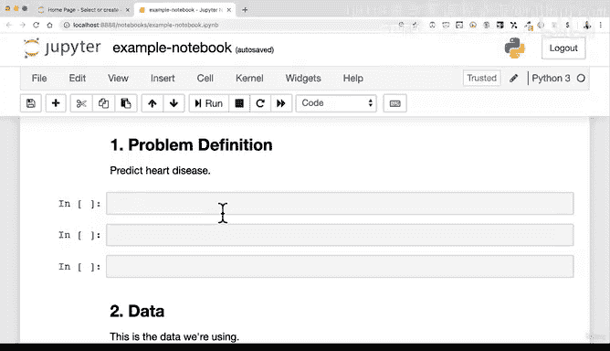

# Bourne《机器学习和数据科学训练营｜Zero to Mastery Data Science and Machine Learning Bootcamp》 - P37：037_05_013 Jupyter Notebook 演练3.zh_en - GPT中英字幕课程资源 - BV1yhrvBVEv2

Okay， I hope you're starting to get excited as I am about Jupiter Notes because I seriously love these。

 Now， the beautiful thing， the final last beautiful thing about these is because once you finish your project。

 you probably want to share your work。 Maybe that's through Github or give it to one of your teammates so they can check it out for you。

 Now， Jupiter notebooks makes that a breeze。 What you might have seen is throughout past few lectures is auto saved indicator here。

😊，But if we wanted to generate that normally， if we wanted to save our work。

 say we're finished for the day and when we want to save it， shut up shop and come back。

 get ready for tomorrow， we can go save here now its going to automatically save it or remember how we're not getting used to using this。

If we are in command mode， which is the blue square and no pencil up here， we can hit S。

 which is a shortcut for save。 Otherwise at any time that you want。

 you can also hit command S if you're on a Mac or control S if you're on Windows or something like that It's a good habit to get into if you're continually hitting command S or save or just clicking this。

 but again， remember you want to focus on using the keyboard。

Because saving your work often will prevent you having to redo things if for some reason you end up losing something。

Okay， so our notebook is saved。 Now， how do we shut it down if we come back to。The Jupiter dashboard。

 we can see running。 Now you've got this shutdown button here。

 but usually you probably won't use that。 So to shut our notebook down。

 we're going to go into terminal。 And we can see here that we've saved our notebook several times。

 and this is times stamps。 So these are the last three saves that we did pretty close together after each other。

 to shut the notebook down。And stop your terminal from running， going to hit control plus C。

 and then it's going to ask you yes or no， and you're going to have to hit Y or n within five seconds。

I hit why because I want to shut it down。And that's what you'll see here shutting down one kernel。

 Let's go back here。We go files。Running， maybe we have to refresh this or close this。

Sometimes a Jupiter dashboard won't update。Because we've closed the connection in our terminal。

 But that's fine。 We can X out of this。 So now our Jupiter notebook is no longer running。

 It is saved in our sample project folder。 We come back here。Ml course。Sample project。There we go。

 example， notebook book。 and it's going to say。Date modified today at 1127 AM。 There we go。

 Save it two minutes ago。 Beauti。 And what you'll see here is we're now back。

 we've got the environment activated within the sample project folder。

So what happens if we wanted to completely get out of the environment as well， like Conda。

 deactivate？Maybe you want to activate another environment to work on another project。

 so to get out of your current environment， you can type in Con deactivate。

That's going to take you back to base， the base， the default environment。

 but we're still within the sample project folder。So if we came back tomorrow。

 let's exit out of everything that we have open actually so we can see what it's like to come back completely from scratch because this is what you'll want to be doing。

Remember， this is what we've set up。 we've got our project folder。

 you've seen some data being imported into the Workspaces Jupyter Note， and you've seen a little bit。

 a little highlight of using some tools within your environment。

So let's reactivate this whole setup again， terminal。We're going to increase the size。

 See how I have base activated by default。 I'm going to change into my sample project folder。

 So desktop mind stored on my desktop under MLl course， yours might be different。

 Remember Now I'm within the sample project folder if I hit Ls。 I can see the image that we uploaded。

 I can see my environment。 I can see my notebook， and I can see the data there heart diseasease do csv。

So if we wanted to access a notebook， let's enter Jupiter notebook。Comman， not found。

Take a second to think about why that command might not work。

 If you'd guess that we didn't have our environment activated， that's correct。 But that's all right。

 If you didn't， because it took me ages to get used to this kind of workflow。

 But I want to show you it。 So Conda activate， not activate。 Conda activate。

 We're going to reactiv our environment。Users is it uses Daniel。Desktop， slash ML L course。

 slash sample project。Slash m。There we go。 We notice that base has changed to this。 Now。

 if we run the Jupiter notebook command again， Jupiter notebook。What do you think this will do？

Let's see。This is going to bring us back to the Jupiter dashboard。 Now， if we're go into running。

 we've got no notebooks， no terminals running， we notice that our terminal has changed again to this。

 this funky looking code。 All it's saying is we've got a Jupyter notebook server running on local host dot 888。

 which is the same as here。 Q 8， not triple 8。 we have our notebook here to start it up。

You can click on it。And we come back。Beautiful， we've got everything that we were。

 we were looking at before in the previous video。😊，Now。

 the thing to remember is that when you reload a Jupyter notebook， all the cells。

 all the memory of the cells will start from scratch。 So if we wanted to rerun this cell。

 remember to run a cell is shift plus enter or this run button， but we're ignoring the toolbar。

 we want to get proficient at using the keyboard， shift enter， It's going to start back at one。

 And if we do the same2 same3。 Now， if we ran this， a， what do you think a will be equal to。

As the output， because we've gone 2，3， equals，6， equals 5。Shift， enter。A equals 6。

 Remember because Jupiter notebook sells a run in order of execution。

And so this is the workflow that you would take if you were coming back to work on your project again。

 you might have to rerun all of your cells so the code， say we are working down here。

 you may have to rerun all of the cells above so that you can work on your code down here and you're not missing out on any data。

And the final beautiful thing is because we've now got a workspace that we can work on an entire project。

 we can also share this workspace。 So if we come back。

 our sample project folder that we've been working through。

 hass our environment has our data has this image that we we've been looking at and it has our notebook which contains code and text about the project we're working on So if my teammate was like。

 hey Daniel， can you share with me the Jupyter notebook you've been working on for the heart disease project I could be like sure I could send them this and then they could if they've got this exact same setup on their computer。

 they could start up an environment， import the data。

 work through the sixstep Ml framework and then run the code and read my descriptions throughout my Jupyter notebook。

So that is the beautiful thing about Jupyter Notes。

 they're kind of like the all in one workspace for data science and machine learning projects。

So in the next few lectures or in the next few lessons and projects。

 we're going to really dig into this little framework here at the same time working out how to apply different data science and machine learning tools such as these within our Jupyter notebook。

