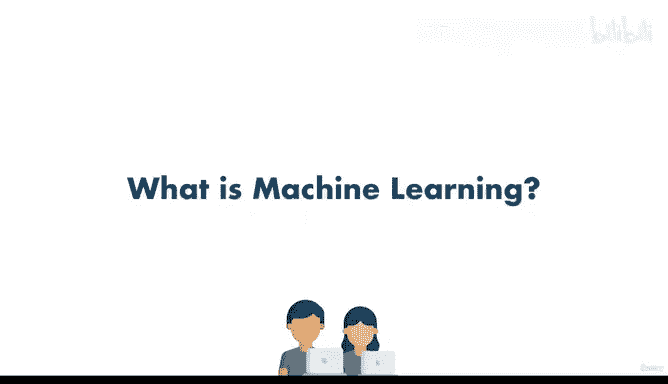

# Bourne《机器学习和数据科学训练营｜Zero to Mastery Data Science and Machine Learning Bootcamp》 - P3：003_01_005 你的第一天.zh_en - GPT中英字幕课程资源 - BV1yhrvBVEv2

Congratulations， you just got hired at Cako Corp。They're the latest Silicon Valley startup to hit the scene。

 They help analyze data of large companies and consult on what companies should do with their data。

They do autonomous vehicles， security cameras。 They have an online dating app， a website。

 They even have drones， and they also offer their services like Amazon to other big companies or startups。

And you just got hired。 Asome。 Wait， what is your role Well you're the new machine learning and data science expert。

Well， this is a little awkward because you don't really know anything about that， do you。

Maybe a little bit。 maybe you've heard it in the news。 But h。

 this is going to be awkward because it's too late。

 You're already hired and people want you working right away。So you entered the office and， oh。

 there's your boss right there。This guy over here with the perfect hair。 That's Bruno。

 He just got promoted， and he's really excited to make an impact with Caco Corp in their data division。

 And he just hired you to lead some of their initiatives。😊，Now， he seems nice on the surface。

 but I have a feeling that he's going to be a tough cookie to work with， but you know what。

 we'll get through this。Now， if your memory is fuzzy of how you ended up here at Cacocorp。

 let's not worry about that。 It's your first day on the job。

 All you know is that you're the new machine learning and data science expert。 Now。

 because this is your first day， as you do， you go out for lunch with your coworkers。 And luckily。

 they don't ask you too many questions。 And they seem to like you。 They seem to be nice。

But then during lunch comes the question。Hey， we've heard about this machine learning thing and Bruno said that you're the expert on the topic and we're excited to have you on the team。

 but what is machine learning？Any you think to yourself。Oh boy。 what should I say here， Well。

 you know what， guys， I have to go back to work。 Don't have much time。

 I'll explain it to you tomorrow。 So you run away。 still confused how you got here。 But luckily。

 the day ends with you not revealing that， you know absolutely nothing。

 and you have no idea how you just got hired。You survived the first day， but we have a problem。

 right， Tomrow， you have to go into work， and you're going to have to explain this to your colleagues。

Hopefully you can survive throughout the next couple of weeks and let people know that you're not an imposter。

 but。H， what should we do here， Well， luckily for you， you remember your old childhood friends。

Their name。Andre and Daniel， look how cute they were as a baby。You call them up and you say， hey。

 somehow I landed this job in Silicon Valley。 It's really well paying。

 but I have no idea what I'm talking about。 And luckily for you， they know。

 So they're going to help you throughout this journey to make sure that Bruno doesn't fire you and you impress all your colleagues。

What we're going to do is each day at work， you're going to get some tasks。

 and then you're going to go back home and Andre and Daniel are going to help you so that， well。

 you don't get fired。So。😊，Here we are。 all of us at home trying to decide how we're going to tackle this first problem。

 That is， what is machine learning， We have to go into work tomorrow and explain it to our colleagues。

 Let's get to it。

What is machine learning？