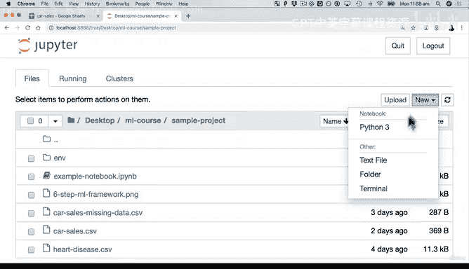
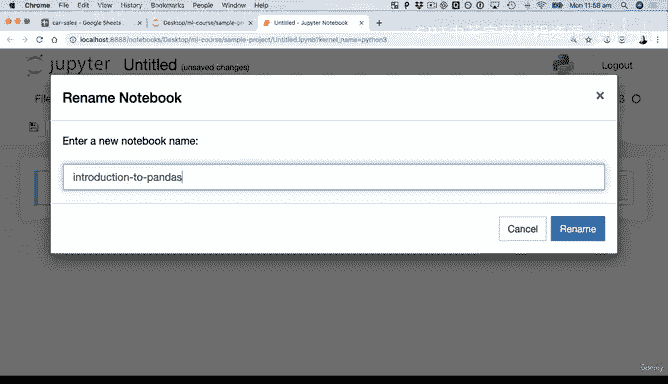
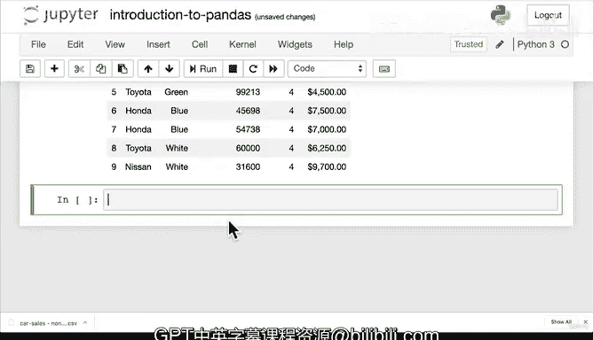

# Bourne《机器学习和数据科学训练营｜Zero to Mastery Data Science and Machine Learning Bootcamp》 - P40：040_06_004 Series、DataFrame 和 CSV.zh_en - GPT中英字幕课程资源 - BV1yhrvBVEv2

Now we've got a little bit of an overview of what pandas is。 Let's start to code it， so to begin。

We're going to load up a terminal or command prompt Now this is the workflow we've been through a couple of times now but we're going to keep going through with each new concept to make sure we kind of get it down pat because that's what we're doing right we're just practicing and practicing and practicing。

So if we try to access Jupiter notebooks， which is our workspace where we want to use pandas。

 we run this code whilst we're in the base environment， it's not going to work。

 So we need to activate the environment that we've created。

 So if I go Connda M list this will show me my environments。

 and in my case I want to go to the sample project folder that we created in the beginning because that environment has all the tools such as mappllib。

 pandas， Jupyter， nuy， etc。 we're focused on using Jupyter and pandas in this section。

 So to activate that I'm going to type in Conda activate， then I could copy this here。

And put it down there， but we're going to practice typing out commands in the command line because that's what you want to get proficient and used to typing these sort of things。

M our course， sample project。Slash M。And we'll hit enter。So now that has activated this。

 and you can see we've changed from base to having this environment activated。

So if I load up a Jupyter notebook now。By typing Jupiter notebook。It's going to open up my browser。

Beautiful， now， because I'm in my home directory， I need to look into my desktop。And then ML course。

 sample project。There we are。 so now we're in in the sample project folder within the Jupiter dashboard。

 Now this is a project that we made in before in previous session where we created example notebook。

So to begin exploring pandas， we're going to go new Python 3 Notebook。

We'll give this a name。 We'll call it introduction to。Paandndas。

There we go。 hit enter。And so to begin with pandas， the first step is to import pandas as P D。

 We've seen this a few times already， but this abbreviation P D is just a short version of pandas。

 It saves us from having to type pandas continually。 So we'll hit shift and enter。

 this is just going to tell Python as we're running Python 3。 Hey， Python。

 go and get the pandas tool for us because we want to use it。And now。

 the first thing to know about pandas is this two。Main data types。 I'm writing that little hash。

 This is a comment， and I'll hit enter。 The first one we're going to look at is series。

 So we go series equals PD D series。 And now， remember where the style we're going。

 we're going to go through these concepts is by looking at them first before discussing them。

Becauseuse remember， if in doubt， run the code。 Now， if I make a series here。

 the command Pd do series takes a Python list。 So I've got a few car brands in there。

 so we could really call this car brands if we want， but we'll leave it a series。

 So let's hit shift and enter。And to view our series in Jupiter notebook， we'll type in series。

 hit shift enter。So now we can see we've got like a single one dimensional column of information。

 And that's the main thing you need to know about series。 So series equals one dimensional。

So one column， let's practice making another one。 We'll hit escape and create a new cell。

So what about this one we do some colors？Colors equals P D， not series。We'll go， red。We'll go blue。

And white。Excellent。So if we go underneath here and we'll put colours underneath so it displays it。

Shift enter beautiful。 So now we've got two1 D series，1 dimensional， when I say 1 D， by the way。

 one of car brands and one of different colors。 So now the difference between a series and a data frame。

 now a data frame。😊，Is two dimensional， and data frame is far more common。

 I'm saying column because data frames have columns。

A data frame is far more common than a series because oftentimes with your data。

 you'll have more than just one single column。 So let's create a data frame。

 We'll call this one car data。 maybe car data equals P D dot data frame。

And now data frame is a little bit different because it takes a Python dictionary。

 some like a car make。And then the beautiful thing about data frames is that we can create a data frame out of series。

 So we've got series here。 So car make， this is the key， and this is the value。😊，Well go color。

And we'll give it our colors series。So down here we'll go car data。Beautiful。

 that is our first data frame。 Now， this is so exciting， right， Because I love data frames。

 and it's a beautiful thing to start seeing your first ever data frame being made。 And now。

 if you have a look here， making a data frame from scratch can kind of be a bit tedious。

 So what you'll usually do is rather than creating your data frame from some series。

 You're going to import data， So we'll type that down here， importm data。 And now。

 where would you get data。 See， for example， we wanted some car data。 where could we find that。 Well。

 if we go up to this beautifully created premade spreadsheet。 And by the way。

 all the resources to what we're working on will be in the resources section。😊。

We can see that this is a spreadsheet called car sales。 And now。

 how do you think we might get this into a panda's data frame？ That's all right。

 If you don't know the answer， we haven't been through it yet。

 but this is what pandas is great at doing right， You'll have some structured data。

 maybe in a spreadsheet or something which could be anything right， This is car sales。

 but you could have transactions。 you could have patient records， something like that。

But we want to rather than manipulate the data in a spreadsheet。

 we want to start using code specifically pandas code。 So the first thing is we have to import it。

Now for this car sales data。The way we could do it is to export it。Now。

 there's a little download tab here into comma separated values dot CSv。 Now。

 this is a very common data storage file type， and pandas works beautifully with it。

 So if we were to export this spreadsheet data as comma separated values， let's do that。

That's going to save down here。 Now I've already imported this into my sample project folder as car sales do csv。

 So let's see how we would import that in pandas。 So car sales equals Pd do read CSsv and then we're going to type in the file name as a string So car sales do csv。

 Now the beautiful thing about pandas or Jupyter notebooks in general actually。

 is that you can use tab autocomplete So let's try that out So we're going to press tab。There we go。

 And we've got some options here that's going to prefill that。 So we don't want the missing data One。

 We'll have a look at that in a future video， but let's click that There we go。 car sales do csv。

 So all this is doing is saying， hey， pandas with PD D read this CSv file and save it to car sales。

 So I'll hit shift enter。 Now let's have a look at that data frame。Beautiful。

So now we can see this is just the exact same information that's here。In a pandas data frame。 now。

 the beautiful thing about this is that because it's now in a panda's data frame。

 we can take advantage of all the functions that Padas has to offer in manipulating viewing and changing this data。

😊，All right。Let's have a quick overlook of what the anatomy of this data frame is。

 because different places refer to different things。 So we'll go to this slide。

The anatomy of a data frame， so we'll break it down on the left hand side is the index column。

 Now panda's data frames like Python list start at 0。 So if you had five rows in your data frame。

 it would only go up to 4。 Remember it starts at 0。Now， this here is a row。

So these all these values here， including the index， is called a row。And these ones here are columns。

And a row is referred to as access0。And a column is referred to as axis equals1。

 So if you ever see a pandas function in the future， which has a little parameter called axis。

 if it's saying axis equals 0， it's meaning a row。 Now， if it's saying axis equals 1。

 It means a column。 I got confused by this in the beginning， I was just like。

 just tell me if it's a row or column， but some functions use axis 0 or axis equals 1。

Now these individual values here are data， you can have different kinds of data types we'll see those in a future video。

And the headings up here in bold are column names。 So these are the main things you need to know about A panda's data frame。

 You can take a screenshot of this or something like that。It'll be in the resources section as well。

 but if ever you hear me referring to different terms around here。

 you can always have a look at the anatomy of the data frame and know what's been talked about。

So let's go back to our notebook。And so once you've imported a data frame。

 what you might want to do is make some changes here and then export it。

 So let's see how we would do that exporting a data frame。 Now， of course。

 we haven't made any changes to ours just yet。But we're going to export it anyway， to see。

An example of how to do it To export a data frame， we take the variable of the data frame。

Car sales dot2 C SV。 So to import it was read CV。 Now we're going to call this function。

 car sales dot 2 CV， and then pass it a string name of what we want to call it import， exported。

Car sales dot CSsv。 Now， you could also do car sales dot 2 Excel。

If you wanted to export it to an Excel file， but since we're only really working with CSVs。

 which is kind of a universal data type， you might not have Excel on your computer， CSVs。

 you can run almost anywhere， we're going to export to CSV。So if we hit shift and enter。

Where do you think that's going to go？Let's go back up here。 We look in here。

 Exed car sales dot CS S V a few seconds ago。Beautiful。

 so now if we wanted to create a new variable exported car sales just to demonstrate P D dot read CSsv。

Car sales， no， we want to go exported car sales。 So all we're doing now is just reiming this file here to see what it looks like。

 and then we'll go。Exported carss。Fix up this one as well。 Shift and enter beautiful。

 We import it back in， but there's some unnamed column here。 Now。

 this is a little trick of what 2 csv does because there's this index column here。

 if you don't put in。And index， I think it's equals false。If you don't put in this。

 it'll export it with the index as a column。 So let's see what happens if we go there。

 indexex equals false。 Now we're going to all that's done is re exportported the file。

Then we're going to reimport it。There we go， it's going to index it as it gets imported。

So that little parameter there index equals falses go export this data frame and don't worry about throwing the numbers there。

But I think that's enough for now we've looked at the main takeaways from this is that pandas have two main data types。

 series， which is a one dimensional column， So there's only one column here， data frame。

 which is a far more common type， which is two columns or two dimensional sorry。

 so you've got rows and columns。But the more common way of importing data into pandas is to read something like a CSV file。

 and then once you've made changes on this or manipulated in some way。

 you can export it as a CSV file。All right。 I'll see you in the next video。

