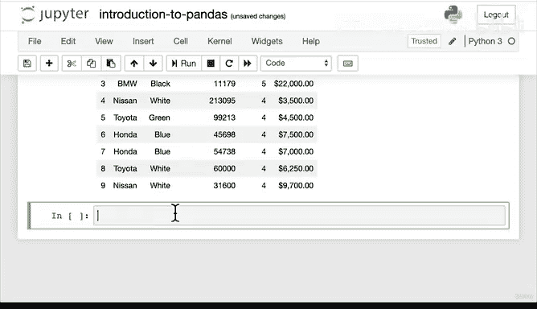

# Bourne《机器学习和数据科学训练营｜Zero to Mastery Data Science and Machine Learning Bootcamp》 - P41：041_06_007 使用Pandas描述数据.zh_en - GPT中英字幕课程资源 - BV1yhrvBVEv2

Okay， welcome back Now in the last video， we went through different data types and pandas。

 series and data frames。😊，Creating some series in a data frame， importing data。

And then exporting data。 Now we're going to look at different ways you can describe data in pandas。

 So we'll make a little heading here。 Remember to do that。 You can type some markdown。

 if you've never seen markdown before， you can do some research。 But to create a heading。

 you can do two little hashtags。 and this will。We'll press escape an M shift enter。 Now。

 I've got described data in a nice little heading format。

 This is a great way to break up Jupiter notebook books。 So it's communicative。Okay。

So the way you call functions we've already seen this on an example here to CSV on panda's data frames is by pressing the dot notation。

So if we go tab， it might show us。There we go。 tookook a little while。

 and I got impatient and pressed tamed a lot。 It'll show us a few functions here that we can run。

 But remember， there's an a lot here。 So in the beginning。

 don't focus on trying to learn all of these off by heart。

 Just focus on using the few that we're going through at the moment and then build upon your knowledge as you go。

So the first thing we're going to have a look at is how to describe the data types in our data frame。

 We can do this by typing in D types。So you'll notice some functions have brackets after and some don't like this one doesn't have brackets over it。

The difference between these two is this is an attribute。So we type in here attribute。

 whereas a function like。Car sales。2。CSV is a function。

So the difference between an attribute and a function is this is going to perform some steps whereas D types。

 which is an attribute， is just some meta information which is stored about the car sales data frame so that's the two main things to remember here but the difference between an attribute and a function we don't want to run this line of code so we'll comment that out but we do want to see the D types so let's do that。

Hading shift enter。 Now， this will tell us some information about our car saless data frame columns。

 So it's got a make column。 Let's view it up here。 make color， adomin doors， price。

 That's our column names。So this is going to tell us the type of our mate column is an object。

 color is an object， odometer is an int， doors is an integer， and price is also an object。

Let's have a look at some other things we can do with that data frame， car saless dot columns。 Now。

 is this a function or an attribute。It doesn't have brackets， so it's an attribute。

So this is going to tell us our column names is going to return it as a list so you could go。

Car columns equals car salesles。comns。Hit shift enter。

And now you've got your column names stored as a list。

So you can perform some operations on this list and then use that later on to manipulate your data frame。

 but this is just how you access two of the main types of attributes from your data frame。

Let's have a look at something else。 What about the indexes， so's going to go carcos。 index。

Has no attribute index， all。Cause we typed in car columns。 We want our car sales data frame。

 There we go。Beautiful， so this is going say， let's view the data frame here， car sales。

This is going to say the range of the index starts at 0 and stops at 10。 Step is  one。So 0，1，2，3。

 Okay， that makes sense。Now we've gone through a few different attributes of our data frame。

 let's have a look at some of the functions we can call。

Remember the main difference between a function and an attribute is one doesn't have brackets。

 attributes don't have brackets and functions are going to perform some kind of operation so the first one we'll have a look at is describe。

Now there we go， what thescribe does is gives us some statistical information about our numeric columns。

You might notice why isn't price coming up here？Is a numeric column。So we've got odometer。

 that means there's 10 columns as count， the mean is 78，601。

 so the odometer is how many kilometers a car might have done。And then number of doors。

 the count is 10， meaning there's 10 rows with doors as a column。

And the mean is for standard deviation is that 0。471405。 We've got percentiles here， men and max。

But no price。 Well， if we come back up here。We can see that the odometer is an integer value。

 and the doors are also an integer value， but the price is an object。 Now， that's interesting。

 maybe when we imported it from our Cv， this cell is formatted differently to these cells。

Don't worry， we'll have a look at that in a future video。

But something to keep in mind is that describe works on only numeric columns。

So let's have a look at something else， maybe we want info。Carll。

info and now it's important to remember that these type of description functions。

And attributes are some things that you might run through at the very start of exploring a new set of data。

 So that's what we're doing。 We're pretending we've got car sales here and we want to start running functions like infofo and describe to just start exploring our data and getting some information about it。

So what's this going to give us， Let's have a look。 range index 10 entries 0 to 9。

 Now info is kind of like。Index。Combined with D types。And so remember。

 pandas has many different ways to do similar things。

 So as you go through and work through learn more about the library。

 you'll kind of find a pattern that works for you best。

 I'm just showing your broad collection of different useful functions you can use throughout any type of data analysis。

 What this is going to tell us is that the mate column has 10 nonnell objects。

 10 nonnell objects for color same again for the rest of the columns。

 There's two D types for in64 Yep， that makes sense in 64 in64 and 3 for object Okay and that's not using very much memory。

Allright， let's keep going Car sales， you can call statistical analysis on your data frame。

 so car sales do mean will give you the average of your numerical columns。

 Remember price doesn't show up here because it's an object， not a numerical column。

You can even call Me on individual series， let's make a series。Called car prices equals Pd。t series。

3000， let's pretend that this is our car prices， that they're not in object format。

 They're in integer format。 And then we go car prices dot mean or princes。Car princes。

I wish I was a cowpri。There we go， so that's going to give us the average of these three numbers here that's pretty high there。

 38583 because we have this big value that's a car prints card right there。😊。

Next one we can have a look at is sum so we can go car sales。 sum。

 This is going to sum up all of the different columns value。

 So this is just really combined what's in the mate column， what's in the color column。

 It's titled up how many a domino there is。How many doors there are it's not really useful calling it on the whole data frame so maybe we do it on a single column now to select a single column we'll go through this in the selection video。

 but to select a single column just to demonstrate it here。

 doors dot sum you type in the name of the column in square brackets as a string and then called dot sum hit shift enter。

 now that's just going to bring the sum down here。Now you can do a fair few different versions of this statistical。

 like not just some， you can go mean， media and a bunch of others， so I suggest if you're practicing。

 try out a few different statistical functions， even look up the panda's documentation for different statistical measures you can call on different columns。

And then finally， if you want one last bit of information about your data frame is length。

So the reason you might want this is say your data frames 200。

00 rows and you only wanted to work on a few thousand for an exploratory data analysis。

 you could figure out the length of the data frame you're currently working on by passing it to L。

And we can see that there's 10 rows in our data frame。 We have a look at it one more time。Beautiful。

 that's nice and correct， okay。So that's the end of this describing section what you could probably do is go through practice running the code yourself and then see if there's any other。

Functions here that you want to try out， maybe create your own series like this and then see what statistical values you can find out about your series。

 but without further ado， I'll see you in the next lecture and we'll look at how to differently view data and select data。

