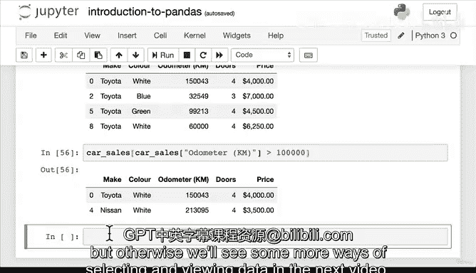

# Bourne《机器学习和数据科学训练营｜Zero to Mastery Data Science and Machine Learning Bootcamp》 - P42：042_06_008 使用Pandas选择和查看数据.zh_en - GPT中英字幕课程资源 - BV1yhrvBVEv2

Welcome back we've had a look at a few different ways of describing data that we've imported to pandas into a data frame Let's have a look at a couple of different ways we can view and select data。

😊，So we'll come down here， we'll put another little heading in， So we go viewing and selecting data。

 We're going to hit escape and M for markdown， shift and enter because we're keeping our notebooks nice and clean and communicative right from the beginning。

So to begin， one of the first things you'll do is have a look at the head of your data frame。AndNow。

 remember， this has brackets after it。 So it's a function。

 And what this is going to do is return the first or the top five rows of your data frame。

 Now you might be thinking why5。 Well， that's a good question， I'm not entirely sure。

 but five seems like a pretty good number。 And so in practice what you'll probably be doing is manipulating your data frame in some way。

 and then calling head on it fairly often。 So you don't have now our data frames only 10 rows。

 So calling the whole thing isn't actually too bad。 but imagine if you had thousands of these。

 So what head does is it gives you a quick snapshot in a small little space of what your data frame contains。

 So if you make a couple quick changes here and there。 you might want to look at the top five rows。

 And a five isn't enough， maybe you want to look at the top 7。

 Well the beautiful thing about head is that you can。

Type in a number here and it will return that many rows。

So you can have play around and return whatever amount of roses you want。Now， for some reason。

 if you wanted the bottom of your data frame， you can use dot tail， and that will return。

 you might have guessed。The bottom five rows。 Now this is handy if you're doing some alterations on the bottom of your data frame rather than the top。

 and so the changes will only appear towards the bottom。

 something like that entails much the same you can put in any kind of number you want here。

Press shift and enter， and it will turn the bottom three rows there。Now。

 the next two functions that we're going to look at are lock and I lock。

 so let's write them down here， lock and dot I lock。Now， before we go into the details， remember。

 we always want to run code first， if and out， run the code。 That's our motto。

So let's create a series here so we can demonstrate the difference。Between lock and eye locks。

 I'm going to make one called Anim。 What's your favourite animal， Maybe， since we're using pandas。

 maybe we'll put a panda in there。And one more snake。Now we're going to set the index here。Now。

 if we created a series by default， the index will be zero to however many things we have here。

But let's actually see that rather than talk about it becauseuse remember， if in doubt。

 run the code An 0 to 4 in order。 But if we wanted our own custom index。

 which we can do by passing the index parameter。 And then we put in a list to say 0，3。

 and we want this index to be out of order on purpose so we can demonstrate lock and I lock。

There we go。 So we have five things here， five things here， both Python list。 Now， if we run this。

 we can see that our index has changed。So， let's have a look。Animals dot lock。3。If we call this。

 what do you think will come back and lock you can consider a short for location？So let's try。

 shift enter。Dog and snake。Beautiful， so what lock refers to is the index numbers。

So because we have three and three here， it returns two items。 Let's try Anim。 lock9。

What do you think this will come back with， which animal？Shift enter bird。

The reason being is because bird is at index 9。 So we created bird，1，2，3，1，2，3， index 9。Okay。Now。

 let's try our car sales data frame。 If you're not sure what this looks like， we'll run it here。

So we can see， okay，0，1，2，3。 The index is still in order here。 beautiful。 Now。

 let's run lock on this dot lock 3。 What do you think this will come back with， Which car。

Let's try it out。All beautiful。 comes back with position 3。

 A beautiful black BMW for $22000 can be all yours。 I could become a car salesman。 What do you think。

😊，So now let's try another one。 Let's try IO this time。 We'll put IO here。So we go animals。iloc。

three。This time， we're doing dot I lock instead of just lock。So if we have five items here。

 what do you think this will come back with？Let's try it out。 Shi， enter。Panda， now。

 so we can see it。 Let's put a new cell here and go animals。Beautiful， so what Ioc refers to。

 Ioc refers to。Position。So we can see here，0，1，2，3。If this was in order， remember。

 Python list and data frames in series start from 0。 Ioc refers to position。

 whereas lock refers to index。 Let's try maybe with our car sales data frame， car sales dot Ioc。th3。

It comes back with the same as lock。 That is because if we go up。Oh， actually， let's just do it here。

 Car sales。 If we have a look at our data frame， I lock。Position 3。

 remember because Ioc refers to position， so 0，1，2，3 is the same as index 3。

So that's the main two points you have to remember about IL and lock， is that IL？

Refers to position and will put in here， lock。Lock refers to。Inindex。They're the main two。

Differentiations there。Okay， now the beautiful thing about this is that with IO and lock。

 you can use slicing， so if you've ever used Python list， you might be familiar with slicing。

 but if not I'll show you what that looks like and we might type in animals。 iL。😊，Colon3。

 and what this means is rather than talk about it， let's run the code。Is give us。

The items in animals up to position 3。 Now， Ioc doesn't include position 3。 So it'll give us。

 remember， start from 0，0，1，2，3。 So it's going to give us up to3。 Now。

 let's try it with the car sales data frame。 car sales dot lock。Colon 3， shift and enter。There we go。

 It's given us up to and including index 3。 Basically， this is the same as calling head。

 but with four。 so car sales。Don head，4。Excellent， okay， let's keep going。

Now we've seen this previously， but let's say we wanted to select just this mate column and have a look at what's going on there。

So the way to select a column is to type in its name in square brackets next to the name of the data frame as a string shift enter。

 there's the make column。Let's have a look at the color column， car sales。Color。

Excellent we've selected that Now there's two ways you might see。

 I want you to be familiar with both of these ways of selecting a column so if we go carss。 make。

It's easier to type than something like that。 but this is the same thing。 Let me demonstrate。

 car sales。Mike。These two lines of code are going to do the exact same thing。Let's prove it。

 I'll put a split in here by hitting control shift minus。 I'm going to go make excellent。

And we're going to car sales。 make。Now the only real difference between these two is the syntax。

 so whichever one you prefer， you might want to use。

 but what you should know about the dot notation is that if your column name has a space in it。

 the dot notation won't work。So if we tried to do this for。A domina。K M。

It'll come back with an error。But if we put a cell in here and go car sales。系倒么啊。K M。Run this。

It'll return the odometer， so there there two main differences between selecting a single column。

And now one last thing before this video gets too long is that if you wanted to select a single column。

 but put a little bit of a filter on it。Let's start with the mate column， but we only want。

Rose with at Carm Toyota。So can you decipher out what's going on here， We're saying car sales， Okay。

 and then we're passing at this little condition here。 This is called Berlin indexing。

 Let's hit shift enter to have a look。So this is going to say， hey， pandas。

 give us a car sales data frame and this condition is I only want the car sales data in the mate column。

 which are equal to Toyota。 Now what if we only wanted maybe those with over 100000 kilo on the data on the on the data on the odometer。

 We've got data on the brain。 That's why we're saying it， Let's get odometer here。

KM because remember we can't do the dot notation。You can create a habit which one you want to type。

 usually you pick one way of selecting a single column and stick with that throughout your entire notebook。

 so we want greater than 100，000。Now。This is going to give back the rows that fulfill this condition。

So you can imagine how advanced you could get with this if you had say 100。

000 different cars you might put in a few more different criteria in here。

 but this is just a few simple use cases of how we can view and select data。

 Now there's a couple more we're going to go through but to prevent this video from going for too long we're going to take a little break。

 go back over what we've gone just through and practice a little bit before the next one。

 but otherwise we'll see some more ways of selecting and viewing data in the next video。

