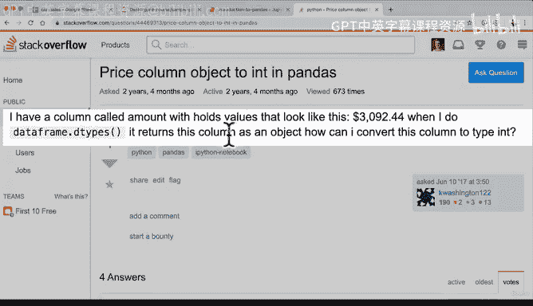
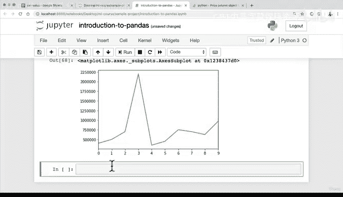

# Bourne《机器学习和数据科学训练营｜Zero to Mastery Data Science and Machine Learning Bootcamp》 - P43：043_06_010 使用Pandas选择和查看数据（第二部分）.zh_en - GPT中英字幕课程资源 - BV1yhrvBVEv2

Alright， we're making some real progress here。 There's almost an infiniteent ways that you can view and select data with Pada's data frame。

 We're only really scratching the surface here。 But once you learn these foundation steps。

 you can really combine them in kind of any different way you can imagine and really transform and view your data in a different lie。

 So let's keep going。😊，We're still viewing and selecting data at the moment。

 So the next 1 I want to show you is PD cross tab。 And this is a great way to compare two columns。

 If you want to see them like a little innovative innovative， Is that the right word。

 I'm not sure doesn't really matter， but you'll see a little comparative way。

 maybe that's a bit better word。😊，So cross tab is basically going to say， hey。

 pandas grab the make column， let's refresh our memory of what our data frame looks like。

 We have make， which is car makess， doors， which is here。😊。

So this is going to cross over the make column with the door column。🤢。

And so cross tab is equal panndas dot cross tab and you pass it one column and then another column。

So we got here， these are doors， the amount of doors，3，4 and 5。 So we've got 3，4，5。

 and these are the different makess here。 We got four different makess， Toyota， Honda。

 BMW and Nissan。Beautiful and so what this is doing is it's kind of aggregating these two columns together。

 so let's explore this BMW there's one car with five doors， Honda there's。Three cars like four doors。

 Toyota is the only car brand that has three doors，'m not quite sure what that car would look like。

 but who knows this is a kind of data you'll come across。Okay。

 now cross tabab is great for comparing two columns。

 but what if you wanted to compare more columns in the context of another。

 this is where a group buy comes in。 So let's put a little comment here group by。

So we're going to go car sales， I was going to say PD。

 I'm used to saying PD group by and we want the make column。Dot main。Now。

 what do you think before we even run this code now I'm going against my only rule here ofve always run the code first。

What do you think this will do if we looked at this， So we've got car sales。

 which is our data frame that's up here。We've got this little function here called group by。

 we know it's a function because it's followed by brackets and then within the group by we've got the mate column。

 we've got mean。How to think about it？ItDoesn't matter you should write the code out first and press shift and enter and see what happens。

So what this is going to do is it's going to group the data frame on the make column similar to what our cross tab did。

 but this time we have more columns here， so it's given us the mean values of the odometer of all the different types of makes as well as the doors。

 so BMW the mean odometer rating is 11179 and the mean amount of doors is 5 and that makes sense because there's only one BMW car。

But again， this group by， you could group by almost any column you can imagine and then call some operation on it as you go and you can imagine。

If you had more columns here and you wanted to combine them in some way and view them。

 you can use this group by function to make sure you only group it by a certain type。

 maybe you want only white toyos。 maybe that's a little exercise。

 See how you could group it by only looking at sore two white toyos Yeah。

 two white toyotas and then seeing what happens from there but。Ihi just want to show you group by。

 It's kind of like cross tab， but for focusing on more than one column at a time。So what's next？

All right。 Well maybe， but we have a look at some visualizations。 Yeah， that's a great idea。

 So we go car sales， odometera。😊，Let's see if we can do a little plot here。🤢。

I'm going to call dot plot。 What do you think this will do run that。Beautiful。

We get a plot of the different odoino value。 So this is what the beautiful thing about pandas is how beautiful and how quickly you can get an analysis going and you might look at a table like this。

😊，And not really be sure what's going on especially have lots of rows。

 but getting a visualization out is a great way to quickly understand what's happening and we'll have a section coming up on how to make these visualizations a bit more interactive and a bit more prettier with labels and different information here。

😊，But。What you might find is that if this plot doesn't show up。

 you might need to run these two lines of code。 And this is map plot Lib。In line。

Because you see here this is generated， this plot is actually remember how we created our environment and installed a whole bunch of tools for us。

 Connda did that for us When we created our environment。

 installed mapplot Lib because some of the functionality like the plot function in pandas depends on mappllib。

So behind the scenes， Conrs actually set this up for us and when we imported pandas right up the top here。

 we won't go right back up the top because that'll take a little while， but when we typed in。

 importm pandas as PD，It might have done some work behind the scenes for us to organize this plot。

 but if it hasn't， you can type in these two lines of code importport mappllibb。 pi plot。

As P L T and this one here， this percentage sign at the front is a little magic function。

 Jupyter notebookbooks have different magic functions， which do a specific kind of thing。

 All this is saying is plot our map plot lid plots inside the notebook so we can see them。😊。

So if your plots don't show up， make sure you've run these two lines of code。

So you can type them and put them at the top of your notebook potentially if your plots aren't showing up。

So next thing we want to see is another kind of plot， which is called a histogram。

 Now histogram is a great way to see the distribution。

 distributionion is a fancy word for spread of data。 So imagine this。

 most of our odometer readings are between， let's say this is 20000 up to 100000 So the reason you can see this kind of curve shape here is because this is where the average about odometer readings fall into。

 and that these two values out here might be considered outliers because they're not within this big clump of values。

 So that's an easy way to run a histogram on your numerical columns。😊。

Let's have a look at the price column。 We want to see what different prices of cars we have。Dot plot。

hu。Now， why is that？ What do you think that came up， Do you remember no numeric dated a plot。

 Why is that。Let's have a look at the data type。🤢，Price dot D type We did dot D types at the start in one of the videos。

 dot D type is just on a single column。So D type O for object。😡，So it's nonnumeric。

 so our error is nonnumeric datad a plot。😊，What can we do here？

 Now we could plot around for a bit and try to get this to work。

 But let's have a look at how we might research a problem like this， but we might type in。

How to convert a panda's column。Price to integer。Price column object to int in pandas。 Now。

 this is a step you might take if you run into some kind of error。

 we could always play around with this price column to try to fix it。 But I want to emphasize what。

 what an actual workflow might look like when you're looking up something。

So we've Googled how to convert a panda's column price to integer because that's what we want to do。

You might click on this， stack Overflow。Of a column called amount withholds values that look like this。

 Now， what you want to do is when you get to somewhere like stack Oflow。

You want to see if this description of this question matches our problem。

 so they have a column called amount which holds values that look like this that's similar to us。

 but ours called price。When I do data frame do D types， it returns this column as an object。

So does ours。 How do I convert this to type in？ Yes， that's what we want to do。

 Let's have a look at some of these answers。Okay， this is using red X。

What you'll do with these answers is kind of look through them and see which one stands out to you the most This green tick means that the question asker。

Has marked this as the right answer to help them solve their problem。But sometimes， as's other ones。

Like maybe this one here， I want to use one without rex because Rex kind of confuses me。

So this has also got five up boatats。 One of them is mine previously in doing research for this video here。

 So what you might do。Is copy this。so this， you can see they've started off with a mount。

 which is like our price column， and it's come out like this， which is what we want to do。

 We want to convert our price column。 Let's have a look， car sales。

We to convert our price columns to something like what our odometer column looks like。

We've copied this piece of code from Sta overflow。 We're going to type it in here。

 but we're going to use it as reference， right， because we want to get practice writing our own code。

So we're going to compare it to what ours is。Let's zoom out one little bit so we can see two cells at once。

 Excelt。 So this is saying data frame with a column amount equals， data frame， amount， dot string。

 dot replace。Some interesting combination of code there。With nothing as type int。 Now。

 that's a fair bidard in one go。But let's try replace the parts that we do know to our own。

 So data frame， our data frame is actually called car sales。 we're going to type in car sales。

Our amount column is actually called price。 so we'll type in price。

And we're going to reassign it to car sales。APrice is what this is saying is， hey。

 grab the price column and set it equal to this another car sales's do price column， but。

Let's put some adjustments。 So this means access the string and replace Now。

 this little funky combination of。Slashes， dull signs。Coma and dots。Is saying。Hey。

 find these symbols within the price column and replace it。After the comma。

 replace it with nothing and then change the type with as type to integer。

So let's go through that one more time， Carle's price column。

 we want to readjust it to equaling the carale's price column so keep the values the same。

 but access the string and replace the dollarine commas and dots。

 so do sign commas and dots with nothing so this is an empty string and then change it from a string so dot as type integer。

Now that was a mouthful。But remember， if and down， run the code， shift and enter。 Now。

 let's see what our Tsars data frame looks like。 Beai。 We've changed the price column。

To look more like the odometer column what's happened here， The price column has included this sense。

Hm。😊，So maybe that's an exercise of how to fix that to not include the sense。

 because we only want it in thousands， and this has increased it。 So now the Nisan。

 the white Nisan is now $970000。 But let's see if we can plot it now， price。Do't plot。Beautiful。

 so the plot is incorrect because the numbers are just way too high， but at least we can plot it now。

 So the next thing wed look at in terms of manipulating data is looking at this line of code and going。

 how can we readjust that。 So maybe that's a little exercise you could try。

 Try to readjust this line of code to not include those last two zeros on the end。

Now we've seen a few different ways of viewing and selecting data some of the major ones with pandas。

 we'll now look at a few more ways that we can manipulate data。So take a little break if you need。

 go back over the code we've gone through and I'll see you in the next video。😊。

