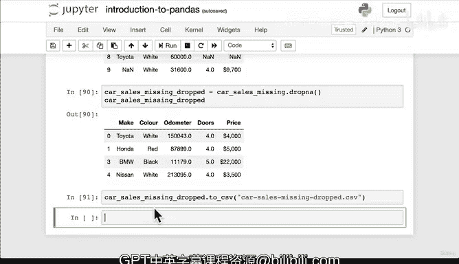

# Bourne《机器学习和数据科学训练营｜Zero to Mastery Data Science and Machine Learning Bootcamp》 - P44：044_06_011 数据操作.zh_en - GPT中英字幕课程资源 - BV1yhrvBVEv2

By now， you're probably thinking， my goodness。There is so much to remember。 And I'm not going to lie。

 I felt the same way when I first started。 I went through some information on pandas and realized holy goodness。

 There is， all I didn't actually say goodness I said a different word there。

 You could probably imagine what word。And I said there's so much here。

 how am I going to remember all these functions off my heart。 And the point here is to remember。

You don't necessarily need to know all of this off by heart。

 The only reason I can kind of do this on the fly is because I've had a little bit of practice。

 Don't forget to always try the code yourself。 You can look it up， find things like this。

 This is part of the the research， part of being a data scientist。

 Part of being a machine learning engineer is learning how to ask different questions。

 Think about how can I do this with the data and then try to find out。 With that being said。

 let's have a look in this next little section here and how to manipulate data with pandas。

 So I'll put another little heading like we've been doing。Or maybe manipulating data。

 that sounds a bit better escape and Ill press M for markdown because we're staying communicative。

Excellent。Now again， the beautiful thing about pandas is that if you can think of it。

 you can probably do it。😊，So the first thing we'll see is manipulating data is some string methods。

 So Python has a bunch of different string methods like lower。

What do you think this will do if we go car sales， make dot string dot lower？Let's see。 Shi in enter。

It's lowered the string， because。Its data type is an object according to pandas。

 but it's actually also a Python string。 So anything that you can do on strings in Python。

 you can do on string columns in pandas。 There's a bunch of different functions there。

 but we'll just remember that you can access the string value of a column by doing dot string。

 We did that above。In the price column， we convert it from a string to an integer。Now。

 if we have a look at our car sales's data frame again。What there。We。

 didn't we just lower this string。But， it didn't actually save。

Now here's an important concept to remember， it's that。

Pandas requires if you want to change a column， it requires reassigning that column。

 So that means we want to set car saless make， equals car saless make。I wanna do。Dot string。

 dot lower。There we go。Car saless make， yep， dotdge string， dot lower。

Now what this will do is it will reassign the car sales's mate column to be a lowered stream。

 so let's have a look。There we go。😔，The string has been lowered。

 so now all the levers in here are lowercase。You'll probably come across this a fair few times when you're working on different data frames。

 is this this concept of reassignment， what some functions have。

Is that to save you from having to go this column equals this column again。

 some sort of function is some functions have a parameter called in place。

 We'll have a look at that in place parameter along with some missing data。 Well you might be saying。

 hey， our car sales data frame doesn't have any missing data。

But in practice in the real world and when you get real data sets。

 I've made this one up right so I've typed in this into here。

Real data sets often contain missing data， so they often look like this。

Because you might have someone tracking some records ideally， they'd look like this。

 all the data there。But in reality， when you get a new data set。

 sometimes it's got a few holes in it， right， Someone hasn't tracked everything correctly。

 and that's that's just life。 You don't always get perfection。So， we're going。

Do you remember how to import CSV file I've already exported this one。 So we' go P D dot read CSv。

We're going to do tab， auto complete car sales missing data dot CSsv。

 What this is going to do is save the car sales missing CS SV。And import it as a pandas data frame。

 So all it's going to do is bring this into being a data frame。Shift an intel。

Now this is how pandas describes missing data N AN for Nan， that's basically just saying， hey。

 I've got no value here， not a number or something like that。

 actually not entirely sure what Nan stands for， but all I know is that it just means there's no value here。

Alright， so what if you wanted to fill these missing values with something。 So say， for example。

 we wanted to fill the odometer。 So we're accessing that。 There's a function called fill N A。

 which is fill these N A N values。 and you can pass fill N A some kind of value。

And it will fill these values。 So maybe we want to fill up the odometer column with the mean of the rest of their odometerters。

 which， in reality isn't a very good practice， but just for demonstration's sake， maybe let's。

 let's do that。 Don't mean。So what this is saying。Oh， no。

 we want missing because this is our missing。Missing。Missing， there we go。

What this is saying is grab the car sales missing odometer column this one and fill N A。

 fill the missing values with the car sales missing odometer columns mean value。

 So the values that do actually exist there。We're going to get the main， and fill it。

Let's quickly see what that is， car sales。Not missing。去懂门啦。Dot mean。So if we do this correctly。

 should fill them up with this value， let's go there。Beautiful， now we've got。

All those missing values。 So the third one down is now filled with the car sales's missing odometer mean value。

 We've got a few reoccurrences there of all the missing ones。

 So now if we have a look at the data frame。And this is the practice you'll be going through right。

 you'll be making manipulations here， and then you'll be consistently viewing the data frames he might do head。

 but because it's only small， we'll look at the whole thing。😊，What's happened here？

 There's still N A N。This is a problem， right， this is。What I was mentioning before。

 that in place value that we can use。 So let's see it in action。 So we could。Do a reassignment。

By going。Car sales。Missing。Oh don miilla。Equals that。

And then reassigning the values to being something like that。

 But what we'll do we'll look at the in place parameter so you can see what I mean。

 so we'll get rid of that。We're going to copy this line of code so we don't have to retype it out。

 but remember， you should always practice retyping code so you get used to it。Now， this Fiiny。

As a parameter and lots of pandas functions have this in place equals。It's false by default。

 but we want true。Actually。This is a good time to look at the documentation。So。

So we didn't know this filllon A function。What would you do to figure that out。

 So maybe we go to Google and we go。Ps how to fill missing data in a column。

Working with missing data。Yes， this is a panda's documentation。

Get very familiar with looking at these when you first start looking at this documentation can be a bit overwhelming because there's a lot going on remember this documentation is for every single thing that pandas can do so going through it can take a while。

😊，But if we look in here， maybe want to search for fill。Fill， fill missing values。 There we go。

 fill N A。 Now， often it comes with， let me zoom in for you。

 a little hyperlink to the exact function。 fill N A can fill in N A values with non N A data in a couple of ways。

 Excelt， then give some examples here。We're going to click on the fill& A function and see what happens。

 So we've got data frame dot fill& A， which is what we've got so far。Data frame。

 odometera because we only want the odometer column dot fill in A。 yep， tick for that。

Value equals none。 So by default， the value equals none。

 but it can take a few different values in our case。Our value is the mean of the odometer column。

 We'll come back。 We can see this little in place parameter。It's got a few others。

 but we're not going to cover them for now。So in place， bull by default， false， if true。

 fill in place。 Note， this will modify any other views on this object。

 E G and no copy slice for a column in a data frame。So if we set in place to true。

 it means fill in place。 Let's have a look。 In place equals true。Before we do。

 we'll take one last look at what our data frame looks like。Still missing values。

 So let's see what happens Fi N A in place equals Str。Now， let's have another look。They missing。

There we go。 So we've filled the values without reassigning。 So without typing car sales missing。

 odomar。Oh don么啊。Equals that。So that's just a thing to remember， you can always do it this way。

 remember how I said Padas has multiple different ways of doing the same thing。

One way to reassign values is to reassign them by putting the exact value on a replace at the start or by setting the in place parameter of a function to true So that'll really depend on how your workflow goes personally I'm not a fan of the in place I like just leaving it by default and then reassigning the value at the start。

Let's have a look at one more thing before probably we'll take a little break。😊。

Ass these lectures getting a bit long。It's if we wanted to remove these missing values。 So say。

 for example， we're happy with filling the odometer column。

 but every other row that has missing values， we just want to ignore them because missing values aren't going to help us with our data analysis In truth。

 they might， but we want to just see how we would get rid of them。 car sales missing。

 Now there's a function here called drop and a。😊，Now we might just see what happens if we just run that。

Drop in a beautiful。 Now， if we type in here， car saless missing。What does our data frame look like？

It hasn't happened again。Remember we've just covered this。

 what do you think we can do to fix this up？So we might do car sales。Drop in a in place， equals true。

Ohll hit， shift enter。And we'll have a look at our data frame。Carsils missing。Beautiful。Now。

 what do you think the value is in maybe not putting in place， As Sch Now。

 our car sales missing data frame is always going to return。

Those rows with missing those are going to be dropped。 What if we wanted to re accesss them。

 We'd have to re import。The CSV。 So maybe we do that equals P D dot Re CSV car sales missing。

So we'll reset our data frame。We'll have a look at it。 This one's going to have missing values。

So maybe we create a new data frame， car sales missing， dropped。Eagles。

Car sales missing dot drop in a in place， es true。So what this will do is it returns a copy。

Of our car sales's missing data frame， but with dropped values。嗯。Oh， I set in place， equals true。

We have to re rerun this s。 That's okay。 So sometimes you make mistakes here。

 we're gonna go drop in a。There we go。 Carsle's missing dropped beautiful。

 So it's going to be the same data frame， but dropped the missing values。 Then what we might do is。

Car sales missing dropped。 Sa this to 2 C SV as。Car sales missing， dropped。Dot csv。That way。

We can if we did want to access the rows with missing values。

 we can from our car sales missing data frame， this one here。

Or if we wanted to manipulate our data frame with missing values dropped。

 we can from this data frame。So that's the important distinction there between using in place or not using in place。

Alright， we've covered enough on manipulating data in this lesson for the time being。

 so take a little break， revise over the few functions that we've gone through。

 have a trial out with in place versus not in place， and I'll see you in the next video。

