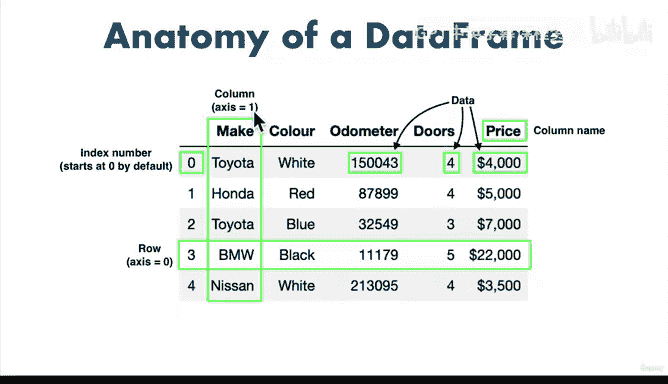

# Bourne《机器学习和数据科学训练营｜Zero to Mastery Data Science and Machine Learning Bootcamp》 - P45：045_06_012 数据操作2.zh_en - GPT中英字幕课程资源 - BV1yhrvBVEv2

Welcome back In the last lecture， we looked at a few different ways to manipulate data。

 especially missing data。 we looked at in place， so if you want to perform an operation on pandas data frames in place。

 you can set the in place parameter to true or you can reassign it by using。

We don't have a reinslement example。Or you can reassignment by sending it to equaling something。

Now we've had enough of working with missing data How would we create data from existing data Well Padas has a few different ways that you can create data such as building a new column。

 Let's have a look a couple of different ways。 Let's start with a series so maybe we'll comment this first We'll go column from series。

😊，Then we'll create a series called seats column equals P D series。

 Maybe inside that series will put a few。Numbers are5， because a few of our cars have five seats。

 or actually， all of our cars have five seats， but we're not going to fill it out。

 So we got car sales， seats and other way to make a new column。 we'll put a comment here。New column。

Called seats。 Remember， our car sales data frame is the one we are working with above。

So we can view it here。So car sales， new column。Now it's very similar to how you would select a column to create a new column。

 remember we're going to run the code first before we discuss it。

 so we're going to set it equal to the seats column， which is that series we've just created。

And now we want to view our car sales data frame。Excellent， so we see what this has done。

We've got the exact same columns as before。 but this time。

 we've in now got seats on the right hand side。 So that's created a column on the very right。

 When you create a new column in pandas by default。

 it appears on the very right hand side of your data frame。But we've got some missing values here。

 Okay， that's because our series was only 5 by 5。 So it was length 5 with the value 5。

 I'm getting confused with all these fives here。So this is just to say this Toyoto white car。

$400000 because we haven't fixed up that price column and it has five seats。

 But how would we fill this N A N， Maybe we can use car sales with the seats column We saw this before in the previous video。

 fill N A。And， we want。five。There we go。 we want in place。 Yeah。

 so we don't have to in place equals true。Shift， and then we have a look at car sales。Oh， mistake。

There we go， all of our cars have five seats， beautiful。😡，We kind of already knew that already。 Well。

 maybe some didn't have five seats。Now， there's another way to create a column， and that's from。

A python list， which is similar to a series， a column from list。M type in Pythonly。

So you want maybe fuel economy。 That's something else you you'd want to consider when you buy a car these days。

 youd want to make sure that you're getting the best value or the best bang for your buck。

 Did I spell economy， right， No， mix them up。There we go。We want maybe 7。5 litreers per100 kilometre。

 some 9。2。5。09。6， we're just making these numbers up here。There we go。

 It's about five long as well and we want car sales， what shall we call this column？Fuel per00 k M。

 That's nice and easy to remember Es。 We're going to set it to being equal to our fuel economy list。

Economy， and then we're going to have a look at it here。V you error。What do we get wrong。

 lengthngth of values does not match length of index。So that's an interesting error。

 So maybe we need more values in here。 Let's keep filling it up。8。73。0。

 This is a really fuel efficient car。 See what happens。 Still not the same。 What do we need，0，1，2，3。

4，5，678。M more should do 4。5。There we go。So if you want to create it from a list。

 did that on purpose， wink wink。It has to be the same length as your existing data frame。

 whereas a series can be。Different kind of length to what your data frame already is。 So we needed。

9 or 10 values in here， because it starts from 0， because our original car sales data frame was of length 10。

Al right， let's have another look at it way。 What if we wanted to create a column from another column。

 So as if we wanted to figure out how much this car has fuel it's used in its lifetime。

 So if this is per 100 kilometres。It's done 150000 kilometers， maybe。

If we divided the odometer column by 10 and times to buy this column。

 we could work out how many litreers of fuel this courage is used in its whole entire life。

Let's try that out。So if we go car sales dot， what's a good name， total， fuel used。Beautiful eles。

 car sales。 We want the odometer column。Car sales o domota， maybe we press T。 there we go。

 Tab order complete。 Now we want to divide this by 100 because this is fuel per 100 kilometersmet。

And so we could times that by car saless。We want fuel per tab。Per tab。 No。

 I press tab to get fuel per00 kilometre。Now what do you think this will do？

This is going to create a new column because this string doesn't exist in our data frame。

 and it's going to take the odometermeter column， another beautiful thing about panda's numeric columns is that you can perform operations directly on them。

And then it's going to divide the odometer column by 100 and times it by。

The fuel per 100 kilometer column。 Let's see what happens。We want to view our data frame。Beautiful。

 so this is going to be total fuel used in litres， or maybe we could have named that better。

If we create this new column by typing in leaders。E。It's going to create another column。

Total fuel used L。H that's all right。We don't mind that for now。So 11，253 liters。

If you did that in one go， that'll be quite expensive depending on the price of fuel where you live。

All right。 now is one more easier way to create a column we can do it from。Create a column。

From a single value。Let's do that。 Car sales。 Maybe we want a simple one number of wheels， es 4。

Because if your car didn't have four wheels you probably wouldn't be able to drive Now you can start to see how our data frame can evolve over time。

 right， we've manipulated a few things。 maybe some of these columns aren't very useful in the long run。

 but it's just an example of how you can quickly use pandas to change up your data frame。

 We've adjusted the price column we've lowered the make column we've added a bunch of our own columns It a step you'll take in a data science or machine learning project right。

Maybe we'll add one more column。We want to know if our cars pass the road safety。

And by defaulted equals true， this is just to give another example of different types of columns。

 So D types。So， yeah， there we go。We've got。A bull column on the end now。So bull， true or false。

 we've got a few ints， we've got a few floats， we've got some object columns。 we've got true。

 So this is how versatile pandas is right。 You can use many different data types with it。AndNow。

 what if we wanted to remove one of our columns。 It's like this one because it's got the L at the top。

 and that's less confusing than this。 We don't know what measurement that's in。

 You can use the function drop。 So we're going go drop。For drop column。So we'll go total if fuel use。

 That's our column name。 Now we need to give it drop requires the parameter access。

 So access equals one。 if you remember the anatomy of our data frame， let's see if we have it here。

 that's because columns are on access equals one。

Remember how I said some functions require access， it took me a while to remember this。

But that's all you have to remember is if you're talking about a column。

 you're talking about access one。So let's do that。Drop beautiful car sales。It's still got that。

 we keep forgetting。 I'm going to reemphase this point。

We need to either reassign or use the in place method。

 so we're reassigning our caras data frame here。Drop。Car sales， now we've dropped it。 Beaful。

 look at that data frame。 That's amazing。 All right。

 so we've seen how to create a few different columns here。

 We've seen how to drop a column if we don't want it。

 There's a few more things we want to do for manipulating our data frames。

 but before this lecture gets too long again。 go back。

 I want you to if you're gonna to take a little break， take a little break。

 but otherwise before the next lecture， try creating a column of your own。

 something can be as simple as you like， but just practice typing out some code like this。

 Maybe you do a little operation can be as fancy or as unfancy as you like。

 but just practice making a new column of your own。 and I'll see you back in the next video。😊。

